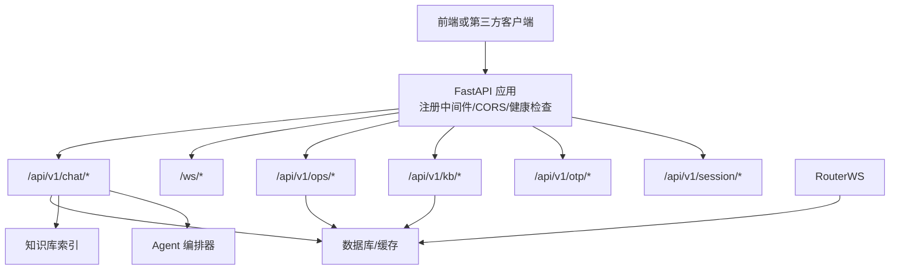
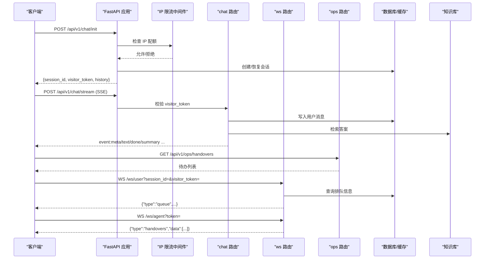
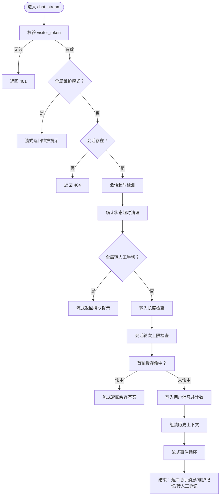
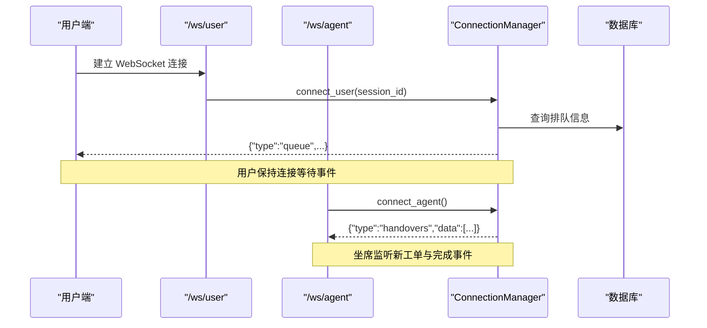
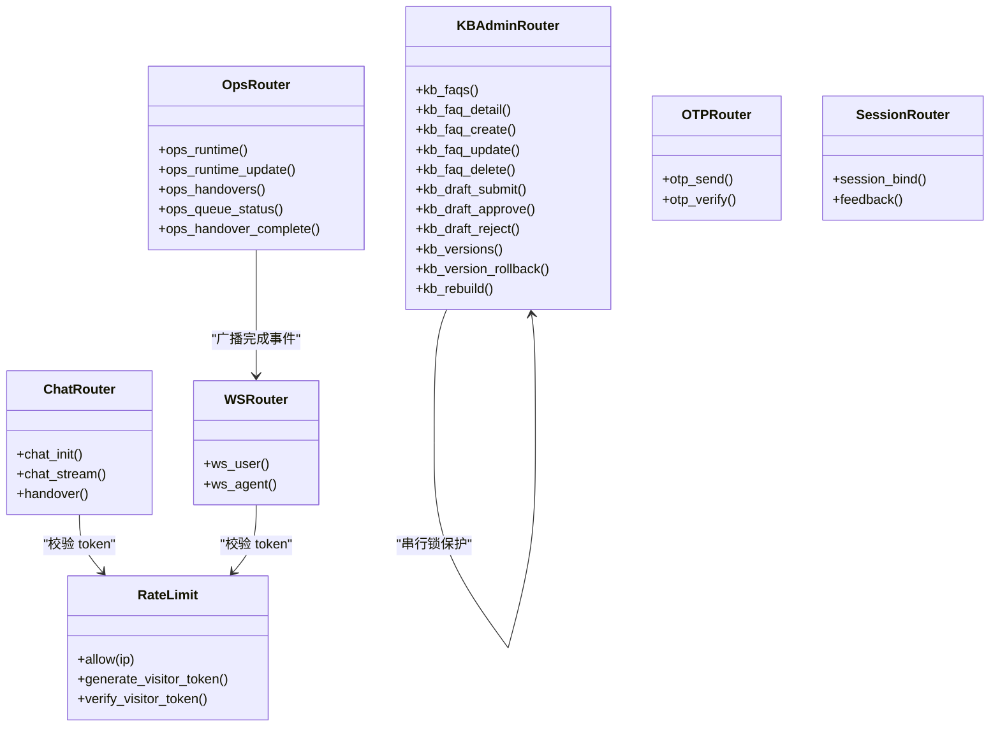

# API 接口文档

<cite>
**本文引用的文件**   
- [backend/app/main.py](file://backend/app/main.py)
- [backend/app/routers/chat.py](file://backend/app/routers/chat.py)
- [backend/app/routers/ws.py](file://backend/app/routers/ws.py)
- [backend/app/routers/kb_admin.py](file://backend/app/routers/kb_admin.py)
- [backend/app/routers/ops.py](file://backend/app/routers/ops.py)
- [backend/app/routers/otp.py](file://backend/app/routers/otp.py)
- [backend/app/routers/session.py](file://backend/app/routers/session.py)
- [backend/app/storage/rate_limit.py](file://backend/app/storage/rate_limit.py)
- [backend/app/models/schemas.py](file://backend/app/models/schemas.py)
- [frontend/src/api.ts](file://frontend/src/api.ts)
- [frontend/src/sse-client.ts](file://frontend/src/sse-client.ts)
- [backend/tests/test_api.py](file://backend/tests/test_api.py)
</cite>

## 目录
1. [简介](#简介)
2. [项目结构](#项目结构)
3. [核心组件](#核心组件)
4. [架构总览](#架构总览)
5. [详细接口参考](#详细接口参考)
6. [认证与授权](#认证与授权)
7. [限流与安全策略](#限流与安全策略)
8. [错误码与异常处理](#错误码与异常处理)
9. [依赖关系分析](#依赖关系分析)
10. [性能特征与优化建议](#性能特征与优化建议)
11. [客户端集成指南](#客户端集成指南)
12. [版本管理与迁移指南](#版本管理与迁移指南)
13. [故障排查](#故障排查)
14. [结论](#结论)

## 简介
本仓库提供一套基于 FastAPI 的客服 Agent 后端服务，以及配套的前端 SDK。对外暴露 RESTful API 与 WebSocket 实时通道，支持：
- 会话初始化、访客令牌签发与校验
- 流式对话（SSE）
- 转人工排队与坐席广播
- 知识库后台 CRUD、草稿审批流、版本回滚与热更新
- 运营统计、Bad Case 管理、CSAT 满意度收集
- OTP 验证码流程（演示模式）

所有请求/响应数据结构以 Pydantic 模型为唯一契约来源，前端 TypeScript 类型与之对齐。

**章节来源**
- [backend/app/main.py:1-63](file://backend/app/main.py#L1-L63)
- [backend/app/models/schemas.py:1-138](file://backend/app/models/schemas.py#L1-L138)

## 项目结构
后端采用按功能域组织路由的方式：
- `routers/chat.py`：对话与转人工
- `routers/ws.py`：WebSocket 用户端/坐席端
- `routers/kb_admin.py`：知识库后台
- `routers/ops.py`：运营与运行控制
- `routers/otp.py`：OTP 验证码
- `routers/session.py`：会话绑定与反馈埋点
- `storage/rate_limit.py`：IP 限流与 Visitor Token
- `models/schemas.py`：前后端数据契约

**图表来源**
- [backend/app/main.py:1-63](file://backend/app/main.py#L1-L63)
- [backend/app/routers/chat.py:1-327](file://backend/app/routers/chat.py#L1-L327)
- [backend/app/routers/ws.py:1-149](file://backend/app/routers/ws.py#L1-L149)
- [backend/app/routers/kb_admin.py:1-299](file://backend/app/routers/kb_admin.py#L1-L299)
- [backend/app/routers/ops.py:1-163](file://backend/app/routers/ops.py#L1-L163)
- [backend/app/routers/otp.py:1-83](file://backend/app/routers/otp.py#L1-L83)
- [backend/app/routers/session.py:1-35](file://backend/app/routers/session.py#L1-L35)

**章节来源**
- [backend/app/main.py:1-63](file://backend/app/main.py#L1-L63)

## 核心组件
- 应用入口与全局中间件：CORS、IP 限流、健康检查、路由注册。
- 对话路由：会话初始化、SSE 流式回答、手动转人工。
- WebSocket 管理器：用户端/坐席端连接管理、事件推送与广播。
- 知识库后台：FAQ CRUD、草稿审批、版本回滚、热更新。
- 运营模块：运行控制、Bad Case、CSAT、队列状态、Copilot。
- OTP 模块：验证码下发与校验。
- 会话模块：匿名会话绑定用户、点赞/点踩埋点。
- 安全模块：IP 令牌桶限流、Visitor Token 签名验证。

**章节来源**
- [backend/app/main.py:1-63](file://backend/app/main.py#L1-L63)
- [backend/app/routers/chat.py:1-327](file://backend/app/routers/chat.py#L1-L327)
- [backend/app/routers/ws.py:1-149](file://backend/app/routers/ws.py#L1-L149)
- [backend/app/routers/kb_admin.py:1-299](file://backend/app/routers/kb_admin.py#L1-L299)
- [backend/app/routers/ops.py:1-163](file://backend/app/routers/ops.py#L1-L163)
- [backend/app/routers/otp.py:1-83](file://backend/app/routers/otp.py#L1-L83)
- [backend/app/routers/session.py:1-35](file://backend/app/routers/session.py#L1-L35)
- [backend/app/storage/rate_limit.py:1-74](file://backend/app/storage/rate_limit.py#L1-L74)

## 架构总览
整体交互路径如下：
- 客户端发起 `/api/v1/chat/init` 获取 `session_id` 与 `visitor_token`。
- 使用 SSE 调用 `/api/v1/chat/stream` 发送消息并接收流式事件。
- 需要转人工时，走自动判定或 `/api/v1/handover` 主动登记；用户通过 `/ws/user` 订阅排队进度，坐席通过 `/ws/agent` 接收待办广播。
- 运营侧通过 `/api/v1/ops/*` 查看状态、标记完成、调整运行模式。
- 知识库后台通过 `/api/v1/kb/*` 进行草稿与版本管理。
- 安全层对所有 `/api/` 路径做 IP 限流，敏感接口要求 Visitor Token 校验。

**图表来源**
- [backend/app/main.py:1-63](file://backend/app/main.py#L1-L63)
- [backend/app/routers/chat.py:1-327](file://backend/app/routers/chat.py#L1-L327)
- [backend/app/routers/ws.py:1-149](file://backend/app/routers/ws.py#L1-L149)
- [backend/app/routers/ops.py:1-163](file://backend/app/routers/ops.py#L1-L163)

## 详细接口参考

### 通用说明
- 所有业务 API 位于 `/api/v1/*`。
- 所有请求默认返回 JSON；SSE 接口返回 `text/event-stream`。
- 全局中间件对 `/api/` 前缀路径执行 IP 限流，超限返回 429。
- 部分接口要求携带 `visitor_token` 并校验其有效性。

#### 公共参数
| 参数 | 位置 | 类型 | 是否必填 | 说明 |
| --- | --- | --- | --- | --- |
| `session_id` | 多数请求体/查询 | 字符串 | 视接口而定 | 会话标识 |
| `visitor_token` | 请求体/查询 | 字符串 | 视接口而定 | 动态签名令牌 |
| `status` | 查询 | 字符串 | 可选 | 过滤操作结果状态 |
| `limit` | 查询 | 整数 | 可选 | 限制返回数量 |

---

### 会话与反馈

#### 会话初始化
- **方法**：POST
- **URL**：`/api/v1/chat/init`
- **请求体**：
  - `session_id`：可选，已有会话 ID
  - `user_id`：可选，已登录用户 ID
- **响应体**：
  - `session_id`：会话 ID
  - `visitor_token`：动态令牌
  - `expires_in`：过期秒数
  - `brand_name`：品牌名
  - `quick_chips`：快捷问题
  - `history`：历史消息
  - `status`：会话状态
  - `gray`：灰度标记
- **成功状态码**：200
- **异常状态码**：无额外定义

**章节来源**
- [backend/app/routers/chat.py:1-200](file://backend/app/routers/chat.py#L1-L200)
- [backend/app/models/schemas.py:1-138](file://backend/app/models/schemas.py#L1-L138)

#### 会话绑定
- **方法**：POST
- **URL**：`/api/v1/session/bind`
- **请求体**：
  - `anonymous_session_id`：匿名会话 ID
  - `user_id`：用户 ID
- **响应体**：
  - `ok`：布尔
  - `session_id`：会话 ID
  - `user_id`：用户 ID
- **成功状态码**：200
- **异常状态码**：无额外定义

**章节来源**
- [backend/app/routers/session.py:1-35](file://backend/app/routers/session.py#L1-L35)
- [backend/app/models/schemas.py:1-138](file://backend/app/models/schemas.py#L1-L138)

#### 点赞/点踩埋点
- **方法**：POST
- **URL**：`/api/v1/feedback`
- **请求体**：
  - `session_id`：会话 ID
  - `message_id`：可选，消息 ID
  - `value`：`up` 或 `down`
  - `query`：可选，用户问题
  - `context`：可选，上下文
  - `answer`：可选，助手回答
- **响应体**：
  - `ok`：布尔
  - `feedback_id`：可选，埋点记录 ID
- **成功状态码**：200
- **异常状态码**：无额外定义

**章节来源**
- [backend/app/routers/session.py:1-35](file://backend/app/routers/session.py#L1-L35)
- [backend/app/models/schemas.py:1-138](file://backend/app/models/schemas.py#L1-L138)

---

### 流式对话接口（重点）

#### 流式对话
- **方法**：POST
- **URL**：`/api/v1/chat/stream`
- **请求体**：
  - `session_id`：会话 ID
  - `message`：用户输入文本
  - `visitor_token`：访客令牌
- **响应类型**：`text/event-stream`
- **SSE 事件类型与格式**：
  - `meta`：元数据，包含当前状态、是否需要转人工等字段
  - `text`：分片文本内容，用于打字机效果
  - `done`：结束标志，包含 `message_id`、`handover`、`cached` 等
  - `summary`：摘要事件，常用于转人工后的排队提示
- **连接管理**：
  - 服务端在流中设置 `Cache-Control: no-cache` 与 `X-Accel-Buffering: no`
  - 客户端需逐事件解析 `event:` 与 `data:` 行
  - 连接关闭后，服务端会落库助手回复并维护分层记忆
- **防御机制**：
  - Visitor Token 校验失败直接 401
  - 会话不存在返回 404
  - 会话超时自动复位为新会话
  - 确认状态超时取消
  - 输入超长拦截不调 LLM
  - 会话轮次上限熔断
  - 首轮高频缓存命中秒回

**图表来源**
- [backend/app/routers/chat.py:1-327](file://backend/app/routers/chat.py#L1-L327)

**章节来源**
- [backend/app/routers/chat.py:1-327](file://backend/app/routers/chat.py#L1-L327)
- [backend/tests/test_api.py:1-200](file://backend/tests/test_api.py#L1-L200)

#### 手动转人工
- **方法**：POST
- **URL**：`/api/v1/handover`
- **请求体**：
  - `session_id`：会话 ID
  - `visitor_token`：访客令牌
  - `contact`：可选，联系方式
- **响应体**：
  - `ok`：布尔
  - `queue_id`：可选，排队 ID
  - `message`：提示信息
- **成功状态码**：200
- **异常状态码**：
  - 401：Visitor Token 无效
  - 404：会话不存在
  - 503：服务维护

**章节来源**
- [backend/app/routers/chat.py:201-327](file://backend/app/routers/chat.py#L201-L327)
- [backend/app/models/schemas.py:1-138](file://backend/app/models/schemas.py#L1-L138)

---

### WebSocket 实时通信

#### 用户端
- **URL**：`/ws/user?session_id={session_id}&visitor_token={visitor_token}`
- **鉴权**：必须携带有效 `visitor_token`，否则关闭连接（代码 4401）
- **行为**：
  - 建连成功后立即推送一次当前排队状态
  - 服务端主动推送以下事件：
    - `queue`：排队进度对象，含 `queue_id`、`position`、`ahead`、`status`
    - `agent_joined`：人工已接入，含 `queue_id`
  - 客户端仅消费心跳/断开信号，不主动发业务消息

#### 坐席端
- **URL**：`/ws/agent?token={token}`
- **鉴权**：若配置了 `AGENT_WS_TOKEN`，则必须匹配；开发期留空放行
- **行为**：
  - 首帧推送待办快照：`{"type":"handovers","data":[...]}`
  - 服务端主动推送：
    - `handover_new`：新工单，含 `queue_id`
    - `handover_done`：工单完成，含 `queue_id`，同时通知对应用户

**图表来源**
- [backend/app/routers/ws.py:1-149](file://backend/app/routers/ws.py#L1-L149)

**章节来源**
- [backend/app/routers/ws.py:1-149](file://backend/app/routers/ws.py#L1-L149)

---

### 知识库后台（FAQ 管理）

#### FAQ 列表
- **方法**：GET
- **URL**：`/api/v1/kb/faqs`
- **查询参数**：
  - `category`：可选，分类过滤
  - `q`：可选，关键词搜索
- **响应体**：
  - `total`：总数
  - `categories`：分类统计
  - `faqs`：FAQ 列表，附带最新未生效草稿信息

#### FAQ 详情
- **方法**：GET
- **URL**：`/api/v1/kb/faqs/{faq_id}`
- **响应体**：FAQ 详情对象

#### 新建 FAQ
- **方法**：POST
- **URL**：`/api/v1/kb/faqs`
- **请求体**：
  - `faq`：FAQ 载荷
  - `created_by`：操作人
- **响应体**：
  - `draft_id`：草稿 ID
  - `faq_id`：FAQ ID
  - `status`：草稿状态

#### 编辑 FAQ
- **方法**：PUT
- **URL**：`/api/v1/kb/faqs/{faq_id}`
- **请求体**：
  - `faq`：FAQ 载荷
  - `created_by`：操作人
- **响应体**：
  - `draft_id`：草稿 ID
  - `faq_id`：FAQ ID
  - `status`：草稿状态

#### 删除 FAQ
- **方法**：DELETE
- **URL**：`/api/v1/kb/faqs/{faq_id}`
- **查询参数**：
  - `created_by`：操作人
- **响应体**：
  - `draft_id`：草稿 ID
  - `faq_id`：FAQ ID
  - `status`：草稿状态

#### 草稿列表
- **方法**：GET
- **URL**：`/api/v1/kb/drafts`
- **查询参数**：
  - `status`：可选，过滤草稿状态

#### 草稿详情
- **方法**：GET
- **URL**：`/api/v1/kb/drafts/{draft_id}`
- **响应体**：草稿对象

#### 提交草稿
- **方法**：POST
- **URL**：`/api/v1/kb/drafts/{draft_id}/submit`
- **响应体**：
  - `ok`：布尔
  - `draft_id`：草稿 ID
  - `status`：pending

#### 审批通过
- **方法**：POST
- **URL**：`/api/v1/kb/drafts/{draft_id}/approve`
- **请求体**：
  - `reviewed_by`：审核人
- **响应体**：
  - `ok`：布尔
  - `faq_id`：FAQ ID
  - `action`：动作类型

#### 驳回草稿
- **方法**：POST
- **URL**：`/api/v1/kb/drafts/{draft_id}/reject`
- **请求体**：
  - `reviewed_by`：审核人
  - `reason`：可选，原因
- **响应体**：
  - `ok`：布尔
  - `draft_id`：草稿 ID
  - `status`：rejected
  - `reason`：原因

#### 删除草稿
- **方法**：DELETE
- **URL**：`/api/v1/kb/drafts/{draft_id}`
- **响应体**：
  - `ok`：布尔
  - `draft_id`：草稿 ID

#### 版本历史
- **方法**：GET
- **URL**：`/api/v1/kb/versions`
- **查询参数**：
  - `faq_id`：可选，按 FAQ 过滤
  - `limit`：可选，限制条数
- **响应体**：版本列表

#### 回滚版本
- **方法**：POST
- **URL**：`/api/v1/kb/versions/{version_id}/rollback`
- **请求体**：
  - `created_by`：操作人
- **响应体**：
  - `ok`：布尔
  - `draft_id`：草稿 ID
  - `faq_id`：FAQ ID
  - `action`：动作类型
  - `status`：pending
  - `message`：提示信息

#### 重建知识库
- **方法**：POST
- **URL**：`/api/v1/kb/rebuild`
- **响应体**：
  - `ok`：布尔
  - `faqs`：FAQ 数量
  - `version`：索引版本

**章节来源**
- [backend/app/routers/kb_admin.py:1-299](file://backend/app/routers/kb_admin.py#L1-L299)
- [backend/app/models/schemas.py:1-138](file://backend/app/models/schemas.py#L1-L138)

---

### 运营与运行控制

#### 运行状态
- **方法**：GET
- **URL**：`/api/v1/ops/runtime`
- **响应体**：
  - `mode`：auto/handover/off
  - `gray_percent`：灰度比例
  - `kill_switch`：布尔

#### 更新运行状态
- **方法**：PUT
- **URL**：`/api/v1/ops/runtime`
- **请求体**：
  - `mode`：可选，auto/handover/off
  - `gray_percent`：可选，0-100
- **响应体**：当前运行状态

#### Bad Case 状态更新
- **方法**：POST
- **URL**：`/api/v1/ops/badcases/{feedback_id}/status`
- **请求体**：
  - `status`：open/resolved/ignored
  - `note`：备注
- **响应体**：
  - `ok`：布尔
  - `feedback_id`：反馈 ID
  - `status`：状态
  - `note`：备注

#### CSAT 提交
- **方法**：POST
- **URL**：`/api/v1/csat`
- **请求体**：
  - `session_id`：会话 ID
  - `visitor_token`：可选
  - `rating`：1-5
  - `comment`：可选
- **响应体**：
  - `ok`：布尔
  - `rating`：评分

#### CSAT 统计
- **方法**：GET
- **URL**：`/api/v1/ops/csat`
- **响应体**：总量、平均分、星级分布

#### 运营统计
- **方法**：GET
- **URL**：`/api/v1/ops/stats`
- **响应体**：会话统计、点赞率、CSAT 统计

#### 待办列表
- **方法**：GET
- **URL**：`/api/v1/ops/handovers`
- **查询参数**：
  - `status`：默认 waiting
- **响应体**：待办列表

#### Bad Case 列表
- **方法**：GET
- **URL**：`/api/v1/ops/badcases`
- **查询参数**：
  - `limit`：默认 20
- **响应体**：Bad Case 列表

#### 排队状态
- **方法**：GET
- **URL**：`/api/v1/ops/queue/status`
- **查询参数**：
  - `queue_id`：排队 ID
- **响应体**：排队对象

#### 完成待办
- **方法**：POST
- **URL**：`/api/v1/ops/handovers/{queue_id}/complete`
- **响应体**：
  - `ok`：布尔
  - `queue_id`：排队 ID

#### Copilot 工单卡片
- **方法**：GET
- **URL**：`/api/v1/ops/copilot/{queue_id}`
- **响应体**：
  - `queue_id`：排队 ID
  - `session_id`：会话 ID
  - `copilot`：工单卡片对象

#### Copilot 模板生成
- **方法**：POST
- **URL**：`/api/v1/ops/copilot/templates`
- **查询参数**：
  - `queue_id`：排队 ID
- **响应体**：
  - `queue_id`：排队 ID
  - `templates`：模板数组

#### Copilot 内部查询
- **方法**：POST
- **URL**：`/api/v1/ops/copilot/query`
- **查询参数**：
  - `queue_id`：排队 ID
  - `action`：logistics/order/refund
- **响应体**：查询结果

**章节来源**
- [backend/app/routers/ops.py:1-163](file://backend/app/routers/ops.py#L1-L163)
- [backend/app/models/schemas.py:1-138](file://backend/app/models/schemas.py#L1-L138)

---

### OTP 验证码

#### 发送验证码
- **方法**：POST
- **URL**：`/api/v1/otp/send`
- **请求体**：
  - `session_id`：会话 ID
  - `visitor_token`：访客令牌
  - `phone`：手机号
- **响应体**：
  - `ok`：布尔
  - `sent`：布尔
  - `ttl_minutes`：有效期分钟数
  - `code`：可选，演示模式返回
  - `mock`：可选，是否为演示模式

#### 校验验证码
- **方法**：POST
- **URL**：`/api/v1/otp/verify`
- **请求体**：
  - `session_id`：会话 ID
  - `visitor_token`：访客令牌
  - `phone`：手机号
  - `code`：验证码
- **响应体**：
  - `ok`：布尔
  - `verified`：布尔
  - `ttl_minutes`：有效期分钟数

**章节来源**
- [backend/app/routers/otp.py:1-83](file://backend/app/routers/otp.py#L1-L83)
- [backend/app/models/schemas.py:1-138](file://backend/app/models/schemas.py#L1-L138)

---

### 健康检查
- **方法**：GET
- **URL**：`/health`
- **响应体**：
  - `status`：ok
  - `brand`：品牌名
  - `llm_mode`：real/mock
  - `faqs`：FAQ 数量

**章节来源**
- [backend/app/main.py:1-63](file://backend/app/main.py#L1-L63)

## 认证与授权

### Visitor Token
- 由 `/api/v1/chat/init` 签发，绑定 `session_id` 与过期时间。
- 校验逻辑包括签名验证、会话 ID 匹配、过期时间检查。
- 裸请求不带 Token 会被拒绝。
- 适用接口：
  - `/api/v1/chat/stream`
  - `/api/v1/handover`
  - `/api/v1/otp/send`
  - `/api/v1/otp/verify`
  - `/api/v1/csat`

### WebSocket 鉴权
- 用户端：`/ws/user` 要求 `session_id` 与 `visitor_token`，校验失败关闭连接（4401）。
- 坐席端：`/ws/agent` 要求 `token` 与配置项 `AGENT_WS_TOKEN` 一致；未配置时放行。

**章节来源**
- [backend/app/storage/rate_limit.py:1-74](file://backend/app/storage/rate_limit.py#L1-L74)
- [backend/app/routers/ws.py:1-149](file://backend/app/routers/ws.py#L1-L149)
- [backend/app/routers/chat.py:1-327](file://backend/app/routers/chat.py#L1-L327)
- [backend/app/routers/otp.py:1-83](file://backend/app/routers/otp.py#L1-L83)

## 限流与安全策略

### IP 限流
- 全局中间件对 `/api/` 前缀路径启用令牌桶限流。
- 默认限制：每分钟 10 次/IP。
- 超限返回 429，并包含剩余配额。

### Visitor Token 签名
- 基于 HMAC-SHA256 对负载进行签名。
- 负载包含会话 ID 与过期时间。
- 校验失败返回 401。

### 其他防御
- 会话轮次上限熔断
- 输入超长拦截
- 会话超时复位
- 确认状态超时取消
- 全局维护模式与全局转人工半切

**章节来源**
- [backend/app/main.py:1-63](file://backend/app/main.py#L1-L63)
- [backend/app/storage/rate_limit.py:1-74](file://backend/app/storage/rate_limit.py#L1-L74)
- [backend/app/routers/chat.py:1-327](file://backend/app/routers/chat.py#L1-L327)

## 错误码与异常处理

| 状态码 | 含义 | 常见触发场景 |
| --- | --- | --- |
| 200 | 成功 | 正常业务响应 |
| 400 | 请求参数无效 | 非法状态值、重复操作、参数缺失 |
| 401 | 未授权 | Visitor Token 无效 |
| 404 | 资源不存在 | 会话/FAQ/草稿/版本/排队项不存在 |
| 409 | 冲突 | 重复创建、草稿状态不允许操作 |
| 410 | 资源过期 | OTP 过期 |
| 429 | 请求过于频繁 | IP 限流触发 |
| 503 | 服务不可用 | 维护模式下手动转人工 |

**章节来源**
- [backend/app/routers/chat.py:1-327](file://backend/app/routers/chat.py#L1-L327)
- [backend/app/routers/kb_admin.py:1-299](file://backend/app/routers/kb_admin.py#L1-L299)
- [backend/app/routers/ops.py:1-163](file://backend/app/routers/ops.py#L1-L163)
- [backend/app/routers/otp.py:1-83](file://backend/app/routers/otp.py#L1-L83)
- [backend/app/main.py:1-63](file://backend/app/main.py#L1-L63)

## 依赖关系分析

**图表来源**
- [backend/app/routers/chat.py:1-327](file://backend/app/routers/chat.py#L1-L327)
- [backend/app/routers/ws.py:1-149](file://backend/app/routers/ws.py#L1-L149)
- [backend/app/routers/ops.py:1-163](file://backend/app/routers/ops.py#L1-L163)
- [backend/app/routers/kb_admin.py:1-299](file://backend/app/routers/kb_admin.py#L1-L299)
- [backend/app/routers/otp.py:1-83](file://backend/app/routers/otp.py#L1-L83)
- [backend/app/routers/session.py:1-35](file://backend/app/routers/session.py#L1-L35)
- [backend/app/storage/rate_limit.py:1-74](file://backend/app/storage/rate_limit.py#L1-L74)

**章节来源**
- [backend/app/routers/chat.py:1-327](file://backend/app/routers/chat.py#L1-L327)
- [backend/app/routers/ws.py:1-149](file://backend/app/routers/ws.py#L1-L149)
- [backend/app/routers/ops.py:1-163](file://backend/app/routers/ops.py#L1-L163)
- [backend/app/routers/kb_admin.py:1-299](file://backend/app/routers/kb_admin.py#L1-L299)
- [backend/app/routers/otp.py:1-83](file://backend/app/routers/otp.py#L1-L83)
- [backend/app/routers/session.py:1-35](file://backend/app/routers/session.py#L1-L35)
- [backend/app/storage/rate_limit.py:1-74](file://backend/app/storage/rate_limit.py#L1-L74)

## 性能特征与优化建议
- 首轮高频缓存命中可显著降低 LLM 调用延迟，实现首字 < 500ms 目标。
- 固定回答被切分为小块重放，前端仍可呈现打字机效果。
- 知识库热更新为全量重建，但数据量小时为毫秒级。
- 转人工后异步生成 Copilot 工单卡片，避免阻塞 SSE。
- 建议在生产环境将 IP 限流从内存实现迁移到 Redis，提升水平扩展能力。
- 对长会话建议使用会话超时复位策略，避免无限增长。

[本节为一般性性能讨论，不直接分析具体文件]

## 客户端集成指南

### 使用前端 SDK
- 会话初始化：`chatInit({ session_id?, user_id? })`
- 发送反馈：`sendFeedback({ session_id, message_id?, value, query?, context?, answer? })`
- 会话绑定：`bindSession({ anonymous_session_id, user_id })`
- 手动转人工：`manualHandover({ session_id, visitor_token, contact? })`
- 运营查询：`fetchStats()`、`fetchHandovers(status)`、`fetchBadCases(limit)`
- 完成待办：`completeHandover(queueId)`
- 运行控制：`fetchRuntime()`、`updateRuntime(patch)`
- Bad Case 状态：`setBadCaseStatus(feedbackId, status, note)`
- CSAT：`submitCsat({ session_id, visitor_token, rating, comment? })`
- OTP：`sendOtp({ session_id, visitor_token, phone })`、`verifyOtp({ session_id, visitor_token, phone, code })`
- Copilot：`fetchCopilot(queueId)`、`generateTemplates(queueId)`、`copilotQuery(queueId, action)`
- 知识库后台：`fetchFAQs(category?, q?)`、`fetchFAQ(faqId)`、`createFAQ(faq, createdBy)`、`updateFAQ(faqId, faq, createdBy)`、`deleteFAQ(faqId, createdBy)`、`fetchDrafts(status?)`、`submitDraft(draftId)`、`approveDraft(draftId, reviewedBy)`、`rejectDraft(draftId, reviewedBy, reason?)`、`deleteDraft(draftId)`、`fetchVersions(faqId?, limit)`、`rollbackVersion(versionId, createdBy)`、`rebuildKB()`

**章节来源**
- [frontend/src/api.ts:1-392](file://frontend/src/api.ts#L1-L392)

### SSE 客户端
- 使用 `postSSE(path, body, onEvent, signal?)` 发起 POST 请求并解析 `text/event-stream`。
- 事件回调接收 `{ event, data }`，其中 `event` 为 `meta`、`text`、`done`、`summary` 等。
- 支持 AbortSignal 中断连接。

**章节来源**
- [frontend/src/sse-client.ts:1-59](file://frontend/src/sse-client.ts#L1-L59)

## 版本管理与迁移指南

### API 版本
- 所有业务接口统一位于 `/api/v1/*`。
- 应用标题版本为 `1.0.0`，表示当前对外契约版本。
- 新增接口应沿用 `/api/v1/*`，如需破坏性变更再引入新版本路径。

### 向后兼容性
- 请求体字段多为可选，便于渐进式扩展。
- 响应体保留兼容字段，如 `expires_in`、`status`、`gray`。
- 知识库后台所有变更经草稿审批流，避免生产环境直接修改。

### 迁移建议
- 客户端应优先使用 SDK 封装函数，减少手动拼接 URL 的风险。
- SSE 客户端应实现事件类型分支与断线重试。
- WebSocket 客户端应在建连失败时降级为 HTTP 轮询（如排队进度）。
- 知识库变更后，可通过 `/api/v1/kb/rebuild` 兜底重建索引。

**章节来源**
- [backend/app/main.py:1-63](file://backend/app/main.py#L1-L63)
- [backend/app/routers/kb_admin.py:1-299](file://backend/app/routers/kb_admin.py#L1-L299)
- [frontend/src/api.ts:1-392](file://frontend/src/api.ts#L1-L392)

## 故障排查

### 常见问题
- **401 未授权**：检查 Visitor Token 是否来自 `/api/v1/chat/init`，并确保传入正确的 `session_id`。
- **429 请求过多**：检查 IP 限流配置，适当放宽或接入 Redis 限流。
- **SSE 事件缺失**：确认客户端正确解析 `event:` 与 `data:` 行，并处理连接断开。
- **WebSocket 连接失败**：检查查询参数是否完整，坐席端是否配置 `AGENT_WS_TOKEN`。
- **知识库未更新**：确认草稿已通过审批流，必要时调用 `/api/v1/kb/rebuild`。

**章节来源**
- [backend/app/routers/chat.py:1-327](file://backend/app/routers/chat.py#L1-L327)
- [backend/app/routers/ws.py:1-149](file://backend/app/routers/ws.py#L1-L149)
- [backend/app/routers/kb_admin.py:1-299](file://backend/app/routers/kb_admin.py#L1-L299)
- [backend/tests/test_api.py:1-200](file://backend/tests/test_api.py#L1-L200)

## 结论
本系统提供了一套完整的客服 Agent API，涵盖会话管理、流式对话、实时通信、知识库后台、运营监控与安全策略。通过严格的 Visitor Token 校验、IP 限流与多层防御机制，保障服务稳定与安全。客户端可借助 SDK 与 SSE/WebSocket 工具简化集成。未来可根据业务规模逐步引入 Redis 限流、更完善的鉴权与审计日志，进一步提升可扩展性与可观测性。