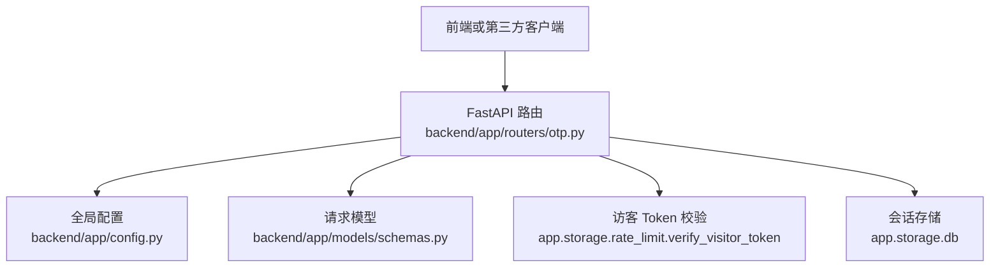
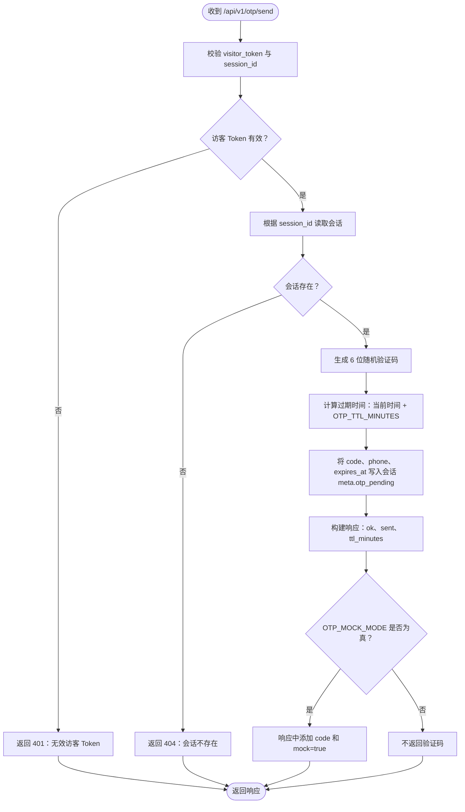
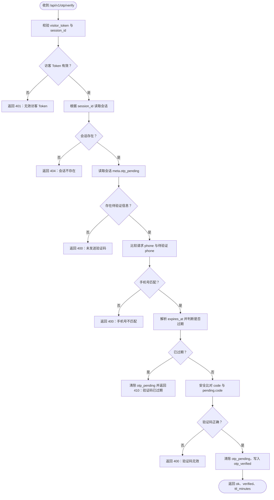
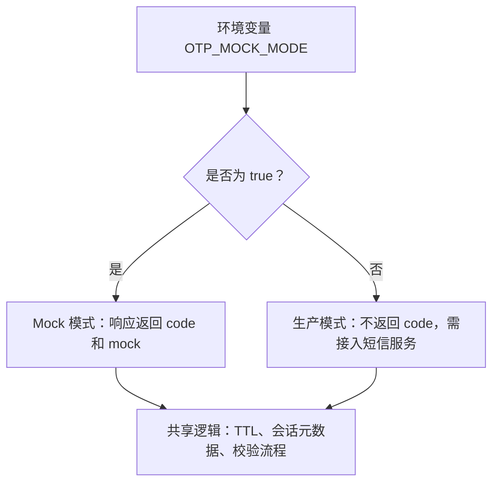
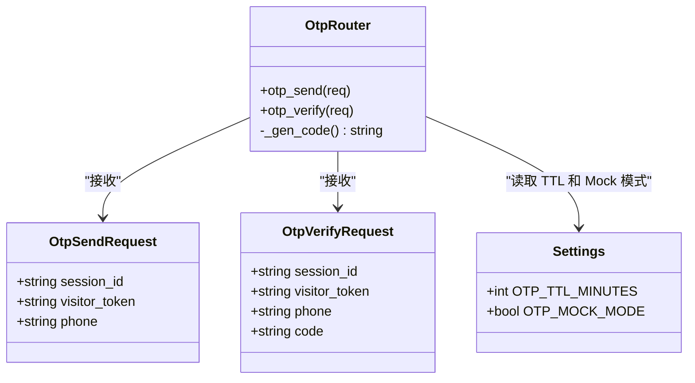
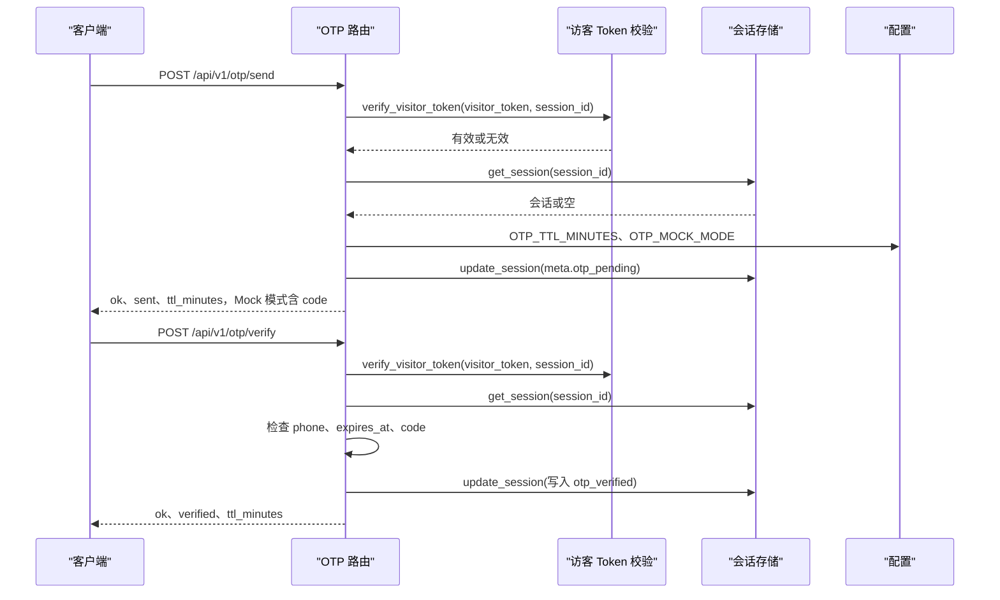

# OTP 验证码接口

<cite>
**本文引用的文件**   
- [backend/app/routers/otp.py](file://backend/app/routers/otp.py)
- [backend/app/models/schemas.py](file://backend/app/models/schemas.py)
- [backend/app/config.py](file://backend/app/config.py)
- [backend/tests/test_api.py](file://backend/tests/test_api.py)
</cite>

## 目录
1. [简介](#简介)
2. [项目结构中的定位](#项目结构中的定位)
3. [核心端点总览](#核心端点总览)
4. [请求模型说明](#请求模型说明)
5. [验证码发送端点 POST /api/v1/otp/send](#验证码发送端点-post-apiv1otpsend)
6. [验证码校验端点 POST /api/v1/otp/verify](#验证码校验端点-post-apiv1otpverify)
7. [Mock 模式与生产模式差异](#mock-模式与生产模式差异)
8. [会话临时安全状态 otp_verified](#会话临时安全状态-otp_verified)
9. [错误处理与状态码](#错误处理与状态码)
10. [完整请求响应示例](#完整请求响应示例)
11. [依赖关系与架构](#依赖关系与架构)
12. [性能与安全注意事项](#性能与安全注意事项)
13. [故障排查指南](#故障排查指南)
14. [结论](#结论)

## 简介
本接口用于在聊天会话内完成敏感操作前的手机号身份确认，典型场景包括忘记密码、修改手机号等。整体流程为：识别敏感意图后引导用户提供手机号，调用验证码发送接口下发验证码；用户输入验证码后调用验证码校验接口；校验通过后，在当前会话的元数据中写入临时安全标记，后续敏感操作可据此进行门禁控制。

该功能由 FastAPI 路由实现，验证码通过随机数生成并暂存在会话元数据中，有效期由配置项控制。系统还提供 Mock 模式，便于开发联调时直接在前端看到验证码。

## 项目结构中的定位
OTP 相关逻辑集中在后端应用的路由层和配置层：
- 路由实现：`backend/app/routers/otp.py`
- 请求模型定义：`backend/app/models/schemas.py`
- 运行配置：`backend/app/config.py`
- 测试用例参考：`backend/tests/test_api.py`



**图示来源**
- [backend/app/routers/otp.py:1-83](file://backend/app/routers/otp.py#L1-L83)
- [backend/app/models/schemas.py:1-138](file://backend/app/models/schemas.py#L1-L138)
- [backend/app/config.py:1-104](file://backend/app/config.py#L1-L104)

**章节来源**
- [backend/app/routers/otp.py:1-83](file://backend/app/routers/otp.py#L1-L83)
- [backend/app/models/schemas.py:1-138](file://backend/app/models/schemas.py#L1-L138)
- [backend/app/config.py:1-104](file://backend/app/config.py#L1-L104)

## 核心端点总览
| 方法 | 路径 | 用途 | 主要入参 | 主要出参 | 关键行为 |
|---|---|---|---|---|---|
| `POST` | `/api/v1/otp/send` | 向指定手机号下发验证码 | `session_id`、`visitor_token`、`phone` | `ok`、`sent`、`ttl_minutes`，Mock 模式下额外返回 `code` 和 `mock` | 校验访客 Token、查找会话、生成验证码、写入会话元数据 |
| `POST` | `/api/v1/otp/verify` | 校验用户输入的验证码 | `session_id`、`visitor_token`、`phone`、`code` | `ok`、`verified`、`ttl_minutes` | 校验访客 Token、检查待验证状态、比对手机号和验证码、更新会话安全状态 |

**章节来源**
- [backend/app/routers/otp.py:18-83](file://backend/app/routers/otp.py#L18-L83)

## 请求模型说明
### OtpSendRequest
| 字段 | 类型 | 是否必填 | 约束 | 说明 |
|---|---|---:|---|---|
| `session_id` | 字符串 | 是 | 无显式长度限制 | 当前聊天会话标识 |
| `visitor_token` | 字符串 | 是 | 无显式长度限制 | 访客访问令牌，用于请求鉴权 |
| `phone` | 字符串 | 是 | 长度 5 到 20 | 接收验证码的手机号，用于绑定本次验证码目标 |

### OtpVerifyRequest
| 字段 | 类型 | 是否必填 | 约束 | 说明 |
|---|---|---:|---|---|
| `session_id` | 字符串 | 是 | 无显式长度限制 | 当前聊天会话标识 |
| `visitor_token` | 字符串 | 是 | 无显式长度限制 | 访客访问令牌，用于请求鉴权 |
| `phone` | 字符串 | 是 | 长度 5 到 20 | 验证码绑定的手机号，需与发送时一致 |
| `code` | 字符串 | 是 | 长度 4 到 8 | 用户收到的验证码，服务端按固定六位数字格式生成 |

**章节来源**
- [backend/app/models/schemas.py:96-112](file://backend/app/models/schemas.py#L96-L112)

## 验证码发送端点 POST /api/v1/otp/send

### 功能概述
该端点用于在指定会话中为指定手机号生成并暂存验证码。它不是真正的短信网关接口，而是聊天安全流程的一部分：验证码最终由业务侧决定如何送达（Mock 模式下直接返回给前端，生产模式下应由短信通道发送）。

### 处理流程


**图示来源**
- [backend/app/routers/otp.py:18-56](file://backend/app/routers/otp.py#L18-L56)
- [backend/app/config.py:80-86](file://backend/app/config.py#L80-L86)

### 请求参数
- `session_id`：来自聊天初始化接口返回的会话标识。
- `visitor_token`：来自聊天初始化接口返回的访客令牌。
- `phone`：需要接收验证码的手机号，长度必须在 5 到 20 之间。

### 成功响应
| 字段 | 类型 | 含义 |
|---|---|---|
| `ok` | 布尔值 | 表示请求是否被接受 |
| `sent` | 布尔值 | 表示验证码已生成并暂存到会话元数据 |
| `ttl_minutes` | 整数 | 验证码有效期分钟数，默认 10 |
| `code` | 字符串 | 仅在 `OTP_MOCK_MODE=true` 时返回，值为 6 位数字 |
| `mock` | 布尔值 | 仅在 Mock 模式下返回，值为 `true` |

### 失败响应
| 状态码 | 场景 | 响应体字段 |
|---|---|---|
| `401` | 访客 Token 无效 | `detail="invalid visitor token"` |
| `404` | 会话不存在 | `detail="session not found"` |

### 内部机制要点
- 验证码使用密码学安全的随机数生成器产生，格式为固定 6 位数字。
- 验证码不会直接持久化为独立记录，而是作为会话元数据的一部分，键名为 `otp_pending`。
- `otp_pending` 中包含：
  - `code`：验证码
  - `phone`：绑定的手机号
  - `expires_at`：过期时间字符串，格式为“年-月-日 时:分:秒”
- 过期时间由配置项 `OTP_TTL_MINUTES` 决定，默认 10 分钟。

**章节来源**
- [backend/app/routers/otp.py:18-56](file://backend/app/routers/otp.py#L18-L56)
- [backend/app/config.py:80-86](file://backend/app/config.py#L80-L86)

## 验证码校验端点 POST /api/v1/otp/verify

### 功能概述
该端点用于校验用户提交的验证码。校验成功后，会在会话元数据中写入临时安全状态 `otp_verified`，并清除待验证信息 `otp_pending`。该状态可用于后续敏感操作的门禁判断。

### 处理流程


**图示来源**
- [backend/app/routers/otp.py:58-83](file://backend/app/routers/otp.py#L58-L83)

### 请求参数
- `session_id`：与发送验证码时的会话保持一致。
- `visitor_token`：与发送验证码时的访客令牌保持一致。
- `phone`：必须与发送验证码时传入的手机号完全一致。
- `code`：用户从短信或 Mock 响应中获得的验证码。

### 成功响应
| 字段 | 类型 | 含义 |
|---|---|---|
| `ok` | 布尔值 | 表示请求被接受 |
| `verified` | 布尔值 | 表示验证码校验通过 |
| `ttl_minutes` | 整数 | 临时安全状态的有效期分钟数，默认 10 |

### 失败响应
| 状态码 | 场景 | 响应体字段 |
|---|---|---|
| `401` | 访客 Token 无效 | `detail="invalid visitor token"` |
| `404` | 会话不存在 | `detail="session not found"` |
| `400` | 未先发送验证码 | `detail="no otp sent, please request a code first"` |
| `400` | 手机号不匹配 | `detail="phone mismatch"` |
| `400` | 验证码不正确 | `detail="invalid code"` |
| `410` | 验证码已过期 | `detail="otp expired, please request a new code"` |

### 内部机制要点
- 校验前会先检查会话元数据中是否存在 `otp_pending`。
- 如果存在待验证信息，但 `phone` 不一致，直接拒绝。
- 过期时间通过解析 `otp_pending.expires_at` 与当前时间比较得出。
- 校验通过后：
  - 删除 `otp_pending`
  - 写入 `otp_verified`，包含 `phone` 和 `verified_at`
- 验证码比对使用常量时间比较函数，降低时序攻击风险。

**章节来源**
- [backend/app/routers/otp.py:58-83](file://backend/app/routers/otp.py#L58-L83)

## Mock 模式与生产模式差异

### 配置项
| 配置项 | 默认值 | 含义 |
|---|---:|---|
| `OTP_MOCK_MODE` | `true` | 是否启用演示模式 |
| `OTP_TTL_MINUTES` | `10` | 验证码及临时安全状态的有效期分钟数 |

### Mock 模式
- `OTP_MOCK_MODE=true`
- 验证码发送响应中直接包含 `code` 和 `mock=true`
- 适合开发和 UI 联调，无需接入真实短信服务
- 验证码仍会写入会话元数据，校验逻辑与生产模式一致

### 生产模式
- `OTP_MOCK_MODE=false`
- 验证码发送响应不包含 `code`
- 业务方应通过短信通道将验证码送达用户
- 其他行为与 Mock 模式相同：验证码 TTL、会话状态管理、校验逻辑不变



**图示来源**
- [backend/app/config.py:80-86](file://backend/app/config.py#L80-L86)
- [backend/app/routers/otp.py:42-56](file://backend/app/routers/otp.py#L42-L56)

**章节来源**
- [backend/app/config.py:80-86](file://backend/app/config.py#L80-L86)
- [backend/app/routers/otp.py:42-56](file://backend/app/routers/otp.py#L42-L56)

## 会话临时安全状态 otp_verified

### 数据结构
验证码校验成功后，会话元数据中会出现以下字段：
- `otp_verified.phone`：已通过验证的手机号
- `otp_verified.verified_at`：验证通过的时间戳，格式为“年-月-日 时:分:秒”

同时，`otp_pending` 会被删除，避免重复使用。

### TTL 机制
- 代码中并未为 `otp_verified` 设置独立的自动过期清理逻辑。
- 文档注释和实现注释强调：临时安全状态具有 TTL，且验证码 TTL 过期后会销毁。
- 实际生效方式取决于底层会话存储是否支持基于 `meta` 或会话级别的生命周期管理。
- 若会话存储不具备自动过期能力，则应在后续敏感操作中加入显式的过期检查，或使用外部缓存服务统一管理。

### 安全性考虑
- `otp_verified` 仅表示“当前会话中某次验证码校验已通过”，不应视为永久身份凭证。
- 敏感操作应同时校验：
  - `visitor_token` 是否有效
  - 会话是否仍存在
  - `otp_verified` 是否尚未过期
  - 当前请求的手机号是否与验证过的手机号一致
- 建议对敏感操作增加二次确认或频率限制，防止会话劫持后的滥用。

**章节来源**
- [backend/app/routers/otp.py:1-12](file://backend/app/routers/otp.py#L1-L12)
- [backend/app/routers/otp.py:70-77](file://backend/app/routers/otp.py#L70-L77)
- [backend/app/config.py:80-86](file://backend/app/config.py#L80-L86)

## 错误处理与状态码

### 统一错误分类
| 类别 | 状态码 | 触发条件 | 建议处理 |
|---|---:|---|---|
| 鉴权失败 | `401` | `visitor_token` 无效 | 提示重新获取访客令牌或刷新会话 |
| 会话缺失 | `404` | `session_id` 对应会话不存在 | 提示重新初始化会话 |
| 前置条件不足 | `400` | 未发送验证码、手机号不匹配、验证码不正确 | 提示先发送验证码或核对手机号 |
| 验证码过期 | `410` | 超过 `OTP_TTL_MINUTES` 仍未校验 | 引导用户重新申请验证码 |

### 错误响应格式
所有异常均通过 FastAPI 的 HTTP 异常抛出，响应体包含 `detail` 字段描述错误原因。

**章节来源**
- [backend/app/routers/otp.py:28-83](file://backend/app/routers/otp.py#L28-L83)

## 完整请求响应示例

### 正常发送验证码
请求体：
```json
{
  "session_id": "一个有效的会话标识",
  "visitor_token": "一个有效的访客令牌",
  "phone": "13800138000"
}
```

Mock 模式响应：
```json
{
  "ok": true,
  "sent": true,
  "ttl_minutes": 10,
  "code": "123456",
  "mock": true
}
```

生产模式响应：
```json
{
  "ok": true,
  "sent": true,
  "ttl_minutes": 10
}
```

### 正常校验验证码
请求体：
```json
{
  "session_id": "一个有效的会话标识",
  "visitor_token": "一个有效的访客令牌",
  "phone": "13800138000",
  "code": "123456"
}
```

成功响应：
```json
{
  "ok": true,
  "verified": true,
  "ttl_minutes": 10
}
```

### 错误示例
- 访客 Token 无效：
  ```json
  {
    "detail": "invalid visitor token"
  }
  ```
  状态码：`401`

- 会话不存在：
  ```json
  {
    "detail": "session not found"
  }
  ```
  状态码：`404`

- 未先发送验证码：
  ```json
  {
    "detail": "no otp sent, please request a code first"
  }
  ```
  状态码：`400`

- 手机号不匹配：
  ```json
  {
    "detail": "phone mismatch"
  }
  ```
  状态码：`400`

- 验证码过期：
  ```json
  {
    "detail": "otp expired, please request a new code"
  }
  ```
  状态码：`410`

- 验证码不正确：
  ```json
  {
    "detail": "invalid code"
  }
  ```
  状态码：`400`

**章节来源**
- [backend/app/routers/otp.py:28-83](file://backend/app/routers/otp.py#L28-L83)
- [backend/app/models/schemas.py:96-112](file://backend/app/models/schemas.py#L96-L112)

## 依赖关系与架构

### 类与方法关系


**图示来源**
- [backend/app/models/schemas.py:96-112](file://backend/app/models/schemas.py#L96-L112)
- [backend/app/config.py:80-86](file://backend/app/config.py#L80-L86)
- [backend/app/routers/otp.py:18-83](file://backend/app/routers/otp.py#L18-L83)

### 请求序列图


**图示来源**
- [backend/app/routers/otp.py:18-83](file://backend/app/routers/otp.py#L18-L83)
- [backend/app/config.py:80-86](file://backend/app/config.py#L80-L86)

**章节来源**
- [backend/app/routers/otp.py:18-83](file://backend/app/routers/otp.py#L18-L83)
- [backend/app/models/schemas.py:96-112](file://backend/app/models/schemas.py#L96-L112)
- [backend/app/config.py:80-86](file://backend/app/config.py#L80-L86)

## 性能与安全注意事项

### 性能
- 验证码生成使用轻量随机数，开销极低。
- 验证码和校验结果均保存在会话元数据中，避免引入额外的独立表或缓存键。
- 校验过程主要是内存中的字典读写和字符串比较，延迟较低。
- 高频场景下，应关注底层会话存储的性能，尤其是并发更新同一会话的情况。

### 安全
- 所有 OTP 接口都会先校验 `visitor_token`。
- 验证码比对使用常量时间比较函数，降低时序攻击风险。
- 验证码仅存在于会话生命周期内，不应长期保存。
- `otp_verified` 是临时信任标记，不适合当作登录态或永久凭证。
- 建议在敏感操作中再次校验手机号、会话活跃性和过期时间。
- 生产环境务必关闭 `OTP_MOCK_MODE`，并通过短信通道发送验证码。
- 建议结合速率限制、防刷策略和审计日志，防止验证码滥用。

[本节为通用指导，不直接分析具体源码]

## 故障排查指南

### 常见问题
| 问题 | 可能原因 | 排查步骤 |
|---|---|---|
| 返回 401 | `visitor_token` 无效或被篡改 | 检查前端是否正确传递聊天初始化返回的 `visitor_token` |
| 返回 404 | `session_id` 不存在 | 检查会话是否已初始化、是否超时或已被清理 |
| 返回 400 未发送验证码 | 未调用 `/api/v1/otp/send` 或会话状态已被覆盖 | 确认调用顺序，并检查会话元数据 |
| 返回 400 手机号不匹配 | 校验请求的 `phone` 与发送请求不同 | 确保前后端使用同一手机号 |
| 返回 410 验证码过期 | 超过 `OTP_TTL_MINUTES` | 重新调用发送接口 |
| 返回 400 验证码无效 | 输入错误或已使用一次 | 重新获取验证码，不要复用旧码 |

### 调试建议
- 在 Mock 模式下，直接查看 `/api/v1/otp/send` 响应中的 `code`，减少短信链路干扰。
- 打印或观察会话元数据，确认 `otp_pending` 和 `otp_verified` 的变化。
- 检查环境变量 `OTP_MOCK_MODE` 和 `OTP_TTL_MINUTES` 是否符合预期。
- 参考现有测试用例的结构，构造最小复现请求。

**章节来源**
- [backend/app/routers/otp.py:28-83](file://backend/app/routers/otp.py#L28-L83)
- [backend/app/config.py:80-86](file://backend/app/config.py#L80-L86)
- [backend/tests/test_api.py:1-200](file://backend/tests/test_api.py#L1-L200)

## 结论
OTP 验证码接口围绕聊天会话提供轻量级的敏感操作前置校验能力。其核心设计特点是：
- 以会话为单位管理验证码和安全状态。
- 通过 `visitor_token` 做基础鉴权。
- 使用 `otp_pending` 表达待验证状态，用 `otp_verified` 表达已验证状态。
- 通过 `OTP_TTL_MINUTES` 控制验证码和临时安全状态的有效期。
- 通过 `OTP_MOCK_MODE` 区分开发与生产行为。

在实际生产中，应配合短信通道、会话生命周期管理、敏感操作门禁和监控审计，形成完整的账户安全闭环。