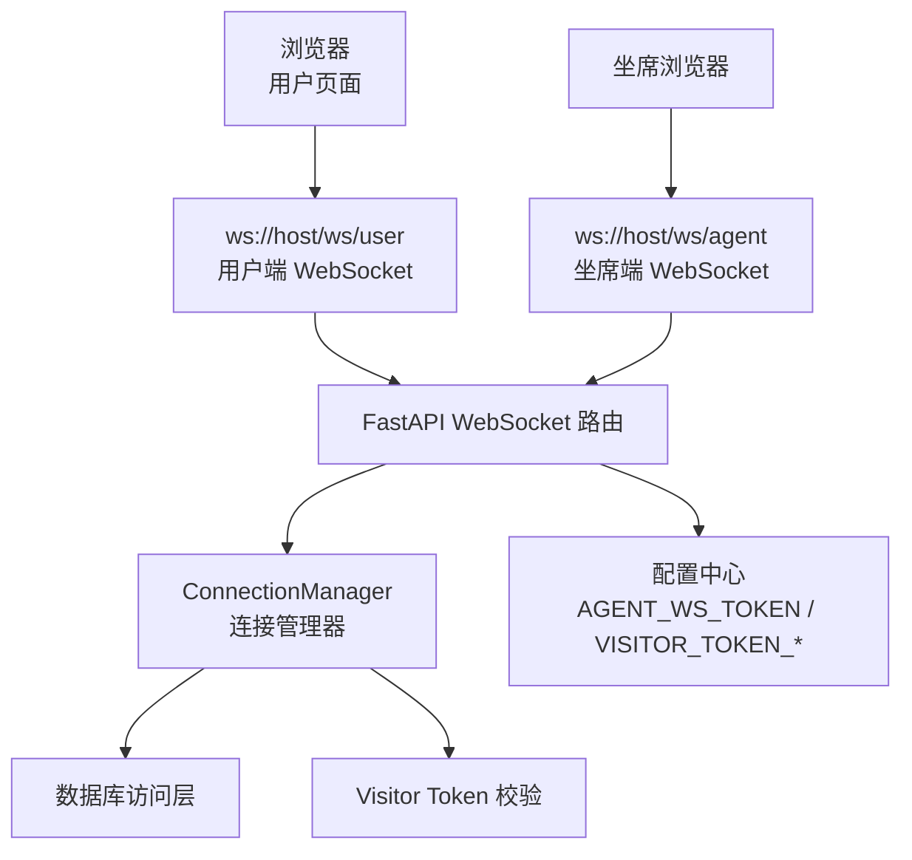
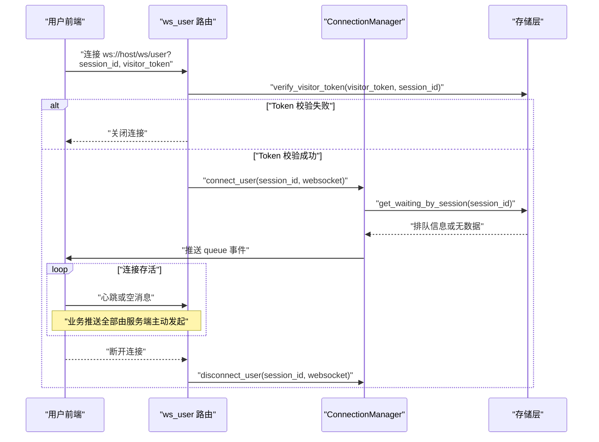
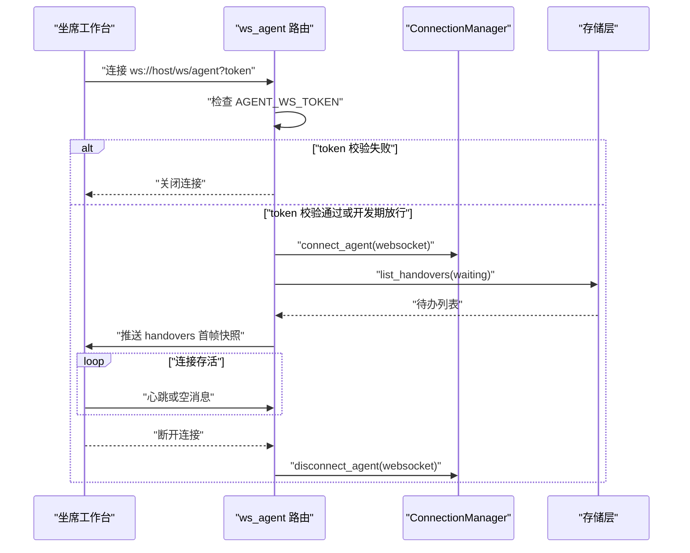
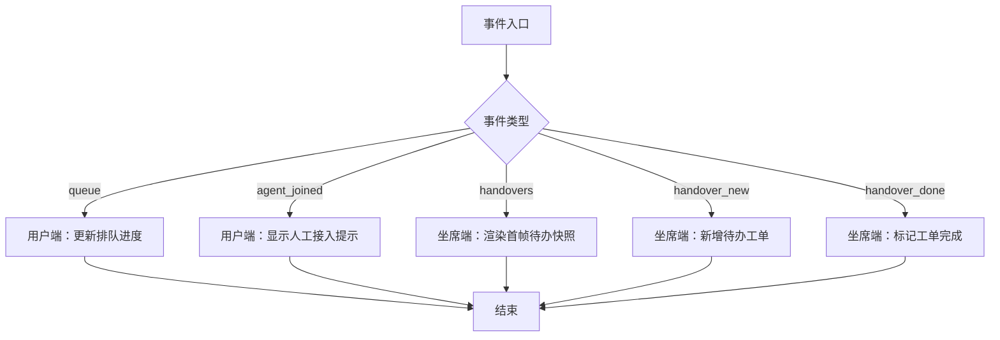
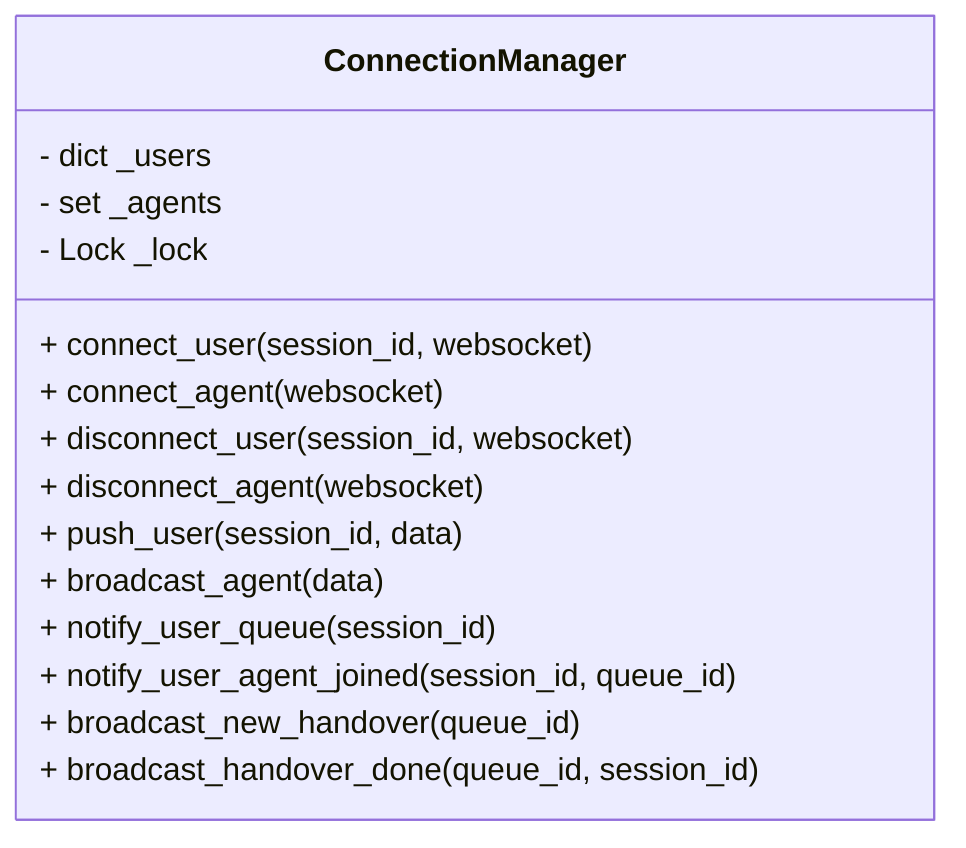
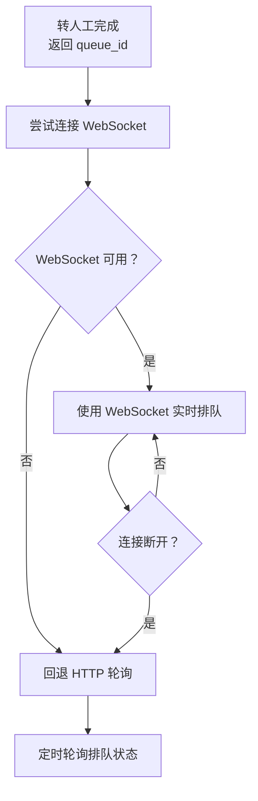
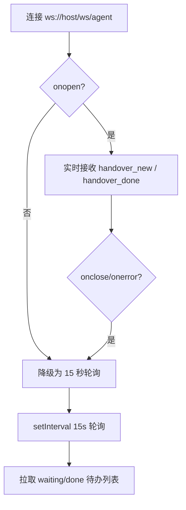
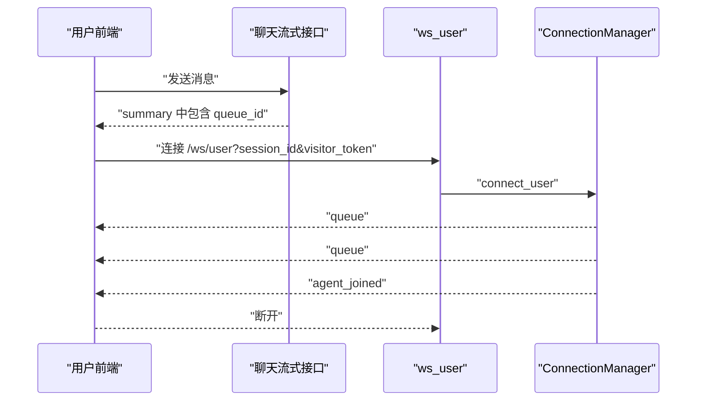
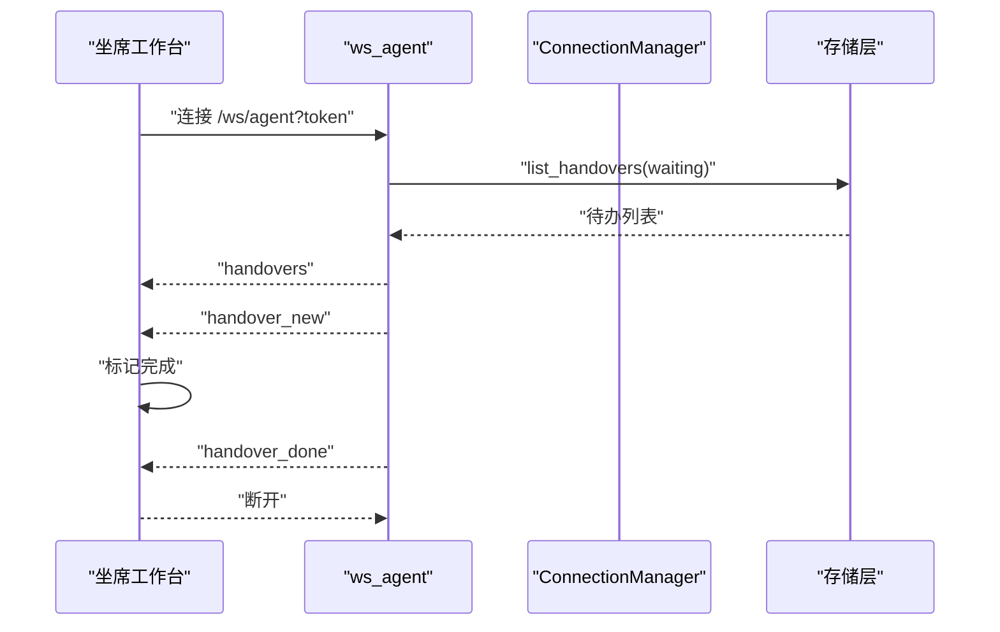

# WebSocket 实时通信

<cite>
**本文引用的文件**   
- [backend/app/routers/ws.py](file://backend/app/routers/ws.py)
- [backend/app/storage/rate_limit.py](file://backend/app/storage/rate_limit.py)
- [backend/app/config.py](file://backend/app/config.py)
- [backend/app/main.py](file://backend/app/main.py)
- [frontend/src/widget.ts](file://frontend/src/widget.ts)
- [frontend/src/agent.ts](file://frontend/src/agent.ts)
</cite>

## 目录
1. [简介](#简介)
2. [项目结构中的 WebSocket 位置](#项目结构中的-websocket-位置)
3. [接口总览](#接口总览)
4. [用户端 WebSocket 接口](#用户端-websocket-接口)
5. [坐席端 WebSocket 接口](#坐席端-websocket-接口)
6. [事件协议](#事件协议)
7. [连接管理机制：ConnectionManager](#连接管理机制connectionmanager)
8. [降级策略与重连机制](#降级策略与重连机制)
9. [完整交互示例](#完整交互示例)
10. [故障排查](#故障排查)
11. [性能与扩展建议](#性能与扩展建议)
12. [结论](#结论)

## 简介
本文件系统性地记录小答 AI 客服系统的 WebSocket 实时通信能力，包括：
- 用户端排队实时通道：用于在转人工后实时展示排队进度、人工接入通知。
- 坐席端待办实时通道：用于实时推送新工单和工单完成事件，并在首帧下发待办快照。
- Visitor Token 认证机制与坐席端 AGENT_WS_TOKEN 权限控制。
- ConnectionManager 的连接池、消息推送与广播逻辑。
- WebSocket 失败时的 HTTP 轮询降级策略。
- 连接建立、事件订阅、消息推送、断线处理与重连的端到端流程。

该文档面向后端开发者、前端集成方以及运维人员，既提供 API 契约，也解释实现细节与注意事项。

## 项目结构中的 WebSocket 位置
WebSocket 路由由 FastAPI 应用统一注册，具体实现位于后端路由模块；前端用户侧 Widget 与坐席工作台分别维护 WebSocket 实例并实现降级轮询。

**图表来源**
- [backend/app/routers/ws.py:1-149](file://backend/app/routers/ws.py#L1-L149)
- [backend/app/main.py:49-63](file://backend/app/main.py#L49-L63)
- [backend/app/storage/rate_limit.py:35-74](file://backend/app/storage/rate_limit.py#L35-L74)
- [backend/app/config.py:84-104](file://backend/app/config.py#L84-L104)

**章节来源**
- [backend/app/main.py:49-63](file://backend/app/main.py#L49-L63)
- [backend/app/routers/ws.py:1-149](file://backend/app/routers/ws.py#L1-L149)

## 接口总览
系统提供两个 WebSocket 端点，均基于 FastAPI 的 WebSocket 路由注册到主应用中。

| 端点 | 客户端 | 用途 | 认证方式 | 主要事件方向 |
|---|---|---|---|---|
| `ws://host/ws/user?session_id=&visitor_token=` | 普通用户前端 Widget | 转人工后接收排队进度与人工接入通知 | Visitor Token 绑定 session_id，校验签名、会话匹配与过期时间 | 服务端 → 客户端 |
| `ws://host/ws/agent?token=` | 坐席工作台 | 实时接收新工单、工单完成，首帧返回待办快照 | AGENT_WS_TOKEN（留空为开发期放行） | 服务端 → 客户端 |

所有 WebSocket 消息均为 JSON 文本，通过 `type` 字段区分事件类型。

**章节来源**
- [backend/app/routers/ws.py:1-149](file://backend/app/routers/ws.py#L1-L149)
- [backend/app/config.py:84-104](file://backend/app/config.py#L84-L104)

## 用户端 WebSocket 接口

### 连接地址
- 地址模板：`ws://host/ws/user?session_id=<会话ID>&visitor_token=<访客令牌>`
- 若使用 HTTPS，应使用 `wss://host/ws/user?...`。

### 认证机制
用户端连接必须携带 `session_id` 和 `visitor_token`：
- 如果任一参数为空，或 Visitor Token 校验失败，服务器会直接关闭连接。
- Visitor Token 采用 HMAC-SHA256 签名方案，负载包含会话标识与过期时间。
- 校验过程包括三部分：
  1. 验证签名是否匹配。
  2. 解析负载中的会话 ID，并与 URL 参数 `session_id` 比较。
  3. 检查过期时间是否未过期。

| 条件 | 行为 |
|---|---|
| 缺少 `session_id` 或 `visitor_token` | 关闭连接 |
| Visitor Token 签名无效 | 关闭连接 |
| Visitor Token 绑定的会话与 URL 不一致 | 关闭连接 |
| Visitor Token 已过期 | 关闭连接 |
| 校验成功 | 接受连接，并立即推送当前排队状态 |

### 连接生命周期
1. 客户端发起 WebSocket 连接，附带 `session_id` 与 `visitor_token`。
2. 后端校验 Token；失败则关闭连接。
3. 成功后将连接加入对应 `session_id` 的用户连接集合。
4. 建连后立即查询并推送一次当前排队状态，用于弥补连接前发生的队列变化。
5. 连接期间，业务事件全部由服务端主动推送。
6. 客户端断开或异常时，后端移除连接并清理空闲会话连接集合。

**图表来源**
- [backend/app/routers/ws.py:76-106](file://backend/app/routers/ws.py#L76-L106)
- [backend/app/storage/rate_limit.py:35-74](file://backend/app/storage/rate_limit.py#L35-L74)

**章节来源**
- [backend/app/routers/ws.py:76-106](file://backend/app/routers/ws.py#L76-L106)
- [backend/app/storage/rate_limit.py:35-74](file://backend/app/storage/rate_limit.py#L35-L74)

## 坐席端 WebSocket 接口

### 连接地址
- 地址模板：`ws://host/ws/agent?token=<坐席令牌>`
- 若使用 HTTPS，应使用 `wss://host/ws/agent?token=...`。

### 认证机制
坐席端连接通过 `AGENT_WS_TOKEN` 配置项进行鉴权：
- 如果配置了 `AGENT_WS_TOKEN`，则请求中的 `token` 必须与其完全一致。
- 如果配置为空，则为开发期放行模式，不强制校验 token。
- 校验失败时，服务器直接关闭连接。

| 配置状态 | 行为 |
|---|---|
| 设置了 `AGENT_WS_TOKEN`，且请求 token 不匹配 | 关闭连接 |
| 设置了 `AGENT_WS_TOKEN`，且请求 token 匹配 | 接受连接 |
| 未设置 `AGENT_WS_TOKEN` | 开发期放行，接受连接 |

### 连接生命周期
1. 坐席前端创建 WebSocket 连接。
2. 后端校验 token；失败则关闭连接。
3. 成功后将连接加入坐席连接池。
4. 首帧发送待办快照：`{"type":"handovers","data":[...]}`。
5. 连接期间，坐席端仅消费心跳或空消息，业务事件由服务端主动推送。
6. 连接断开时，从坐席连接池中移除。

**图表来源**
- [backend/app/routers/ws.py:108-149](file://backend/app/routers/ws.py#L108-L149)
- [backend/app/config.py:98-104](file://backend/app/config.py#L98-L104)

**章节来源**
- [backend/app/routers/ws.py:108-149](file://backend/app/routers/ws.py#L108-L149)
- [backend/app/config.py:98-104](file://backend/app/config.py#L98-L104)

## 事件协议

### 用户端事件
用户端事件由服务端主动推送，不需要客户端订阅。

| 事件类型 | 适用端 | 含义 | 关键字段 |
|---|---|---|---|
| `queue` | 用户端 | 排队进度更新 | `queue_id`、`position`、`ahead`、`status` |
| `agent_joined` | 用户端 | 人工客服已接入 | `queue_id` |

`queue` 事件说明：
- `queue_id`：队列编号。
- `position`：当前排队位置。
- `ahead`：前面等待人数。
- `status`：排队状态。

`agent_joined` 事件说明：
- 当有坐席接入当前用户的排队时触发。
- 同时会向其他仍在排队的用户重新推送 `queue` 事件，使其位置前移。

### 坐席端事件
坐席端事件也由服务端主动推送。

| 事件类型 | 适用端 | 含义 | 关键字段 |
|---|---|---|---|
| `handovers` | 坐席端 | 首次连接时下发待办快照 | `data`，数组形式 |
| `handover_new` | 坐席端 | 新增一个转人工工单 | `queue_id` |
| `handover_done` | 坐席端 | 某个工单被标记为已完成 | `queue_id` |

注意：
- `handovers` 是首帧快照，不是增量事件。
- `handover_new` 和 `handover_done` 是增量事件，前端应在收到后刷新本地待办列表。

**图表来源**
- [backend/app/routers/ws.py:1-149](file://backend/app/routers/ws.py#L1-L149)

**章节来源**
- [backend/app/routers/ws.py:1-149](file://backend/app/routers/ws.py#L1-L149)

## 连接管理机制：ConnectionManager

`ConnectionManager` 是 WebSocket 实时通道的核心组件，负责：
- 维护用户连接池。
- 维护坐席连接池。
- 向指定用户推送消息。
- 向所有坐席广播消息。
- 封装排队进度、人工接入、工单新建、工单完成的业务推送方法。

### 数据结构

| 属性 | 类型 | 含义 |
|---|---|---|
| `_users` | 字典：会话 ID → WebSocket 集合 | 用户连接池 |
| `_agents` | WebSocket 集合 | 坐席连接池 |
| `_lock` | 异步锁 | 保护连接池并发安全 |

### 核心方法

| 方法 | 输入 | 行为 |
|---|---|---|
| `connect_user` | `session_id`、`websocket` | 接受连接，并将连接加入对应会话的用户集合 |
| `connect_agent` | `websocket` | 接受连接，并将连接加入坐席集合 |
| `disconnect_user` | `session_id`、`websocket` | 从用户集合中移除连接；若会话无人连接则删除该键 |
| `disconnect_agent` | `websocket` | 从坐席集合中移除连接 |
| `push_user` | `session_id`、`data` | 向指定会话的所有连接推送消息 |
| `broadcast_agent` | `data` | 向所有坐席连接广播消息 |
| `notify_user_queue` | `session_id` | 查询当前排队状态并推送 `queue` 事件 |
| `notify_user_agent_joined` | `session_id`、`queue_id` | 推送 `agent_joined` 事件 |
| `broadcast_new_handover` | `queue_id` | 广播 `handover_new` |
| `broadcast_handover_done` | `queue_id`、`session_id` | 广播 `handover_done`，通知用户人工接入，并刷新其余排队用户位置 |

**图表来源**
- [backend/app/routers/ws.py:23-74](file://backend/app/routers/ws.py#L23-L74)

### 并发模型
- 所有连接池读写操作均通过异步锁保护。
- 推送和广播会在持有锁期间复制连接集合，然后逐个发送消息。
- 单个发送异常会被捕获忽略，避免影响其他连接。

### 复杂度分析
- `connect_user`：近似 O(1)，哈希集合插入。
- `disconnect_user`：近似 O(1)，集合删除；极端情况下可能删除空键。
- `push_user`：O(k)，k 为该会话的连接数。
- `broadcast_agent`：O(m)，m 为当前坐席连接数。
- `notify_user_queue`：依赖数据库查询，时间复杂度由底层存储决定；推送阶段为 O(k)。
- `broadcast_handover_done`：O(m + k)，广播给所有坐席，再遍历用户连接刷新排队。

**章节来源**
- [backend/app/routers/ws.py:23-74](file://backend/app/routers/ws.py#L23-L74)

## 降级策略与重连机制

### 用户端降级
用户端优先使用 WebSocket 获取实时排队进度。当 WebSocket 不可用时，前端保留 V1.5 的 HTTP 轮询作为降级方案。整体逻辑如下：

1. 聊天流式响应完成后，如果返回 `queue_id`，前端尝试启动 WebSocket 实时排队。
2. 如果 WebSocket 连接失败或断开，前端回退到 HTTP 轮询。
3. 轮询间隔和 UI 表现由前端实现，但后端文档只保证：只要 WebSocket 认证成功，即可收到 `queue` 和 `agent_joined` 事件。

**图表来源**
- [backend/app/routers/ws.py:1-149](file://backend/app/routers/ws.py#L1-L149)
- [frontend/src/widget.ts:201-450](file://frontend/src/widget.ts#L201-L450)

**章节来源**
- [backend/app/routers/ws.py:1-149](file://backend/app/routers/ws.py#L1-L149)
- [frontend/src/widget.ts:201-450](file://frontend/src/widget.ts#L201-L450)

### 坐席端降级
坐席端 WebSocket 连接失败时，前端会自动降级为每 15 秒轮询一次待办列表：
- 连接失败或关闭后，前端进入降级状态。
- 降级后不再依赖 WebSocket 增量事件。
- 定时器持续调用待办列表接口，保证坐席最终能看到最新数据。

**图表来源**
- [frontend/src/agent.ts:1-200](file://frontend/src/agent.ts#L1-L200)
- [frontend/src/agent.ts:201-303](file://frontend/src/agent.ts#L201-L303)

**章节来源**
- [frontend/src/agent.ts:1-200](file://frontend/src/agent.ts#L1-L200)
- [frontend/src/agent.ts:201-303](file://frontend/src/agent.ts#L201-L303)

## 完整交互示例

### 用户端连接与排队示例
1. 用户发起转人工。
2. 后端返回 `queue_id`。
3. 用户前端连接 `ws://host/ws/user?session_id=...&visitor_token=...`。
4. 后端校验 Token，成功后立即推送一次 `queue` 事件。
5. 后续排队进度变化时，后端再次推送 `queue`。
6. 有人工接入时，后端推送 `agent_joined`。
7. 用户断开连接后，后端清理连接。

**图表来源**
- [backend/app/routers/ws.py:76-106](file://backend/app/routers/ws.py#L76-L106)
- [backend/app/routers/ws.py:53-74](file://backend/app/routers/ws.py#L53-L74)
- [frontend/src/widget.ts:201-450](file://frontend/src/widget.ts#L201-L450)

### 坐席端连接与待办示例
1. 坐席打开工作台。
2. 前端连接 `ws://host/ws/agent?token=...`。
3. 后端校验 `AGENT_WS_TOKEN`。
4. 成功后推送首帧 `handovers` 快照。
5. 有新工单时推送 `handover_new`。
6. 坐席完成工单后，后端推送 `handover_done`。
7. 连接断开后降级为 15 秒轮询。

**图表来源**
- [backend/app/routers/ws.py:108-149](file://backend/app/routers/ws.py#L108-L149)
- [frontend/src/agent.ts:1-200](file://frontend/src/agent.ts#L1-L200)
- [frontend/src/agent.ts:201-303](file://frontend/src/agent.ts#L201-L303)

**章节来源**
- [backend/app/routers/ws.py:53-149](file://backend/app/routers/ws.py#L53-L149)
- [frontend/src/widget.ts:201-450](file://frontend/src/widget.ts#L201-L450)
- [frontend/src/agent.ts:1-200](file://frontend/src/agent.ts#L1-L200)
- [frontend/src/agent.ts:201-303](file://frontend/src/agent.ts#L201-L303)

## 故障排查

### 用户端无法连接 WebSocket
常见原因：
- 缺少 `session_id` 或 `visitor_token`。
- Visitor Token 签名无效。
- Visitor Token 绑定的会话与 URL 参数不一致。
- Visitor Token 已过期。
- 网络环境不支持 WebSocket。

排查建议：
1. 确认前端已从初始化接口获取有效的 `session_id` 和 `visitor_token`。
2. 检查后端 `VISITOR_TOKEN_SECRET` 配置是否正确。
3. 检查 Token 生成时间和过期时间是否符合预期。
4. 如果 WebSocket 失败，确认前端是否自动回退到 HTTP 轮询。

**章节来源**
- [backend/app/routers/ws.py:76-106](file://backend/app/routers/ws.py#L76-L106)
- [backend/app/storage/rate_limit.py:35-74](file://backend/app/storage/rate_limit.py#L35-L74)
- [backend/app/config.py:84-96](file://backend/app/config.py#L84-L96)

### 坐席端连接被拒绝
常见原因：
- 未正确传递 `token`。
- `token` 与后端 `AGENT_WS_TOKEN` 不一致。
- 生产环境未配置 `AGENT_WS_TOKEN` 导致误判。

排查建议：
1. 检查 `.env` 中 `AGENT_WS_TOKEN` 的值。
2. 检查前端构造的 `/ws/agent?token=...` 是否与实际值一致。
3. 开发环境可暂时留空以放行，但生产环境应设置强口令。

**章节来源**
- [backend/app/routers/ws.py:108-149](file://backend/app/routers/ws.py#L108-L149)
- [backend/app/config.py:98-104](file://backend/app/config.py#L98-L104)

### 坐席端未收到实时事件
可能原因：
- WebSocket 已降级为轮询。
- 前端未正确处理 `handover_new` 或 `handover_done`。
- 后端广播连接已断开但未重新连接。

排查建议：
1. 观察坐席页面上的 WebSocket 状态指示。
2. 检查 15 秒轮询是否正常刷新待办列表。
3. 检查后端是否调用了 `broadcast_new_handover` 和 `broadcast_handover_done`。

**章节来源**
- [frontend/src/agent.ts:1-200](file://frontend/src/agent.ts#L1-L200)
- [frontend/src/agent.ts:201-303](file://frontend/src/agent.ts#L201-L303)
- [backend/app/routers/ws.py:53-74](file://backend/app/routers/ws.py#L53-L74)

## 性能与扩展建议

### 当前性能特征
- 连接管理使用内存字典和集合，适合中小规模部署。
- 每次推送前复制连接集合，避免迭代过程中连接变更。
- 单个连接发送异常不会中断其他连接推送。
- 用户端按会话维度推送，坐席端按全局广播。

### 扩展建议
1. **连接池持久化**：如果需要跨进程或横向扩展，可将连接池迁移到 Redis。
2. **连接健康检测**：增加心跳超时机制，定期清理长时间无活动的连接。
3. **消息去重**：在高并发场景下，对重复排队更新做合并或节流。
4. **限流增强**：当前 IP 限流主要针对 HTTP 接口；WebSocket 可考虑独立限流策略。
5. **认证扩展**：Visitor Token 可支持更细粒度的权限控制，例如限制特定渠道或租户。
6. **日志审计**：记录 WebSocket 连接建立、断开、认证失败及广播目标数量。

[本节为通用性能建议，不直接分析具体代码行]

## 结论
本项目的 WebSocket 实时通信围绕两个明确角色展开：用户端排队通道与坐席端待办通道。后端通过 `ConnectionManager` 统一管理连接、推送和广播；前端在 WebSocket 不可用时自动降级为 HTTP 轮询，保障基本可用性。Visitor Token 与 `AGENT_WS_TOKEN` 共同构成双向认证体系，既保护用户会话，又防止未授权坐席接入。对于生产环境，建议强化配置管理、连接健康检测和可扩展性设计。