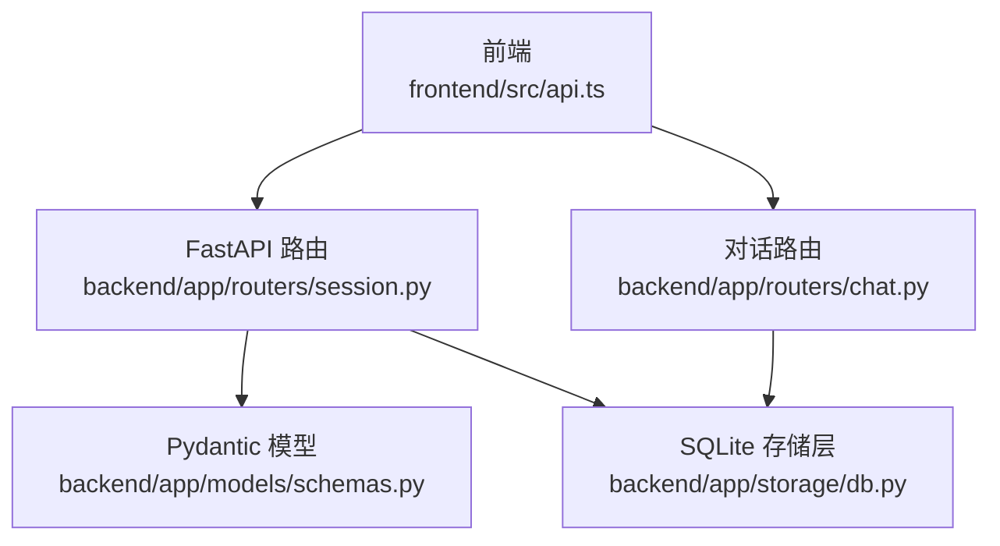
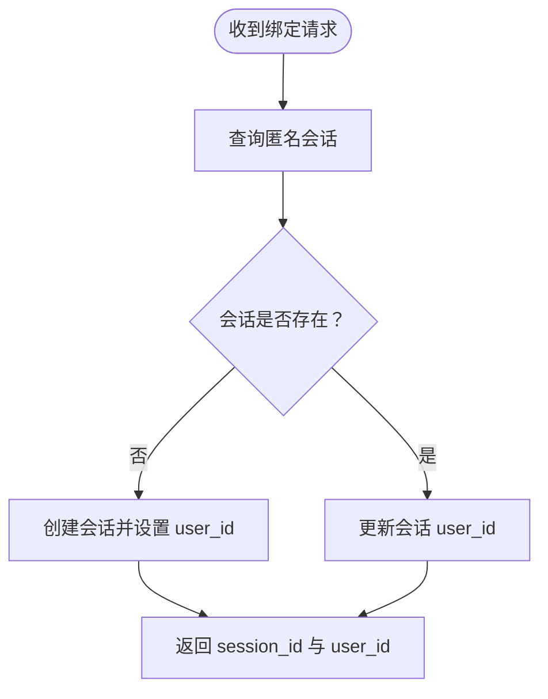
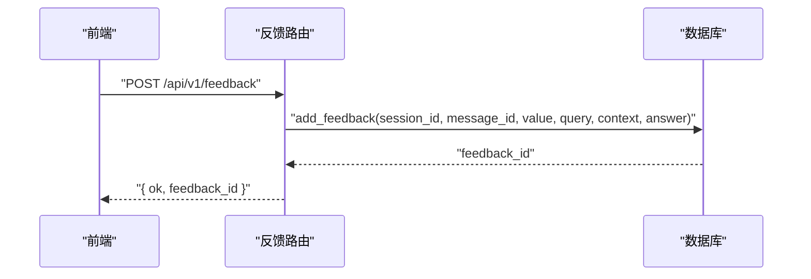
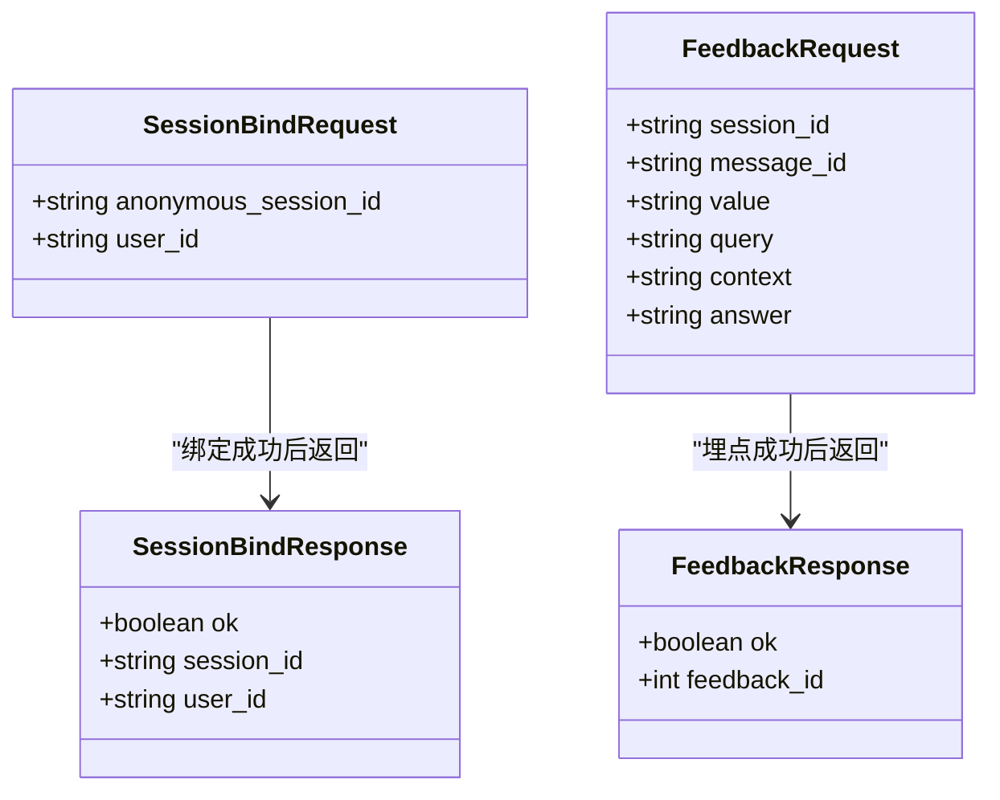
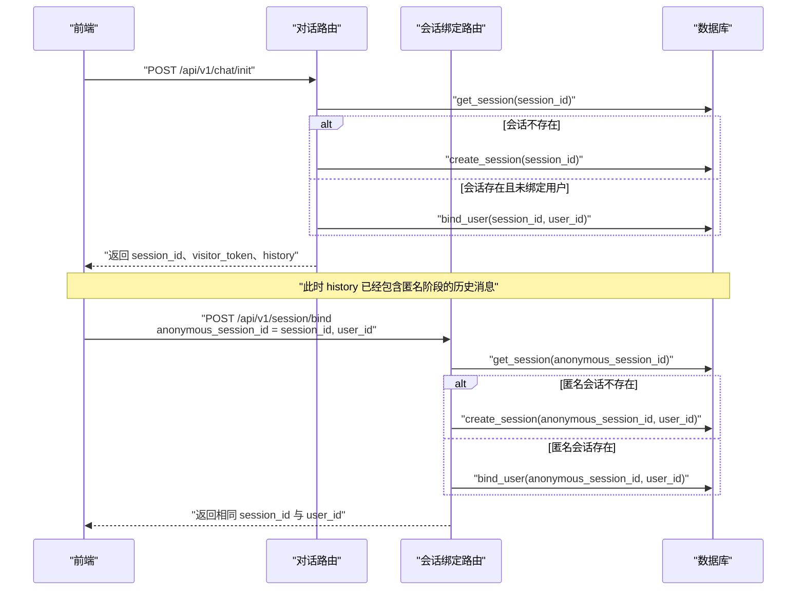
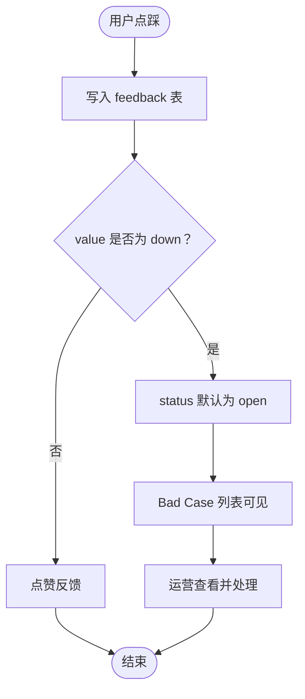
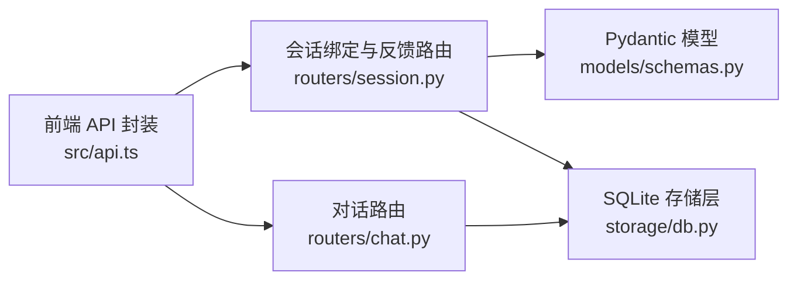

# 会话管理接口

<cite>
**本文引用的文件**   
- [backend/app/routers/session.py](file://backend/app/routers/session.py)
- [backend/app/models/schemas.py](file://backend/app/models/schemas.py)
- [backend/app/storage/db.py](file://backend/app/storage/db.py)
- [backend/app/routers/chat.py](file://backend/app/routers/chat.py)
- [frontend/src/api.ts](file://frontend/src/api.ts)
</cite>

## 目录
1. [引言](#引言)
2. [项目结构定位](#项目结构定位)
3. [核心接口总览](#核心接口总览)
4. [会话绑定接口 POST /api/v1/session/bind](#会话绑定接口-post-apiv1sessionbind)
5. [反馈收集接口 POST /api/v1/feedback](#反馈收集接口-post-apiv1feedback)
6. [请求与响应模型定义](#请求与响应模型定义)
7. [匿名用户登录与历史消息零丢失流程](#匿名用户登录与历史消息零丢失流程)
8. [Bad Case 自动打标与归因机制](#bad-case-自动打标与归因机制)
9. [依赖关系分析](#依赖关系分析)
10. [性能与健壮性说明](#性能与健壮性说明)
11. [故障排查指南](#故障排查指南)
12. [结论](#结论)

## 引言
本文档聚焦后端会话管理相关接口，重点说明：
- 匿名用户登录后如何把匿名会话与真实用户 ID 绑定；
- 为什么登录后历史消息不会丢失；
- 点赞、点踩埋点的数据结构及 Bad Case 自动打标入库机制；
- 请求/响应字段定义、典型调用序列和前后端契约。

## 项目结构定位
会话管理接口位于 FastAPI 路由层，通过 Pydantic 模型校验请求，再委托 SQLite 存储层完成会话绑定、消息查询与反馈记录。前端通过统一封装函数调用这些 REST 接口。



**图表来源**
- [backend/app/routers/session.py:1-35](file://backend/app/routers/session.py#L1-L35)
- [backend/app/models/schemas.py:1-138](file://backend/app/models/schemas.py#L1-L138)
- [backend/app/storage/db.py:1-200](file://backend/app/storage/db.py#L1-L200)
- [backend/app/routers/chat.py:1-120](file://backend/app/routers/chat.py#L1-L120)
- [frontend/src/api.ts:1-80](file://frontend/src/api.ts#L1-L80)

**章节来源**
- [backend/app/routers/session.py:1-35](file://backend/app/routers/session.py#L1-L35)
- [backend/app/models/schemas.py:1-138](file://backend/app/models/schemas.py#L1-L138)
- [backend/app/storage/db.py:1-200](file://backend/app/storage/db.py#L1-L200)
- [backend/app/routers/chat.py:1-120](file://backend/app/routers/chat.py#L1-L120)
- [frontend/src/api.ts:1-80](file://frontend/src/api.ts#L1-L80)

## 核心接口总览

| 接口 | 方法 | 路径 | 用途 | 主要返回字段 |
|---|---:|---|---|---|
| 会话绑定 | `POST` | `/api/v1/session/bind` | 匿名用户登录后绑定会话与用户 ID，保持历史消息不变 | `ok`、`session_id`、`user_id` |
| 反馈收集 | `POST` | `/api/v1/feedback` | 记录点赞或点踩埋点；点踩时自动进入 Bad Case 数据流 | `ok`、`feedback_id` |

**章节来源**
- [backend/app/routers/session.py:1-35](file://backend/app/routers/session.py#L1-L35)
- [backend/app/models/schemas.py:1-138](file://backend/app/models/schemas.py#L1-L138)

## 会话绑定接口 POST /api/v1/session/bind

### 接口目的
该接口用于用户在“登录瞬间”将当前匿名会话与真实用户 ID 绑定。绑定的关键语义是：**不改变 `session_id`，只给已有会话附加 `user_id`**，从而保证前端继续使用原会话 ID 拉取历史消息时不会丢失。

### 请求体 SessionBindRequest

| 字段名 | 类型 | 是否必填 | 长度约束 | 含义 |
|---|---|---:|---|---|
| `anonymous_session_id` | `string` | 是 | 8～64 | 匿名会话 ID，通常由页面初始化或本地状态提供 |
| `user_id` | `string` | 是 | 1～64 | 已登录用户的唯一标识 |

### 响应体 SessionBindResponse

| 字段名 | 类型 | 默认值 | 含义 |
|---|---|---:|---|
| `ok` | `boolean` | `true` | 绑定成功标志 |
| `session_id` | `string` | — | 返回的会话 ID（通常等于请求中的匿名会话 ID） |
| `user_id` | `string` | — | 返回的用户 ID |

### 处理逻辑
1. 根据 `anonymous_session_id` 查询会话。
2. 若不存在：创建新会话，并把该匿名会话 ID 作为主键写入，同时关联 `user_id`。
3. 若存在：直接更新该会话的 `user_id`。
4. 返回绑定结果，`session_id` 保持不变。



**图表来源**
- [backend/app/routers/session.py:12-25](file://backend/app/routers/session.py#L12-L25)
- [backend/app/storage/db.py:95-125](file://backend/app/storage/db.py#L95-L125)

### 请求示例

请求体 JSON：
```json
{
  "anonymous_session_id": "sess_abc123def456",
  "user_id": "u_998877"
}
```

响应体 JSON：
```json
{
  "ok": true,
  "session_id": "sess_abc123def456",
  "user_id": "u_998877"
}
```

### 错误行为
- 如果传入字段不符合 Pydantic 约束，例如长度不足、类型错误或缺少必填字段，FastAPI 会返回参数校验错误。
- 该路由未显式抛出业务异常，正常路径始终返回成功响应；异常主要来自参数校验或数据库层。

**章节来源**
- [backend/app/routers/session.py:1-35](file://backend/app/routers/session.py#L1-L35)
- [backend/app/models/schemas.py:13-36](file://backend/app/models/schemas.py#L13-L36)
- [backend/app/storage/db.py:95-125](file://backend/app/storage/db.py#L95-L125)

## 反馈收集接口 POST /api/v1/feedback

### 接口目的
该接口用于收集用户对助手回答的反馈：
- 点赞：表示回答可接受；
- 点踩：表示回答可能存在问题，系统会把该条反馈标记为 Bad Case，供运营人员归因和处理。

### 请求体 FeedbackRequest

| 字段名 | 类型 | 是否必填 | 长度约束 | 含义 |
|---|---|---:|---|---|
| `session_id` | `string` | 是 | 8～64 | 所属会话 ID |
| `message_id` | `string` 或 `null` | 否 | — | 可选的目标消息 ID，便于精确定位某条回答 |
| `value` | `"up"` 或 `"down"` | 是 | — | 点赞或点踩 |
| `query` | `string` 或 `null` | 否 | — | 触发该回答的用户问题原文 |
| `context` | `string` 或 `null` | 否 | — | 上下文信息，例如多轮摘要、前置条件等 |
| `answer` | `string` 或 `null` | 否 | — | 被评价的回答内容 |

### 响应体 FeedbackResponse

| 字段名 | 类型 | 默认值 | 含义 |
|---|---|---:|---|
| `ok` | `boolean` | `true` | 反馈记录成功标志 |
| `feedback_id` | `integer` 或 `null` | `null` | 后端生成的反馈记录 ID |

### 处理逻辑
1. 接收 `session_id`、`message_id`、`value`、`query`、`context`、`answer`。
2. 调用存储层写入反馈表。
3. 返回 `feedback_id`，供前端观测或后续扩展使用。



**图表来源**
- [backend/app/routers/session.py:27-35](file://backend/app/routers/session.py#L27-L35)
- [backend/app/storage/db.py:1-200](file://backend/app/storage/db.py#L1-L200)

### 请求示例

点赞请求体 JSON：
```json
{
  "session_id": "sess_abc123def456",
  "message_id": "msg_001",
  "value": "up"
}
```

点踩请求体 JSON：
```json
{
  "session_id": "sess_abc123def456",
  "message_id": "msg_001",
  "value": "down",
  "query": "订单号 123456 能退款吗",
  "context": "用户已提交售后申请",
  "answer": "根据规则可以退款"
}
```

响应体 JSON：
```json
{
  "ok": true,
  "feedback_id": 42
}
```

**章节来源**
- [backend/app/routers/session.py:27-35](file://backend/app/routers/session.py#L27-L35)
- [backend/app/models/schemas.py:38-66](file://backend/app/models/schemas.py#L38-L66)

## 请求与响应模型定义

### 会话绑定相关模型



**图表来源**
- [backend/app/models/schemas.py:13-66](file://backend/app/models/schemas.py#L13-L66)
- [backend/app/models/schemas.py:100-120](file://backend/app/models/schemas.py#L100-L120)

### 字段约束要点
- `anonymous_session_id`、`session_id` 必须满足最小长度 8、最大长度 64，避免空串和无意义短 ID。
- `user_id` 至少长度为 1，防止空用户标识。
- `value` 是字面量枚举，仅允许 `"up"` 或 `"down"`，前端不应发送其他值。
- `message_id`、`query`、`context`、`answer` 均为可选字段，便于在轻量埋点场景只传必要字段。

**章节来源**
- [backend/app/models/schemas.py:13-66](file://backend/app/models/schemas.py#L13-L66)
- [backend/app/models/schemas.py:100-120](file://backend/app/models/schemas.py#L100-L120)

## 匿名用户登录与历史消息零丢失流程

### 设计动机
匿名会话通常在页面初始化时生成，此时用户尚未登录。若用户随后登录，前端应继续使用同一个 `session_id`，否则历史消息会被“割裂”到两个会话中。因此，后端需要支持“先匿名、后绑定”的模式。

### 完整时序



**图表来源**
- [backend/app/routers/chat.py:60-100](file://backend/app/routers/chat.py#L60-L100)
- [backend/app/routers/session.py:12-25](file://backend/app/routers/session.py#L12-L25)
- [backend/app/storage/db.py:95-125](file://backend/app/storage/db.py#L95-L125)

### 零丢失的关键点
1. **会话 ID 不变**：绑定接口不生成新 `session_id`，而是复用匿名会话 ID。
2. **历史消息按会话 ID 查询**：聊天初始化接口按 `session_id` 读取 `messages` 表，所以匿名阶段的消息仍能被拉取。
3. **用户 ID 是附属属性**：`user_id` 只是会话记录的一个字段，不影响消息归属。
4. **聊天初始化也支持隐式绑定**：即使前端没有主动调用绑定接口，`chat/init` 也会检测未绑定用户并补绑。

**章节来源**
- [backend/app/routers/chat.py:60-100](file://backend/app/routers/chat.py#L60-L100)
- [backend/app/routers/session.py:12-25](file://backend/app/routers/session.py#L12-L25)
- [backend/app/storage/db.py:95-125](file://backend/app/storage/db.py#L95-L125)

## Bad Case 自动打标与归因机制

### 数据结构
反馈记录存储在 SQLite 的 `feedback` 表中，关键字段包括：

| 字段 | 含义 |
|---|---|
| `id` | 自增主键，对应返回的 `feedback_id` |
| `session_id` | 所属会话 |
| `message_id` | 可选的目标消息 ID |
| `value` | `"up"` 或 `"down"` |
| `query` | 触发回答的问题 |
| `context` | 上下文信息 |
| `answer` | 被评价的回答 |
| `created_at` | 记录时间 |
| `status` | Bad Case 状态，默认 `open` |
| `note` | 处理备注 |

### 点踩自动打标
当 `value` 为 `"down"` 时，这条反馈天然具备 Bad Case 特征。后端会在写入时保留 `status` 默认值 `open`，使 Bad Case 列表可以直接展示未被处理的负面反馈。运营侧可通过后台接口修改状态为 `resolved` 或 `ignored`，并填写处理备注。



**图表来源**
- [backend/app/storage/db.py:25-90](file://backend/app/storage/db.py#L25-L90)
- [backend/app/routers/session.py:27-35](file://backend/app/routers/session.py#L27-L35)

### 与前端 Bad Case 模型的对应
前端定义了 `BadCaseItem`，其字段与后端 `feedback` 表基本对齐，包括 `session_id`、`message_id`、`value`、`query`、`context`、`answer`、`created_at`、`status`、`note`。这说明反馈数据不仅用于埋点统计，还直接构成 Bad Case 管理的输入。

**章节来源**
- [backend/app/storage/db.py:25-90](file://backend/app/storage/db.py#L25-L90)
- [backend/app/routers/session.py:27-35](file://backend/app/routers/session.py#L27-L35)
- [frontend/src/api.ts:150-200](file://frontend/src/api.ts#L150-L200)

## 依赖关系分析



**图表来源**
- [backend/app/routers/session.py:1-35](file://backend/app/routers/session.py#L1-L35)
- [backend/app/models/schemas.py:1-138](file://backend/app/models/schemas.py#L1-L138)
- [backend/app/storage/db.py:1-200](file://backend/app/storage/db.py#L1-L200)
- [backend/app/routers/chat.py:1-120](file://backend/app/routers/chat.py#L1-L120)
- [frontend/src/api.ts:1-80](file://frontend/src/api.ts#L1-L80)

### 耦合与职责
- 路由层只负责参数解析、基础流程和响应组装，不包含复杂业务实现。
- Pydantic 模型是前后端契约的唯一来源，减少字段歧义。
- 存储层封装 SQLite 建表、会话读写、消息读写和反馈写入。
- 前端通过 `bindSession` 和 `sendFeedback` 两个函数调用对应接口，保持调用方式一致。

**章节来源**
- [backend/app/routers/session.py:1-35](file://backend/app/routers/session.py#L1-L35)
- [backend/app/models/schemas.py:1-138](file://backend/app/models/schemas.py#L1-L138)
- [backend/app/storage/db.py:1-200](file://backend/app/storage/db.py#L1-L200)
- [frontend/src/api.ts:1-80](file://frontend/src/api.ts#L1-L80)

## 性能与健壮性说明

### 会话绑定
- 绑定操作本质是单次查询加一次可能的插入或更新，属于轻量数据库操作。
- 数据库连接使用线程锁保护，适合单进程 FastAPI 部署下的简单并发场景。
- 绑定接口不访问 LLM、知识库或外部服务，延迟极低。

### 反馈收集
- 反馈写入是单行 INSERT，无外部依赖。
- 点赞/点踩不需要实时同步，适合异步埋点扩展。
- 点踩记录自带 `status` 字段，便于后续批量导出和分析。

### 历史消息零丢失
- 历史消息保存在 `messages` 表，按 `session_id` 索引查询。
- 绑定过程不迁移消息，也不重建会话，因此历史不会丢失。
- 聊天初始化接口同样支持在未绑定用户时补绑，降低前端复杂度。

**章节来源**
- [backend/app/storage/db.py:1-200](file://backend/app/storage/db.py#L1-L200)
- [backend/app/routers/chat.py:60-100](file://backend/app/routers/chat.py#L60-L100)
- [backend/app/routers/session.py:12-35](file://backend/app/routers/session.py#L12-L35)

## 故障排查指南

### 常见问题与原因
| 现象 | 可能原因 | 排查建议 |
|---|---|---|
| 绑定接口返回参数校验错误 | `anonymous_session_id` 或 `user_id` 长度不合法、类型错误或缺失 | 检查前端构造的请求体是否符合模型约束 |
| 登录后历史消息为空 | 前端使用了新的 `session_id`，而不是原始匿名会话 ID | 确认绑定请求中的 `anonymous_session_id` 与初始化返回的 `session_id` 一致 |
| 点踩未出现在 Bad Case 列表 | 后端未正确写入 `feedback` 表，或前端查询了错误的接口 | 检查 `feedback_id` 是否返回，并核对 Bad Case 查询接口 |
| 反馈记录没有 `status` | 旧库版本尚未执行迁移 | 查看数据库迁移逻辑，确保 `status`、`note` 列已添加 |

### 推荐调试步骤
1. 确认前端调用了 `bindSession`，且传入的 `anonymous_session_id` 来自页面初始化。
2. 确认 `chat/init` 返回的 `history` 不为空。
3. 确认 `feedback` 请求中 `value` 是 `"up"` 或 `"down"`。
4. 若需定位具体消息，尽量传入 `message_id`、`query`、`answer`，便于 Bad Case 归因。

**章节来源**
- [backend/app/models/schemas.py:13-66](file://backend/app/models/schemas.py#L13-L66)
- [backend/app/routers/chat.py:60-100](file://backend/app/routers/chat.py#L60-L100)
- [backend/app/storage/db.py:25-90](file://backend/app/storage/db.py#L25-L90)
- [frontend/src/api.ts:40-80](file://frontend/src/api.ts#L40-L80)

## 结论
- 会话绑定接口通过“不改会话 ID、只绑定用户 ID”的方式，实现了匿名用户登录后历史消息零丢失。
- 反馈接口统一承载点赞与点踩埋点，点踩记录天然具备 Bad Case 属性，便于后续归因、处理和度量。
- 前后端以 Pydantic 模型为核心契约，字段约束清晰，扩展成本低。
- 对于生产环境，建议在前端明确区分“匿名阶段”和“登录后阶段”，但始终复用同一 `session_id`，并在登录成功时调用绑定接口。