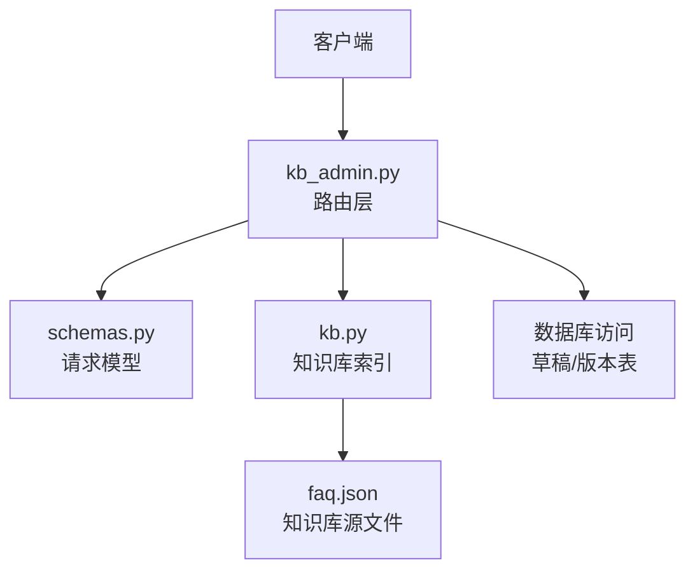
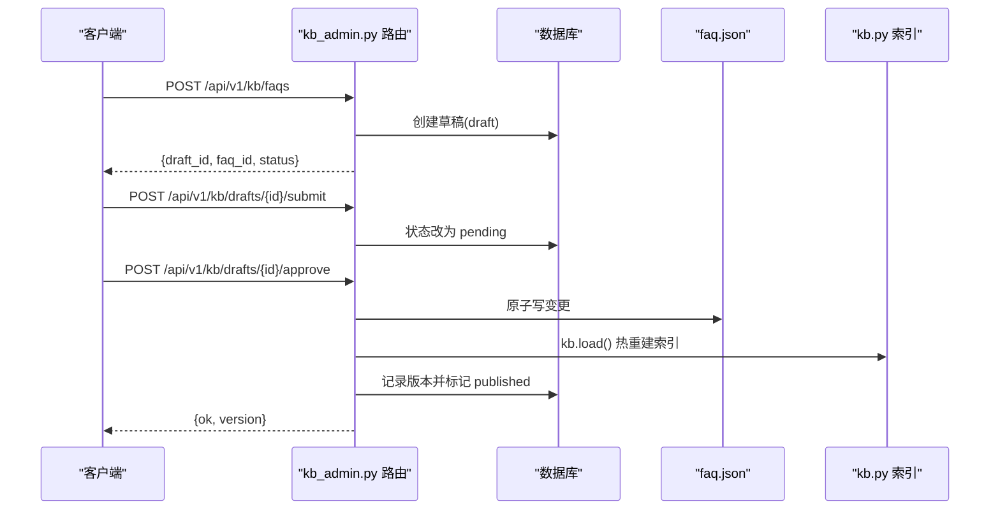
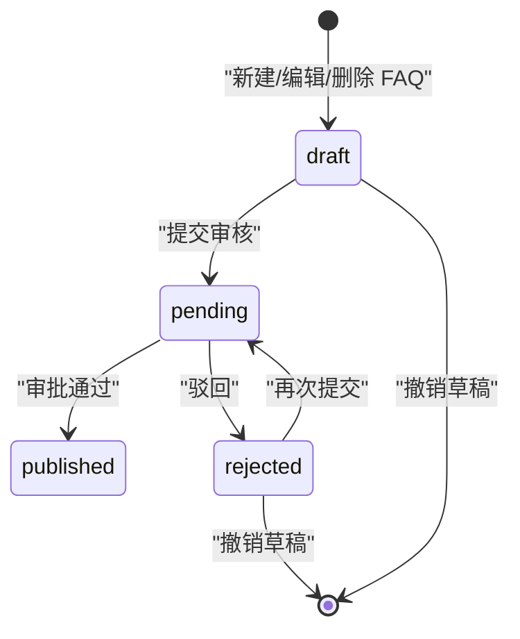
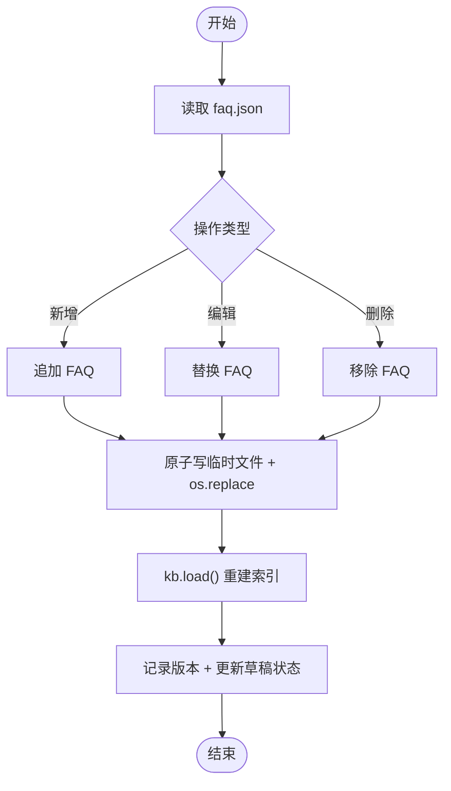

# 知识库管理接口

<cite>
**本文引用的文件**   
- [kb_admin.py](file://backend/app/routers/kb_admin.py)
- [schemas.py](file://backend/app/models/schemas.py)
- [kb.py](file://backend/app/storage/kb.py)
- [test_kb_admin.py](file://backend/tests/test_kb_admin.py)
</cite>

## 目录
1. [简介](#简介)
2. [项目结构](#项目结构)
3. [核心组件](#核心组件)
4. [架构总览](#架构总览)
5. [详细接口文档](#详细接口文档)
6. [请求与响应模型](#请求与响应模型)
7. [草稿状态机与原子写机制](#草稿状态机与原子写机制)
8. [依赖关系分析](#依赖关系分析)
9. [性能与一致性特征](#性能与一致性特征)
10. [故障排查指南](#故障排查指南)
11. [结论](#结论)

## 简介
本仓库的知识库后台（V2.0）提供 FAQ 的 CRUD、草稿审批流、版本历史与一键回滚能力。所有对知识库的变更必须经过“草稿 → 待审 → 已生效/已驳回”的审批流程，并通过“原子写 + 热重建索引”保证 faq.json 与内存索引的一致性。FAQ 查询支持按分类和关键词过滤，并附带最新未生效草稿标记。

## 项目结构
与知识库管理接口直接相关的后端代码位于 `backend/app`：
- `routers/kb_admin.py`：FastAPI 路由层，定义知识库管理的所有 HTTP 端点。
- `models/schemas.py`：Pydantic 请求/响应模型，是前后端契约的唯一来源。
- `storage/kb.py`：知识库加载、检索索引（TF-IDF/BM25/RRF）、FAQ 数据对象。
- `tests/test_kb_admin.py`：覆盖新建、编辑、删除、提交审核、审批通过、驳回、撤销、版本回滚等全流程用例。



**图表来源**
- [kb_admin.py:1-40](file://backend/app/routers/kb_admin.py#L1-L40)
- [schemas.py:1-20](file://backend/app/models/schemas.py#L1-L20)
- [kb.py:1-40](file://backend/app/storage/kb.py#L1-L40)

**章节来源**
- [kb_admin.py:1-40](file://backend/app/routers/kb_admin.py#L1-L40)
- [schemas.py:1-20](file://backend/app/models/schemas.py#L1-L20)
- [kb.py:1-40](file://backend/app/storage/kb.py#L1-L40)

## 核心组件
- 路由控制器：统一暴露 `/api/v1/kb/*` 系列端点，封装草稿创建、提交、审批、驳回、撤销与版本回滚逻辑。
- 请求模型：使用 Pydantic 校验 FAQ 载荷、草稿审批参数与回滚操作参数。
- 知识库索引：基于本地 TF-IDF/BM25 构建向量与 BM25 分数，支持混合特征分词；在审批通过后调用 `kb.load()` 热重建索引。
- 原子写：通过临时文件写入后 `os.replace` 替换目标文件，避免半写态。
- 并发控制：异步锁 `_apply_lock` 保护“应用草稿 → 落盘 → 热更新 → 记版本”的关键路径。

**章节来源**
- [kb_admin.py:1-80](file://backend/app/routers/kb_admin.py#L1-L80)
- [kb.py:1-120](file://backend/app/storage/kb.py#L1-L120)

## 架构总览
知识库管理的整体流程如下：前端或运营系统调用路由端点，路由层校验请求体，将变更持久化为草稿；提交审核后进入待审；审批通过后，路由层串行化执行“读取 faq.json → 修改列表 → 原子写 → 重建索引 → 记录版本 → 更新草稿状态”，最终返回包含版本号的结果。



**图表来源**
- [kb_admin.py:120-200](file://backend/app/routers/kb_admin.py#L120-L200)
- [kb_admin.py:201-299](file://backend/app/routers/kb_admin.py#L201-L299)

## 详细接口文档

### FAQ 查询

#### 列出 FAQ
- **方法**: GET
- **路径**: `/api/v1/kb/faqs`
- **查询参数**:
  - `category`: 可选，按分类过滤，有效值包括 `aftersales`、`presales`、`transaction`、`account`。
  - `q`: 可选，关键词；匹配标准问法、变体问法与答案（不区分大小写）。
- **成功响应**:
  - `total`: 当前过滤后的总数。
  - `categories`: 各分类统计。
  - `faqs`: FAQ 列表，每条附带最新未生效草稿标记字段（如 `draft_status`、`draft_action`、`draft_id`）。
- **错误码**:
  - 无业务错误码；若参数无效由 Pydantic 返回 422。

示例
- 获取全部 FAQ：`GET /api/v1/kb/faqs`
- 仅售前类：`GET /api/v1/kb/faqs?category=presales`
- 搜索含“退货”的条目：`GET /api/v1/kb/faqs?q=退货`

**章节来源**
- [kb_admin.py:140-175](file://backend/app/routers/kb_admin.py#L140-L175)
- [test_kb_admin.py:230-250](file://backend/tests/test_kb_admin.py#L230-L250)

#### 获取 FAQ 详情
- **方法**: GET
- **路径**: `/api/v1/kb/faqs/{faq_id}`
- **路径参数**:
  - `faq_id`: FAQ 唯一标识，例如 `faq_001`。
- **成功响应**: FAQ 完整对象。
- **错误码**:
  - `404`: FAQ 不存在。

示例
- `GET /api/v1/kb/faqs/faq_001`

**章节来源**
- [kb_admin.py:177-183](file://backend/app/routers/kb_admin.py#L177-L183)

### FAQ 操作（创建草稿）

以下三个端点均不直接修改 faq.json，而是创建一条草稿，需后续提交审核并审批通过才生效。

#### 新建 FAQ（草稿）
- **方法**: POST
- **路径**: `/api/v1/kb/faqs`
- **请求体**: 见“请求与响应模型”。
- **成功响应**:
  - `draft_id`: 草稿 ID。
  - `faq_id`: 生成的 FAQ 标识。
  - `status`: `draft`。
  - `message`: 提示文案。
- **错误码**:
  - `422`: 请求体验证失败。

示例
```json
POST /api/v1/kb/faqs
{
  "faq": {
    "category": "aftersales",
    "standard_question": "换货要多久？",
    "variants": ["换货时效", "换货几天"],
    "answer": "一般 3-5 天。",
    "risk_level": "low",
    "follow_up": ["换货运费谁出"]
  },
  "created_by": "ops"
}
```

**章节来源**
- [kb_admin.py:185-194](file://backend/app/routers/kb_admin.py#L185-L194)
- [test_kb_admin.py:30-70](file://backend/tests/test_kb_admin.py#L30-L70)

#### 编辑 FAQ（草稿）
- **方法**: PUT
- **路径**: `/api/v1/kb/faqs/{faq_id}`
- **路径参数**: `faq_id`
- **请求体**: 同新建。
- **成功响应**: 返回新草稿信息。
- **错误码**:
  - `404`: FAQ 不存在。
  - `422`: 请求体验证失败。

示例
- `PUT /api/v1/kb/faqs/faq_001`，请求体结构与新建一致。

**章节来源**
- [kb_admin.py:196-200](file://backend/app/routers/kb_admin.py#L196-L200)
- [test_kb_admin.py:210-220](file://backend/tests/test_kb_admin.py#L210-L220)

#### 删除 FAQ（草稿）
- **方法**: DELETE
- **路径**: `/api/v1/kb/faqs/{faq_id}`
- **查询参数**:
  - `created_by`: 操作人标识，默认值为 `ops`。
- **成功响应**: 返回删除草稿信息。
- **错误码**:
  - `404`: FAQ 不存在。

示例
- `DELETE /api/v1/kb/faqs/faq_040?created_by=ops`

**章节来源**
- [kb_admin.py:202-210](file://backend/app/routers/kb_admin.py#L202-L210)
- [test_kb_admin.py:140-170](file://backend/tests/test_kb_admin.py#L140-L170)

### 草稿与审批流程

#### 草稿列表
- **方法**: GET
- **路径**: `/api/v1/kb/drafts`
- **查询参数**:
  - `status`: 可选，按草稿状态过滤。
- **成功响应**: 草稿列表数组。

示例
- `GET /api/v1/kb/drafts`
- `GET /api/v1/kb/drafts?status=pending`

**章节来源**
- [kb_admin.py:212-214](file://backend/app/routers/kb_admin.py#L212-L214)

#### 草稿详情
- **方法**: GET
- **路径**: `/api/v1/kb/drafts/{draft_id}`
- **路径参数**: `draft_id`
- **成功响应**: 草稿完整对象。
- **错误码**:
  - `404`: 草稿不存在。

示例
- `GET /api/v1/kb/drafts/123`

**章节来源**
- [kb_admin.py:216-220](file://backend/app/routers/kb_admin.py#L216-L220)

#### 提交审核
- **方法**: POST
- **路径**: `/api/v1/kb/drafts/{draft_id}/submit`
- **请求体**: 可为空对象。
- **成功响应**:
  - `ok`: `true`
  - `draft_id`: 草稿 ID
  - `status`: `pending`
- **错误码**:
  - `404`: 草稿不存在。
  - `409`: 草稿当前状态不允许提交（需要处于 `draft` 或 `rejected`）。

示例
- `POST /api/v1/kb/drafts/{draft_id}/submit`

**章节来源**
- [kb_admin.py:201-210](file://backend/app/routers/kb_admin.py#L201-L210)
- [test_kb_admin.py:250-290](file://backend/tests/test_kb_admin.py#L250-L290)

#### 审批通过
- **方法**: POST
- **路径**: `/api/v1/kb/drafts/{draft_id}/approve`
- **请求体**:
  - `reviewed_by`: 审批人标识，默认 `ops`。
- **成功响应**:
  - `ok`: `true`
  - `faq_id`: 操作的 FAQ 标识
  - `action`: `create` / `update` / `delete`
  - `version`: 新版本号
- **错误码**:
  - `404`: 草稿不存在。
  - `409`: 草稿非 `pending` 状态或已被其他操作处理。

示例
```json
POST /api/v1/kb/drafts/{draft_id}/approve
{
  "reviewed_by": "ops"
}
```

**章节来源**
- [kb_admin.py:222-238](file://backend/app/routers/kb_admin.py#L222-L238)
- [kb_admin.py:80-140](file://backend/app/routers/kb_admin.py#L80-L140)

#### 驳回
- **方法**: POST
- **路径**: `/api/v1/kb/drafts/{draft_id}/reject`
- **请求体**:
  - `reviewed_by`: 审批人标识，默认 `ops`。
  - `reason`: 可选，驳回原因。
- **成功响应**:
  - `ok`: `true`
  - `draft_id`: 草稿 ID
  - `status`: `rejected`
  - `reason`: 驳回原因
- **错误码**:
  - `404`: 草稿不存在。
  - `409`: 草稿非 `pending` 状态或驳回失败。

示例
```json
POST /api/v1/kb/drafts/{draft_id}/reject
{
  "reviewed_by": "ops",
  "reason": "措辞不规范"
}
```

**章节来源**
- [kb_admin.py:240-254](file://backend/app/routers/kb_admin.py#L240-L254)

#### 撤销草稿
- **方法**: DELETE
- **路径**: `/api/v1/kb/drafts/{draft_id}`
- **成功响应**:
  - `ok`: `true`
  - `draft_id`: 被撤销的草稿 ID
- **错误码**:
  - `409`: 仅草稿或已驳回状态的草稿可撤销。

示例
- `DELETE /api/v1/kb/drafts/{draft_id}`

**章节来源**
- [kb_admin.py:256-262](file://backend/app/routers/kb_admin.py#L256-L262)

### 版本管理与回滚

#### 查看版本历史
- **方法**: GET
- **路径**: `/api/v1/kb/versions`
- **查询参数**:
  - `faq_id`: 可选，按 FAQ 筛选版本。
  - `limit`: 可选，返回条数上限，默认 50。
- **成功响应**: 版本记录列表，包含 `action`、`snapshot`、`operator`、`version` 等字段。

示例
- `GET /api/v1/kb/versions`
- `GET /api/v1/kb/versions?faq_id=faq_001&limit=10`

**章节来源**
- [kb_admin.py:264-268](file://backend/app/routers/kb_admin.py#L264-L268)

#### 一键回滚到历史版本
- **方法**: POST
- **路径**: `/api/v1/kb/versions/{version_id}/rollback`
- **请求体**:
  - `created_by`: 操作人标识，默认 `ops`。
- **行为说明**:
  - 快照对应 FAQ 仍存在：生成 `update` 草稿。
  - 快照对应 FAQ 已被删除：生成 `create` 草稿（恢复原 id）。
  - 当前内容与快照一致：返回 409，无需回滚。
  - 回滚会生成草稿并自动提交审核，仍需主管审批通过才生效。
- **成功响应**:
  - `ok`: `true`
  - `draft_id`: 回滚对应的草稿 ID
  - `faq_id`: 被回滚的 FAQ 标识
  - `action`: `create` 或 `update`
  - `status`: `pending`
  - `message`: 提示信息
- **错误码**:
  - `404`: 版本记录不存在。
  - `409`: 版本无快照、缺少 FAQ id，或当前内容已与版本一致。

示例
```json
POST /api/v1/kb/versions/{version_id}/rollback
{
  "created_by": "ops"
}
```

**章节来源**
- [kb_admin.py:270-316](file://backend/app/routers/kb_admin.py#L270-L316)
- [test_kb_admin.py:260-309](file://backend/tests/test_kb_admin.py#L260-L309)

## 请求与响应模型

### FAQPayload
用于新建和编辑 FAQ 的统一载荷。
- `category`: 枚举，取值 `aftersales`、`presales`、`transaction`、`account`。
- `standard_question`: 必填，长度 2–200。
- `variants`: 可选，最多 50 个变体问法字符串。
- `answer`: 必填，长度 1–5000。
- `risk_level`: 枚举，取值 `low`、`mid`、`high`，默认 `low`。
- `follow_up`: 可选，最多 20 个后续问题字符串。

**章节来源**
- [schemas.py:40-60](file://backend/app/models/schemas.py#L40-L60)

### DraftReviewRequest
用于审批动作的请求体。
- `reviewed_by`: 审批人标识，默认 `ops`，最大长度 64。
- `reason`: 可选，驳回原因，最大长度 500。

**章节来源**
- [schemas.py:62-70](file://backend/app/models/schemas.py#L62-L70)

### RollbackRequest
用于版本回滚的操作请求体。
- `created_by`: 操作人标识，默认 `ops`，最大长度 64。

**章节来源**
- [schemas.py:72-76](file://backend/app/models/schemas.py#L72-L76)

### FAQCreateRequest / FAQUpdateRequest
- `faq`: 类型为 `FAQPayload`。
- `created_by`: 操作人标识，默认 `ops`，最大长度 64。

**章节来源**
- [schemas.py:62-70](file://backend/app/models/schemas.py#L62-L70)

## 草稿状态机与原子写机制

### 草稿状态机
草稿从创建到生效的生命周期如下：



- `draft`：草稿刚创建，尚未提交。
- `pending`：已提交审核，等待审批。
- `published`：审批通过，已落盘并热更新。
- `rejected`：被驳回，可修改后重新提交。

约束
- 只有 `draft` 或 `rejected` 状态可提交。
- 只有 `pending` 状态可审批或驳回。
- 重复提交、重复审批会返回 `409`。
- 草稿可撤销，撤销后不可再操作。

**章节来源**
- [kb_admin.py:201-262](file://backend/app/routers/kb_admin.py#L201-L262)
- [test_kb_admin.py:250-309](file://backend/tests/test_kb_admin.py#L250-L309)

### 原子写与热更新
- 原子写：先写入临时文件，再用 `os.replace` 替换目标 `faq.json`，避免部分写入导致的损坏。
- 热更新：原子写成功后调用 `kb.load()` 重建索引，同时版本号递增，高频缓存失效。
- 并发安全：关键路径使用异步锁 `_apply_lock`，防止多并发审批导致竞态。



**图表来源**
- [kb_admin.py:80-140](file://backend/app/routers/kb_admin.py#L80-L140)

**章节来源**
- [kb_admin.py:1-80](file://backend/app/routers/kb_admin.py#L1-L80)

## 依赖关系分析

```mermaid
classDiagram
  class KBRouter {
    "+GET /faqs"
    "+GET /faqs/{faq_id}"
    "+POST /faqs"
    "+PUT /faqs/{faq_id}"
    "+DELETE /faqs/{faq_id}"
    "+GET /drafts"
    "+GET /drafts/{draft_id}"
    "+POST /drafts/{id}/submit"
    "+POST /drafts/{id}/approve"
    "+POST /drafts/{id}/reject"
    "+DELETE /drafts/{draft_id}"
    "+GET /versions"
    "+POST /versions/{version_id}/rollback"
  }

  class Schemas {
    "+FAQPayload"
    "+FAQCreateRequest"
    "+FAQUpdateRequest"
    "+DraftReviewRequest"
    "+RollbackRequest"
  }

  class KBStorage {
    "+load()"
    "+get_faq()"
    "+search()"
    "+category_stats()"
    "+version"
  }

  KBRouter --> Schemas : "校验请求体"
  KBRouter --> KBStorage : "读取/重建索引"
```

**图表来源**
- [kb_admin.py:1-316](file://backend/app/routers/kb_admin.py#L1-L316)
- [schemas.py:1-76](file://backend/app/models/schemas.py#L1-L76)
- [kb.py:1-120](file://backend/app/storage/kb.py#L1-L120)

**章节来源**
- [kb_admin.py:1-316](file://backend/app/routers/kb_admin.py#L1-L316)
- [schemas.py:1-76](file://backend/app/models/schemas.py#L1-L76)
- [kb.py:1-120](file://backend/app/storage/kb.py#L1-L120)

## 性能与一致性特征
- 索引重建为全量重建，但数据规模较小（约几十条 FAQ），通常在毫秒级完成。
- 原子写避免脏数据，结合版本号递增使高频缓存失效策略更可靠。
- 并发审批通过异步锁串行化，牺牲少量吞吐换取强一致性。
- 搜索采用 TF-IDF 向量相似度与 BM25 融合，兼顾召回与精确匹配。

[本节为通用性能讨论，不直接分析具体文件]

## 故障排查指南
- 404 FAQ 不存在：检查 `faq_id` 是否正确，确认是否已被删除且未回滚。
- 409 草稿冲突：常见于重复提交、重复审批或在非 `pending` 状态下进行审批/驳回。
- 409 版本回滚失败：可能因版本记录缺失、快照为空、或缺少 FAQ id；也可能当前内容已与版本一致。
- 422 请求体验证失败：检查 `category`、`risk_level` 是否为合法枚举，字段长度是否符合限制。
- 审批未生效：确认草稿已提交并审批通过；检查 `faq.json` 是否更新、索引是否重建。

**章节来源**
- [kb_admin.py:201-316](file://backend/app/routers/kb_admin.py#L201-L316)
- [test_kb_admin.py:210-309](file://backend/tests/test_kb_admin.py#L210-L309)

## 结论
知识库管理接口以 FastAPI 路由为核心，配合 Pydantic 模型校验、原子写与异步锁，实现了“草稿审批 + 热更新 + 版本回滚”的完整闭环。FAQ 查询支持分类与关键词过滤，并在列表中附带最新未生效草稿标记，便于运营人员掌握变更进度。建议在生产环境中严格遵循“所有变更走审批流”的原则，并结合版本历史进行审计与回滚。