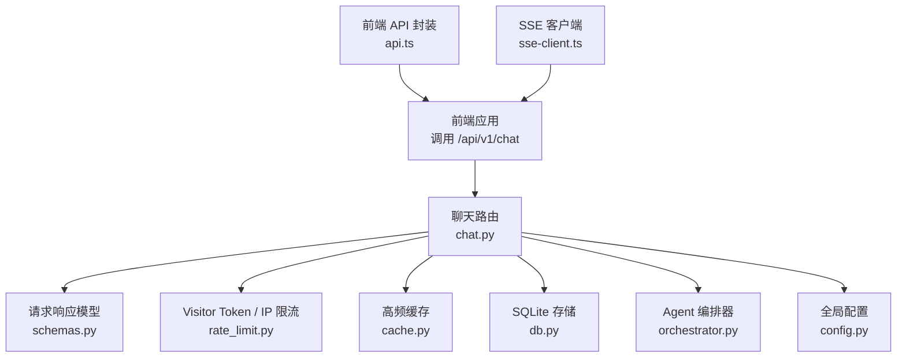
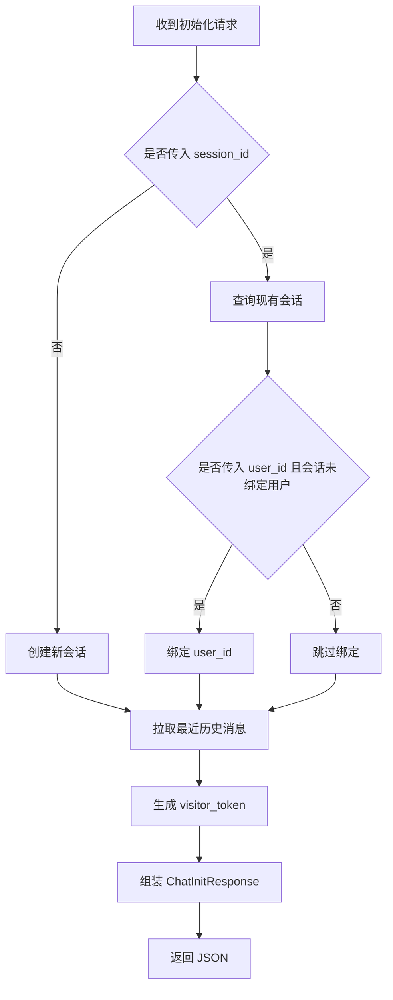
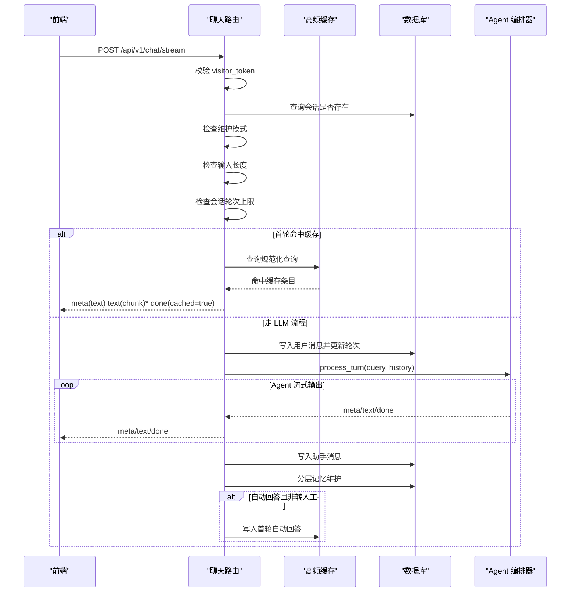
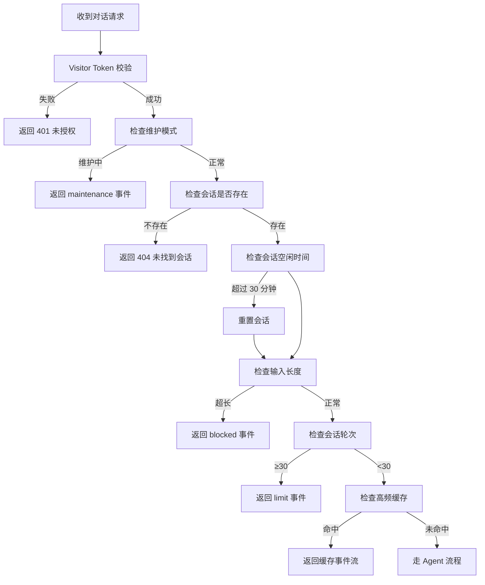
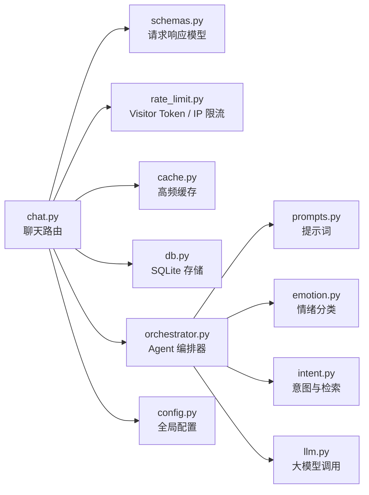

# 聊天接口

<cite>
**本文引用的文件**   
- [backend/app/routers/chat.py](file://backend/app/routers/chat.py)
- [backend/app/models/schemas.py](file://backend/app/models/schemas.py)
- [backend/app/storage/rate_limit.py](file://backend/app/storage/rate_limit.py)
- [backend/app/storage/cache.py](file://backend/app/storage/cache.py)
- [backend/app/storage/db.py](file://backend/app/storage/db.py)
- [backend/app/config.py](file://backend/app/config.py)
- [backend/app/agent/orchestrator.py](file://backend/app/agent/orchestrator.py)
- [frontend/src/api.ts](file://frontend/src/api.ts)
- [frontend/src/sse-client.ts](file://frontend/src/sse-client.ts)
</cite>

## 目录
1. [简介](#简介)
2. [项目结构与入口](#项目结构与入口)
3. [核心端点总览](#核心端点总览)
4. [请求与响应模型](#请求与响应模型)
5. [会话初始化接口](#会话初始化接口)
6. [SSE 流式对话接口](#sse-流式对话接口)
7. [Visitor Token 签名验证机制](#visitor-token-签名验证机制)
8. [防御机制与安全控制](#防御机制与安全控制)
9. [错误处理与状态码](#错误处理与状态码)
10. [完整交互场景示例](#完整交互场景示例)
11. [依赖关系分析](#依赖关系分析)
12. [性能特性与优化建议](#性能特性与优化建议)
13. [故障排查指南](#故障排查指南)
14. [结论](#结论)

## 简介
本文件面向接入方，聚焦后端聊天接口的契约说明，包括：
- 会话初始化接口 `POST /api/v1/chat/init`
- SSE 流式对话接口 `POST /api/v1/chat/stream`
- Visitor Token 校验、维护模式、高频缓存命中秒回、会话轮次上限、超长输入拦截等安全与运行控制逻辑
- SSE 事件类型 `meta`、`text`、`done`、`summary`、`blocked`、`limit`、`maintenance`、`handover` 的语义和字段约定

该文档不直接粘贴代码，而是通过“文件路径 + 行号”的方式标注实现来源，便于读者在仓库中对照定位。

## 项目结构与入口
聊天相关能力集中在后端 FastAPI 应用中：
- 路由定义：`backend/app/routers/chat.py`
- 数据模型契约：`backend/app/models/schemas.py`
- Visitor Token 生成与校验、IP 限流：`backend/app/storage/rate_limit.py`
- 高频答案缓存：`backend/app/storage/cache.py`
- SQLite 会话、消息、排队存储：`backend/app/storage/db.py`
- 全局配置（品牌名、快捷标签、轮次上限、输入长度限制等）：`backend/app/config.py`
- Agent 编排器（负责检索、决策、LLM 调用、转人工）：`backend/app/agent/orchestrator.py`
- 前端 API 封装与 SSE 客户端：`frontend/src/api.ts`、`frontend/src/sse-client.ts`



**图表来源**
- [backend/app/routers/chat.py:1-30](file://backend/app/routers/chat.py#L1-L30)
- [backend/app/models/schemas.py:1-20](file://backend/app/models/schemas.py#L1-L20)
- [backend/app/storage/rate_limit.py:1-20](file://backend/app/storage/rate_limit.py#L1-L20)
- [backend/app/storage/cache.py:1-20](file://backend/app/storage/cache.py#L1-L20)
- [backend/app/storage/db.py:1-20](file://backend/app/storage/db.py#L1-L20)
- [backend/app/agent/orchestrator.py:1-20](file://backend/app/agent/orchestrator.py#L1-L20)
- [frontend/src/api.ts:1-40](file://frontend/src/api.ts#L1-L40)
- [frontend/src/sse-client.ts:1-20](file://frontend/src/sse-client.ts#L1-L20)

**章节来源**
- [backend/app/routers/chat.py:1-30](file://backend/app/routers/chat.py#L1-L30)
- [backend/app/models/schemas.py:1-20](file://backend/app/models/schemas.py#L1-L20)

## 核心端点总览
| 方法 | 路径 | 用途 | 返回类型 | 主要行为 |
|---|---|---|---|---|
| `POST` | `/api/v1/chat/init` | 页面初始化、创建或恢复会话、下发访客令牌、拉取历史消息 | JSON `ChatInitResponse` | 创建/绑定会话、生成 `visitor_token`、返回品牌名、快捷标签、历史消息、会话状态、灰度标记 |
| `POST` | `/api/v1/chat/stream` | 发送用户消息并接收 SSE 流式回答 | `text/event-stream` | Visitor Token 校验、维护模式检测、会话存在性与超时复位、输入长度与轮次上限检查、高频缓存命中秒回、Agent 流式回答、转人工登记、摘要事件 |
| `POST` | `/api/v1/handover` | 手动触发转人工 | JSON `HandoverResponse` | Visitor Token 校验、维护模式检测、记录会话历史摘要并登记排队 |

其中 `POST /api/v1/chat/stream` 是核心对话入口；所有其他行为均通过该接口返回的 SSE 事件体现。

**章节来源**
- [backend/app/routers/chat.py:31-60](file://backend/app/routers/chat.py#L31-L60)
- [backend/app/routers/chat.py:80-327](file://backend/app/routers/chat.py#L80-L327)

## 请求与响应模型
### ChatInitRequest
| 字段 | 类型 | 是否必填 | 默认值 | 含义 |
|---|---|---|---|---|
| `session_id` | 字符串 | 否 | 空 | 已有会话 ID，用于刷新页面后恢复历史 |
| `user_id` | 字符串 | 否 | 空 | 已登录用户 ID，可选；若传入且会话未绑定用户，则绑定 |

### ChatInitResponse
| 字段 | 类型 | 默认值 | 含义 |
|---|---|---|---|
| `session_id` | 字符串 | — | 会话 ID，由后端创建或复用 |
| `visitor_token` | 字符串 | — | 本次会话的访客令牌，后续 SSE 对话必须携带 |
| `expires_in` | 整数 | `86400` | 令牌过期时间（秒），默认 24 小时 |
| `brand_name` | 字符串 | — | 品牌名称，来自配置 |
| `quick_chips` | 数组 | — | 快捷标签列表，每个元素包含显示文本与提问值 |
| `history` | 数组 | — | 最近历史消息，元素含角色、内容、创建时间 |
| `status` | 字符串 | `AGENT_ACTIVE` | 会话当前状态，如 `AGENT_ACTIVE`、`HANDOVER`、`CONFIRMING` 等 |
| `gray` | 布尔值 | `false` | 是否命中灰度分组，可用于观测或分流 |

### ChatStreamRequest
| 字段 | 类型 | 约束 | 含义 |
|---|---|---|---|
| `session_id` | 字符串 | 必填，长度 8–64 | 会话 ID |
| `message` | 字符串 | 必填，长度 1–2000 | 用户当前轮消息 |
| `visitor_token` | 字符串 | 必填，长度 8–256 | 会话访客令牌，用于防刷和身份绑定 |

上述模型由 Pydantic 定义，是前后端契约的唯一来源。

**章节来源**
- [backend/app/models/schemas.py:9-26](file://backend/app/models/schemas.py#L9-L26)
- [backend/app/models/schemas.py:28-35](file://backend/app/models/schemas.py#L28-L35)
- [backend/app/models/schemas.py:88-104](file://backend/app/models/schemas.py#L88-L104)

## 会话初始化接口
### 基本信息
- 方法：`POST`
- 路径：`/api/v1/chat/init`
- 请求体：`ChatInitRequest`
- 响应体：`ChatInitResponse`
- 典型用途：前端页面加载时调用，获取会话上下文、品牌信息、快捷标签和历史消息

### 初始化流程


**图表来源**
- [backend/app/routers/chat.py:31-60](file://backend/app/routers/chat.py#L31-L60)
- [backend/app/storage/db.py:92-130](file://backend/app/storage/db.py#L92-L130)

### 初始化请求示例
```json
{
  "session_id": "sess_abc123def456",
  "user_id": "user_1001"
}
```

### 初始化响应示例
```json
{
  "session_id": "sess_abc123def456",
  "visitor_token": "base64_payload.signature",
  "expires_in": 86400,
  "brand_name": "小答",
  "quick_chips": [
    {"label": "怎么查物流", "value": "怎么查我的物流信息"},
    {"label": "7天无理由怎么退", "value": "怎么申请7天无理由退货"},
    {"label": "退款多久到账", "value": "退款多久能到账"},
    {"label": "忘记密码了", "value": "我忘记密码了怎么办"}
  ],
  "history": [
    {"role": "assistant", "content": "您好，请问有什么可以帮您？", "created_at": "2026-11-05 10:00:00"}
  ],
  "status": "AGENT_ACTIVE",
  "gray": false
}
```

### 初始化异常场景
| 场景 | 行为 |
|---|---|
| 首次访问无 `session_id` | 后端创建新会话，返回新 `session_id` |
| 传入已存在的 `session_id` | 恢复历史消息，不重复创建 |
| 传入 `user_id` 且会话未绑定 | 将匿名会话与登录用户绑定 |
| 历史为空 | `history` 返回空数组 |
| 维护模式下初始化 | 仍返回初始响应，但后续 SSE 会进入维护模式分支 |

**章节来源**
- [backend/app/routers/chat.py:31-60](file://backend/app/routers/chat.py#L31-L60)
- [backend/app/models/schemas.py:88-104](file://backend/app/models/schemas.py#L88-L104)

## SSE 流式对话接口
### 基本信息
- 方法：`POST`
- 路径：`/api/v1/chat/stream`
- 请求体：`ChatStreamRequest`
- 响应类型：`text/event-stream`
- 使用方式：前端使用 `fetch` 读取 `ReadableStream`，按 `event:` 与 `data:` 解析事件

### SSE 事件类型总览
| 事件 | 何时出现 | 主要字段 | 含义 |
|---|---|---|---|
| `meta` | 每轮开始或状态变化时 | `status`、`handover`、`handover_reason`、`quick_replies`、`emotion`、`intent`、`confidence`、`faq_ids`、`cached` | 会话元信息，包括状态、情绪、意图、置信度、是否转人工、是否缓存命中等 |
| `text` | Agent 输出增量文本时 | `content` | 一段可追加到前端的文本片段 |
| `done` | 单轮回答结束时 | `message_id`、`handover`、`handover_reason`、`handover_summary`、`cached`、`clear_pending` | 本轮结束，可能携带转人工信息和清除确认态标记 |
| `summary` | 转人工排队完成时 | `message`、`queue_id`、`session_status` | 向用户展示排队结果与队列编号 |
| `blocked` | 输入过长被拦截时 | `status`、`handover`、`quick_replies` | 提示用户分条发送 |
| `limit` | 会话轮次达到上限时 | `status`、`handover`、`quick_replies` | 提示今日咨询次数过多 |
| `maintenance` | 全局维护模式开启时 | `status`、`handover`、`quick_replies` | 告知服务不可用 |
| `handover` | 转人工模式触发时 | `status`、`handover`、`handover_reason`、`quick_replies` | 明确进入转人工流程 |

### 正常对话 SSE 序列


**图表来源**
- [backend/app/routers/chat.py:80-200](file://backend/app/routers/chat.py#L80-L200)
- [backend/app/routers/chat.py:201-327](file://backend/app/routers/chat.py#L201-L327)
- [backend/app/storage/cache.py:33-82](file://backend/app/storage/cache.py#L33-L82)
- [backend/app/agent/orchestrator.py:70-140](file://backend/app/agent/orchestrator.py#L70-L140)

### 正常对话请求示例
```json
{
  "session_id": "sess_abc123def456",
  "message": "我的快递为什么还没到",
  "visitor_token": "base64_payload.signature"
}
```

### 正常对话 SSE 响应示例
```
event: meta
data: {"status":"answering","emotion":"LEVEL_0","intent":"logistics_query","confidence":0.82,"faq_ids":[],"handover":false,"quick_replies":[{"label":"继续咨询其他问题","value":"好的，继续聊其他问题"}]}

event: text
data: {"content":"正在为您查询物流进度"}

event: text
data: {"content":"根据系统记录，您的包裹已于昨日发出"}

event: done
data: {"message_id":"msg_a1b2c3d4e5f6","handover":false,"handover_reason":"","cached":false}
```

### 缓存命中请求示例
```json
{
  "session_id": "sess_new_session_001",
  "message": "怎么查我的物流信息",
  "visitor_token": "base64_payload.signature"
}
```

### 缓存命中 SSE 响应示例
```
event: meta
data: {"status":"answering","cached":true,"handover":false,"quick_replies":[{"label":"继续咨询其他问题","value":"好的，继续聊其他问题"}]}

event: text
data: {"content":"您可以在订单详情页查看物流轨迹"}

event: done
data: {"message_id":"msg_cached12345678","handover":false,"handover_reason":"","cached":true}
```

### 维护模式 SSE 响应示例
```
event: meta
data: {"status":"maintenance","handover":false,"quick_replies":[]}

event: text
data: {"content":"当前处于维护模式，请稍后再试"}

event: done
data: {"message_id":"","handover":false,"handover_reason":"kill_switch_off"}
```

### 输入过长 blocked SSE 响应示例
```
event: meta
data: {"status":"blocked","handover":false,"quick_replies":[]}

event: text
data: {"content":"这条消息有点长啦，方便分几条发给我吗？"}

event: done
data: {"message_id":"","handover":false}
```

### 轮次上限 limit SSE 响应示例
```
event: meta
data: {"status":"limit","handover":false,"quick_replies":[{"label":"继续咨询其他问题","value":"好的，继续聊其他问题"}]}

event: text
data: {"content":"您今天咨询的次数有点多啦～如需继续，请登录账号或转接人工，小助手会继续为您服务。"}

event: done
data: {"message_id":"","handover":false}
```

### 转人工 summary SSE 响应示例
```
event: meta
data: {"status":"handover","handover":true,"handover_reason":"user_request","quick_replies":[{"label":"继续咨询其他问题","value":"好的，继续聊其他问题"}]}

event: text
data: {"content":"已为您转接人工客服"}

event: done
data: {"message_id":"msg_handover123","handover":true,"handover_reason":"user_request","handover_summary":"用户主动要求转人工"}

event: summary
data: {"message":"已转人工排队（留言模式）","queue_id":1001,"session_status":"HANDOVER"}
```

**章节来源**
- [backend/app/routers/chat.py:80-327](file://backend/app/routers/chat.py#L80-L327)
- [backend/app/models/schemas.py:28-35](file://backend/app/models/schemas.py#L28-L35)
- [frontend/src/sse-client.ts:1-59](file://frontend/src/sse-client.ts#L1-L59)

## Visitor Token 签名验证机制
### 令牌结构
Visitor Token 采用“载荷 + 签名”结构：
- 载荷：包含会话标识和过期时间的 JSON，并进行 URL 安全的 Base64 编码
- 签名：对载荷使用 HMAC-SHA256 计算，密钥来自配置项
- 最终格式：`base64_payload.signature`

### 生成过程
1. 构造载荷对象，包含会话 ID 和过期时间戳
2. 将载荷序列化为紧凑 JSON
3. 进行 URL 安全 Base64 编码
4. 使用固定密钥计算 HMAC-SHA256 签名
5. 拼接为 `payload.signature`

### 校验过程
1. 从 token 中分离载荷和签名
2. 使用相同密钥对载荷重新计算签名，并使用恒定时间比较防止时序攻击
3. 解码载荷，检查会话 ID 是否与请求中的 `session_id` 一致
4. 检查过期时间是否小于当前时间
5. 任一校验失败都视为无效令牌

### 安全要点
| 项目 | 说明 |
|---|---|
| 密钥管理 | `VISITOR_TOKEN_SECRET` 不应硬编码在前端，生产环境必须替换为强随机密钥 |
| 过期时间 | 默认 24 小时，可通过配置调整 |
| 会话绑定 | 校验时会比对 token 内会话 ID 与请求中的 `session_id`，防止跨会话复用 |
| 防重放 | 每次初始化都会生成新 token，旧 token 过期后失效 |
| 裸请求拒绝 | 不带有效 `visitor_token` 的请求会被直接拒绝 |

**章节来源**
- [backend/app/storage/rate_limit.py:35-74](file://backend/app/storage/rate_limit.py#L35-L74)
- [backend/app/config.py:84-96](file://backend/app/config.py#L84-L96)
- [backend/app/routers/chat.py:80-100](file://backend/app/routers/chat.py#L80-L100)

## 防御机制与安全控制
### 四层防御总览
| 层级 | 机制 | 实现位置 | 作用 |
|---|---|---|---|
| 第一层 | IP 令牌桶限流 | `rate_limit.py` | 单 IP 每分钟最多若干条消息，超限拒绝 |
| 第二层 | Visitor Token 校验 | `rate_limit.py` + `chat.py` | 校验签名、会话匹配、过期时间 |
| 第三层 | 会话轮次上限 | `chat.py` + `config.py` | 单会话默认最多 30 轮，防止成本失控 |
| 第四层 | 输入超长拦截 | `chat.py` + `config.py` | 超过最大输入长度直接拒绝，不调 LLM |

### 具体控制规则
| 规则 | 默认值 | 行为 |
|---|---|---|
| 会话轮次上限 | `SESSION_MAX_TURNS = 30` | 达到上限后返回 `limit` 事件 |
| 最大输入长度 | `MAX_INPUT_LEN = 2000` | 超过后返回 `blocked` 事件 |
| IP 限流 | `RATE_LIMIT_PER_MIN = 10` | 单 IP 每分钟最多 10 条 |
| Visitor Token 过期 | `VISITOR_TOKEN_TTL_HOURS = 24` | 24 小时后 token 失效 |
| 会话超时复位 | `SESSION_TIMEOUT_MINUTES = 30` | 30 分钟无操作重置会话状态、轮次和元数据 |
| 确认状态超时 | `CONFIRM_TIMEOUT_SECONDS = 30` | 30 秒未回复自动取消确认态 |
| 连续未解决上限 | `REPEAT_UNRESOLVED_LIMIT = 2` | 连续多次转人工后强制切断并再次转人工 |



**图表来源**
- [backend/app/routers/chat.py:80-200](file://backend/app/routers/chat.py#L80-L200)
- [backend/app/config.py:45-96](file://backend/app/config.py#L45-L96)

**章节来源**
- [backend/app/storage/rate_limit.py:1-74](file://backend/app/storage/rate_limit.py#L1-L74)
- [backend/app/routers/chat.py:80-200](file://backend/app/routers/chat.py#L80-L200)
- [backend/app/config.py:45-96](file://backend/app/config.py#L45-L96)

## 错误处理与状态码
### HTTP 状态码
| 状态码 | 含义 | 触发条件 |
|---|---|---|
| `200` | 成功 | SSE 流正常返回；初始化接口正常返回 JSON |
| `401` | 未授权 | Visitor Token 无效、缺失或签名校验失败 |
| `404` | 未找到资源 | 会话不存在 |
| `503` | 服务不可用 | 维护模式下手动转人工接口返回 |

### SSE 业务状态
| 业务状态 | 对应事件 | 含义 |
|---|---|---|
| `answering` | `meta` | 正在生成回答 |
| `blocked` | `meta` | 输入被拦截 |
| `limit` | `meta` | 会话轮次达到上限 |
| `maintenance` | `meta` | 全局维护模式 |
| `handover` | `meta` | 转人工 |
| `AGENT_ACTIVE` | `ChatInitResponse.status` | 正常自助对话状态 |
| `HANDOVER` | `summary.session_status` | 已转人工排队 |
| `CONFIRMING` | 内部状态 | 等待用户确认某个 FAQ |

### 错误处理策略
- 无效 Visitor Token：直接抛出 `401`，不进入后续逻辑
- 会话不存在：抛出 `404`，避免空会话处理
- 维护模式：SSE 直接返回 `maintenance` 事件，不调用 LLM 也不落库
- 输入超长：SSE 返回 `blocked` 事件，提示用户拆分消息
- 轮次超限：SSE 返回 `limit` 事件，引导用户登录或转人工
- 转人工：写入助手消息、更新会话状态、登记排队、广播通知、生成工单卡片
- 缓存命中：仅首轮自动回答命中，不调 LLM，快速返回

**章节来源**
- [backend/app/routers/chat.py:80-327](file://backend/app/routers/chat.py#L80-L327)
- [backend/app/models/schemas.py:88-138](file://backend/app/models/schemas.py#L88-L138)

## 完整交互场景示例
### 场景一：首次访问正常对话
1. 前端调用 `POST /api/v1/chat/init`
2. 后端创建会话，返回 `session_id`、`visitor_token`、品牌名、快捷标签、历史消息
3. 前端携带 `visitor_token` 调用 `POST /api/v1/chat/stream`
4. 后端校验 token，查询知识库，调用 LLM 流式输出
5. 前端依次渲染 `meta` → 多个 `text` → `done`

### 场景二：缓存命中秒回
1. 新会话首轮输入与高频问题匹配
2. 后端命中内存缓存，不调 LLM
3. 直接返回带 `cached: true` 的 `meta`、`text`、`done`
4. 后端同时写入缓存统计

### 场景三：转人工
1. 用户表达转人工意图，或 Agent 判断无法回答
2. 后端返回 `handover: true` 的 `meta` 和 `done`
3. 后端更新会话状态为 `HANDOVER`，登记排队
4. 后端广播 WebSocket 通知坐席
5. 后端异步生成 Copilot 工单卡片
6. 最后返回 `summary` 事件，包含队列编号

### 场景四：维护模式
1. 运营后台开启全局维护模式
2. 前端调用 SSE 接口
3. 后端立即返回 `maintenance` 事件
4. 不调用 LLM，不落库，不入队

### 场景五：输入过长
1. 用户一次性发送超长消息
2. 后端检测到长度超过 `MAX_INPUT_LEN`
3. 返回 `blocked` 事件，提示分条发送

### 场景六：轮次上限
1. 会话累计 30 轮
2. 后端返回 `limit` 事件
3. 引导用户登录或转人工

**章节来源**
- [backend/app/routers/chat.py:31-327](file://backend/app/routers/chat.py#L31-L327)
- [backend/app/storage/cache.py:1-82](file://backend/app/storage/cache.py#L1-L82)

## 依赖关系分析
### 聊天路由依赖图


**图表来源**
- [backend/app/routers/chat.py:1-30](file://backend/app/routers/chat.py#L1-L30)
- [backend/app/agent/orchestrator.py:1-40](file://backend/app/agent/orchestrator.py#L1-L40)

### 数据流依赖
- 初始化阶段：`init` 依赖 `db.create_session`、`db.get_history`、`rate_limit.generate_visitor_token`
- 对话阶段：`stream` 依赖 `rate_limit.verify_visitor_token`、`db.get_session`、`answer_cache.get`、`orchestrator.process_turn`
- 转人工阶段：依赖 `db.enqueue_handover`、WebSocket 广播、Copilot 工单生成

**章节来源**
- [backend/app/routers/chat.py:31-327](file://backend/app/routers/chat.py#L31-L327)
- [backend/app/agent/orchestrator.py:70-140](file://backend/app/agent/orchestrator.py#L70-L140)

## 性能特性与优化建议
### 已知优化点
| 优化项 | 说明 | 性能影响 |
|---|---|---|
| 高频缓存 | 仅首轮自动回答命中，容量默认 20 条 | 首字延迟低于 500ms，避免重复 LLM 调用 |
| SSE 流式输出 | 文本分段输出，支持打字机效果 | 降低首屏等待时间 |
| 固定文本切块 | 缓存回答按固定大小切块重放 | 保持前端体验的同时减少 LLM 开销 |
| 会话超时复位 | 30 分钟无操作重置状态 | 防止长期占用导致的状态污染 |
| 记忆压缩 | 历史消息超出窗口时压缩摘要 | 控制 Prompt 长度，降低 LLM 成本 |

### 缓存淘汰策略
- 容量上限：默认 20 条
- 淘汰优先级：命中率最低且最久未命中的条目优先淘汰
- 失效机制：知识库版本变化时清空缓存，防止过期口径被秒回

### 建议优化方向
- 生产环境将 IP 限流从内存实现迁移到 Redis，支持多实例共享
- 根据实际 QPS 调整 `CACHE_MAX_ENTRIES` 和 `SESSION_MAX_TURNS`
- 监控 `unresolved_streak`，观察死循环转人工触发频率
- 对 SSE 连接数做网关级限流，避免恶意长连接

**章节来源**
- [backend/app/storage/cache.py:1-82](file://backend/app/storage/cache.py#L1-L82)
- [backend/app/routers/chat.py:140-200](file://backend/app/routers/chat.py#L140-L200)
- [backend/app/config.py:45-96](file://backend/app/config.py#L45-L96)

## 故障排查指南
### 常见问题
| 现象 | 可能原因 | 排查步骤 |
|---|---|---|
| 返回 `401 invalid visitor token` | token 缺失、签名错误或会话 ID 不匹配 | 检查初始化接口返回的 token 是否正确传递到 SSE 请求 |
| 返回 `404 session not found` | 会话 ID 无效或被清理 | 检查前端是否保存并复用 `session_id` |
| 一直收到 `maintenance` 事件 | 全局维护模式开启 | 检查运行控制配置，关闭维护模式 |
| 一直收到 `blocked` 事件 | 输入超过 2000 字符 | 提示用户拆分消息 |
| 一直收到 `limit` 事件 | 会话轮次达到 30 轮 | 引导用户登录或转人工 |
| 转人工后没有排队通知 | WebSocket 广播失败或坐席未上线 | 检查 WebSocket 服务和坐席端连接 |
| 缓存未命中 | 非首轮、手动转人工回答、知识库版本变化 | 检查是否为首轮自动回答，确认知识库是否重建 |

### 关键日志位置
- 聊天路由日志：记录维护模式、转人工、记忆维护异常
- 缓存日志：记录版本同步、淘汰、统计
- 数据库日志：记录会话创建、消息写入、排队登记
- Agent 日志：记录情绪分类、意图判断、LLM 调用、转人工原因

**章节来源**
- [backend/app/routers/chat.py:31-327](file://backend/app/routers/chat.py#L31-L327)
- [backend/app/storage/cache.py:1-82](file://backend/app/storage/cache.py#L1-L82)
- [backend/app/storage/db.py:1-200](file://backend/app/storage/db.py#L1-L200)

## 结论
聊天接口以 `POST /api/v1/chat/init` 建立会话上下文，以 `POST /api/v1/chat/stream` 承载核心对话能力。接口通过 Visitor Token 签名校验、IP 限流、输入长度拦截、会话轮次上限、维护模式、转人工流程等多层防御机制保障安全性与稳定性。SSE 事件体系提供丰富的业务状态反馈，使前端能够构建完整的对话、排队、维护和限流体验。

接入方应重点关注：
- 正确初始化会话并持久化 `session_id` 与 `visitor_token`
- 在 SSE 请求中携带有效的 `visitor_token`
- 正确处理 `meta`、`text`、`done`、`summary`、`blocked`、`limit`、`maintenance`、`handover` 事件
- 关注维护模式和转人工场景的用户提示
- 根据业务规模调整缓存大小、轮次上限和限流阈值