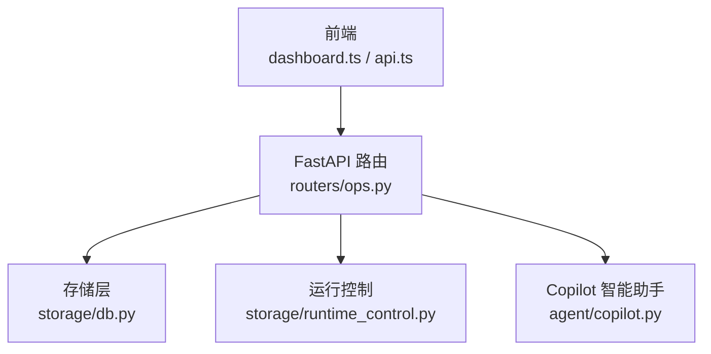
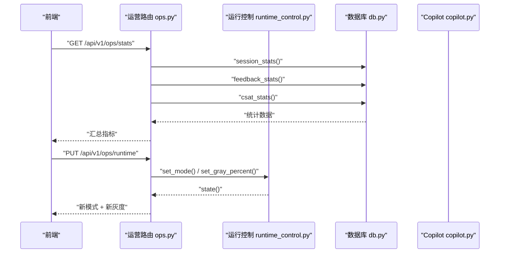
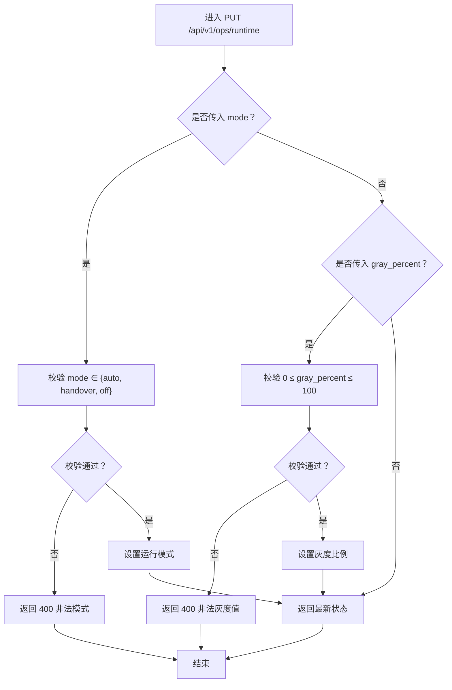
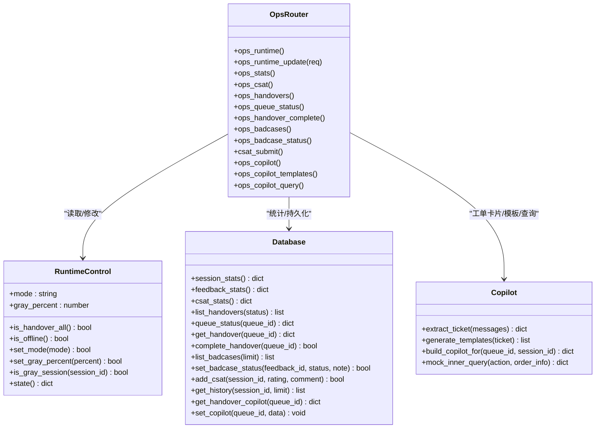

# 运营统计接口

<cite>
**本文引用的文件**   
- [backend/app/routers/ops.py](file://backend/app/routers/ops.py)
- [backend/app/models/schemas.py](file://backend/app/models/schemas.py)
- [backend/app/storage/runtime_control.py](file://backend/app/storage/runtime_control.py)
- [backend/app/storage/db.py](file://backend/app/storage/db.py)
- [backend/app/agent/copilot.py](file://backend/app/agent/copilot.py)
- [frontend/src/api.ts](file://frontend/src/api.ts)
- [frontend/src/dashboard.ts](file://frontend/src/dashboard.ts)
</cite>

## 目录
1. [引言](#引言)
2. [项目结构定位](#项目结构定位)
3. [核心组件](#核心组件)
4. [架构总览](#架构总览)
5. [接口定义与请求模型](#接口定义与请求模型)
6. [详细端点说明](#详细端点说明)
7. [数据结构说明](#数据结构说明)
8. [依赖关系分析](#依赖关系分析)
9. [性能与一致性](#性能与一致性)
10. [故障排查](#故障排查)
11. [结论](#结论)

## 引言
本文面向运营管理后台、坐席工作台和前端运营看板，系统化记录运营统计与运行控制相关 API。内容覆盖：
- 运行控制：服务模式切换（auto/handover/off）与灰度比例调整。
- 数据统计：自动化率、转人工率、点赞率、CSAT 满意度。
- 人工转接：待办列表、排队进度、完成工单。
- Bad Case 管理：点踩记录查询与状态标记。
- CSAT 提交：访客满意度打分。
- Copilot 辅助：工单卡片、快捷模板、内部系统查询。

所有字段语义、错误码、可选参数和前端类型契约均以后端路由与 Pydantic 模型为准。

## 项目结构定位
运营类接口集中在 `backend/app/routers/ops.py`，通过 FastAPI `APIRouter(prefix="/api/v1", tags=["ops"])` 暴露；运行时控制状态由内存对象 `RuntimeControl` 维护；数据读写统一经过 `app.storage.db.Database`；Copilot 能力由 `app.agent.copilot` 提供。

**图示来源**
- [backend/app/routers/ops.py:1-163](file://backend/app/routers/ops.py#L1-L163)
- [backend/app/storage/runtime_control.py:1-83](file://backend/app/storage/runtime_control.py#L1-L83)
- [backend/app/storage/db.py:1-200](file://backend/app/storage/db.py#L1-L200)
- [backend/app/agent/copilot.py:1-113](file://backend/app/agent/copilot.py#L1-L113)
- [frontend/src/api.ts:1-200](file://frontend/src/api.ts#L1-L200)
- [frontend/src/dashboard.ts:1-200](file://frontend/src/dashboard.ts#L1-L200)

**章节来源**
- [backend/app/routers/ops.py:1-163](file://backend/app/routers/ops.py#L1-L163)

## 核心组件
- **运行控制 RuntimeControl**：在进程内保存当前模式与灰度比例，支持设置 auto/handover/off 和 0-100 的灰度百分比，并提供会话级稳定哈希分流判断。
- **数据库 Database**：SQLite 单文件存储，负责会话、消息、反馈、排队队列、CSAT、Bad Case 状态等持久化与统计查询。
- **Copilot**：基于 LLM 生成工单摘要、快捷回复模板，并包含开发期 Mock 的内部系统查询。
- **路由 Router**：聚合运营统计、运行控制、Bad Case、CSAT、Copilot 等端点。

**章节来源**
- [backend/app/storage/runtime_control.py:1-83](file://backend/app/storage/runtime_control.py#L1-L83)
- [backend/app/storage/db.py:1-200](file://backend/app/storage/db.py#L1-L200)
- [backend/app/agent/copilot.py:1-113](file://backend/app/agent/copilot.py#L1-L113)
- [backend/app/routers/ops.py:1-163](file://backend/app/routers/ops.py#L1-L163)

## 架构总览
运营端口的典型调用链路如下：

**图示来源**
- [backend/app/routers/ops.py:12-45](file://backend/app/routers/ops.py#L12-L45)
- [backend/app/storage/runtime_control.py:29-83](file://backend/app/storage/runtime_control.py#L29-L83)

## 接口定义与请求模型

### 运行控制
| 方法 | 路径 | 说明 | 请求体 | 响应 | 错误码 |
|---|---|---|---|---|---|
| GET | `/api/v1/ops/runtime` | 查询当前服务模式和灰度比例 | 无 | 运行状态对象 | 无 |
| PUT | `/api/v1/ops/runtime` | 切换服务模式或灰度比例 | `RuntimeUpdateRequest` | 更新后的运行状态对象 | 400 非法模式或灰度值 |

`RuntimeUpdateRequest` 字段：
- `mode`：可选，字符串，取值 `auto`、`handover`、`off`。
- `gray_percent`：可选，整数，范围 0-100。

### 数据统计
| 方法 | 路径 | 说明 | 请求体 | 响应 | 错误码 |
|---|---|---|---|---|---|
| GET | `/api/v1/ops/stats` | 自动化率、转人工率、点赞率、CSAT 等汇总指标 | 无 | 运营统计对象 | 无 |
| GET | `/api/v1/ops/csat` | CSAT 满意度总量、平均分、星级分布 | 无 | CSAT 统计对象 | 无 |

### 人工转接
| 方法 | 路径 | 说明 | 请求体 | 响应 | 错误码 |
|---|---|---|---|---|---|
| GET | `/api/v1/ops/handovers` | 获取人工坐席待办列表 | `status=waiting` 等查询参数 | 待办项数组 | 无 |
| GET | `/api/v1/ops/queue/status` | 查询排队进度 | `queue_id` 查询参数 | 排队状态对象 | 404 队列为空 |
| POST | `/api/v1/ops/handovers/{queue_id}/complete` | 标记工单已完成 | 无 | 完成确认 | 404 工单不存在或已完成 |

### Bad Case 管理
| 方法 | 路径 | 说明 | 请求体 | 响应 | 错误码 |
|---|---|---|---|---|---|
| GET | `/api/v1/ops/badcases` | 返回点踩记录 | `limit` 查询参数，默认 20 | Bad Case 项数组 | 无 |
| POST | `/api/v1/ops/badcases/{feedback_id}/status` | 标记 Bad Case 处理状态 | `BadCaseStatusRequest` | 成功结果 | 404 记录不存在或状态非法 |

`BadCaseStatusRequest` 字段：
- `status`：必填，字符串，取值 `open`、`resolved`、`ignored`。
- `note`：可选，字符串，处理备注，默认空串。

### CSAT 提交
| 方法 | 路径 | 说明 | 请求体 | 响应 | 错误码 |
|---|---|---|---|---|---|
| POST | `/api/v1/csat` | 访客提交 1-5 星满意度 | `CsatSubmitRequest` | 成功结果 | 401 Visitor Token 无效；400 评分不在 1-5 |

`CsatSubmitRequest` 字段：
- `session_id`：必填，字符串。
- `visitor_token`：可选，字符串，用于校验访客身份。
- `rating`：必填，整数，1-5。
- `comment`：可选，字符串，用户留言。

**章节来源**
- [backend/app/routers/ops.py:12-163](file://backend/app/routers/ops.py#L12-L163)
- [backend/app/models/schemas.py:68-138](file://backend/app/models/schemas.py#L68-L138)

## 详细端点说明

### GET /api/v1/ops/runtime
- **用途**：运营看板运行控制面板读取当前模式与灰度比例。
- **响应关键字段**：
  - `mode`：`auto`、`handover`、`off`。
  - `gray_percent`：0-100。
  - `kill_switch`：非 `auto` 时为真，表示已启用容切。
- **行为**：直接返回内存中 `RuntimeControl.state()`。

**章节来源**
- [backend/app/routers/ops.py:14-18](file://backend/app/routers/ops.py#L14-L18)
- [backend/app/storage/runtime_control.py:67-83](file://backend/app/storage/runtime_control.py#L67-L83)

### PUT /api/v1/ops/runtime
- **用途**：一键切换服务模式或调整灰度放量比例。
- **业务规则**：
  - 若传入 `mode`，仅允许 `auto`、`handover`、`off`，否则返回 400。
  - 若传入 `gray_percent`，必须为 0-100 的整数，否则返回 400。
  - 两者可同时传入，分别设置。
- **响应**：返回最新运行状态。

**图示来源**
- [backend/app/routers/ops.py:20-27](file://backend/app/routers/ops.py#L20-L27)
- [backend/app/storage/runtime_control.py:33-55](file://backend/app/storage/runtime_control.py#L33-L55)

**章节来源**
- [backend/app/routers/ops.py:20-27](file://backend/app/routers/ops.py#L20-L27)
- [backend/app/storage/runtime_control.py:33-55](file://backend/app/storage/runtime_control.py#L33-L55)

### GET /api/v1/ops/stats
- **用途**：运营看板核心指标。
- **口径**：只要会话发生转人工，整个会话归入“转人工”，不计入自动化率，因此自动化率与转人工率之和为 100%。
- **响应关键字段**：
  - `total_sessions`：总咨询量。
  - `agent_resolved`：纯 Agent 解决量。
  - `handover`：转人工量。
  - `auto_rate`：自动化率。
  - `handover_rate`：转人工率，等于 `1 - auto_rate`。
  - `feedback_total`、`feedback_up`、`feedback_down`、`up_rate`：点赞率统计。
  - `csat_total`、`csat_avg`、`csat_dist`：CSAT 满意度统计。

**章节来源**
- [backend/app/routers/ops.py:48-62](file://backend/app/routers/ops.py#L48-L62)

### GET /api/v1/ops/csat
- **用途**：满意度统计面板。
- **响应关键字段**：
  - `csat_total`：打分总量。
  - `csat_avg`：平均分。
  - `csat_dist`：各星级数量映射。

**章节来源**
- [backend/app/routers/ops.py:43-46](file://backend/app/routers/ops.py#L43-L46)

### GET /api/v1/ops/handovers
- **用途**：人工坐席待办列表，供客服侧拉取后主动回复。
- **查询参数**：
  - `status`：默认 `waiting`，用于过滤待办状态。
- **响应**：待办项数组，每项包含队列 ID、会话 ID、摘要、联系方式、状态和创建时间。

**章节来源**
- [backend/app/routers/ops.py:64-67](file://backend/app/routers/ops.py#L64-L67)

### GET /api/v1/ops/queue/status
- **用途**：用户侧轮询排队进度，查看前面还有几人。
- **查询参数**：
  - `queue_id`：必填，队列项 ID。
- **响应**：
  - `queue_id`、`position`、`ahead`、`status`、`created_at`。
- **错误**：找不到队列项时返回 404。

**章节来源**
- [backend/app/routers/ops.py:73-78](file://backend/app/routers/ops.py#L73-L78)

### POST /api/v1/ops/handovers/{queue_id}/complete
- **用途**：坐席工作台标记待办完成，并触发 WebSocket 广播，通知人工已接入或队列位置前移。
- **路径参数**：
  - `queue_id`：必填。
- **响应**：
  - `ok`：布尔。
  - `queue_id`：完成队列 ID。
- **错误**：工单不存在或已完成时返回 404。

**章节来源**
- [backend/app/routers/ops.py:80-91](file://backend/app/routers/ops.py#L80-L91)

### GET /api/v1/ops/badcases
- **用途**：点踩记录，作为 Bad Case 归因原料，供运营看板使用。
- **查询参数**：
  - `limit`：默认 20。
- **响应**：Bad Case 项数组，包含会话、消息、评价、上下文、答案、状态和处理备注。

**章节来源**
- [backend/app/routers/ops.py:69-72](file://backend/app/routers/ops.py#L69-L72)

### POST /api/v1/ops/badcases/{feedback_id}/status
- **用途**：运营标记点踩记录处理状态。
- **路径参数**：
  - `feedback_id`：必填。
- **请求体**：`BadCaseStatusRequest`。
- **响应**：
  - `ok`、`feedback_id`、`status`、`note`。
- **错误**：记录不存在或状态非法时返回 404。

**章节来源**
- [backend/app/routers/ops.py:30-37](file://backend/app/routers/ops.py#L30-L37)
- [backend/app/models/schemas.py:84-90](file://backend/app/models/schemas.py#L84-L90)

### POST /api/v1/csat
- **用途**：Widget 弹出满意度打分，需有效 Visitor Token 且评分为 1-5。
- **请求体**：`CsatSubmitRequest`。
- **响应**：
  - `ok`、`rating`。
- **错误**：
  - 401：Visitor Token 无效。
  - 400：评分不在 1-5。

**章节来源**
- [backend/app/routers/ops.py:39-42](file://backend/app/routers/ops.py#L39-L42)
- [backend/app/models/schemas.py:93-100](file://backend/app/models/schemas.py#L93-L100)

### Copilot 相关端点

#### GET /api/v1/ops/copilot/{queue_id}
- **用途**：获取工单卡片；若尚未生成则现场生成。
- **路径参数**：
  - `queue_id`：必填。
- **响应**：
  - `queue_id`、`session_id`、`copilot`：包含工单摘要、快捷模板等。
- **错误**：队列项不存在返回 404。

**章节来源**
- [backend/app/routers/ops.py:93-104](file://backend/app/routers/ops.py#L93-L104)
- [backend/app/agent/copilot.py:85-96](file://backend/app/agent/copilot.py#L85-L96)

#### POST /api/v1/ops/copilot/templates
- **用途**：生成 3 个快捷回复模板，供坐席一键复制。
- **路径参数**：
  - `queue_id`：必填。
- **逻辑**：
  - 若已有模板则直接返回。
  - 若无模板，先从历史对话提取工单摘要，再结合知识库生成模板，并落库缓存。
- **响应**：
  - `queue_id`、`templates`。
- **错误**：队列项不存在返回 404。

**章节来源**
- [backend/app/routers/ops.py:106-126](file://backend/app/routers/ops.py#L106-L126)
- [backend/app/agent/copilot.py:57-83](file://backend/app/agent/copilot.py#L57-L83)

#### POST /api/v1/ops/copilot/query
- **用途**：坐席一键查询内部系统（当前为开发期 Mock）。
- **路径参数**：
  - `queue_id`：必填。
- **查询参数**：
  - `action`：默认 `logistics`，可区分物流、订单、退款等场景。
- **逻辑**：
  - 优先从 Copilot 缓存中提取订单信息；若无则从历史对话提取。
  - 返回 Mock 结果，明确标注开发期演示数据。
- **响应**：
  - `action`、`result`、`mock`。
- **错误**：队列项不存在返回 404。

**章节来源**
- [backend/app/routers/ops.py:128-163](file://backend/app/routers/ops.py#L128-L163)
- [backend/app/agent/copilot.py:99-113](file://backend/app/agent/copilot.py#L99-L113)

## 数据结构说明

### 运营统计 OpsStats
| 字段 | 类型 | 含义 |
|---|---|---|
| `total_sessions` | number | 总咨询量 |
| `agent_resolved` | number | 纯 Agent 闭环量 |
| `handover` | number | 转人工量 |
| `auto_rate` | number | 自动化率 |
| `handover_rate` | number | 转人工率，等于 `1 - auto_rate` |
| `feedback_total` | number | 反馈总数 |
| `feedback_up` | number | 点赞数 |
| `feedback_down` | number | 点踩数 |
| `up_rate` | number \| null | 点赞率 |
| `csat_total` | number \| undefined | CSAT 打分总量 |
| `csat_avg` | number \| null \| undefined | CSAT 平均分 |
| `csat_dist` | Record<string, number> \| undefined | 星级分布 |

**章节来源**
- [backend/app/routers/ops.py:48-62](file://backend/app/routers/ops.py#L48-L62)
- [frontend/src/api.ts:120-142](file://frontend/src/api.ts#L120-L142)

### 运行状态 RuntimeState
| 字段 | 类型 | 含义 |
|---|---|---|
| `mode` | string | 服务模式，`auto`、`handover`、`off` |
| `gray_percent` | number | 灰度比例，0-100 |
| `kill_switch` | boolean | 非 auto 时为真 |

**章节来源**
- [backend/app/storage/runtime_control.py:67-83](file://backend/app/storage/runtime_control.py#L67-L83)
- [frontend/src/api.ts:144-152](file://frontend/src/api.ts#L144-L152)

### 排队状态 QueueStatus
| 字段 | 类型 | 含义 |
|---|---|---|
| `queue_id` | number | 队列项 ID |
| `position` | number \| null | 当前排名 |
| `ahead` | number \| null | 前面排队人数 |
| `status` | string | 队列状态 |
| `created_at` | string | 创建时间 |

**章节来源**
- [frontend/src/api.ts:110-118](file://frontend/src/api.ts#L110-L118)

### 待办项 HandoverItem
| 字段 | 类型 | 含义 |
|---|---|---|
| `id` | number | 队列 ID |
| `session_id` | string | 关联会话 |
| `summary` | string | 摘要 |
| `contact` | string \| null | 联系方式 |
| `status` | string | 状态，如 waiting |
| `created_at` | string | 创建时间 |

**章节来源**
- [frontend/src/api.ts:154-164](file://frontend/src/api.ts#L154-L164)

### Bad Case 项 BadCaseItem
| 字段 | 类型 | 含义 |
|---|---|---|
| `id` | number | 反馈 ID |
| `session_id` | string | 会话 ID |
| `message_id` | string \| null | 对应消息 ID |
| `value` | string | up/down |
| `query` | string \| null | 用户问题 |
| `context` | string \| null | 上下文 |
| `answer` | string \| null | 机器人回答 |
| `created_at` | string | 创建时间 |
| `status` | string \| undefined | open/resolved/ignored |
| `note` | string \| undefined | 处理备注 |

**章节来源**
- [backend/app/storage/db.py:33-46](file://backend/app/storage/db.py#L33-L46)
- [frontend/src/api.ts:166-178](file://frontend/src/api.ts#L166-L178)

### Copilot 工单卡片
Copilot 数据以 JSON 形式缓存在队列项中，通常包含：
- `ticket`：结构化工单摘要，包括用户诉求、订单信息、机器人是否已解答、问题描述。
- `templates`：快捷回复模板数组，最多 3 条。

生成流程会先尝试从数据库读取；若未生成，则根据最近会话历史调用 LLM 生成摘要，并可选择生成模板。

**章节来源**
- [backend/app/agent/copilot.py:24-55](file://backend/app/agent/copilot.py#L24-L55)
- [backend/app/agent/copilot.py:57-96](file://backend/app/agent/copilot.py#L57-L96)

## 依赖关系分析

**图示来源**
- [backend/app/storage/runtime_control.py:29-83](file://backend/app/storage/runtime_control.py#L29-L83)
- [backend/app/storage/db.py:1-200](file://backend/app/storage/db.py#L1-L200)
- [backend/app/agent/copilot.py:1-113](file://backend/app/agent/copilot.py#L1-L113)
- [backend/app/routers/ops.py:12-163](file://backend/app/routers/ops.py#L12-L163)

**章节来源**
- [backend/app/routers/ops.py:12-163](file://backend/app/routers/ops.py#L12-L163)

## 性能与一致性
- **运行控制状态内存化**：`RuntimeControl` 将模式与灰度比例保存在进程内存中，适合单实例快速读写；生产多实例时可扩展为 Redis 共享。
- **灰度分流稳定**：按 `session_id` 做 SHA-256 稳定哈希，保证同一会话始终命中同一灰度组，避免抖动。
- **数据库 WAL 模式**：SQLite 开启 WAL，提升并发读性能；写操作通过线程锁保护。
- **Copilot 缓存**：工单卡片与模板生成后可写入队列项，避免重复 LLM 调用。
- **WebSocket 广播**：完成工单后会触发广播，减少前端轮询压力。

[本节为通用性能说明，不直接分析具体代码片段]

## 故障排查
- **运行模式切换失败**：检查 `mode` 是否为 `auto`、`handover`、`off`，或 `gray_percent` 是否在 0-100。
- **CSAT 提交返回 401**：检查 `visitor_token` 是否与 `session_id` 匹配。
- **CSAT 提交返回 400**：检查 `rating` 是否为 1-5。
- **排队状态 404**：检查 `queue_id` 是否存在。
- **完成工单 404**：检查队列项是否存在且未完成。
- **Bad Case 标记 404**：检查 `feedback_id` 是否存在且状态合法。
- **Copilot 端点 404**：检查 `queue_id` 是否属于有效转人工队列。

**章节来源**
- [backend/app/routers/ops.py:20-27](file://backend/app/routers/ops.py#L20-L27)
- [backend/app/routers/ops.py:39-42](file://backend/app/routers/ops.py#L39-L42)
- [backend/app/routers/ops.py:73-78](file://backend/app/routers/ops.py#L73-L78)
- [backend/app/routers/ops.py:80-91](file://backend/app/routers/ops.py#L80-L91)
- [backend/app/routers/ops.py:30-37](file://backend/app/routers/ops.py#L30-L37)
- [backend/app/routers/ops.py:93-104](file://backend/app/routers/ops.py#L93-L104)

## 结论
运营统计接口围绕运行控制、数据统计、人工转接、Bad Case 管理与 CSAT 提交形成完整闭环。运行时状态采用内存化设计，配合 SQLite 持久化与 Copilot 智能辅助，既满足运营看板实时性，也保留扩展为分布式共享状态的余地。前端通过 `api.ts` 与 `dashboard.ts` 将运营指标、运行控制和 Bad Case 管理直观呈现，便于运营人员快速决策与排障。