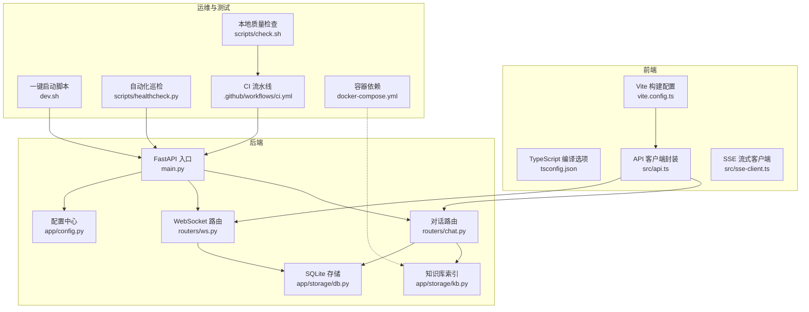
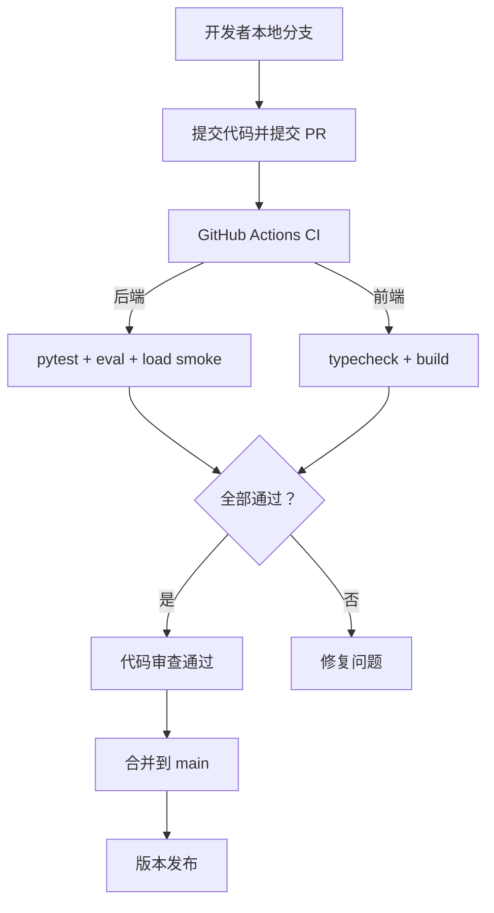
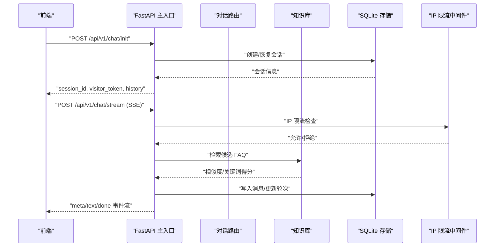
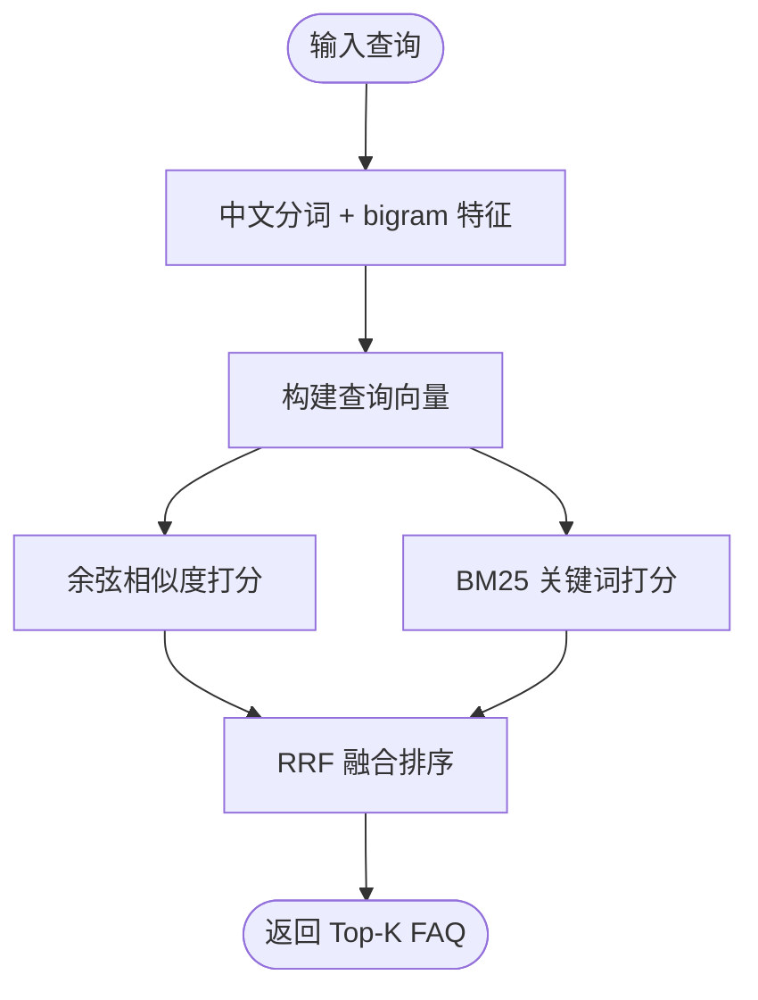
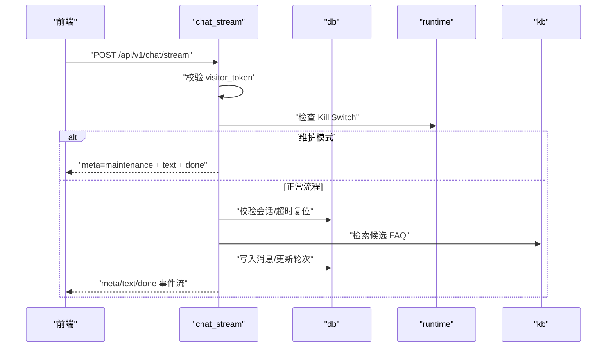
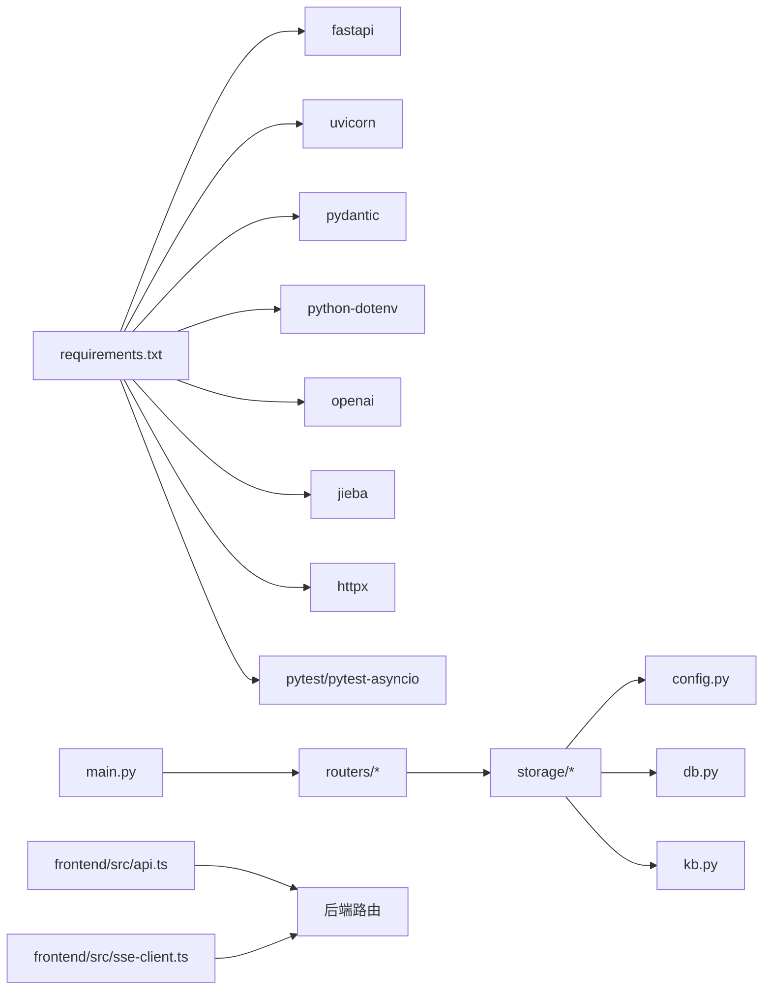

# 开发者指南

<cite>
**本文引用的文件**   
- [backend/app/main.py](file://backend/app/main.py)
- [backend/app/config.py](file://backend/app/config.py)
- [backend/requirements.txt](file://backend/requirements.txt)
- [backend/app/storage/kb.py](file://backend/app/storage/kb.py)
- [backend/app/storage/db.py](file://backend/app/storage/db.py)
- [backend/app/routers/chat.py](file://backend/app/routers/chat.py)
- [backend/app/routers/ws.py](file://backend/app/routers/ws.py)
- [backend/tests/conftest.py](file://backend/tests/conftest.py)
- [backend/tests/test_api.py](file://backend/tests/test_api.py)
- [backend/tools/check_duplicates.py](file://backend/tools/check_duplicates.py)
- [scripts/check.sh](file://scripts/check.sh)
- [scripts/healthcheck.py](file://scripts/healthcheck.py)
- [dev.sh](file://dev.sh)
- [docker-compose.yml](file://docker-compose.yml)
- [frontend/package.json](file://frontend/package.json)
- [frontend/tsconfig.json](file://frontend/tsconfig.json)
- [frontend/vite.config.ts](file://frontend/vite.config.ts)
- [frontend/src/api.ts](file://frontend/src/api.ts)
- [frontend/src/sse-client.ts](file://frontend/src/sse-client.ts)
- [.github/workflows/ci.yml](file://.github/workflows/ci.yml)
</cite>

## 目录
1. [引言](#引言)
2. [项目结构](#项目结构)
3. [代码规范与最佳实践](#代码规范与最佳实践)
4. [新功能开发流程](#新功能开发流程)
5. [调试与故障排查](#调试与故障排查)
6. [Git 工作流与分支管理](#git-工作流与分支管理)
7. [贡献指南](#贡献指南)
8. [常用开发命令与环境优化](#常用开发命令与环境优化)
9. [架构总览](#架构总览)
10. [关键组件详解](#关键组件详解)
11. [依赖关系分析](#依赖关系分析)
12. [性能注意事项](#性能注意事项)
13. [常见问题排查清单](#常见问题排查清单)
14. [结语](#结语)

## 引言
本指南面向参与“小答 AI 客服 Agent”项目的后端 Python、前端 TypeScript 开发者。文档基于仓库实际代码结构，说明编码规范、文件组织、新功能开发步骤、调试方法、Git 协作流程、测试与发布方式，以及 IDE 和性能优化建议。读者无需预先熟悉该项目即可上手。

## 项目结构
仓库采用前后端分离的多模块结构：
- backend：FastAPI 后端，包含路由、Agent 编排、知识库检索、SQLite 存储、缓存、限流、运行时控制等。
- frontend：Vite + TypeScript 构建的前端，提供官网页面、坐席看板、知识库后台和可嵌入聊天 Widget。
- knowledge_base：FAQ 数据源与导入脚本。
- scripts：本地质量检查、健康巡检、部署辅助脚本。
- .github/workflows：GitHub Actions CI，覆盖后端测试、检索评估、压测冒烟与前端构建。
- docker-compose.yml：生产期可选的 Qdrant 向量库与 Redis 服务定义。

**图示来源**
- [backend/app/main.py:1-63](file://backend/app/main.py#L1-L63)
- [backend/app/routers/chat.py:1-200](file://backend/app/routers/chat.py#L1-L200)
- [backend/app/routers/ws.py:1-149](file://backend/app/routers/ws.py#L1-L149)
- [backend/app/config.py:1-104](file://backend/app/config.py#L1-L104)
- [backend/app/storage/kb.py:1-200](file://backend/app/storage/kb.py#L1-L200)
- [backend/app/storage/db.py:1-200](file://backend/app/storage/db.py#L1-L200)
- [frontend/vite.config.ts:1-30](file://frontend/vite.config.ts#L1-L30)
- [frontend/tsconfig.json:1-16](file://frontend/tsconfig.json#L1-L16)
- [frontend/src/api.ts:1-200](file://frontend/src/api.ts#L1-L200)
- [frontend/src/sse-client.ts:1-59](file://frontend/src/sse-client.ts#L1-L59)
- [dev.sh:1-75](file://dev.sh#L1-L75)
- [scripts/check.sh:1-29](file://scripts/check.sh#L1-L29)
- [scripts/healthcheck.py:1-175](file://scripts/healthcheck.py#L1-L175)
- [.github/workflows/ci.yml:1-55](file://.github/workflows/ci.yml#L1-L55)
- [docker-compose.yml:1-16](file://docker-compose.yml#L1-L16)

**章节来源**
- [backend/app/main.py:1-63](file://backend/app/main.py#L1-L63)
- [frontend/vite.config.ts:1-30](file://frontend/vite.config.ts#L1-L30)
- [dev.sh:1-75](file://dev.sh#L1-L75)

## 代码规范与最佳实践

### Python 编码规范
- 使用 FastAPI 作为 Web 框架，入口位于 `backend/app/main.py`，路由按功能拆分到 `backend/app/routers`。
- 配置集中管理于 `backend/app/config.py`，通过 `.env` 注入；所有业务开关（如 LLM 模式、会话超时、重复未解决限制）应通过配置暴露，避免硬编码。
- 存储层以 `backend/app/storage/db.py` 为 SQLite 抽象，所有数据库访问需经过该层，禁止在路由中直接操作连接。
- 知识库检索逻辑集中在 `backend/app/storage/kb.py`，新增检索策略时应保持对外的 `KnowledgeBase` 接口稳定。
- 日志统一使用 Python 标准 logging，并在 `main.py` 初始化基础格式；业务模块通过 `logging.getLogger(__name__)` 获取 logger。
- 错误处理优先返回明确的 HTTP 状态码与结构化 detail；敏感信息不入日志。
- 异步接口使用 `async def`，I/O 密集型任务（SSE、WebSocket、外部 HTTP）使用 asyncio。
- 类型注解使用 `from __future__ import annotations` 与 PEP 604 风格泛型，提升可读性。
- 测试放在 `backend/tests`，使用 pytest；全局 Mock 与隔离环境由 `conftest.py` 管理。

**章节来源**
- [backend/app/main.py:1-63](file://backend/app/main.py#L1-L63)
- [backend/app/config.py:1-104](file://backend/app/config.py#L1-L104)
- [backend/app/storage/db.py:1-200](file://backend/app/storage/db.py#L1-L200)
- [backend/app/storage/kb.py:1-200](file://backend/app/storage/kb.py#L1-L200)
- [backend/tests/conftest.py:1-24](file://backend/tests/conftest.py#L1-L24)

### TypeScript 开发约定
- 前端基于 Vite + TypeScript，编译目标 ES2020，严格模式开启，无未使用变量/参数检查。
- 模块解析使用 bundler 模式，isolatedModules 启用，适合 Vite 增量构建。
- API 契约集中在 `frontend/src/api.ts`，与后端 Pydantic 模型对齐；新增接口时同步更新前端类型定义。
- SSE 流式响应由 `frontend/src/sse-client.ts` 封装，调用方使用事件回调处理 meta/text/done 等事件。
- 多页面应用通过 `vite.config.ts` 的 Rollup input 配置打包 index、agent、dashboard、kb 四个入口。
- 开发服务器端口 5173，自动代理 `/api` 与 `/ws` 到后端 8000。

**章节来源**
- [frontend/tsconfig.json:1-16](file://frontend/tsconfig.json#L1-L16)
- [frontend/package.json:1-16](file://frontend/package.json#L1-L16)
- [frontend/vite.config.ts:1-30](file://frontend/vite.config.ts#L1-L30)
- [frontend/src/api.ts:1-200](file://frontend/src/api.ts#L1-L200)
- [frontend/src/sse-client.ts:1-59](file://frontend/src/sse-client.ts#L1-L59)

### 文件组织结构
- 后端：
  - `app/main.py`：FastAPI 应用注册、中间件、路由引入。
  - `app/routers`：REST/SSE/WebSocket 路由。
  - `app/storage`：知识检索、SQLite、缓存、限流、运行控制。
  - `app/models`：Pydantic 请求/响应模型。
  - `app/agent`：对话编排、记忆、情绪、幽默、意图、LLM 调用。
- 前端：
  - `src`：业务模块、样式、SSE 客户端、站点渲染。
  - HTML 入口对应不同页面。
- 工具与测试：
  - `tests`：pytest 用例、Golden 数据集、负载测试。
  - `tools`：重复 FAQ 检测、Bad Case 报告。
  - `scripts`：质量检查、健康巡检、安装定时任务。

**章节来源**
- [backend/app/main.py:1-63](file://backend/app/main.py#L1-L63)
- [frontend/src/main.ts:1-6](file://frontend/src/main.ts#L1-L6)
- [scripts/check.sh:1-29](file://scripts/check.sh#L1-L29)

## 新功能开发流程
以下流程适用于新增对话能力、运营工具或前端页面：

1. 需求分析与设计
   - 明确功能边界、用户角色、输入输出、异常场景与监控指标。
   - 若涉及检索或 LLM，评估是否影响知识库或 Prompt，是否需要阈值调优。
   - 确定是否需要新增 WebSocket 实时事件、SSE 事件类型或前端新页面。

2. 实现后端
   - 新增路由：在 `backend/app/routers` 下创建模块，注册到 `main.py`。
   - 数据模型：在 `app/models/schemas.py` 定义 Pydantic 模型。
   - 存储与检索：如需持久化或检索增强，扩展 `app/storage/db.py` 或 `app/storage/kb.py`。
   - 配置项：将可调参数放入 `app/config.py`，并提供合理默认值。
   - 鉴权与安全：Visitor Token、IP 限流、Kill Switch 等防御机制复用现有中间件。

3. 实现前端
   - 新增 API 调用：在 `frontend/src/api.ts` 增加函数与类型。
   - SSE/WebSocket 集成：复用 `sse-client.ts` 或 `ws.py` 协议。
   - 页面与组件：按需添加 HTML 与 TS 模块，并通过 `vite.config.ts` 注册入口。

4. 编写测试
   - 单元测试：针对路由与核心算法补充 pytest 用例。
   - 集成测试：覆盖 init/stream/handover/ops 等关键链路。
   - Golden 评估：若改变检索逻辑，更新 `tests/eval.py` 或 golden dataset。

5. 本地验证
   - 执行 `scripts/check.sh` 进行完整质量门禁。
   - 手动验证 UI 交互、SSE 打字机效果、WebSocket 排队状态。

6. 提交与审查
   - 提交清晰 commit message，关联 Issue 编号。
   - 发起 Pull Request，附变更说明、截图、风险点与回滚方案。

7. 合并与发布
   - CI 通过后合并到 main。
   - 版本发布遵循语义化版本，记录 release notes。

**章节来源**
- [backend/app/routers/chat.py:1-200](file://backend/app/routers/chat.py#L1-L200)
- [backend/app/routers/ws.py:1-149](file://backend/app/routers/ws.py#L1-L149)
- [frontend/src/api.ts:1-200](file://frontend/src/api.ts#L1-L200)
- [scripts/check.sh:1-29](file://scripts/check.sh#L1-L29)

## 调试与故障排查

### 日志分析
- 后端日志：启动后查看 `backend.log`，包含 FastAPI 启动、知识库加载、中间件拦截、路由处理等信息。
- 健康检查：访问 `/health` 确认服务存活、品牌名、LLM 模式与 FAQ 数量。
- 自动化巡检：运行 `scripts/healthcheck.py` 检查服务存活、核心指标、检索质量、待办积压与 Bad Case。

**章节来源**
- [backend/app/main.py:1-63](file://backend/app/main.py#L1-L63)
- [scripts/healthcheck.py:1-175](file://scripts/healthcheck.py#L1-L175)

### 断点调试
- 后端：使用 uvicorn 启动并附加调试器（如 VS Code Python 调试），在路由或存储层设置断点。
- 前端：浏览器 DevTools 中调试 TypeScript 源码，SSE 流可在网络面板观察 event-stream 帧。
- WebSocket：打开控制台监听消息收发，或使用网络面板中的 WS 标签页。

### 性能分析
- 后端：关注 SSE 流延迟、LLM 调用耗时、检索相似度阈值、缓存命中率；可通过 `app/storage/cache.py` 相关统计定位瓶颈。
- 前端：使用浏览器 Performance 面板分析首屏渲染与事件流绘制；检查 Vite 构建产物体积。
- 压力测试：运行 `tests/load_test.py` 进行进程内 Mock 压测，结合 CI 中的 smoke 级别并发。

**章节来源**
- [backend/app/routers/chat.py:1-200](file://backend/app/routers/chat.py#L1-L200)
- [backend/tests/load_test.py](file://backend/tests/load_test.py)
- [frontend/src/sse-client.ts:1-59](file://frontend/src/sse-client.ts#L1-L59)

## Git 工作流与分支管理
- 主干分支：`main` 为稳定分支，CI 在 push main 与 pull_request 时触发。
- 功能分支：从 main 拉取功能分支，命名如 `feat/xxx`、`fix/xxx`。
- 代码审查：所有变更必须通过 PR，至少一名 reviewer 批准。
- 自动化门禁：CI 执行后端 pytest、检索评估、压测冒烟与前端 build。
- 版本发布：打 tag 并发布 release notes；必要时配合 docker-compose 部署 Qdrant/Redis。

**图示来源**
- [.github/workflows/ci.yml:1-55](file://.github/workflows/ci.yml#L1-L55)

**章节来源**
- [.github/workflows/ci.yml:1-55](file://.github/workflows/ci.yml#L1-L55)

## 贡献指南
- 参与方式：
  - 提 Issue：描述问题、复现步骤、期望行为与日志片段。
  - 发 PR：附变更说明、截图、测试覆盖与风险评估。
- 代码质量：
  - 遵循 Python/TS 规范，保持类型注解与注释清晰。
  - 新增功能必须配套测试与文档。
- 协作礼仪：
  - 尊重 reviewer 意见，及时回复评论。
  - 保持 commit message 简洁明确。

[本节为通用协作说明，不直接分析具体文件]

## 常用开发命令与环境优化

### 常用命令
- 一键启动/停止/状态：
  - `./dev.sh start`：启动后端 8000 与前端 5173。
  - `./dev.sh stop`：清理占用进程。
  - `./dev.sh status`：查看健康状态。
- 本地质量检查：
  - `./scripts/check.sh`：执行后端测试、检索评估、压测冒烟、前端构建、知识库重复检测。
- 后端依赖安装：
  - `pip install -r backend/requirements.txt`
- 前端依赖安装与构建：
  - `cd frontend && npm ci`
  - `cd frontend && npm run build`

**章节来源**
- [dev.sh:1-75](file://dev.sh#L1-L75)
- [scripts/check.sh:1-29](file://scripts/check.sh#L1-L29)
- [backend/requirements.txt:1-11](file://backend/requirements.txt#L1-L11)
- [frontend/package.json:1-16](file://frontend/package.json#L1-L16)

### IDE 配置建议
- VS Code：
  - Python：启用 Pylance、Ruff（或 Flake8）、Black；配置 `python.linting.enabled=true`。
  - TypeScript：启用 ESLint、Prettier；确保 `strict` 与 `noUnusedLocals/Parameters` 生效。
  - 调试配置：添加 uvicorn 启动配置与 Node.js 调试配置。
- JetBrains：
  - Python：启用 PEP8 检查、Pytest；配置 Flask/FastAPI 支持。
  - TypeScript：启用 TSLint/ESLint、Node.js 调试。

### 插件推荐
- Python：Python、Pylance、Ruff、Jupyter。
- TypeScript：ESLint、Prettier、Auto Import。
- 通用：GitLens、Error Lens、Rainbow Brackets。

[本节为通用环境优化建议，不直接分析具体文件]

## 架构总览
系统分为前端、后端、存储与运维四大部分：
- 前端：Vite 构建多页面应用，通过 REST/SSE/WebSocket 与后端交互。
- 后端：FastAPI 提供对话、运营、队列、运行控制等接口；内置 IP 限流、CORS、访客 Token 校验。
- 存储：SQLite 保存会话、消息、反馈、人工排队；知识库使用 TF-IDF + BM25 + RRF 融合检索。
- 运维：CI 流水线、自动化巡检、容器依赖。

**图示来源**
- [backend/app/main.py:1-63](file://backend/app/main.py#L1-L63)
- [backend/app/routers/chat.py:1-200](file://backend/app/routers/chat.py#L1-L200)
- [backend/app/storage/kb.py:1-200](file://backend/app/storage/kb.py#L1-L200)
- [backend/app/storage/db.py:1-200](file://backend/app/storage/db.py#L1-L200)

## 关键组件详解

### FastAPI 入口与中间件
- 作用：注册 CORS、全局 IP 限流、知识库加载、健康检查、路由聚合。
- 关键点：
  - `/health` 返回服务状态、品牌名、LLM 模式与 FAQ 数量。
  - 限流中间件对 `/api/` 路径做 IP 级节流，超限返回 429。
  - 启动时加载知识库，记录 FAQ 条数与分类统计。

**章节来源**
- [backend/app/main.py:1-63](file://backend/app/main.py#L1-L63)

### 配置中心
- 作用：集中管理 LLM、检索、会话、存储、Token、运行时开关等配置。
- 关键点：
  - 从 `.env` 读取，缺省值兜底；布尔值解析兼容多种字符串形式。
  - `use_real_llm` 根据 `LLM_MODE` 与 Key 决定走真实或 Mock LLM。
  - 提供高频问题缓存开关、会话超时、重复未解决限制、OTP TTL 等。

**章节来源**
- [backend/app/config.py:1-104](file://backend/app/config.py#L1-L104)

### 知识库检索
- 作用：TF-IDF 向量检索 + BM25 关键词检索 + RRF 融合，支持中文分词与大gram。
- 关键点：
  - `FAQItem` 包含标准问法、变体、答案、风险等级、后续问题。
  - `TfidfIndex` 维护词表、IDF、文档向量与平均文档长度，计算余弦相似度与 BM25。
  - 否定词与风险词检测用于高风险转人工与情感判断。

**图示来源**
- [backend/app/storage/kb.py:1-200](file://backend/app/storage/kb.py#L1-L200)

**章节来源**
- [backend/app/storage/kb.py:1-200](file://backend/app/storage/kb.py#L1-L200)

### SQLite 存储
- 作用：会话、消息、反馈、人工排队、CSAT、FAQ 草稿与版本历史。
- 关键点：
  - 线程锁保护写操作，每线程独立连接，WAL 模式提升并发性能。
  - 提供会话创建、更新、重置、消息追加、历史记录、排队入队等操作。
  - 支持旧库迁移（如 copilot、feedback 状态列）。

**章节来源**
- [backend/app/storage/db.py:1-200](file://backend/app/storage/db.py#L1-L200)

### 对话路由与 SSE 流
- 作用：对话初始化、流式回答、转人工、记忆维护、运行控制。
- 关键点：
  - Visitor Token 校验防止裸 curl 攻击。
  - Kill Switch：维护模式全切、全局转人工半切。
  - 会话超时复位与确认状态超时取消。
  - 输入长度与轮次上限熔断。
  - 首轮缓存命中秒回。

**图示来源**
- [backend/app/routers/chat.py:1-200](file://backend/app/routers/chat.py#L1-L200)

**章节来源**
- [backend/app/routers/chat.py:1-200](file://backend/app/routers/chat.py#L1-L200)

### WebSocket 实时通道
- 作用：用户端排队进度推送、坐席端待办广播、事件分发。
- 关键点：
  - `ConnectionManager` 管理用户与坐席连接集合。
  - 用户端需携带 session_id 与 visitor_token 校验。
  - 坐席端可选择配置 AGENT_WS_TOKEN 鉴权。
  - 首次建连下发待办快照，事件包括 handover_new、handover_done、queue 更新。

**章节来源**
- [backend/app/routers/ws.py:1-149](file://backend/app/routers/ws.py#L1-L149)

### 前端 API 与 SSE 客户端
- 作用：封装后端 REST/SSE/WebSocket 调用，统一错误处理。
- 关键点：
  - `api.ts` 提供 chatInit、sendFeedback、bindSession、manualHandover、ops/stats、badcases、runtime 等函数。
  - `sse-client.ts` 解析 `text/event-stream`，按事件类型回调。
  - Vite 开发服务器代理 `/api` 与 `/ws` 到后端。

**章节来源**
- [frontend/src/api.ts:1-200](file://frontend/src/api.ts#L1-L200)
- [frontend/src/sse-client.ts:1-59](file://frontend/src/sse-client.ts#L1-L59)
- [frontend/vite.config.ts:1-30](file://frontend/vite.config.ts#L1-L30)

## 依赖关系分析

**图示来源**
- [backend/requirements.txt:1-11](file://backend/requirements.txt#L1-L11)
- [backend/app/main.py:1-63](file://backend/app/main.py#L1-L63)
- [backend/app/routers/chat.py:1-200](file://backend/app/routers/chat.py#L1-L200)
- [backend/app/storage/db.py:1-200](file://backend/app/storage/db.py#L1-L200)
- [backend/app/storage/kb.py:1-200](file://backend/app/storage/kb.py#L1-L200)
- [frontend/src/api.ts:1-200](file://frontend/src/api.ts#L1-L200)
- [frontend/src/sse-client.ts:1-59](file://frontend/src/sse-client.ts#L1-L59)

**章节来源**
- [backend/requirements.txt:1-11](file://backend/requirements.txt#L1-L11)
- [backend/app/main.py:1-63](file://backend/app/main.py#L1-L63)

## 性能注意事项
- 检索性能：
  - MVP 使用本地 TF-IDF/BM25，问答量较小时开销低；生产可替换为 Embedding + Qdrant。
  - 调整相似度阈值与 RRF 参数平衡召回率与准确率。
- 缓存优化：
  - 首轮高频问题缓存命中可显著降低 LLM 调用成本。
- 会话与上下文：
  - 控制会话轮次与输入长度，避免 Context 爆炸。
  - 中期摘要压缩历史，减少 Prompt 长度。
- 限流与熔断：
  - IP 限流防止滥用；轮次上限与 Kill Switch 保障系统稳定性。
- 前端体验：
  - SSE 分片发送实现打字机效果，注意缓冲与断线重连。

[本节为通用性能建议，不直接分析具体文件]

## 常见问题排查清单
- 后端无法启动：
  - 检查 `.env` 配置与依赖安装；查看 `backend.log`。
  - 确认端口 8000 未被占用。
- 前端无法连接后端：
  - 确认 dev 服务器代理配置；检查 `/api` 与 `/ws` 代理。
  - 查看浏览器网络面板错误。
- 检索结果不准确：
  - 调整相似度阈值、Top-K、RRF 参数；检查知识库数据质量。
  - 运行 `tools/check_duplicates.py` 发现重复 FAQ。
- 会话被意外重置：
  - 检查会话超时配置与 `updated_at` 时间戳。
- WebSocket 连接失败：
  - 检查 visitor_token 与 AGENT_WS_TOKEN 配置；查看连接关闭码。
- 自动化巡检失败：
  - 检查 WECHAT_WEBHOOK/DINGTALK_WEBHOOK 配置；查看 `backend/logs/healthcheck-YYYY-MM-DD.json`。

**章节来源**
- [backend/tools/check_duplicates.py:1-49](file://backend/tools/check_duplicates.py#L1-L49)
- [scripts/healthcheck.py:1-175](file://scripts/healthcheck.py#L1-L175)
- [frontend/vite.config.ts:1-30](file://frontend/vite.config.ts#L1-L30)

## 结语
本指南总结了项目的代码规范、文件组织、开发流程、调试方法、Git 协作、测试与发布方式，并提供了架构图与关键组件详解。建议在开发新功能时遵循配置驱动、类型安全、测试覆盖与可观测性的原则，逐步完善系统的质量与稳定性。