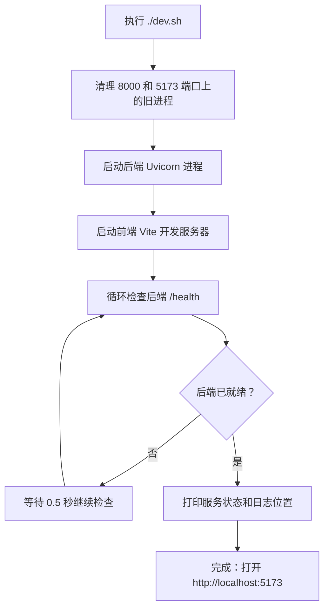
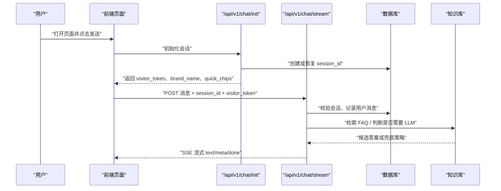

# 快速开始

<cite>
**本文引用的文件**   
- [dev.sh](file://dev.sh)
- [docker-compose.yml](file://docker-compose.yml)
- [backend/requirements.txt](file://backend/requirements.txt)
- [frontend/package.json](file://frontend/package.json)
- [package.json](file://package.json)
- [backend/app/config.py](file://backend/app/config.py)
- [backend/app/main.py](file://backend/app/main.py)
- [backend/app/routers/chat.py](file://backend/app/routers/chat.py)
- [backend/app/routers/session.py](file://backend/app/routers/session.py)
- [backend/app/routers/ws.py](file://backend/app/routers/ws.py)
- [frontend/index.html](file://frontend/index.html)
- [frontend/src/main.ts](file://frontend/src/main.ts)
- [frontend/src/widget.ts](file://frontend/src/widget.ts)
- [knowledge_base/import_kb_to_admin.py](file://knowledge_base/import_kb_to_admin.py)
- [scripts/healthcheck.py](file://scripts/healthcheck.py)
</cite>

## 目录
1. [简介](#简介)
2. [环境要求与安装步骤](#环境要求与安装步骤)
3. [环境变量配置](#环境变量配置)
4. [一键启动 dev.sh](#一键启动-devsh)
5. [容器化部署 docker-compose](#容器化部署-docker-compose)
6. [第一次对话示例](#第一次对话示例)
7. [在网页中嵌入聊天组件](#在网页中嵌入聊天组件)
8. [访问管理后台与知识库](#访问管理后台与知识库)
9. [常见问题排查](#常见问题排查)
10. [结论](#结论)

## 简介
smart_bot（小答 AI 客服）是一个支持 RAG 检索、SSE 流式回答、转人工排队、访客会话、验证码引导和知识库后台的客服 Agent 项目。  
它由以下部分组成：
- **后端**：FastAPI + Uvicorn，提供 REST API、WebSocket、健康检查、IP 限流、会话与会话历史存储。
- **前端**：Vite + TypeScript，提供官网页面、可嵌入网站的 Web Component 聊天组件、坐席工作台和知识库后台入口。
- **知识库**：基于 `faq.json` 的 FAQ 数据，可通过脚本导入到后台的草稿与版本表。
- **运维脚本**：一键启动、停止、状态检查、自动化巡检等。

## 环境要求与安装步骤

### 系统与环境要求
| 项目 | 最低版本或说明 | 备注 |
|---|---|---|
| Python | 3.8+ | 代码注释也提到支持较新的 Python 3.14 |
| Node.js | 推荐 18+ | Vite 5 需要现代 Node.js |
| npm / pnpm / yarn | 任一包管理器均可 | 前端使用 `vite` 开发服务器 |
| Docker（可选） | 任意支持 Compose 的版本 | 仅用于运行 Qdrant 和 Redis |
| `lsof`（Linux/macOS） | 非必须但建议安装 | 一键脚本会用它清理端口占用进程 |

### 第一步：克隆并进入项目
```bash
git clone <你的仓库地址>
cd smart_bot
```

### 第二步：安装后端依赖
```bash
cd backend
python -m venv .venv
source .venv/bin/activate
pip install -r requirements.txt
```

后端依赖包括 FastAPI、Uvicorn、Pydantic、OpenAI SDK、Jieba、HTTPX、测试库等。

**章节来源**
- [backend/requirements.txt:1-11](file://backend/requirements.txt#L1-L11)

### 第三步：安装前端依赖
```bash
cd frontend
npm install
```

前端是独立的 Vite + TypeScript 工程，只包含开发期依赖：TypeScript 和 Vite。

**章节来源**
- [frontend/package.json:1-16](file://frontend/package.json#L1-L16)

## 环境变量配置

项目的运行时配置统一通过 `.env` 文件加载。后端会在 `backend/.env` 中读取变量；如果不存在则使用默认值。

### 常用环境变量清单

| 变量名 | 默认值或类型 | 作用 | 是否必填 |
|---|---:|---|---|
| `DEEPSEEK_API_KEY` | 空字符串 | DeepSeek 真实模型调用密钥 | 可选，不填时走模拟模式 |
| `DEEPSEEK_BASE_URL` | `https://api.deepseek.com` | LLM 服务基地址 | 可选 |
| `DEEPSEEK_MODEL` | `deepseek-chat` | 使用的模型名称 | 可选 |
| `LLM_MODE` | `auto` | `auto`、`real`、`mock` | 可选 |
| `BRAND_NAME` | `小答` | 品牌名、聊天标题等展示名称 | 可选 |
| `QUICK_CHIPS` | JSON 数组或空字符串 | 首页快捷提问标签 | 可选 |
| `SIM_THRESHOLD_LOW` | `0.22` | 相似度低阈值，低于此值倾向转人工 | 可选 |
| `SIM_THRESHOLD_HIGH` | `0.40` | 相似度高阈值，高于此值可直接生成回答 | 可选 |
| `RETRIEVE_TOP_K` | `3` | 检索候选数量 | 可选 |
| `RRF_K` | `60` | 重排相关参数 | 可选 |
| `QUERY_REWRITE_ENABLED` | `true` | 是否开启查询重写 | 可选 |
| `CACHE_ENABLED` | `true` | 是否启用高频问题缓存 | 可选 |
| `CACHE_MAX_ENTRIES` | `20` | 缓存条目上限 | 可选 |
| `SESSION_MAX_TURNS` | `30` | 单轮对话最大轮次 | 可选 |
| `MAX_INPUT_LEN` | `2000` | 单次输入最大长度 | 可选 |
| `RATE_LIMIT_PER_MIN` | `10` | IP 每分钟请求次数 | 可选 |
| `HISTORY_WINDOW_TURNS` | `5` | 历史摘要滑动窗口大小 | 可选 |
| `SESSION_TIMEOUT_MINUTES` | `30` | 会话无操作超时分钟数 | 可选 |
| `CONFIRM_TIMEOUT_SECONDS` | `30` | 确认态超时秒数 | 可选 |
| `REPEAT_UNRESOLVED_LIMIT` | `2` | 连续未解决后直接转人工次数 | 可选 |
| `OTP_TTL_MINUTES` | `10` | OTP 验证码有效期 | 可选 |
| `OTP_MOCK_MODE` | `true` | OTP 演示模式 | 可选 |
| `DB_PATH` | `data/chat.db` | SQLite 数据库路径 | 可选 |
| `KB_PATH` | `../knowledge_base/faq.json` | FAQ 知识库文件路径 | 可选 |
| `VISITOR_TOKEN_SECRET` | `change-me-in-production` | 访客 Token 签名密钥 | 生产环境应修改 |
| `VISITOR_TOKEN_TTL_HOURS` | `24` | 访客 Token 过期小时数 | 可选 |
| `AGENT_WS_TOKEN` | 空字符串 | 坐席 WebSocket 鉴权令牌 | 可选 |

### 创建 `.env` 的最小配置
在项目根目录创建 `backend/.env`，最少可以只写品牌名和知识库路径；如果不需要真实 LLM，可以不配置 `DEEPSEEK_API_KEY`。

推荐先创建一个最小示例：
- 设置 `BRAND_NAME`
- 确认 `KB_PATH` 指向 `knowledge_base/faq.json`
- 如需真实模型，再配置 `DEEPSEEK_API_KEY` 和 `DEEPSEEK_BASE_URL`

**章节来源**
- [backend/app/config.py:1-104](file://backend/app/config.py#L1-L104)

## 一键启动 dev.sh

`dev.sh` 是本项目的一键启动脚本，负责：
- 清理 8000 和 5173 端口的旧进程
- 启动后端 FastAPI 服务
- 启动前端 Vite 开发服务器
- 等待后端 `/health` 就绪
- 输出最终访问地址和日志位置

### 使用方法

| 命令 | 含义 |
|---|---|
| `./dev.sh` | 启动前后端 |
| `./dev.sh start` | 显式启动前后端 |
| `./dev.sh stop` | 停止前后端并清理 PID 文件 |
| `./dev.sh status` | 查看后端和前端的健康状态 |

### 启动流程概览



**图示来源**
- [dev.sh:1-75](file://dev.sh#L1-L75)

### 启动后的默认地址

| 服务 | 地址 | 用途 |
|---|---|---|
| 后端 | `http://127.0.0.1:8000` | FastAPI、REST API、WebSocket、健康检查 |
| 前端 | `http://localhost:5173` | 官网聊天演示页、知识库后台入口、坐席工作台入口 |
| 健康检查 | `http://127.0.0.1:8000/health` | 返回服务状态、品牌名、LLM 模式和 FAQ 数量 |

### 日志位置
- 后端日志：项目根目录的 `backend.log`
- 前端日志：项目根目录的 `frontend.log`

### 顶层 npm 脚本
项目根目录的 `package.json` 提供了简化命令：
- `npm start` → `bash dev.sh`
- `npm run stop` → `bash dev.sh stop`
- `npm run status` → `bash dev.sh status`

**章节来源**
- [dev.sh:1-75](file://dev.sh#L1-L75)
- [package.json:1-11](file://package.json#L1-L11)

## 容器化部署 docker-compose

`docker-compose.yml` 当前定义的是生产期依赖：Qdrant 向量数据库和 Redis。MVP 阶段默认没有强制依赖这些容器，因此可以直接本地启动后端和前端；当切换到真实 Embedding 或生产环境时，可取消注释并使用该 Compose 文件拉起基础设施。

### 当前 Compose 定义的服务

| 服务名 | 镜像 | 端口映射 | 卷 | 用途 |
|---|---|---:|---|---|
| `qdrant` | `qdrant/qdrant:latest` | `6333:6333` | `qdrant_data:/qdrant/storage` | 向量检索 |
| `redis` | `redis:7-alpine` | `6379:6379` | 无 | 限流与缓存 |

### 启动方式
```bash
docker compose up -d
```

### 常见用途
- 本地联调真实向量检索服务
- 为后续升级 Qdrant + BGE-M3 等 Embedding 方案提供基础
- 作为生产环境的基础设施模板

**章节来源**
- [docker-compose.yml:1-16](file://docker-compose.yml#L1-L16)

## 第一次对话示例

### 步骤一：启动服务
```bash
./dev.sh
```

或者：
```bash
npm start
```

等待控制台输出类似“启动完成：打开 http://localhost:5173”。

### 步骤二：打开前端页面
浏览器打开：
```
http://localhost:5173
```

页面会通过 `main.ts` 注册聊天 Widget 并渲染官网内容。

**章节来源**
- [frontend/src/main.ts:1-6](file://frontend/src/main.ts#L1-L6)
- [frontend/index.html:1-14](file://frontend/index.html#L1-L14)

### 步骤三：发起第一条消息
1. 点击右下角聊天按钮打开面板。
2. 在输入框中输入一个简单问题，例如物流、退款、忘记密码等。
3. 按回车或点击发送按钮。
4. 后端通过 SSE 流式返回回答，前端以打字机效果显示。

#### 后端对话核心流程



**图示来源**
- [backend/app/routers/chat.py:1-200](file://backend/app/routers/chat.py#L1-L200)
- [backend/app/routers/session.py:1-35](file://backend/app/routers/session.py#L1-L35)
- [frontend/src/widget.ts:1-200](file://frontend/src/widget.ts#L1-L200)

### 对话能力速览
- 首次对话可能命中 FAQ 缓存，响应更快。
- 未命中时走 LLM 或兜底逻辑。
- 高风险或无法回答的问题自动转人工。
- 会话最多 30 轮，超过后会提示继续咨询或转人工。
- 输入过长会被拦截。
- 所有 `/api/` 接口受 IP 限流保护。

**章节来源**
- [backend/app/routers/chat.py:1-200](file://backend/app/routers/chat.py#L1-L200)
- [backend/app/main.py:1-63](file://backend/app/main.py#L1-L63)

## 在网页中嵌入聊天组件

项目的前端提供了一个 Web Component：`<xd-chat-widget>`，支持两种形态：
- `floating`：右下角悬浮按钮 + 弹出面板，适合嵌入任意官网。
- `inline`：内嵌面板，适合放在官网 Hero 区域。

### 支持的属性

| 属性 | 类型 | 默认值 | 说明 |
|---|---|---|---|
| `mode` | `floating` 或 `inline` | `floating` | 控制组件形态 |
| `api-base` | 字符串 | 空字符串 | 后端 API 地址；留空时走同源代理 |
| `brand` | 字符串 | `小答` | 品牌名，覆盖后端返回的品牌名 |

### 嵌入方式
在你自己的 HTML 页面中引入这个 Web Component，并放入 `<body>`：
```html
<xd-chat-widget mode="floating" api-base="http://127.0.0.1:8000" brand="你的品牌名"></xd-chat-widget>
```

注意：
- `api-base` 应指向后端 FastAPI 服务。
- 如果跨域访问，后端已开启允许所有来源的 CORS。
- 组件内部会使用 `visitor_token` 和 `session_id` 维持会话。

### 组件实现要点
- 使用 Shadow DOM 隔离样式。
- 维护匿名会话 ID。
- 支持 OTP 验证码卡片。
- 支持免责声明。
- 支持 CSAT 满意度打分。
- 支持转人工提示和快捷回复。

**章节来源**
- [frontend/src/widget.ts:1-200](file://frontend/src/widget.ts#L1-L200)
- [backend/app/main.py:1-63](file://backend/app/main.py#L1-L63)

## 访问管理后台与知识库

### 知识库数据来源
知识库的核心数据位于：
```
knowledge_base/faq.json
```

后端启动时会加载该文件，并在健康检查中返回 FAQ 数量。

**章节来源**
- [backend/app/main.py:1-63](file://backend/app/main.py#L1-L63)
- [backend/app/config.py:60-80](file://backend/app/config.py#L60-L80)

### 把 FAQ 导入后台版本系统
如果你直接编辑了 `faq.json`，但没有经过后台审批流，可以使用导入脚本补录后台草稿和版本记录：
```bash
cd backend
source .venv/bin/activate
cd ../knowledge_base
python import_kb_to_admin.py
```

脚本行为：
- 从 `faq.json` 读取 FAQ。
- 幂等去重：重复 `id` 不会重复导入。
- 为每条新 FAQ 创建草稿，并直接发布。
- 同时写入 `faq_versions` 版本表，支持回滚。
- 不修改 `faq.json`。

**章节来源**
- [knowledge_base/import_kb_to_admin.py:1-66](file://knowledge_base/import_kb_to_admin.py#L1-L66)

### 管理后台入口
- 知识库后台：通常通过前端页面中的知识库入口访问。
- 坐席工作台：用于查看转人工待办、AI Copilot、快捷回复模板等。
- 运营监控：可通过自动化巡检脚本查看健康、指标、Bad Case、待办积压。

**章节来源**
- [backend/app/routers/ws.py:1-149](file://backend/app/routers/ws.py#L1-L149)
- [scripts/healthcheck.py:1-175](file://scripts/healthcheck.py#L1-L175)

## 常见问题排查

### 问题一：端口冲突
**现象**：启动时报端口 8000 或 5173 已被占用。  
**原因**：之前启动的后端或前端进程未正常退出。  
**处理**：
```bash
./dev.sh stop
./dev.sh start
```
或者手动清理：
```bash
lsof -ti :8000 | xargs kill -9
lsof -ti :5173 | xargs kill -9
```

**章节来源**
- [dev.sh:1-75](file://dev.sh#L1-L75)

### 问题二：找不到虚拟环境或 uvicorn
**现象**：启动后端时报 `.venv/bin/uvicorn` 不存在。  
**原因**：没有创建或激活 Python 虚拟环境。  
**处理**：
```bash
cd backend
python -m venv .venv
source .venv/bin/activate
pip install -r requirements.txt
```

**章节来源**
- [backend/requirements.txt:1-11](file://backend/requirements.txt#L1-L11)
- [dev.sh:40-55](file://dev.sh#L40-L55)

### 问题三：前端依赖缺失
**现象**：`npm run dev` 报错模块找不到。  
**原因**：没有执行 `npm install`。  
**处理**：
```bash
cd frontend
npm install
npm run dev
```

**章节来源**
- [frontend/package.json:1-16](file://frontend/package.json#L1-L16)

### 问题四：后端健康检查失败
**现象**：`curl http://127.0.0.1:8000/health` 返回错误或非 `ok`。  
**可能原因**：
- FAQ 文件路径错误。
- `KB_PATH` 指向的文件不存在。
- 后端启动时知识库加载失败。
- 端口被其他进程占用。

**处理**：
1. 检查 `backend/.env` 中的 `KB_PATH`。
2. 确认 `knowledge_base/faq.json` 存在且可读。
3. 查看 `backend.log`。
4. 重启服务：
   ```bash
   ./dev.sh stop
   ./dev.sh start
   ```

**章节来源**
- [backend/app/main.py:1-63](file://backend/app/main.py#L1-L63)
- [backend/app/config.py:60-80](file://backend/app/config.py#L60-L80)

### 问题五：对话报 invalid visitor token
**现象**：聊天接口返回 401，提示 visitor token 无效。  
**可能原因**：
- 前端和后端不是同一实例。
- `api-base` 配置错误。
- 会话初始化没有正确拿到 `visitor_token`。
- 跨域或代理配置异常。

**处理**：
- 确认前端访问的是本机的 `http://localhost:5173`。
- 如果使用自定义页面嵌入，确认 `api-base` 指向正确的后端地址。
- 清除浏览器缓存或刷新页面重新初始化会话。

**章节来源**
- [backend/app/routers/chat.py:1-200](file://backend/app/routers/chat.py#L1-L200)

### 问题六：对话一直转人工
**可能原因**：
- FAQ 中没有匹配的知识。
- 相似度阈值过低。
- 运行控制开关启用了全局转人工。
- 输入过长或轮次过多触发限制。

**处理**：
1. 检查 `faq.json` 是否包含对应问题。
2. 调整 `SIM_THRESHOLD_LOW` 和 `SIM_THRESHOLD_HIGH`。
3. 检查运行控制和 Kill Switch。
4. 缩短输入或减少连续对话轮次。

**章节来源**
- [backend/app/routers/chat.py:1-200](file://backend/app/routers/chat.py#L1-L200)
- [backend/app/config.py:1-104](file://backend/app/config.py#L1-L104)

### 问题七：权限问题
**现象**：脚本或后端无法写入 `data/chat.db`、日志文件或 `faq.json`。  
**处理**：
```bash
chmod +x dev.sh
chmod a+r knowledge_base/faq.json
mkdir -p backend/data
chown -R $USER:$USER backend/data
```

### 问题八：Docker 容器无法启动
**现象**：`docker compose up` 报错。  
**可能原因**：
- Docker 未安装或未启动。
- 端口 6333 或 6379 被占用。
- 网络或权限不足。

**处理**：
```bash
docker compose down
docker compose up -d
```
如果端口冲突，修改 `docker-compose.yml` 中的端口映射。

**章节来源**
- [docker-compose.yml:1-16](file://docker-compose.yml#L1-L16)

## 结论
按照本文步骤，你可以在 10 分钟内完成 smart_bot 的环境搭建：
1. 安装 Python 和 Node.js。
2. 安装后端和前端依赖。
3. 配置 `.env`。
4. 使用 `./dev.sh` 启动。
5. 打开 `http://localhost:5173` 进行第一次对话。
6. 根据需要配置真实 LLM、知识库、容器化部署和运维巡检。

如果遇到端口、依赖、权限或对话异常，可参考常见问题排查部分逐步定位。