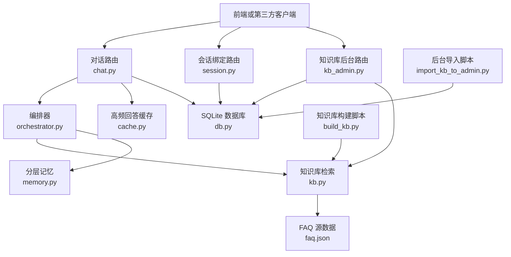
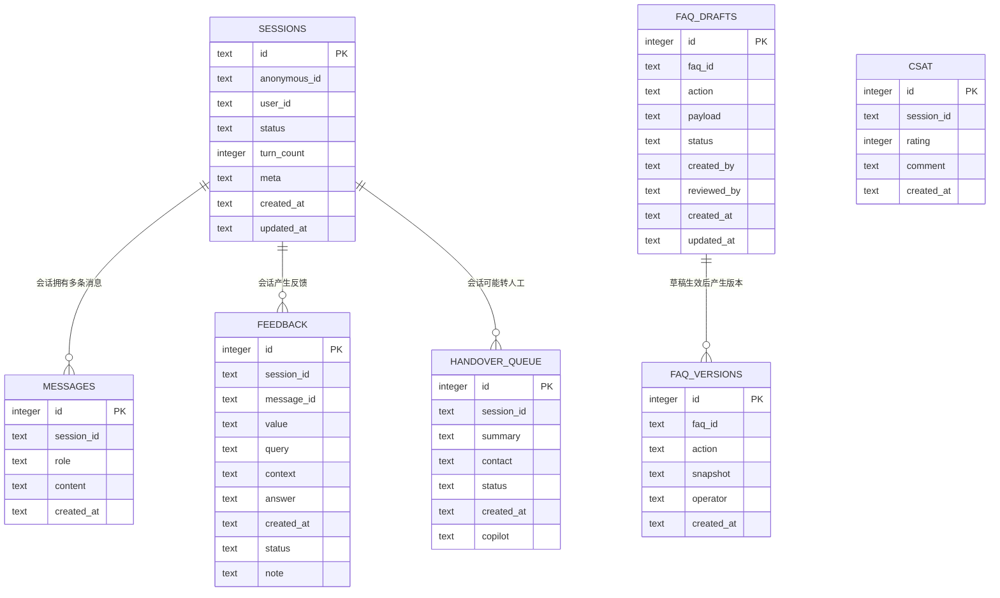
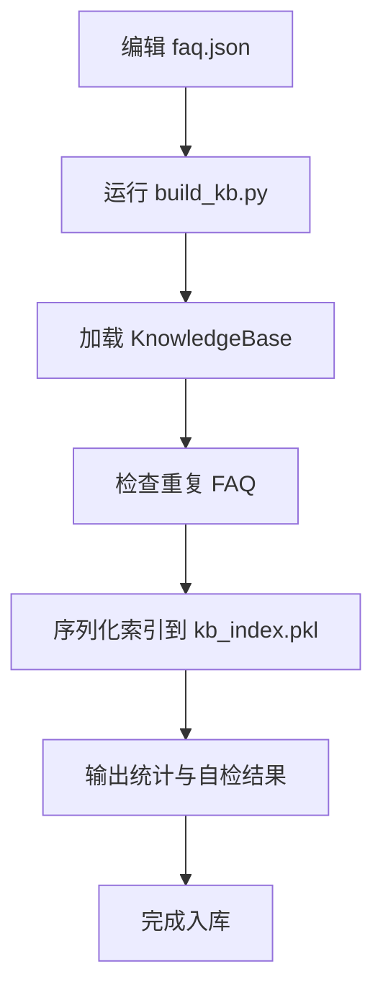
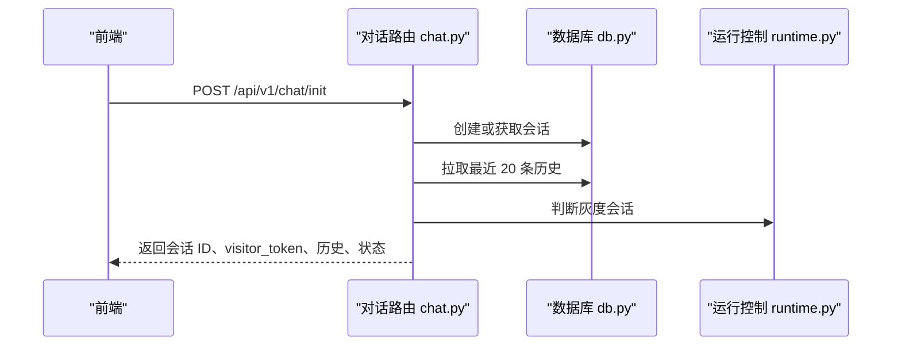
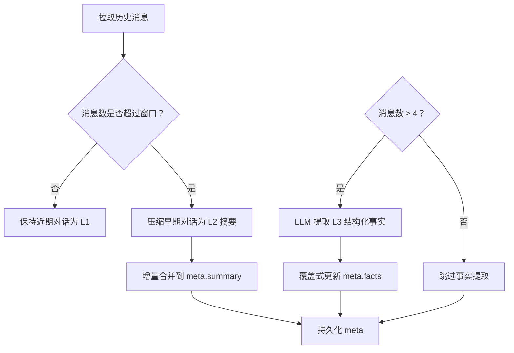
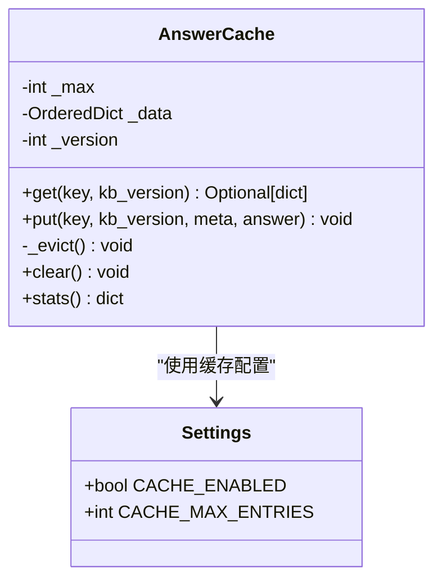

# 数据模型

<cite>
**本文引用的文件**   
- [backend/app/models/schemas.py](file://backend/app/models/schemas.py)
- [backend/app/storage/db.py](file://backend/app/storage/db.py)
- [backend/app/storage/kb.py](file://backend/app/storage/kb.py)
- [knowledge_base/faq.json](file://knowledge_base/faq.json)
- [backend/app/storage/cache.py](file://backend/app/storage/cache.py)
- [backend/app/agent/memory.py](file://backend/app/agent/memory.py)
- [backend/app/routers/chat.py](file://backend/app/routers/chat.py)
- [backend/app/routers/session.py](file://backend/app/routers/session.py)
- [backend/app/routers/kb_admin.py](file://backend/app/routers/kb_admin.py)
- [knowledge_base/build_kb.py](file://knowledge_base/build_kb.py)
- [knowledge_base/import_kb_to_admin.py](file://knowledge_base/import_kb_to_admin.py)
- [backend/app/config.py](file://backend/app/config.py)
</cite>

## 目录
1. [引言](#引言)
2. [项目结构与数据边界](#项目结构与数据边界)
3. [核心实体关系与字段定义](#核心实体关系与字段定义)
4. [SQLite 数据库表结构设计](#sqlite-数据库表结构设计)
5. [FAQ 数据 JSON 规范](#faq-数据-json-规范)
6. [数据生命周期管理](#数据生命周期管理)
7. [数据迁移、版本管理与备份恢复](#数据迁移版本管理与备份恢复)
8. [数据访问模式与缓存策略](#数据访问模式与缓存策略)
9. [性能与扩展建议](#性能与扩展建议)
10. [故障排查指南](#故障排查指南)
11. [结论](#结论)

## 引言
本数据模型文档面向客服机器人系统的后端数据层，聚焦以下目标：
- 描述核心实体：知识库条目 FAQItem、会话 Session、消息 Message、人工转接队列 HandoverQueue，以及反馈、满意度、知识库草稿与版本等辅助实体。
- 说明 SQLite 表结构、主外键关系、索引、约束和运行时迁移。
- 定义 FAQ JSON 的权威语义与校验规则。
- 解释会话滑动窗口、L3 结构化事实提取、增量摘要更新等数据生命周期机制。
- 给出数据迁移、版本管理和备份恢复方案。
- 总结数据访问模式和缓存策略最佳实践。

该模型以 `faq.json` 为知识库 Source of Truth，以 SQLite 为持久化存储，以 Pydantic 模型作为前后端契约，由路由层协调检索、记忆、缓存和运行控制。

## 项目结构与数据边界
系统的数据相关代码分布在以下模块：
- 数据契约：Pydantic 请求/响应模型集中在 `backend/app/models/schemas.py`。
- 持久化层：SQLite 数据库操作集中在 `backend/app/storage/db.py`。
- 知识库检索：TF-IDF/BM25 混合检索及 FAQItem 实体定义在 `backend/app/storage/kb.py`。
- 源数据：FAQ 源文件 `knowledge_base/faq.json`。
- 构建脚本：`knowledge_base/build_kb.py` 负责从 `faq.json` 构建索引；`knowledge_base/import_kb_to_admin.py` 把现有 FAQ 导入后台审批流。
- 缓存层：内存级高频回答缓存 `backend/app/storage/cache.py`。
- 记忆层：分层记忆（滑动窗口、L2 摘要、L3 事实）`backend/app/agent/memory.py`。
- 路由层：对话、会话绑定、知识库后台等接口 `backend/app/routers/chat.py`、`backend/app/routers/session.py`、`backend/app/routers/kb_admin.py`。
- 配置：运行时参数如会话轮次上限、超时、缓存容量、阈值等 `backend/app/config.py`。

**图示来源**
- [backend/app/routers/chat.py:1-120](file://backend/app/routers/chat.py#L1-L120)
- [backend/app/routers/session.py:1-35](file://backend/app/routers/session.py#L1-L35)
- [backend/app/routers/kb_admin.py:1-80](file://backend/app/routers/kb_admin.py#L1-L80)
- [backend/app/storage/db.py:1-120](file://backend/app/storage/db.py#L1-L120)
- [backend/app/storage/kb.py:1-120](file://backend/app/storage/kb.py#L1-L120)
- [backend/app/agent/memory.py:1-87](file://backend/app/agent/memory.py#L1-L87)
- [backend/app/storage/cache.py:1-82](file://backend/app/storage/cache.py#L1-L82)
- [knowledge_base/build_kb.py:1-55](file://knowledge_base/build_kb.py#L1-L55)
- [knowledge_base/import_kb_to_admin.py:1-66](file://knowledge_base/import_kb_to_admin.py#L1-L66)

**章节来源**
- [backend/app/models/schemas.py:1-138](file://backend/app/models/schemas.py#L1-L138)
- [backend/app/storage/db.py:1-200](file://backend/app/storage/db.py#L1-L200)
- [backend/app/storage/kb.py:1-120](file://backend/app/storage/kb.py#L1-L120)
- [knowledge_base/faq.json:1-60](file://knowledge_base/faq.json#L1-L60)
- [backend/app/storage/cache.py:1-82](file://backend/app/storage/cache.py#L1-L82)
- [backend/app/agent/memory.py:1-87](file://backend/app/agent/memory.py#L1-L87)
- [backend/app/routers/chat.py:1-120](file://backend/app/routers/chat.py#L1-L120)
- [backend/app/routers/session.py:1-35](file://backend/app/routers/session.py#L1-L35)
- [backend/app/routers/kb_admin.py:1-120](file://backend/app/routers/kb_admin.py#L1-L120)
- [knowledge_base/build_kb.py:1-55](file://knowledge_base/build_kb.py#L1-L55)
- [knowledge_base/import_kb_to_admin.py:1-66](file://knowledge_base/import_kb_to_admin.py#L1-L66)
- [backend/app/config.py:1-104](file://backend/app/config.py#L1-L104)

## 核心实体关系与字段定义
本节从领域对象角度描述核心实体及其关联。

### FAQItem（知识库条目）
FAQItem 是知识库检索的最小单元，对应 `faq.json` 中每条 FAQ，并参与 TF-IDF 与 BM25 混合检索。

| 字段 | 类型 | 含义 | 约束与语义 |
|---|---|---|---|
| id | 字符串 | FAQ 唯一标识 | 用于版本历史、草稿关联、回滚定位 |
| category | 枚举 | 分类：售后、售前、交易、账号 | 仅允许预设四类 |
| standard_question | 字符串 | 标准问法 | 必填，长度至少 2，最多 200 |
| variants | 字符串列表 | 变体问法 | 可选，最多 50 条 |
| answer | 字符串 | 自动回答内容 | 必填，长度至少 1，最多 5000 |
| risk_level | 枚举 | 风险等级：低、中、高 | 默认 low；高风险条目不直接自动回答 |
| follow_up | 字符串列表 | 后续引导问题 | 可选，最多 20 条 |

FAQItem 还暴露 `search_text` 与 `tokenized` 方法，组合标准问法、变体与答案生成检索文本，并对问答特征分别加权，以提升召回精度。

### Session（对话会话）
Session 代表一次用户与机器人的对话上下文，存储在 `sessions` 表，并通过 `meta` 字段承载 L2 摘要与 L3 事实等扩展状态。

| 字段 | 类型 | 含义 | 约束与语义 |
|---|---|---|---|
| id | 字符串 | 会话 ID | 主键，格式前缀为 `sess_` |
| anonymous_id | 字符串 | 匿名会话标识 | 登录前会话标识 |
| user_id | 字符串 | 绑定后的用户标识 | 登录后覆盖匿名标识 |
| status | 字符串 | 会话状态 | 默认 `AGENT_ACTIVE`，可转为 `HANDOVER` 等 |
| turn_count | 整数 | 已处理轮数 | 用于轮次上限熔断 |
| meta | 字符串（JSON） | 扩展元数据 | 包含 `facts`、`summary`、`pending_faq_id`、`unresolved_streak` 等 |
| created_at | 时间字符串 | 创建时间 | 格式 `YYYY-MM-DD HH:MM:SS` |
| updated_at | 时间字符串 | 更新时间 | 用于 30 分钟无操作复位判断 |

### Message（对话消息）
Message 记录每轮用户与助手的交互片段，按会话维度查询最近 N 条作为短期记忆。

| 字段 | 类型 | 含义 | 约束与语义 |
|---|---|---|---|
| id | 整数 | 自增主键 | 消息行号 |
| session_id | 字符串 | 所属会话 | 逻辑外键，通过索引加速查询 |
| role | 字符串 | 角色：用户或助手 | 区分输入与输出 |
| content | 字符串 | 消息正文 | 可能较长，需截断后进入 Prompt |
| created_at | 时间字符串 | 发送时间 | 用于历史排序与窗口计算 |

### HandoverQueue（人工转接队列）
HandoverQueue 记录需要人工处理的工单，支持排队进度、坐席 Copilot 数据和完成状态流转。

| 字段 | 类型 | 含义 | 约束与语义 |
|---|---|---|---|
| id | 整数 | 自增主键 | 队列项编号 |
| session_id | 字符串 | 来源会话 | 便于回溯上下文 |
| summary | 字符串 | 转人工摘要 | 汇总最新问题、历史与检索结果 |
| contact | 字符串 | 联系方式 | 可选，手机号或邮箱 |
| status | 字符串 | 队列状态 | 默认 `waiting`，可变为 `done` |
| created_at | 时间字符串 | 入队时间 | 用于排队顺序 |
| copilot | 字符串（JSON） | 坐席协作数据 | V2.0 新增列，兼容旧库 |

### 其他辅助实体
- Feedback：点赞/点踩埋点，支持 Bad Case 状态流转。
- Csat：会话满意度评分，1-5 星。
- FqaDrafts：FAQ 变更草稿，支持草稿、待审、驳回、生效状态机。
- FqaVersions：FAQ 版本快照，支持回滚与审计。

**章节来源**
- [backend/app/storage/kb.py:1-120](file://backend/app/storage/kb.py#L1-L120)
- [backend/app/storage/db.py:1-120](file://backend/app/storage/db.py#L1-L120)
- [backend/app/storage/db.py:200-566](file://backend/app/storage/db.py#L200-L566)
- [backend/app/models/schemas.py:1-138](file://backend/app/models/schemas.py#L1-L138)

## SQLite 数据库表结构设计
SQLite 是 MVP 阶段的单一持久化引擎，使用 WAL 模式提升并发读写能力，并通过线程锁保证进程内串行写入。

### 表概览
| 表名 | 用途 | 主键 | 关键索引 | 主要约束 |
|---|---|---|---|---|
| sessions | 会话元数据 | id | 无显式索引 | status、turn_count、meta、user_id、anonymous_id |
| messages | 对话消息 | id | idx_messages_session(session_id, id) | role、content、created_at |
| feedback | 反馈与 Bad Case | id | 无显式索引 | value、status、note |
| handover_queue | 人工转接队列 | id | 无显式索引 | status、copilot(JSON) |
| faq_drafts | FAQ 草稿 | id | 无显式索引 | action、payload(JSON)、status、created_by |
| faq_versions | FAQ 版本历史 | id | 无显式索引 | action、snapshot(JSON)、operator |
| csat | 满意度评分 | id | 无显式索引 | rating(1-5)、comment |

### 主外键关系
当前实现未使用 SQLite 外键约束，而是通过业务层维护逻辑关系：
- messages.session_id 引用 sessions.id。
- feedback.session_id 与 message_id 引用会话与消息。
- handover_queue.session_id 引用会话。
- faq_drafts.faq_id 与 faq_versions.faq_id 引用 FAQ 条目。

### 索引优化
- messages 表对 (session_id, id) 建立复合索引，加速按会话拉取历史。
- 其余查询多为按主键或简单条件过滤，暂无额外索引。
- 未来若频繁按 feedback.value、handover_queue.status、faq_drafts.status 筛选，可考虑追加单列索引。

### 约束规则
- sessions：id 为主键；status 默认 `AGENT_ACTIVE`；turn_count 默认 0；meta 默认空 JSON。
- messages：role 与 content 非空；created_at 自动生成。
- feedback：value 支持 up/down；status 默认 open；note 默认空。
- handover_queue：status 默认 waiting；新增 copilot JSON 列以兼容旧库。
- faq_drafts：action 限制 create/update/delete；payload 存储完整 FAQ JSON；status 受状态机约束。
- faq_versions：snapshot 存储发布后或删除前快照；operator 默认为 ops。
- csat：rating 限制 1-5。

### 初始化与迁移
数据库初始化时执行建表脚本，并在运行时检测旧库缺失列，自动添加：
- handover_queue.copilot TEXT DEFAULT '{}'
- feedback.status TEXT DEFAULT 'open'
- feedback.note TEXT DEFAULT ''

这种设计确保旧版本数据库可直接升级，无需手动迁移脚本。

**图示来源**
- [backend/app/storage/db.py:1-120](file://backend/app/storage/db.py#L1-L120)
- [backend/app/storage/db.py:200-566](file://backend/app/storage/db.py#L200-L566)

**章节来源**
- [backend/app/storage/db.py:1-200](file://backend/app/storage/db.py#L1-L200)
- [backend/app/storage/db.py:200-566](file://backend/app/storage/db.py#L200-L566)

## FAQ 数据 JSON 规范
`faq.json` 是知识库 Source of Truth，构建脚本会读取该文件并构建本地 TF-IDF 与 BM25 索引。

### 顶层结构
| 键 | 类型 | 含义 |
|---|---|---|
| meta | 对象 | 知识库元信息，包含品牌、描述、字段清单 |
| faqs | 数组 | FAQ 条目集合 |

### FAQ 条目字段语义
| 字段 | 类型 | 语义 | 验证规则 |
|---|---|---|---|
| id | 字符串 | FAQ 唯一标识 | 建议采用 `faq_NNN` 形式，避免重复 |
| category | 字符串 | 分类 | 必须为 aftersales/presales/transaction/account 之一 |
| standard_question | 字符串 | 标准问法 | 必填，长度 2-200 |
| variants | 字符串数组 | 变体问法 | 可选，最多 50 条 |
| answer | 字符串 | 自动回答 | 必填，长度 1-5000 |
| risk_level | 字符串 | 风险等级 | 必须为 low/mid/high，默认 low |
| follow_up | 字符串数组 | 后续引导 | 可选，最多 20 条 |

### 构建与校验流程
1. 修改 `faq.json`。
2. 运行 `knowledge_base/build_kb.py`。
3. 脚本加载 `KnowledgeBase`，检查重复率（相似度 > 0.95 视为重复）。
4. 序列化索引到 `backend/data/kb_index.pkl`。
5. 输出分类分布与抽样自检命中结果。

**图示来源**
- [knowledge_base/build_kb.py:1-55](file://knowledge_base/build_kb.py#L1-L55)
- [backend/app/storage/kb.py:1-120](file://backend/app/storage/kb.py#L1-L120)

**章节来源**
- [knowledge_base/faq.json:1-60](file://knowledge_base/faq.json#L1-L60)
- [knowledge_base/build_kb.py:1-55](file://knowledge_base/build_kb.py#L1-L55)
- [backend/app/storage/kb.py:1-120](file://backend/app/storage/kb.py#L1-L120)

## 数据生命周期管理
本节重点描述会话数据的生命周期：滑动窗口、L2 中期摘要、L3 结构化事实提取，以及与缓存、检索、编排器的协作。

### 会话初始化与历史恢复
- 前端调用 `/api/v1/chat/init`，后端根据传入 session_id 创建或恢复会话。
- 返回 visitor_token、品牌名称、快捷回复、最近 20 条历史、当前状态与灰度标记。
- 若用户已登录，会尝试绑定 user_id。

**图示来源**
- [backend/app/routers/chat.py:120-200](file://backend/app/routers/chat.py#L120-L200)
- [backend/app/storage/db.py:120-200](file://backend/app/storage/db.py#L120-L200)

### 滑动窗口与分层记忆
- L1 短期记忆：最近 N 轮完整对话，N 由 `HISTORY_WINDOW_TURNS` 决定，实际消息数为 `window_size() = HISTORY_WINDOW_TURNS * 2`。
- L2 中期摘要：当消息数超过滑动窗口时，将窗口外的早期对话压缩成 ≤160 字的摘要，增量合并到 `meta.summary`。
- L3 结构化事实：从第 2 轮起（≥4 条消息），用 LLM 提取订单号、产品、诉求等 Key-Value 事实，覆盖式更新到 `meta.facts`。

**图示来源**
- [backend/app/agent/memory.py:1-87](file://backend/app/agent/memory.py#L1-L87)
- [backend/app/routers/chat.py:1-120](file://backend/app/routers/chat.py#L1-L120)
- [backend/app/config.py:1-104](file://backend/app/config.py#L1-L104)

### 会话超时与确认状态取消
- 会话 30 分钟无操作自动复位：status 重置为 `AGENT_ACTIVE`，turn_count 归零，meta 清空，但历史消息保留供查阅。
- 确认状态 30 秒无回复自动取消：清除 `pending_faq_id` 与 `pending_at`，回到自由对话。

### 编排器中的数据注入
编排器在生成回答时读取 `meta.summary` 与 `meta.facts`，将其注入 System Prompt，使长对话不丢失上下文。

**章节来源**
- [backend/app/agent/memory.py:1-87](file://backend/app/agent/memory.py#L1-L87)
- [backend/app/routers/chat.py:1-120](file://backend/app/routers/chat.py#L1-L120)
- [backend/app/config.py:1-104](file://backend/app/config.py#L1-L104)

## 数据迁移、版本管理与备份恢复

### 数据库迁移
- 初始化时检测旧库缺失列，自动添加：
  - handover_queue.copilot
  - feedback.status
  - feedback.note
- 所有写入使用事务提交，确保一致性。

### FAQ 版本管理
- FAQ 变更走草稿审批流：draft → pending → published/rejected。
- 每次审批生效写入 `faq_versions`，记录 action、snapshot、operator、created_at。
- 删除操作记录删除前快照，支持回滚。

### 导入与重建
- `import_kb_to_admin.py` 将 `faq.json` 现有 FAQ 批量登记为初始版本，幂等保护：已存在 faq_id 的记录跳过。
- `build_kb.py` 重建本地索引，输出统计与重复检查报告。

### 备份与恢复建议
- SQLite WAL 模式适合轻量部署；生产建议定期备份 `data/chat.db` 与 `knowledge_base/faq.json`。
- 因未启用外键约束，恢复时需保证 sessions、messages、feedback、handover_queue、faq_drafts、faq_versions、csat 六类表结构一致。
- FAQ 版本历史提供细粒度回滚能力，但整体服务重启或数据损坏时仍需依赖数据库快照。

**章节来源**
- [backend/app/storage/db.py:1-120](file://backend/app/storage/db.py#L1-L120)
- [backend/app/storage/db.py:200-566](file://backend/app/storage/db.py#L200-L566)
- [knowledge_base/import_kb_to_admin.py:1-66](file://knowledge_base/import_kb_to_admin.py#L1-L66)
- [knowledge_base/build_kb.py:1-55](file://knowledge_base/build_kb.py#L1-L55)

## 数据访问模式与缓存策略

### 数据访问模式
- 会话查询：按 session_id 获取元数据与最近 N 条历史。
- 消息写入：每次用户输入与助手回答都插入 messages 表。
- 反馈记录：点赞/点踩写入 feedback，支持 Bad Case 状态更新。
- 转人工：入队 handover_queue，支持排队进度查询与完成标记。
- 知识库检索：FAQItem 通过 TF-IDF 与 BM25 混合检索，返回 top_k 结果。
- 分层记忆：每轮维护 L2 摘要与 L3 事实，写入 session.meta。

### 缓存策略
AnswerCache 针对“自动回答”结果进行首轮回话秒回优化：
- Key：规范化查询（jieba 分词 + 停用词过滤 + 去除纯标点 token）。
- 容量：默认 20 条，采用最少命中且最久未命中的淘汰策略。
- 失效：知识库版本变化时整体清空，防止过期口径被复用。
- 命中条件：仅首轮、仅自动回答、缓存开启。

**图示来源**
- [backend/app/storage/cache.py:1-82](file://backend/app/storage/cache.py#L1-L82)
- [backend/app/config.py:1-104](file://backend/app/config.py#L1-L104)

### 最佳实践
- 高频问题优先命中缓存，降低 LLM 调用延迟与成本。
- 知识库热更新后强制清空缓存，保证口径一致性。
- 多轮上下文不使用缓存，避免错误复用首轮答案。
- 消息历史只读最近 N 条，避免 Prompt 过长。
- 结构化事实与摘要增量更新，减少冗余 LLM 调用。

**章节来源**
- [backend/app/storage/cache.py:1-82](file://backend/app/storage/cache.py#L1-L82)
- [backend/app/routers/chat.py:120-200](file://backend/app/routers/chat.py#L120-L200)
- [backend/app/config.py:1-104](file://backend/app/config.py#L1-L104)

## 性能与扩展建议
- 索引扩展：若反馈、转人工队列、草稿表查询量增长，可为常用过滤列增加索引。
- 连接池：当前每线程新建连接，生产环境可引入连接池降低连接开销。
- 外键约束：未来可启用 SQLite 外键约束，加强数据完整性。
- 向量检索替换：kb.py 明确预留豆包 embedding + Qdrant 的替换接口，可在高并发场景下替换本地 TF-IDF。
- 缓存扩容：根据流量调整 CACHE_MAX_ENTRIES，并结合命中率监控评估效果。
- 会话窗口调优：HISTORY_WINDOW_TURNS 影响 L2/L3 触发频率，可根据平均对话长度调整。

[本节为通用性能建议，不直接分析具体文件]

## 故障排查指南
- 会话不存在：POST /chat/stream 返回 404，检查 session_id 是否有效。
- Visitor Token 无效：返回 401，检查前端是否携带正确 token。
- 会话轮次超限：返回限流提示，检查 SESSION_MAX_TURNS 配置。
- 输入超长：拦截不调 LLM，提示分条发送。
- 知识库热更新后缓存异常：确认 kb.version 变化后 AnswerCache 已清空。
- FAQ 重复：build_kb.py 报告相似度 > 0.95 的条目，需合并或改写。
- 草稿状态非法：set_faq_draft_status 仅允许合法状态跳转，检查状态机。
- 旧库缺少列：init_db 会自动添加 copilot/status/note，若仍报错，检查迁移逻辑。

**章节来源**
- [backend/app/routers/chat.py:120-200](file://backend/app/routers/chat.py#L120-L200)
- [backend/app/storage/db.py:1-120](file://backend/app/storage/db.py#L1-L120)
- [knowledge_base/build_kb.py:1-55](file://knowledge_base/build_kb.py#L1-L55)
- [backend/app/storage/cache.py:1-82](file://backend/app/storage/cache.py#L1-L82)

## 结论
本数据模型围绕 FAQItem、Session、Message、HandoverQueue 四个核心实体展开，辅以反馈、满意度、FAQ 草稿与版本等支撑表。SQLite 提供轻量持久化，WAL 模式与线程锁保障基本并发安全；FAQ 数据以 `faq.json` 为权威来源，通过构建脚本与后台审批流共同维护。数据生命周期管理通过滑动窗口、L2 摘要与 L3 结构化事实，实现长对话上下文不丢失。缓存策略针对高频问答提供首轮回话秒回能力，并在知识库热更新后失效。未来可扩展索引、连接池、外键约束与向量检索引擎，以支撑更高并发与更复杂检索需求。

[本节为总结性内容，不直接分析具体文件]