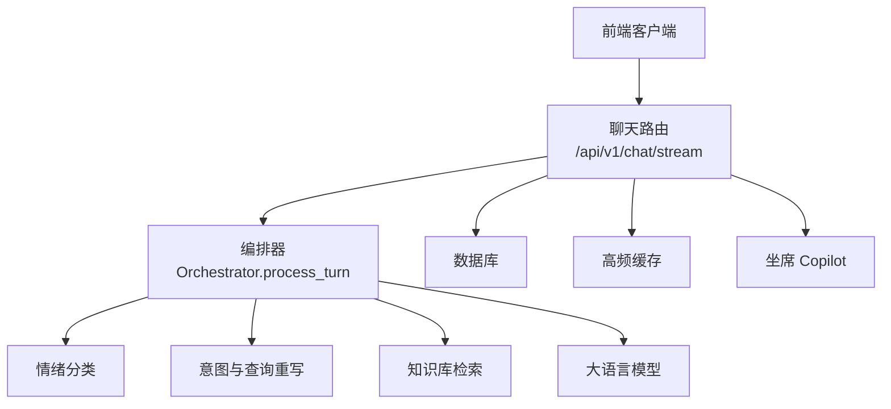
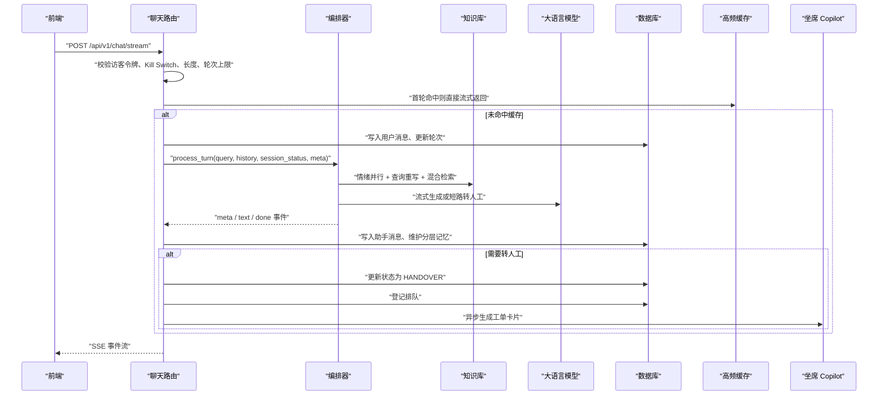
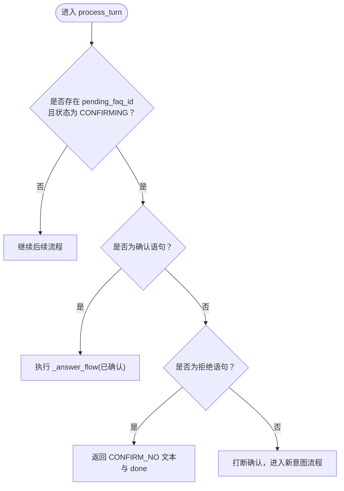
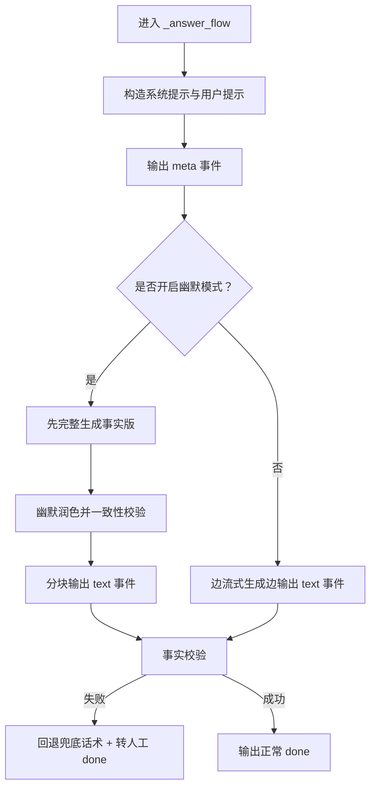
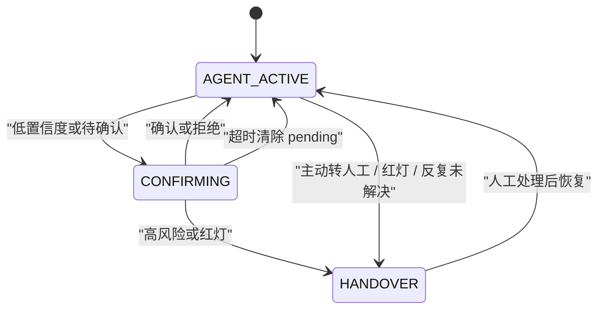
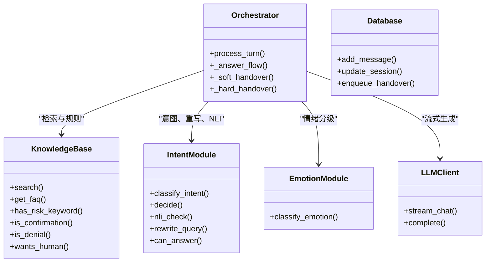

# Orchestrator 编排器主流程

<cite>
**本文引用的文件**   
- [orchestrator.py](file://backend/app/agent/orchestrator.py)
- [chat.py](file://backend/app/routers/chat.py)
- [schemas.py](file://backend/app/models/schemas.py)
- [db.py](file://backend/app/storage/db.py)
- [cache.py](file://backend/app/storage/cache.py)
- [copilot.py](file://backend/app/agent/copilot.py)
</cite>

## 目录
1. [引言](#引言)
2. [项目结构定位](#项目结构定位)
3. [核心组件](#核心组件)
4. [架构总览](#架构总览)
5. [process_turn 完整工作流](#process_turn-完整工作流)
6. [SSE 事件模型：meta、text、done](#sse-事件模型metatextdone)
7. [与 Session 状态机的集成](#与-session-状态机的集成)
8. [依赖关系分析](#依赖关系分析)
9. [性能特征与优化点](#性能特征与优化点)
10. [故障排查指南](#故障排查指南)
11. [结论](#结论)

## 引言
Orchestrator（编排器）是智能问答系统的“中枢调度层”。它不直接实现情绪识别、意图判断、检索或 LLM 生成，而是串联这些子系统，按统一策略决定本轮回答的走向：自动回答、确认引导、软转人工、硬转人工、熔断保护。

`process_turn` 是该编排器的核心方法，负责把一次用户输入转化为有序的可流式 SSE 事件序列。文档重点说明其完整阶段、输入输出、异常处理、状态流转以及与路由层和会话存储的协作方式。

## 项目结构定位
本项目的后端采用 FastAPI + SQLite MVP 架构，关键位置如下：

- `backend/app/routers/chat.py`：对话 HTTP 入口，负责访客令牌校验、会话超时、轮次上限、高频缓存、消息落库，以及调用编排器并组装 SSE。
- `backend/app/agent/orchestrator.py`：编排器，定义 `process_turn`、答案生成流程 `_answer_flow`、软转人工 `_soft_handover`、硬转人工 `_hard_handover`。
- `backend/app/storage/kb.py`：知识库封装（外部引用），提供 FAQ 查询、混合检索、风险词、否定句、转人工语义等规则。
- `backend/app/storage/db.py`：SQLite 会话、消息、反馈、排队等数据访问层。
- `backend/app/storage/cache.py`：首轮高频问题秒回缓存。
- `backend/app/agent/copilot.py`：转人工后异步生成的坐席工单卡片与快捷回复模板。

**图表来源**
- [chat.py:60-120](file://backend/app/routers/chat.py#L60-L120)
- [orchestrator.py:1-40](file://backend/app/agent/orchestrator.py#L1-L40)

**章节来源**
- [chat.py:1-80](file://backend/app/routers/chat.py#L1-L80)
- [orchestrator.py:1-40](file://backend/app/agent/orchestrator.py#L1-L40)

## 核心组件
| 组件 | 职责 | 关键接口/行为 |
|---|---|---|
| `Orchestrator` | 编排一轮对话的主流程 | `process_turn`、`_answer_flow`、`_soft_handover`、`_hard_handover` |
| `ChatStreamRequest` | 请求体模型 | `session_id`、`message`、`visitor_token` |
| `AnswerCache` | 首轮高频答案缓存 | `get`、`put`、`normalize_query` |
| `Database` | 会话、消息、排队持久化 | `add_message`、`update_session`、`enqueue_handover` |
| `Copilot` | 转人工后的工单摘要与快捷回复 | `build_copilot_for`、`extract_ticket`、`generate_templates` |

**章节来源**
- [orchestrator.py:1-40](file://backend/app/agent/orchestrator.py#L1-L40)
- [schemas.py:10-35](file://backend/app/models/schemas.py#L10-L35)
- [cache.py:1-82](file://backend/app/storage/cache.py#L1-L82)
- [db.py:1-60](file://backend/app/storage/db.py#L1-L60)
- [copilot.py:1-30](file://backend/app/agent/copilot.py#L1-L30)

## 架构总览
从用户发送消息到最终 SSE 事件流返回，整体调用链如下：

**图表来源**
- [chat.py:80-160](file://backend/app/routers/chat.py#L80-L160)
- [orchestrator.py:40-200](file://backend/app/agent/orchestrator.py#L40-L200)
- [db.py:120-200](file://backend/app/storage/db.py#L120-L200)
- [cache.py:20-82](file://backend/app/storage/cache.py#L20-L82)
- [copilot.py:80-113](file://backend/app/agent/copilot.py#L80-L113)

## process_turn 完整工作流
`process_turn` 是一个异步生成器，每次调用都向调用方逐步产出字典事件。其设计目标是：先做安全与状态检查，再并行降低首字延迟，最后根据置信度与风险策略分流到自动回答、确认引导、软转人工或硬转人工。

### 输入与输出
| 维度 | 说明 |
|---|---|
| 输入参数 | `query`：用户最新输入；`history`：历史消息列表；`session_status`：当前会话状态；`session_meta`：会话元信息，含 `pending_faq_id`、`unresolved_streak`、`summary`、`facts`；`message_id`：本轮助手消息 ID |
| 输出类型 | 异步生成 `dict`，每个 dict 必须包含 `type` 字段，值为 `meta`、`text` 或 `done` |
| 主要副作用 | 不直接写库；写库由路由层在收到 `done` 后完成 |

### 阶段一：主动转人工检测
如果用户明确表达要转人工，编排器立即走硬转人工分支，不做挽留。该判断基于知识库侧的语义规则。

- 输入：原始 `query`
- 判定逻辑：调用 `wants_human(query)`
- 输出：进入 `_hard_handover(reason="user_request")`
- 异常处理：无额外捕获，直接返回硬转人工事件流

### 阶段二：防死循环检查
连续多轮未能解决时，系统不再继续尝试自动回答，而是强制转人工，避免陷入“问不出 → 转人工 → 用户又回来”的死循环。

- 输入：`session_meta.get("unresolved_streak", 0)`
- 判定条件：大于等于配置项 `REPEAT_UNRESOLVED_LIMIT`
- 输出：进入 `_hard_handover(reason="repeated_unresolved")`
- 计数器维护者：路由层。正常闭环归零，转人工则累加并封顶

### 阶段三：确认状态机处理
当会话处于 `CONFIRMING` 且存在 `pending_faq_id` 时，本次输入会优先被当作对上一轮待确认 FAQ 的响应。

- 确认语句：调用 `is_confirmation(query)`
  - 命中：查找对应 FAQ，直接走 `_answer_flow(confirmed=True)`
  - 结果：跳过后续意图和检索，快速给出答案
- 拒绝语句：调用 `is_denial(query)`
  - 输出：`meta` 中 intent 标记为 `CONFIRM_NO`，提示“好的，那您想了解什么”，然后结束
- 其他输入：打断确认状态，进入新意图流程

**图表来源**
- [orchestrator.py:80-120](file://backend/app/agent/orchestrator.py#L80-L120)

### 阶段四：情绪识别与查询重写并行执行
为了降低首字延迟，情绪分类和查询重写使用异步任务并行发起。

- 情绪分类：始终执行 `classify_emotion(query)`
- 查询重写：仅当启用重写开关且用户没有主动要求转人工时才执行 `rewrite_query(query)`
- 取消机制：若情绪达到红灯阈值，会取消正在进行的查询重写任务，避免浪费资源

### 阶段五：红灯熔断判断
红灯条件包括两类：

1. 情绪等级为最高级别
2. 命中风险关键词

任一条件满足即触发硬转人工，并将查询重写任务取消。

- 输入：`emotion`、原始 `query`
- 输出：`_hard_handover(reason="emotion_red", emotion=...)`
- 异常处理：取消异步任务时捕获 `CancelledError`，确保不会向上抛出

### 阶段六：混合检索与置信度决策
非红灯情况下，使用重写后的查询进行混合检索。检索结果交给意图模块的 `decide` 函数，得到决策对象，包含决策类型和置信度相关信息。

- 输入：`search_query`、`top_k`
- 中间产物：`results`、`verdict`、可选的 `top_faq`
- 决策分支：
  - `handover`：软转人工
  - `ask_llm`：进入后续否定校验、LLM 能力判断、高风险 FAQ 拦截

### 阶段七：否定语义与 NLI 校验
当存在否定语义且命中某个 FAQ 时，系统用 NLI 判断用户是否真正指向该 FAQ。

- CONTRADICTION：用户语义与 FAQ 矛盾 → 硬转人工
- NEUTRAL：无法确定 → 软转人工
- ENTAILMENT：语义支持 → 继续生成

### 阶段八：LLM 能力判断
如果没有明确的 FAQ 支撑，或者置信度不足，会调用 LLM 的布尔判断接口 `can_answer`。若判断为不能回答，则软转人工。

### 阶段九：高风险 FAQ 拦截
即使检索命中了 FAQ，如果该 FAQ 的风险等级为高，也不直接回答，而是硬转人工。这是“红线清单”策略的一部分。

### 阶段十：流式生成回答
当 FAQ 可回答时，进入 `_answer_flow`。该流程会：

1. 构造系统提示和用户提示
2. 注入上下文、历史、摘要、结构化事实
3. 计算置信度，设置幽默开关
4. 输出 `meta` 事件
5. 流式读取 LLM 输出，逐 token 发出 `text` 事件
6. 对最终答案做事实校验
7. 输出 `done` 事件

**图表来源**
- [orchestrator.py:201-300](file://backend/app/agent/orchestrator.py#L201-L300)

**章节来源**
- [orchestrator.py:40-200](file://backend/app/agent/orchestrator.py#L40-L200)
- [orchestrator.py:201-404](file://backend/app/agent/orchestrator.py#L201-L404)

## SSE 事件模型：meta、text、done
Orchestrator 产出的事件都是 Python 字典，由路由层序列化为 SSE。三种事件类型职责不同：

| 事件类型 | 作用 | 关键字段 |
|---|---|---|
| `meta` | 描述本轮意图、情绪、置信度、FAQ 匹配、快捷按钮、转人工原因等元信息 | `status`、`emotion`、`intent`、`confidence`、`faq_ids`、`faqs`、`handover`、`quick_replies`、`handover_reason`、`rewritten_query`、`humor` |
| `text` | 流式增量文本内容 | `content` |
| `done` | 表示本轮结束，携带转人工标志、原因、摘要及清除待确认标记 | `message_id`、`handover`、`handover_reason`、`handover_summary`、`clear_pending`、`cached` |

### meta 常见状态值
| 状态 | 含义 |
|---|---|
| `answering` | 正在生成自动回答 |
| `confirming` | 低置信度或不确定，等待用户选择或澄清 |
| `handover` | 硬转人工或运行控制全切转人工 |
| `blocked` | 输入超长被拦截 |
| `limit` | 会话轮次超限 |
| `maintenance` | 全局维护模式 |

### done 中的防死循环与确认清理
- `handover=True`：本轮未闭环，路由层会把 `unresolved_streak` 累加
- `handover=False`：本轮闭环，路由层将 `unresolved_streak` 置零
- `clear_pending=True`：表示确认状态应被清除，路由层会删除 `pending_faq_id`

**章节来源**
- [orchestrator.py:1-40](file://backend/app/agent/orchestrator.py#L1-L40)
- [orchestrator.py:201-300](file://backend/app/agent/orchestrator.py#L201-L300)
- [orchestrator.py:300-404](file://backend/app/agent/orchestrator.py#L300-L404)
- [chat.py:220-327](file://backend/app/routers/chat.py#L220-L327)

## 与 Session 状态机的集成
Session 状态机由数据库表 `sessions` 维护，关键字段包括：

- `status`：例如 `AGENT_ACTIVE`、`HANDOVER`、`CONFIRMING`
- `turn_count`：累计轮次
- `meta`：JSON 字符串，承载 `pending_faq_id`、`pending_at`、`unresolved_streak`、`summary`、`facts` 等

### CONFIRMING 状态的中断机制
`CONFIRMING` 不是无限期状态。中断来源有三处：

1. 用户确认：直接回答对应 FAQ 并退出确认态
2. 用户拒绝：返回澄清文本并退出确认态
3. 其他输入：视为新意图，中断确认流程

此外，路由层会在每轮开始时检查 `pending_faq_id` 是否超过确认超时时间，若超时则清除待确认状态。

**图表来源**
- [db.py:120-200](file://backend/app/storage/db.py#L120-L200)
- [chat.py:120-200](file://backend/app/routers/chat.py#L120-L200)
- [orchestrator.py:80-120](file://backend/app/agent/orchestrator.py#L80-L120)

### unresolved_streak 计数器工作原理
该计数器位于会话元数据中，用于衡量“连续未解决”的次数。

| 场景 | 行为 |
|---|---|
| 本轮转人工 | 计数加一，最大不超过配置上限加一 |
| 本轮自动闭环 | 计数清零 |
| 达到阈值 | 下一轮 `process_turn` 直接硬转人工 |
| 达到阈值 +1 | 作为防御性上限，防止极端情况无限增长 |

这个计数器不在编排器内部维护，而是在路由层处理 `done` 事件时更新。这样编排器只负责业务判断，路由层负责状态持久化。

**章节来源**
- [chat.py:240-327](file://backend/app/routers/chat.py#L240-L327)
- [db.py:120-200](file://backend/app/storage/db.py#L120-L200)

## 依赖关系分析
Orchestrator 的依赖关系呈现“薄编排、厚能力”的特点：它自身代码量不大，但串联了情绪、意图、检索、LLM、知识库规则等多个子系统。

**图表来源**
- [orchestrator.py:1-40](file://backend/app/agent/orchestrator.py#L1-L40)
- [orchestrator.py:201-404](file://backend/app/agent/orchestrator.py#L201-L404)

**章节来源**
- [orchestrator.py:1-40](file://backend/app/agent/orchestrator.py#L1-L40)
- [orchestrator.py:201-404](file://backend/app/agent/orchestrator.py#L201-L404)

## 性能特征与优化点
| 优化点 | 机制 | 效果 |
|---|---|---|
| 情绪与查询重写并行 | 使用异步任务同时发起情绪分类和查询重写 | 降低首字延迟 |
| 红灯熔断取消重写 | 情绪红灯时取消未完成的重写任务 | 减少无效 LLM 或检索开销 |
| 首轮高频缓存 | 会话首轮命中缓存直接流式返回 | 目标首字低于 500ms |
| 固定话术分块模拟流式 | `_chunk_text` 将静态文本切成小块 | 前端打字机动效自然 |
| 两段式幽默 | 先事实版生成，再润色并一致性校验 | 提高趣味性但不牺牲关键信息准确性 |
| 会话轮次硬上限 | 路由层限制最大轮数 | 控制成本 |
| 输入长度拦截 | 超长消息不调 LLM | 防止 Context 撑爆 |
| 维护模式 Kill Switch | 全局离线或全切转人工 | 生产安全兜底 |

**章节来源**
- [chat.py:80-160](file://backend/app/routers/chat.py#L80-L160)
- [cache.py:1-82](file://backend/app/storage/cache.py#L1-L82)
- [orchestrator.py:201-404](file://backend/app/agent/orchestrator.py#L201-L404)

## 故障排查指南
| 现象 | 可能原因 | 排查建议 |
|---|---|---|
| 用户说转人工却仍在自动回答 | 未命中 `wants_human` 规则 | 检查知识库中的转人工语义规则 |
| 反复提问仍无法解决，但未转人工 | `unresolved_streak` 未累积或配置阈值过高 | 查看会话 meta 中的计数器 |
| 确认态长期不消失 | 未确认也未拒绝，且未超时 | 检查确认超时配置和路由层清理逻辑 |
| 情绪红灯后仍有长尾延迟 | 查询重写任务未正确取消 | 检查异步任务取消与异常捕获 |
| 答案出现数字幻觉 | 事实校验失败 | 检查检索上下文与 LLM 输出 |
| 高频问题首字慢 | 首轮缓存未命中或知识库版本变化 | 检查缓存 key 规范化与 kb.version |
| 转人工后坐席看不到工单 | Copilot 异步生成失败 | 检查 WebSocket 广播与 Copilot 日志 |

**章节来源**
- [chat.py:200-327](file://backend/app/routers/chat.py#L200-L327)
- [orchestrator.py:201-404](file://backend/app/agent/orchestrator.py#L201-L404)
- [copilot.py:80-113](file://backend/app/agent/copilot.py#L80-L113)

## 结论
Orchestrator 的核心价值在于把“安全优先、体验优先、成本可控”的策略统一到单一流程中。`process_turn` 以状态机为骨架，以风险熔断为底线，以并行任务和缓存为性能保障，最终通过统一的 `meta`、`text`、`done` 事件模型向前端暴露一致的交互协议。

在实际使用中，应重点关注以下三点：

1. **风险控制**：红灯、高风险 FAQ、否定矛盾、反复未解决都应导向转人工，避免错误扩散。
2. **状态一致性**：`CONFIRMING`、`unresolved_streak`、`status` 由路由层与数据库共同维护，编排器只消费状态，不直接写库。
3. **可观测性**：通过 `meta.intent`、`meta.handover_reason`、`done.handover_summary` 可以回溯本轮决策路径，便于 Bad Case 分析与调优。