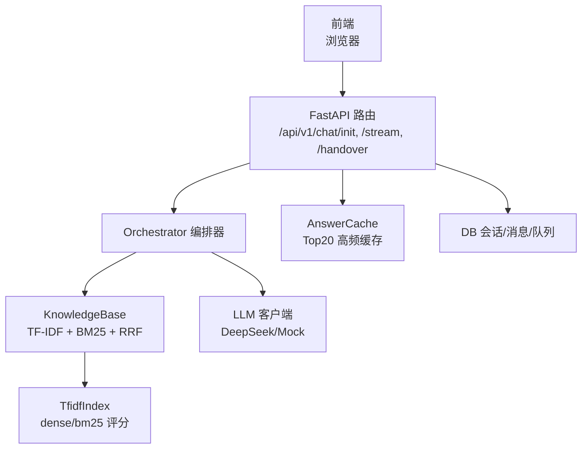
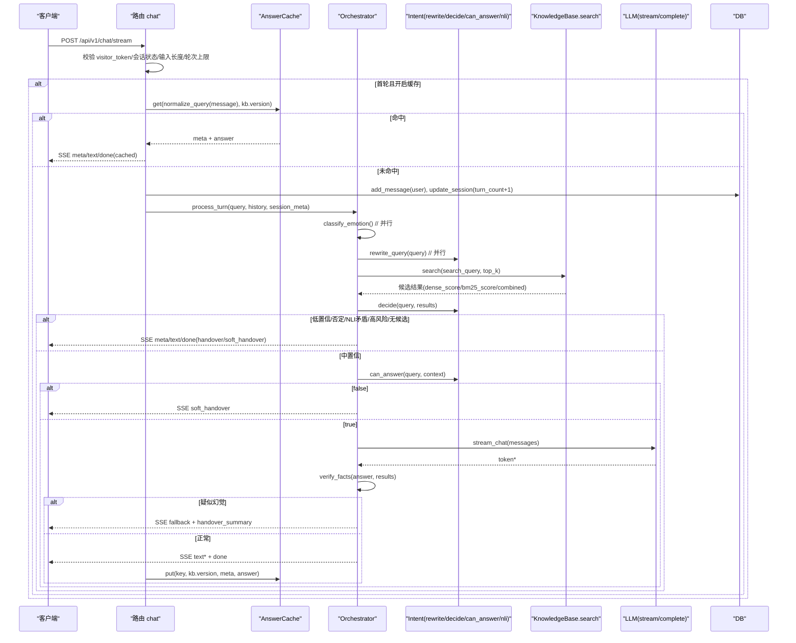
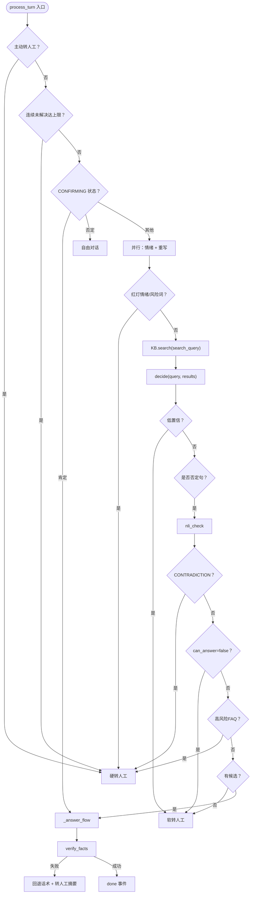
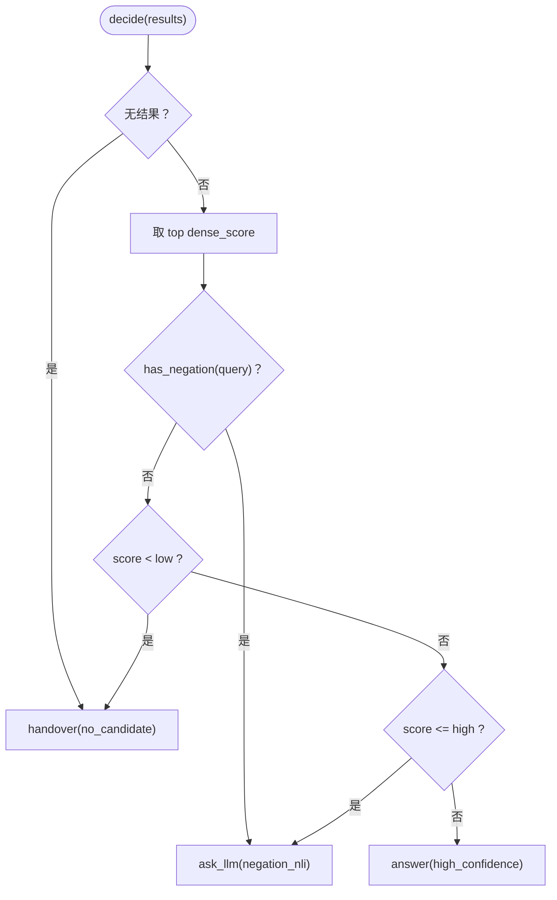
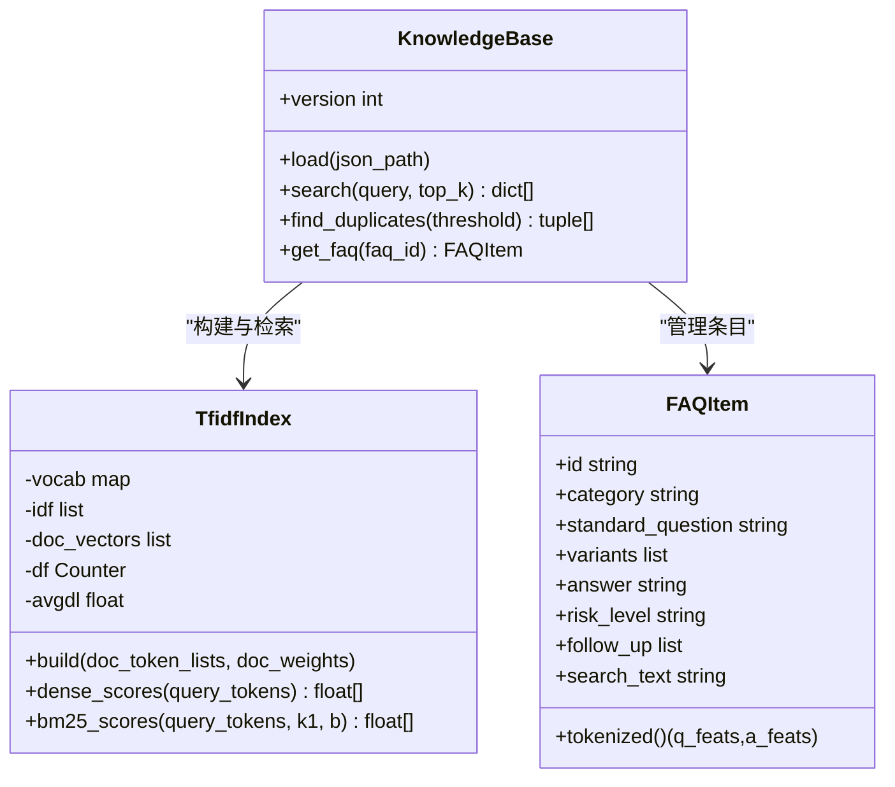
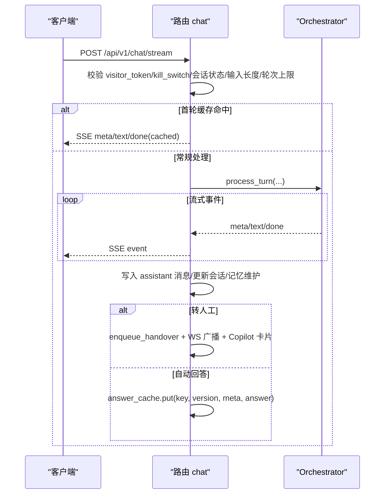
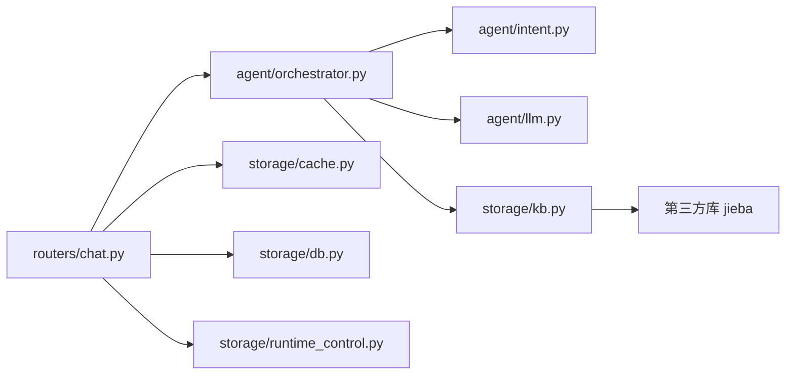

# RAG 智能问答引擎

<cite>
**本文引用的文件**   
- [orchestrator.py](file://backend/app/agent/orchestrator.py)
- [intent.py](file://backend/app/agent/intent.py)
- [llm.py](file://backend/app/agent/llm.py)
- [kb.py](file://backend/app/storage/kb.py)
- [chat.py](file://backend/app/routers/chat.py)
- [schemas.py](file://backend/app/models/schemas.py)
- [cache.py](file://backend/app/storage/cache.py)
- [build_kb.py](file://knowledge_base/build_kb.py)
</cite>

## 目录
1. [简介](#简介)
2. [项目结构](#项目结构)
3. [核心组件](#核心组件)
4. [架构总览](#架构总览)
5. [详细组件分析](#详细组件分析)
6. [依赖关系分析](#依赖关系分析)
7. [性能优化策略](#性能优化策略)
8. [故障排查指南](#故障排查指南)
9. [结论](#结论)

## 简介
本仓库实现了一个面向客服场景的检索增强生成（RAG）智能问答引擎。其编排器 Orchestrator 串联了“查询重写 → 意图识别 → 知识检索 → LLM 生成 → 幻觉校验 → 响应格式化”的完整链路，并在知识库层实现了基于 jieba 分词与 bigram 特征的 TF-IDF + BM25 双路召回，以及无参数的 RRF 融合重排。系统同时提供 Top20 高频问题缓存、异步并发、SSE 流式输出和运行控制开关，兼顾准确率、延迟与可运维性。

## 项目结构
后端采用 FastAPI 路由 + Agent 管线 + 存储层的分层组织：
- 路由层：会话初始化、SSE 对话、转人工接口
- Agent 层：编排器、意图与语义判断、LLM 客户端
- 存储层：知识库索引、缓存、数据库与运行时控制
- 知识库构建脚本：从 FAQ JSON 构建本地索引并保存

**图示来源**
- [chat.py:1-60](file://backend/app/routers/chat.py#L1-L60)
- [orchestrator.py:1-120](file://backend/app/agent/orchestrator.py#L1-L120)
- [kb.py:1-80](file://backend/app/storage/kb.py#L1-L80)
- [llm.py:1-40](file://backend/app/agent/llm.py#L1-L40)
- [cache.py:1-40](file://backend/app/storage/cache.py#L1-L40)

**章节来源**
- [chat.py:1-60](file://backend/app/routers/chat.py#L1-L60)
- [schemas.py:1-60](file://backend/app/models/schemas.py#L1-L60)

## 核心组件
- 编排器 Orchestrator：统一调度情绪分级、查询重写、检索、决策、生成、幻觉校验与转人工分流，产出 SSE 事件流。
- 意图模块 intent：负责查询重写、置信度阈值决策、can_answer 第二层判断、NLI 蕴含校验与可选意图分类。
- 知识库 kb：实现 jieba 分词、bigram 特征、TF-IDF 向量索引、BM25 关键词索引、RRF 融合检索与重复检测。
- LLM 客户端 llm：统一封装 DeepSeek 真实调用与 Mock 离线实现，支持流式与非流式。
- 缓存 cache：按规范化 query 维护 Top20 高频答案缓存，版本失效。
- 路由 chat：会话生命周期、访客 Token 校验、输入长度与轮次熔断、SSE 流式返回与记忆维护。

**章节来源**
- [orchestrator.py:1-120](file://backend/app/agent/orchestrator.py#L1-L120)
- [intent.py:1-130](file://backend/app/agent/intent.py#L1-L130)
- [kb.py:1-120](file://backend/app/storage/kb.py#L1-L120)
- [llm.py:1-177](file://backend/app/agent/llm.py#L1-L177)
- [cache.py:1-82](file://backend/app/storage/cache.py#L1-L82)
- [chat.py:1-120](file://backend/app/routers/chat.py#L1-L120)

## 架构总览
下图展示从用户输入到最终答案生成的端到端流程，包括缓存命中短路、并行情绪与重写、混合检索、决策分支、流式生成与幻觉回退。

**图示来源**
- [chat.py:100-327](file://backend/app/routers/chat.py#L100-L327)
- [orchestrator.py:60-200](file://backend/app/agent/orchestrator.py#L60-L200)
- [intent.py:1-130](file://backend/app/agent/intent.py#L1-L130)
- [kb.py:220-290](file://backend/app/storage/kb.py#L220-L290)
- [llm.py:120-177](file://backend/app/agent/llm.py#L120-L177)
- [cache.py:1-82](file://backend/app/storage/cache.py#L1-L82)

## 详细组件分析

### Orchestrator 编排器工作流
Orchestrator.process_turn 是单轮对话的主入口，按以下阶段推进：
1. 转人工快速通道：主动要求转人工或连续 N 轮未解决直接硬转。
2. 确认状态机：在 CONFIRMING 状态下根据肯定/否定进入回答或回到自由对话。
3. 并行情绪分级与查询重写：降低首字延迟；红灯情绪或风险词熔断，取消重写任务。
4. 混合检索：使用 search_query（若启用重写）进行 TF-IDF + BM25 双路召回。
5. 决策 decide：基于 dense_score 阈值与否定词触发 NLI 校验。
6. 高风险 FAQ 与兜底：高风险直接硬转人工；无候选走软转人工。
7. 生成与幻觉校验：两段式幽默时先生成事实版再润色，最后 verify_facts 校验关键事实一致性。
8. 输出事件流：meta/text/done，含快捷回复、改写后查询、转人工摘要等元信息。

**图示来源**
- [orchestrator.py:60-200](file://backend/app/agent/orchestrator.py#L60-L200)
- [intent.py:40-130](file://backend/app/agent/intent.py#L40-L130)
- [kb.py:220-290](file://backend/app/storage/kb.py#L220-L290)

**章节来源**
- [orchestrator.py:60-200](file://backend/app/agent/orchestrator.py#L60-L200)
- [orchestrator.py:201-404](file://backend/app/agent/orchestrator.py#L201-L404)

### Query Rewrite：子句拆解与关键词扩展
Query Rewrite 的目标是将口语化输入改写为适合检索的标准问法，仅影响召回，不改变安全判断所依据的原始 query。
- 条件开关：通过 settings.QUERY_REWRITE_ENABLED 控制。
- 模型调用：temperature=0、max_tokens=60，限制输出长度以保证稳定性。
- 异常与回退：调用失败或输出超长/为空时回退原 query。
- Mock 行为：MockLLM 在改写任务提示下原样返回，保证离线链路稳定。

该机制提升了召回召回面，尤其对口语变体、省略主语、语气助词等噪声具有鲁棒性。

**章节来源**
- [intent.py:1-40](file://backend/app/agent/intent.py#L1-L40)
- [llm.py:60-120](file://backend/app/agent/llm.py#L60-L120)

### 意图识别与两级置信度决策
- decide：根据 dense_score 与 low/high 阈值划分“不能回答/需要 LLM 判断/高置信直接回答”。检测到否定词强制走 NLI 校验。
- can_answer：第二层 LLM 布尔判断，结合上下文判断是否能回答。
- nli_check：三分类 ENTAILMENT/CONTRADICTION/NEUTRAL，用于否定句语义方向校验。
- classify_intent：可选意图分类（IN_KNOWLEDGE/OUT_OF_SCOPE/HIGH_RISK），作为叠加能力。

**图示来源**
- [intent.py:40-90](file://backend/app/agent/intent.py#L40-L90)

**章节来源**
- [intent.py:40-130](file://backend/app/agent/intent.py#L40-L130)

### 知识库双路召回与 RRF 融合
- 分词与特征：
  - tokenize：jieba 分词 + 停用词过滤 + 小写归一。
  - tokenize_full：jieba 词 + 中文连续字符 bigram（前缀 bg_），提升口语化与拆字变体的匹配鲁棒性。
  - FAQItem.tokenized：标准问法与变体权重 1.0，答案降权（0.2~0.35），避免答案稀释问法匹配。
- TF-IDF 向量索引：
  - 构建：统计 df、计算 idf、加权 tf-idf 并 L2 归一化为稀疏向量。
  - dense_scores：查询向量与文档向量余弦相似度（0~1）。
- BM25 关键词索引：
  - bm25_scores：经典 BM25 公式，考虑词频、文档长度与平均文档长度。
- RRF 融合重排：
  - 分别对 dense 与 bm25 排名，使用 k=60 常数进行倒数求和：sum(1/(k+rank+1))。
  - 融合得分 combined 决定最终顺序，并按 dense_score 做次要排序以保留语义强度。
  - 返回每个候选携带 dense_score、bm25_score、combined，供后续 decide 使用。

**图示来源**
- [kb.py:1-200](file://backend/app/storage/kb.py#L1-L200)
- [kb.py:220-290](file://backend/app/storage/kb.py#L220-L290)

**章节来源**
- [kb.py:1-200](file://backend/app/storage/kb.py#L1-L200)
- [kb.py:220-290](file://backend/app/storage/kb.py#L220-L290)

### LLM 客户端：流式与非流式统一封装
- DeepSeekClient：OpenAI 兼容的 AsyncOpenAI 客户端，支持 stream_chat 与 complete。
- MockLLM：离线规则化输出，按任务提示区分情绪、改写、can_answer、NLI、结构化事实等场景。
- LLM 统一入口：根据配置自动切换真实或 Mock，对外暴露 stream_chat 与 complete。

**章节来源**
- [llm.py:1-177](file://backend/app/agent/llm.py#L1-L177)

### 路由与 SSE 流式传输
- chat_stream：访客 Token 校验、Kill Switch、会话超时复位、确认状态超时取消、输入长度与轮次熔断、首轮高频缓存命中秒回、SSE 事件流转发、记忆维护与转人工队列登记。
- 事件类型：meta/text/done/summary，包含状态、情绪、意图、置信度、快捷按钮、改写后查询、转人工摘要等。

**图示来源**
- [chat.py:100-327](file://backend/app/routers/chat.py#L100-L327)
- [orchestrator.py:201-404](file://backend/app/agent/orchestrator.py#L201-L404)

**章节来源**
- [chat.py:100-327](file://backend/app/routers/chat.py#L100-L327)

### 幻觉校验与幽默两段式接线
- verify_facts：抽取回答中的数字/金额/时间等关键事实，与检索上下文中抽取的事实集合比较，若缺失则视为疑似幻觉。
- 幽默开关：仅在售前类且情绪绿灯时启用；两段式先生成事实版，再由 polish_answer 润色，不一致回退事实版。
- 兜底：疑似幻觉直接回退未知话术，并附带转人工摘要。

**章节来源**
- [orchestrator.py:201-320](file://backend/app/agent/orchestrator.py#L201-L320)

### 知识库构建与入库
- build_kb.py：读取 faq.json，加载 KnowledgeBase，构建索引并序列化为 pkl；执行重复检测与抽样自检。
- 健康检查：相似度 > 0.95 视为重复，便于数据质量治理。

**章节来源**
- [build_kb.py:1-55](file://knowledge_base/build_kb.py#L1-L55)

## 依赖关系分析
- 路由层依赖 Orchestrator、DB、Cache、RuntimeControl、RateLimit。
- Orchestrator 依赖 Intent、LLM、Prompts、Emotion、Humor、KnowledgeBase。
- KnowledgeBase 依赖 jieba、math、collections，内部维护 TfidfIndex。
- LLM 依赖 OpenAI SDK（可选）与配置。
- Cache 依赖 normalize_query（复用 kb.tokenize）。

**图示来源**
- [chat.py:1-60](file://backend/app/routers/chat.py#L1-L60)
- [orchestrator.py:1-60](file://backend/app/agent/orchestrator.py#L1-L60)
- [kb.py:1-40](file://backend/app/storage/kb.py#L1-L40)

**章节来源**
- [chat.py:1-60](file://backend/app/routers/chat.py#L1-L60)
- [orchestrator.py:1-60](file://backend/app/agent/orchestrator.py#L1-L60)
- [kb.py:1-40](file://backend/app/storage/kb.py#L1-L40)

## 性能优化策略
- Top20 高频问题缓存：
  - 仅会话首轮命中，键为 normalize_query（分词 + 停用词过滤 + 标点过滤）。
  - 容量上限淘汰：最少命中 + 最久未命中优先淘汰。
  - 版本失效：知识库重建导致 kb.version 变化时清空缓存。
- 异步并发：
  - 情绪分级与查询重写并行，减少首字延迟。
  - LLM 流式输出，边生成边传输。
- 熔断与限流：
  - 输入长度拦截、会话轮次上限、Kill Switch（全下线/全转人工）、确认状态超时。
- 流式响应：
  - SSE 事件流，meta/text/done/summary，前端打字机效果良好。
- 索引与检索：
  - TF-IDF + BM25 双路召回，RRF 无参数融合，k=60 常数平衡两路贡献。
  - 答案降权避免稀释问法匹配。

**章节来源**
- [cache.py:1-82](file://backend/app/storage/cache.py#L1-L82)
- [chat.py:100-327](file://backend/app/routers/chat.py#L100-L327)
- [orchestrator.py:60-200](file://backend/app/agent/orchestrator.py#L60-L200)
- [kb.py:220-290](file://backend/app/storage/kb.py#L220-L290)

## 故障排查指南
- 无法连接 LLM：
  - 检查 DEEPSEEK_API_KEY/DEEPSEEK_BASE_URL 配置；若无 Key 或初始化失败将降级 Mock。
  - Mock 模式下 ensure_ascii 与固定模板输出可用于离线验证。
- 检索结果为空：
  - 确认 KnowledgeBase.load 已执行且 kb_index.pkl 存在；检查 faq.json 数据完整性。
  - 查看 tokenize 是否因停用词过多导致空查询；调整 STOPWORDS 或输入清洗。
- 频繁转人工：
  - 检查 SIM_THRESHOLD_LOW/HIGH 阈值设置；观察 dense_score 分布。
  - 关注否定句路径：has_negation 触发 NLI，CONTRADICTION 会转人工。
- 缓存未命中或过期：
  - 检查 kb.version 是否与缓存同步；知识库重建后缓存被清空属预期行为。
- 流式中断：
  - 检查 SSE headers（no-cache/X-Accel-Buffering=no）；确认前端事件监听 meta/text/done/summary。
- 幻觉回退：
  - verify_facts 失败会回退未知话术并记录手摘摘要；检查检索上下文是否足够覆盖关键事实。

**章节来源**
- [llm.py:120-177](file://backend/app/agent/llm.py#L120-L177)
- [kb.py:220-290](file://backend/app/storage/kb.py#L220-L290)
- [orchestrator.py:201-404](file://backend/app/agent/orchestrator.py#L201-L404)
- [cache.py:1-82](file://backend/app/storage/cache.py#L1-L82)

## 结论
该 RAG 智能问答引擎以 Orchestrator 为核心，将查询重写、意图识别、混合检索、LLM 生成与幻觉校验有机串联，并通过 TF-IDF + BM25 双路召回与 RRF 融合提升召回精度与鲁棒性。配合 Top20 高频缓存、异步并发与 SSE 流式传输，系统在准确率、延迟与可运维性之间取得平衡。未来可在嵌入向量与向量数据库替换上平滑演进，同时在幽默两段式、记忆压缩与工单卡片生成方面持续完善。