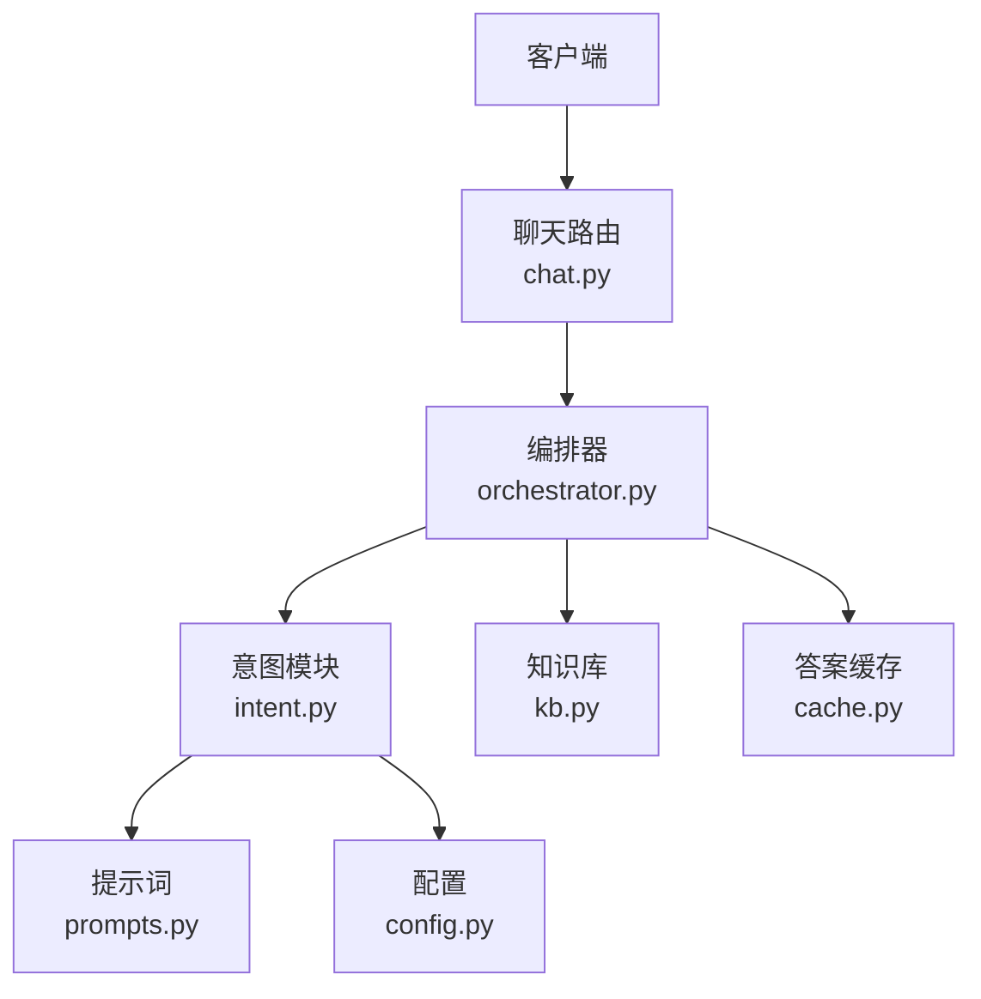
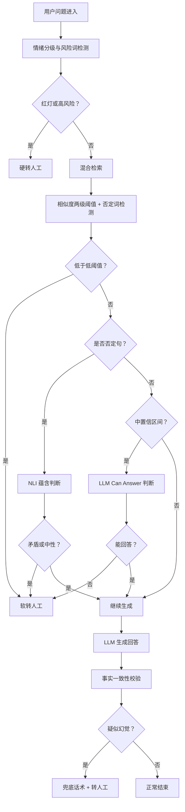
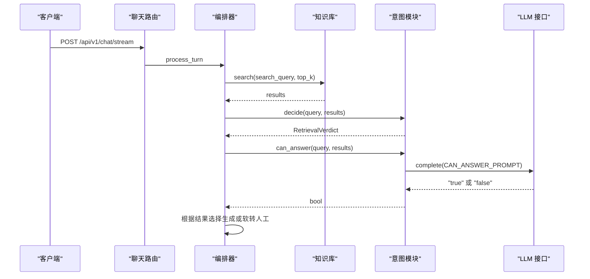
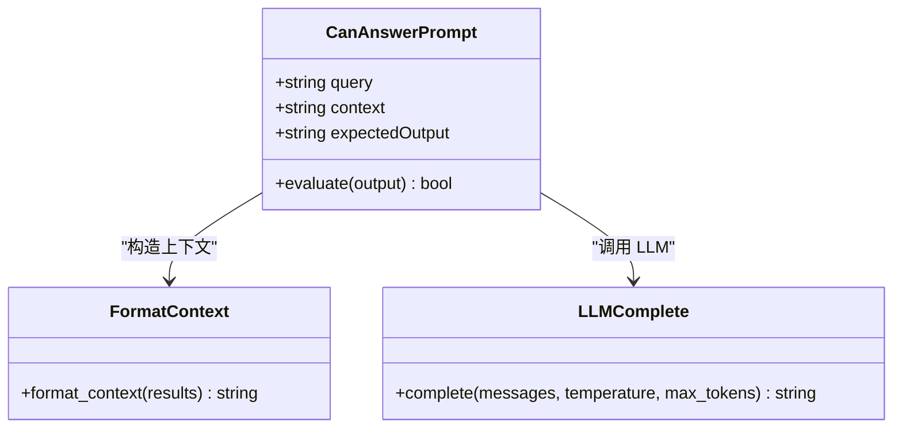
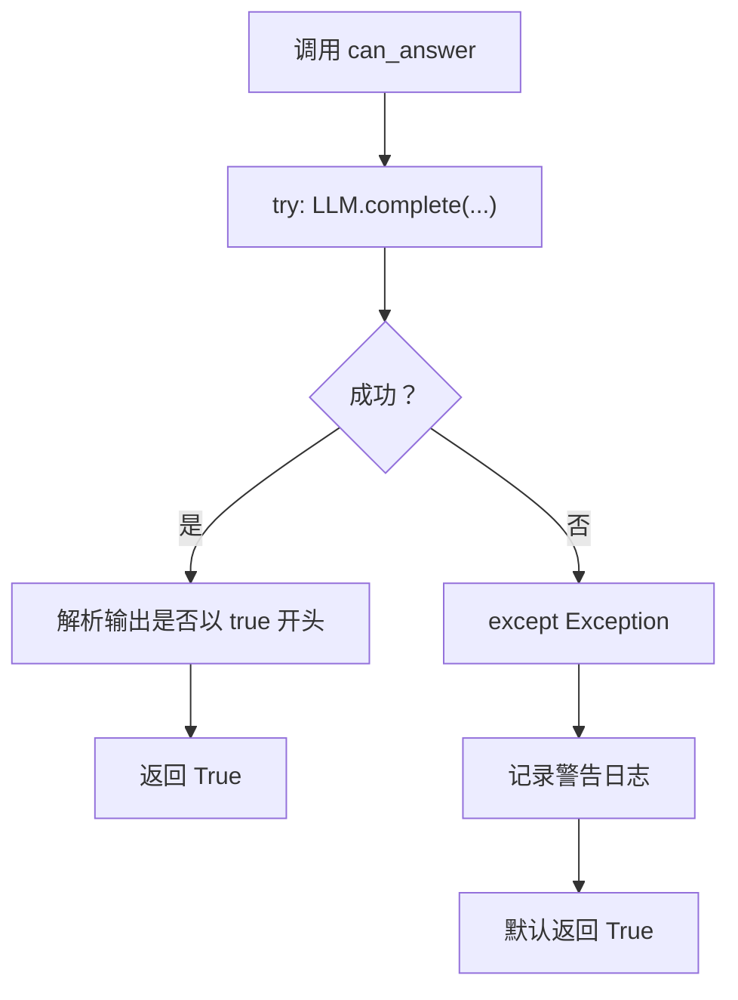
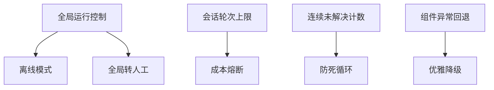

# LLM Can Answer 判断

<cite>
**本文引用的文件**   
- [orchestrator.py](file://backend/app/agent/orchestrator.py)
- [intent.py](file://backend/app/agent/intent.py)
- [prompts.py](file://backend/app/agent/prompts.py)
- [chat.py](file://backend/app/routers/chat.py)
- [config.py](file://backend/app/config.py)
- [kb.py](file://backend/app/storage/kb.py)
- [cache.py](file://backend/app/storage/cache.py)
- [test_v2_gaps.py](file://backend/tests/test_v2_gaps.py)
</cite>

## 目录
1. [引言](#引言)
2. [项目结构定位](#项目结构定位)
3. [核心组件与职责](#核心组件与职责)
4. [三级决策机制总览](#三级决策机制总览)
5. [Can Answer 判断详解](#can-answer-判断详解)
6. [Prompt 设计与评估标准](#prompt-设计与评估标准)
7. [错误处理与重试机制](#错误处理与重试机制)
8. [LLM API 交互、超时与熔断保护](#llm-api-交互超时与熔断保护)
9. [典型场景示例](#典型场景示例)
10. [性能影响与优化建议](#性能影响与优化建议)
11. [故障排查指南](#故障排查指南)
12. [结论](#结论)

## 引言
本文聚焦“LLM Can Answer”判断：当检索召回的相似度处于中置信区间时，系统使用大语言模型对“当前知识库能否完整回答用户问题”做布尔判断。该判断是整体三层防幻觉机制中的第二层，直接决定中置信查询是继续生成还是转人工澄清，因此既影响准确率，也显著影响 LLM 调用成本、首字延迟和用户体验。

## 项目结构定位
Can Answer 判断不是独立服务，而是嵌入在对话编排管线中的意图与置信度决策分支：
- 路由层接收请求并构建 SSE 事件流。
- 编排器负责情绪分级、检索、置信度决策、生成、输出校验与转人工。
- 意图模块提供 can_answer、nli_check、classify_intent、decide 等能力。
- Prompt 模块集中管理所有提示词模板。
- 配置模块定义相似度阈值、是否启用重写、缓存开关等关键参数。
- 知识库模块提供 FAQ 数据、分词、否定词与风险词检测。
- 缓存模块命中首轮高频问题时跳过 LLM 调用。

**图示来源**
- [chat.py:1-120](file://backend/app/routers/chat.py#L1-L120)
- [orchestrator.py:1-120](file://backend/app/agent/orchestrator.py#L1-L120)
- [intent.py:1-130](file://backend/app/agent/intent.py#L1-L130)
- [prompts.py:1-120](file://backend/app/agent/prompts.py#L1-L120)
- [config.py:1-104](file://backend/app/config.py#L1-L104)
- [cache.py:1-82](file://backend/app/storage/cache.py#L1-L82)

**章节来源**
- [chat.py:1-120](file://backend/app/routers/chat.py#L1-L120)
- [orchestrator.py:1-120](file://backend/app/agent/orchestrator.py#L1-L120)
- [intent.py:1-130](file://backend/app/agent/intent.py#L1-L130)
- [prompts.py:1-120](file://backend/app/agent/prompts.py#L1-L120)
- [config.py:1-104](file://backend/app/config.py#L1-L104)
- [cache.py:1-82](file://backend/app/storage/cache.py#L1-L82)

## 核心组件与职责
- 聊天路由：会话初始化、访客 Token 校验、输入长度限制、轮次上限、SSE 流式响应、记忆维护、转人工登记。
- 编排器：串联情绪分级、查询重写、检索、置信度决策、NLI 校验、生成、事实校验、软/硬转人工。
- 意图模块：检索快速决策、can_answer 布尔判断、NLI 蕴含判断、意图分类、查询重写。
- 提示词模块：System Prompt、情绪分级、查询重写、意图分类、可回答性判断、NLI、幽默润色、摘要与 Copilot 模板。
- 配置模块：LLM 模式、品牌名、相似度阈值、检索 Top K、缓存开关、会话限制、重复未解决上限等。
- 知识库模块：FAQ 模型、TF-IDF/BM25 索引、混合特征、否定词与风险词检测。
- 缓存模块：Top N 高频问题秒回缓存，按知识库版本失效。

**章节来源**
- [chat.py:1-327](file://backend/app/routers/chat.py#L1-L327)
- [orchestrator.py:1-404](file://backend/app/agent/orchestrator.py#L1-L404)
- [intent.py:1-130](file://backend/app/agent/intent.py#L1-L130)
- [prompts.py:1-223](file://backend/app/agent/prompts.py#L1-L223)
- [config.py:1-104](file://backend/app/config.py#L1-L104)
- [kb.py:1-200](file://backend/app/storage/kb.py#L1-L200)
- [cache.py:1-82](file://backend/app/storage/cache.py#L1-L82)

## 三级决策机制总览
系统围绕“三层防幻觉”组织判断流程：
1. 第一层：检索相似度两级阈值 + 否定词检测。
   - 低相似度：零 LLM 调用，直接转人工。
   - 高相似度：直接生成。
   - 中相似度：进入第二层 can_answer。
   - 含否定词：强制走 NLI 语义方向校验。
2. 第二层：LLM can_answer 布尔判断。
   - true：继续生成。
   - false：软转人工，进行澄清式挽留或直接转人工。
3. 第三层：生成后轻量事实校验。
   - 若答案中出现无法在检索上下文中验证的数字、金额、时间等事实，视为疑似幻觉，触发兜底话术并标记转人工。

**图示来源**
- [orchestrator.py:1-200](file://backend/app/agent/orchestrator.py#L1-L200)
- [intent.py:1-130](file://backend/app/agent/intent.py#L1-L130)
- [prompts.py:1-200](file://backend/app/agent/prompts.py#L1-L200)

**章节来源**
- [orchestrator.py:1-200](file://backend/app/agent/orchestrator.py#L1-L200)
- [intent.py:1-130](file://backend/app/agent/intent.py#L1-L130)

## Can Answer 判断详解
### 入口与触发条件
- 触发位置：编排器的主流程中，检索完成后先执行 `decide`，得到 `ask_llm` 或 `answer`。
- 触发路径：
  - 最高相似度低于低阈值：直接转人工，不调 LLM。
  - 最高相似度高于高阈值：直接生成。
  - 最高相似度在中置信区间：调用 `can_answer(query, results)`。
  - 检测到否定句：优先走 NLI；NLI 为矛盾或中性时也转人工。
- 结果影响：
  - can_answer 返回 true：继续生成。
  - can_answer 返回 false：软转人工，携带 reason 为 cannot_answer。

**图示来源**
- [chat.py:120-220](file://backend/app/routers/chat.py#L120-L220)
- [orchestrator.py:100-180](file://backend/app/agent/orchestrator.py#L100-L180)
- [intent.py:60-130](file://backend/app/agent/intent.py#L60-L130)

**章节来源**
- [orchestrator.py:100-180](file://backend/app/agent/orchestrator.py#L100-L180)
- [intent.py:60-130](file://backend/app/agent/intent.py#L60-L130)

### 数据结构与复杂度
- 输入：
  - query：用户原始问题字符串。
  - results：检索结果列表，每项包含 FAQ 对象与分数。
- 内部处理：
  - format_context(results) 将检索上下文拼接为文本。
  - 调用 LLM complete，temperature=0.0，max_tokens=8，保证短输出。
- 输出：
  - 布尔值：以返回值是否以 “true” 开头为准。
- 复杂度：
  - 时间复杂度近似 O(n)，n 为检索上下文长度。
  - 空间复杂度近似 O(n)，用于拼接上下文。
  - LLM 调用开销固定，受 model、token 数与网络延迟影响。

**章节来源**
- [intent.py:60-130](file://backend/app/agent/intent.py#L60-L130)
- [prompts.py:120-200](file://backend/app/agent/prompts.py#L120-L200)

## Prompt 设计与评估标准
### CAN_ANSWER_PROMPT
- 目标：让 LLM 判断“知识库能否完整回答用户问题”，仅输出 true 或 false。
- 输入字段：
  - query：用户问题。
  - context：由 format_context(results) 生成的知识库内容。
- 设计要点：
  - 要求只输出布尔标签，避免自由文本干扰解析。
  - 使用小 max_tokens 降低生成成本与延迟。
  - 温度设为 0.0，提升稳定性。
- 评估标准：
  - 能回答：FAQ 内容与用户问题语义一致，且足以给出明确答案。
  - 不能回答：FAQ 缺失、语义不一致、边界模糊、需要更多上下文或人工确认。

**图示来源**
- [prompts.py:120-200](file://backend/app/agent/prompts.py#L120-L200)
- [intent.py:60-130](file://backend/app/agent/intent.py#L60-L130)

**章节来源**
- [prompts.py:120-200](file://backend/app/agent/prompts.py#L120-L200)
- [intent.py:60-130](file://backend/app/agent/intent.py#L60-L130)

### 相关 Prompt 与 System Prompt
- System Prompt：定义身份披露、事实来源、禁止编造、多轮规则、幽默控制、历史摘要注入等。
- NLI_PROMPT：用于否定句蕴含判断，输出 ENTAILMENT / CONTRADICTION / NEUTRAL。
- QUERY_REWRITE_PROMPT：口语化问题改写为标准问法，仅用于检索。
- INTENT_PROMPT：可选意图分类，辅助风险评估。

这些 Prompt 共同构成从检索前到生成后的全链路约束，确保 can_answer 判断与后续生成逻辑一致。

**章节来源**
- [prompts.py:1-223](file://backend/app/agent/prompts.py#L1-L223)

## 错误处理与重试机制
### can_answer 的错误策略
- 异常捕获：调用 LLM 时捕获 Exception。
- 日志记录：记录警告信息，便于排查。
- 默认行为：失败时按“可回答”处理，返回 True。
- 原因分析：
  - 保守策略：宁可多一次生成尝试，也不因 LLM 不可用而误判为不可回答。
  - 风险：若 LLM 长期不可用，可能增加幻觉概率，但会被第三层事实校验拦截。

**图示来源**
- [intent.py:60-130](file://backend/app/agent/intent.py#L60-L130)

**章节来源**
- [intent.py:60-130](file://backend/app/agent/intent.py#L60-L130)

### 重试机制现状
- 当前代码未在 can_answer 中实现显式重试循环。
- 若需增强可靠性，可在外层封装重试策略，例如：
  - 最大重试次数。
  - 指数退避。
  - 区分可重试错误（如超时、限流）与不可重试错误（如格式错误）。
- 注意：重试会增加延迟与成本，需谨慎权衡。

[本节为通用改进建议，不直接分析具体源码]

## LLM API 交互、超时与熔断保护
### 交互方式
- 通过 llm.complete 发送消息列表，包含 user role 与 CAN_ANSWER_PROMPT 格式化内容。
- 参数：
  - temperature=0.0：稳定输出。
  - max_tokens=8：限制输出长度。
- 其他 LLM 调用：
  - emotion 分级、query rewrite、NLI、意图分类、幽默润色、Copilot 工单卡片等均采用相同接口。

### 超时控制
- 当前代码未显式设置 LLM API 的超时参数。
- 建议在 llm.complete 上层或底层统一配置连接超时与读取超时。
- 结合运行时控制，可将长时间无响应的请求视为外部依赖故障，触发降级或转人工。

### 熔断保护
- 系统级熔断：
  - 全局离线模式：直接返回维护消息。
  - 全局转人工模式：绕过检索与 LLM，直接登记转人工。
  - 会话轮次上限：防止无限消耗。
  - 连续未解决计数：超过阈值后硬转人工。
- 组件级熔断：
  - 情绪分级异常时回退关键词。
  - query rewrite 失败时回退原 query。
  - can_answer 失败时默认可回答。
  - 生成失败时回退兜底话术。
  - 事实校验失败时触发幻觉兜底并转人工。

**图示来源**
- [chat.py:120-327](file://backend/app/routers/chat.py#L120-L327)
- [config.py:1-104](file://backend/app/config.py#L1-L104)
- [orchestrator.py:1-200](file://backend/app/agent/orchestrator.py#L1-L200)

**章节来源**
- [chat.py:120-327](file://backend/app/routers/chat.py#L120-L327)
- [config.py:1-104](file://backend/app/config.py#L1-L104)
- [orchestrator.py:1-200](file://backend/app/agent/orchestrator.py#L1-L200)

## 典型场景示例
以下示例基于现有 Prompt 与决策逻辑归纳，不涉及具体代码片段：

- 明确可回答：
  - 用户问“支持 7 天无理由退货吗”。
  - 检索命中高置信 FAQ。
  - decide 返回 answer，直接生成。
- 中置信需判断：
  - 用户问“拆了包装还能退吗”。
  - 检索相似度在中置信区间。
  - can_answer 判断知识库是否能完整回答。
  - 若 true，继续生成；若 false，软转人工。
- 否定句边界：
  - 用户问“不支持七天无理由对吧”。
  - has_negation 为真，强制 NLI。
  - 若 CONTRADICTION，硬转人工；NEUTRAL，软转人工；ENTAILMENT，继续生成。
- 完全不可回答：
  - 用户问“老板是谁”。
  - 检索无候选或低相似度。
  - decide 返回 handover，直接转人工。
- 高风险 FAQ：
  - 命中高风险分类。
  - 编排器直接硬转人工，不直接生成。
- LLM 不可用：
  - can_answer 抛出异常。
  - 默认返回 True，继续生成。
  - 若生成后事实校验失败，仍会触发兜底与转人工。

**章节来源**
- [orchestrator.py:100-200](file://backend/app/agent/orchestrator.py#L100-L200)
- [intent.py:1-130](file://backend/app/agent/intent.py#L1-L130)
- [prompts.py:120-200](file://backend/app/agent/prompts.py#L120-L200)
- [kb.py:1-200](file://backend/app/storage/kb.py#L1-L200)

## 性能影响与优化建议
### 性能影响
- LLM 调用成本：
  - can_answer 每次中置信查询都会调用一次 LLM。
  - 若大量查询落入中置信区间，成本显著上升。
- 首字延迟：
  - can_answer 阻塞在生成之前，增加端到端延迟。
  - 情绪分级与查询重写已并行，但 can_answer 仍串行于检索之后。
- 缓存命中：
  - 首轮高频问题命中缓存时跳过 LLM，显著提升首字速度。
- 检索优化：
  - Query Rewrite 提升召回精度，减少中置信区间比例。
  - RRF 融合与 TF-IDF/BM25 混合索引提升相关性。

### 优化建议
- 调整相似度阈值：
  - SIM_THRESHOLD_LOW 与 SIM_THRESHOLD_HIGH 直接影响 can_answer 触发频率。
  - 可根据线上数据重新校准，减少中置信区间比例。
- 缓存扩展：
  - 当前仅首轮自动回答结果缓存。
  - 可考虑对 can_answer 的 (query_hash, kb_version) 结果做短期缓存，但需严格处理上下文变化。
- 异步与并行：
  - 将 can_answer 与 NLI 等轻量判断并行化，降低首字延迟。
- 降级策略：
  - 当 LLM 持续失败时，切换到规则化 can_answer 或默认策略，并告警。
- 监控指标：
  - can_answer 调用次数、成功率、平均耗时、返回分布。
  - 中置信区间占比、转人工率、幻觉兜底率。

**章节来源**
- [config.py:1-104](file://backend/app/config.py#L1-L104)
- [cache.py:1-82](file://backend/app/storage/cache.py#L1-L82)
- [intent.py:1-130](file://backend/app/agent/intent.py#L1-L130)

## 故障排查指南
### 常见问题
- can_answer 频繁返回 false：
  - 检查 Prompt 是否正确注入 context。
  - 检查检索结果是否命中相关 FAQ。
  - 调整相似度阈值或检索 Top K。
- can_answer 频繁返回 true 但生成后幻觉：
  - 关注第三层事实校验是否触发。
  - 检查 format_context 与 verify_facts 逻辑。
- LLM 调用失败：
  - 查看日志中的警告信息。
  - 检查 LLM_MODE、API Key、Base URL。
  - 评估是否需要重试或降级。
- 中置信区间过多：
  - 调高 SIM_THRESHOLD_HIGH，减少中置信区间。
  - 优化 Query Rewrite 与检索索引。

### 排查步骤
1. 确认会话状态与轮次是否超限。
2. 检查访客 Token 是否有效。
3. 查看检索结果与相似度分数。
4. 观察 can_answer 的日志与返回。
5. 检查生成后的事实校验与转人工原因。
6. 核对运行控制开关与缓存命中情况。

**章节来源**
- [chat.py:120-327](file://backend/app/routers/chat.py#L120-L327)
- [orchestrator.py:1-200](file://backend/app/agent/orchestrator.py#L1-L200)
- [intent.py:60-130](file://backend/app/agent/intent.py#L60-L130)
- [test_v2_gaps.py:1-200](file://backend/tests/test_v2_gaps.py#L1-L200)

## 结论
LLM Can Answer 判断是中置信查询的关键分流点，它通过 Prompt 工程与 LLM 布尔判断弥补相似度阈值的不足，同时被三层防幻觉机制包围：检索阈值、can_answer、生成后事实校验。其默认失败策略偏向“可回答”，以降低误判导致的体验下降，但最终仍由第三层事实校验兜底。生产环境中应重点监控 can_answer 的触发频率、成功率与幻觉率，并结合相似度阈值、缓存命中率与运行控制开关进行综合优化。