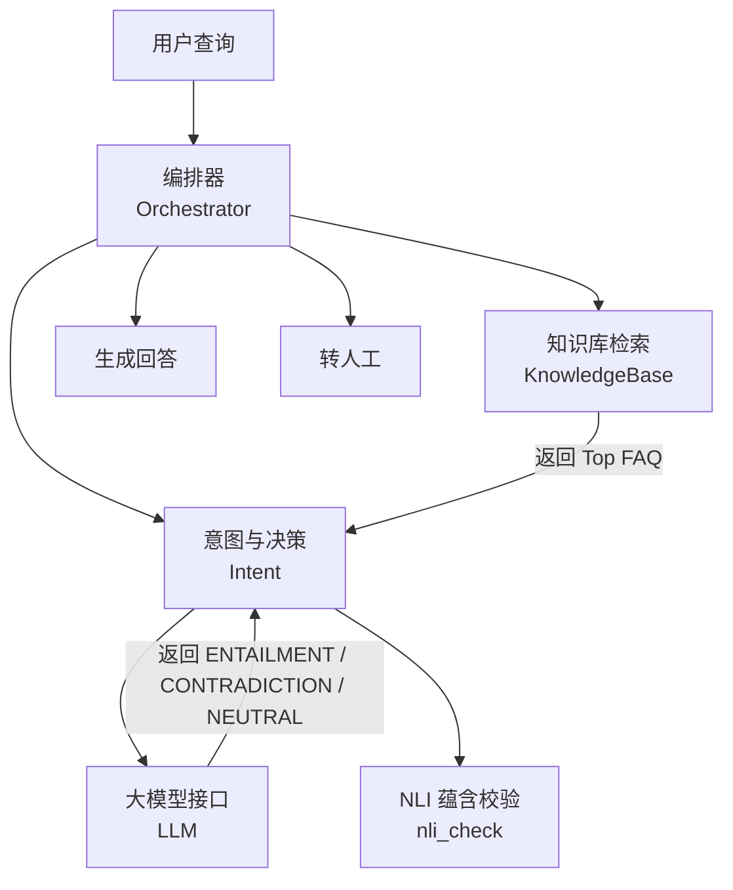
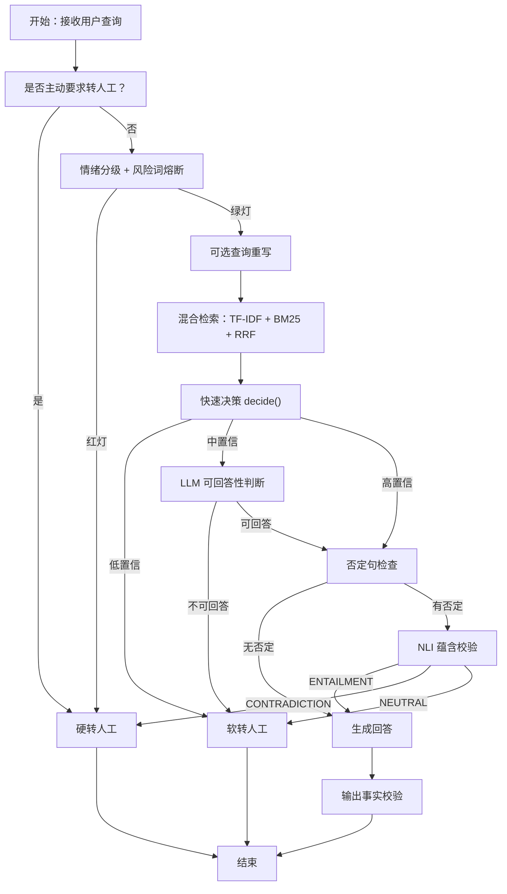
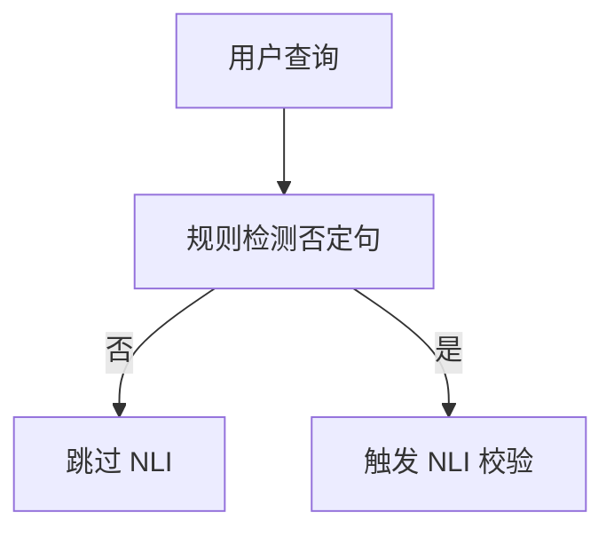
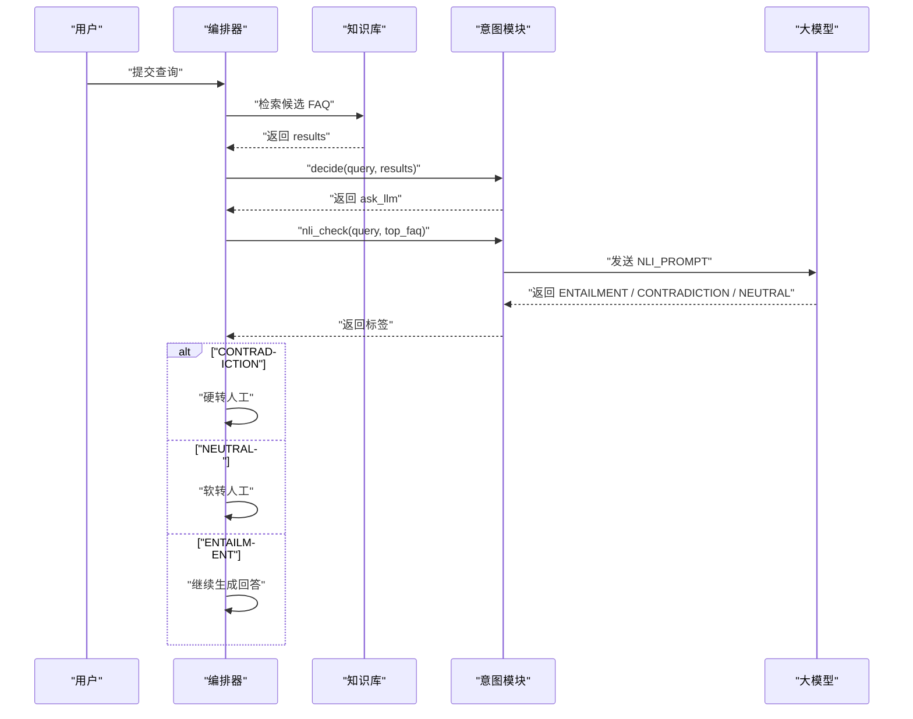
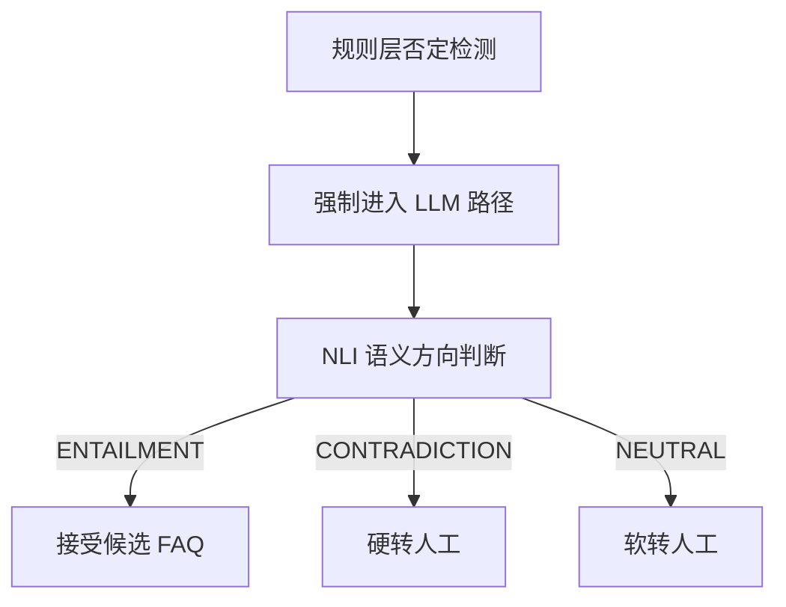
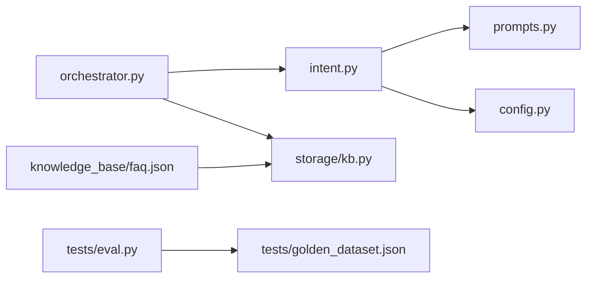

# NLI 蕴含校验

<cite>
**本文引用的文件**   
- [orchestrator.py](file://backend/app/agent/orchestrator.py)
- [intent.py](file://backend/app/agent/intent.py)
- [prompts.py](file://backend/app/agent/prompts.py)
- [kb.py](file://backend/app/storage/kb.py)
- [eval.py](file://backend/tests/eval.py)
- [golden_dataset.json](file://backend/tests/golden_dataset.json)
- [faq.json](file://knowledge_base/faq.json)
</cite>

## 目录
1. [引言](#引言)
2. [项目结构定位](#项目结构定位)
3. [核心组件](#核心组件)
4. [架构总览](#架构总览)
5. [NLI 蕴含校验详细分析](#nli-蕴含校验详细分析)
6. [依赖关系分析](#依赖关系分析)
7. [性能与可靠性特征](#性能与可靠性特征)
8. [故障排查指南](#故障排查指南)
9. [结论](#结论)
10. [附录：语义分类示例](#附录语义分类示例)

## 引言
本文件围绕自然语言推理（NLI）蕴含校验机制展开，说明系统如何判断用户查询与 FAQ 答案之间的语义关系，包括 ENTAILMENT（蕴含）、CONTRADICTION（矛盾）、NEUTRAL（中立）三种分类。文档重点解释以下目标：

- 如何通过 NLI 检测否定句含义，避免把“不支持退换”的 FAQ 错误匹配到“你们支持 7 天无理由对吧？”这类反问或否定式提问。
- NLI 模型如何集成、输入如何构造、结果如何解析。
- NLI 在整体防幻觉三层防线中的位置和作用。
- 提供面向业务理解的语义分类示例和调用流程图。

## 项目结构定位
NLI 并非独立服务，而是嵌入 Agent 编排管线的一个语义校验分支。其关键代码分布在以下模块：

| 模块 | 职责 | 与 NLI 的关系 |
|---|---|---|
| `backend/app/agent/orchestrator.py` | Agent 主流程编排：情绪分级、检索、决策、生成、输出校验、转人工 | 负责在检测到否定句时触发 NLI；根据 NLI 结果决定继续回答、软转人工或硬转人工 |
| `backend/app/agent/intent.py` | 意图识别、置信度决策、可回答性判断、NLI 调用 | 实现 `decide`、`can_answer`、`nli_check` 三个核心函数 |
| `backend/app/agent/prompts.py` | Prompt 工程：人设、情绪、改写、可回答性、NLI、幽默润色等 | 定义 `NLI_PROMPT`，规定 LLM 只输出三类标签之一 |
| `backend/app/storage/kb.py` | 知识库加载、TF-IDF/BM25/RRF 混合检索、否定词/风险词检测 | 提供 `has_negation` 等规则，作为是否进入 NLI 的触发条件 |
| `backend/tests/eval.py` | 自动化评测脚本 | 验证否定句场景下相似度不会虚高，并确认走 NLI 路径 |
| `backend/tests/golden_dataset.json` | 黄金测试集 | 包含否定句用例，如“不支持 7 天无理由退换对吧”“不能退款是吗” |
| `knowledge_base/faq.json` | FAQ 知识源 | 提供标准问法、变体问法和答案，供 NLI 做语义方向判断 |

**图表来源**
- [orchestrator.py:1-200](file://backend/app/agent/orchestrator.py#L1-L200)
- [intent.py:1-130](file://backend/app/agent/intent.py#L1-L130)
- [prompts.py:1-200](file://backend/app/agent/prompts.py#L1-L200)
- [kb.py:1-200](file://backend/app/storage/kb.py#L1-L200)

**章节来源**
- [orchestrator.py:1-200](file://backend/app/agent/orchestrator.py#L1-L200)
- [intent.py:1-130](file://backend/app/agent/intent.py#L1-L130)
- [prompts.py:1-200](file://backend/app/agent/prompts.py#L1-L200)
- [kb.py:1-200](file://backend/app/storage/kb.py#L1-L200)

## 核心组件
本节从数据结构和处理逻辑角度梳理 NLI 相关组件。

### 数据结构
| 名称 | 类型 | 作用 |
|---|---|---|
| `FAQItem` | dataclass | 表示一条 FAQ，包含 id、分类、标准问法、变体问法、答案、风险等级、后续问题 |
| `RetrievalVerdict` | dataclass | 表达检索后的快速决策，包含 decision、faqs、confidence、reason |
| `query` | 字符串 | 原始用户查询，用于安全判断和否定检测 |
| `search_query` | 字符串 | 可选重写后的查询，仅用于检索召回 |
| `results` | 列表 | 检索结果，每条包含 faq 对象和 dense_score 等评分 |
| `top_faq` | `FAQItem` 或 None | 最高相似度的候选 FAQ |
| `nli_label` | 枚举值 | ENTAILMENT、CONTRADICTION、NEUTRAL 三者之一 |

**章节来源**
- [kb.py:1-200](file://backend/app/storage/kb.py#L1-L200)
- [intent.py:1-130](file://backend/app/agent/intent.py#L1-L130)

### 关键函数
| 函数 | 所在文件 | 主要行为 |
|---|---|---|
| `decide(query, results)` | `intent.py` | 基于相似度阈值和否定检测做快速决策 |
| `can_answer(query, results)` | `intent.py` | 第二层 LLM 布尔判断，评估知识库能否完整回答 |
| `nli_check(query, faq)` | `intent.py` | 调用 LLM 进行 NLI 三元分类 |
| `build_system_prompt(...)` | `prompts.py` | 构建生成前第一层防幻觉 System Prompt |
| `NLI_PROMPT` | `prompts.py` | 规定 NLI 只输出三类标签 |
| `has_negation(query)` | `kb.py` | 基于正则模式检测否定含义 |

**章节来源**
- [intent.py:1-130](file://backend/app/agent/intent.py#L1-L130)
- [prompts.py:1-200](file://backend/app/agent/prompts.py#L1-L200)
- [kb.py:1-200](file://backend/app/storage/kb.py#L1-L200)

## 架构总览
NLI 不是孤立模块，而是 Agent 多阶段流水线中的一个语义校验门控。整体流程如下：

**图表来源**
- [orchestrator.py:1-200](file://backend/app/agent/orchestrator.py#L1-L200)
- [intent.py:1-130](file://backend/app/agent/intent.py#L1-L130)
- [prompts.py:1-200](file://backend/app/agent/prompts.py#L1-L200)
- [kb.py:1-200](file://backend/app/storage/kb.py#L1-L200)

**章节来源**
- [orchestrator.py:1-200](file://backend/app/agent/orchestrator.py#L1-L200)

## NLI 蕴含校验详细分析

### 一、何时触发 NLI
NLI 触发有两个前置条件：

1. 检索命中了候选 FAQ。
2. 用户查询被规则判定为否定句。

否定句检测由知识库模块的规则完成，而不是直接交给 LLM。规则使用正则表达式匹配多种中文否定表达方式，例如“不支持”“不能”“没有”“难道”“对吧”“不是吗”等。这样可以在零 LLM 成本的前提下快速拦截高风险语义反转。

**图表来源**
- [kb.py:1-200](file://backend/app/storage/kb.py#L1-L200)
- [orchestrator.py:1-200](file://backend/app/agent/orchestrator.py#L1-L200)

**章节来源**
- [kb.py:1-200](file://backend/app/storage/kb.py#L1-L200)
- [orchestrator.py:1-200](file://backend/app/agent/orchestrator.py#L1-L200)

### 二、NLI 的输入构造
NLI 输入由两部分组成：

| 字段 | 内容 | 说明 |
|---|---|---|
| query | 原始用户查询 | 保留否定、反问、质疑等真实语义，不经过改写 |
| answer | 候选 FAQ 的答案 | 来自检索 Top1 的 FAQ 答案字段 |

Prompt 会明确要求模型只输出三类标签之一：

- ENTAILMENT：用户问题的意图与 FAQ 答案方向一致。
- CONTRADICTION：用户问题在否定、质疑或反问 FAQ 的结论。
- NEUTRAL：两者说的不是同一件事。

这种设计把 NLI 定位为轻量级语义方向校验，而不是自由生成任务。

**章节来源**
- [prompts.py:1-200](file://backend/app/agent/prompts.py#L1-L200)
- [intent.py:1-130](file://backend/app/agent/intent.py#L1-L130)

### 三、NLI 的调用位置与控制流
NLI 调用发生在编排器的“中置信分支”内部。具体顺序如下：

1. 检索完成后执行 `decide()`。
2. 如果检测到否定句，`decide()` 返回 `ask_llm`，强制进入 LLM 路径。
3. 若未命中任何 FAQ，直接走软转人工。
4. 若命中 FAQ 且存在否定句，则调用 `nli_check()`。
5. 若没有否定句，则先执行 `can_answer()` 做第二层可回答性判断。

**图表来源**
- [orchestrator.py:1-200](file://backend/app/agent/orchestrator.py#L1-L200)
- [intent.py:1-130](file://backend/app/agent/intent.py#L1-L130)

**章节来源**
- [orchestrator.py:1-200](file://backend/app/agent/orchestrator.py#L1-L200)
- [intent.py:1-130](file://backend/app/agent/intent.py#L1-L130)

### 四、NLI 的结果解析
`nli_check()` 对 LLM 返回文本做简单后处理：

1. 去除空白字符并转为大写。
2. 以字符串前缀匹配三类标签。
3. 如果不是 ENTAILMENT 或 CONTRADICTION，则默认归为 NEUTRAL。
4. 如果调用异常，记录警告并按 ENTAILMENT 处理，保证链路不因模型失败而中断。

这意味着：

- ENTAILMENT → 继续生成回答。
- CONTRADICTION → 硬转人工，因为否定语义与 FAQ 结论冲突。
- NEUTRAL → 软转人工，因为两者语义不一致但尚未构成明确矛盾。
- 异常 → 按 ENTAILMENT 降级，避免阻断正常对话。

**章节来源**
- [intent.py:1-130](file://backend/app/agent/intent.py#L1-L130)

### 五、否定句的特殊处理机制
否定句是 NLI 设计的核心动机。系统中否定句处理分为两层：

| 层级 | 处理方式 | 目的 |
|---|---|---|
| 规则层 | 通过正则模式检测否定词 | 低成本、可解释地识别否定语义 |
| 语义层 | 通过 NLI 判断用户查询与 FAQ 答案的方向关系 | 避免表面关键词重合导致的错误肯定回答 |

例如，FAQ 答案是“支持 7 天无理由退换”，但用户说“不支持 7 天无理由退换对吧”。如果只看字面相似度，可能误判为高置信回答；加入 NLI 后，系统可以识别这是否定或质疑语境，从而避免错误肯定。

**图表来源**
- [kb.py:1-200](file://backend/app/storage/kb.py#L1-L200)
- [intent.py:1-130](file://backend/app/agent/intent.py#L1-L130)
- [orchestrator.py:1-200](file://backend/app/agent/orchestrator.py#L1-L200)

**章节来源**
- [kb.py:1-200](file://backend/app/storage/kb.py#L1-L200)
- [intent.py:1-130](file://backend/app/agent/intent.py#L1-L130)
- [orchestrator.py:1-200](file://backend/app/agent/orchestrator.py#L1-L200)

### 六、NLI 在防幻觉机制中的作用
系统在 Prompt 工程中明确设计了三层防幻觉：

| 层级 | 位置 | 手段 |
|---|---|---|
| 第一层 | 生成前 System Prompt | 禁止编造、限制信息来源、强调事实来自知识库 |
| 第二层 | 检索后可回答性判断 | 用 LLM 判断知识库是否能完整回答 |
| 第三层 | 生成后事实校验 | 抽取回答中的数字、金额、时间等事实，对比上下文 |

NLI 属于“检索后、生成前”的语义方向校验，主要解决“语义反转类幻觉”，尤其是否定句被当成肯定句处理的场景。它不替代生成层的防幻觉，也不替代输出层的事实校验，而是补齐语义理解这一环。

**章节来源**
- [prompts.py:1-200](file://backend/app/agent/prompts.py#L1-L200)
- [orchestrator.py:1-200](file://backend/app/agent/orchestrator.py#L1-L200)

## 依赖关系分析
NLI 相关依赖关系如下：

**图表来源**
- [orchestrator.py:1-200](file://backend/app/agent/orchestrator.py#L1-L200)
- [intent.py:1-130](file://backend/app/agent/intent.py#L1-L130)
- [prompts.py:1-200](file://backend/app/agent/prompts.py#L1-L200)
- [kb.py:1-200](file://backend/app/storage/kb.py#L1-L200)
- [eval.py:1-100](file://backend/tests/eval.py#L1-L100)
- [golden_dataset.json:1-105](file://backend/tests/golden_dataset.json#L1-L105)
- [faq.json:1-200](file://knowledge_base/faq.json#L1-L200)

**章节来源**
- [orchestrator.py:1-200](file://backend/app/agent/orchestrator.py#L1-L200)
- [intent.py:1-130](file://backend/app/agent/intent.py#L1-L130)
- [prompts.py:1-200](file://backend/app/agent/prompts.py#L1-L200)
- [kb.py:1-200](file://backend/app/storage/kb.py#L1-L200)
- [eval.py:1-100](file://backend/tests/eval.py#L1-L100)
- [golden_dataset.json:1-105](file://backend/tests/golden_dataset.json#L1-L105)
- [faq.json:1-200](file://knowledge_base/faq.json#L1-L200)

## 性能与可靠性特征
### 性能特征
- 规则层否定检测使用本地正则匹配，零 LLM 调用成本。
- NLI 只在“检索命中 + 否定句”分支触发，避免对所有查询都调用 LLM。
- NLI Prompt 限制输出长度为 8 个 token，减少模型响应开销。
- 查询重写是可配置功能，不影响否定和安全判断的安全语义。

### 可靠性特征
- NLI 调用异常时默认按 ENTAILMENT 处理，避免阻断主链路。
- 否定句检测采用保守的正则集合，宁可误触发 NLI，也不轻易忽略明显否定。
- 评测脚本对否定句场景设置独立统计指标，便于回归监控。

**章节来源**
- [intent.py:1-130](file://backend/app/agent/intent.py#L1-L130)
- [kb.py:1-200](file://backend/app/storage/kb.py#L1-L200)
- [eval.py:1-100](file://backend/tests/eval.py#L1-L100)

## 故障排查指南
| 现象 | 可能原因 | 排查建议 |
|---|---|---|
| 否定句仍被当作肯定回答 | 否定规则未覆盖该句式 | 检查 `has_negation` 的正则模式，补充否定表达 |
| NLI 频繁返回 NEUTRAL | 用户查询与 FAQ 答案主题不一致 | 检查检索 Top1 是否正确；考虑优化召回或补充变体问法 |
| NLI 频繁返回 CONTRADICTION | 用户确实在否定或质疑 FAQ | 这是预期行为，应转人工或进一步澄清 |
| NLI 调用失败导致回答异常 | 大模型接口异常 | 查看日志中的 NLI 调用失败警告；当前默认按 ENTAILMENT 降级 |
| 否定句未进入 NLI | 规则未命中 | 使用黄金测试集中否定用例验证 `golden_dataset.json` 中的 negation 场景 |

**章节来源**
- [intent.py:1-130](file://backend/app/agent/intent.py#L1-L130)
- [eval.py:1-100](file://backend/tests/eval.py#L1-L100)
- [golden_dataset.json:1-105](file://backend/tests/golden_dataset.json#L1-L105)

## 结论
NLI 蕴含校验在本项目中承担“语义方向门控”的角色。它弥补了传统相似度检索容易忽略否定、反问、质疑等语义反转的缺陷。通过“规则层否定检测 + LLM 层 NLI 分类 + 编排层决策分流”，系统能够：

- 避免把否定式提问误判为肯定式答案。
- 在语义矛盾时优先转人工。
- 在语义无关时走软转人工，降低错误回答风险。
- 配合三层防幻觉机制，提升回答的事实性和安全性。

对于业务方而言，NLI 的价值主要体现在“少答错”而非“多答对”：它不是让机器人更聪明，而是让机器人更谨慎。

## 附录：语义分类示例
以下示例基于仓库中的 FAQ 数据和黄金测试集，展示三类语义关系的判断思路。为避免直接复制原文，这里仅描述语义关系和预期行为。

| 用户查询语义 | FAQ 答案语义 | NLI 分类 | 系统行为 |
|---|---|---|---|
| “支持 7 天无理由吗” | “支持 7 天无理由退换” | ENTAILMENT | 继续生成回答 |
| “不支持 7 天无理由退换对吧” | “支持 7 天无理由退换” | CONTRADICTION | 硬转人工 |
| “能发顺丰吗” | “默认发中通或圆通，暂不支持指定快递” | NEUTRAL 或 CONTRADICTION，取决于具体表述 | 通常倾向转人工或进一步澄清 |
| “发货后能改快递吗” | “发货后一般不能改快递，需联系人工” | ENTAILMENT 或 NEUTRAL，视答案细节而定 | 命中则生成，否则转人工 |
| “不能退款是吗” | “支持退款，按规则处理” | CONTRADICTION | 硬转人工 |
| “物流好几天不动怎么办” | “物流查询和投诉处理策略” | ENTAILMENT | 继续生成回答 |

这些示例体现了 NLI 的核心价值：当用户表达否定、质疑或反问时，系统不应仅凭关键词重合就给出肯定回答。

**章节来源**
- [golden_dataset.json:1-105](file://backend/tests/golden_dataset.json#L1-L105)
- [faq.json:1-200](file://knowledge_base/faq.json#L1-L200)
- [intent.py:1-130](file://backend/app/agent/intent.py#L1-L130)
- [orchestrator.py:1-200](file://backend/app/agent/orchestrator.py#L1-L200)