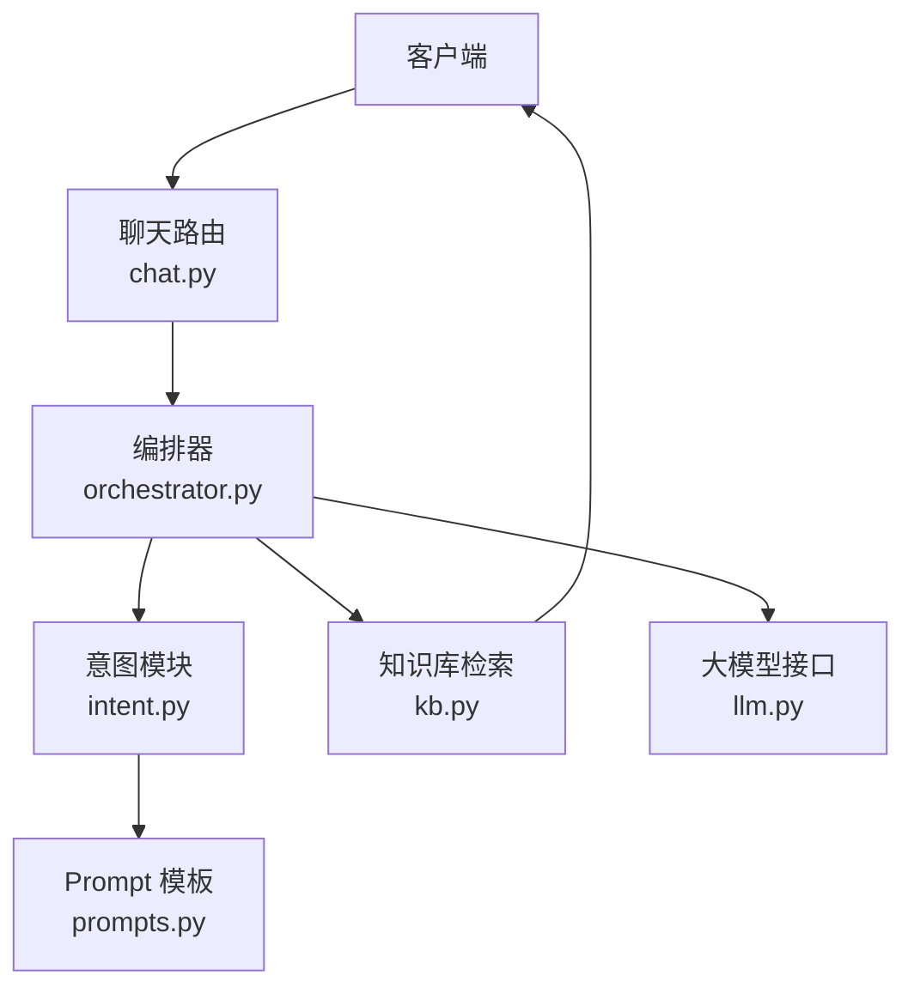
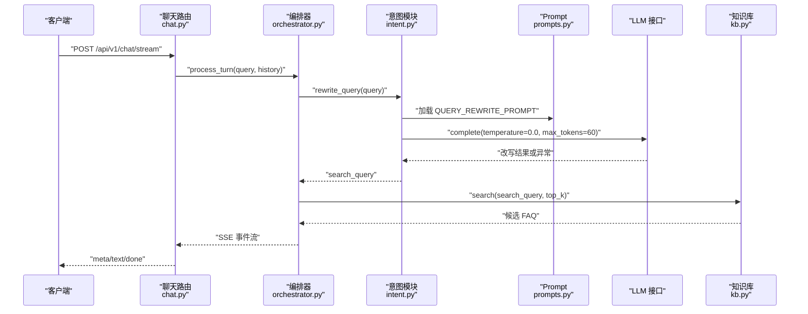
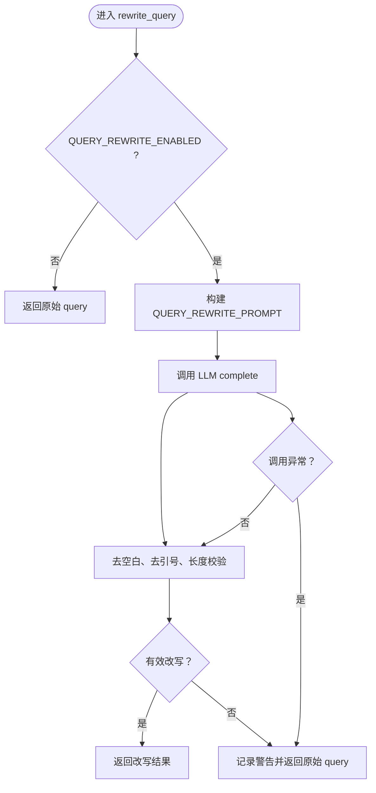
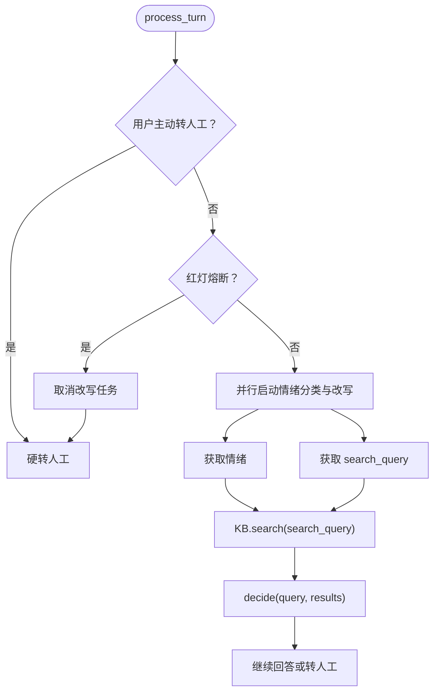
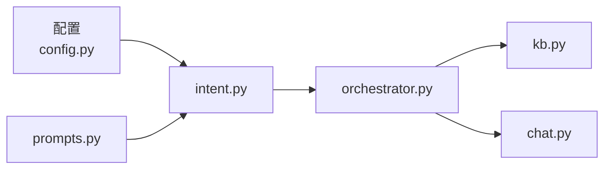

# Query Rewrite 查询改写

<cite>
**本文引用的文件**   
- [orchestrator.py](file://backend/app/agent/orchestrator.py)
- [intent.py](file://backend/app/agent/intent.py)
- [prompts.py](file://backend/app/agent/prompts.py)
- [chat.py](file://backend/app/routers/chat.py)
- [kb.py](file://backend/app/storage/kb.py)
- [config.py](file://backend/app/config.py)
</cite>

## 目录
1. [引言](#引言)
2. [项目结构中的查询改写位置](#项目结构中的查询改写位置)
3. [核心组件](#核心组件)
4. [架构总览](#架构总览)
5. [详细组件分析](#详细组件分析)
6. [依赖关系分析](#依赖关系分析)
7. [性能考虑](#性能考虑)
8. [故障排查指南](#故障排查指南)
9. [结论](#结论)

## 引言
Query Rewrite（查询改写）是该客服系统检索链路中的一层“语义标准化”能力：把用户口语化、省略主语、包含错别字或情绪化措辞的自然语言问题，改写成更适合知识库检索的标准问法。它仅用于提升检索召回精度，不改变后续安全判断所使用的原始 query。当改写失败、被配置关闭或 LLM 不可用时，系统会回退到使用原始 query，保证整体链路稳定可用。

该能力位于对话编排器与意图识别模块之间，配合混合检索、置信度决策、NLI 语义校验和生成后校验共同构成三层防幻觉体系的一部分。

## 项目结构中的查询改写位置
查询改写并非独立服务，而是后端 Agent 管线中的一个函数式能力，主要涉及以下文件：

- `backend/app/agent/intent.py`：定义 `rewrite_query` 函数及 Prompt 调用逻辑。
- `backend/app/agent/prompts.py`：定义 `QUERY_REWRITE_PROMPT`，约束改写行为。
- `backend/app/agent/orchestrator.py`：在编排器中并行触发改写任务，并把改写结果传给检索层。
- `backend/app/storage/kb.py`：接收改写后的 search query，执行 TF-IDF + BM25 + RRF 混合检索。
- `backend/app/routers/chat.py`：作为 `/api/v1/chat/stream` 入口，组装历史并调用编排器。
- `backend/app/config.py`：提供 `QUERY_REWRITE_ENABLED` 等开关与阈值。

**图示来源**
- [chat.py:1-200](file://backend/app/routers/chat.py#L1-L200)
- [orchestrator.py:1-120](file://backend/app/agent/orchestrator.py#L1-L120)
- [intent.py:1-60](file://backend/app/agent/intent.py#L1-L60)
- [prompts.py:60-120](file://backend/app/agent/prompts.py#L60-L120)
- [kb.py:230-316](file://backend/app/storage/kb.py#L230-L316)

**章节来源**
- [orchestrator.py:1-120](file://backend/app/agent/orchestrator.py#L1-L120)
- [intent.py:1-60](file://backend/app/agent/intent.py#L1-L60)
- [prompts.py:60-120](file://backend/app/agent/prompts.py#L60-L120)
- [chat.py:1-120](file://backend/app/routers/chat.py#L1-L120)
- [kb.py:230-316](file://backend/app/storage/kb.py#L230-L316)
- [config.py:40-80](file://backend/app/config.py#L40-L80)

## 核心组件
查询改写相关核心职责可归纳为以下组件：

| 组件 | 文件 | 主要职责 | 关键行为 |
|---|---|---|---|
| `rewrite_query` | `intent.py` | 将口语化 query 改写为标准检索问法 | 读取配置、调用 LLM、清洗输出、长度校验、异常回退 |
| `QUERY_REWRITE_PROMPT` | `prompts.py` | 定义改写规则 | 禁止反转否定语义、保留关键信息、去除语气词、单行输出 |
| `Orchestrator.process_turn` | `orchestrator.py` | 编排整个对话流程 | 并行发起情绪分类与改写、选择 search query、传入检索层 |
| `KnowledgeBase.search` | `kb.py` | 接收改写后的 search query 进行检索 | TF-IDF + BM25 + RRF，返回候选 FAQ |
| `Settings.QUERY_REWRITE_ENABLED` | `config.py` | 控制是否启用改写 | 支持多种 true/false 字符串形式 |

**章节来源**
- [intent.py:24-60](file://backend/app/agent/intent.py#L24-L60)
- [prompts.py:88-108](file://backend/app/agent/prompts.py#L88-L108)
- [orchestrator.py:70-120](file://backend/app/agent/orchestrator.py#L70-L120)
- [kb.py:230-316](file://backend/app/storage/kb.py#L230-L316)
- [config.py:56-70](file://backend/app/config.py#L56-L70)

## 架构总览
下图展示一次用户消息从进入路由到完成检索的完整时序，重点标出 Query Rewrite 的位置与降级路径。

**图示来源**
- [chat.py:120-220](file://backend/app/routers/chat.py#L120-L220)
- [orchestrator.py:70-120](file://backend/app/agent/orchestrator.py#L70-L120)
- [intent.py:24-60](file://backend/app/agent/intent.py#L24-L60)
- [prompts.py:88-108](file://backend/app/agent/prompts.py#L88-L108)
- [kb.py:230-316](file://backend/app/storage/kb.py#L230-L316)

## 详细组件分析

### 查询改写函数 `rewrite_query`
`rewrite_query` 是 Query Rewrite 的直接实现。其处理流程如下：

1. **配置检查**：如果 `QUERY_REWRITE_ENABLED` 为 false，直接返回原始 query。
2. **构造 Prompt**：使用 `QUERY_REWRITE_PROMPT.format(query)` 拼装用户输入。
3. **调用 LLM**：以 `temperature=0.0`、`max_tokens=60` 请求改写。
4. **后处理**：
   - 去首尾空白。
   - 去除外层引号。
   - 再次去空白。
   - 要求非空且长度不超过 80。
5. **回退策略**：
   - 改写结果为空或超长时记录警告日志并返回原始 query。
   - 任何异常都捕获并记录警告日志，最终返回原始 query。

**图示来源**
- [intent.py:24-60](file://backend/app/agent/intent.py#L24-L60)

**章节来源**
- [intent.py:24-60](file://backend/app/agent/intent.py#L24-L60)

### Prompt 设计：`QUERY_REWRITE_PROMPT`
改写 Prompt 的核心约束包括：

- **语义不变**：只改表达方式，不改语义；绝对不反转肯定/否定含义。
- **关键信息保留**：订单号、数字、金额、日期、型号、地名等原样保留。
- **口语降噪**：去掉口头禅、语气词、情绪化措辞。
- **输出格式**：输出一行改写结果，不解释；若已标准则原样输出。

这些规则确保改写结果既适合检索，又不会引入语义漂移。

| 规则类别 | 说明 | 设计目的 |
|---|---|---|
| 语义保真 | 不反转否定句、不改变意图方向 | 防止检索召回错误方向的 FAQ |
| 实体保护 | 保留订单号、金额、日期、型号 | 避免关键过滤条件丢失 |
| 噪声清理 | 删除语气词、情绪化表达 | 提升关键词匹配质量 |
| 单行输出 | 不附加解释文本 | 便于长度校验与直接使用 |

**章节来源**
- [prompts.py:88-108](file://backend/app/agent/prompts.py#L88-L108)

### 编排器中的改写集成
编排器 `Orchestrator.process_turn` 是 Query Rewrite 的主要调度点。它在用户主动转人工、红灯熔断之后，与情绪分类并行发起改写任务：

- 如果配置允许且不是主动转人工，创建改写异步任务。
- 如果命中红灯（严重情绪或风险词），取消改写任务，避免浪费 LLM 调用。
- 改写完成后，`search_query` 使用改写结果；否则使用原始 query。
- 后续安全判断仍基于原始 query，改写只影响检索召回。

**图示来源**
- [orchestrator.py:70-120](file://backend/app/agent/orchestrator.py#L70-L120)

**章节来源**
- [orchestrator.py:70-120](file://backend/app/agent/orchestrator.py#L70-L120)

### 检索层对改写结果的消费
`KnowledgeBase.search` 接收 `search_query`，并不关心它是否来自改写。改写只是上游传递的一个更“标准”的查询文本。检索层负责：

- 中文分词与停用词过滤。
- TF-IDF 向量相似度计算。
- BM25 稀疏检索。
- RRF 融合排序。
- 返回携带 `dense_score`、`bm25_score`、`combined` 的候选列表。

因此，Query Rewrite 的效果体现在：当用户口语化表达更接近知识库标准问法时，TF-IDF 与 BM25 更容易命中正确 FAQ。

**章节来源**
- [kb.py:230-316](file://backend/app/storage/kb.py#L230-L316)

### 与意图识别系统的集成
Query Rewrite 与意图识别不是竞争关系，而是协作关系：

| 阶段 | 组件 | 输入 | 输出 | 是否使用原始 query |
|---|---|---|---|---|
| 改写 | `rewrite_query` | 原始 query | 标准检索问法 | 是，但改写结果用于检索 |
| 快速决策 | `decide` | 原始 query + 检索结果 | 高/中/低置信决策 | 是 |
| 可回答性判断 | `can_answer` | 原始 query + 上下文 | true/false | 是 |
| NLI 语义校验 | `nli_check` | 原始 query + FAQ answer | ENTAILMENT/CONTRADICTION/NEUTRAL | 是 |
| 意图分类 | `classify_intent` | 原始 query | IN_KNOWLEDGE/OUT_OF_SCOPE/HIGH_RISK | 是 |

可见，**所有安全相关判断都基于原始 query**，只有检索召回使用改写后的 `search_query`。这是防止改写误伤安全边界的保守设计。

**章节来源**
- [intent.py:24-130](file://backend/app/agent/intent.py#L24-L130)
- [orchestrator.py:70-120](file://backend/app/agent/orchestrator.py#L70-L120)

### 改写失败的回退策略
系统为 Query Rewrite 设计了多层回退：

1. **配置级回退**：`QUERY_REWRITE_ENABLED=false` 时跳过改写。
2. **输出级回退**：改写结果为空或超过 80 字符时回退原始 query。
3. **异常级回退**：LLM 调用抛出异常时回退原始 query。
4. **熔断级回退**：红灯场景下直接取消改写任务，不再等待结果。
5. **检索级回退**：即使改写失败，检索层仍可正常用原始 query 工作。
6. **生成级回退**：生成失败或疑似幻觉时会走兜底话术或转人工。

这些回退策略保证系统在 LLM 不可用、网络异常、模型输出不稳定时仍能继续提供服务。

**章节来源**
- [intent.py:24-60](file://backend/app/agent/intent.py#L24-L60)
- [orchestrator.py:70-120](file://backend/app/agent/orchestrator.py#L70-L120)
- [orchestrator.py:201-320](file://backend/app/agent/orchestrator.py#L201-L320)

### 不同类型问题的改写效果示例
由于代码未提供具体改写样例，下面根据 Prompt 规则和常见用户表达模式给出预期改写方向。实际改写结果取决于 LLM 输出，应以线上日志为准。

| 用户原始问题类型 | 典型表达特征 | 预期改写方向 | 说明 |
|---|---|---|---|
| 省略主语 | “怎么退货” | “如何申请退货” | 补全动词结构，保留核心动作 |
| 包含错别字 | “退款多久能到帐” | “退款多久到账” | 修正明显错别字，保持语义 |
| 复合问题 | “物流到哪了，什么时候能到，能不能加急” | 建议拆分为单一问题 | Prompt 要求单行输出，复杂问题更适合拆分 |
| 否定句 | “不支持七天无理由对吧” | 保留否定语义的标准化问法 | 严禁反转否定含义 |
| 带情绪 | “你们这破东西怎么还发错货” | 去除情绪词，聚焦“发错货” | 只改表达方式，不改语义 |
| 已标准 | “我的订单为什么还没发货” | 可能原样输出 | Prompt 允许已标准时原样返回 |

注意：以上为设计预期，不代表固定映射规则。系统通过 LLM 泛化理解，而不是硬编码正则替换。

**章节来源**
- [prompts.py:88-108](file://backend/app/agent/prompts.py#L88-L108)
- [intent.py:24-60](file://backend/app/agent/intent.py#L24-L60)

## 依赖关系分析
Query Rewrite 的依赖关系可以按运行时角色划分：

- `config.py` 提供 `QUERY_REWRITE_ENABLED`。
- `prompts.py` 提供 `QUERY_REWRITE_PROMPT`。
- `intent.py` 组合配置与 Prompt，封装 `rewrite_query`。
- `orchestrator.py` 决定何时调用改写、何时取消、如何使用结果。
- `kb.py` 消费改写后的 search query。
- `chat.py` 是外部入口，间接驱动整个链路。

潜在耦合点：
- 改写 Prompt 变化会影响 `intent.py` 的输出格式。
- `orchestrator.py` 假设改写返回字符串，若 LLM 返回结构体将破坏契约。
- `kb.py` 不感知 query 是否改写，解耦良好。

**图示来源**
- [config.py:56-70](file://backend/app/config.py#L56-L70)
- [prompts.py:88-108](file://backend/app/agent/prompts.py#L88-L108)
- [intent.py:24-60](file://backend/app/agent/intent.py#L24-L60)
- [orchestrator.py:70-120](file://backend/app/agent/orchestrator.py#L70-L120)
- [kb.py:230-316](file://backend/app/storage/kb.py#L230-L316)
- [chat.py:120-220](file://backend/app/routers/chat.py#L120-L220)

**章节来源**
- [config.py:56-70](file://backend/app/config.py#L56-L70)
- [intent.py:24-60](file://backend/app/agent/intent.py#L24-L60)
- [orchestrator.py:70-120](file://backend/app/agent/orchestrator.py#L70-L120)

## 性能考虑
Query Rewrite 的性能设计围绕“提升检索准确率的同时尽量降低延迟”展开：

| 优化点 | 实现方式 | 收益 |
|---|---|---|
| 并行执行 | 情绪分类与改写异步并行 | 减少首字延迟 |
| 红灯熔断 | 严重情绪或风险词直接取消改写任务 | 避免无效 LLM 调用 |
| 温度控制 | `temperature=0.0` | 输出稳定、减少随机性 |
| Token 限制 | `max_tokens=60` | 控制 LLM 成本与响应时间 |
| 输出长度校验 | 最长 80 字符 | 快速拦截异常输出 |
| 配置开关 | `QUERY_REWRITE_ENABLED` | 可在部署层关闭改写 |
| 高频缓存 | 首轮命中秒回，不调 LLM | 降低重复问题成本 |
| 降级路径 | 异常回退原始 query | 保证可用性 |

需要注意：
- 改写本身会增加一次 LLM 调用开销。
- 在低置信度或高风险场景，应优先避免不必要的改写。
- 生产环境可通过灰度或运行控制逐步开启改写能力。

**章节来源**
- [orchestrator.py:70-120](file://backend/app/agent/orchestrator.py#L70-L120)
- [intent.py:24-60](file://backend/app/agent/intent.py#L24-L60)
- [config.py:56-70](file://backend/app/config.py#L56-L70)
- [chat.py:150-220](file://backend/app/routers/chat.py#L150-L220)

## 故障排查指南
排查 Query Rewrite 问题时，建议按以下顺序定位：

1. **确认是否启用改写**  
   检查 `QUERY_REWRITE_ENABLED` 是否为 true。

2. **查看改写调用日志**  
   关注 `intent.py` 中记录的“查询重写结果异常”和“查询重写调用失败”日志。

3. **检查 LLM 模式**  
   `LLM_MODE`、`DEEPSEEK_API_KEY`、`DEEPSEEK_BASE_URL`、`DEEPSEEK_MODEL` 是否正确。

4. **检查改写输出长度**  
   改写结果超过 80 字符会被视为异常并回退。

5. **检查 Prompt 变更**  
   `QUERY_REWRITE_PROMPT` 是否被修改导致输出格式不符合预期。

6. **观察检索效果**  
   对比使用原始 query 与改写后 query 的检索候选，确认改写是否提升召回。

7. **结合意图决策日志**  
   如果检索结果低置信，确认是否走到 `decide` 的 `LOW_CONFIDENCE` 分支。

8. **检查生成后校验**  
   如果回答疑似幻觉，可能不是改写问题，而是生成内容无法被知识库事实验证。

**章节来源**
- [intent.py:24-60](file://backend/app/agent/intent.py#L24-L60)
- [prompts.py:88-108](file://backend/app/agent/prompts.py#L88-L108)
- [orchestrator.py:201-320](file://backend/app/agent/orchestrator.py#L201-L320)
- [config.py:40-80](file://backend/app/config.py#L40-L80)

## 结论
Query Rewrite 在该系统中承担“口语化 query 到标准检索问法”的中间层职责。它通过 Prompt 工程约束语义保真、实体保护和输出格式，通过 `rewrite_query` 实现配置开关、异常回退和长度校验，并通过编排器与意图识别、混合检索、生成后校验协同工作。

当前实现的关键优势是：
- 改写仅影响检索召回，不影响安全判断。
- 多层回退保证 LLM 不可用时系统仍可运行。
- 与情绪分级、红灯熔断、NLI 校验形成完整防幻觉体系。

未来可考虑的改进方向包括：
- 增加改写质量评估指标，如改写前后检索命中率差异。
- 支持改写结果缓存，对高频口语化表达做轻量映射。
- 在 Bad Case 管理中记录改写失败样本，持续优化 Prompt。
- 在运行控制中支持按会话或用户维度灰度开启改写。