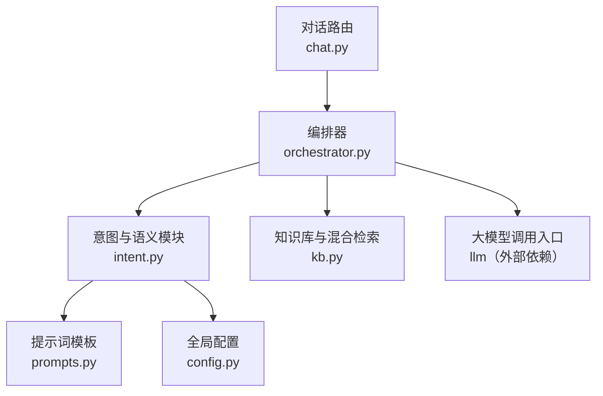
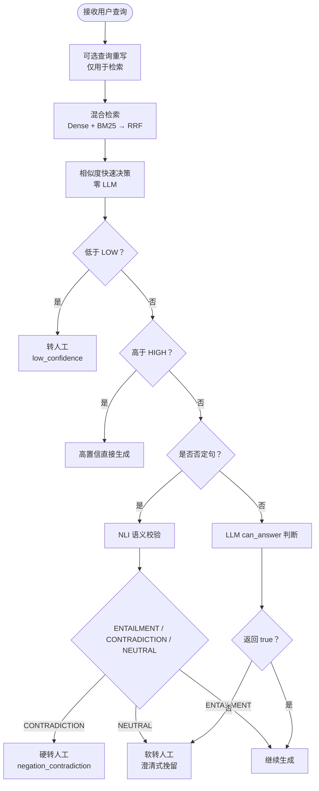
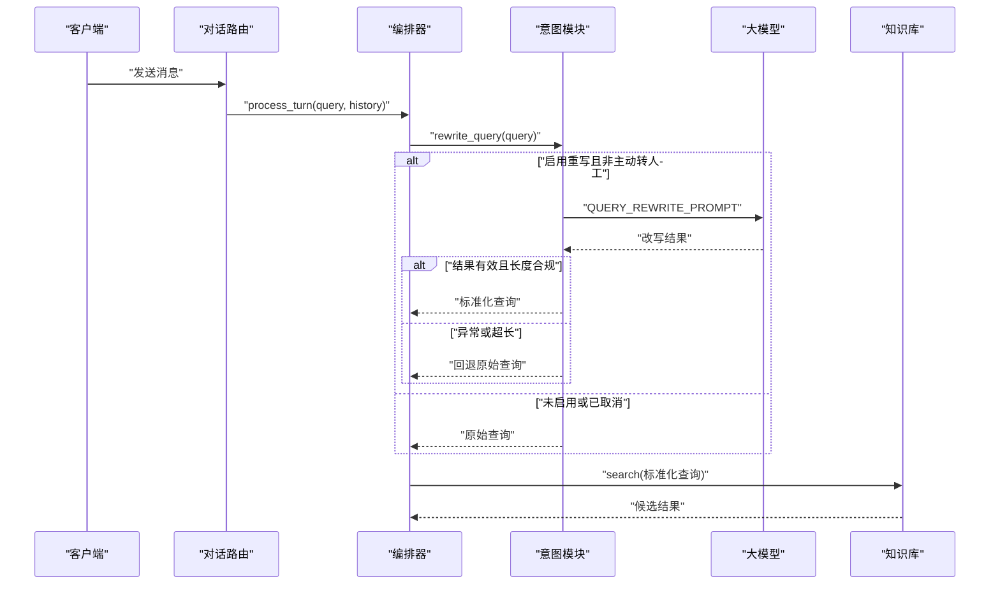
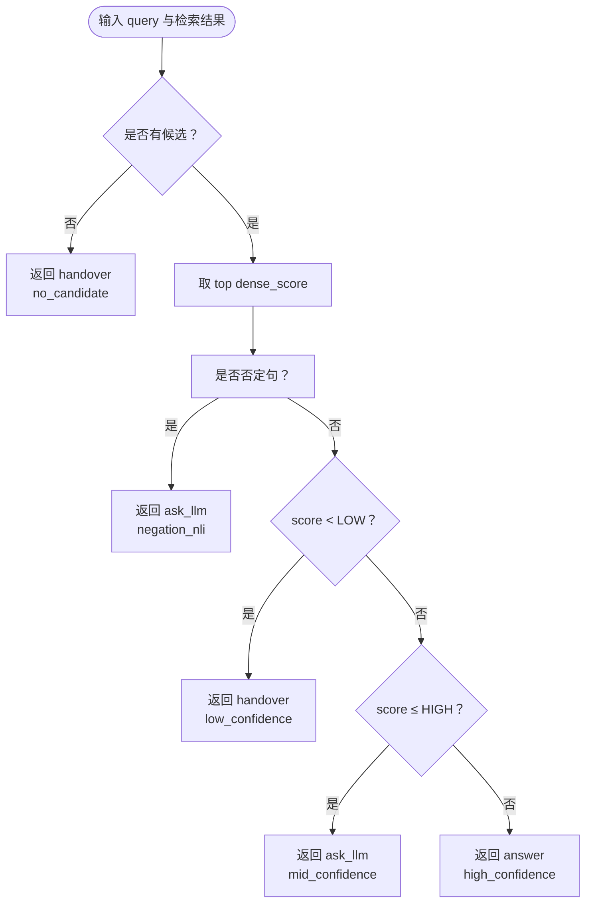
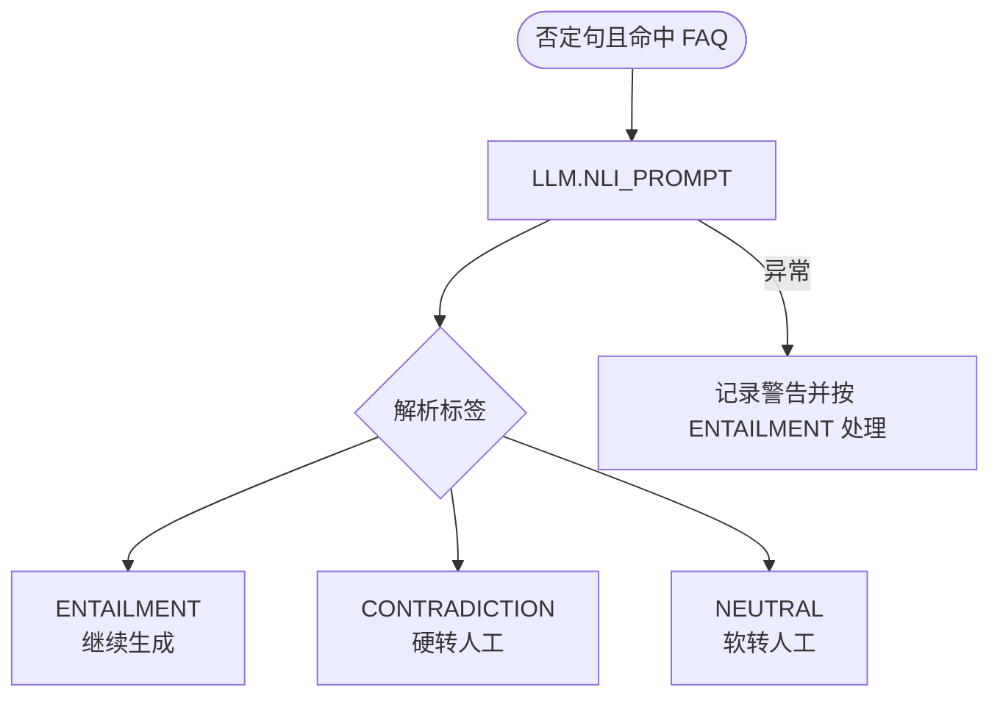
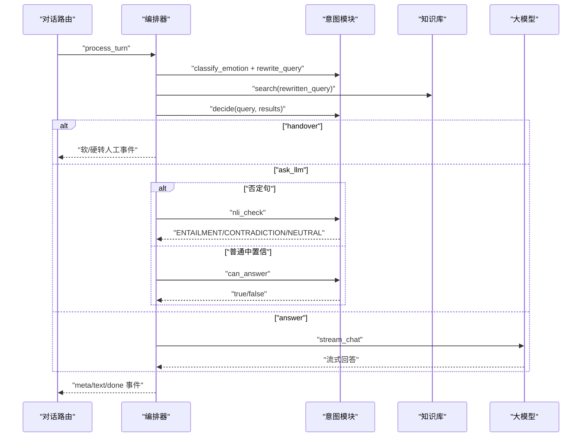

# 意图识别与语义校验

<cite>
**本文引用的文件**   
- [orchestrator.py](file://backend/app/agent/orchestrator.py)
- [intent.py](file://backend/app/agent/intent.py)
- [prompts.py](file://backend/app/agent/prompts.py)
- [kb.py](file://backend/app/storage/kb.py)
- [chat.py](file://backend/app/routers/chat.py)
- [schemas.py](file://backend/app/models/schemas.py)
- [config.py](file://backend/app/config.py)
</cite>

## 目录
1. [引言](#引言)
2. [项目结构定位](#项目结构定位)
3. [三级决策机制总览](#三级决策机制总览)
4. [核心组件分析](#核心组件分析)
5. [查询重写工作原理](#查询重写工作原理)
6. [相似度阈值与否定句处理](#相似度阈值与否定句处理)
7. [LLM can_answer 布尔判断](#llm-can_answer-布尔判断)
8. [NLI 蕴含校验](#nli-蕴含校验)
9. [与 Orchestrator 的集成流程](#与-orchestrator-的集成流程)
10. [错误处理策略](#错误处理策略)
11. [典型场景与决策路径](#典型场景与决策路径)
12. [性能与优化建议](#性能与优化建议)
13. [故障排查指南](#故障排查指南)
14. [结论](#结论)

## 引言
本文件面向“意图识别与语义校验”子系统，目标是帮助开发者、产品和技术支持人员理解系统如何把用户口语化问题转换为可检索的标准问法，并通过“相似度快速决策 → LLM 可回答性判断 → NLI 语义校验”的三级机制，决定直接生成、继续 LLM 生成还是转人工。文档同时说明 `decide` 函数的阈值逻辑、否定句特殊处理、与编排器（Orchestrator）的集成方式，以及异常时的回退行为。

## 项目结构定位
意图识别与语义校验主要位于后端 Agent 层，并依赖知识库检索、配置和提示词模块：

**图表来源**
- [chat.py:1-200](file://backend/app/routers/chat.py#L1-L200)
- [orchestrator.py:1-200](file://backend/app/agent/orchestrator.py#L1-L200)
- [intent.py:1-130](file://backend/app/agent/intent.py#L1-L130)
- [kb.py:1-200](file://backend/app/storage/kb.py#L1-L200)
- [prompts.py:1-200](file://backend/app/agent/prompts.py#L1-L200)
- [config.py:1-104](file://backend/app/config.py#L1-L104)

**章节来源**
- [chat.py:1-200](file://backend/app/routers/chat.py#L1-L200)
- [orchestrator.py:1-200](file://backend/app/agent/orchestrator.py#L1-L200)
- [intent.py:1-130](file://backend/app/agent/intent.py#L1-L130)
- [kb.py:1-200](file://backend/app/storage/kb.py#L1-L200)
- [prompts.py:1-200](file://backend/app/agent/prompts.py#L1-L200)
- [config.py:1-104](file://backend/app/config.py#L1-L104)

## 三级决策机制总览
系统采用三层决策：

| 层级 | 名称 | 是否调用 LLM | 触发条件 | 主要作用 |
|---|---|---:|---|---|
| 第一层 | 基于相似度的快速决策 | 否 | 检索后直接使用 `SIM_THRESHOLD_LOW` 与 `SIM_THRESHOLD_HIGH` | 零 LLM 路径快速判定：高置信直接回答、低置信转人工、中置信进入第二层 |
| 第二层 | LLM `can_answer` 布尔判断 | 是 | 中置信区间或否定句走 NLI 前的分支 | 用 LLM 判断当前知识库上下文能否完整回答用户问题 |
| 第三层 | NLI 蕴含校验 | 是 | 仅对包含否定词的查询且命中 FAQ 时强制执行 | 判断用户查询与 FAQ 答案之间是“蕴含、矛盾、中立”，防止语义反转误答 |

**图表来源**
- [intent.py:1-130](file://backend/app/agent/intent.py#L1-L130)
- [orchestrator.py:1-200](file://backend/app/agent/orchestrator.py#L1-L200)
- [kb.py:200-316](file://backend/app/storage/kb.py#L200-L316)
- [config.py:1-104](file://backend/app/config.py#L1-L104)

## 核心组件分析

### RetrievalVerdict 数据模型
`RetrievalVerdict` 是检索后的结构化决策结果，包含决策类型、候选结果、最高相似度及原因说明。它由 `decide` 函数返回，并被 Orchestrator 消费以决定后续流程。

| 字段 | 含义 | 取值示例 |
|---|---|---|
| `decision` | 决策方向 | `answer`、`ask_llm`、`handover`、`confirming` |
| `faqs` | 候选 FAQ 列表 | `[{"faq": ..., "dense_score": ...}, ...]` |
| `confidence` | 最高相似度分数 | `0.0 ~ 1.0` |
| `reason` | 决策原因 | `high_confidence`、`mid_confidence`、`low_confidence`、`negation_nli`、`no_candidate` |

**章节来源**
- [intent.py:1-130](file://backend/app/agent/intent.py#L1-L130)

### 检索结果结构
知识库 `search` 返回每个候选项的结构如下：

| 字段 | 含义 | 用途 |
|---|---|---|
| `faq` | `FAQItem` 对象 | 标准问法、变体、答案、风险等级等 |
| `dense_score` | Dense 向量相似度 | 用于置信度阈值判断 |
| `bm25_score` | BM25 稀疏分数 | 融合重排辅助指标 |
| `combined` | RRF 融合得分 | 最终排序依据 |

**章节来源**
- [kb.py:200-316](file://backend/app/storage/kb.py#L200-L316)

## 查询重写工作原理
Query Rewrite 的目标是把口语化问题改写成适合知识库检索的标准问法，但不会改变原始语义，也不会影响安全判断。

#### 关键规则
- 只改写表达方式，不反转肯定/否定含义。
- 保留订单号、数字、金额、日期、型号、地名等关键信息。
- 去除口头禅、语气词、情绪化措辞。
- 如果原问题已经很标准，则原样输出。
- 输出限制为单行且长度不超过 80 字符。

#### 调用与回退
- 通过 `QUERY_REWRITE_PROMPT` 构造提示词，使用 `llm.complete` 调用。
- 当 `QUERY_REWRITE_ENABLED` 关闭时，直接返回原始查询。
- 当改写结果为空、超长或 LLM 调用异常时，记录警告日志并回退到原始查询。

**图表来源**
- [intent.py:1-130](file://backend/app/agent/intent.py#L1-L130)
- [orchestrator.py:1-200](file://backend/app/agent/orchestrator.py#L1-L200)
- [prompts.py:1-200](file://backend/app/agent/prompts.py#L1-L200)
- [kb.py:200-316](file://backend/app/storage/kb.py#L200-L316)

**章节来源**
- [intent.py:1-130](file://backend/app/agent/intent.py#L1-L130)
- [prompts.py:1-200](file://backend/app/agent/prompts.py#L1-L200)
- [config.py:1-104](file://backend/app/config.py#L1-L104)

## 相似度阈值与否定句处理
`decide` 函数是第一层快速决策的核心，完全本地计算，不调用 LLM。

#### 阈值定义
- `SIM_THRESHOLD_LOW`：默认值来自配置，表示低置信阈值。
- `SIM_THRESHOLD_HIGH`：默认值来自配置，表示高置信阈值。
- 配置注释指出，TF-IDF + bigram 量纲下，命中类分数中位约 0.33，未命中约 0.05；切换真实 Embedding 后可按 0.75 / 0.85 重新调参。

#### 决策规则
| 条件 | 返回值 | 原因 |
|---|---|---|
| 无候选结果 | `handover` | `no_candidate` |
| 检测到否定词 | `ask_llm` | `negation_nli`，强制走 NLI |
| 最高相似度 `< SIM_THRESHOLD_LOW` | `handover` | `low_confidence` |
| `SIM_THRESHOLD_LOW ≤ 最高相似度 ≤ SIM_THRESHOLD_HIGH` | `ask_llm` | `mid_confidence` |
| 最高相似度 `> SIM_THRESHOLD_HIGH` | `answer` | `high_confidence` |

**图表来源**
- [intent.py:1-130](file://backend/app/agent/intent.py#L1-L130)
- [config.py:1-104](file://backend/app/config.py#L1-L104)

**章节来源**
- [intent.py:1-130](file://backend/app/agent/intent.py#L1-L130)
- [config.py:1-104](file://backend/app/config.py#L1-L104)

## LLM can_answer 布尔判断
当第一层返回 `ask_llm` 且不是否定句分支时，系统进入第二层：让 LLM 判断当前知识库上下文是否能完整回答用户问题。

#### 实现要点
- 使用 `format_context(results)` 构建上下文。
- 使用 `CAN_ANSWER_PROMPT` 构造提示词。
- 要求 LLM 输出 `true` 或 `false`。
- 若 LLM 调用失败，记录警告并按“可以回答”处理，避免阻断正常链路。

```mermaid
flowchart TD
    Start(["进入 ask_llm 分支"]) --> BuildCtx["构建上下文"]
    BuildCtx --> CallLLM["LLM.can_answer"]
    CallLLM --> Parse{"输出以 true 开头？"}
    Parse -->|是| Yes["返回 True"]
    Parse -->|否| No["返回 False"]
    CallLLM -->|异常| Fallback["记录警告并按 True 处理"]
```

**图表来源**
- [intent.py:1-130](file://backend/app/agent/intent.py#L1-L130)
- [prompts.py:1-200](file://backend/app/agent/prompts.py#L1-L200)

**章节来源**
- [intent.py:1-130](file://backend/app/agent/intent.py#L1-L130)
- [prompts.py:1-200](file://backend/app/agent/prompts.py#L1-L200)

## NLI 蕴含校验
当查询包含否定词且命中 FAQ 时，系统在进入生成前进行 NLI 语义校验，防止“表面匹配但语义相反”的回答。

#### 语义标签
| 标签 | 含义 | 后续处理 |
|---|---|---|
| `ENTAILMENT` | 用户意图与 FAQ 答案方向一致 | 继续生成 |
| `CONTRADICTION` | 用户否定、质疑或反问 FAQ 结论 | 硬转人工，原因 `negation_contradiction` |
| `NEUTRAL` | 两者说的不是同一件事 | 软转人工，澄清式挽留 |

#### 实现要点
- 使用 `NLI_PROMPT` 构造提示词，输入用户查询和 FAQ 答案。
- 解析首单词段是否为 `ENTAILMENT`、`CONTRADICTION` 或 `NEUTRAL`。
- 若 LLM 调用失败，记录警告并按 `ENTAILMENT` 处理，保证稳定性。

**图表来源**
- [intent.py:1-130](file://backend/app/agent/intent.py#L1-L130)
- [prompts.py:1-200](file://backend/app/agent/prompts.py#L1-L200)

**章节来源**
- [intent.py:1-130](file://backend/app/agent/intent.py#L1-L130)
- [prompts.py:1-200](file://backend/app/agent/prompts.py#L1-L200)

## 与 Orchestrator 的集成流程
Orchestrator 是整个对话管线的主控制器，负责串联情绪分级、检索、置信度决策、生成、输出校验和转人工。

#### 主流程顺序
1. 用户主动要求转人工：立即硬转人工。
2. 防死循环：连续未解决轮次达到阈值后直接硬转人工。
3. 确认状态机：在 `CONFIRMING` 状态下接受确认或否认。
4. 并行任务：情绪分类与查询重写互不依赖，降低首字延迟。
5. 红灯熔断：情绪极差或命中风险词时取消重写并硬转人工。
6. 混合检索：使用重写后的查询召回候选。
7. 快速决策：调用 `decide`。
8. 二次判断：否定句走 NLI；否则走 `can_answer`。
9. 高风险 FAQ：直接硬转人工。
10. 生成回答：流式输出并做事实校验，疑似幻觉回退兜底话术。

**图表来源**
- [orchestrator.py:1-200](file://backend/app/agent/orchestrator.py#L1-L200)
- [intent.py:1-130](file://backend/app/agent/intent.py#L1-L130)
- [kb.py:200-316](file://backend/app/storage/kb.py#L200-L316)

**章节来源**
- [orchestrator.py:1-200](file://backend/app/agent/orchestrator.py#L1-L200)
- [chat.py:1-200](file://backend/app/routers/chat.py#L1-L200)

## 错误处理策略
各层均有明确的安全回退策略：

| 组件 | 异常情况 | 处理策略 |
|---|---|---|
| Query Rewrite | LLM 调用失败、结果为空或超长 | 记录警告，回退原始查询 |
| `can_answer` | LLM 调用异常 | 记录警告，按“可以回答”处理 |
| NLI | LLM 调用异常 | 记录警告，按 `ENTAILMENT` 处理 |
| 生成阶段 | LLM 流式生成异常 | 记录错误，输出未知兜底话术 |
| 输出校验 | 关键事实无法在上下文中验证 | 记录疑似幻觉警告，替换为兜底话术并标记转人工 |

这些策略确保即使外部 LLM 不稳定，系统仍能在可控范围内运行，而不是崩溃或给出明显错误的强断言。

**章节来源**
- [intent.py:1-130](file://backend/app/agent/intent.py#L1-L130)
- [orchestrator.py:201-404](file://backend/app/agent/orchestrator.py#L201-L404)

## 典型场景与决策路径

### 场景一：高置信直接回答
- 输入：标准问法，如“怎么申请七天无理由退货”。
- 重写：可能不变或轻微规范化。
- 检索：top candidate 的 `dense_score > SIM_THRESHOLD_HIGH`。
- 决策：`decide` 返回 `answer`。
- 后续：高风险检查通过后直接进入 `_answer_flow`，流式生成回答。
- 返回：`meta` 包含 `IN_KNOWLEDGE`、高置信度、候选 FAQ ID；`done` 不含转人工标记。

**章节来源**
- [intent.py:1-130](file://backend/app/agent/intent.py#L1-L130)
- [orchestrator.py:201-404](file://backend/app/agent/orchestrator.py#L201-L404)

### 场景二：低置信转人工
- 输入：模糊或无关问题。
- 重写：可能改为更标准问法，但仍无高相关候选。
- 检索：top candidate 的 `dense_score < SIM_THRESHOLD_LOW`。
- 决策：`decide` 返回 `handover`。
- 后续：进入 `_soft_handover`，展示两个候选主题作为快捷回复。
- 返回：`meta` 包含 `OUT_OF_SCOPE` 或 `LOW_CONFIDENCE`，`handover_reason` 为 `low_confidence`。

**章节来源**
- [intent.py:1-130](file://backend/app/agent/intent.py#L1-L130)
- [orchestrator.py:201-404](file://backend/app/agent/orchestrator.py#L201-L404)

### 场景三：否定句命中 FAQ 但语义矛盾
- 输入：“你们不支持七天无理由对吧？”
- 重写：保留否定语义，可能改为“是否支持七天无理由退货”。
- 检索：命中某条支持退货的 FAQ。
- 决策：因含否定词，`decide` 返回 `ask_llm`。
- NLI：返回 `CONTRADICTION`。
- 后续：硬转人工，原因 `negation_contradiction`。
- 返回：`meta` 包含 `HIGH_RISK` 或转人工意图，`handover` 为真。

**章节来源**
- [intent.py:1-130](file://backend/app/agent/intent.py#L1-L130)
- [orchestrator.py:1-200](file://backend/app/agent/orchestrator.py#L1-L200)

### 场景四：中置信且 can_answer 为 false
- 输入：部分关键词命中但上下文不完整。
- 检索：`SIM_THRESHOLD_LOW ≤ score ≤ SIM_THRESHOLD_HIGH`。
- 决策：`decide` 返回 `ask_llm`。
- `can_answer`：LLM 判断不能完整回答，返回 `false`。
- 后续：软转人工，原因 `cannot_answer`。
- 返回：`meta` 包含澄清式快捷回复，`handover_reason` 为 `cannot_answer`。

**章节来源**
- [intent.py:1-130](file://backend/app/agent/intent.py#L1-L130)
- [orchestrator.py:1-200](file://backend/app/agent/orchestrator.py#L1-L200)

### 场景五：高风险 FAQ
- 输入：命中风险等级为 `high` 的 FAQ。
- 决策：即使高置信，也会优先执行高风险检查。
- 后续：硬转人工，原因 `high_risk_faq`。
- 返回：`meta` 包含 `HIGH_RISK`，`handover` 为真。

**章节来源**
- [orchestrator.py:1-200](file://backend/app/agent/orchestrator.py#L1-L200)
- [kb.py:1-200](file://backend/app/storage/kb.py#L1-L200)

## 性能与优化建议
- 并行化：情绪分类与查询重写并行执行，减少首字延迟。
- 零 LLM 路径：低置信和高置信分支尽量不调用 LLM，降低延迟和成本。
- 缓存优化：对话路由层对首轮高频问题做秒回缓存，进一步降低 LLM 调用。
- 重写开关：可通过 `QUERY_REWRITE_ENABLED` 控制是否启用查询重写，便于离线或压测场景稳定行为。
- 阈值调优：当前 TF-IDF + bigram 默认阈值为 0.22 / 0.40；若迁移到真实 Embedding，应参考 0.75 / 0.85 重新校准。

[本节为通用性能建议，不直接分析具体代码片段]

## 故障排查指南

### 常见问题
| 现象 | 可能原因 | 排查步骤 |
|---|---|---|
| 所有问题都转人工 | `SIM_THRESHOLD_LOW` 过高或知识库质量差 | 检查配置、查看检索结果 `dense_score`、评估 FAQ 覆盖度 |
| 否定句误答 | NLI 失败或 LLM 返回异常 | 查看 NLI 日志、检查 `NLI_PROMPT` 效果、确认否定词检测 |
| 查询改写无效 | 改写结果为空或超长 | 检查 `QUERY_REWRITE_PROMPT`、观察 LLM 输出长度 |
| can_answer 始终为 true | LLM 异常被兜底 | 检查 LLM 可用性与日志，确认异常回退逻辑 |
| 生成后仍转人工 | 输出校验发现疑似幻觉 | 检查生成内容是否包含无法在上下文中验证的事实 |

### 日志关键字
- “查询重写结果异常”
- “查询重写调用失败”
- “can_answer 调用失败”
- “NLI 校验失败”
- “意图分类调用失败”
- “生成失败”
- “疑似幻觉”

**章节来源**
- [intent.py:1-130](file://backend/app/agent/intent.py#L1-L130)
- [orchestrator.py:201-404](file://backend/app/agent/orchestrator.py#L201-L404)

## 结论
该意图识别与语义校验子系统通过“相似度快速决策 → LLM 可回答性判断 → NLI 语义校验”的三级机制，在保证准确性的同时尽量降低 LLM 调用成本。`decide` 函数提供零 LLM 的快速分流，否定句通过 NLI 防止语义反转，Orchestrator 则统一协调情绪、检索、生成与安全策略。实际部署中，应重点关注知识库质量、阈值配置、Query Rewrite 效果以及 LLM 异常回退路径的可观测性。