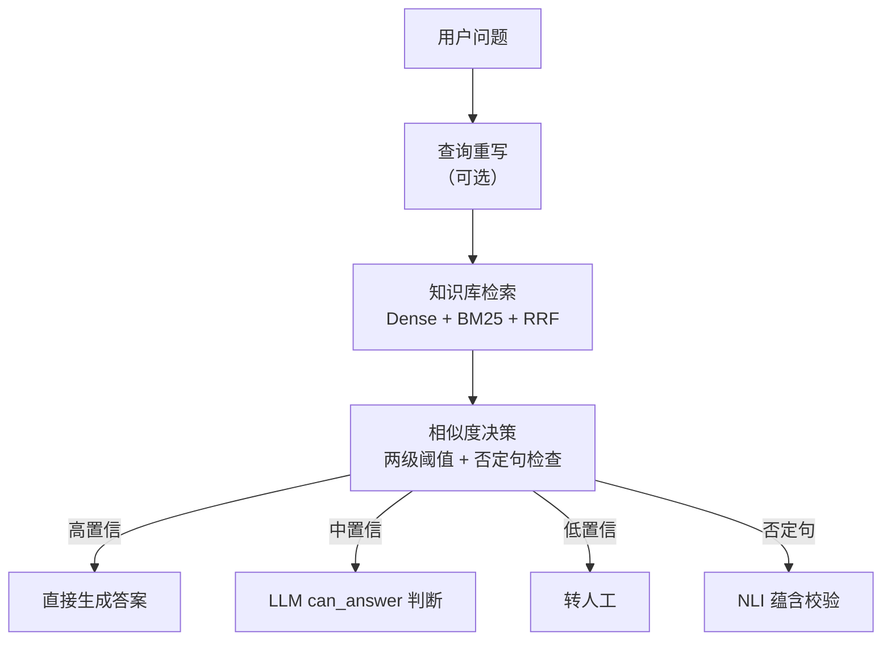
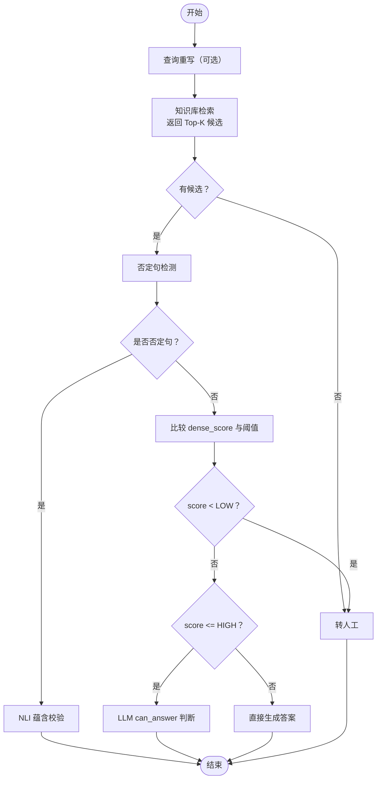
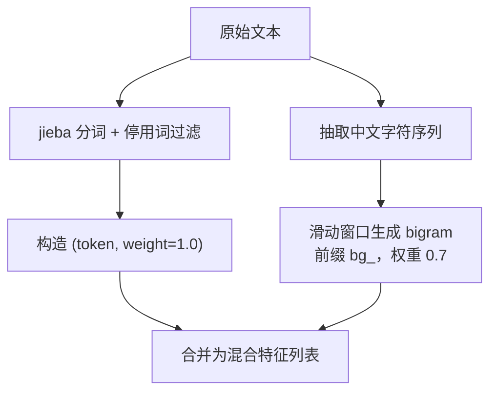
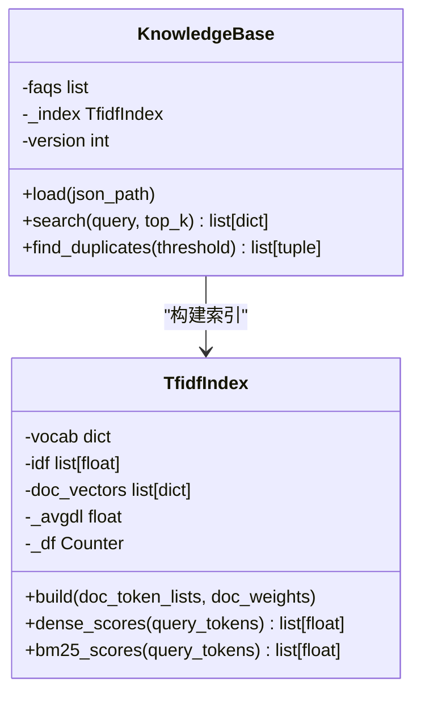
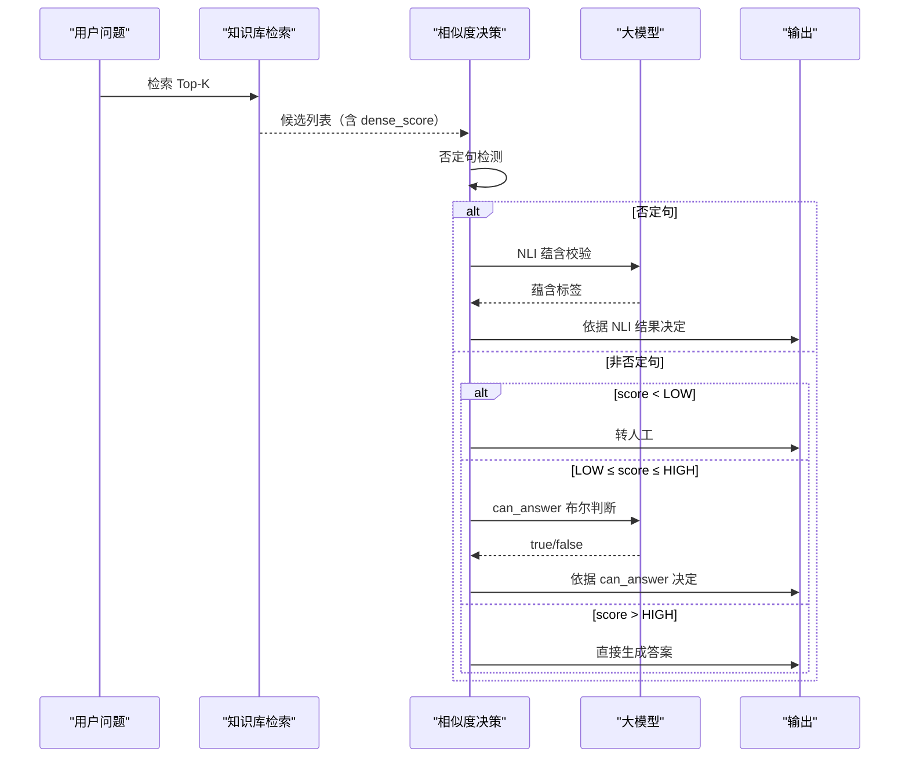
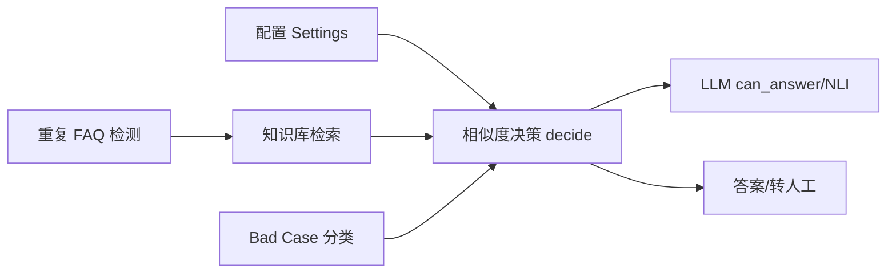

# 相似度决策机制

<cite>
**本文引用的文件**   
- [backend/app/config.py](file://backend/app/config.py)
- [backend/app/storage/kb.py](file://backend/app/storage/kb.py)
- [backend/app/agent/intent.py](file://backend/app/agent/intent.py)
- [backend/tools/badcase_report.py](file://backend/tools/badcase_report.py)
- [knowledge_base/build_kb.py](file://knowledge_base/build_kb.py)
</cite>

## 目录
1. [引言](#引言)
2. [项目结构定位](#项目结构定位)
3. [核心组件](#核心组件)
4. [架构总览](#架构总览)
5. [详细组件分析](#详细组件分析)
6. [依赖关系分析](#依赖关系分析)
7. [性能与零 LLM 路径](#性能与零-llm-路径)
8. [阈值调优指南](#阈值调优指南)
9. [故障排查](#故障排查)
10. [结论](#结论)

## 引言
本文件聚焦智能问答系统中的“相似度决策机制”。该机制基于 TF-IDF 向量相似度，结合 BM25 关键词召回与 RRF 融合排序，通过两级相似度阈值 `SIM_THRESHOLD_LOW` 和 `SIM_THRESHOLD_HIGH` 决定：
- 高置信命中时直接返回答案；
- 中等置信时调用大模型做“能否回答”判断；
- 低置信或否定句场景下走转人工或 NLI 校验等安全路径。

这一设计在保证准确率的同时，尽可能减少大模型调用，从而降低延迟与成本。

## 项目结构定位
相似度决策不是孤立模块，而是串联“检索 → 决策 → 生成/转人工”的关键枢纽：
- 配置层：定义相似度阈值、Top-K、RRF 参数等。
- 知识库层：负责分词、TF-IDF 向量构建、BM25 评分、RRF 融合检索。
- 意图决策层：根据 Top 候选的 dense_score 执行两级阈值判定，并处理否定句等安全分支。
- 辅助工具层：Bad Case 分类、重复 FAQ 检测等复用相同阈值语义。

**图示来源**
- [backend/app/agent/intent.py:17-34](file://backend/app/agent/intent.py#L17-L34)
- [backend/app/agent/intent.py:55-83](file://backend/app/agent/intent.py#L55-L83)
- [backend/app/storage/kb.py:260-306](file://backend/app/storage/kb.py#L260-L306)

**章节来源**
- [backend/app/config.py:40-60](file://backend/app/config.py#L40-L60)
- [backend/app/storage/kb.py:260-306](file://backend/app/storage/kb.py#L260-L306)
- [backend/app/agent/intent.py:17-83](file://backend/app/agent/intent.py#L17-L83)

## 核心组件
- 配置类 Settings：集中暴露 `SIM_THRESHOLD_LOW`、`SIM_THRESHOLD_HIGH`、`RETRIEVE_TOP_K`、`RRF_K` 等检索与决策参数。
- 知识索引 TfidfIndex：实现简化版 TF-IDF 向量、BM25 评分、余弦相似度计算。
- 知识库 KnowledgeBase：封装 FAQ 加载、混合特征构建、双路召回与 RRF 重排。
- 意图决策 decide：基于最高候选 dense_score 的两级阈值快速决策，并叠加否定句安全分支。
- 辅助工具：badcase 分类与重复 FAQ 检测使用相同分数语义，确保指标口径一致。

**章节来源**
- [backend/app/config.py:40-60](file://backend/app/config.py#L40-L60)
- [backend/app/storage/kb.py:100-173](file://backend/app/storage/kb.py#L100-L173)
- [backend/app/storage/kb.py:260-306](file://backend/app/storage/kb.py#L260-L306)
- [backend/app/agent/intent.py:55-83](file://backend/app/agent/intent.py#L55-L83)
- [backend/tools/badcase_report.py:35-47](file://backend/tools/badcase_report.py#L35-L47)

## 架构总览
相似度决策在整体流程中的触发条件如下：
1. 接收用户输入，可先进行查询重写以提升召回质量。
2. 进入知识库检索，得到 Top-K 候选，每个候选携带 dense_score（TF-IDF 余弦相似度）。
3. 将 Top 候选传给 decide：
   - 若为否定句，强制进入 NLI 校验分支；
   - 若 dense_score < LOW，直接转人工；
   - 若 LOW ≤ dense_score ≤ HIGH，调用 LLM 判断“能否回答”；
   - 若 dense_score > HIGH，直接返回答案。

**图示来源**
- [backend/app/agent/intent.py:55-83](file://backend/app/agent/intent.py#L55-L83)
- [backend/app/storage/kb.py:260-306](file://backend/app/storage/kb.py#L260-L306)

## 详细组件分析

### 配置与阈值语义
Settings 提供两级相似度阈值及检索参数，默认值用于当前 TF-IDF 量纲；注释明确说明未来切换真实 Embedding 后需按 0.75 / 0.85 重调。

- `SIM_THRESHOLD_LOW`：低于该值视为低置信，通常转人工。
- `SIM_THRESHOLD_HIGH`：高于该值视为高置信，可直接生成答案。
- 中间区间 `[LOW, HIGH]`：需要第二层 LLM 判断。

**章节来源**
- [backend/app/config.py:40-60](file://backend/app/config.py#L40-L60)

### 分词与混合特征提取
系统采用“jieba 中文分词 + 中文连续字符 bigram”的混合特征，提升对口语化表达、拆字变体的鲁棒性：
- `tokenize`：jieba 分词 + 停用词过滤 + 小写归一。
- `tokenize_full`：在 token 基础上追加前缀为 `bg_` 的中文 bigram 特征，bigram 权重可调（默认 0.7）。
- FAQItem.tokenized：标准问法与变体问法使用较高权重，答案部分降权，避免答案稀释问法匹配。

**图示来源**
- [backend/app/storage/kb.py:17-48](file://backend/app/storage/kb.py#L17-L48)
- [backend/app/storage/kb.py:63-79](file://backend/app/storage/kb.py#L63-L79)

**章节来源**
- [backend/app/storage/kb.py:17-48](file://backend/app/storage/kb.py#L17-L48)
- [backend/app/storage/kb.py:63-79](file://backend/app/storage/kb.py#L63-L79)

### TF-IDF 向量与相似度算法
TfidfIndex 实现简化版 TF-IDF：
- IDF：`(n+1)/(df+1)` 的对数平滑 + 1。
- TF-IDF：`(1 + ln tf) · idf`，并按文档向量 L2 归一化。
- 相似度：查询向量与文档向量的余弦相似度，结果范围近似 0~1。

同时实现 BM25 评分，并与 Dense 向量得分经 RRF 融合排序，提高召回稳健性。

**图示来源**
- [backend/app/storage/kb.py:100-173](file://backend/app/storage/kb.py#L100-L173)
- [backend/app/storage/kb.py:220-306](file://backend/app/storage/kb.py#L220-L306)

**章节来源**
- [backend/app/storage/kb.py:100-173](file://backend/app/storage/kb.py#L100-L173)
- [backend/app/storage/kb.py:260-306](file://backend/app/storage/kb.py#L260-L306)

### 相似度决策流程
decide 函数基于 Top 候选的 dense_score 执行两级阈值判定：
- 无候选：转人工。
- 否定句：强制走 NLI 校验，避免仅凭词面重合误判。
- low 以下：转人工。
- low 到 high 之间：调用 LLM 判断“能否回答”。
- high 以上：直接生成答案。

**图示来源**
- [backend/app/agent/intent.py:55-83](file://backend/app/agent/intent.py#L55-L83)
- [backend/app/agent/intent.py:85-104](file://backend/app/agent/intent.py#L85-L104)
- [backend/app/agent/intent.py:106-130](file://backend/app/agent/intent.py#L106-L130)

**章节来源**
- [backend/app/agent/intent.py:55-104](file://backend/app/agent/intent.py#L55-L104)

### 否定句与风险词检测
系统内置否定模式与风险词规则，用于安全分支：
- `has_negation`：匹配“不支持”“不能”“难道”“对吧”等模式。
- `has_risk_keyword`：投诉、举报、法律、报警等高风险词汇。
- `wants_human`：识别“转人工”“找客服”等用户主动转人工意图。

这些规则在 decide 之前或作为兜底逻辑使用，保障系统在低置信或敏感场景下不硬答。

**章节来源**
- [backend/app/storage/kb.py:200-258](file://backend/app/storage/kb.py#L200-L258)
- [backend/app/agent/intent.py:55-83](file://backend/app/agent/intent.py#L55-L83)

### 不同相似度分数对应的决策示例
以下示例以默认阈值 LOW=0.22、HIGH=0.40 为例（实际值来自配置）：
- dense_score = 0.05：低于 LOW，决策为“转人工”，零 LLM 调用。
- dense_score = 0.30：处于 [LOW, HIGH]，调用 LLM 做 can_answer 判断。
- dense_score = 0.45：高于 HIGH，直接生成答案，零 LLM 调用。
- 否定句且 dense_score = 0.45：仍会走 NLI 校验，不直接生成。

注意：示例仅展示决策分支；具体输出由上层编排器与生成器决定。

**章节来源**
- [backend/app/config.py:49-53](file://backend/app/config.py#L49-L53)
- [backend/app/agent/intent.py:55-83](file://backend/app/agent/intent.py#L55-L83)

## 依赖关系分析
相似度决策依赖以下组件与外部接口：
- 配置依赖 Settings：读取环境变量覆盖默认阈值。
- 知识库依赖 jieba 分词与正则表达式。
- 意图决策依赖 LLM 接口用于 can_answer 与 NLI 校验。
- Bad Case 与重复 FAQ 检测复用相似度分数语义，确保评估口径一致。

**图示来源**
- [backend/app/config.py:40-60](file://backend/app/config.py#L40-L60)
- [backend/app/agent/intent.py:55-130](file://backend/app/agent/intent.py#L55-L130)
- [backend/app/storage/kb.py:260-306](file://backend/app/storage/kb.py#L260-L306)
- [backend/tools/badcase_report.py:35-47](file://backend/tools/badcase_report.py#L35-L47)
- [knowledge_base/build_kb.py:28-42](file://knowledge_base/build_kb.py#L28-L42)

**章节来源**
- [backend/app/config.py:40-60](file://backend/app/config.py#L40-L60)
- [backend/app/agent/intent.py:55-130](file://backend/app/agent/intent.py#L55-L130)
- [backend/app/storage/kb.py:260-306](file://backend/app/storage/kb.py#L260-L306)
- [backend/tools/badcase_report.py:35-47](file://backend/tools/badcase_report.py#L35-L47)
- [knowledge_base/build_kb.py:28-42](file://knowledge_base/build_kb.py#L28-L42)

## 性能与零 LLM 路径
相似度决策的两个关键零 LLM 路径：
- 高置信直接答案：当 dense_score > HIGH 且非否定句时，直接返回答案，无需调用 LLM。
- 低置信转人工：当 dense_score < LOW 时，直接转人工，无需调用 LLM。

此外，否定句路径会强制走 NLI 校验，虽然可能产生 LLM 调用，但能显著降低错误推送风险。

优化建议：
- 在高吞吐场景优先保证 HIGH 阈值能稳定捕获高频正确命中，从而最大化零 LLM 比例。
- 对否定句集合持续扩展，减少误判导致的错误答案。
- 配合缓存层对高频问题进行首轮自动回答结果的缓存，进一步降低 LLM 调用频率。

**章节来源**
- [backend/app/agent/intent.py:55-83](file://backend/app/agent/intent.py#L55-L83)
- [backend/app/config.py:56-60](file://backend/app/config.py#L56-L60)

## 阈值调优指南
- 默认阈值背景：当前 TF-IDF + bigram 量纲下，命中类分数中位约 0.33，未命中约 0.05，因此设置 LOW=0.22、HIGH=0.40。
- 调参原则：
  - 提高 HIGH：扩大“直接答案”区间，提升速度但可能增加误答风险。
  - 降低 LOW：缩小“转人工”区间，减少人工介入但可能漏掉低置信命中。
  - 扩大区间 [LOW, HIGH]：更多问题进入 LLM can_answer，兼顾精度与自动化率。
- 未来迁移提示：切换到真实 Embedding（如豆包/BGE-M3 + Qdrant）后，应按注释建议重新校准为 0.75 / 0.85。
- 评估方法：
  - 使用黄金测试集统计 Hit@K、CSAT、自动率等指标。
  - 观察 badcase 报告中“弱检索型”占比，针对性补充变体问法。
  - 定期运行重复 FAQ 检测，防止相似度 ≥0.95 的撞车问题影响召回。

**章节来源**
- [backend/app/config.py:40-60](file://backend/app/config.py#L40-L60)
- [backend/tools/badcase_report.py:35-47](file://backend/tools/badcase_report.py#L35-L47)
- [knowledge_base/build_kb.py:28-42](file://knowledge_base/build_kb.py#L28-L42)

## 故障排查
常见问题与定位要点：
- 大量问题被判定为“转人工”：
  - 检查是否有足够变体问法提升召回；
  - 调整 LOW 阈值或优化分词/停用词表；
  - 确认检索 Top-K 与 RRF 参数是否合理。
- 高置信但错误答案：
  - 重点排查否定句是否被遗漏；
  - 检查是否存在重复 FAQ 导致“撞车”；
  - 考虑适当提高 HIGH 或引入更严格的安全校验。
- LLM can_answer 不稳定：
  - 查看异常日志，确认 Prompt 上下文格式是否正确；
  - 在失败时可按现有逻辑回退为“可回答”处理，但应监控误判率。

**章节来源**
- [backend/app/storage/kb.py:200-258](file://backend/app/storage/kb.py#L200-L258)
- [backend/app/storage/kb.py:299-306](file://backend/app/storage/kb.py#L299-L306)
- [backend/app/agent/intent.py:85-104](file://backend/app/agent/intent.py#L85-L104)

## 结论
相似度决策机制通过两级阈值将“直接答案、LLM 判断、转人工”三类路径清晰分层，并在否定句场景引入 NLI 校验，形成兼顾效率与安全的设计。其核心技术包括 jieba 分词、中文 bigram 混合特征、TF-IDF 余弦相似度与 BM25/RRF 融合检索。生产环境可根据业务指标持续调优阈值，并在未来迁移至真实 Embedding 时重新校准。