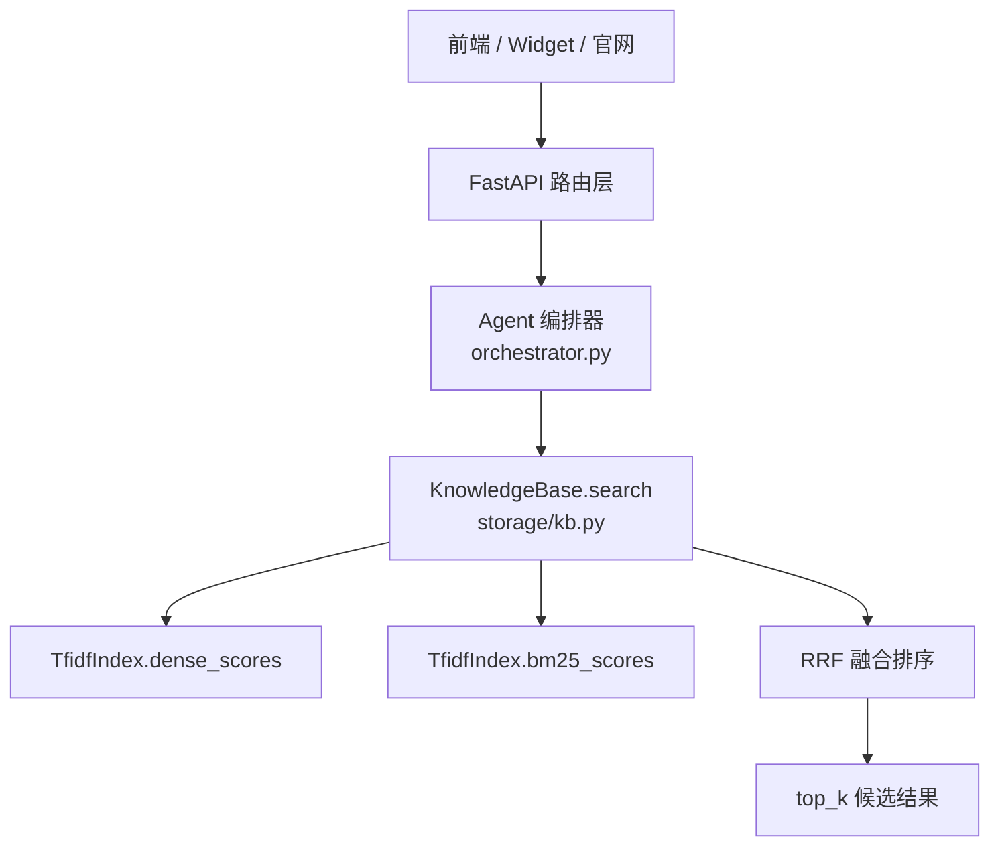
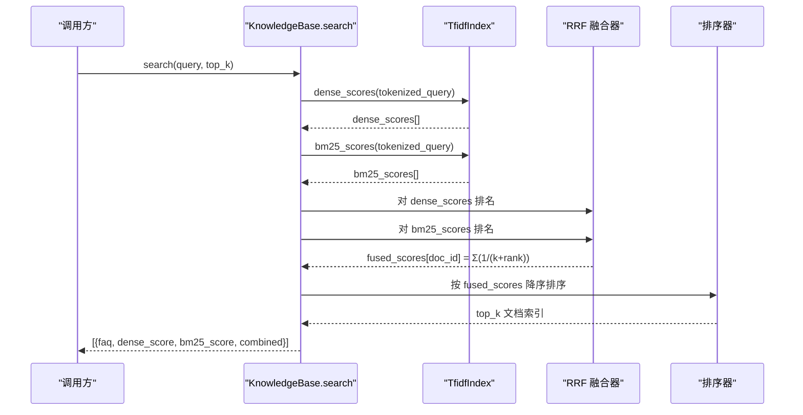
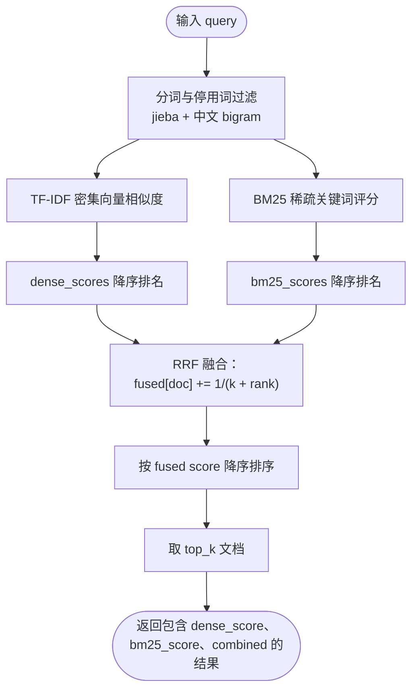
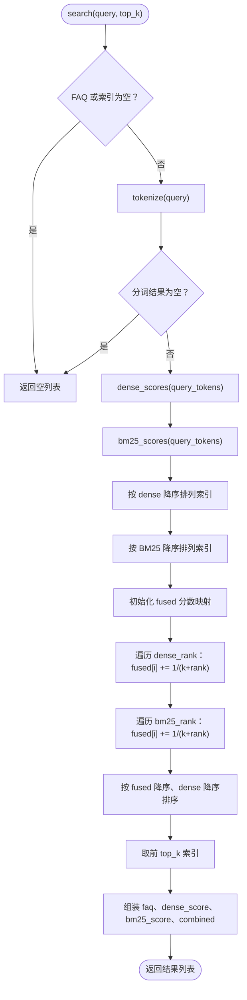

# RRF 融合重排算法

<cite>
**本文引用的文件**   
- [backend/app/storage/kb.py](file://backend/app/storage/kb.py)
- [backend/app/config.py](file://backend/app/config.py)
- [源码解读.md](file://源码解读.md)
- [README.md](file://README.md)
</cite>

## 目录
1. [引言](#引言)
2. [项目结构中的检索位置](#项目结构中的检索位置)
3. [核心组件](#核心组件)
4. [架构总览](#架构总览)
5. [RRF 数学原理与实现细节](#rrf-数学原理与实现细节)
6. [双路召回到统一排序的数据流](#双路召回到统一排序的数据流)
7. [代码级流程图：混合检索与 RRF 融合](#代码级流程图混合检索与-rrf-融合)
8. [与传统加权平均融合的对比](#与传统加权平均融合的对比)
9. [性能分析与调优建议](#性能分析与调优建议)
10. [常见问题排查](#常见问题排查)
11. [结论](#结论)

## 引言
本文件聚焦仓库中基于 Reciprocal Rank Fusion（RRF，倒数排名融合）的检索重排实现，目标是把 TF-IDF 向量检索与 BM25 关键词检索的两路结果，用无参数、对分布不敏感的排名融合方法重新排序，从而得到更稳定的候选集合。

在该项目中，知识库检索的核心入口是 `KnowledgeBase.search`，它先分别计算每篇 FAQ 的 TF-IDF 密集向量相似度分数和 BM25 稀疏关键词分数，再按各自排名做 RRF 求和，最后返回融合分数最高的 top_k 文档。配置层暴露了 `RRF_K`，默认值为 60，这与 RRF 经典文献中常用的平滑常数一致。

## 项目结构中的检索位置
从仓库整体来看，RRF 属于“RAG 检索管线”的一部分，位于后端存储层。请求进入 FastAPI 路由后，由编排器调用 `KnowledgeBase.search`；该函数内部同时维护 TF-IDF 索引、BM25 统计量，以及 RRF 融合逻辑。

**图表来源**
- [README.md:1-120](file://README.md#L1-L120)
- [源码解读.md:1-120](file://源码解读.md#L1-L120)

**章节来源**
- [README.md:1-120](file://README.md#L1-L120)
- [源码解读.md:1-120](file://源码解读.md#L1-L120)

## 核心组件
本项目的检索相关核心组件如下：

| 组件 | 职责 | 关键行为 |
|---|---|---|
| `FAQItem` | 知识库条目模型 | 构造搜索文本、构建问法与答案的混合特征 |
| `TfidfIndex` | TF-IDF 向量索引与 BM25 评分 | 构建词表、IDF、归一化向量、余弦相似度、BM25 打分 |
| `KnowledgeBase` | 知识库加载与检索入口 | 加载 FAQ、构建索引、执行双路召回与 RRF 融合 |
| `Settings` | 全局配置 | 提供 `RETRIEVE_TOP_K`、`RRF_K`、阈值等检索开关 |

其中，RRF 的实现集中在 `KnowledgeBase.search`，而 `TfidfIndex` 负责把原始文本转换为可计算的密集分数与稀疏分数。

**章节来源**
- [backend/app/storage/kb.py:1-120](file://backend/app/storage/kb.py#L1-L120)
- [backend/app/storage/kb.py:201-316](file://backend/app/storage/kb.py#L201-L316)
- [backend/app/config.py:40-60](file://backend/app/config.py#L40-L60)

## 架构总览
从数据流角度看，一次查询会经历以下阶段：

1. 输入 query 经过分词、停用词过滤、中文 bigram 扩展。
2. 使用同一份 token 列表分别计算：
   - TF-IDF 密集向量余弦相似度；
   - BM25 稀疏关键词评分。
3. 对两路分数分别做降序排名。
4. 对每个文档的排名位置 i 计算 RRF 贡献 `1/(k + i)`，并把两路贡献相加。
5. 按融合分数降序取 top_k，并附带 dense_score、bm25_score、combined 字段返回。

**图表来源**
- [backend/app/storage/kb.py:262-300](file://backend/app/storage/kb.py#L262-L300)

**章节来源**
- [backend/app/storage/kb.py:262-300](file://backend/app/storage/kb.py#L262-L300)

## RRF 数学原理与实现细节
RRF 的核心思想是：**不同检索器不需要输出相同的分数量纲，只要它们能给出稳定排名，就可以用排名倒数求和来融合**。

### 公式
RRF 的标准形式为：

RRF(d) = Σ_i (1 / (k + rank_i(d)))

其中：
- d 表示某个文档；
- rank_i(d) 表示第 i 个检索器给出的排名，通常从 0 开始；
- k 是平滑常数，用于控制低排名的衰减速度，也起到平衡多路检索器数量的作用；
- 本项目中 k 默认取 60。

### 为什么选择排名而不是原始分数
TF-IDF 向量相似度通常是归一化的余弦值，范围接近 0 到 1；BM25 则是基于词频、逆文档频率和文档长度的非负实数，可能大于 1，且分布形态与稠密向量完全不同。如果直接对两个分数做加权平均，就需要手动调整权重，还要考虑不同检索器的分布差异。

RRF 的优势正是绕开这个困难：它只关心“某个文档在第几页”，不关心“第一页比第二页高多少”。因此：
- 不需要权重调参；
- 对检索器输出分布变化更鲁棒；
- 新增第三路检索器时，只需继续累加 `1/(k + rank)`，无需重写融合逻辑。

### 本项目中的具体实现
在 `KnowledgeBase.search` 中，RRF 的计算过程可以概括为：

1. 对 dense_scores 做降序排序，得到密集向量召回排名；
2. 对 bm25_scores 做降序排序，得到 BM25 召回排名；
3. 对每个文档，把两路排名对应的 `1/(k + rank)` 相加；
4. 最终按 fused score 降序取前 top_k。

需要注意：当前实现中，dense 与 BM25 都参与 RRF 求和，但排序时的主键是 fused score，次级排序键是 dense_score，这意味着当融合分数相同时，系统倾向于保留密集向量得分更高的结果。这相当于在 RRF 之后引入了一个轻微的 tie-break 偏好。

**章节来源**
- [backend/app/storage/kb.py:262-300](file://backend/app/storage/kb.py#L262-L300)
- [backend/app/config.py:54-56](file://backend/app/config.py#L54-L56)

## 双路召回到统一排序的数据流
下面把一次典型查询的数据流转拆成更细的步骤。

**图表来源**
- [backend/app/storage/kb.py:262-300](file://backend/app/storage/kb.py#L262-L300)

### 关键数据结构
`search` 返回的是字典列表，每个元素至少包含：

| 字段 | 含义 | 特点 |
|---|---|---|
| `faq` | FAQItem 对象 | 标准问法、变体问法、答案、分类等 |
| `dense_score` | TF-IDF 向量相似度 | 来自密集检索，常用于置信度阈值判断 |
| `bm25_score` | BM25 评分 | 来自稀疏关键词检索 |
| `combined` | RRF 融合分数 | 用于最终排序 |

这种设计让上层既可以使用 RRF 结果做排序，也可以继续使用 dense_score 做业务阈值判断。

**章节来源**
- [backend/app/storage/kb.py:262-300](file://backend/app/storage/kb.py#L262-L300)

## 代码级流程图：混合检索与 RRF 融合
下面的流程图对应 `KnowledgeBase.search` 的实际控制流。

**图表来源**
- [backend/app/storage/kb.py:262-300](file://backend/app/storage/kb.py#L262-L300)

**章节来源**
- [backend/app/storage/kb.py:262-300](file://backend/app/storage/kb.py#L262-L300)

## 与传统加权平均融合的对比
| 维度 | RRF 融合 | 加权平均融合 |
|---|---|---|
| 输入要求 | 只需要稳定排名 | 需要可比的原始分数 |
| 是否需要权重 | 不需要显式权重 | 通常需要调权重 |
| 对分布变化的鲁棒性 | 较强，因为只看排名 | 较弱，受各检索器分布影响大 |
| 新增检索器成本 | 仅累加一项 `1/(k+rank)` | 需要重新评估权重与量纲 |
| 可解释性 | 以“是否被多个检索器高排”为核心 | 以“加权后的数值大小”为核心 |
| 实现复杂度 | 简单，排序后线性扫描 | 需要分数归一化、权重组合、边界处理 |
| 潜在问题 | 忽略分数幅度信息 | 容易因某一路高分掩盖其他路 |

在本项目中，RRF 更适合 MVP 阶段的 TF-IDF + BM25 双路检索，因为：
- 密集向量和稀疏关键词的自然分布不同；
- 当前版本没有外部 embedding 服务，无法直接用统一的语义相似度量纲；
- 业务更关注“哪些文档能被多种信号共同命中”，而不是精确比较两种分数的大小。

如果未来切换到真实 embedding（例如豆包 text-embedding 或 BGE-M3）并接入 Qdrant，则三路与融合方案会更清晰：dense 语义召回、BM25 关键词召回、以及可能的类别/规则召回，再用 RRF 合并。

**章节来源**
- [backend/app/storage/kb.py:1-20](file://backend/app/storage/kb.py#L1-L20)
- [backend/app/storage/kb.py:262-300](file://backend/app/storage/kb.py#L262-L300)

## 性能分析与调优建议

### 时间复杂度
设文档数量为 n，query 分词后词项数为 m：

- `dense_scores`：对每个文档计算与 query 向量的点积，主要开销与共享词项有关，近似 O(n × |vocab_overlap|)；
- `bm25_scores`：对每个文档统计词频并查 IDF，近似 O(n × |unique_query_terms|)；
- 两次排序：O(n log n)；
- RRF 累加：O(n)；
- 最终排序取 top_k：O(n log n) 或可用堆优化到 O(n log k)。

整体最坏情况约为 O(n log n + n × m)，对于知识库规模较小（如几十到几百条 FAQ）的场景，延迟主要来自 Python 循环与正则、分词，而非纯数学计算。

### 空间复杂度
- 词表、IDF、文档向量稀疏表示、BM25 的 df 统计都在索引构建阶段完成；
- 每次查询额外空间主要是 dense_scores、bm25_scores、fused 三个长度为 n 的数组；
- 对当前知识库规模来说，内存占用很小。

### 可调参数
| 参数 | 默认值 | 作用 | 调优建议 |
|---|---:|---|---|
| `RRF_K` | 60 | RRF 平滑常数 | 增大 k 会降低低排名的区分度；减小 k 会让高排名更敏感 |
| `RETRIEVE_TOP_K` | 3 | 返回候选数量 | 与下游 LLM 可回答性判断、转人工阈值配合调整 |
| `SIM_THRESHOLD_LOW` | 0.22 | 低置信度阈值 | 低于该值倾向转人工 |
| `SIM_THRESHOLD_HIGH` | 0.40 | 高置信度阈值 | 高于该值可直接自动回答 |

注意：虽然配置中存在 `settings.RRF_K`，但当前 `KnowledgeBase.search` 中 RRF 的 k 值是硬编码为 60。因此修改 `.env` 中的 `RRF_K` 不会直接影响该实现，除非后续代码改为读取配置。这是当前实现的一个潜在不一致点。

### 优化方向
1. **避免重复排序**：若后续增加更多检索路，可对 fused 分数做一次排序，复用排序结果。
2. **缓存高频 query**：结合已有的高频缓存机制，对相同 query 的 RRF 结果做短期缓存。
3. **向量索引替换**：将本地简化 TF-IDF 向量替换为真实 embedding + Qdrant，同时保持 BM25 作为关键词召回路，仍可用 RRF 融合。
4. **引入更多路召回**：比如按分类召回、同义词召回、规则匹配召回，这些天然不适合加权平均，但非常适合 RRF。

**章节来源**
- [backend/app/storage/kb.py:262-300](file://backend/app/storage/kb.py#L262-L300)
- [backend/app/config.py:48-56](file://backend/app/config.py#L48-L56)

## 常见问题排查

### 问题一：RRF_K 配置未生效
**现象**：修改 `.env` 中的 `RRF_K` 后，检索结果无明显变化。  
**原因**：`KnowledgeBase.search` 中 RRF 的 k 值是硬编码为 60，并未读取 `settings.RRF_K`。  
**解决思路**：
- 将 k 改为从配置读取；
- 或在单元测试中验证 k 的变化对排序结果的影响；
- 若暂时不改代码，应记录“当前实现固定 k=60”这一约束。

**章节来源**
- [backend/app/config.py:54-56](file://backend/app/config.py#L54-L56)
- [backend/app/storage/kb.py:262-300](file://backend/app/storage/kb.py#L262-L300)

### 问题二：融合后 top_k 不稳定
**现象**：多次查询或微调知识库后，top_k 顺序出现波动。  
**可能原因**：
- 知识库内容变化导致 dense 与 BM25 排名变化；
- 分词结果变化；
- 相似文档之间 fused score 非常接近，tie-break 依赖 dense_score；
- RETRIEVE_TOP_K 太小，下游阈值判断放大波动。

**排查建议**：
- 打印 dense_score、bm25_score、combined 三项分数；
- 检查是否有大量文档分数接近；
- 适当增大 RETRIEVE_TOP_K，让下游决策有更多候选；
- 检查是否误以为 RRF 会改变 dense_score 或 bm25_score 本身——RRF 只改变排序。

**章节来源**
- [backend/app/storage/kb.py:262-300](file://backend/app/storage/kb.py#L262-L300)

### 问题三：BM25 命中很多但 RRF 排名不高
**现象**：某文档 BM25 分数很高，但最终不在 top_k。  
**解释**：RRF 看的是排名，不是分数绝对值。如果 BM25 对该文档排名靠前，确实会增加 fused score；但如果 dense 召回没把它排在前列，其融合优势会被限制。反之，如果 dense 召回很强，但 BM25 没命中，融合分数也会较低。

**建议**：
- 单独检查 BM25 排名；
- 检查分词是否丢失关键词；
- 检查 stopword 列表是否误删业务词；
- 必要时增加同义词或查询重写策略。

**章节来源**
- [backend/app/storage/kb.py:1-120](file://backend/app/storage/kb.py#L1-L120)
- [backend/app/storage/kb.py:262-300](file://backend/app/storage/kb.py#L262-L300)

## 结论
RRF 在本项目中的作用很明确：把 TF-IDF 密集向量检索与 BM25 稀疏关键词检索这两路不同分布、不同量纲的检索结果，通过排名倒数求和的方式统一排序。它不需要复杂的权重调优，能够自然平衡不同检索方法的输出，特别适合 MVP 阶段的知识库场景。

从工程角度，RRF 实现简洁、可解释性强，并与现有配置、缓存、阈值判断体系兼容良好。未来若引入真实 embedding 和向量数据库，RRF 仍是合适的融合策略之一，因为它可以把语义检索、关键词检索、规则检索等多路结果统一到一个稳定的排序信号上。

当前实现的注意事项是：RRF 的 k 值在当前代码中硬编码为 60，尽管配置层提供了 `RRF_K`。后续若希望完全可配置，应将 `search` 中的 k 改为读取 `settings.RRF_K`，并通过测试覆盖不同 k 值的排序稳定性。