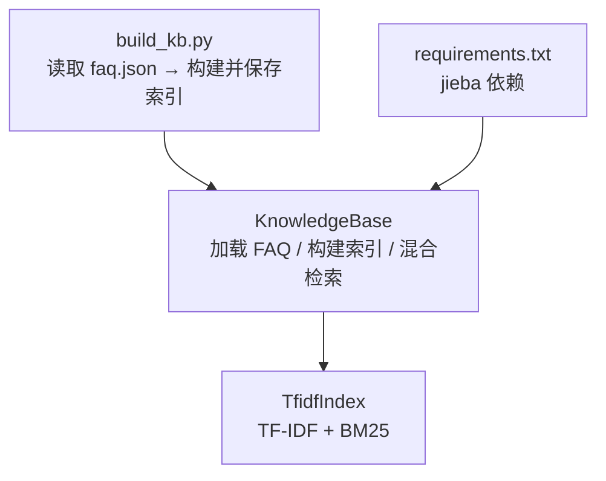
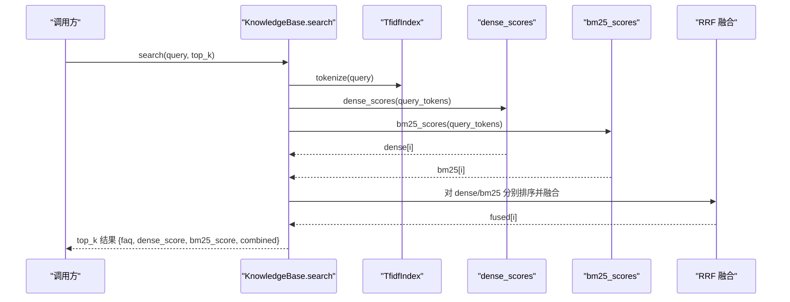
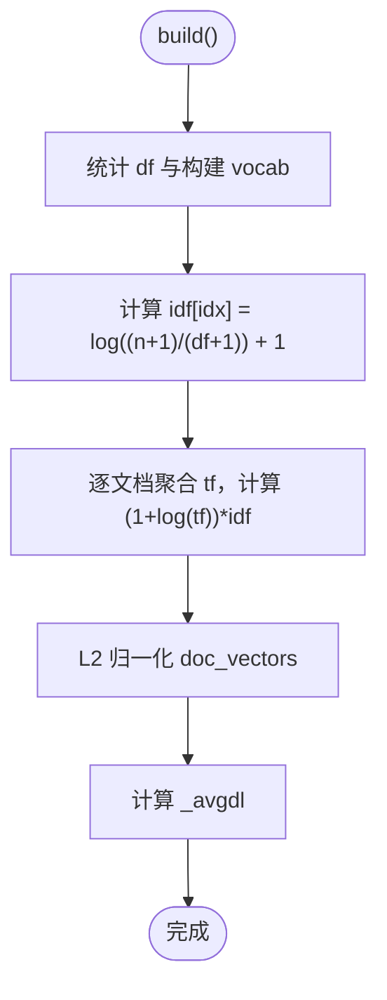
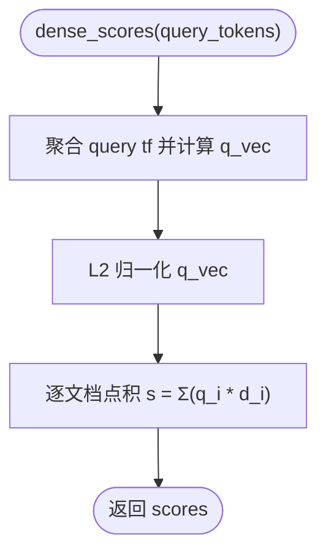
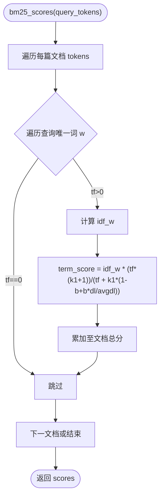
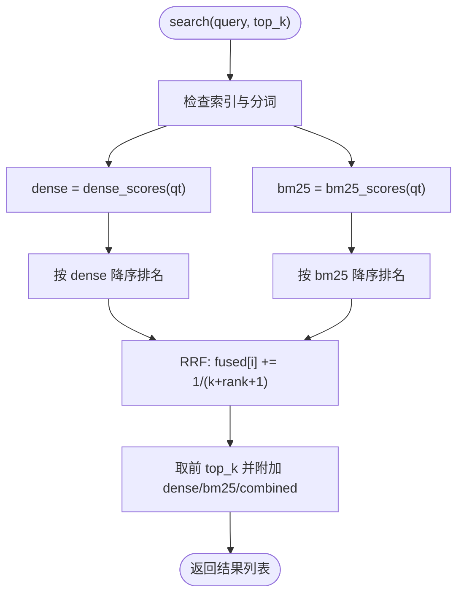
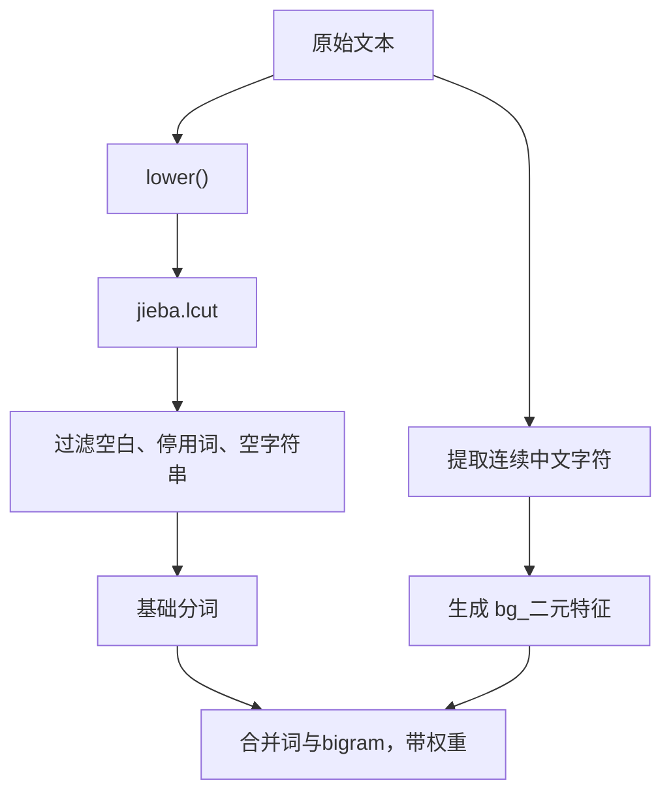
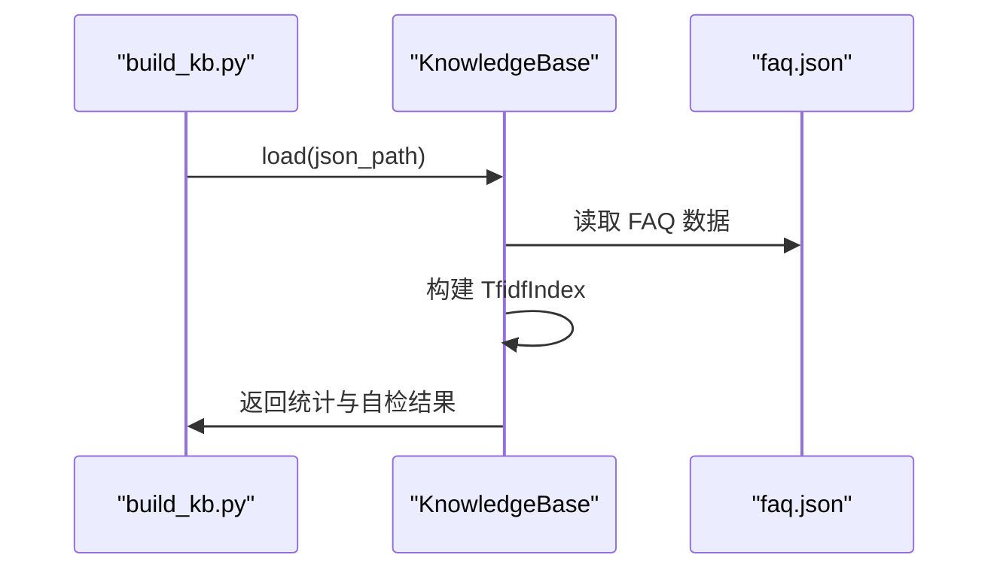
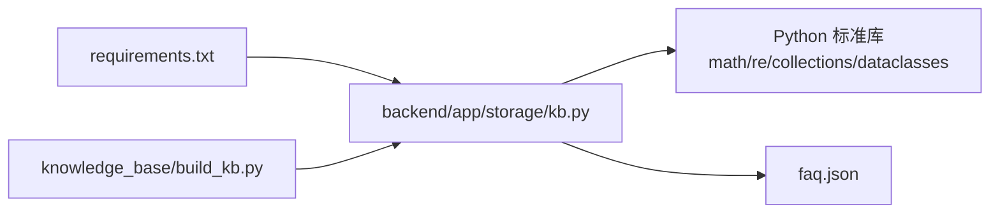

# TF-IDF 与 BM25 双路召回

<cite>
**本文引用的文件**   
- [backend/app/storage/kb.py](file://backend/app/storage/kb.py)
- [knowledge_base/build_kb.py](file://knowledge_base/build_kb.py)
- [backend/requirements.txt](file://backend/requirements.txt)
</cite>

## 目录
1. [引言](#引言)
2. [项目结构定位](#项目结构定位)
3. [核心组件](#核心组件)
4. [架构总览](#架构总览)
5. [详细组件分析](#详细组件分析)
6. [依赖关系分析](#依赖关系分析)
7. [性能考量](#性能考量)
8. [故障排查指南](#故障排查指南)
9. [结论](#结论)

## 引言
本文聚焦知识库检索模块中的双路召回实现：TF-IDF 向量相似度与 BM25 关键词评分。代码采用简化版本地索引，不依赖外部 Embedding 服务；检索阶段通过 RRF（倒数排名融合）对两条独立评分路径做重排，为后续置信度判断和 LLM 生成提供候选上下文。文档重点解释以下要点：
- `TfidfIndex` 的文档频率统计、IDF 计算、L2 归一化与余弦相似度评分。
- BM25 数学公式及参数 `k1=1.5`、`b=0.75` 的作用，以及文档长度如何影响评分。
- 双路召回如何并行执行并返回独立分数，供 RRF 融合使用。
- 中文分词策略、未登录词与标点符号的处理方式。
- 构建索引、执行查询、获取相关度分数的完整调用流程。

## 项目结构定位
本项目的检索能力集中在后端存储层，入口是 `KnowledgeBase`，内部持有 `TfidfIndex`。知识库数据由 `faq.json` 经脚本构建后持久化为 pickle 索引。前端与 Agent 编排器通过统一接口发起混合检索。

**图表来源** 
- [backend/app/storage/kb.py:1-316](file://backend/app/storage/kb.py#L1-L316)
- [knowledge_base/build_kb.py:1-55](file://knowledge_base/build_kb.py#L1-L55)
- [backend/requirements.txt:1-11](file://backend/requirements.txt#L1-L11)

**章节来源**
- [backend/app/storage/kb.py:1-316](file://backend/app/storage/kb.py#L1-L316)
- [knowledge_base/build_kb.py:1-55](file://knowledge_base/build_kb.py#L1-L55)
- [backend/requirements.txt:1-11](file://backend/requirements.txt#L1-L11)

## 核心组件
- `FAQItem`：FAQ 数据结构，负责组装检索文本、分词特征，并对问法与答案设置不同权重。
- `TfidfIndex`：核心索引类，维护词表、IDF、文档向量、BM25 所需统计量，并提供 dense 与 sparse 两种评分方法。
- `KnowledgeBase`：对外暴露的检索接口，封装索引构建、RRF 融合重排与结果输出。
- `build_kb.py`：离线入库脚本，从 `faq.json` 构建索引并序列化到磁盘。

**章节来源**
- [backend/app/storage/kb.py:1-316](file://backend/app/storage/kb.py#L1-L316)

## 架构总览
双路召回在单次检索中同时执行，各自输出独立评分列表，随后进行 RRF 融合重排，最终返回 top-k 候选及其 dense/bm25/combined 分数。

**图表来源**
- [backend/app/storage/kb.py:233-316](file://backend/app/storage/kb.py#L233-L316)

**章节来源**
- [backend/app/storage/kb.py:233-316](file://backend/app/storage/kb.py#L233-L316)

## 详细组件分析

### TfidfIndex 类：TF-IDF 向量索引
该类维护以下状态：
- `doc_token_lists`：每篇文档的分词序列。
- `vocab`：词到列索引的映射。
- `idf`：每个词的 IDF 值。
- `doc_vectors`：每篇文档的稀疏向量（词索引→归一化权重）。
- `_avgdl`：平均文档长度，用于 BM25。
- `_df`：词到文档频率的计数，用于 BM25。

#### 索引构建过程
1. **文档频率统计与词表构建**  
   遍历每篇文档的分词集合，累计每个词出现在多少篇文档中，并分配列索引。
2. **IDF 计算**  
   使用平滑公式：`log((n+1)/(df+1)) + 1`，避免除零与极端负值。
3. **TF-IDF 加权与 L2 归一化**  
   - 对每篇文档按 token 权重聚合词频。
   - 计算 TF-IDF 权重 `(1 + log(tf)) * idf`。
   - 对向量做 L2 归一化，保证余弦相似度等价于点积。
4. **平均文档长度**  
   记录平均 token 数，供 BM25 使用。

**图表来源**
- [backend/app/storage/kb.py:63-119](file://backend/app/storage/kb.py#L63-L119)

**章节来源**
- [backend/app/storage/kb.py:63-119](file://backend/app/storage/kb.py#L63-L119)

#### 余弦相似度评分 dense_scores
- 将查询分词聚合为词频，并按相同规则计算查询向量（含 IDF 与 L2 归一化）。
- 与每篇文档向量做点积，得到稠密相似度分数，范围近似 `[0, 1]`。

**图表来源**
- [backend/app/storage/kb.py:121-147](file://backend/app/storage/kb.py#L121-L147)

**章节来源**
- [backend/app/storage/kb.py:121-147](file://backend/app/storage/kb.py#L121-L147)

#### BM25 评分 bm25_scores
BM25 公式实现如下：
- 对查询中的每个唯一词：
  - 计算该词在当前文档中的词频 `tf`。
  - 若 `tf == 0`，跳过。
  - 计算 IDF：`log((n - df + 0.5) / (df + 0.5) + 1)`。
  - 计算词项得分：`idf * (tf*(k1+1)) / (tf + k1*(1 - b + b*dl/avgdl))`。
- 将所有词项得分累加为该文档的 BM25 总分。

关键参数：
- `k1=1.5`：词频饱和参数，控制词频增长对评分的提升速度。
- `b=0.75`：文档长度归一化参数，调节文档长度对评分的影响。
- `dl/avgdl`：文档长度相对平均长度的比值，使短文档与长文档可比。

**图表来源**
- [backend/app/storage/kb.py:149-167](file://backend/app/storage/kb.py#L149-L167)

**章节来源**
- [backend/app/storage/kb.py:149-167](file://backend/app/storage/kb.py#L149-L167)

### KnowledgeBase：混合检索与 RRF 融合
`KnowledgeBase.search` 的流程：
1. 检查索引是否已构建。
2. 对查询执行中文分词。
3. 分别调用 `dense_scores` 与 `bm25_scores` 获得两路分数。
4. 对每路分数独立排序，得到排名列表。
5. 使用 RRF 融合：`fused[i] += 1/(k + rank + 1)`，其中 `k=60`。
6. 按融合分数降序取 top-k，并在结果中附带 `dense_score`、`bm25_score`、`combined`。

**图表来源**
- [backend/app/storage/kb.py:233-316](file://backend/app/storage/kb.py#L233-L316)

**章节来源**
- [backend/app/storage/kb.py:233-316](file://backend/app/storage/kb.py#L233-L316)

### 中文分词与未登录词处理
- 分词工具：`jieba.lcut`，支持中文分词。
- 停用词过滤：内置 `_STOPWORDS` 集合，过滤常见无意义词。
- 大小写与空白：统一小写并去除空白。
- 标点与未登录词：
  - 标点通常被 jieba 保留为独立 token，随后被 `w.strip()` 与 `isspace()` 过滤。
  - 未登录词（如新造词、拼写变体）可能无法被正确切分，但代码引入中文 bigram 提升鲁棒性：
    - `tokenize_full` 会提取连续的中文字符串，并构造形如 `bg_前两个字符` 的二元特征。
    - 问法与答案使用不同 bigram 权重（问法更高），避免答案稀释匹配。

**图表来源**
- [backend/app/storage/kb.py:18-61](file://backend/app/storage/kb.py#L18-L61)

**章节来源**
- [backend/app/storage/kb.py:18-61](file://backend/app/storage/kb.py#L18-L61)

### 构建索引与执行查询示例
以下为典型用法步骤（以说明为主，不直接展示源码内容）：
- 离线构建索引：
  - 运行脚本 `python knowledge_base/build_kb.py`，它会读取 `faq.json`，构建 `KnowledgeBase` 并保存 pickle 索引。
  - 脚本会打印入库数量、分类分布、疑似重复 FAQ，以及若干样本查询的 dense 分数自检结果。
- 运行时检索：
  - 通过 `KnowledgeBase.search(query, top_k)` 获取混合检索结果。
  - 每条结果包含：
    - `faq`：FAQ 对象。
    - `dense_score`：TF-IDF 向量相似度分数。
    - `bm25_score`：BM25 关键词评分。
    - `combined`：RRF 融合后的综合分数。

**图表来源**
- [knowledge_base/build_kb.py:1-55](file://knowledge_base/build_kb.py#L1-L55)
- [backend/app/storage/kb.py:249-272](file://backend/app/storage/kb.py#L249-L272)

**章节来源**
- [knowledge_base/build_kb.py:1-55](file://knowledge_base/build_kb.py#L1-L55)
- [backend/app/storage/kb.py:249-272](file://backend/app/storage/kb.py#L249-L272)

## 依赖关系分析
- 中文分词依赖 `jieba`，在 `requirements.txt` 中声明。
- `TfidfIndex` 依赖 Python 标准库：`math`、`re`、`collections.Counter`、`dataclasses`。
- `KnowledgeBase` 依赖 JSON 读写与 `pickle` 序列化（在脚本中使用）。

**图表来源**
- [backend/requirements.txt:1-11](file://backend/requirements.txt#L1-L11)
- [backend/app/storage/kb.py:1-316](file://backend/app/storage/kb.py#L1-L316)
- [knowledge_base/build_kb.py:1-55](file://knowledge_base/build_kb.py#L1-L55)

**章节来源**
- [backend/requirements.txt:1-11](file://backend/requirements.txt#L1-L11)
- [backend/app/storage/kb.py:1-316](file://backend/app/storage/kb.py#L1-L316)
- [knowledge_base/build_kb.py:1-55](file://knowledge_base/build_kb.py#L1-L55)

## 性能考量
- 时间复杂度：
  - `build`：O(N×V)，N 为文档数，V 为平均文档 token 数；IDF 与归一化均为线性扫描。
  - `dense_scores`：O(Q×V_d + N×|doc_vec|)，Q 为查询唯一词数，|doc_vec| 为文档非零维度。
  - `bm25_scores`：O(N×U)，U 为查询唯一词数，每次遍历文档 token 集合。
- 空间复杂度：
  - `vocab`、`idf`、`doc_vectors`、`_df` 与 `doc_token_lists` 随语料规模线性增长。
- 优化建议：
  - 对高频查询可缓存查询向量与 IDFs。
  - 使用倒排索引加速 BM25 的词频查找。
  - 对大语料使用批量向量化与内存映射。
  - 调整 RRF 常数 `k` 以平衡两类召回的排名贡献。

[本节为通用性能讨论，不涉及具体文件分析]

## 故障排查指南
- 检索结果为空：
  - 检查 `KnowledgeBase.faqs` 是否为空，或 `_index` 是否已构建。
  - 检查查询分词结果是否为空（可能全部被停用词过滤）。
- 分数异常低：
  - 检查 IDF 计算是否出现极端值（应为平滑公式）。
  - 检查 L2 归一化是否生效，确保向量范数不为零。
- BM25 评分不稳定：
  - 检查 `_avgdl` 是否正确计算，避免除以零。
  - 确认 `k1`、`b` 参数配置合理。
- 中文匹配不佳：
  - 检查 jieba 词典是否覆盖业务词汇，必要时添加自定义词。
  - 调整 `tokenize_full` 中 bigram 权重，提升口语化变体的匹配能力。
- 重复 FAQ 撞车：
  - 使用 `find_duplicates` 检测相似条目，阈值默认 0.95。

**章节来源**
- [backend/app/storage/kb.py:233-316](file://backend/app/storage/kb.py#L233-L316)
- [backend/app/storage/kb.py:63-167](file://backend/app/storage/kb.py#L63-L167)
- [backend/app/storage/kb.py:18-61](file://backend/app/storage/kb.py#L18-L61)

## 结论
本项目在 MVP 阶段采用本地 TF-IDF 与 BM25 双路召回，结合 RRF 融合重排，实现了无需外部 Embedding 的检索方案。`TfidfIndex` 提供了清晰的文档频率统计、IDF 计算、向量归一化与余弦相似度评分；BM25 则通过 `k1=1.5`、`b=0.75` 参数控制词频饱和与文档长度归一化。两种算法并行执行，输出独立评分，便于后续置信度决策与 LLM 生成。中文分词通过 jieba 与中文 bigram 增强鲁棒性，对未登录词与标点具备基本处理能力。整体设计简洁、可维护，并为后续替换为高级 Embedding 与向量数据库预留了扩展空间。

[本节为总结性内容，不涉及具体文件分析]