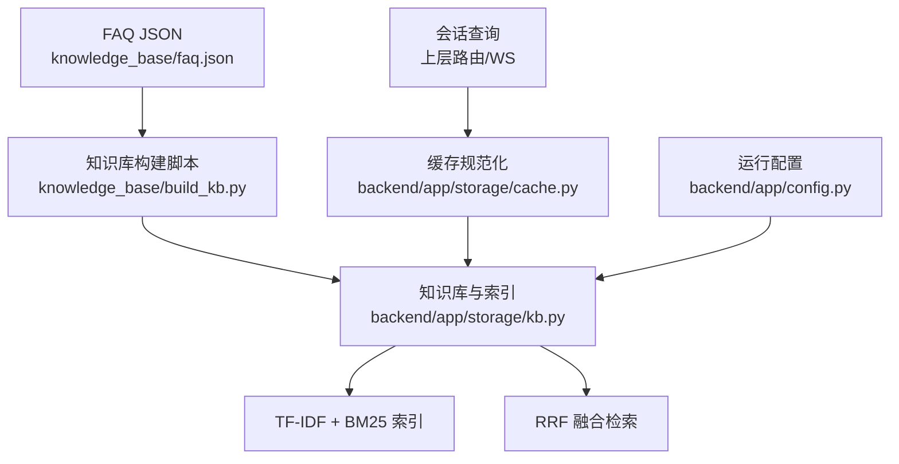
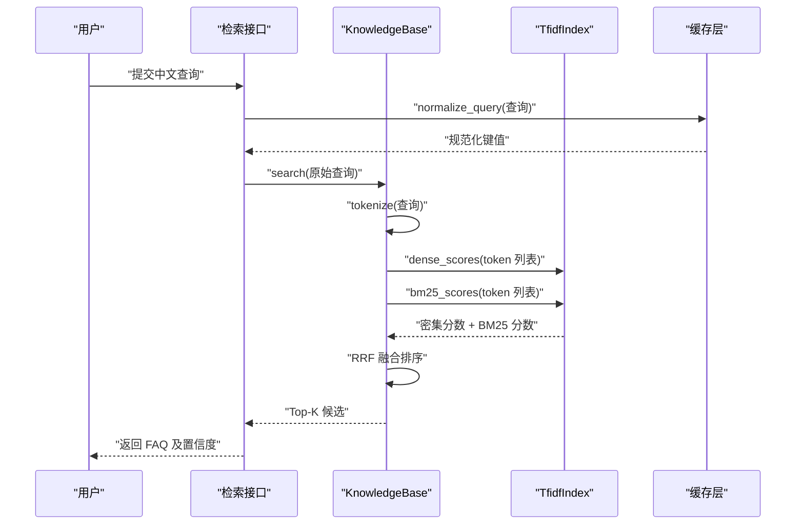
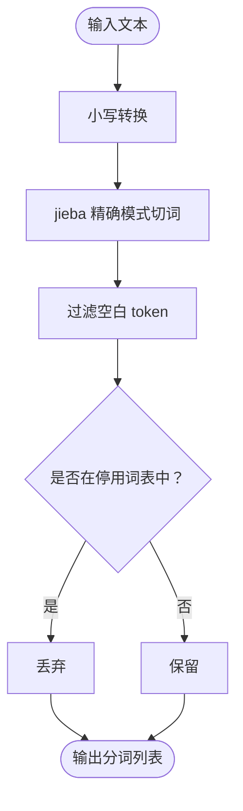
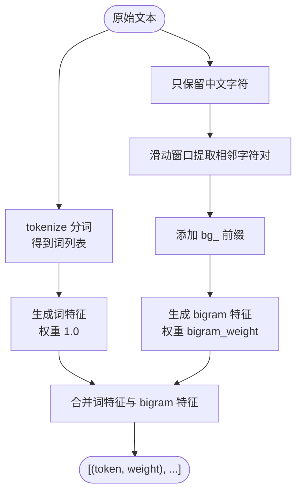
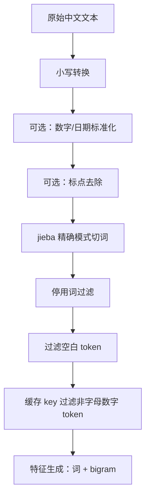
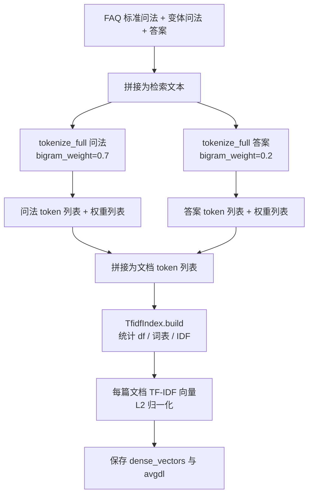
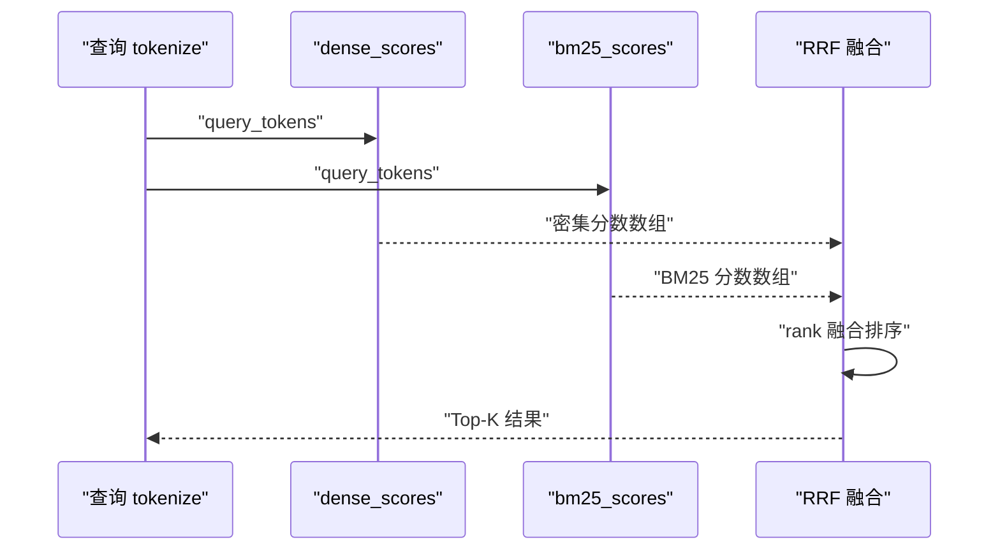
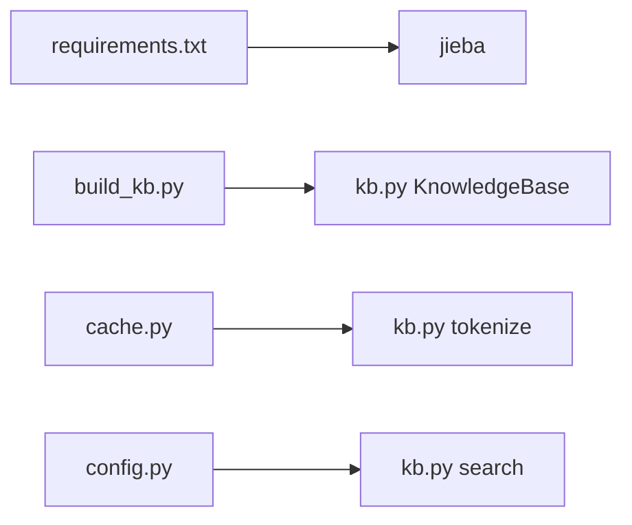

# 中文分词与特征工程

<cite>
**本文引用的文件**   
- [backend/requirements.txt](file://backend/requirements.txt)
- [knowledge_base/build_kb.py](file://knowledge_base/build_kb.py)
- [backend/app/storage/kb.py](file://backend/app/storage/kb.py)
- [backend/app/storage/cache.py](file://backend/app/storage/cache.py)
- [backend/app/config.py](file://backend/app/config.py)
- [knowledge_base/faq.json](file://knowledge_base/faq.json)
</cite>

## 目录
1. [引言](#引言)
2. [项目结构中的分词与检索位置](#项目结构中的分词与检索位置)
3. [核心组件](#核心组件)
4. [架构总览](#架构总览)
5. [详细组件分析](#详细组件分析)
6. [依赖关系分析](#依赖关系分析)
7. [性能与可扩展性](#性能与可扩展性)
8. [故障排查](#故障排查)
9. [结论](#结论)
10. [附录：完整转换流程与参数建议](#附录完整转换流程与参数建议)

## 引言
本文面向客服知识库的中文分词与特征工程，重点解释以下实现：
- 基于 jieba 的分词策略、停用词过滤与小写归一。
- bigram 特征提取：通过滑动窗口生成相邻字符对，提升口语化变体和短语匹配能力。
- 分词后的文本预处理流程，包括小写转换、标点去除、数字标准化等。
- 从原始中文文本到 TF-IDF/BM25 特征向量的完整路径。
- 不同业务场景下的分词策略选择与参数调优建议。

该仓库采用本地轻量方案：不依赖外部 Embedding 模型，而是用 TF-IDF 向量检索与 BM25 关键词检索做双路召回，再通过 RRF 融合重排。jieba 是这一链路中“文本 → 可计算特征”的关键入口。

## 项目结构中的分词与检索位置
- 依赖声明：Python 依赖包含 `jieba>=0.42`，说明分词由 Python 侧实现而非前端或 JS 层。
- 知识库构建脚本：`build_kb.py` 负责加载 FAQ JSON，调用 `KnowledgeBase.load` 并序列化索引。
- 核心分词与特征逻辑集中在 `app/storage/kb.py`，提供分词、bigram 混合特征、TF-IDF 索引、BM25 评分和检索接口。
- 缓存层 `app/storage/cache.py` 复用同一 `tokenize` 函数作为查询规范化 key，保证缓存命中与检索一致性。
- 配置层 `app/config.py` 定义相似度阈值，用于控制“直接回答 / LLM 判断 / 转人工”的决策边界。

**图表来源**
- [backend/requirements.txt:1-11](file://backend/requirements.txt#L1-L11)
- [knowledge_base/build_kb.py:1-55](file://knowledge_base/build_kb.py#L1-L55)
- [backend/app/storage/kb.py:1-316](file://backend/app/storage/kb.py#L1-L316)
- [backend/app/storage/cache.py:1-34](file://backend/app/storage/cache.py#L1-L34)
- [backend/app/config.py:46-52](file://backend/app/config.py#L46-L52)

**章节来源**
- [backend/requirements.txt:1-11](file://backend/requirements.txt#L1-L11)
- [knowledge_base/build_kb.py:1-55](file://knowledge_base/build_kb.py#L1-L55)
- [backend/app/storage/kb.py:1-316](file://backend/app/storage/kb.py#L1-L316)
- [backend/app/storage/cache.py:1-34](file://backend/app/storage/cache.py#L1-L34)
- [backend/app/config.py:46-52](file://backend/app/config.py#L46-L52)

## 核心组件
本节聚焦与“中文分词与特征工程”直接相关的代码单元：

| 组件 | 职责 | 关键行为 |
|---|---|---|
| `tokenize(text)` | 基础中文分词 | 使用 jieba 精确模式切词；小写归一；去空白；过滤内置停用词。 |
| `tokenize_full(text, bigram_weight)` | 混合特征生成 | 在 `tokenize` 基础上，抽取中文连续字符 bigram，并以权重加权。 |
| `FAQItem.tokenized()` | FAQ 文档特征构造 | 问法与答案分别进行 `tokenize_full`，答案降权以降低稀释效应。 |
| `TfidfIndex` | TF-IDF 向量索引 | 构建词表、IDF、L2 归一化向量；支持稠密余弦相似度。 |
| `TfidfIndex.bm25_scores(...)` | BM25 稀疏评分 | 基于词频、文档长度与平均文档长度计算 BM25。 |
| `KnowledgeBase.search(query, top_k)` | 双路检索 + RRF 融合 | Dense(BM25 输入为 token 列表) + Sparse(BM25)，按 RRF 排序返回候选。 |
| `normalize_query(query)` | 查询规范化 | 复用 `tokenize`，仅保留含中英文字母数字的 token 作为缓存 key。 |

**章节来源**
- [backend/app/storage/kb.py:1-316](file://backend/app/storage/kb.py#L1-L316)
- [backend/app/storage/cache.py:1-34](file://backend/app/storage/cache.py#L1-L34)

## 架构总览
下图展示一次搜索请求从原始中文文本到特征向量再到检索结果的全链路。

**图表来源**
- [backend/app/storage/kb.py:1-316](file://backend/app/storage/kb.py#L1-L316)
- [backend/app/storage/cache.py:1-34](file://backend/app/storage/cache.py#L1-L34)

## 详细组件分析

### 分词与停用词过滤
- 分词入口：`tokenize` 使用 `jieba.lcut` 对已小写化的文本进行切分。
- 停用词机制：模块内定义 `_STOPWORDS` 集合，覆盖常见语气词、人称代词、泛用疑问词等，如“的、了、吗、呢、啊、我、你、这个、那个、什么、怎么、会、要、想、有、没、不、请、帮、问、一下、请问”等。
- 过滤规则：
  - 去除空白 token。
  - 不在 `_STOPWORDS` 中的 token 才进入后续特征。
- 小写归一：先 `.lower()`，再切词，使英文字母统一小写，避免大小写噪声。
- 注意：当前实现未显式去除标点符号；标点可能以独立 token 形式出现，但后续在缓存 key 生成时会通过正则过滤非中英文字母数字 token。

**图表来源**
- [backend/app/storage/kb.py:1-316](file://backend/app/storage/kb.py#L1-L316)

**章节来源**
- [backend/app/storage/kb.py:1-316](file://backend/app/storage/kb.py#L1-L316)

### Bigram 特征提取
- 动机：口语化表达存在拆字、变体、插入语气词等情况，纯分词难以稳定匹配。例如“拆封了还能退吗”与“拆了包装还能退吗”在分词上差异较大，但共享“还能、能退、退吗”等语义片段。
- 实现方式：
  - 先用正则筛选出所有中文字符，拼接成纯中文序列。
  - 通过滑动窗口提取长度为 2 的子串，即 bigram。
  - 每个 bigram 前缀 `bg_` 以避免与分词冲突。
  - bigram 权重默认为 `0.7`，低于单词的 `1.0`，从而保持主语义优先。
- FAQ 文档特征：
  - 问法部分使用较高 bigram 权重（默认 `0.7`）。
  - 答案部分使用较低 bigram 权重（默认 `0.2`），避免长答案稀释问法匹配。
  - 最终文档 token 列表由“问法 tokens + 答案 tokens”拼接而成，对应权重列表也一并传入索引构建。

**图表来源**
- [backend/app/storage/kb.py:1-316](file://backend/app/storage/kb.py#L1-L316)

**章节来源**
- [backend/app/storage/kb.py:1-316](file://backend/app/storage/kb.py#L1-L316)

### 分词后文本预处理流程
当前仓库的预处理可归纳为以下阶段：

1. **小写转换**：`tokenize` 中对输入执行 `.lower()`，统一英文字母大小写。
2. **分词**：使用 jieba 精确模式切词。
3. **停用词过滤**：移除内置停用词表中的词。
4. **空白与无效 token 处理**：
   - 在 `tokenize` 中剔除空白 token。
   - 在缓存 key 生成时，进一步通过正则仅保留包含中文、英文字母或数字的 token，从而间接去除纯标点。
5. **数字标准化**：当前未实现专门的数字归一（如将“七”转为“7”或将日期格式统一）。如需增强，可在 `tokenize` 之前加入数字替换规则。
6. **标点去除**：当前未在 `tokenize` 中直接删除标点；主要依赖后续 token 过滤与分词本身对标点切分的弱化。
7. **特征加权**：对问法和答案分别赋予不同 bigram 权重，并在 TF-IDF 构建时对重复 token 累加权重。

**图表来源**
- [backend/app/storage/kb.py:1-316](file://backend/app/storage/kb.py#L1-L316)
- [backend/app/storage/cache.py:1-34](file://backend/app/storage/cache.py#L1-L34)

**章节来源**
- [backend/app/storage/kb.py:1-316](file://backend/app/storage/kb.py#L1-L316)
- [backend/app/storage/cache.py:1-34](file://backend/app/storage/cache.py#L1-L34)

### 从原始中文文本到特征向量的完整过程
下图描述一条 FAQ 文档如何被转换为可用于检索的特征向量：

**图表来源**
- [backend/app/storage/kb.py:1-316](file://backend/app/storage/kb.py#L1-L316)

**章节来源**
- [backend/app/storage/kb.py:1-316](file://backend/app/storage/kb.py#L1-L316)

### 检索流程：Dense + BM25 + RRF
- 查询先经 `tokenize` 得到 token 列表。
- 通过 `dense_scores` 计算查询与文档的余弦相似度。
- 通过 `bm25_scores` 计算 BM25 分数。
- 将两个排序结果按 RRF（Reciprocal Rank Fusion）融合，公式近似为对每个候选的排名取倒数求和。
- 返回 Top-K 候选，并附带 dense_score、bm25_score、combined 融合分。

**图表来源**
- [backend/app/storage/kb.py:1-316](file://backend/app/storage/kb.py#L1-L316)

**章节来源**
- [backend/app/storage/kb.py:1-316](file://backend/app/storage/kb.py#L1-L316)

### 缓存层的查询规范化
缓存 key 使用 `normalize_query`，其内部调用 `tokenize`，并仅保留包含中文、英文字母或数字的 token，再 join 为字符串。这样“拆了包装还能退吗”和“拆了包装还能退吗？”可映射到同一 key，提高首问命中率。

**章节来源**
- [backend/app/storage/cache.py:1-34](file://backend/app/storage/cache.py#L1-L34)

## 依赖关系分析
- Python 依赖通过 `requirements.txt` 引入 `jieba>=0.42`。
- `build_kb.py` 通过动态添加 `backend` 目录到 `sys.path`，导入 `app.storage.kb.KnowledgeBase`。
- `cache.py` 在运行时 import `app.storage.kb.tokenize`，确保缓存与检索分词一致。
- `config.py` 定义相似度阈值，影响检索结果的置信度判定策略。

**图表来源**
- [backend/requirements.txt:1-11](file://backend/requirements.txt#L1-L11)
- [knowledge_base/build_kb.py:1-55](file://knowledge_base/build_kb.py#L1-L55)
- [backend/app/storage/cache.py:1-34](file://backend/app/storage/cache.py#L1-L34)
- [backend/app/config.py:46-52](file://backend/app/config.py#L46-L52)
- [backend/app/storage/kb.py:1-316](file://backend/app/storage/kb.py#L1-L316)

**章节来源**
- [backend/requirements.txt:1-11](file://backend/requirements.txt#L1-L11)
- [knowledge_base/build_kb.py:1-55](file://knowledge_base/build_kb.py#L1-L55)
- [backend/app/storage/cache.py:1-34](file://backend/app/storage/cache.py#L1-L34)
- [backend/app/config.py:46-52](file://backend/app/config.py#L46-L52)
- [backend/app/storage/kb.py:1-316](file://backend/app/storage/kb.py#L1-L316)

## 性能与可扩展性
- 时间复杂度：
  - 分词：O(n)，n 为文本长度。
  - bigram 生成：O(m)，m 为中文字符数。
  - TF-IDF 构建：词频统计 O(N·L)，N 为文档数，L 为平均 token 数；IDF 与向量归一化线性于词表规模。
  - 检索：dense_scores 与 bm25_scores 均为遍历文档的线性扫描，适合 MVP 规模。
- 空间复杂度：
  - 词表、IDF、文档向量字典随语料增长而增大。
- 可扩展方向：
  - 替换为真实 Embedding（如豆包 text-embedding、BGE-M3）+ 向量数据库（如 Qdrant），可显著提升跨句式鲁棒性。
  - 增加自定义停用词表加载，支持按业务线扩展。
  - 增加数字、日期、金额、手机号等实体归一化步骤。
  - 调整 bigram 权重、BM25 超参 k1、b 以及 RRF 融合常数 k。

[本节为通用指导，不直接分析具体代码行]

## 故障排查
常见问题与建议：

| 现象 | 可能原因 | 排查与修复 |
|---|---|---|
| 检索命中不稳定 | jieba 未正确安装或版本过旧 | 检查 `requirements.txt` 中 `jieba>=0.42` 是否满足。 |
| 同义问法匹配差 | 停用词过多或 bigram 权重过低 | 调整 `_STOPWORDS`，或提高问法 bigram 权重。 |
| 答案干扰问法匹配 | 答案 token 过多且权重未充分降权 | 降低答案 bigram 权重，或减少答案参与检索的权重。 |
| 缓存命中率低 | 查询规范化不一致 | 确认缓存 key 与检索 `tokenize` 一致，并检查标点、空格差异。 |
| 中文标点导致噪声 | 未去除标点 | 在预处理阶段加入标点过滤，或在缓存 key 生成时强化正则过滤。 |
| 数字表达不一致 | “七”和“7”无法等价 | 增加数字标准化，将中文数字、日期、金额统一为规范格式。 |

**章节来源**
- [backend/requirements.txt:1-11](file://backend/requirements.txt#L1-L11)
- [backend/app/storage/kb.py:1-316](file://backend/app/storage/kb.py#L1-L316)
- [backend/app/storage/cache.py:1-34](file://backend/app/storage/cache.py#L1-L34)

## 结论
本仓库的分词与特征工程以 jieba 为基础，结合内置停用词过滤、小写归一与中文 bigram 特征，构建了轻量但实用的 TF-IDF + BM25 双路检索系统。该方案在 MVP 阶段具备快速上线、易于调试、无需外部 Embedding 的优势；同时保留了向真实 Embedding + 向量数据库迁移的空间。对于口语化客服场景，bigram 是提升鲁棒性的关键；而停用词、数字标准化与标点清理则是进一步提升准确率的重要补充。

[本节为总结性内容，不直接分析具体代码行]

## 附录：完整转换流程与参数建议

### 从原始中文文本到特征向量的步骤清单
1. **输入**：原始中文文本（用户查询或 FAQ 标准问法/变体/答案）。
2. **小写转换**：统一英文字母大小写。
3. **可选数字标准化**：将中文数字、日期、金额等转换为统一格式。
4. **可选标点去除**：删除无意义标点，减少噪声。
5. **jieba 分词**：使用精确模式切词。
6. **停用词过滤**：移除内置 `_STOPWORDS` 中的词。
7. **Bigram 提取**：对中文连续字符提取相邻字符对，添加 `bg_` 前缀。
8. **特征加权**：
   - 问法：词权重 `1.0`，bigram 权重 `0.7`。
   - 答案：词权重 `1.0`，bigram 权重 `0.2`。
9. **TF-IDF 构建**：统计词频、IDF、L2 归一化。
10. **检索**：Dense 余弦相似度 + BM25 + RRF 融合排序。

### 代码示例路径
- 知识库构建入口与样本自检：  
  [knowledge_base/build_kb.py:1-55](file://knowledge_base/build_kb.py#L1-L55)
- FAQ 数据源样例：  
  [knowledge_base/faq.json:1-40](file://knowledge_base/faq.json#L1-L40)
- 分词与 bigram 特征实现：  
  [backend/app/storage/kb.py:1-316](file://backend/app/storage/kb.py#L1-L316)
- 查询规范化与缓存 key：  
  [backend/app/storage/cache.py:1-34](file://backend/app/storage/cache.py#L1-L34)
- 相似度阈值配置：  
  [backend/app/config.py:46-52](file://backend/app/config.py#L46-L52)

### 不同业务场景下的分词策略建议
| 场景 | 推荐策略 | 理由 |
|---|---|---|
| 售后退换货问答 | 提高问法 bigram 权重，适度放宽停用词 | 用户口语化强，变体多，bigram 有助于捕获“还能退、能退吗”等片段。 |
| 售前咨询 | 适度保留更多分词粒度，避免过度过滤 | 需要更细粒度的商品属性匹配。 |
| 交易与支付 | 加强数字、金额、订单号标准化 | 这类问题对数值敏感，需统一格式以提升匹配稳定性。 |
| 账号与安全 | 强化风险词与否定词检测 | 涉及投诉、举报、封号等高风险表达，需准确识别。 |
| 转人工意图 | 使用专用关键词集 | 如“转人工、找客服、找真人”等，便于快速分流。 |

### 参数调优建议
- `bigram_weight`：
  - 问法：可从 `0.7` 上调至 `0.8~0.9`，提升口语变体匹配。
  - 答案：保持 `0.2` 或更低，防止答案稀释问法。
- BM25 超参：
  - `k1`：控制词频饱和程度，通常 `1.2~1.5`。
  - `b`：控制文档长度归一化强度，通常 `0.75`。
- 相似度阈值：
  - 低阈值直接转人工，高阈值直接生成，中间走 LLM 可回答性判断。
  - 当前实现注释提示：切换真实 Embedding 后可按 `0.75 / 0.85` 重调。

**章节来源**
- [knowledge_base/build_kb.py:1-55](file://knowledge_base/build_kb.py#L1-L55)
- [knowledge_base/faq.json:1-40](file://knowledge_base/faq.json#L1-L40)
- [backend/app/storage/kb.py:1-316](file://backend/app/storage/kb.py#L1-L316)
- [backend/app/storage/cache.py:1-34](file://backend/app/storage/cache.py#L1-L34)
- [backend/app/config.py:46-52](file://backend/app/config.py#L46-L52)