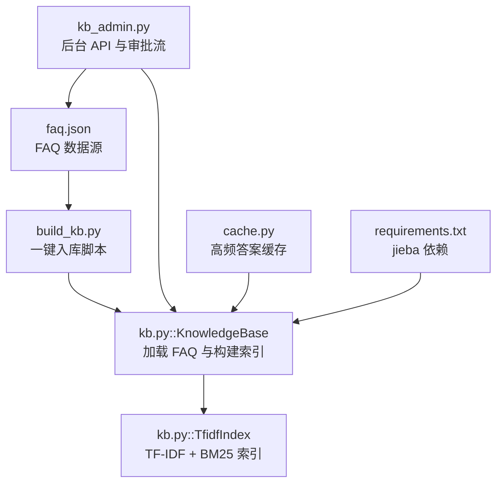
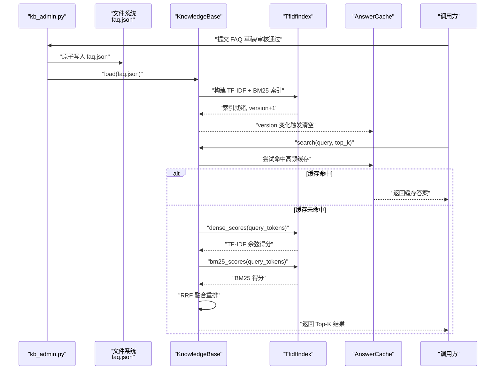
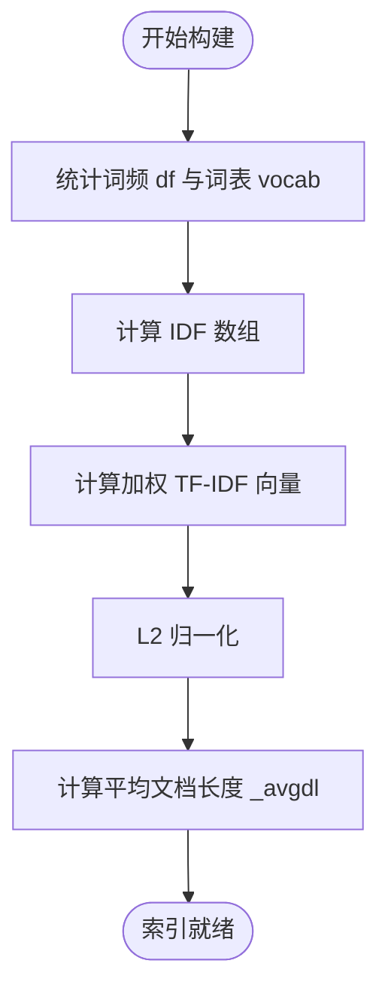
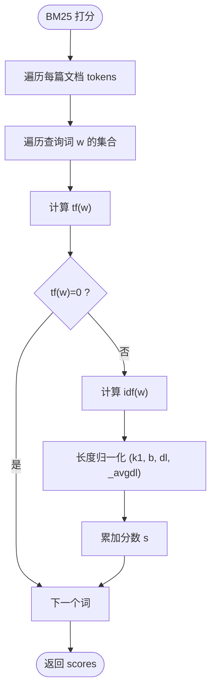
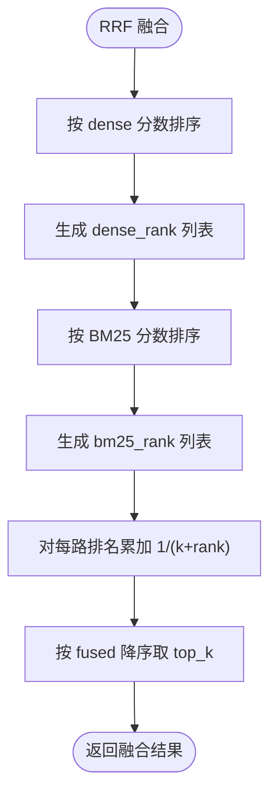
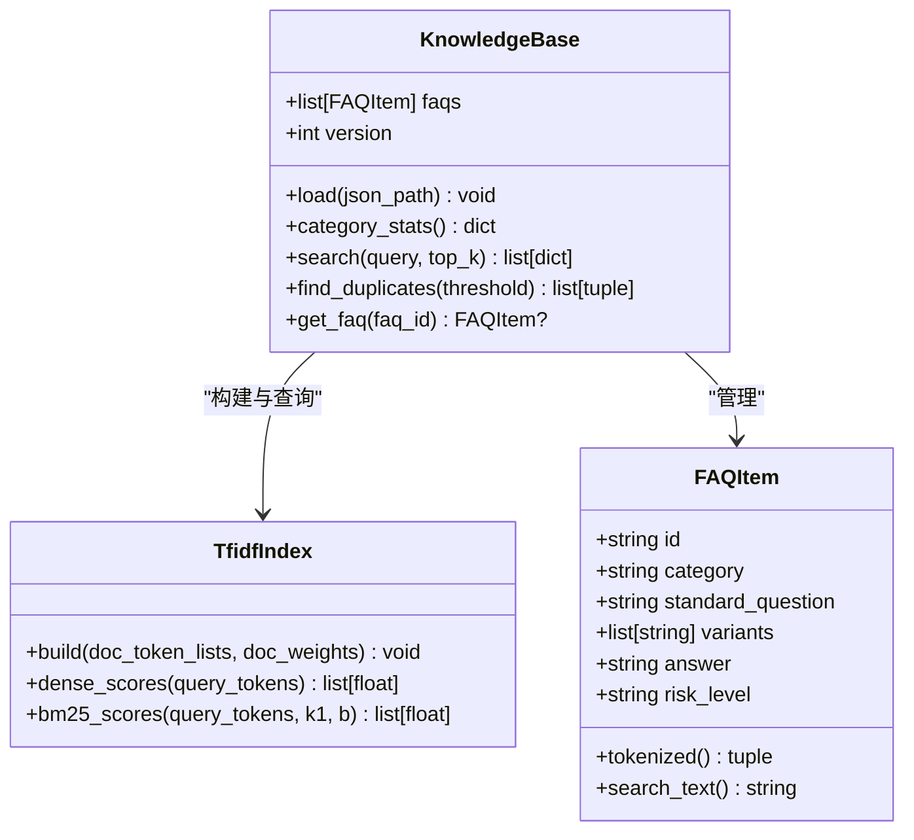
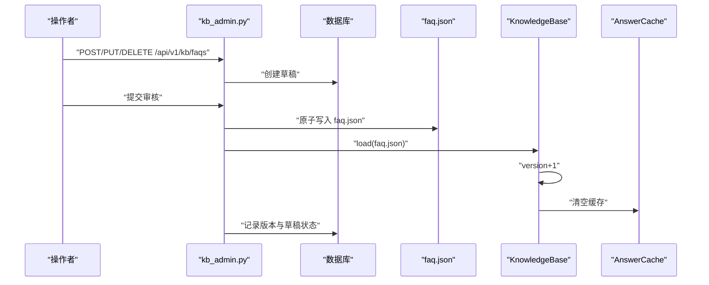
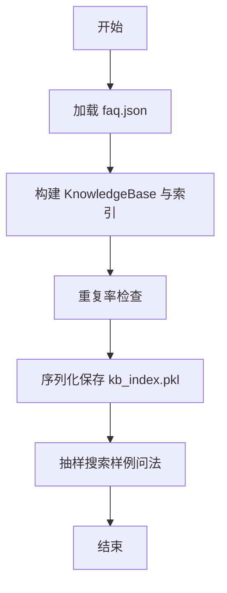
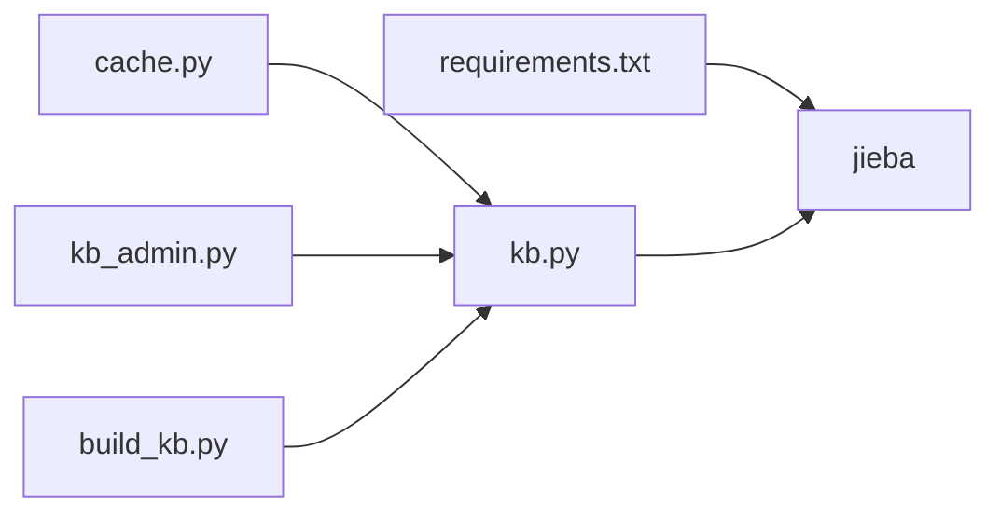

# 知识库检索引擎

<cite>
**本文引用的文件**   
- [backend/app/storage/kb.py](file://backend/app/storage/kb.py)
- [knowledge_base/build_kb.py](file://knowledge_base/build_kb.py)
- [knowledge_base/faq.json](file://knowledge_base/faq.json)
- [backend/app/routers/kb_admin.py](file://backend/app/routers/kb_admin.py)
- [backend/app/storage/cache.py](file://backend/app/storage/cache.py)
- [backend/requirements.txt](file://backend/requirements.txt)
</cite>

## 目录
1. [引言](#引言)
2. [项目结构](#项目结构)
3. [核心组件](#核心组件)
4. [架构总览](#架构总览)
5. [详细组件分析](#详细组件分析)
6. [依赖关系分析](#依赖关系分析)
7. [性能与优化](#性能与优化)
8. [故障排查指南](#故障排查指南)
9. [结论](#结论)

## 引言
本仓库的知识库检索引擎采用“TF-IDF + BM25 双路召回、RRF 融合重排”的混合检索方案，面向客服场景下的 FAQ 语义匹配。其目标是：在无需外部向量模型的前提下，通过本地中文分词、停用词过滤、bigram 特征和 TF-IDF/BM25 打分，快速召回最相关的 FAQ，并在后台支持 FAQ 的 CRUD、审批流、版本历史与热更新。

整体设计遵循“faq.json 是唯一事实来源（Source of Truth）”的原则：所有变更经后台审批流落盘到 faq.json，随后调用 KnowledgeBase.load 重建索引并提升版本号，使高频答案缓存自动失效。

## 项目结构
知识库检索相关代码集中在后端模块 knowledge_base 与 backend 中：

- knowledge_base/build_kb.py：一键入库脚本，读取 faq.json → 构建索引 → 序列化保存。
- knowledge_base/faq.json：FAQ 数据源，包含标准问法、变体问法、答案、风险等级等字段。
- backend/app/storage/kb.py：检索引擎核心，包含分词、TfidfIndex、KnowledgeBase 及 RRF 融合逻辑。
- backend/app/routers/kb_admin.py：知识库后台接口，负责 FAQ 增删改查、草稿审批、原子写 faq.json 与热更新。
- backend/app/storage/cache.py：Top-N 高频问题秒回缓存，基于 jieba 规范化查询键与知识库版本联动失效。
- backend/requirements.txt：依赖声明，包含 jieba 用于中文分词。

**图示来源**
- [knowledge_base/build_kb.py:1-55](file://knowledge_base/build_kb.py#L1-L55)
- [knowledge_base/faq.json:1-60](file://knowledge_base/faq.json#L1-L60)
- [backend/app/storage/kb.py:1-316](file://backend/app/storage/kb.py#L1-L316)
- [backend/app/routers/kb_admin.py:1-200](file://backend/app/routers/kb_admin.py#L1-L200)
- [backend/app/storage/cache.py:1-82](file://backend/app/storage/cache.py#L1-L82)
- [backend/requirements.txt:1-11](file://backend/requirements.txt#L1-L11)

**章节来源**
- [knowledge_base/build_kb.py:1-55](file://knowledge_base/build_kb.py#L1-L55)
- [knowledge_base/faq.json:1-60](file://knowledge_base/faq.json#L1-L60)
- [backend/app/storage/kb.py:1-316](file://backend/app/storage/kb.py#L1-L316)
- [backend/app/routers/kb_admin.py:1-200](file://backend/app/routers/kb_admin.py#L1-L200)
- [backend/app/storage/cache.py:1-82](file://backend/app/storage/cache.py#L1-L82)
- [backend/requirements.txt:1-11](file://backend/requirements.txt#L1-L11)

## 核心组件
- TfidfIndex：实现文档频率统计、IDF 计算、TF-IDF 向量归一化、余弦相似度计算以及 BM25 打分。
- KnowledgeBase：封装 FAQ 列表、索引构建、检索入口 search、重复检测 find_duplicates，并提供类别统计。
- tokenize / tokenize_full：jieba 中文分词、停用词过滤、小写归一；bigram 特征提取，提升口语化变体匹配鲁棒性。
- AnswerCache：高频答案缓存，使用规范化查询作为 key，结合 kb.version 进行失效控制。
- kb_admin：后台 API，负责 FAQ 草稿审批、原子写入 faq.json、触发 kb.load 热更新。

**章节来源**
- [backend/app/storage/kb.py:1-316](file://backend/app/storage/kb.py#L1-L316)
- [backend/app/storage/cache.py:1-82](file://backend/app/storage/cache.py#L1-L82)
- [backend/app/routers/kb_admin.py:1-200](file://backend/app/routers/kb_admin.py#L1-L200)

## 架构总览
下图展示从 FAQ 数据到索引构建再到查询检索的完整流程，包括后台审批流触发的热更新路径。

**图示来源**
- [backend/app/routers/kb_admin.py:1-200](file://backend/app/routers/kb_admin.py#L1-L200)
- [backend/app/storage/kb.py:1-316](file://backend/app/storage/kb.py#L1-L316)
- [backend/app/storage/cache.py:1-82](file://backend/app/storage/cache.py#L1-L82)

## 详细组件分析

### 中文分词、停用词过滤与 bigram 特征
- 分词策略：使用 jieba.lcut 对输入文本进行切分，统一转为小写，去除空白与停用词。停用词集合涵盖常见虚词、语气词与无意义代词，以降低噪声。
- bigram 特征：从纯中文子串中提取相邻字符二元组，并以“bg_”前缀标记，赋予权重（问法 0.7，答案 0.2）。该机制能增强口语化变体的匹配能力，例如“拆了包装还能退吗”与“拆封了还能退吗”共享“还能/能退/退吗”等 bigram。
- 混合特征：FAQItem.tokenized 将标准问法和变体问法合并为问法特征，再单独生成答案特征，并对答案降权，避免稀释问法匹配精度。

复杂度说明：
- tokenize：O(n)，n 为文本长度。
- tokenize_full：O(n) 生成词表 + O(m) 生成 bigram，m 为中文字符数量。
- FAQItem.search_text：拼接字符串，O(k)，k 为字段总长度。

**章节来源**
- [backend/app/storage/kb.py:1-120](file://backend/app/storage/kb.py#L1-L120)

### TfidfIndex 类：构建与检索算法
TfidfIndex 承担两项职责：
1. 构建 TF-IDF 向量索引并进行 L2 归一化。
2. 计算 BM25 分数。

构建过程：
- 文档频率统计：遍历每篇文档的分词集合，统计每个词的文档频率 _df，同时建立词表 vocab。
- IDF 计算：对每个词 idx 计算 IDF = log((N+1)/(df+1)) + 1，其中 N 为文档总数。
- 加权 TF-IDF 与归一化：对每篇文档按 token 与对应权重（问法 1.0，答案降权）计算 TF-IDF，得到稀疏向量后做 L2 归一化，便于后续余弦相似度。
- 平均文档长度：记录 _avgdl，用于 BM25 的长度归一化。

**图示来源**
- [backend/app/storage/kb.py:90-170](file://backend/app/storage/kb.py#L90-L170)

#### Dense 检索：余弦相似度
- dense_scores 对查询词计算 TF-IDF 向量并 L2 归一化，然后与每篇文档向量点积，得到 0~1 的余弦相似度。
- 时间复杂度：O(Q·V + Q·D)，Q 为查询词数，V 为词汇表大小，D 为文档数；由于 doc_vectors 是稀疏字典，实际点积只遍历非零项。

#### BM25 检索：参数配置与长度归一化
- 参数：k1=1.5，b=0.75。
- 公式要点：对每个查询词 w，计算 tf(w)、df(w)、idf(w)，并结合文档长度 dl 与平均长度 _avgdl 进行长度归一化。
- 输出：每篇文档的 BM25 分数列表。

**图示来源**
- [backend/app/storage/kb.py:160-200](file://backend/app/storage/kb.py#L160-L200)

**章节来源**
- [backend/app/storage/kb.py:90-200](file://backend/app/storage/kb.py#L90-L200)

### RRF 融合重排算法
RRF（Reciprocal Rank Fusion）是一种无参数的排名融合方法。本实现步骤如下：
- 分别对 dense_scores 与 bm25_scores 排序，得到两路排名序列。
- 对每个候选 i，初始化 fused[i]=0。
- 对 dense_rank 中的第 r 名 i，执行 fused[i] += 1/(k+r)，k=60。
- 对 bm25_rank 中的第 r 名 i，同样累加 1/(k+r)。
- 最终按 fused 降序（次级按 dense_score 降序）取 top_k。

该融合方式不引入额外权重，仅利用两路结果的相对排名来聚合相关性，稳定且可解释。

**图示来源**
- [backend/app/storage/kb.py:230-280](file://backend/app/storage/kb.py#L230-L280)

**章节来源**
- [backend/app/storage/kb.py:220-280](file://backend/app/storage/kb.py#L220-L280)

### KnowledgeBase：FAQ 加载、索引构建与检索
- load：从 faq.json 加载 FAQ 列表，计算类别统计；对每条 FAQ 生成 token_lists 与 weight_lists（问法权重 1.0，答案权重 0.35），构建 TfidfIndex，并提升 version。
- search：双路召回 dense + BM25，RRF 融合，返回包含 dense_score、bm25_score、combined 的结果。
- find_duplicates：对自身标准问法检索，相似度超阈值（默认 0.95）视为疑似重复。

**图示来源**
- [backend/app/storage/kb.py:120-316](file://backend/app/storage/kb.py#L120-L316)

**章节来源**
- [backend/app/storage/kb.py:120-316](file://backend/app/storage/kb.py#L120-L316)

### 后台审批流与热更新
- kb_admin 提供 FAQ 创建、编辑、删除接口，均先落盘为草稿，审核后通过 _apply_draft 原子写入 faq.json，然后调用 kb.load 热重建索引，并将草稿状态设为 published，记录版本历史。
- 原子写使用临时文件 + os.replace，避免半写状态。
- 版本管理：每次热更新 kb.version+1，使 AnswerCache 整体清空，防止过期口径被秒回。

**图示来源**
- [backend/app/routers/kb_admin.py:1-200](file://backend/app/routers/kb_admin.py#L1-L200)
- [backend/app/storage/cache.py:1-82](file://backend/app/storage/cache.py#L1-L82)

**章节来源**
- [backend/app/routers/kb_admin.py:1-200](file://backend/app/routers/kb_admin.py#L1-L200)

### 完整示例流程：从 FAQ 数据到索引构建再到查询检索
以下示例以 build_kb.py 为主线，展示从 FAQ 数据到索引构建再到抽样自检查询的流程：

1. 准备 FAQ 数据：knowledge_base/faq.json 中包含 meta 与 faqs 数组，每条 FAQ 具备 id、category、standard_question、variants、answer、risk_level、follow_up 字段。
2. 运行一键入库：python knowledge_base/build_kb.py，脚本导入 app.storage.kb.KnowledgeBase，加载 faq.json，执行健康检查 find_duplicates，序列化保存 kb_index.pkl。
3. 抽样自检：对若干样例问法调用 kb.search(top_k=1)，打印最高分 FAQ 的 id、标准问法与 dense_score。

**图示来源**
- [knowledge_base/build_kb.py:1-55](file://knowledge_base/build_kb.py#L1-L55)
- [knowledge_base/faq.json:1-60](file://knowledge_base/faq.json#L1-L60)
- [backend/app/storage/kb.py:200-316](file://backend/app/storage/kb.py#L200-L316)

**章节来源**
- [knowledge_base/build_kb.py:1-55](file://knowledge_base/build_kb.py#L1-L55)
- [knowledge_base/faq.json:1-60](file://knowledge_base/faq.json#L1-L60)
- [backend/app/storage/kb.py:200-316](file://backend/app/storage/kb.py#L200-L316)

## 依赖关系分析
- jieba：中文分词核心库，被 tokenize 与 cache.normalize_query 使用。
- fastapi、uvicorn、pydantic 等：Web 框架与配置依赖，支撑 kb_admin 路由。
- 模块耦合：
  - kb_admin 依赖 kb.py 的 KnowledgeBase 单例与 db 存储。
  - cache.py 依赖 kb.py 的 tokenize 进行查询规范化。
  - build_kb.py 依赖 kb.py 的 KnowledgeBase 完成批量入库。

**图示来源**
- [backend/requirements.txt:1-11](file://backend/requirements.txt#L1-L11)
- [backend/app/storage/kb.py:1-316](file://backend/app/storage/kb.py#L1-L316)
- [backend/app/storage/cache.py:1-82](file://backend/app/storage/cache.py#L1-L82)
- [backend/app/routers/kb_admin.py:1-200](file://backend/app/routers/kb_admin.py#L1-L200)
- [knowledge_base/build_kb.py:1-55](file://knowledge_base/build_kb.py#L1-L55)

**章节来源**
- [backend/requirements.txt:1-11](file://backend/requirements.txt#L1-L11)
- [backend/app/storage/kb.py:1-316](file://backend/app/storage/kb.py#L1-L316)
- [backend/app/storage/cache.py:1-82](file://backend/app/storage/cache.py#L1-L82)
- [backend/app/routers/kb_admin.py:1-200](file://backend/app/routers/kb_admin.py#L1-L200)
- [knowledge_base/build_kb.py:1-55](file://knowledge_base/build_kb.py#L1-L55)

## 性能与优化
- 向量化预计算：
  - TfidfIndex.build 预先计算每篇文档的 TF-IDF 向量与 IDF，查询时只需对查询向量做相同处理并点积，避免重复计算。
  - dense_scores 使用稀疏向量点积，减少无效计算。
- 内存缓存机制：
  - AnswerCache 使用有序字典维护 Top-N 高频问题的自动回答结果，key 为规范化查询（jieba 分词 + 停用词过滤 + 去标点）。
  - 容量上限淘汰策略：优先淘汰命中次数最少且最近未命中的条目。
  - 失效策略：kb.version 变化时整体清空缓存，确保口径一致。
- 后台热更新：
  - kb_admin 原子写 faq.json 后调用 kb.load 全量重建索引，版本递增，缓存自动失效，保证一致性。
- 复杂度与规模：
  - 当前 MVP 阶段 FAQ 数量较小（约数十条），索引构建与检索均为毫秒级。
  - 若扩展至大规模数据，建议考虑：
    - 使用倒排索引或近似最近邻（ANN）加速 dense 检索。
    - 将 BM25 结果缓存或预计算热点词条得分。
    - 将 AnswerCache 替换为 Redis 等分布式缓存，支持水平扩展。

[本节为通用性能讨论，不涉及具体文件分析]

## 故障排查指南
- 分词为空导致检索失败：
  - 检查停用词是否误删关键语义词；必要时调整 _STOPWORDS。
  - 确认 jieba 已正确安装与可用。
- 重复 FAQ 告警：
  - 运行 build_kb.py 查看 find_duplicates 输出的疑似重复 FAQ 列表，合并或改写标准问法与变体。
- 缓存未命中或旧结果：
  - 检查 kb.version 是否正确递增；确认 kb.load 在后台审批通过后被调用。
  - 查看 AnswerCache.stats 监控命中率与淘汰情况。
- 后台热更新异常：
  - 检查 faq.json 文件格式与权限；确认原子写过程中没有残留临时文件。
  - 确认 _apply_lock 串行化锁生效，避免并发写竞态。

**章节来源**
- [backend/app/storage/kb.py:1-316](file://backend/app/storage/kb.py#L1-L316)
- [backend/app/storage/cache.py:1-82](file://backend/app/storage/cache.py#L1-L82)
- [backend/app/routers/kb_admin.py:1-200](file://backend/app/routers/kb_admin.py#L1-L200)
- [knowledge_base/build_kb.py:1-55](file://knowledge_base/build_kb.py#L1-L55)

## 结论
本知识库检索引擎以本地 TF-IDF 与 BM25 双路召回为核心，辅以 jieba 中文分词、停用词过滤与 bigram 特征，有效提升口语化变体的匹配鲁棒性；RRF 融合重排提供无参数的稳定融合策略。配合后台审批流与原子写机制，系统实现了 FAQ 数据的可信管理与热更新；AnswerCache 则进一步提升了高频问答的响应速度。对于更大规模的部署，可在保持现有接口不变的前提下，平滑替换为外部 Embedding 与向量数据库，实现生产级扩展。