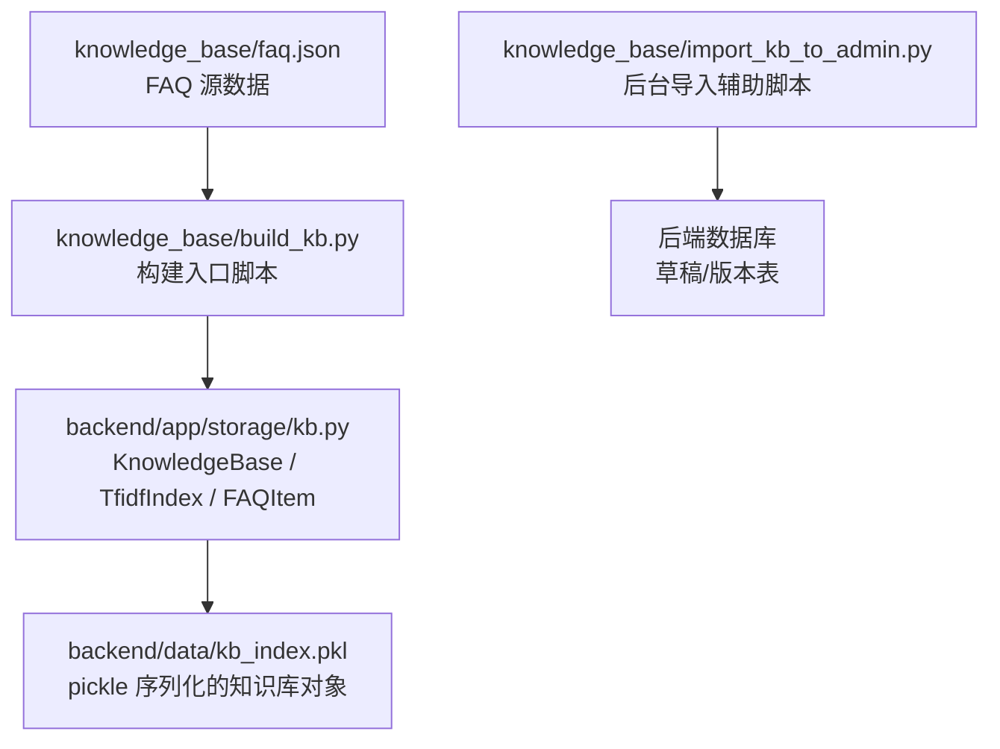
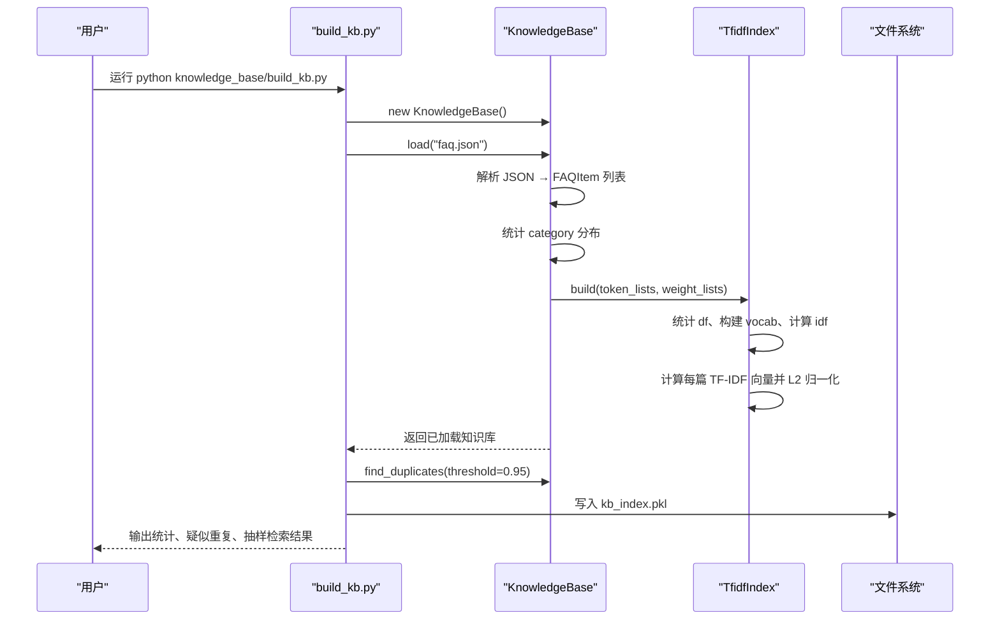
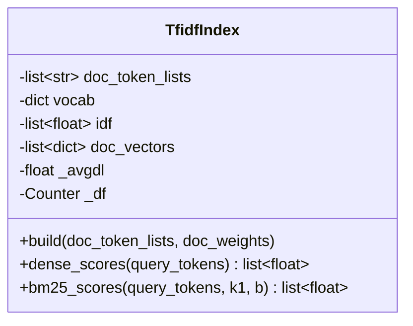
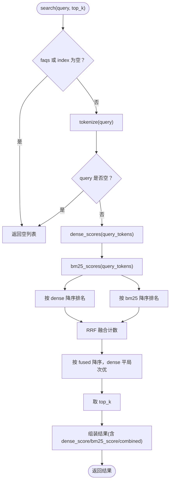
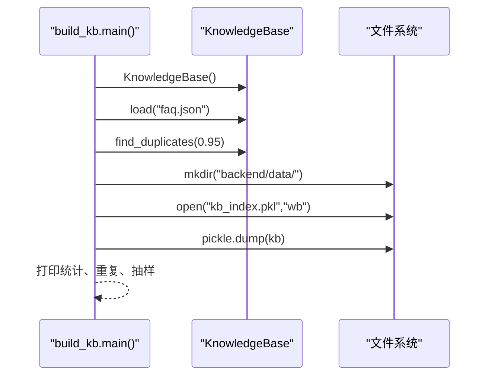
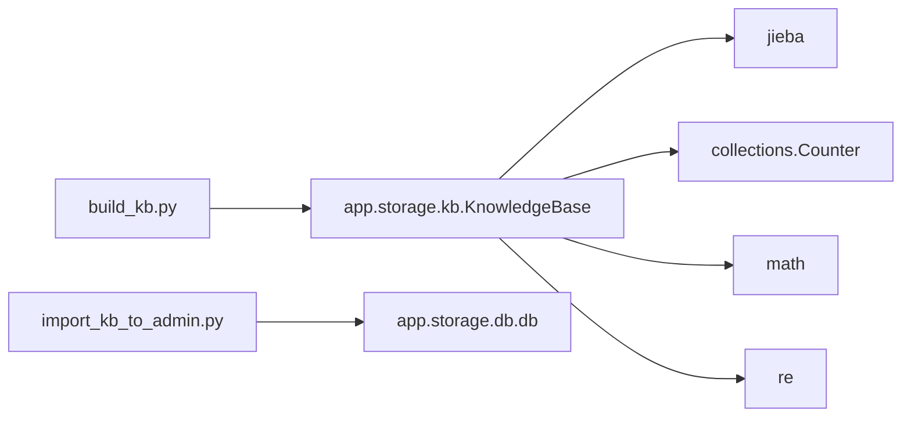

# 索引构建流水线

<cite>
**本文引用的文件**   
- [build_kb.py](file://knowledge_base/build_kb.py)
- [faq.json](file://knowledge_base/faq.json)
- [import_kb_to_admin.py](file://knowledge_base/import_kb_to_admin.py)
- [kb.py](file://backend/app/storage/kb.py)
</cite>

## 目录
1. [引言](#引言)
2. [项目结构](#项目结构)
3. [核心组件](#核心组件)
4. [架构总览](#架构总览)
5. [详细组件分析](#详细组件分析)
6. [依赖关系分析](#依赖关系分析)
7. [性能与优化](#性能与优化)
8. [使用示例](#使用示例)
9. [故障排查](#故障排查)
10. [结论](#结论)

## 引言
本文件面向“知识库索引构建流水线”，目标是把 FAQ JSON 数据转化为可检索的本地索引，并持久化到后端。该流程覆盖：
- 数据读取与校验
- 中文分词与特征提取（词 + bigram）
- TF-IDF 向量与 BM25 关键词双路召回
- RRF 融合重排
- 重复检测与抽样自检
- 序列化存储为 pickle 索引文件

该流水线当前为全量重建模式，适合在 FAQ 源变更时重新生成索引；同时通过版本号和缓存失效机制，为后续增量更新预留扩展点。

## 项目结构
知识库相关代码集中在两个位置：
- knowledge_base：存放 FAQ 源数据与构建脚本
- backend/app/storage：实现 KnowledgeBase、TfidfIndex、FAQItem 等核心类

图示来源
- [build_kb.py:1-55](file://knowledge_base/build_kb.py#L1-L55)
- [kb.py:1-316](file://backend/app/storage/kb.py#L1-L316)

章节来源
- [build_kb.py:1-55](file://knowledge_base/build_kb.py#L1-L55)
- [kb.py:1-316](file://backend/app/storage/kb.py#L1-L316)

## 核心组件
- FAQItem：FAQ 单条记录的数据模型，负责构造检索文本、分词与权重。
- TfidfIndex：TF-IDF 向量索引与 BM25 评分器，维护词汇表、文档频率、IDF、文档向量及平均文档长度。
- KnowledgeBase：知识聚合层，负责加载 FAQ、构建索引、分类统计、检索（Dense + BM25 → RRF）、重复检测、版本管理。
- build_kb.py：一键入库脚本，调用 KnowledgeBase 完成加载、去重检查、采样自检，并写入 kb_index.pkl。
- import_kb_to_admin.py：将 faq.json 同步为后台的草稿与版本记录，保证审批流与回滚能力，不修改 faq.json。

章节来源
- [kb.py:47-119](file://backend/app/storage/kb.py#L47-L119)
- [kb.py:121-200](file://backend/app/storage/kb.py#L121-L200)
- [kb.py:239-316](file://backend/app/storage/kb.py#L239-L316)
- [build_kb.py:1-55](file://knowledge_base/build_kb.py#L1-L55)
- [import_kb_to_admin.py:1-66](file://knowledge_base/import_kb_to_admin.py#L1-L66)

## 架构总览
下图展示从 FAQ JSON 到可搜索索引的端到端构建过程。

图示来源
- [build_kb.py:24-55](file://knowledge_base/build_kb.py#L24-L55)
- [kb.py:239-283](file://backend/app/storage/kb.py#L239-L283)
- [kb.py:121-200](file://backend/app/storage/kb.py#L121-L200)

## 详细组件分析

### FAQItem：数据模型与特征构造
- 字段：id、category、standard_question、variants、answer、risk_level、follow_up。
- 检索文本：标准问法 + 所有变体 + 答案拼接。
- 分词策略：jieba 分词 + 停用词过滤 + 小写归一；中文 bigram 作为混合特征提升口语化匹配鲁棒性。
- 权重策略：问法特征权重较高，答案特征降权，避免答案稀释问法匹配精度。

复杂度要点
- 单次 tokenized 时间复杂度近似 O(L)，L 为文本字符数；bigram 生成线性于中文字符数。
- 空间复杂度与词表规模成正比。

章节来源
- [kb.py:47-119](file://backend/app/storage/kb.py#L47-L119)

### TfidfIndex：倒排索引、BM25 与稠密向量
职责
- 维护文档分词列表、词汇表、IDF、文档向量、文档频率 Counter、平均文档长度。
- 提供 dense_scores（稠密向量余弦相似度）和 bm25_scores（BM25 稀疏评分）。

关键流程
- build：统计文档频率 → 构建词汇表 → 计算 IDF → 计算每篇 TF-IDF 并 L2 归一化 → 计算平均文档长度。
- dense_scores：对查询构建加权向量并 L2 归一化，然后与每篇文档向量做内积（等价于余弦相似度）。
- bm25_scores：按词遍历集合，累加 IDFs 与 TF 项。

数据结构
- vocab：词 → 列索引
- idf：词向量对应列的 IDF 值
- doc_vectors：每篇文档的稀疏向量 {列索引: 权重}
- _df：词 → 文档频率（Counter）
- _avgdl：平均文档长度（用于 BM25）

复杂度
- build：O(N × V + N × |tokens|)，N 为文档数，V 为词表大小。
- dense_scores：O(|query| + N × |nonzero_doc_vec|)。
- bm25_scores：O(N × |query|)。

图示来源
- [kb.py:121-200](file://backend/app/storage/kb.py#L121-L200)

章节来源
- [kb.py:121-200](file://backend/app/storage/kb.py#L121-L200)

### KnowledgeBase：加载、检索、重复检测与版本管理
职责
- 加载 FAQ JSON 为 FAQItem 列表，统计分类分布。
- 组装 token_lists 与 weight_lists，驱动 TfidfIndex.build。
- 提供 search（Dense + BM25 → RRF 融合），find_duplicates，get_faq。
- 维护 version，用于与高频缓存联动失效。

检索流程
- 分别计算 Dense 与 BM25 分数，各自排序后执行 RRF 融合。
- 返回 top_k 结果，附带 dense_score、bm25_score、combined。

图示来源
- [kb.py:260-316](file://backend/app/storage/kb.py#L260-L316)

章节来源
- [kb.py:239-316](file://backend/app/storage/kb.py#L239-L316)

### build_kb.py：一键入库脚本
功能
- 初始化 KnowledgeBase，加载 faq.json。
- 执行重复检测，阈值默认 0.95。
- 确保输出目录存在，序列化 KnowledgeBase 为 kb_index.pkl。
- 打印 FAQ 数量、分类分布、疑似重复、抽样检索结果。

输出路径
- 输入：knowledge_base/faq.json
- 输出：backend/data/kb_index.pkl

图示来源
- [build_kb.py:24-55](file://knowledge_base/build_kb.py#L24-L55)

章节来源
- [build_kb.py:1-55](file://knowledge_base/build_kb.py#L1-L55)

### import_kb_to_admin.py：后台导入辅助脚本
作用
- 将 faq.json 现有 FAQ 登记为后台的草稿与版本记录。
- 幂等保护：跳过已存在的 FAQ ID，避免重复。
- 不修改 faq.json，仅补录后台审计所需数据。

章节来源
- [import_kb_to_admin.py:1-66](file://knowledge_base/import_kb_to_admin.py#L1-L66)

## 依赖关系分析
- build_kb.py 依赖 app.storage.kb.KnowledgeBase。
- KnowledgeBase 依赖 jieba 分词、math、collections、re、dataclasses。
- 序列化依赖 pickle。
- import_kb_to_admin.py 依赖后端数据库接口（db）。

图示来源
- [build_kb.py:14-23](file://knowledge_base/build_kb.py#L14-L23)
- [kb.py:1-20](file://backend/app/storage/kb.py#L1-L20)
- [import_kb_to_admin.py:24-31](file://knowledge_base/import_kb_to_admin.py#L24-L31)

章节来源
- [build_kb.py:1-55](file://knowledge_base/build_kb.py#L1-L55)
- [kb.py:1-316](file://backend/app/storage/kb.py#L1-L316)
- [import_kb_to_admin.py:1-66](file://knowledge_base/import_kb_to_admin.py#L1-L66)

## 性能与优化
当前流水线为内存中全量构建，适合中小规模知识库秒级重建。针对大规模知识库，建议如下优化方向：

- 内存管理
  - 文档向量使用稀疏 dict，减少高维稀疏矩阵占用。
  - 分块加载 FAQ 数据，避免一次性载入超大 JSON。
  - 使用 mmap 或外部向量库（如 Qdrant）替代纯内存存储。

- 磁盘 I/O 优化
  - 批量写入 pickle 或使用更高效的二进制格式（如 msgpack、Apache Arrow）。
  - 先写临时文件再原子替换，避免构建中断导致损坏。

- 并行化处理
  - 多进程并行构建每篇文档的 token_lists 与权重列表。
  - 并行计算每篇文档的 TF-IDF 向量。
  - 使用多进程合并 vocab 与 _df。

- 索引结构与检索优化
  - 预计算 query 侧向量与 BM25 中间结果。
  - 对高频类别建立子索引，缩小检索范围。
  - 使用 numpy/scipy 加速密集向量运算。

[本节为通用性能建议，未直接分析具体源码]

## 使用示例

### 构建索引
步骤
1. 准备 FAQ 源数据：knowledge_base/faq.json。
2. 执行构建脚本：python knowledge_base/build_kb.py。
3. 查看输出：控制台会打印 FAQ 数量、分类分布、疑似重复、抽样检索结果。
4. 确认产物：backend/data/kb_index.pkl 生成成功。

注意事项
- 首次运行会自动创建 backend/data 目录。
- 若发现疑似重复 FAQ，需人工核对并合并或删除冲突条目。

章节来源
- [build_kb.py:24-55](file://knowledge_base/build_kb.py#L24-L55)

### 初始化后台数据
步骤
1. 确保后端服务可用，数据库连接正常。
2. 执行：python knowledge_base/import_kb_to_admin.py。
3. 查看导入统计：本次新增条数、跳过条数、草稿与版本总数。

章节来源
- [import_kb_to_admin.py:24-66](file://knowledge_base/import_kb_to_admin.py#L24-L66)

## 故障排查

常见问题与处理
- 无法找到 faq.json
  - 现象：脚本报错找不到输入文件。
  - 处理：确认 knowledge_base/faq.json 存在且可读。

- 序列化失败
  - 现象：写入 kb_index.pkl 时报错。
  - 处理：检查 backend/data 目录是否存在且可写；必要时手动创建目录并赋予写权限。

- 重复 FAQ 过多
  - 现象：find_duplicates 输出大量疑似重复。
  - 处理：合并相似 FAQ，调整标准问法与变体，降低语义重叠。

- 检索结果为空
  - 现象：search 返回空列表。
  - 处理：检查 FAQ 是否为空；检查 query 分词后是否为空；确认索引已成功构建。

- 后台导入无变化
  - 现象：import_kb_to_admin.py 显示全部跳过。
  - 处理：确认数据库中已有对应 FAQ ID 的记录；如需重新导入，先清理历史草稿与版本。

章节来源
- [build_kb.py:31-55](file://knowledge_base/build_kb.py#L31-L55)
- [kb.py:260-316](file://backend/app/storage/kb.py#L260-L316)
- [import_kb_to_admin.py:40-66](file://knowledge_base/import_kb_to_admin.py#L40-L66)

## 结论
本流水线以 FAQ JSON 为单一事实源，通过 jieba 分词与 bigram 混合特征、TF-IDF 稠密向量与 BM25 稀疏评分的 RRF 融合，构建了轻量可移植的知识库检索系统。build_kb.py 提供一键式全量重建流程，配合 import_kb_to_admin.py 保障后台审计与回滚能力。未来可在保持接口不变的前提下，平滑替换为外部 Embedding 与向量数据库，以获得更强的检索效果与更好的扩展性。