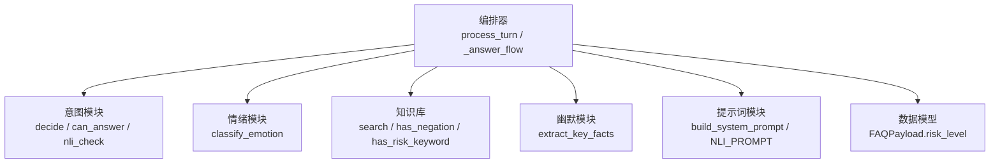
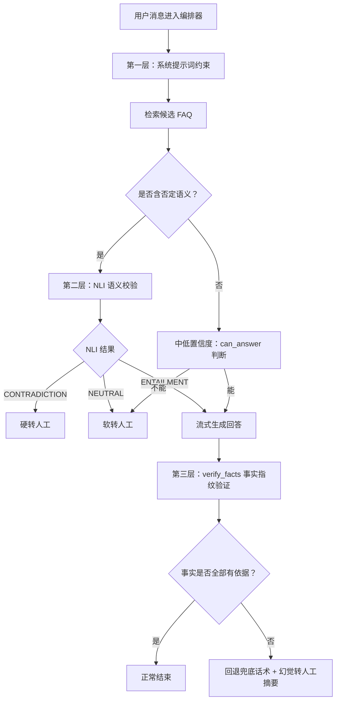
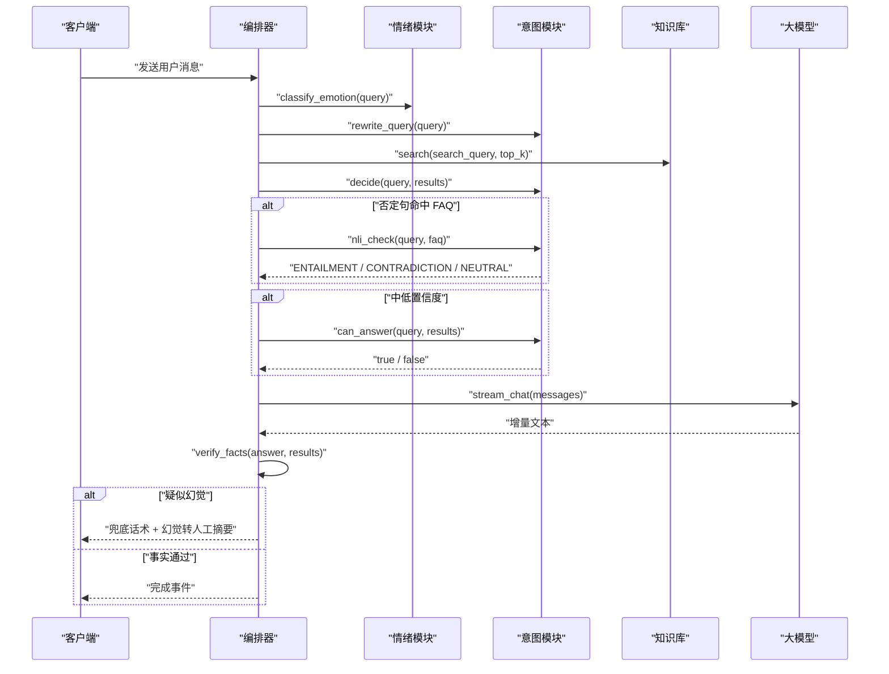
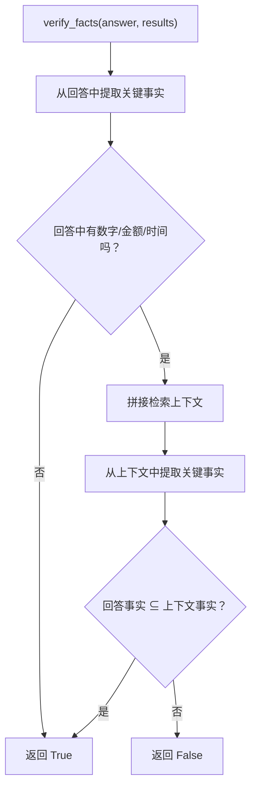
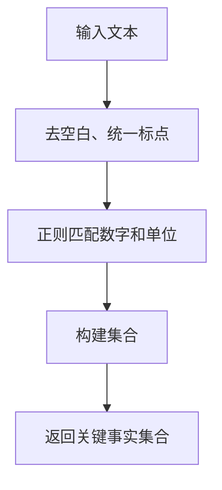
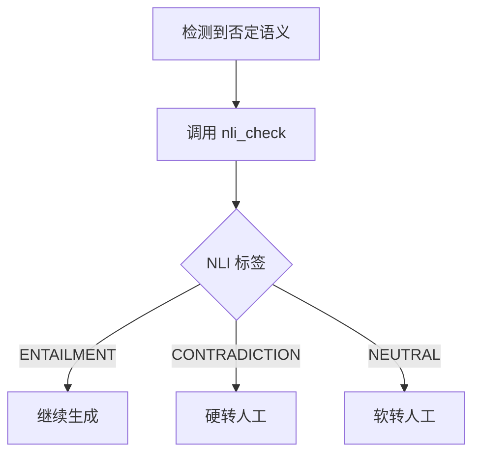
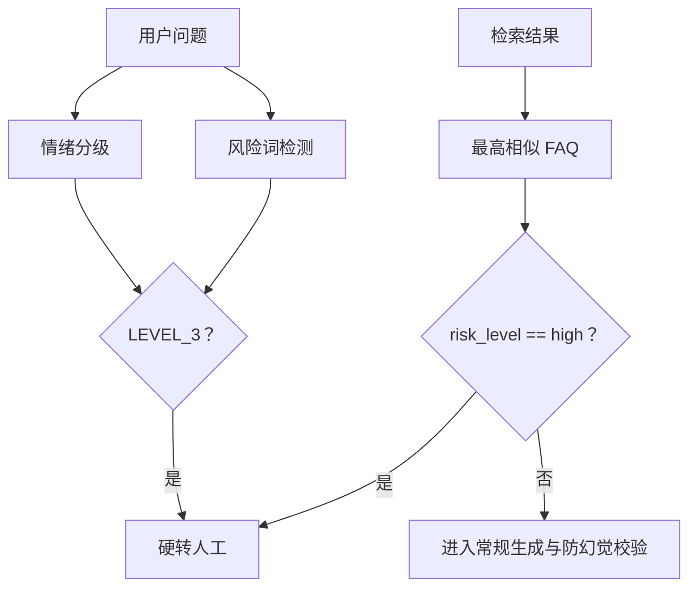
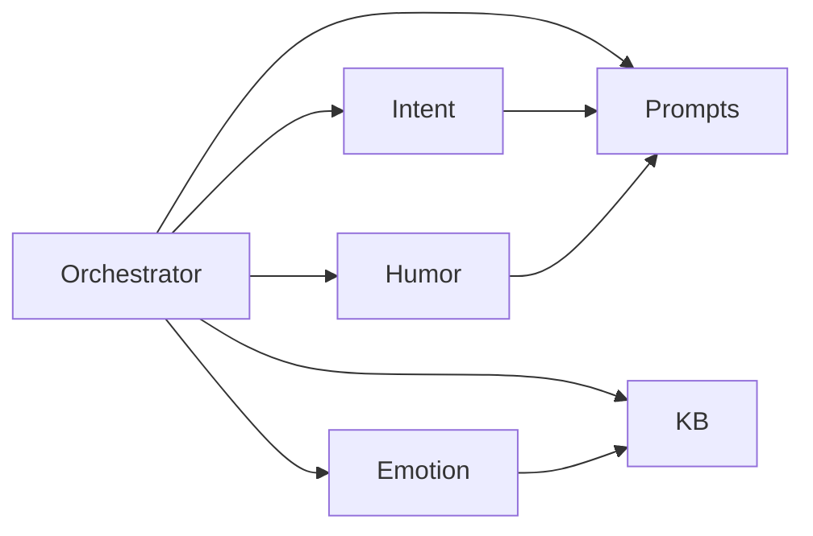

# 防幻觉三重防护机制

<cite>
**本文引用的文件**   
- [orchestrator.py](file://backend/app/agent/orchestrator.py)
- [intent.py](file://backend/app/agent/intent.py)
- [humor.py](file://backend/app/agent/humor.py)
- [prompts.py](file://backend/app/agent/prompts.py)
- [emotion.py](file://backend/app/agent/emotion.py)
- [kb.py](file://backend/app/storage/kb.py)
- [schemas.py](file://backend/app/models/schemas.py)
</cite>

## 目录
1. [引言](#引言)
2. [项目结构定位](#项目结构定位)
3. [三层防护总览](#三层防护总览)
4. [核心组件与职责](#核心组件与职责)
5. [架构流程图](#架构流程图)
6. [详细组件分析](#详细组件分析)
7. [依赖关系分析](#依赖关系分析)
8. [性能与成本特性](#性能与成本特性)
9. [故障排查指南](#故障排查指南)
10. [结论](#结论)

## 引言
本文件面向客服 Agent 管线中的“防幻觉”能力，系统性解释三层防护如何协同工作：
- 第一层：Prompt 约束。通过系统提示词强制 LLM 只使用检索上下文中的事实，禁止编造、推测和模糊表达。
- 第二层：NLI 否定句语义校验。对含否定语义的用户问题，先判断 FAQ 答案是否与用户意图相反；CONTRADICTION 直接转人工，NEUTRAL 走软转人工澄清。
- 第三层：事实指纹验证。LLM 生成回答后，提取其中的数字、金额、时间等关键事实，并检查这些事实是否能在检索上下文中找到依据；否则视为疑似幻觉，回退兜底话术并标记转人工。

该机制贯穿 `process_turn` 主流程、`_answer_flow` 生成流程、`verify_facts` 输出校验、`extract_key_facts` 关键事实抽取，以及情绪分级、高风险 FAQ 拦截等多个环节。

**章节来源**
- [orchestrator.py:1-120](file://backend/app/agent/orchestrator.py#L1-L120)
- [prompts.py:1-120](file://backend/app/agent/prompts.py#L1-L120)

## 项目结构定位
防幻觉机制主要分布在以下模块：
- 编排器：串联情绪识别、查询重写、检索、置信度决策、生成、输出校验和转人工。
- 意图模块：实现查询重写、可回答性判断、NLI 语义校验。
- 幽默模块：实现关键事实指纹抽取与润色一致性校验。
- 提示词模块：定义系统 Prompt、NLI Prompt、幽默润色 Prompt、情绪分级 Prompt 等。
- 知识库模块：提供 FAQ 模型、风险词检测、否定词检测、检索融合等。
- 情绪模块：LLM 情绪分级 + 关键词兜底。
- 数据模型：FAQ payload 中包含 `risk_level`，用于高风险问答分流。

**图表来源**
- [orchestrator.py:1-120](file://backend/app/agent/orchestrator.py#L1-L120)
- [intent.py:1-130](file://backend/app/agent/intent.py#L1-L130)
- [humor.py:1-55](file://backend/app/agent/humor.py#L1-L55)
- [prompts.py:1-200](file://backend/app/agent/prompts.py#L1-L200)
- [kb.py:1-316](file://backend/app/storage/kb.py#L1-L316)
- [schemas.py:35-70](file://backend/app/models/schemas.py#L35-L70)

**章节来源**
- [orchestrator.py:1-120](file://backend/app/agent/orchestrator.py#L1-L120)
- [intent.py:1-130](file://backend/app/agent/intent.py#L1-L130)
- [humor.py:1-55](file://backend/app/agent/humor.py#L1-L55)
- [prompts.py:1-200](file://backend/app/agent/prompts.py#L1-L200)
- [kb.py:1-316](file://backend/app/storage/kb.py#L1-L316)
- [schemas.py:1-138](file://backend/app/models/schemas.py#L1-L138)

## 三层防护总览
防幻觉不是单点检查，而是按阶段部署的防线：

| 层级 | 触发时机 | 核心逻辑 | 失败后果 |
|---|---|---|---|
| 第一层：Prompt 约束 | 生成前 | 系统提示词要求事实必须来自知识库，禁止推测、模糊词和编造 | 若被违反，由后续两层继续拦截 |
| 第二层：NLI 否定句校验 | 命中 FAQ 且用户问题含否定语义时 | 用 LLM 判断用户意图与 FAQ 答案是否矛盾或无关 | CONTRADICTION 硬转人工；NEUTRAL 软转人工 |
| 第三层：事实指纹验证 | 生成完成后 | 提取回答中的数字、金额、时间等关键事实，检查是否在检索上下文存在 | 不满足则回退兜底话术，并标记幻觉相关转人工摘要 |

**图表来源**
- [orchestrator.py:1-120](file://backend/app/agent/orchestrator.py#L1-L120)
- [orchestrator.py:201-320](file://backend/app/agent/orchestrator.py#L201-L320)
- [intent.py:60-130](file://backend/app/agent/intent.py#L60-L130)
- [humor.py:1-55](file://backend/app/agent/humor.py#L1-L55)

**章节来源**
- [orchestrator.py:1-120](file://backend/app/agent/orchestrator.py#L1-L120)
- [intent.py:60-130](file://backend/app/agent/intent.py#L60-L130)
- [humor.py:1-55](file://backend/app/agent/humor.py#L1-L55)

## 核心组件与职责
### 编排器 Orchestrator
编排器是防幻觉机制的总控入口，负责：
- 接收用户消息、历史、会话状态。
- 并行执行情绪识别与可选查询重写。
- 红灯熔断：LEVEL_3 情绪或命中风险词直接硬转人工。
- 混合检索并调用 `decide` 做置信度决策。
- 否定句走 NLI 校验。
- 高风险 FAQ 直接硬转人工。
- 调用 `_answer_flow` 生成回答，并在结束后调用 `verify_facts`。
- 根据结果输出文本、元信息、完成事件或转人工事件。

**章节来源**
- [orchestrator.py:1-120](file://backend/app/agent/orchestrator.py#L1-L120)
- [orchestrator.py:201-404](file://backend/app/agent/orchestrator.py#L201-L404)

### 意图模块 Intent
意图模块承担“检索后决策”和“语义方向校验”：
- `rewrite_query`：将口语化问题改写为标准问法，仅用于提升检索召回。
- `decide`：基于相似度阈值和否定词检测，返回 answer、ask_llm、handover 或 confirming。
- `can_answer`：中置信度路径下，让 LLM 判断知识库能否完整回答问题。
- `nli_check`：对用户问题和 FAQ 答案做蕴含判断，返回 ENTAILMENT、CONTRADICTION 或 NEUTRAL。

**章节来源**
- [intent.py:1-130](file://backend/app/agent/intent.py#L1-L130)

### 幽默模块 Humor
幽默模块提供关键事实指纹抽取能力，并被两个地方复用：
- 幽默润色时，比较润色前后关键事实集合，不一致则回退事实版。
- 第三层防幻觉中，比较回答与检索上下文的关键事实集合。

**章节来源**
- [humor.py:1-55](file://backend/app/agent/humor.py#L1-L55)

### 提示词模块 Prompts
提示词模块定义防幻觉所需的核心指令：
- `build_system_prompt`：第一层防线，要求事实 100% 来自知识库，禁止编造、推测和模糊词。
- `NLI_PROMPT`：让 LLM 输出 ENTAILMENT / CONTRADICTION / NEUTRAL。
- `CAN_ANSWER_PROMPT`：让 LLM 输出 true/false 表示能否回答。
- `POLISH_PROMPT`：允许调整语气，但严禁改动数字、时间、金额、规则等关键信息。
- 其他情绪、意图、记忆、转人工摘要等提示词。

**章节来源**
- [prompts.py:1-200](file://backend/app/agent/prompts.py#L1-L200)

### 情绪模块 Emotion
情绪模块决定对话红线：
- 优先调用 LLM 分类 LEVEL_0 ~ LEVEL_3。
- LLM 异常时回退到预设红黄关键词。
- 结合知识库风险词检测，进一步兜住极端场景。

**章节来源**
- [emotion.py:1-47](file://backend/app/agent/emotion.py#L1-L47)

### 知识库模块 KB
知识库模块提供：
- FAQ 数据结构，包含 `risk_level`。
- 否定词模式匹配 `has_negation`。
- 风险词匹配 `has_risk_keyword`。
- 确认/否认关键词匹配 `is_confirmation` / `is_denial`。
- TF-IDF + BM25 + RRF 混合检索。

**章节来源**
- [kb.py:1-316](file://backend/app/storage/kb.py#L1-L316)

### 数据模型 Schemas
FAQ payload 明确区分低风险、中风险、高风险：
- `risk_level` 为 `low`、`mid`、`high`。
- 高风险 FAQ 在编排器中被直接拦截，不走普通回答流程。

**章节来源**
- [schemas.py:35-70](file://backend/app/models/schemas.py#L35-L70)

## 架构流程图
### 主流程时序图

**图表来源**
- [orchestrator.py:1-120](file://backend/app/agent/orchestrator.py#L1-L120)
- [orchestrator.py:201-320](file://backend/app/agent/orchestrator.py#L201-L320)
- [intent.py:60-130](file://backend/app/agent/intent.py#L60-L130)
- [emotion.py:1-47](file://backend/app/agent/emotion.py#L1-L47)

## 详细组件分析

### verify_facts 的工作原理
`verify_facts` 是第三层防幻觉的核心函数，其输入包括：
- `answer`：LLM 生成的最终回答。
- `results`：检索到的 FAQ 结果列表。

它的工作步骤如下：
1. 从 `answer` 中提取关键事实集合。
2. 如果回答中没有可提取的关键事实，默认认为没有幻觉风险，返回 True。
3. 将检索结果拼接成上下文文本。
4. 从上下文中提取关键事实集合。
5. 判断回答中的关键事实集合是否为上下文关键事实集合的子集。
6. 只有全部子集成立时才返回 True；否则返回 False，触发兜底话术和转人工摘要。

**图表来源**
- [orchestrator.py:1-120](file://backend/app/agent/orchestrator.py#L1-L120)
- [humor.py:1-55](file://backend/app/agent/humor.py#L1-L55)

**章节来源**
- [orchestrator.py:1-120](file://backend/app/agent/orchestrator.py#L1-L120)
- [humor.py:1-55](file://backend/app/agent/humor.py#L1-L55)

### extract_key_facts 的关键事实抽取
`extract_key_facts` 的目标是从任意中文文本中抽取“数字范围 + 单位”形式的指纹，例如：
- “7 天无理由”
- “满 100 减 20”
- “24 小时发货”
- “3 次以内”

其处理过程包括：
1. 归一化文本：去除多余空白、统一冒号和括号形式。
2. 使用正则表达式匹配数字及其常见单位。
3. 将所有匹配结果转为集合，便于进行集合包含判断。

该函数被两处复用：
- 幽默润色时，确保润色后的关键事实集合包含原始关键事实集合。
- 第三层防幻觉时，确保回答中的关键事实集合完全落在检索上下文的关键事实集合内。

**图表来源**
- [humor.py:1-55](file://backend/app/agent/humor.py#L1-L55)

**章节来源**
- [humor.py:1-55](file://backend/app/agent/humor.py#L1-L55)

### NLI 否定句语义校验逻辑
当检索命中 FAQ 且用户问题包含否定语义时，编排器不会直接生成答案，而是先调用 `nli_check`。

NLI 校验的逻辑如下：
1. 使用 `NLI_PROMPT` 让 LLM 判断用户问题与 FAQ 答案之间的语义关系。
2. 如果结果为 ENTAILMENT，说明语义方向一致，继续生成。
3. 如果结果为 CONTRADICTION，说明用户问题在否定、质疑或反问 FAQ 结论，直接硬转人工。
4. 如果结果为 NEUTRAL，说明两者说的不是同一件事，走软转人工进行澄清。

**图表来源**
- [orchestrator.py:1-120](file://backend/app/agent/orchestrator.py#L1-L120)
- [intent.py:100-130](file://backend/app/agent/intent.py#L100-L130)

**章节来源**
- [intent.py:100-130](file://backend/app/agent/intent.py#L100-L130)
- [orchestrator.py:1-120](file://backend/app/agent/orchestrator.py#L1-L120)

### 与情绪识别和高危 FAQ 的联动
防幻觉机制不仅依赖生成后的事实校验，还前置了情绪和风险过滤：

#### 情绪识别联动
- 情绪等级为 LEVEL_3 时，直接硬转人工，不再进行后续生成。
- 情绪识别优先使用 LLM，失败时回退到红黄关键词。
- 风险词检测会触发 LEVEL_3 兜底，避免极端投诉漏判。

#### 高风险 FAQ 联动
- FAQ 的 `risk_level` 为 high 时，无论置信度多高，都直接硬转人工。
- 高风险 FAQ 的转人工文案可使用 FAQ 自身答案作为补充说明。

**图表来源**
- [orchestrator.py:1-120](file://backend/app/agent/orchestrator.py#L1-L120)
- [emotion.py:1-47](file://backend/app/agent/emotion.py#L1-L47)
- [kb.py:201-316](file://backend/app/storage/kb.py#L201-L316)
- [schemas.py:35-70](file://backend/app/models/schemas.py#L35-L70)

**章节来源**
- [orchestrator.py:1-120](file://backend/app/agent/orchestrator.py#L1-L120)
- [emotion.py:1-47](file://backend/app/agent/emotion.py#L1-L47)
- [kb.py:201-316](file://backend/app/storage/kb.py#L201-L316)
- [schemas.py:35-70](file://backend/app/models/schemas.py#L35-L70)

### 不同幻觉场景的检测与拦截示例
以下为典型幻觉场景及对应拦截路径（不展示具体代码内容，仅描述流程）：

| 场景 | 表现 | 触发层级 | 拦截方式 |
|---|---|---|---|
| 编造数字 | 回答中出现“7 天无理由”，但检索上下文未出现该数字 | 第三层 | `verify_facts` 返回 False，回退兜底话术 |
| 篡改金额 | 幽默润色把“满 100 减 20”改成其他金额 | 幽默一致性校验 | 关键事实集合不包含原值，回退事实版 |
| 否定语义误答 | 用户说“不支持 7 天退货对吧”，FAQ 答案却是支持退货 | 第二层 | NLI 返回 CONTRADICTION，硬转人工 |
| 否定语义无关 | 用户问题与 FAQ 答案不在同一语义方向 | 第二层 | NLI 返回 NEUTRAL，软转人工 |
| 模糊推测 | 回答使用“可能”“大概”“应该” | 第一层 | 系统提示词禁止此类表达；若仍出现，第三层继续兜底 |
| 高风险话题 | 涉及退款金额、赔偿、投诉、法律等 | 前置拦截 | 高风险 FAQ 或风险词直接硬转人工 |

**章节来源**
- [prompts.py:1-120](file://backend/app/agent/prompts.py#L1-L120)
- [intent.py:100-130](file://backend/app/agent/intent.py#L100-L130)
- [humor.py:1-55](file://backend/app/agent/humor.py#L1-L55)
- [orchestrator.py:1-120](file://backend/app/agent/orchestrator.py#L1-L120)
- [orchestrator.py:201-320](file://backend/app/agent/orchestrator.py#L201-L320)

## 依赖关系分析
防幻觉机制的依赖关系可以概括为：
- 编排器依赖意图模块、情绪模块、知识库模块、提示词模块和幽默模块。
- 意图模块依赖提示词模块和大模型接口。
- 幽默模块依赖提示词模块和大模型接口。
- 情绪模块依赖提示词模块、大模型接口和知识库风险词检测。
- 知识库模块独立提供检索、风险词、否定词等基础能力。
- 数据模型为 FAQ 的 `risk_level` 提供类型约束。

**图表来源**
- [orchestrator.py:1-120](file://backend/app/agent/orchestrator.py#L1-L120)
- [intent.py:1-130](file://backend/app/agent/intent.py#L1-L130)
- [humor.py:1-55](file://backend/app/agent/humor.py#L1-L55)
- [emotion.py:1-47](file://backend/app/agent/emotion.py#L1-L47)
- [kb.py:1-316](file://backend/app/storage/kb.py#L1-L316)
- [prompts.py:1-200](file://backend/app/agent/prompts.py#L1-L200)

**章节来源**
- [orchestrator.py:1-120](file://backend/app/agent/orchestrator.py#L1-L120)
- [intent.py:1-130](file://backend/app/agent/intent.py#L1-L130)
- [humor.py:1-55](file://backend/app/agent/humor.py#L1-L55)
- [emotion.py:1-47](file://backend/app/agent/emotion.py#L1-L47)
- [kb.py:1-316](file://backend/app/storage/kb.py#L1-L316)
- [prompts.py:1-200](file://backend/app/agent/prompts.py#L1-L200)

## 性能与成本特性
防幻觉机制在正确性和用户体验之间做了以下权衡：

| 维度 | 设计选择 | 影响 |
|---|---|---|
| 首字延迟 | 情绪识别与查询重写并行执行 | 降低无效 LLM 调用带来的等待 |
| 检索精度 | 查询重写仅用于检索，安全判断仍用原始 query | 减少语义反转导致的错误召回 |
| 幻觉拦截 | 生成后再做轻量事实指纹校验 | 避免每次检索都调用额外 LLM |
| 否定句校验 | 仅在命中 FAQ 且含否定语义时触发 | 控制 NLI 调用成本 |
| 幽默润色 | 仅售前类 + 绿灯情绪启用，且有关键事实一致性校验 | 防止风格溢出和事实篡改 |
| 高风险拦截 | 前置风险词和 risk_level 检查 | 避免高风险内容进入生成链路 |

整体而言，三层防护以“前置规则 + 轻量校验 + 生成后兜底”的方式，尽量在不显著增加延迟的前提下拦截幻觉。

[本节为通用性能讨论，不直接分析具体代码行]

## 故障排查指南
### 疑似幻觉频繁触发
现象：大量回答被回退为兜底话术，并附带幻觉相关转人工摘要。

排查要点：
- 检查检索上下文是否确实缺少回答中的数字、金额或时间。
- 检查 `extract_key_facts` 是否能正确匹配业务中的数字单位格式。
- 检查系统提示词是否被外部注入修改，导致 LLM 脱离知识库约束。
- 检查幽默润色是否被启用，并观察是否因关键事实不一致而回退。

相关位置：
- [orchestrator.py:1-120](file://backend/app/agent/orchestrator.py#L1-L120)
- [humor.py:1-55](file://backend/app/agent/humor.py#L1-L55)
- [prompts.py:1-120](file://backend/app/agent/prompts.py#L1-L120)

### NLI 误判导致过度转人工
现象：用户否定句被误判为 CONTRADICTION 或 NEUTRAL，频繁转人工。

排查要点：
- 检查 `has_negation` 的正则模式是否覆盖业务中的否定表达方式。
- 检查 NLI Prompt 是否被修改，导致 LLM 输出不稳定。
- 检查 FAQ 答案是否与用户真实诉求错位。
- 关注 `nli_check` 的异常回退逻辑：失败时默认按 ENTAILMENT 处理，可能掩盖问题。

相关位置：
- [intent.py:100-130](file://backend/app/agent/intent.py#L100-L130)
- [kb.py:201-316](file://backend/app/storage/kb.py#L201-L316)
- [prompts.py:120-200](file://backend/app/agent/prompts.py#L120-L200)

### 高风险 FAQ 未拦截
现象：应转人工的高风险问题仍被自动回答。

排查要点：
- 检查 FAQ 的 `risk_level` 是否配置为 high。
- 检查检索结果是否未能命中该 FAQ。
- 检查高风险 FAQ 的拦截逻辑是否被绕过。

相关位置：
- [schemas.py:35-70](file://backend/app/models/schemas.py#L35-L70)
- [orchestrator.py:1-120](file://backend/app/agent/orchestrator.py#L1-L120)

### 情绪分级异常
现象：极端情绪未触发红灯，或正常情绪被误判为 LEVEL_3。

排查要点：
- 检查 LLM 情绪分级输出是否符合 LEVEL_0 ~ LEVEL_3。
- 检查兜底关键词是否命中。
- 检查风险词是否干扰情绪判断。

相关位置：
- [emotion.py:1-47](file://backend/app/agent/emotion.py#L1-L47)
- [kb.py:201-316](file://backend/app/storage/kb.py#L201-L316)

**章节来源**
- [orchestrator.py:1-120](file://backend/app/agent/orchestrator.py#L1-L120)
- [orchestrator.py:201-404](file://backend/app/agent/orchestrator.py#L201-L404)
- [intent.py:100-130](file://backend/app/agent/intent.py#L100-L130)
- [humor.py:1-55](file://backend/app/agent/humor.py#L1-L55)
- [emotion.py:1-47](file://backend/app/agent/emotion.py#L1-L47)
- [kb.py:201-316](file://backend/app/storage/kb.py#L201-L316)
- [prompts.py:1-200](file://backend/app/agent/prompts.py#L1-L200)
- [schemas.py:35-70](file://backend/app/models/schemas.py#L35-L70)

## 结论
防幻觉三重防护机制通过“提示词约束 + NLI 语义校验 + 事实指纹验证”形成闭环：
- 第一层在生成前限制 LLM 的行为边界。
- 第二层在否定句场景下阻止语义相反的误答。
- 第三层在生成后确保数字、金额、时间等关键事实有检索依据。

同时，机制与情绪识别、高风险 FAQ、查询重写、幽默润色等模块紧密联动，既保证安全性，又尽量控制延迟和调用成本。对于生产环境，建议重点关注检索质量、FAQ 准确性、NLI Prompt 稳定性以及 `extract_key_facts` 对业务数字格式的覆盖程度。

[本节为总结性内容，不直接分析具体代码行]