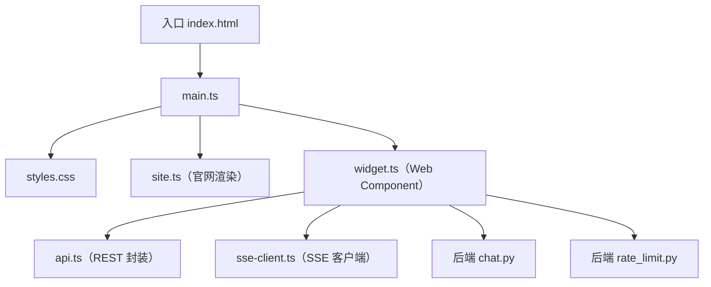
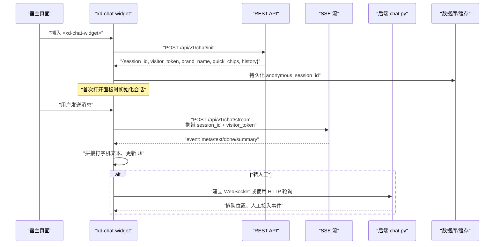
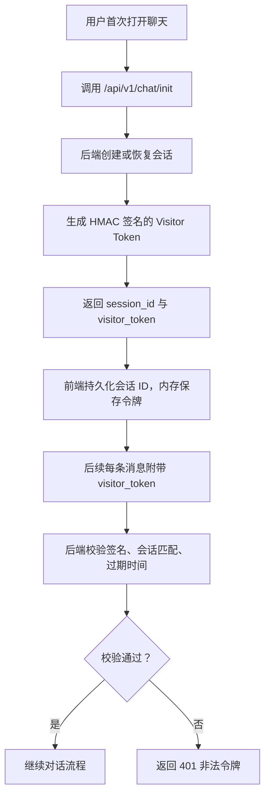
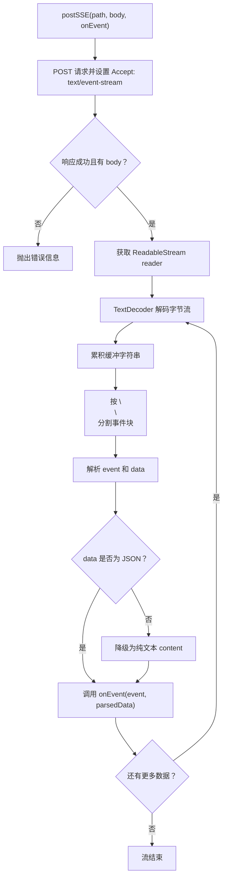
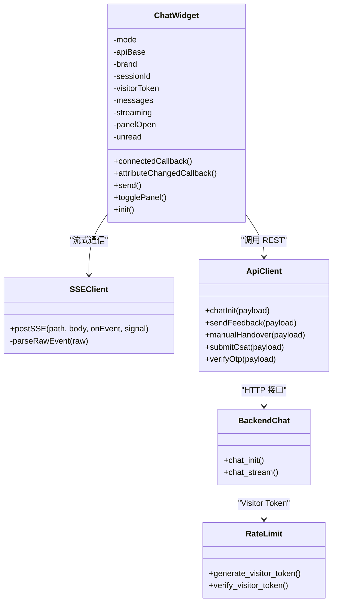

# Web Widget 聊天组件

<cite>
**本文引用的文件**   
- [frontend/src/widget.ts](file://frontend/src/widget.ts)
- [frontend/src/sse-client.ts](file://frontend/src/sse-client.ts)
- [frontend/src/api.ts](file://frontend/src/api.ts)
- [backend/app/routers/chat.py](file://backend/app/routers/chat.py)
- [backend/app/storage/rate_limit.py](file://backend/app/storage/rate_limit.py)
- [backend/app/config.py](file://backend/app/config.py)
- [frontend/index.html](file://frontend/index.html)
</cite>

## 目录
1. [简介](#简介)
2. [项目结构](#项目结构)
3. [核心组件](#核心组件)
4. [架构总览](#架构总览)
5. [详细组件分析](#详细组件分析)
6. [依赖关系分析](#依赖关系分析)
7. [性能与稳定性](#性能与稳定性)
8. [集成示例与使用方式](#集成示例与使用方式)
9. [主题、品牌与多语言](#主题品牌与多语言)
10. [故障排查](#故障排查)
11. [结论](#结论)

## 简介
本仓库中的 Web Widget 聊天组件是一个基于原生 Web Component 构建的 `xd-chat-widget`，提供两种使用形态：

- **悬浮按钮形态（floating）**：页面右下角固定浮动按钮，点击后弹出聊天面板。适合嵌入任意第三方网站，不侵入宿主布局。
- **内嵌面板形态（inline）**：作为普通块级元素渲染在父容器中，适合官网 Hero 演示区或特定业务页面。

组件通过 Shadow DOM 实现样式隔离，避免被宿主站点 CSS 污染；通过 POST + SSE 流式协议与后端对话服务通信；通过 Visitor Token 机制绑定会话并防止未授权访问；同时支持转人工排队、CSAT 满意度打分、OTP 敏感操作二次验证等 V2.0 能力。

## 项目结构
前端部分中与聊天组件直接相关的代码集中在 `frontend/src`：



**图表来源**
- [frontend/index.html:1-14](file://frontend/index.html#L1-L14)
- [frontend/src/main.ts:1-6](file://frontend/src/main.ts#L1-L6)
- [frontend/src/widget.ts:1-200](file://frontend/src/widget.ts#L1-L200)
- [frontend/src/sse-client.ts:1-59](file://frontend/src/sse-client.ts#L1-L59)
- [frontend/src/api.ts:1-200](file://frontend/src/api.ts#L1-L200)
- [backend/app/routers/chat.py:1-200](file://backend/app/routers/chat.py#L1-L200)
- [backend/app/storage/rate_limit.py:1-74](file://backend/app/storage/rate_limit.py#L1-L74)

**章节来源**
- [frontend/index.html:1-14](file://frontend/index.html#L1-L14)
- [frontend/src/main.ts:1-6](file://frontend/src/main.ts#L1-L6)

## 核心组件
`ChatWidget` 继承自原生 `HTMLElement`，以 Web Component 形式暴露给宿主页面。它对外暴露三个关键属性：

| 属性 | 类型 | 默认值 | 说明 |
|---|---|---:|---|
| `mode` | `"floating" \| "inline"` | `"floating"` | 控制悬浮按钮形态还是内嵌面板形态 |
| `api-base` | `string` | `""` | 后端 API 基地址，空字符串表示同源走代理 |
| `brand` | `string` | `"小答"` | 品牌名，初始化失败时回退为默认值 |

组件内部维护以下状态：

| 字段 | 类型 | 作用 |
|---|---|---|
| `sessionId` | `string` | 当前会话 ID，持久化到本地存储 |
| `visitorToken` | `string` | 后端下发的访客令牌，用于后续消息校验 |
| `messages` | `ChatMsg[]` | 本地消息历史，用于重放和断线恢复 |
| `streaming` | `boolean` | 是否正在接收流式响应 |
| `panelOpen` | `boolean` | 面板是否展开 |
| `unread` | `number` | 悬浮模式下未读计数 |
| `csatShown` / `otpShown` | `boolean` | 每个会话仅展示一次 CSAT 卡片和 OTP 卡片 |

组件通过 `connectedCallback` 注册按钮点击、输入框回车、关闭按钮等交互事件；通过 `render()` 把 HTML 模板和样式注入 Shadow DOM；通过 `init()` 调用 `/api/v1/chat/init` 完成会话创建、历史加载和 Visitor Token 下发。

**章节来源**
- [frontend/src/widget.ts:1-200](file://frontend/src/widget.ts#L1-L200)
- [frontend/src/widget.ts:201-500](file://frontend/src/widget.ts#L201-L500)

## 架构总览
聊天组件的整体数据流如下：



**图表来源**
- [frontend/src/widget.ts:201-500](file://frontend/src/widget.ts#L201-L500)
- [frontend/src/sse-client.ts:1-59](file://frontend/src/sse-client.ts#L1-L59)
- [backend/app/routers/chat.py:1-200](file://backend/app/routers/chat.py#L1-L200)

## 详细组件分析

### Web Component 与 Shadow DOM 样式隔离
组件通过 `attachShadow({ mode: "open" })` 创建 Shadow Root，并将全部样式和模板注入其中。这意味着：

- 宿主页面的全局样式不会穿透到聊天面板。
- 聊天组件内部也不会意外覆盖宿主页面的选择器。
- 所有类名以 `xd-` 前缀命名，降低冲突概率。
- 组件根节点使用 `all: initial` 重置浏览器默认样式，保证在不同站点中行为一致。

组件内部主要样式区域包括：

| 区域 | 职责 |
|---|---|
| `.xd-fab` | 悬浮按钮，固定在右下角，带悬停缩放动画 |
| `.xd-badge` | 悬浮模式下未读角标 |
| `.xd-panel` | 聊天主面板，悬浮模式固定定位，内联模式相对定位 |
| `.xd-header` | 品牌 Logo、标题、在线状态和关闭按钮 |
| `.xd-messages` | 滚动消息列表 |
| `.xd-bubble` | 单条消息气泡 |
| `.xd-chips` | 快捷回复标签 |
| `.xd-input-bar` | 输入框和发送按钮 |
| `.xd-disclaimer` | AI 免责声明 |
| `.xd-csat` | CSAT 满意度卡片 |
| `.xd-otp` | OTP 验证码卡片 |

**章节来源**
- [frontend/src/widget.ts:1-200](file://frontend/src/widget.ts#L1-L200)

### 悬浮按钮形态与内嵌面板形态
组件通过 `mode` 属性切换形态：

- **悬浮模式**：
  - 面板初始隐藏。
  - 右下角显示圆形悬浮按钮。
  - 未读消息会在按钮右上角显示数字角标。
  - 点击按钮展开面板，再次点击可关闭。
- **内嵌模式**：
  - 面板始终可见。
  - 移除固定定位，改为相对布局。
  - 常用于官网 Hero 演示区，便于直观展示对话效果。

面板定位算法要点：

| 属性 | 悬浮模式 | 内嵌模式 |
|---|---|---|
| `position` | `fixed` | `relative` |
| `right` | `24px` | `auto` |
| `bottom` | `92px` | `auto` |
| `z-index` | `9998` | `0` |
| `display` | 由交互控制 | 始终 `flex` |

面板尺寸采用响应式策略：宽度固定 `360px`，但最大宽度限制为视口宽度减去边距；高度固定 `560px`，最大高度限制为视口高度减去底部空间。

**章节来源**
- [frontend/src/widget.ts:1-200](file://frontend/src/widget.ts#L1-L200)

### 动画与交互细节
组件包含多种轻量动画：

| 动画 | 触发条件 | 表现 |
|---|---|---|
| 悬浮按钮缩放 | 鼠标悬停 | `transform: scale(1.06)` |
| 打字机光标闪烁 | 流式输出中 | 光标元素无限闪烁 |
| 三点跳动动画 | 机器人占位消息 | 三个圆点依次弹跳 |
| 星星评分悬停 | CSAT 卡片 | 星号放大 |
| 快捷标签悬停 | 快捷回复 | 背景色反转 |

这些动画均通过 CSS `transition` 和 `@keyframes` 实现，没有引入额外动画库，有利于在任意网站中保持轻量。

**章节来源**
- [frontend/src/widget.ts:1-200](file://frontend/src/widget.ts#L1-L200)

### Visitor Token 安全机制
Visitor Token 是聊天组件与会话之间的安全纽带。其生命周期如下：



**图表来源**
- [backend/app/routers/chat.py:60-100](file://backend/app/routers/chat.py#L60-L100)
- [backend/app/storage/rate_limit.py:38-74](file://backend/app/storage/rate_limit.py#L38-L74)

具体机制：

1. **令牌生成**
   - 载荷包含会话 ID 和过期时间戳。
   - 使用 Base64 URL Safe 编码。
   - 使用 HMAC-SHA256 对载荷签名。
   - 最终格式为 `payload.signature`。

2. **令牌验证**
   - 后端解析载荷和签名。
   - 使用恒定时间比较函数防止时序攻击。
   - 校验载荷中的会话 ID 是否与请求参数一致。
   - 检查令牌是否已过期。
   - 任一校验失败即拒绝请求。

3. **会话绑定**
   - 前端将匿名会话 ID 写入本地存储，键名为 `xd_anonymous_session_id`。
   - 下次刷新页面时复用同一会话 ID。
   - 若已有登录用户，后端可将匿名会话绑定到真实用户。

**章节来源**
- [backend/app/storage/rate_limit.py:1-74](file://backend/app/storage/rate_limit.py#L1-L74)
- [backend/app/routers/chat.py:60-100](file://backend/app/routers/chat.py#L60-L100)
- [frontend/src/widget.ts:201-300](file://frontend/src/widget.ts#L201-L300)

### SSE 客户端实现
SSE 客户端负责将 REST 请求转换为流式事件回调。它使用 `fetch` 发起 POST 请求，并通过 `ReadableStream` 逐块读取服务器推送的 `text/event-stream`。

核心流程：



**图表来源**
- [frontend/src/sse-client.ts:1-59](file://frontend/src/sse-client.ts#L1-L59)

支持的 SSE 事件类型：

| 事件 | 含义 | 前端处理 |
|---|---|---|
| `meta` | 元数据，包含状态、FAQ 命中信息、快捷回复等 | 保存最新元数据 |
| `text` | 流式文本片段 | 追加到机器人消息气泡 |
| `done` | 对话结束 | 填充 messageId、handover 标记 |
| `summary` | 转人工摘要 | 启动排队实时通道 |

**章节来源**
- [frontend/src/sse-client.ts:1-59](file://frontend/src/sse-client.ts#L1-L59)
- [frontend/src/widget.ts:300-500](file://frontend/src/widget.ts#L300-L500)

### 消息发送与流式渲染
用户发送消息后，组件会执行以下步骤：

1. 清空输入框并禁用发送按钮。
2. 将用户消息加入本地历史。
3. 创建一个机器人占位消息，显示三点跳动动画。
4. 调用 `postSSE` 发送消息。
5. 收到 `text` 事件时，动态拼接内容并滚动到底部。
6. 收到 `done` 事件时，替换占位内容为最终气泡。
7. 根据 `meta` 中的 FAQ 信息附加知识库命中徽章。
8. 如果是转人工场景，附加排队提示和 CSAT 卡片。
9. 如果触发敏感词，附加 OTP 验证码卡片。
10. 恢复发送按钮可用状态。

错误处理方面，组件会对网络异常进行友好提示，并根据错误文本区分“请求太频繁”和“网络异常”。

**章节来源**
- [frontend/src/widget.ts:300-500](file://frontend/src/widget.ts#L300-L500)

### 转人工与排队机制
当后端判定需要转人工时，会通过 `summary` 事件返回 `queue_id`。组件随后启动排队实时通道：

- 优先尝试 WebSocket 连接 `/ws/user?session_id=&visitor_token=`。
- WebSocket 成功后，实时接收排队位置和人工接入事件。
- 如果 WebSocket 不可用，则回退到 HTTP 轮询 `/api/v1/ops/queue/status`。

WebSocket 服务端会对 `visitor_token` 进行校验，校验失败直接关闭连接。坐席端通过 `/ws/agent` 接收待办广播，首帧下发待办快照。

**章节来源**
- [frontend/src/widget.ts:300-500](file://frontend/src/widget.ts#L300-L500)
- [backend/app/routers/ws.py:1-149](file://backend/app/routers/ws.py#L1-L149)

### V2.0 特性
组件实现了多个 V2.0 增强功能：

| 功能 | 说明 |
|---|---|
| 防死循环 | 连续未解决达到阈值后自动转人工 |
| 会话超时 | 30 分钟无操作自动复位会话 |
| 重复检查 | 高频问题命中缓存秒回 |
| 幽默两段式接线 | 先智能回答，再根据风险转人工 |
| OTP 验证码 | 涉及账户安全的敏感引导触发手机号验证 |
| 免责声明 | 发送区上方展示 AI 免责提示 |
| CSAT 满意度 | 转人工后弹出星级打分，每会话一次 |
| Bad Case 管理 | 后台支持标记和管理坏案例 |
| 自动化巡检 | 运营监控和运行控制 |

**章节来源**
- [frontend/src/widget.ts:1-200](file://frontend/src/widget.ts#L1-L200)
- [backend/app/routers/chat.py:1-200](file://backend/app/routers/chat.py#L1-L200)

## 依赖关系分析
聊天组件的前端依赖关系如下：



**图表来源**
- [frontend/src/widget.ts:1-200](file://frontend/src/widget.ts#L1-L200)
- [frontend/src/sse-client.ts:1-59](file://frontend/src/sse-client.ts#L1-L59)
- [frontend/src/api.ts:1-200](file://frontend/src/api.ts#L1-L200)
- [backend/app/routers/chat.py:1-200](file://backend/app/routers/chat.py#L1-L200)
- [backend/app/storage/rate_limit.py:1-74](file://backend/app/storage/rate_limit.py#L1-L74)

耦合度分析：

- `ChatWidget` 与 `ApiClient` 松耦合，通过函数式接口调用。
- `ChatWidget` 与 `SSEClient` 解耦，只依赖 `onEvent` 回调。
- 后端路由层直接依赖存储层和安全层，符合分层架构。
- Visitor Token 机制独立于业务逻辑，可复用至其他需要身份绑定的接口。

潜在改进点：

- 可为 `postSSE` 增加重试和断线重连策略。
- 可为 `ChatWidget` 增加生命周期钩子，方便宿主框架监听组件状态。
- 可考虑将 Visitor Token 放入 Cookie 或 Authorization Header，减少明文传输风险。

**章节来源**
- [frontend/src/widget.ts:1-200](file://frontend/src/widget.ts#L1-L200)
- [frontend/src/sse-client.ts:1-59](file://frontend/src/sse-client.ts#L1-L59)
- [frontend/src/api.ts:1-200](file://frontend/src/api.ts#L1-L200)

## 性能与稳定性

### 性能优化建议
1. **Shadow DOM 样式隔离**：避免宿主 CSS 污染，减少样式计算开销。
2. **流式渲染**：SSE 分片输出，首字延迟目标低于 500ms。
3. **高频缓存**：首轮命中缓存时直接秒回，不调大模型。
4. **本地历史重放**：避免每次打开都重新拉取完整历史。
5. **按需渲染**：面板关闭时隐藏 DOM，减少渲染压力。
6. **轻量动画**：纯 CSS 动画，不引入额外 JS 动画库。
7. **输入拦截**：超长输入直接拒绝，避免无效 LLM 调用。
8. **会话上限**：30 轮硬上限控制成本。

### 稳定性保障
1. **Visitor Token 签名校验**：防止伪造会话访问。
2. **IP 限流**：令牌桶算法限制每分钟请求数。
3. **会话超时复位**：30 分钟无操作自动清理活跃状态。
4. **确认状态超时取消**：30 秒无回复自动回到自由对话。
5. **SSE 错误捕获**：网络异常时给出友好提示。
6. **WebSocket 降级**：实时通道失败时回退 HTTP 轮询。
7. **Kill Switch**：全局维护模式和全局转人工模式。

**章节来源**
- [backend/app/routers/chat.py:1-200](file://backend/app/routers/chat.py#L1-L200)
- [backend/app/storage/rate_limit.py:1-74](file://backend/app/storage/rate_limit.py#L1-L74)
- [frontend/src/sse-client.ts:1-59](file://frontend/src/sse-client.ts#L1-L59)

## 集成示例与使用方式

### 基础 HTML 集成
在任意 HTML 页面中引入组件脚本并放置标签即可：

```html
<script type="module" src="/src/widget.js"></script>
<xd-chat-widget api-base="https://your-api-domain" brand="你的品牌"></xd-chat-widget>
```

关键点：

- `api-base` 指向后端 API 基地址。
- `brand` 覆盖默认品牌名。
- 不传 `mode` 时为悬浮按钮形态。
- 传入 `mode="inline"` 时为内嵌面板形态。

**章节来源**
- [frontend/index.html:1-14](file://frontend/index.html#L1-L14)
- [frontend/src/widget.ts:1-200](file://frontend/src/widget.ts#L1-L200)

### React 集成
在 React 项目中，可以直接使用自定义元素：

```jsx
import "./styles.css";

function App() {
  return (
    <>
      <xd-chat-widget api-base="https://your-api-domain" />
    </>
  );
}
```

注意事项：

- 确保在应用启动时加载组件脚本。
- 如果使用 TypeScript，需要声明自定义元素类型。
- 建议在 `useEffect` 中监听组件事件（如需）。

### Vue 集成
Vue 项目中使用方式类似：

```vue
<template>
  <xd-chat-widget
    api-base="https://your-api-domain"
    brand="我的产品"
  />
</template>
```

注意事项：

- Vue 的 JSX 或模板中对自定义元素支持良好。
- 可通过属性传递配置项。
- 可在组件生命周期中监听 DOM 事件。

### 原生 JavaScript 集成
原生项目中可直接操作组件实例：

```js
const widget = document.createElement("xd-chat-widget");
widget.setAttribute("api-base", "https://your-api-domain");
widget.setAttribute("brand", "我的品牌");
document.body.appendChild(widget);
```

如果需要动态切换形态：

```js
widget.setAttribute("mode", "inline");
```

**章节来源**
- [frontend/src/widget.ts:1-200](file://frontend/src/widget.ts#L1-L200)

## 主题、品牌与多语言

### 品牌色配置
组件默认使用蓝色 `#0066CC` 作为品牌主色。可以通过以下方式定制：

1. **CSS 变量覆盖**：在宿主页面中定义与组件同名的 CSS 变量。
2. **属性覆盖**：通过 `brand` 属性修改品牌名称。
3. **源码扩展**：修改组件内部样式常量。

推荐做法是在宿主页面中通过 CSS 变量覆盖，避免修改组件源码。

### 主题定制清单
| 定制项 | 当前实现 | 建议扩展 |
|---|---|---|
| 品牌名 | `brand` 属性 | 支持多品牌配置对象 |
| 主色调 | 硬编码 `#0066CC` | 通过 CSS 变量注入 |
| 字体族 | 系统字体栈 | 支持自定义字体 |
| 圆角大小 | 固定 `12px` / `16px` | 通过 CSS 变量控制 |
| 阴影强度 | 固定 rgba 值 | 通过主题配置调整 |
| 图标 | 内联 SVG | 支持外部图标资源 |

### 多语言支持
当前组件文案为中文硬编码，例如：

- “你好，我是{brand}(AI客服)”
- “输入你的问题…”
- “发送”
- “AI 客服提供的信息仅供参考…”
- “本次服务体验如何？”

可扩展方案：

1. **简单方案**：通过属性传入各文案片段。
2. **中等方案**：支持 `locale` 属性，加载对应语言包。
3. **高级方案**：集成 i18n 库，支持运行时切换语言。

**章节来源**
- [frontend/src/widget.ts:1-200](file://frontend/src/widget.ts#L1-L200)
- [backend/app/config.py:1-104](file://backend/app/config.py#L1-L104)

## 故障排查

### 常见问题与解决方案

| 问题 | 可能原因 | 解决方案 |
|---|---|---|
| 聊天面板无法打开 | 后端服务未启动或 CORS 配置错误 | 检查后端是否运行，确认跨域允许 |
| 显示“连不上客服服务” | `/api/v1/chat/init` 请求失败 | 检查网络、API 路径、环境变量 |
| 消息发送无响应 | Visitor Token 校验失败 | 确认 token 与 session_id 匹配且未过期 |
| 请求太频繁 | IP 限流触发 | 等待冷却或提升限流阈值 |
| 面板样式错乱 | 宿主 CSS 冲突 | 检查是否误改组件样式，确认 Shadow DOM 隔离 |
| 悬浮按钮被遮挡 | z-index 层级问题 | 提高宿主容器 z-index 或调整组件层级 |
| 流式输出卡顿 | 网络不稳定或后端响应慢 | 检查网络，优化后端 LLM 调用 |
| 转人工排队无实时进度 | WebSocket 连接失败 | 检查防火墙，启用 HTTP 轮询降级 |
| 刷新后丢失对话 | 本地存储清除或会话过期 | 检查 localStorage，确认会话未超时 |
| 多语言显示异常 | 缺少对应语言包 | 补充语言文件或改用英文兜底 |

### 调试建议
1. 打开浏览器开发者工具 Network 面板，查看 `/api/v1/chat/init` 和 `/api/v1/chat/stream` 请求。
2. 检查 Console 中的 `[xd-chat]` 日志。
3. 确认 Visitor Token 的 payload 和 signature 是否正确。
4. 使用 curl 模拟请求测试后端接口。
5. 在生产环境开启 CORS 白名单，仅允许可信域名。

**章节来源**
- [frontend/src/widget.ts:201-500](file://frontend/src/widget.ts#L201-L500)
- [frontend/src/sse-client.ts:1-59](file://frontend/src/sse-client.ts#L1-L59)
- [backend/app/storage/rate_limit.py:1-74](file://backend/app/storage/rate_limit.py#L1-L74)

## 结论
`xd-chat-widget` 是一个轻量、可嵌入、样式隔离的 Web Component 聊天组件。它通过 Shadow DOM 确保在任何网站环境中稳定显示，通过 POST + SSE 实现低延迟流式对话，通过 Visitor Token 保障会话安全，并通过 V2.0 特性完善转人工、CSAT、OTP、免责声明等企业级能力。

对于集成方而言，只需在页面中添加一个自定义元素标签，即可快速获得完整的 AI 客服体验。对于扩展方而言，组件提供了清晰的扩展点，支持主题定制、多语言接入、事件监听和状态同步。

未来可进一步优化的方向包括：

- 增加更完善的主题配置系统。
- 支持运行时语言切换。
- 为 SSE 客户端增加断线重连和指数退避。
- 提供更丰富的组件生命周期钩子。
- 支持消息富媒体渲染和图片上传。
- 增加无障碍访问支持。