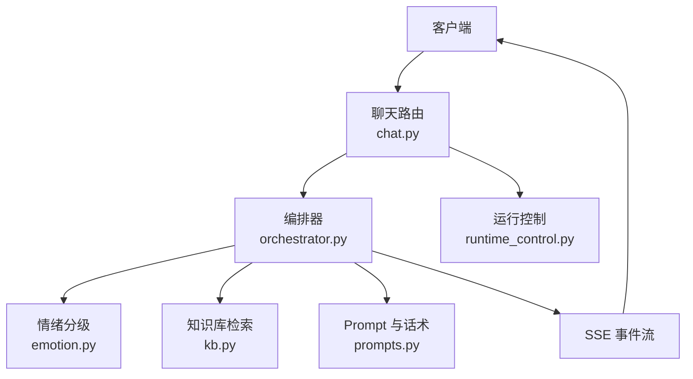
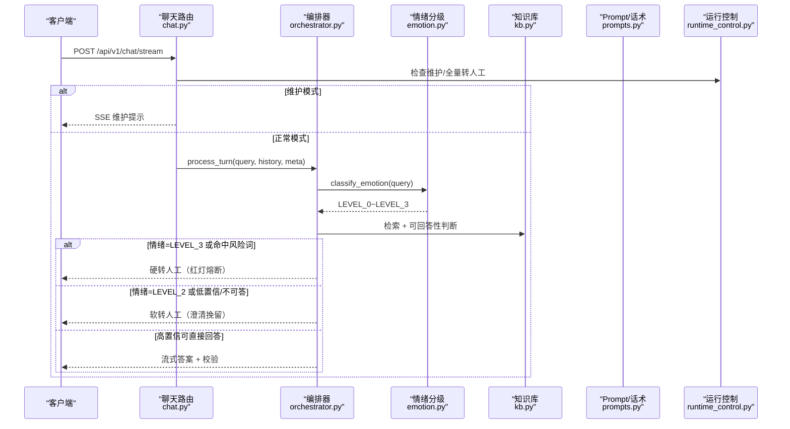
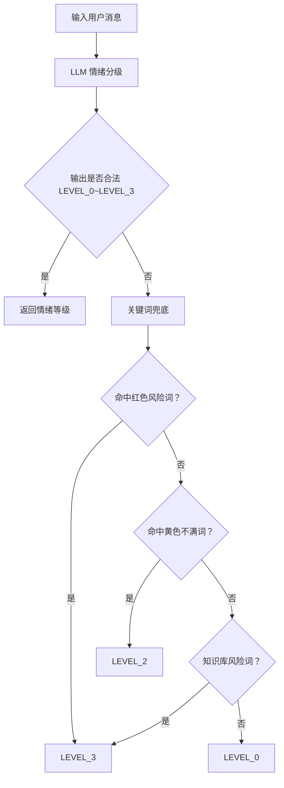
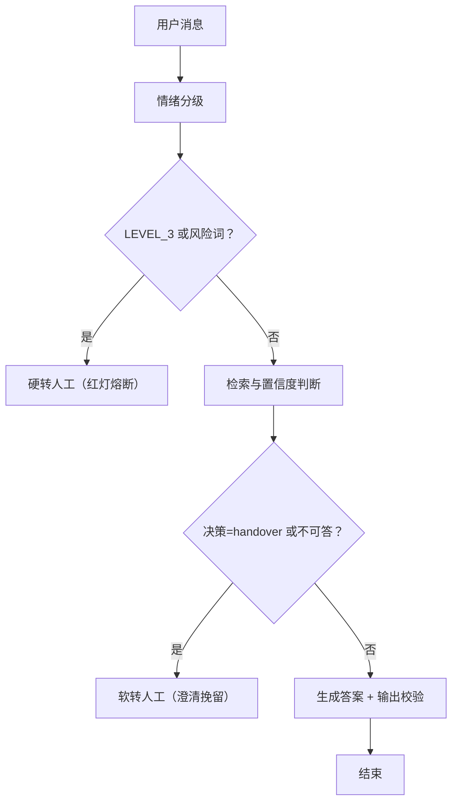
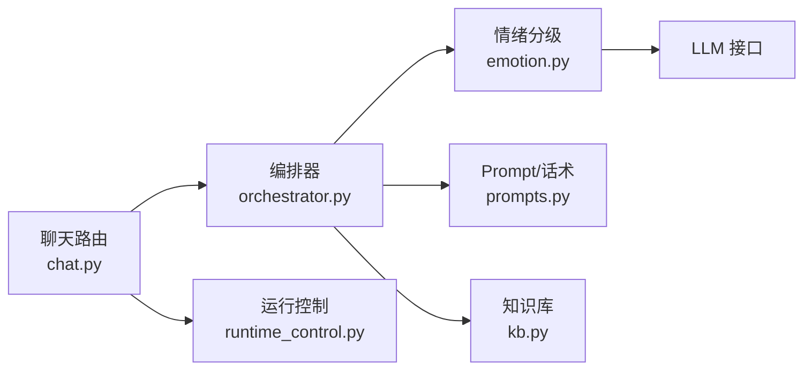

# 情绪识别与熔断机制

<cite>
**本文引用的文件**   
- [emotion.py](file://backend/app/agent/emotion.py)
- [prompts.py](file://backend/app/agent/prompts.py)
- [orchestrator.py](file://backend/app/agent/orchestrator.py)
- [chat.py](file://backend/app/routers/chat.py)
- [schemas.py](file://backend/app/models/schemas.py)
- [runtime_control.py](file://backend/app/storage/runtime_control.py)
- [config.py](file://backend/app/config.py)
</cite>

## 目录
1. [引言](#引言)
2. [项目结构定位](#项目结构定位)
3. [核心组件](#核心组件)
4. [架构总览](#架构总览)
5. [详细组件分析](#详细组件分析)
6. [依赖关系分析](#依赖关系分析)
7. [性能特征与优化建议](#性能特征与优化建议)
8. [故障排查指南](#故障排查指南)
9. [结论](#结论)
10. [附录：调参与配置清单](#附录调参与配置清单)

## 引言
本文件围绕“情绪识别与熔断机制”进行系统性说明，重点覆盖以下目标：
- 四级情绪分类体系：LEVEL_0（平静）、LEVEL_1（轻微不满）、LEVEL_2（明显愤怒）、LEVEL_3（极度激动/高风险）。
- 基于规则与 LLM 混合的情绪识别算法：关键词匹配、风险词兜底、LLM 主判。
- 熔断触发条件：LEVEL_3 或命中风险关键词时立即硬转人工；LEVEL_2 通常进入软转人工澄清挽留。
- 软转人工与硬转人工的区别、业务场景示例、Prompt 设计要点、关键词库配置方法、阈值调优建议。

该机制位于客服对话流水线中，是“检索→置信度决策→生成→输出校验→转人工”编排的关键前置环节。

**章节来源**
- [orchestrator.py:1-40](file://backend/app/agent/orchestrator.py#L1-L40)

## 项目结构定位
情绪识别与熔断相关代码集中在后端 Agent 层和路由层：
- 情绪分级逻辑在 `backend/app/agent/emotion.py`。
- Prompt 定义、话术模板、系统人设在 `backend/app/agent/prompts.py`。
- 情绪识别结果如何影响熔断与回答流程，由 `backend/app/agent/orchestrator.py` 编排。
- 会话入口、SSE 流式事件、运行控制（Kill Switch）在 `backend/app/routers/chat.py` 与 `backend/app/storage/runtime_control.py`。
- 请求响应模型、FAQ 风险等级等数据结构在 `backend/app/models/schemas.py`。
- 全局阈值、开关、超时参数在 `backend/app/config.py`。

**图表来源**
- [chat.py:1-120](file://backend/app/routers/chat.py#L1-L120)
- [orchestrator.py:1-120](file://backend/app/agent/orchestrator.py#L1-L120)
- [emotion.py:1-47](file://backend/app/agent/emotion.py#L1-L47)
- [runtime_control.py:1-83](file://backend/app/storage/runtime_control.py#L1-L83)

**章节来源**
- [chat.py:1-120](file://backend/app/routers/chat.py#L1-L120)
- [orchestrator.py:1-120](file://backend/app/agent/orchestrator.py#L1-L120)
- [emotion.py:1-47](file://backend/app/agent/emotion.py#L1-L47)
- [prompts.py:1-60](file://backend/app/agent/prompts.py#L1-L60)
- [runtime_control.py:1-83](file://backend/app/storage/runtime_control.py#L1-L83)
- [config.py:1-104](file://backend/app/config.py#L1-L104)

## 核心组件
- 情绪分级函数：接收用户消息，返回 LEVEL_0~LEVEL_3。
- 编排器：根据情绪等级、风险词、检索结果决定软转人工或硬转人工。
- Prompt 工程：情绪分级 Prompt、系统人设、幽默控制、转人工话术。
- 运行控制：全局维护模式、全局转人工模式、灰度分流。
- 配置中心：情绪相关阈值、会话轮次上限、重复未解决次数限制、查询重写开关等。

**章节来源**
- [emotion.py:1-47](file://backend/app/agent/emotion.py#L1-L47)
- [orchestrator.py:1-200](file://backend/app/agent/orchestrator.py#L1-L200)
- [prompts.py:1-120](file://backend/app/agent/prompts.py#L1-L120)
- [runtime_control.py:1-83](file://backend/app/storage/runtime_control.py#L1-L83)
- [config.py:1-104](file://backend/app/config.py#L1-L104)

## 架构总览
情绪识别与熔断的整体数据流如下：

**图表来源**
- [chat.py:80-200](file://backend/app/routers/chat.py#L80-L200)
- [orchestrator.py:80-200](file://backend/app/agent/orchestrator.py#L80-L200)
- [emotion.py:1-47](file://backend/app/agent/emotion.py#L1-L47)
- [runtime_control.py:1-83](file://backend/app/storage/runtime_control.py#L1-L83)

**章节来源**
- [chat.py:80-200](file://backend/app/routers/chat.py#L80-L200)
- [orchestrator.py:80-200](file://backend/app/agent/orchestrator.py#L80-L200)

## 详细组件分析

### 四级情绪分类体系
系统采用四级情绪标签：
- LEVEL_0：平静，正常咨询。
- LEVEL_1：轻微不满或催促。
- LEVEL_2：明显生气或投诉倾向。
- LEVEL_3：严重投诉、威胁曝光、法律与安全等高风险。

情绪分级以 LLM 为主，关键词为兜底。当 LLM 调用失败或输出异常时，回退到关键词规则。

**图表来源**
- [emotion.py:1-47](file://backend/app/agent/emotion.py#L1-L47)
- [prompts.py:40-80](file://backend/app/agent/prompts.py#L40-L80)

#### 关键实现要点
- LLM 主判：通过统一 LLM 接口调用，温度设为较低值，最大 token 很小，仅输出标签。
- 异常回退：若 LLM 输出不以 “LEVEL_” 开头或不在允许集合内，记录警告并走关键词兜底。
- 关键词策略：
  - 红色风险词：如 12315、曝光、投诉、举报、起诉、报警、诈骗、媒体等，直接 LEVEL_3。
  - 黄色不满词：如“怎么还没”“等很久”“太慢了”“什么破”“再也不买”等，直接 LEVEL_2。
  - 知识库风险词：通过 `has_risk_keyword` 再次判定，命中则 LEVEL_3。
  - 其他情况默认 LEVEL_0。

**章节来源**
- [emotion.py:1-47](file://backend/app/agent/emotion.py#L1-L47)
- [prompts.py:40-80](file://backend/app/agent/prompts.py#L40-L80)

### 熔断触发条件与处理路径
编排器根据情绪等级与风险词决定熔断类型：

- 硬转人工（红灯熔断）：
  - 情绪等级为 LEVEL_3。
  - 命中风险关键词。
  - 其他高风险场景：FAQ 风险等级为 high、否定句 NLI 矛盾等。
- 软转人工（澄清挽留）：
  - 情绪等级为 LEVEL_2。
  - 检索低置信或不可回答。
  - 用户主动要求转人工。
  - 连续多轮未解决达到阈值。

**图表来源**
- [orchestrator.py:80-200](file://backend/app/agent/orchestrator.py#L80-L200)

#### 软转人工与硬转人工的区别
- 软转人工：用于澄清挽留，先尝试确认用户意图、提供快捷回复，必要时登记排队。
- 硬转人工：用于红灯熔断，立即停止自动回答，优先安抚并转接专人处理。

两者最终都会产生 SSE 事件，包含 `handover=true` 与 `handover_reason`，便于前端展示与运营观测。

**章节来源**
- [orchestrator.py:80-200](file://backend/app/agent/orchestrator.py#L80-L200)
- [prompts.py:150-223](file://backend/app/agent/prompts.py#L150-L223)

### 情绪识别的 Prompt 设计
情绪分级 Prompt 明确四个等级的语义边界，并要求只输出标签，不输出解释。同时强调区分反讽、开玩笑、阴阳怪气，按真实情绪判断。

- 平静：正常咨询无情绪。
- 轻微不满：催促、抱怨时效。
- 明显生气：投诉倾向、负面评价。
- 严重投诉：威胁曝光、法律与安全相关。

此外，系统人设会根据情绪等级动态调整幽默策略：
- LEVEL_0：可轻松活泼，适度玩梗。
- LEVEL_1：收敛幽默，专业耐心，可加一句安抚。
- LEVEL_2/LEVEL_3：严禁玩笑与梗，只输出事实与诚恳安抚。

**章节来源**
- [prompts.py:1-120](file://backend/app/agent/prompts.py#L1-L120)

### 关键词库配置方法
当前实现使用三类关键词来源：
- 内置红色风险词列表。
- 内置黄色不满词列表。
- 知识库风险词检测接口 `has_risk_keyword`。

配置建议：
- 将高频敏感词纳入红色风险词，避免误伤但确保红灯熔断不遗漏。
- 将常见抱怨词纳入黄色不满词，提高 LEVEL_2 召回率。
- 将业务高危主题（退款金额、赔偿、责任认定、安全、法律等）纳入知识库风险词或 FAQ 风险等级为 high。
- 定期从 Bad Case 与坐席反馈中补充关键词，保持规则库时效性。

**章节来源**
- [emotion.py:1-47](file://backend/app/agent/emotion.py#L1-L47)
- [schemas.py:60-100](file://backend/app/models/schemas.py#L60-L100)

### 熔断阈值调优建议
- 重复未解决次数：
  - 配置项 `REPEAT_UNRESOLVED_LIMIT` 控制连续未解决后强制硬转人工，默认值为 2。
  - 若客户群体投诉较多，可适当降低至 1；若自助解答率高，可提高至 3。
- 会话轮次上限：
  - `SESSION_MAX_TURNS` 控制成本熔断，默认 30 轮。
  - 对高频问题较多的场景，配合缓存可缓解压力。
- 检索阈值：
  - `SIM_THRESHOLD_LOW` 与 `SIM_THRESHOLD_HIGH` 控制检索置信度区间，低区间直接转人工，高区间直接生成。
  - 切换真实 Embedding 后需重新校准。
- 查询重写开关：
  - `QUERY_REWRITE_ENABLED` 打开后可提升召回精度，但对极端情绪应保留原始 query 做安全判断。
- 情绪等级权重：
  - 对于 LEVEL_2，建议结合 NLI 与可回答性判断决定是否软转人工。
  - 对于 LEVEL_3，建议一律硬转人工，不再继续检索或生成。

**章节来源**
- [config.py:40-104](file://backend/app/config.py#L40-L104)
- [orchestrator.py:120-200](file://backend/app/agent/orchestrator.py#L120-L200)

### 实际业务场景示例
- 场景一：物流查询（平静）
  - 用户：“我的包裹到哪了？”
  - 情绪：LEVEL_0。
  - 流程：检索命中 → 高置信 → 生成答案 → 可选幽默（允许）。
- 场景二：发货延迟（轻微不满）
  - 用户：“怎么还没发货，等了三天了。”
  - 情绪：LEVEL_1。
  - 流程：检索命中 → 可回答 → 收敛幽默，语气专业耐心。
- 场景三：商品质量问题（明显愤怒）
  - 用户：“什么破东西，再也不买了。”
  - 情绪：LEVEL_2。
  - 流程：可能检索不可答或低置信 → 软转人工澄清挽留 → 登记排队。
- 场景四：威胁曝光（极度激动/高风险）
  - 用户：“我要打 12315，你们等着被曝光吧。”
  - 情绪：LEVEL_3。
  - 流程：红灯熔断 → 硬转人工 → 立即安抚并转接专人。

这些场景体现了不同情绪等级下的差异化处理：从自由对话到软转人工，再到红灯熔断。

**章节来源**
- [prompts.py:40-120](file://backend/app/agent/prompts.py#L40-L120)
- [orchestrator.py:80-200](file://backend/app/agent/orchestrator.py#L80-L200)

## 依赖关系分析
情绪识别与熔断涉及的模块耦合如下：
- 路由层依赖编排器与运行控制。
- 编排器依赖情绪分级、Prompt、知识库、LLM。
- 情绪分级依赖 LLM 与知识库风险词。
- 运行控制独立管理全局模式与灰度。

**图表来源**
- [chat.py:1-120](file://backend/app/routers/chat.py#L1-L120)
- [orchestrator.py:1-120](file://backend/app/agent/orchestrator.py#L1-L120)
- [emotion.py:1-47](file://backend/app/agent/emotion.py#L1-L47)
- [runtime_control.py:1-83](file://backend/app/storage/runtime_control.py#L1-L83)

**章节来源**
- [chat.py:1-120](file://backend/app/routers/chat.py#L1-L120)
- [orchestrator.py:1-120](file://backend/app/agent/orchestrator.py#L1-L120)
- [emotion.py:1-47](file://backend/app/agent/emotion.py#L1-L47)
- [runtime_control.py:1-83](file://backend/app/storage/runtime_control.py#L1-L83)

## 性能特征与优化建议
- 并行任务：
  - 情绪分级与查询重写并行执行，降低首字延迟。
  - 若检测到红灯熔断，取消查询重写任务，避免浪费。
- 缓存优化：
  - 首轮高频问题命中秒回缓存，不调用 LLM，目标首字 < 500ms。
- 记忆压缩：
  - 分层记忆（摘要 + 结构化事实）减少上下文膨胀，降低 LLM 成本。
- 熔断节流：
  - 会话轮次上限与重复未解决次数限制防止无限循环与成本溢出。

优化建议：
- 对情绪分级 Prompt 增加 Few-shot 示例，提升稳定性。
- 对关键词库引入权重评分，支持模糊匹配与正则扩展。
- 对 LLM 降级路径增加重试与超时保护。
- 对软转人工流程增加快速澄清模板，提高挽留成功率。

**章节来源**
- [orchestrator.py:80-200](file://backend/app/agent/orchestrator.py#L80-L200)
- [chat.py:120-200](file://backend/app/routers/chat.py#L120-L200)
- [config.py:40-104](file://backend/app/config.py#L40-L104)

## 故障排查指南
- LLM 调用失败：
  - 情绪分级会记录警告并回退关键词，观察日志中的“情绪分级调用失败”。
  - 检查 API Key、Base URL、Model 配置。
- 情绪标签异常：
  - 若 LLM 输出不以 “LEVEL_” 开头，会记录“情绪分级输出异常”，并回退关键词。
  - 检查 Prompt 是否被篡改，或 LLM 返回格式不符合预期。
- 熔断未触发：
  - 检查风险词是否在红色/黄色列表中，或知识库风险词接口是否正确返回。
  - 检查 FAQ 风险等级是否为 high，以及 NLI 判断是否误判。
- 软转人工过多：
  - 调高检索置信度阈值，或优化知识库内容质量。
  - 调整 `REPEAT_UNRESOLVED_LIMIT` 降低频繁转人工。
- 硬转人工过频：
  - 检查红色风险词是否过于宽泛，避免误伤正常咨询。
  - 调整情绪分级 Prompt，增强对反讽与玩笑的鲁棒性。

**章节来源**
- [emotion.py:1-47](file://backend/app/agent/emotion.py#L1-L47)
- [orchestrator.py:80-200](file://backend/app/agent/orchestrator.py#L80-L200)

## 结论
本系统的“情绪识别与熔断机制”以 LLM 主判、关键词兜底为核心，结合检索置信度与 NLI 语义校验，形成多层次防幻觉与风险控制。LEVEL_3 与风险词直接触发硬转人工，LEVEL_2 通常进入软转人工澄清挽留。通过 Prompt 工程、关键词库配置与阈值调优，可在保证用户体验的同时有效控制风险与成本。

## 附录：调参与配置清单
- 情绪与熔断相关配置：
  - `REPEAT_UNRESOLVED_LIMIT`：连续未解决次数阈值，默认 2。
  - `SESSION_MAX_TURNS`：会话轮次上限，默认 30。
  - `QUERY_REWRITE_ENABLED`：是否启用查询重写，默认开启。
  - `SIM_THRESHOLD_LOW` / `SIM_THRESHOLD_HIGH`：检索置信度区间。
- 运行控制：
  - `mode`：auto/handover/off。
  - `gray_percent`：灰度百分比。
- 前端快捷回复：
  - `HANDOVER_QUICK_REPLIES`：软转人工时可点击的快捷回复。

**章节来源**
- [config.py:40-104](file://backend/app/config.py#L40-L104)
- [runtime_control.py:1-83](file://backend/app/storage/runtime_control.py#L1-L83)
- [schemas.py:60-138](file://backend/app/models/schemas.py#L60-L138)