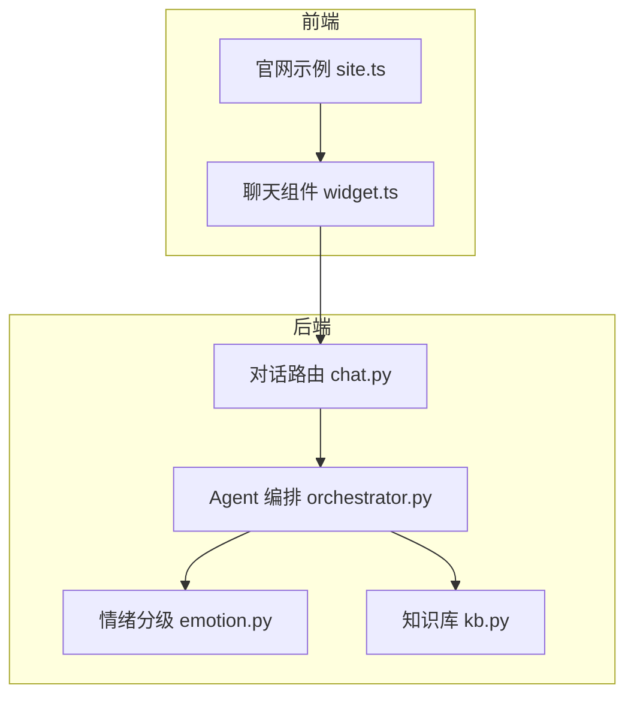
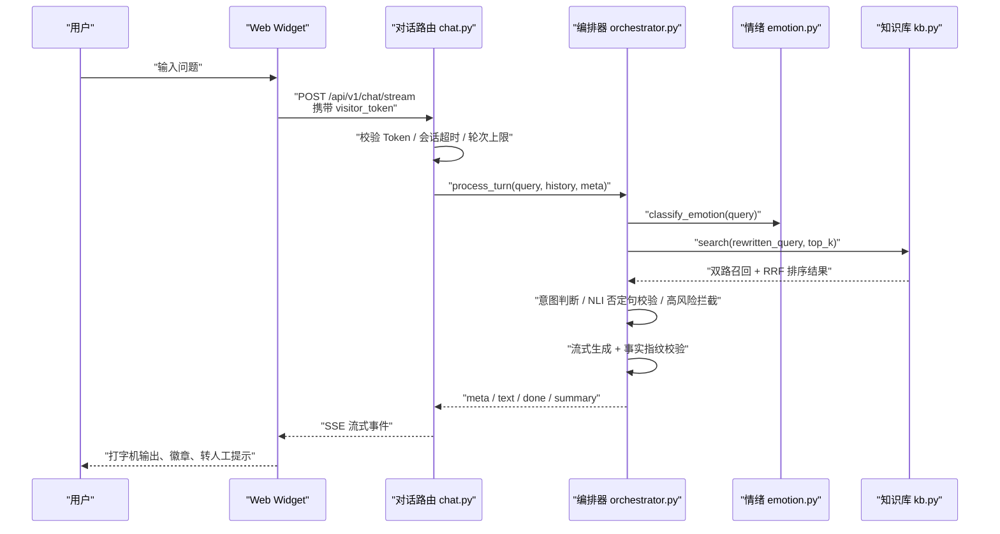
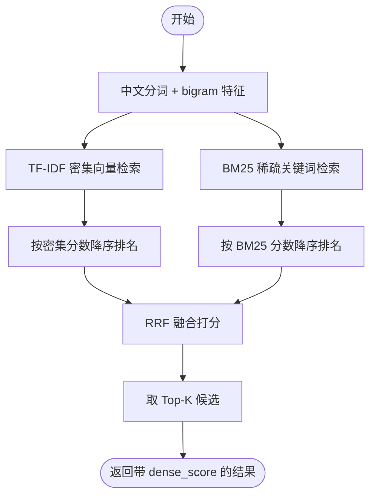
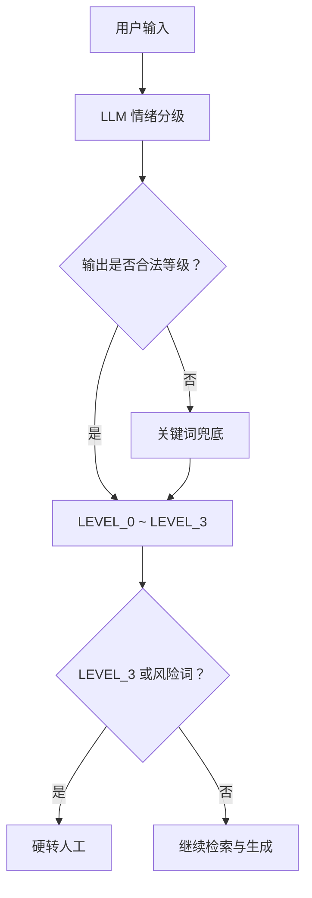
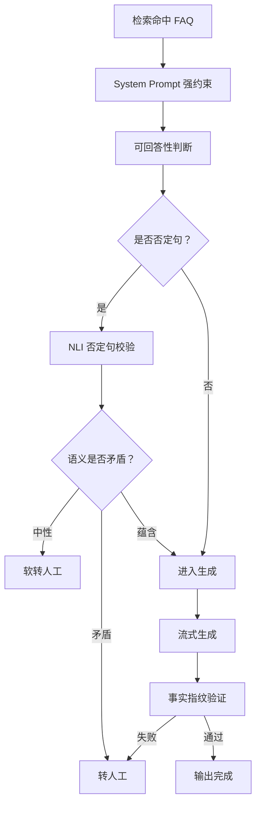
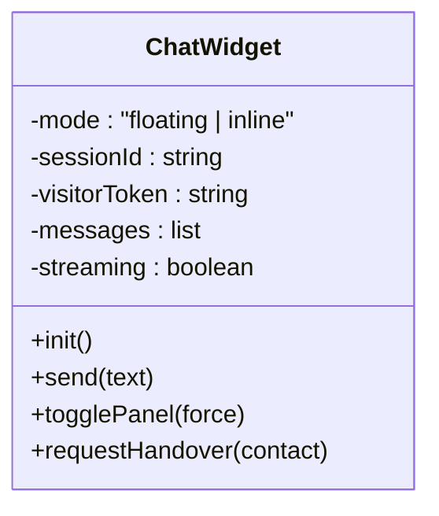
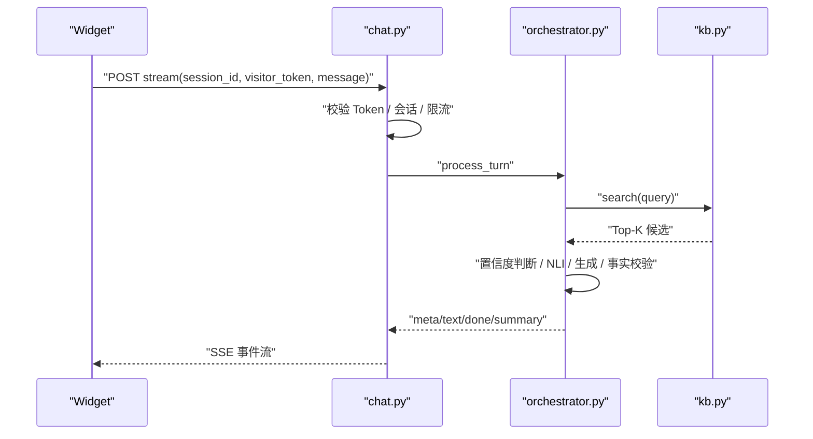
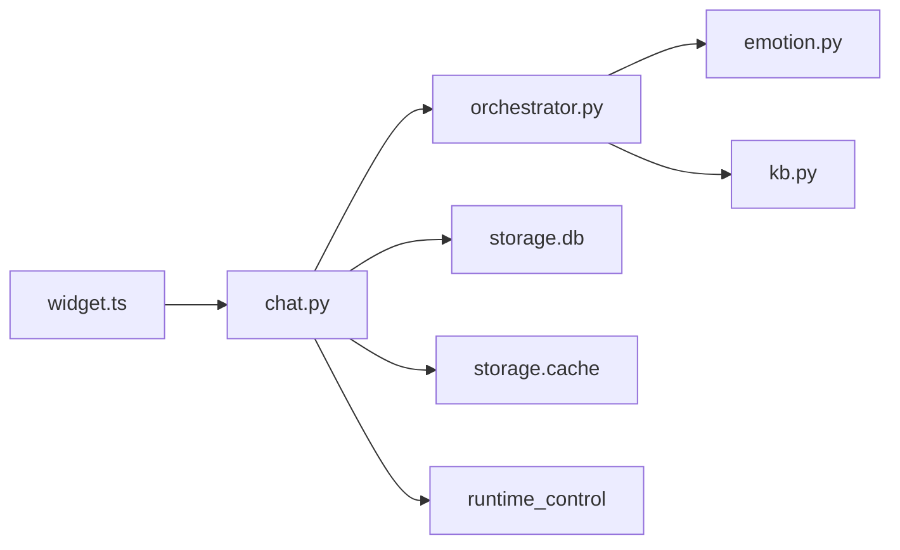

# 核心功能

<cite>
**本文引用的文件**   
- [orchestrator.py](file://backend/app/agent/orchestrator.py)
- [emotion.py](file://backend/app/agent/emotion.py)
- [kb.py](file://backend/app/storage/kb.py)
- [chat.py](file://backend/app/routers/chat.py)
- [widget.ts](file://frontend/src/widget.ts)
- [site.ts](file://frontend/src/site.ts)
</cite>

## 目录
1. [引言](#引言)
2. [项目结构](#项目结构)
3. [核心组件](#核心组件)
4. [架构总览](#架构总览)
5. [详细组件分析](#详细组件分析)
6. [依赖关系分析](#依赖关系分析)
7. [性能与容量特性](#性能与容量特性)
8. [故障排查指南](#故障排查指南)
9. [结论](#结论)

## 引言
smart_bot 是一个以 RAG 为核心的智能问答 Agent，围绕“检索增强 + 置信度决策 + 流式生成 + 三重防幻觉 + 情绪熔断 + 自动转人工”的完整闭环展开。后端基于 FastAPI 提供会话、SSE 流式对话与转人工接口；前端通过 Web Component 形式的聊天 Widget 嵌入任意站点。

本文面向两类读者：
- 希望理解智能问答引擎工作原理的技术人员；
- 需要掌握接入方式、安全机制与排障方法的运营与产品人员。

## 项目结构
仓库按领域分层组织：
- backend：FastAPI 后端服务，包含路由、Agent 编排、知识库索引、存储、运行时控制等；
- frontend：管理后台与官网示例页面，以及可嵌入站点的 Web Component；
- knowledge_base：FAQ 数据源与构建脚本；
- scripts：部署与健康检查脚本。

**图表来源**
- [site.ts:1-200](file://frontend/src/site.ts#L1-L200)
- [widget.ts:1-200](file://frontend/src/widget.ts#L1-L200)
- [chat.py:1-200](file://backend/app/routers/chat.py#L1-L200)
- [orchestrator.py:1-200](file://backend/app/agent/orchestrator.py#L1-L200)
- [emotion.py:1-47](file://backend/app/agent/emotion.py#L1-L47)
- [kb.py:1-200](file://backend/app/storage/kb.py#L1-L200)

**章节来源**
- [site.ts:1-200](file://frontend/src/site.ts#L1-L200)
- [widget.ts:1-200](file://frontend/src/widget.ts#L1-L200)
- [chat.py:1-200](file://backend/app/routers/chat.py#L1-L200)

## 核心组件
- 对话路由层：负责访客 Token 校验、会话生命周期、输入长度与轮次上限、维护层记忆、高频缓存命中秒回、SSE 事件封装与转人工排队。
- Agent 编排器：串联情绪识别、查询重写、混合检索、置信度决策、NLI 否定句校验、高风险拦截、幽默两段式生成、事实指纹校验与转人工。
- 知识库模块：实现中文分词、TF-IDF 向量检索与 BM25 关键词召回，并通过 RRF 融合重排返回候选。
- 情绪模块：LLM 为主的情绪分级，配合红黄关键词兜底。
- Web Widget：悬浮按钮与内嵌面板两种形态，Shadow DOM 样式隔离，Visitor Token 安全校验，CSAT 与 OTP 交互。

**章节来源**
- [chat.py:1-327](file://backend/app/routers/chat.py#L1-L327)
- [orchestrator.py:1-404](file://backend/app/agent/orchestrator.py#L1-L404)
- [kb.py:1-316](file://backend/app/storage/kb.py#L1-L316)
- [emotion.py:1-47](file://backend/app/agent/emotion.py#L1-L47)
- [widget.ts:1-719](file://frontend/src/widget.ts#L1-L719)

## 架构总览
下图展示从用户提问到答案生成的端到端流程，包括安全校验、检索、决策、生成与转人工分支。

**图表来源**
- [widget.ts:200-577](file://frontend/src/widget.ts#L200-L577)
- [chat.py:1-327](file://backend/app/routers/chat.py#L1-L327)
- [orchestrator.py:1-404](file://backend/app/agent/orchestrator.py#L1-L404)
- [emotion.py:1-47](file://backend/app/agent/emotion.py#L1-L47)
- [kb.py:201-316](file://backend/app/storage/kb.py#L201-L316)

## 详细组件分析

### RAG 检索增强生成与双路召回
系统采用“TF-IDF 向量检索 + BM25 关键词召回 + RRF 融合重排”的双路方案：
- 中文分词使用 jieba，并过滤停用词；同时构造 bigram 特征提升口语化变体匹配鲁棒性。
- TF-IDF 索引对问法与答案分别加权（问法权重更高），并对文档向量进行 L2 归一化。
- BM25 使用标准公式，结合平均文档长度做长度归一。
- RRF 将两个独立排序列表融合，取 Top-K 候选；返回 dense_score 用于后续置信度阈值判断。

**图表来源**
- [kb.py:1-200](file://backend/app/storage/kb.py#L1-L200)
- [kb.py:201-316](file://backend/app/storage/kb.py#L201-L316)

实际使用场景举例：
- 用户问“能退不”，系统会把“能退不”拆解为语义向量与关键词，同时命中“退换货政策”相关 FAQ；即使口语化变体也能被 bigram 与 BM25 覆盖。
- 若只命中低相似度结果，编排器会进入软转人工或确认流程，避免硬答。

**章节来源**
- [kb.py:1-200](file://backend/app/storage/kb.py#L1-L200)
- [kb.py:201-316](file://backend/app/storage/kb.py#L201-L316)

### 情绪识别与熔断机制
情绪分级由两层组成：
- 主路径：调用 LLM 根据情绪 Prompt 判定 LEVEL_0~LEVEL_3；
- 兜底路径：当 LLM 异常或输出不规范时，回退到关键词策略，直接映射到对应等级。

关键规则：
- LEVEL_3 或命中风险关键词触发红灯熔断，立即走硬转人工；
- LEVEL_2/LEVEL_3 不允许幽默，仅售前类且 LEVEL_0 才允许幽默点缀；
- 风险关键词包含投诉、报警、起诉、账号被盗等敏感词。

**图表来源**
- [emotion.py:1-47](file://backend/app/agent/emotion.py#L1-L47)
- [kb.py:201-316](file://backend/app/storage/kb.py#L201-L316)
- [orchestrator.py:1-200](file://backend/app/agent/orchestrator.py#L1-L200)

自动转人工触发条件汇总：
- 用户主动要求转人工；
- 连续多轮未解决达到阈值；
- 情绪 LEVEL_3 或风险关键词命中；
- 否定句与高置信 FAQ 语义矛盾；
- 中置信且不可回答；
- 高风险 FAQ；
- 运行控制全局转人工。

**章节来源**
- [emotion.py:1-47](file://backend/app/agent/emotion.py#L1-L47)
- [kb.py:201-316](file://backend/app/storage/kb.py#L201-L316)
- [orchestrator.py:1-200](file://backend/app/agent/orchestrator.py#L1-L200)
- [chat.py:1-327](file://backend/app/routers/chat.py#L1-L327)

### 防幻觉三重防护
系统从三个层面降低幻觉风险：

1. 生成前约束
   - System Prompt 强约束回答必须来自知识库上下文；
   - 查询先经改写为标准问法以提升检索质量；
   - 中置信时先让 LLM 做可回答性判断。

2. 否定句语义校验
   - 当用户输入含否定模式且命中 FAQ 时，使用 NLI 校验语义方向；
   - CONTRADICTION 直接转人工；NEUTRAL 软转人工；ENTAILMENT 继续生成。

3. 生成后事实指纹验证
   - 抽取回答中的数字、金额、时间等关键事实；
   - 与检索上下文抽取的事实集合比对，若不满足则视为疑似幻觉，回退到兜底话术并转人工。

**图表来源**
- [orchestrator.py:1-404](file://backend/app/agent/orchestrator.py#L1-L404)
- [kb.py:201-316](file://backend/app/storage/kb.py#L201-L316)

**章节来源**
- [orchestrator.py:1-404](file://backend/app/agent/orchestrator.py#L1-L404)
- [kb.py:201-316](file://backend/app/storage/kb.py#L201-L316)

### Web Widget 两种形态与安全机制
Widget 支持两种形态：
- floating：右下角悬浮按钮 + 弹出面板，适合任意站点快速接入；
- inline：内嵌面板，适合官网 Hero 演示区 1:1 还原设计稿。

样式隔离：
- 使用 Shadow DOM 挂载组件内部结构与样式，避免污染宿主页面；
- 所有 CSS 在组件内部声明，不受外部样式影响。

Visitor Token 安全机制：
- 初始化时后端下发 visitor_token，前端保存并在每次请求携带；
- 后端校验 visitor_token，非法请求直接拒绝；
- 手动转人工、满意度评分等敏感操作也需携带 token。

其他能力：
- CSAT 满意度打分：转人工后每会话弹出一次；
- OTP 敏感引导：涉及账户安全的对话触发手机号验证卡片；
- 免责声明：发送区上方小字明示 AI 参考性质。

**图表来源**
- [widget.ts:1-719](file://frontend/src/widget.ts#L1-L719)
- [chat.py:1-327](file://backend/app/routers/chat.py#L1-L327)

实际使用场景：
- 官网首页 Hero 区域使用 `mode="inline"` 内嵌面板，展示品牌化客服入口；
- 普通站点引入 `<xd-chat-widget mode="floating">` 一行代码即可接入；
- 用户点击悬浮按钮打开面板，首次初始化获取会话与历史消息，随后通过 SSE 接收流式回复。

**章节来源**
- [widget.ts:1-719](file://frontend/src/widget.ts#L1-L719)
- [site.ts:1-200](file://frontend/src/site.ts#L1-L200)
- [chat.py:1-200](file://backend/app/routers/chat.py#L1-L200)

### 从提问到答案的完整流程示例
以下以一个典型问题为例，说明从前端到后端的完整链路：

1. 用户在 Widget 中输入“拆了包装还能退吗”。
2. Widget 发起 POST /api/v1/chat/stream，携带 session_id、visitor_token 与 message。
3. 路由层校验 visitor_token、会话状态、输入长度与轮次上限。
4. 首轮命中高频缓存则直接秒回；否则落库用户消息并组装历史。
5. 编排器并行执行情绪识别与查询改写，然后检索知识库。
6. 若高置信命中 FAQ，进入生成流程；若中置信，先确认；若低置信或不可回答，软转人工。
7. 生成完成后进行事实指纹校验；失败则兜底并转人工。
8. 路由层把 meta、text、done、summary 事件通过 SSE 推送到前端。
9. 前端渲染打字机效果、命中徽章、转人工提示，并在转人工后弹出 CSAT。

**图表来源**
- [widget.ts:200-577](file://frontend/src/widget.ts#L200-L577)
- [chat.py:1-327](file://backend/app/routers/chat.py#L1-L327)
- [orchestrator.py:1-404](file://backend/app/agent/orchestrator.py#L1-L404)
- [kb.py:201-316](file://backend/app/storage/kb.py#L201-L316)

## 依赖关系分析
- 路由层依赖编排器、数据库、缓存、运行时控制与知识库；
- 编排器依赖情绪模块、意图模块、LLM、Prompt 模板与知识库；
- 知识库模块依赖分词与正则表达式，并提供全局单例；
- 前端 Widget 依赖 API 封装与 SSE 客户端，不直接感知后端实现细节。

**图表来源**
- [widget.ts:1-200](file://frontend/src/widget.ts#L1-L200)
- [chat.py:1-200](file://backend/app/routers/chat.py#L1-L200)
- [orchestrator.py:1-200](file://backend/app/agent/orchestrator.py#L1-L200)
- [kb.py:1-200](file://backend/app/storage/kb.py#L1-L200)

**章节来源**
- [widget.ts:1-200](file://frontend/src/widget.ts#L1-L200)
- [chat.py:1-200](file://backend/app/routers/chat.py#L1-L200)
- [orchestrator.py:1-200](file://backend/app/agent/orchestrator.py#L1-L200)
- [kb.py:1-200](file://backend/app/storage/kb.py#L1-L200)

## 性能与容量特性
- 首字响应优化：
  - 首轮高频缓存命中可直接秒回，不调用 LLM；
  - 固定话术分段推送，前端仍呈现打字机动效；
  - 情绪识别与查询改写并行执行，降低首字延迟。
- 容量保护：
  - 输入超长拦截，避免撑爆上下文；
  - 会话轮次硬上限，防止成本失控；
  - 会话 30 分钟无操作自动复位；
  - 确认状态 30 秒无回复自动取消。
- 稳定性保障：
  - 维护模式 Kill Switch 全切或半切；
  - 转人工排队与 WebSocket 广播异步执行，不阻塞 SSE；
  - 分层记忆压缩与结构化事实提取，控制上下文规模。

**章节来源**
- [chat.py:1-327](file://backend/app/routers/chat.py#L1-L327)
- [orchestrator.py:1-200](file://backend/app/agent/orchestrator.py#L1-L200)

## 故障排查指南
常见问题与定位建议：
- 收到 invalid visitor token：
  - 检查前端是否正确携带 visitor_token；
  - 检查后端 verify_visitor_token 逻辑与会话绑定。
- 一直显示“连不上客服服务”：
  - 检查前端 api-base 配置与代理；
  - 检查后端是否启动，/api/v1/chat/init 是否正常返回。
- 频繁触发转人工：
  - 检查知识库是否缺少相关 FAQ；
  - 检查是否命中风险关键词或情绪 LEVEL_3；
  - 检查是否连续多轮未解决导致防死循环触发。
- 生成内容疑似幻觉：
  - 检查 System Prompt 是否注入正确上下文；
  - 检查事实指纹验证是否失败；
  - 检查检索结果是否低置信或无关。
- 前端未显示命中徽章：
  - 检查后端 meta 中 faqs 或 faq_ids 字段；
  - 检查前端是否根据 lastMeta 渲染徽章。

**章节来源**
- [chat.py:1-327](file://backend/app/routers/chat.py#L1-L327)
- [orchestrator.py:1-404](file://backend/app/agent/orchestrator.py#L1-L404)
- [widget.ts:200-577](file://frontend/src/widget.ts#L200-L577)

## 结论
smart_bot 的核心价值在于：
- 用 RAG 与双路召回提高知识检索精度；
- 用情绪识别与熔断机制保障用户体验与安全；
- 用三重防幻觉确保回答事实可靠；
- 用自动转人工与排队机制承接复杂问题；
- 用 Web Component 与 Visitor Token 实现轻量、安全、可嵌入的前端体验。

生产落地建议：
- 先准备 30 条核心 FAQ，跑通自动应答与转人工闭环；
- 持续收集点踩与转人工 Bad Case，反哺知识库；
- 调整检索阈值、情绪关键词与转人工策略，平衡自动化率与人工作业量。