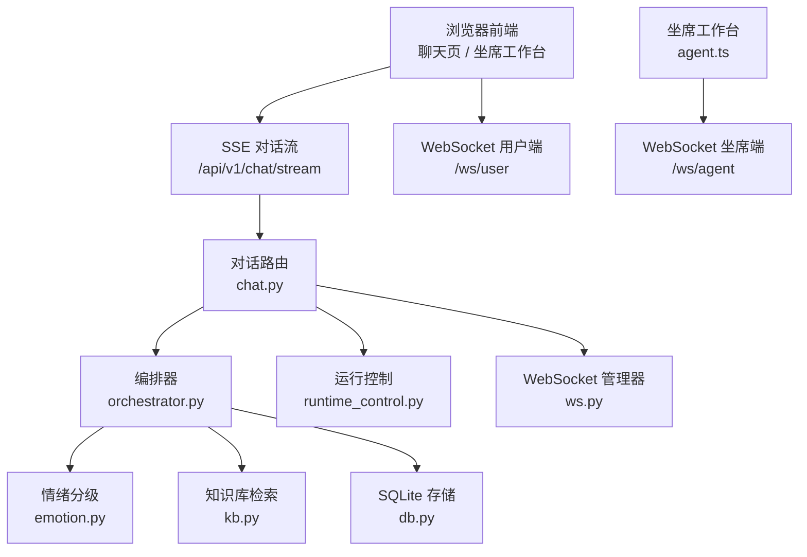
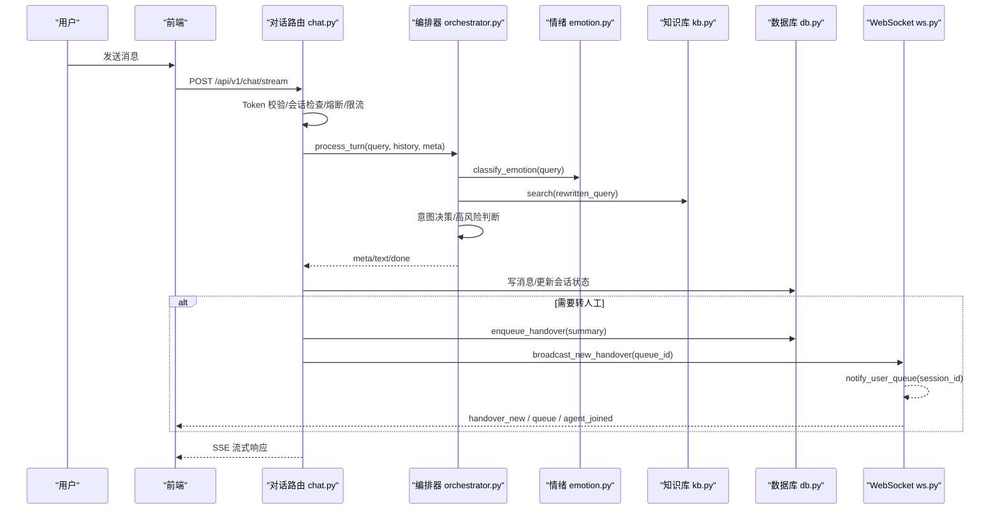
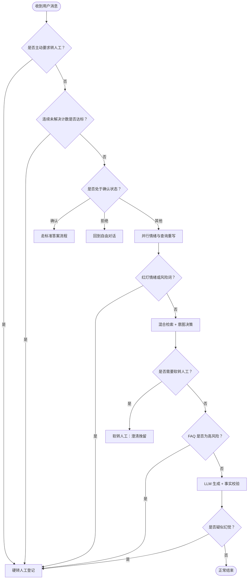
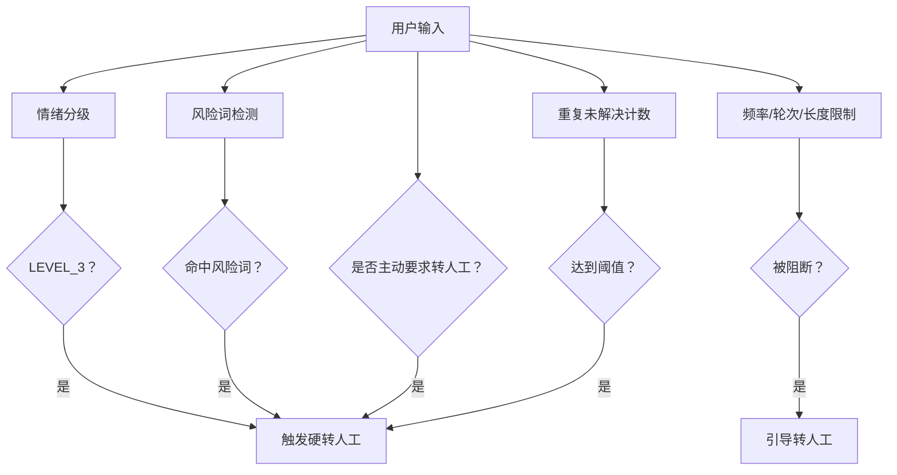
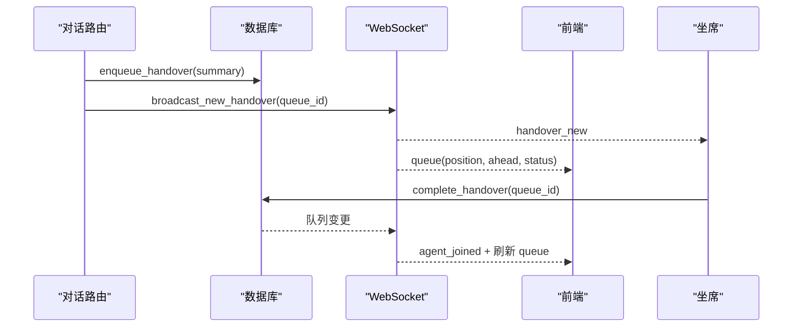
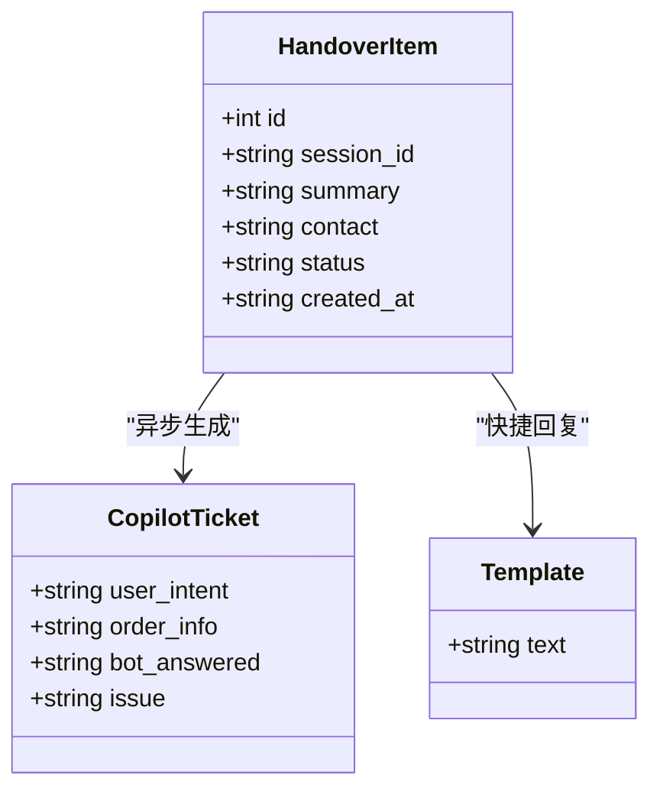
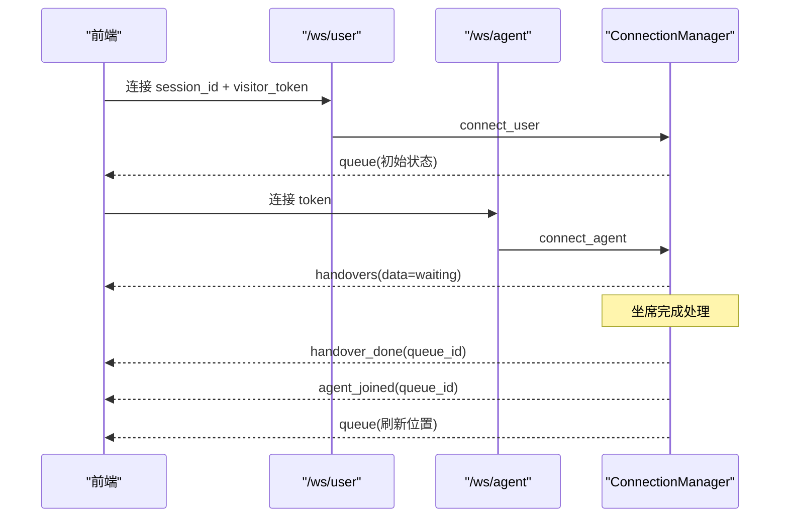
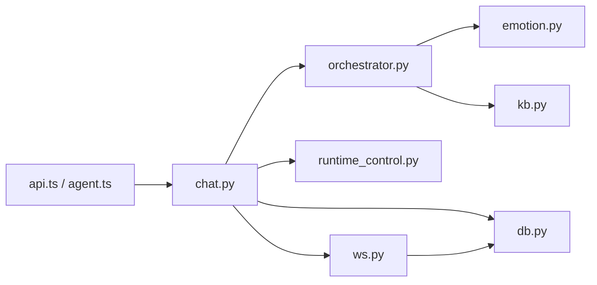

# 转人工调度系统

<cite>
**本文引用的文件**   
- [orchestrator.py](file://backend/app/agent/orchestrator.py)
- [emotion.py](file://backend/app/agent/emotion.py)
- [chat.py](file://backend/app/routers/chat.py)
- [ws.py](file://backend/app/routers/ws.py)
- [db.py](file://backend/app/storage/db.py)
- [kb.py](file://backend/app/storage/kb.py)
- [runtime_control.py](file://backend/app/storage/runtime_control.py)
- [schemas.py](file://backend/app/models/schemas.py)
- [api.ts](file://frontend/src/api.ts)
- [agent.ts](file://frontend/src/agent.ts)
</cite>

## 目录
1. [引言](#引言)
2. [项目结构](#项目结构)
3. [核心组件](#核心组件)
4. [架构总览](#架构总览)
5. [详细组件分析](#详细组件分析)
6. [依赖关系分析](#依赖关系分析)
7. [性能与容量特性](#性能与容量特性)
8. [排班策略与监控指标](#排班策略与监控指标)
9. [故障排查指南](#故障排查指南)
10. [结论](#结论)

## 引言
本仓库实现了一个面向在线客服的“转人工调度系统”。系统既支持自动问答，也支持在用户主动要求、情绪升级、高风险问题或系统熔断时转入人工服务。文档重点解释以下能力：
- 软转人工：用于低置信度回答、语义不确定或用户需要澄清时的挽留流程，先给出可选主题并允许用户确认。
- 硬转人工：用于用户明确要人、红灯情绪、风险关键词、高频未解决、高风险 FAQ 等强制场景，直接登记排队。
- 触发条件配置：情绪分级、关键词匹配、业务规则（知识库风险等级、会话轮次上限、运行模式）。
- 排队机制：队列写入、顺序排序、等待位置计算、实时状态推送和降级轮询。
- 坐席工作台：待办列表、会话上下文摘要、AI Copilot 工单卡片、快捷回复模板、历史记录查看。
- WebSocket 协议：用户端排队进度、坐席端新待办广播、完成事件。
- 调度策略调优与监控指标定义。
- 完整业务流程图与异常处理方案。

## 项目结构
后端以 FastAPI 路由为核心入口，编排器串联情绪识别、检索、意图判断、LLM 生成、输出校验与转人工；数据库使用 SQLite，提供会话、消息、反馈、CSAT 和人工排队表；WebSocket 通道负责实时排队与坐席广播；前端包含普通聊天页面、运营看板、知识库后台以及坐席工作台。

**图表来源**
- [chat.py:1-327](file://backend/app/routers/chat.py#L1-L327)
- [orchestrator.py:1-404](file://backend/app/agent/orchestrator.py#L1-L404)
- [emotion.py:1-47](file://backend/app/agent/emotion.py#L1-L47)
- [kb.py:1-316](file://backend/app/storage/kb.py#L1-L316)
- [db.py:1-566](file://backend/app/storage/db.py#L1-L566)
- [runtime_control.py:1-83](file://backend/app/storage/runtime_control.py#L1-L83)
- [ws.py:1-149](file://backend/app/routers/ws.py#L1-L149)

**章节来源**
- [chat.py:1-327](file://backend/app/routers/chat.py#L1-L327)
- [db.py:1-566](file://backend/app/storage/db.py#L1-L566)
- [ws.py:1-149](file://backend/app/routers/ws.py#L1-L149)

## 核心组件
- 对话路由层：负责访客 Token 校验、会话存在性检查、超时复位、全局熔断、输入长度和轮次上限保护、首轮缓存命中、记忆维护、转人工登记与 WebSocket 广播。
- 编排器：串联情绪分级、查询重写、混合检索、意图决策、高风险判断、LLM 生成、事实校验、软转人工和硬转人工。
- 情绪分级：优先调用 LLM 分类，失败回退到预置红黄词兜底。
- 知识库：TF-IDF 向量 + BM25 融合检索，并提供否定词、风险词检测及 FAQ 模型。
- 存储层：SQLite 管理会话、消息、反馈、CSAT、FAQ 草稿版本、Copilot 数据与排队队列。
- 运行控制：Kill Switch 三态 auto/handover/off 与灰度百分比稳定分流。
- WebSocket 管理器：用户端排队进度推送、坐席端待办快照与增量广播。
- 前端 API 封装与坐席工作台：REST 接口类型对齐、队列状态、统计、运行控制、Bad Case、CSAT、手动转人工、Copilot 操作。

**章节来源**
- [orchestrator.py:1-404](file://backend/app/agent/orchestrator.py#L1-L404)
- [emotion.py:1-47](file://backend/app/agent/emotion.py#L1-L47)
- [kb.py:1-316](file://backend/app/storage/kb.py#L1-L316)
- [db.py:1-566](file://backend/app/storage/db.py#L1-L566)
- [runtime_control.py:1-83](file://backend/app/storage/runtime_control.py#L1-L83)
- [ws.py:1-149](file://backend/app/routers/ws.py#L1-L149)
- [api.ts:1-392](file://frontend/src/api.ts#L1-L392)

## 架构总览
转人工调度系统由“对话入口 → 编排器 → 存储/WebSocket → 前端”构成。SSE 承载对话流式响应，WebSocket 承载排队与待办实时事件；运行时控制可在生产环境快速切换为全量转人工或维护下线。

**图表来源**
- [chat.py:1-327](file://backend/app/routers/chat.py#L1-L327)
- [orchestrator.py:1-404](file://backend/app/agent/orchestrator.py#L1-L404)
- [emotion.py:1-47](file://backend/app/agent/emotion.py#L1-L47)
- [kb.py:1-316](file://backend/app/storage/kb.py#L1-L316)
- [db.py:1-566](file://backend/app/storage/db.py#L1-L566)
- [ws.py:1-149](file://backend/app/routers/ws.py#L1-L149)

## 详细组件分析

### 软转人工与硬转人工的区别与应用场景
- 软转人工
  - 触发时机：意图判定为不可回答、置信度不足、NLI 中性、无匹配 FAQ、或 LLM 无法确定可答。
  - 行为特征：返回“clarifying”或“confirming”状态，展示可选主题和快捷回复；若用户继续追问或拒绝，则可能再次尝试解答或进入硬转人工。
  - 典型原因标签：低置信度、无法回答、NLI 中性、无匹配知识。
- 硬转人工
  - 触发时机：用户主动要求转人工、红灯情绪、风险关键词命中、重复未解决达到阈值、高风险 FAQ、否定矛盾等。
  - 行为特征：直接标记手转标志、输出强提示文案、快速进入排队登记；不执行复杂生成流程。

**图表来源**
- [orchestrator.py:1-404](file://backend/app/agent/orchestrator.py#L1-L404)

**章节来源**
- [orchestrator.py:201-404](file://backend/app/agent/orchestrator.py#L201-L404)

### 转人工触发条件配置方法
- 情绪阈值
  - 通过情绪分级模块将用户输入分为 LEVEL_0 至 LEVEL_3；LEVEL_3 或命中风险关键词即触发硬转人工。
  - 情绪分级优先调用 LLM，失败回退到内置红黄词列表。
- 关键词匹配
  - 知识库模块提供风险词检测；负面/否定词用于 NLI 方向判断。
- 业务规则
  - 用户主动要求转人工立即硬转。
  - 重复未解决超过阈值自动硬转。
  - FAQ 风险等级 high 时直接硬转。
  - 运行控制设置为 handover 时，所有对话直接转人工登记。
  - 会话轮次上限、输入超长、维护模式等防护也会阻断正常生成路径，必要时引导转人工。

**图表来源**
- [emotion.py:1-47](file://backend/app/agent/emotion.py#L1-L47)
- [kb.py:1-316](file://backend/app/storage/kb.py#L1-L316)
- [orchestrator.py:1-404](file://backend/app/agent/orchestrator.py#L1-L404)
- [chat.py:1-327](file://backend/app/routers/chat.py#L1-L327)
- [runtime_control.py:1-83](file://backend/app/storage/runtime_control.py#L1-L83)

**章节来源**
- [emotion.py:1-47](file://backend/app/agent/emotion.py#L1-L47)
- [kb.py:1-316](file://backend/app/storage/kb.py#L1-L316)
- [orchestrator.py:1-404](file://backend/app/agent/orchestrator.py#L1-L404)
- [chat.py:1-327](file://backend/app/routers/chat.py#L1-L327)
- [runtime_control.py:1-83](file://backend/app/storage/runtime_control.py#L1-L83)

### 排队进度跟踪机制
- 队列管理
  - 转人工后调用数据库入队，记录 session_id、摘要、联系方式、创建时间，默认状态 waiting。
  - 坐席可通过接口列出 waiting/done 队列，并将 waiting 标记为 done。
- 优先级排序
  - 当前 MVP 使用自增 id 作为顺序，list_handovers 按 id ASC 排序，体现先到先服务的简单优先级。
- 等待时间预估
  - 基于等待队列中排在目标项之前的条目数量计算 ahead；position 表示当前排名。
  - 等待时间估算可由前端根据平均处理时长乘以 ahead 近似估计。
- 实时状态更新
  - WebSocket 建连时推送当前排队状态；当有坐席完成处理时，重新通知所有用户刷新位置。
  - 前端支持 WebSocket 失败自动降级为 15 秒 HTTP 轮询。

**图表来源**
- [chat.py:201-327](file://backend/app/routers/chat.py#L201-L327)
- [db.py:201-566](file://backend/app/storage/db.py#L201-L566)
- [ws.py:1-149](file://backend/app/routers/ws.py#L1-L149)
- [agent.ts:1-303](file://frontend/src/agent.ts#L1-L303)

**章节来源**
- [db.py:201-566](file://backend/app/storage/db.py#L201-L566)
- [ws.py:1-149](file://backend/app/routers/ws.py#L1-L149)
- [agent.ts:1-303](file://frontend/src/agent.ts#L1-L303)

### 坐席工作台设计
- 待办事项列表
  - 拉取 waiting 与 done 列表，显示摘要、联系方式、创建时间和会话 ID。
  - 提供“处理完成”按钮，调用完成接口并刷新列表。
- 会话上下文注入
  - 每个待办项附带摘要，由编排器生成；后端还异步生成 Copilot 工单卡片，包含核心诉求、订单信息、Bot 已解答与未解决问题。
- 快捷回复模板
  - 坐席可点击“生成回复模板”，后端返回多条建议文本，前端提供复制功能。
- 历史记录查看
  - 通过历史消息接口读取最近对话，辅助坐席理解上下文。

**图表来源**
- [api.ts:1-392](file://frontend/src/api.ts#L1-L392)
- [agent.ts:1-303](file://frontend/src/agent.ts#L1-L303)

**章节来源**
- [api.ts:1-392](file://frontend/src/api.ts#L1-L392)
- [agent.ts:1-303](file://frontend/src/agent.ts#L1-L303)

### WebSocket 实时通信协议
- 用户端
  - 连接参数：session_id、visitor_token。
  - 事件：queue（排队位置、前面人数、状态）、agent_joined（坐席接入）。
  - 建连即推送一次当前排队状态，弥补连接前变化。
- 坐席端
  - 连接参数：token（可选，需匹配 AGENT_WS_TOKEN）。
  - 首帧：handovers(data) 下发 waiting 待办快照。
  - 事件：handover_new（新待办）、handover_done（完成）。
- 降级策略
  - 前端 WebSocket 失败自动降级为 15 秒轮询。

**图表来源**
- [ws.py:1-149](file://backend/app/routers/ws.py#L1-L149)

**章节来源**
- [ws.py:1-149](file://backend/app/routers/ws.py#L1-L149)

### 调度策略调优指南
- 情绪阈值
  - 调整情绪分级 Prompt 或关键词列表，平衡误判率与漏报率；对高危渠道可提高敏感度。
- 关键词匹配
  - 定期扩充风险词库，覆盖监管、法律、媒体曝光等敏感表达；区分行业术语避免误伤。
- 业务规则
  - 调整 REPEAT_UNRESOLVED_LIMIT、SESSION_MAX_TURNS、MAX_INPUT_LEN 等阈值，防止滥用与成本失控。
  - 使用全局 handover 模式应对突发流量或系统不稳定，保证用户不被丢弃。
- 知识库质量
  - 提升 FAQ 召回准确率可降低软转人工比例；对高风险 FAQ 明确 risk_level=high。
- 队列容量与处理能力
  - 观察 position/ahead 增长趋势，动态增加坐席或调整话术以降低排队压力。

[本节为通用指导，不涉及具体代码行]

### 监控指标定义
- 会话与转人工
  - 总会话数、自动回答占比、转人工次数、转人工率。
- 排队与处理
  - 等待队列长度、平均 ahead、最大 position、处理完成速率。
- 满意度与质量
  - CSAT 总数、平均分、评分分布；点赞/点踩总数与好评率。
- 运行控制
  - 当前模式、灰度百分比、kill_switch 标志。
- 前端类型契约
  - OpsStats、QueueStatus、RuntimeState、HandoverItem 等接口定义在前端 api.ts 中。

**章节来源**
- [db.py:201-566](file://backend/app/storage/db.py#L201-L566)
- [api.ts:1-392](file://frontend/src/api.ts#L1-L392)

## 依赖关系分析
- 对话路由依赖编排器、运行时控制、存储层与 WebSocket 管理器。
- 编排器依赖情绪模块、知识库模块与配置；内部维护幽默开关、事实校验与转人工摘要。
- 存储层提供会话、消息、反馈、CSAT、FAQ 版本、Copilot 与排队队列的能力。
- WebSocket 管理器依赖存储层获取排队状态，并维护用户与坐席连接集合。
- 前端 API 封装与后端 Pydantic 模型保持契约一致。

**图表来源**
- [chat.py:1-327](file://backend/app/routers/chat.py#L1-L327)
- [orchestrator.py:1-404](file://backend/app/agent/orchestrator.py#L1-L404)
- [emotion.py:1-47](file://backend/app/agent/emotion.py#L1-L47)
- [kb.py:1-316](file://backend/app/storage/kb.py#L1-L316)
- [db.py:1-566](file://backend/app/storage/db.py#L1-L566)
- [runtime_control.py:1-83](file://backend/app/storage/runtime_control.py#L1-L83)
- [ws.py:1-149](file://backend/app/routers/ws.py#L1-L149)
- [api.ts:1-392](file://frontend/src/api.ts#L1-L392)
- [agent.ts:1-303](file://frontend/src/agent.ts#L1-L303)

**章节来源**
- [chat.py:1-327](file://backend/app/routers/chat.py#L1-L327)
- [orchestrator.py:1-404](file://backend/app/agent/orchestrator.py#L1-L404)
- [ws.py:1-149](file://backend/app/routers/ws.py#L1-L149)

## 性能与容量特性
- 并发与延迟
  - 情绪分类与查询重写并行执行，降低首字延迟。
  - LLM 流式生成，逐步输出文本，提升用户体验。
- 缓存优化
  - 首轮命中缓存可直接秒回，不调用 LLM。
- 存储性能
  - SQLite 启用 WAL 模式，线程锁保护读写；队列查询按 id ASC 排序，适合 MVP。
- 前端降级
  - WebSocket 失败自动降级为 15 秒轮询，保障基本可用性。
- 成本保护
  - 会话轮次上限与输入长度拦截，防止上下文爆炸与恶意滥用。

**章节来源**
- [orchestrator.py:1-404](file://backend/app/agent/orchestrator.py#L1-L404)
- [chat.py:1-327](file://backend/app/routers/chat.py#L1-L327)
- [db.py:1-566](file://backend/app/storage/db.py#L1-L566)
- [agent.ts:1-303](file://frontend/src/agent.ts#L1-L303)

## 排班策略与监控指标

### 排班策略调优建议
- 阈值调参
  - 提高重复未解决阈值可减少误转人工；降低情绪阈值可更快响应投诉。
- 知识库治理
  - 补充变体问法与高风险 FAQ，提升自动回答覆盖率。
- 队列容量规划
  - 根据 ahead 增长趋势安排高峰时段坐席；设置 SLA 目标（如平均等待时间）。
- 灰度与熔断
  - 在新功能上线时使用灰度百分比逐步放量；出现异常时切换到 handover 或 off。

[本节为通用指导，不涉及具体代码行]

### 监控指标定义
- 业务指标
  - 总会话数、自动回答占比、转人工次数与比例。
- 排队指标
  - 等待队列长度、平均 ahead、最大 position、完成速率。
- 质量指标
  - CSAT 总分与分布、点赞率、点踩率。
- 运行指标
  - 运行模式、灰度百分比、kill_switch 状态。

**章节来源**
- [db.py:201-566](file://backend/app/storage/db.py#L201-L566)
- [api.ts:1-392](file://frontend/src/api.ts#L1-L392)

## 故障排查指南
- 用户无法建立 WebSocket
  - 检查 visitor_token 与 session_id 是否正确；服务端关闭码 4401 表示认证失败。
- 坐席端收不到新待办
  - 检查 AGENT_WS_TOKEN 配置；确认首帧 handovers 是否下发。
- 排队位置不更新
  - 确认坐席是否完成处理；检查 notify_user_queue 是否被调用。
- 转人工未登记
  - 检查 ChatStream 的 handover 分支是否执行；确认 enqueue_handover 返回值。
- 情绪分级异常
  - 查看日志中的 LLM 异常与关键词回退；必要时调整情绪 Prompt 或关键词列表。
- 维护模式影响业务
  - 检查 runtime mode 是否为 off；必要时切换回 auto。

**章节来源**
- [ws.py:1-149](file://backend/app/routers/ws.py#L1-L149)
- [chat.py:1-327](file://backend/app/routers/chat.py#L1-L327)
- [emotion.py:1-47](file://backend/app/agent/emotion.py#L1-L47)
- [runtime_control.py:1-83](file://backend/app/storage/runtime_control.py#L1-L83)

## 结论
该转人工调度系统在现有 RAG 与 LLM 基础上，提供了从软转人工到硬转人工的完整链路，并通过情绪分级、关键词匹配、业务规则与运行控制形成多层触发体系。排队机制采用简单可靠的 FIFO 顺序，配合 WebSocket 实时推送与前端降级轮询，保障用户体验。坐席工作台集成 AI Copilot 与快捷回复模板，提升处理效率。未来可进一步引入多实例共享状态、更复杂的优先级策略、等待时间预测与更细粒度的熔断策略，以支撑更大规模与更复杂的生产场景。