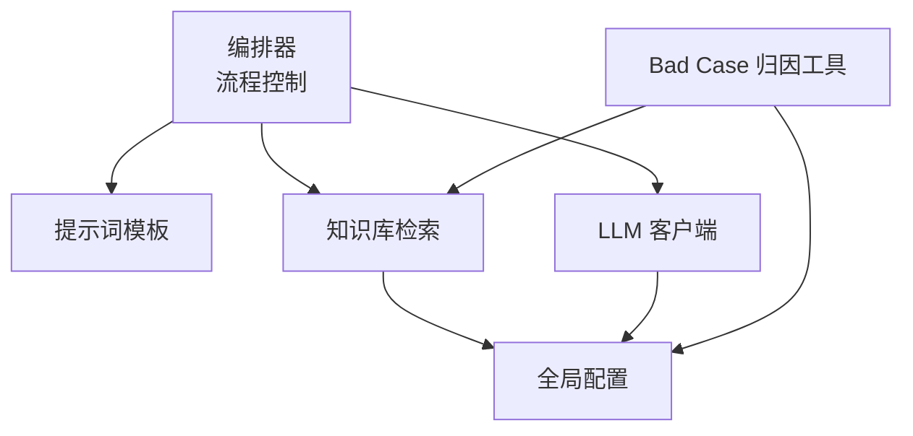
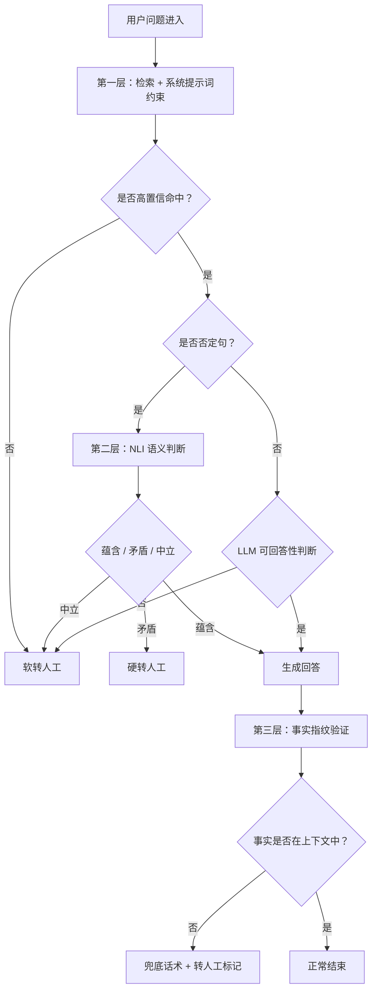
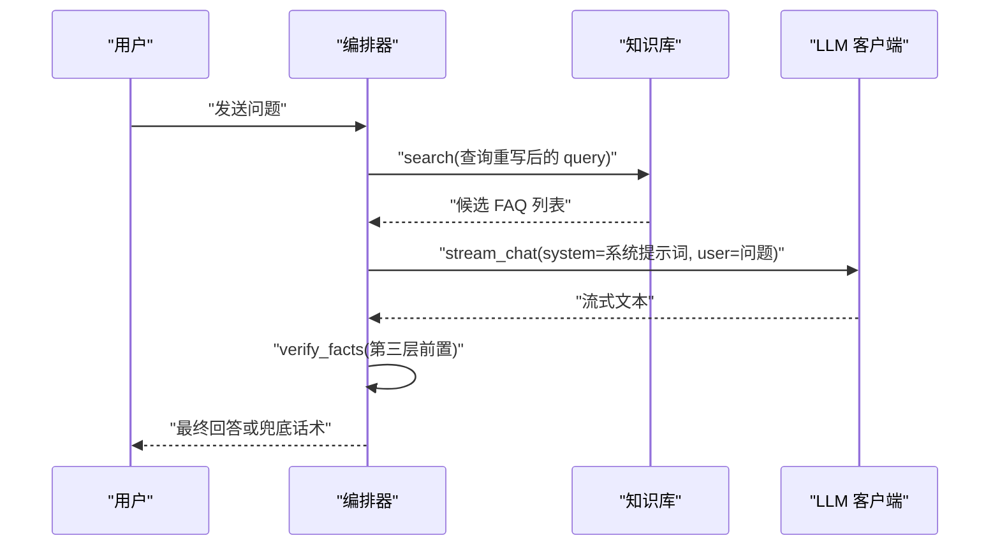
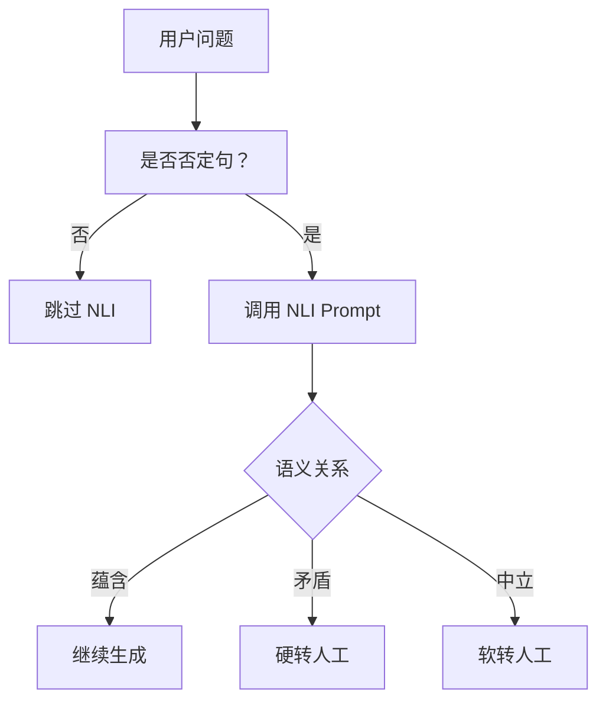
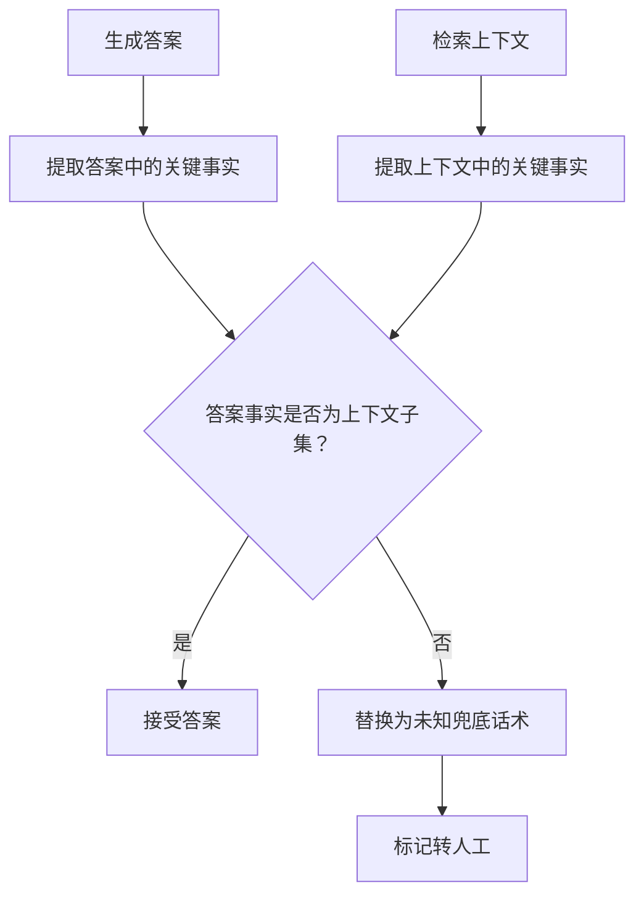
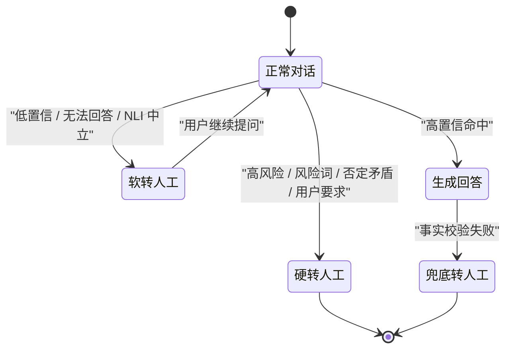
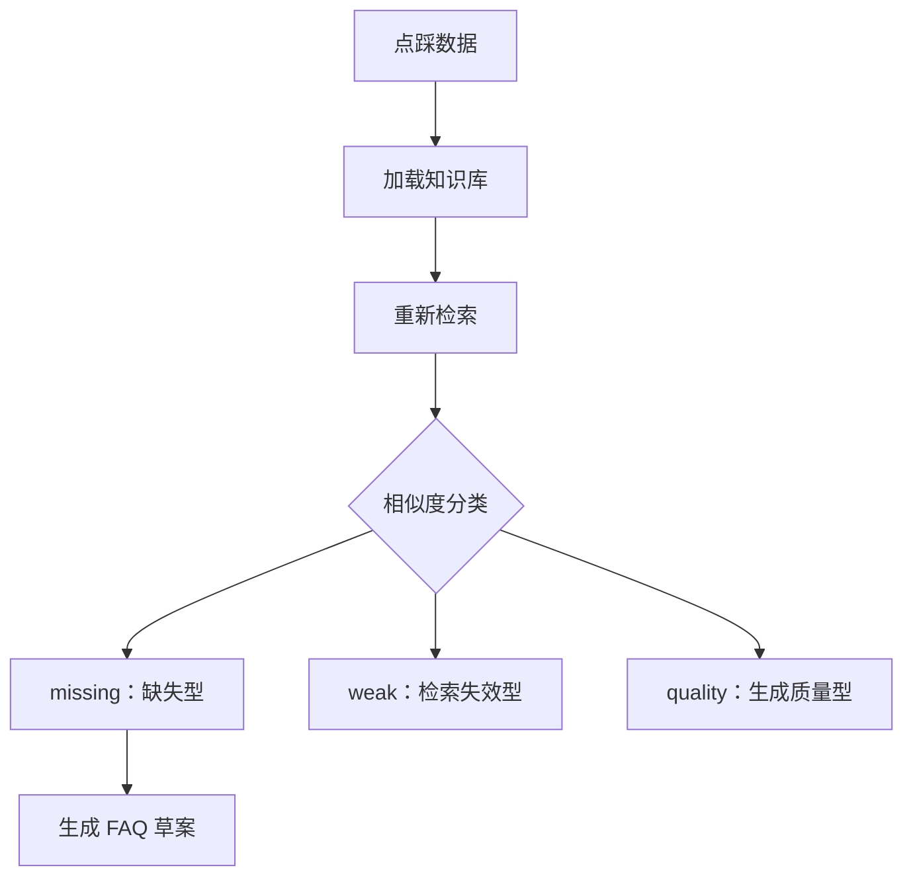
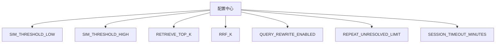
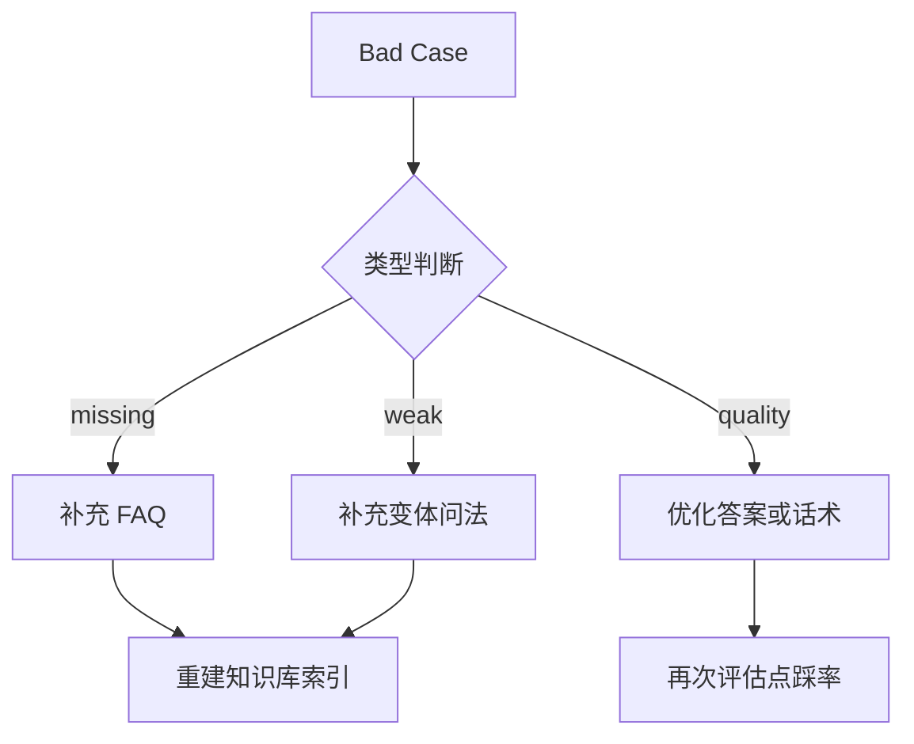
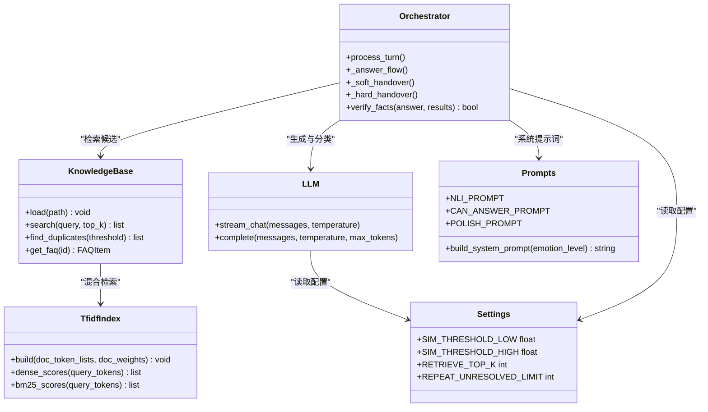

# 防幻觉三重防护

<cite>
**本文引用的文件**   
- [orchestrator.py](file://backend/app/agent/orchestrator.py)
- [prompts.py](file://backend/app/agent/prompts.py)
- [llm.py](file://backend/app/agent/llm.py)
- [kb.py](file://backend/app/storage/kb.py)
- [config.py](file://backend/app/config.py)
- [badcase_report.py](file://backend/tools/badcase_report.py)
- [faq.json](file://knowledge_base/faq.json)
- [test_v2_gaps.py](file://backend/tests/test_v2_gaps.py)
</cite>

## 目录
1. [引言](#引言)
2. [项目结构定位](#项目结构定位)
3. [三层防护总览](#三层防护总览)
4. [第一层：Prompt 约束与检索边界](#第一层prompt-约束与检索边界)
5. [第二层：NLI 否定句语义校验](#第二层nli-否定句语义校验)
6. [第三层：事实指纹验证与相似度阈值](#第三层事实指纹验证与相似度阈值)
7. [幻觉处理策略](#幻觉处理策略)
8. [评估方法与调优指南](#评估方法与调优指南)
9. [Bad Case 分析与修复案例](#bad-case-分析与修复案例)
10. [架构关系图](#架构关系图)
11. [结论](#结论)

## 引言
本文件面向客服机器人系统中的“防幻觉”能力，围绕仓库中已实现的三层防护机制展开：  
- 第一层通过系统提示词和知识库检索范围限制 LLM 的生成空间。  
- 第二层对否定类用户问题使用自然语言推理 Prompt 判断答案是否发生语义反转或无关。  
- 第三层在生成后提取关键事实并比对检索上下文，防止数字、金额、时间等实体被编造。  

同时说明降级策略（兜底话术、软转人工、硬转人工）、评估方式以及可调参数配置。

## 项目结构定位
防幻觉能力主要分布在以下模块：
- 编排器负责串联情绪分级、查询重写、检索、决策、生成、输出校验与转人工。
- Prompt 工程提供系统提示词、NLI Prompt、可回答性判断 Prompt、幽默润色 Prompt 等。
- LLM 客户端统一封装真实 DeepSeek 调用与离线 Mock 行为。
- 知识库模块实现 TF-IDF + BM25 + RRF 混合检索，并提供否定词、风险词、转人工意图等规则。
- 配置文件集中管理相似度阈值、检索 Top-K、会话超时、重复未解决上限等参数。
- Bad Case 工具基于检索相似度对点踩数据进行缺失型、弱召回型、质量型归因。

**图表来源**
- [orchestrator.py:1-120](file://backend/app/agent/orchestrator.py#L1-L120)
- [prompts.py:1-80](file://backend/app/agent/prompts.py#L1-L80)
- [kb.py:200-316](file://backend/app/storage/kb.py#L200-L316)
- [llm.py:1-177](file://backend/app/agent/llm.py#L1-L177)
- [config.py:1-104](file://backend/app/config.py#L1-L104)
- [badcase_report.py:1-120](file://backend/tools/badcase_report.py#L1-L120)

**章节来源**
- [orchestrator.py:1-120](file://backend/app/agent/orchestrator.py#L1-L120)
- [prompts.py:1-80](file://backend/app/agent/prompts.py#L1-L80)
- [kb.py:200-316](file://backend/app/storage/kb.py#L200-L316)
- [llm.py:1-177](file://backend/app/agent/llm.py#L1-L177)
- [config.py:1-104](file://backend/app/config.py#L1-L104)
- [badcase_report.py:1-120](file://backend/tools/badcase_report.py#L1-L120)

## 三层防护总览
防幻觉不是单一模型，而是由“检索边界 + 语义校验 + 生成后校验”构成的流水线：

| 层级 | 触发时机 | 核心目标 | 主要实现 | 失败时行为 |
|---|---|---|---|---|
| 第一层 | 生成前 | 限制 LLM 只依据知识库内容回答 | 系统提示词注入知识库上下文；检索先于生成 | 未命中或低置信度走软转人工；高风险直接硬转人工 |
| 第二层 | 检索后、生成前 | 防止否定句导致答案方向反转 | NLI Prompt 判断蕴含、矛盾、中立 | 矛盾则硬转人工；中立则软转人工澄清 |
| 第三层 | 生成后 | 防止数字、金额、时间等事实被编造 | 提取答案与上下文中关键事实并做集合包含检查 | 回退为未知兜底话术，并标记疑似幻觉转人工 |

**图表来源**
- [orchestrator.py:120-220](file://backend/app/agent/orchestrator.py#L120-L220)
- [prompts.py:80-160](file://backend/app/agent/prompts.py#L80-L160)
- [kb.py:200-316](file://backend/app/storage/kb.py#L200-L316)

**章节来源**
- [orchestrator.py:120-220](file://backend/app/agent/orchestrator.py#L120-L220)
- [prompts.py:80-160](file://backend/app/agent/prompts.py#L80-L160)

## 第一层：Prompt 约束与检索边界
### 设计理念
第一层防护的核心是“不让 LLM 自由发挥”。它通过两个手段缩小生成空间：
1. 检索先行：先用 TF-IDF 向量 + BM25 + RRF 融合检索候选 FAQ。
2. 提示词约束：将系统提示词中的知识库上下文、历史摘要、已确认事实与用户问题组合起来，要求 LLM 只根据这些内容回答，禁止推测和编造。

### 技术实现
- 检索入口使用 `KnowledgeBase.search`，返回带 `dense_score`、`bm25_score`、`combined` 的候选列表。
- 配置项 `SIM_THRESHOLD_LOW`、`SIM_THRESHOLD_HIGH`、`RETRIEVE_TOP_K` 决定检索召回数量和置信度区间。
- 系统提示词由 `build_system_prompt` 构建，明确要求：
  - 身份必须披露为 AI 客服。
  - 事实必须来自知识库。
  - 查不到时明确告知并转人工。
  - 不使用模糊词。
  - 高风险问题不展开处理。
- 生成流程 `_answer_flow` 把 `context`、`history`、`summary`、`facts`、`query` 注入 system 消息，再流式生成。

**图表来源**
- [orchestrator.py:200-300](file://backend/app/agent/orchestrator.py#L200-L300)
- [kb.py:250-316](file://backend/app/storage/kb.py#L250-L316)
- [prompts.py:10-70](file://backend/app/agent/prompts.py#L10-L70)

### 关键点
- 系统提示词是“生成前的防线”，但它是软约束，不能保证 LLM 绝对遵守。
- 因此需要第二层 NLI 与第三层事实校验共同补强。

**章节来源**
- [prompts.py:10-70](file://backend/app/agent/prompts.py#L10-L70)
- [orchestrator.py:200-300](file://backend/app/agent/orchestrator.py#L200-L300)
- [kb.py:250-316](file://backend/app/storage/kb.py#L250-L316)
- [config.py:30-60](file://backend/app/config.py#L30-L60)

## 第二层：NLI 否定句语义校验
### 设计理念
当用户问题是“不支持吗？”“真的假的？”“对吧？”这类否定或质疑句式时，直接按正面 FAQ 回答容易反向解释政策。例如 FAQ 说“支持 7 天无理由退换”，用户问“不支持对吧？”如果 LLM 顺着 FAQ 解释支持，就可能产生语义反转。

第二层通过 NLI Prompt 判断用户问题与 FAQ 答案之间的语义关系：
- 蕴含：问答方向一致，继续生成。
- 矛盾：用户否定或质疑 FAQ 结论，视为高风险，转人工。
- 中立：两者不在同一语义轨道，走软转人工澄清。

### 技术实现
- 否定句检测使用正则模式匹配，包括“不支持”“能吗”“对吧”“不是吗”“确定吗”等。
- NLI Prompt 要求输出标签：ENTAILMENT、CONTRADICTION、NEUTRAL。
- 在编排器中，若检测到否定句且存在 top FAQ，则调用 NLI 判断：
  - CONTRADICTION → 硬转人工。
  - NEUTRAL → 软转人工。
  - ENTAILMENT → 继续生成。
- 默认情况下由 LLM 执行该分类任务；Mock 模式下会返回固定结果用于离线测试。

**图表来源**
- [orchestrator.py:140-200](file://backend/app/agent/orchestrator.py#L140-L200)
- [kb.py:200-240](file://backend/app/storage/kb.py#L200-L240)
- [prompts.py:120-160](file://backend/app/agent/prompts.py#L120-L160)
- [llm.py:40-120](file://backend/app/agent/llm.py#L40-L120)

### 关于 NLI 模型选择
当前代码并未引入独立的 NLI 模型库，而是复用 LLM 客户端完成语义分类：
- 真实环境使用 DeepSeek 模型，以 Prompt 形式输出蕴含/矛盾/中立。
- 开发环境使用 MockLLM，按提示词关键字返回固定标签。
- 这意味着 NLI 的效果依赖 LLM 的指令遵循能力，而不是专用 NLI 模型。

**章节来源**
- [orchestrator.py:140-200](file://backend/app/agent/orchestrator.py#L140-L200)
- [prompts.py:120-160](file://backend/app/agent/prompts.py#L120-L160)
- [llm.py:40-120](file://backend/app/agent/llm.py#L40-L120)
- [kb.py:200-240](file://backend/app/storage/kb.py#L200-L240)

## 第三层：事实指纹验证与相似度阈值
### 设计理念
即使检索命中、NLI 通过，LLM 仍可能在流式生成过程中加入错误数字、金额、时间或条件。第三层在生成完成后做一次轻量事实校验：
- 从生成答案中提取关键事实。
- 从检索上下文中提取相同类型的关键事实。
- 如果答案中的关键事实不是上下文事实的子集，则判定为疑似幻觉。

### 技术实现
- 关键事实提取函数位于编排器中，用于抽取数字、金额、时间等实体信息。
- 上下文文本由 `format_context` 拼接候选 FAQ 的标准问法、变体与答案。
- 验证逻辑是集合包含判断：答案事实集合 ⊆ 上下文事实集合。
- 若验证失败，系统将：
  - 记录疑似幻觉告警。
  - 替换为未知兜底话术。
  - 输出 `done` 事件，标记 `handover_reason` 为疑似幻觉相关原因。

**图表来源**
- [orchestrator.py:20-40](file://backend/app/agent/orchestrator.py#L20-L40)
- [orchestrator.py:220-280](file://backend/app/agent/orchestrator.py#L220-L280)

### 与相似度阈值的关系
- 相似度阈值 `SIM_THRESHOLD_LOW`、`SIM_THRESHOLD_HIGH` 主要用于检索阶段决定“是否需要 LLM 介入”。
- 第三层事实校验不是用向量相似度判断，而是用关键事实集合进行包含检查。
- 因此，“相似度阈值”和“事实指纹验证”是两个不同阶段的防护：前者管召回，后者管生成实体一致性。

**章节来源**
- [orchestrator.py:20-40](file://backend/app/agent/orchestrator.py#L20-L40)
- [orchestrator.py:220-280](file://backend/app/agent/orchestrator.py#L220-L280)
- [config.py:30-60](file://backend/app/config.py#L30-L60)

## 幻觉处理策略
系统在检测到不同级别的幻觉或不可信场景时，采用三类处理路径：

| 场景 | 处理方式 | 说明 |
|---|---|---|
| 用户主动要求转人工 | 硬转人工 | 立即转接，不挽留 |
| 连续多轮未解决 | 硬转人工 | 防止死循环，使用专属提示语 |
| 情绪极差或命中风险词 | 硬转人工 | 避免在高风险场景继续自动化 |
| 高风险 FAQ | 硬转人工 | 退款、赔偿、法律等敏感问题 |
| 否定句 NLI 矛盾 | 硬转人工 | 语义反转风险高 |
| 低置信检索或 LLM 认为无法回答 | 软转人工 | 给出可选话题或直接引导转人工 |
| 生成后事实校验失败 | 兜底话术 + 转人工标记 | 已知可能幻觉，不再信任该答案 |

**图表来源**
- [orchestrator.py:120-404](file://backend/app/agent/orchestrator.py#L120-L404)

**章节来源**
- [orchestrator.py:120-404](file://backend/app/agent/orchestrator.py#L120-L404)

## 评估方法与调优指南
### 评估方法
系统已经内置了 Bad Case 归因工具，可用于评估检索与生成效果：
- 对每条点踩记录重新检索。
- 根据 `dense_score` 划分：
  - missing：检索无候选或最高分低于低阈值。
  - weak：有候选但分数在低阈值到高阈值之间。
  - quality：高置信命中但仍被点踩，说明答案或话术需优化。
- 自动为 missing 类型去重生成 FAQ 草案，便于运营补充标准答案。

**图表来源**
- [badcase_report.py:1-120](file://backend/tools/badcase_report.py#L1-L120)

### 可调参数配置
以下为与防幻觉直接相关的配置项：

| 参数 | 默认值 | 作用 | 调优建议 |
|---|---:|---|---|
| `SIM_THRESHOLD_LOW` | 0.22 | 低相似度阈值，低于该值视为检索缺失 | 若 miss 太多可提高；若误判更多可降低 |
| `SIM_THRESHOLD_HIGH` | 0.40 | 高相似度阈值，高于该值视为高置信 | 用于区分“直接生成”和“需要 LLM 判断” |
| `RETRIEVE_TOP_K` | 3 | 检索候选数量 | 增加召回面，但可能引入噪声 |
| `RRF_K` | 60 | RRF 融合排序参数 | 影响 Dense 与 BM25 的相对排序权重 |
| `QUERY_REWRITE_ENABLED` | true | 是否启用查询重写 | 关闭可减少一次 LLM 调用，但召回精度可能下降 |
| `REPEAT_UNRESOLVED_LIMIT` | 2 | 连续未解决轮数上限 | 小于等于该值时仍可软转人工，超过后硬转人工 |
| `SESSION_TIMEOUT_MINUTES` | 30 | 会话无操作超时分钟数 | 超时会话复位，避免旧状态干扰 |

**图表来源**
- [config.py:30-104](file://backend/app/config.py#L30-L104)

**章节来源**
- [badcase_report.py:1-120](file://backend/tools/badcase_report.py#L1-L120)
- [config.py:30-104](file://backend/app/config.py#L30-L104)

## Bad Case 分析与修复案例
### 缺失型案例
典型表现：用户问题在知识库中没有对应 FAQ，检索结果为空或相似度极低。  
修复方式：
- 使用 Bad Case 工具自动生成草案。
- 运营补充标准问法、变体问法和标准答案。
- 将新增条目写入 `knowledge_base/faq.json`，然后重建索引。

### 弱召回型案例
典型表现：知识库中有相关 FAQ，但用户换了一种说法导致 TF-IDF/BM25 召回分数偏低。  
修复方式：
- 为该 FAQ 补充变体问法。
- 调整 `SIM_THRESHOLD_LOW` 与 `SIM_THRESHOLD_HIGH`，观察线上点踩分布变化。

### 生成质量型案例
典型表现：检索命中且分数较高，但用户仍点踩，说明答案不够准确、话术不合适，或幽默润色破坏了事实。  
修复方式：
- 优先检查第三层事实指纹校验是否被绕过。
- 检查幽默分段生成是否保留关键数字和时间。
- 检查 NLI 是否把中性问题误判为蕴含。

### 单元测试覆盖的行为
现有测试覆盖了多个与防幻觉相关的关键行为：
- 连续未解决后自动硬转人工。
- 正常闭环回答后重置未解决计数。
- 售前绿灯开启幽默，售后场景关闭幽默。
- 幽默润色失败时回退到事实版。
- OTP 流程与防幻觉无直接冲突，但体现 V2.0 生产版补齐能力。

**图表来源**
- [badcase_report.py:1-120](file://backend/tools/badcase_report.py#L1-L120)
- [test_v2_gaps.py:1-226](file://backend/tests/test_v2_gaps.py#L1-L226)
- [faq.json:1-200](file://knowledge_base/faq.json#L1-L200)

**章节来源**
- [badcase_report.py:1-120](file://backend/tools/badcase_report.py#L1-L120)
- [test_v2_gaps.py:1-226](file://backend/tests/test_v2_gaps.py#L1-L226)
- [faq.json:1-200](file://knowledge_base/faq.json#L1-L200)

## 架构关系图
下面展示防幻觉三层的代码级组件关系：

**图表来源**
- [orchestrator.py:1-404](file://backend/app/agent/orchestrator.py#L1-L404)
- [kb.py:1-316](file://backend/app/storage/kb.py#L1-L316)
- [llm.py:1-177](file://backend/app/agent/llm.py#L1-L177)
- [prompts.py:1-223](file://backend/app/agent/prompts.py#L1-L223)
- [config.py:1-104](file://backend/app/config.py#L1-L104)

**章节来源**
- [orchestrator.py:1-404](file://backend/app/agent/orchestrator.py#L1-L404)
- [kb.py:1-316](file://backend/app/storage/kb.py#L1-L316)
- [llm.py:1-177](file://backend/app/agent/llm.py#L1-L177)
- [prompts.py:1-223](file://backend/app/agent/prompts.py#L1-L223)
- [config.py:1-104](file://backend/app/config.py#L1-L104)

## 结论
该项目的防幻觉机制以“检索边界 + 语义校验 + 生成后事实校验”为主线，兼顾了性能与安全：
- 第一层通过系统提示词和检索结果限定 LLM 的知识范围。
- 第二层针对否定句进行语义方向校验，降低语义反转风险。
- 第三层在生成后做关键事实校验，发现疑似幻觉时及时降级。
- 整体策略以软转人工和硬转人工作为安全网，配合 Bad Case 归因工具和可调阈值持续优化。

未来若需进一步提升稳定性，可考虑：
- 将 NLI 从通用 LLM Prompt 迁移到专用 NLI 模型，提高矛盾/中立判断准确率。
- 将第三层事实校验扩展为结构化实体对齐，而不仅是集合包含。
- 将相似度阈值与业务指标联动，形成 A/B 实验驱动的自动调参。