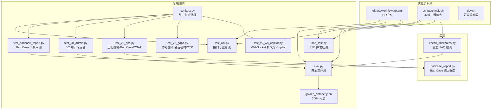
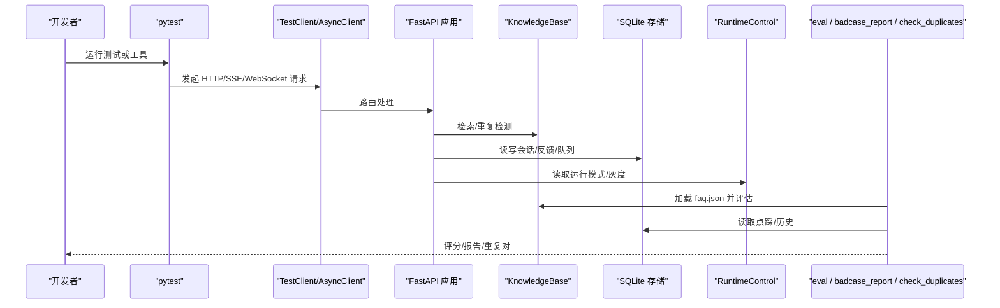
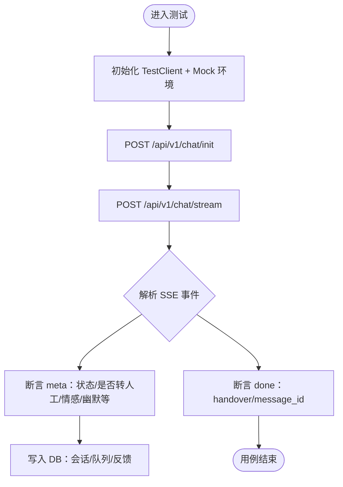
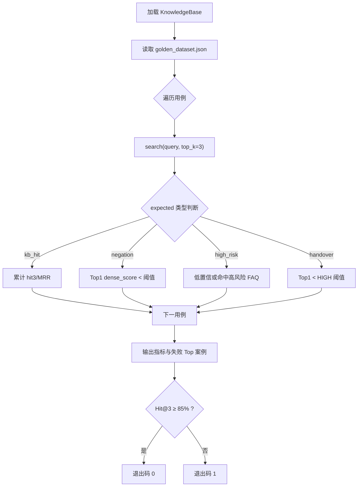
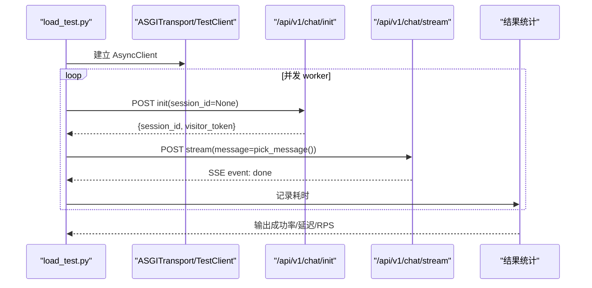
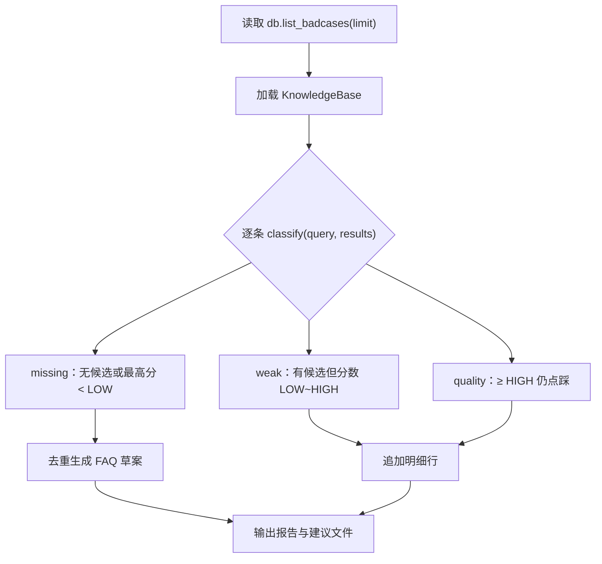
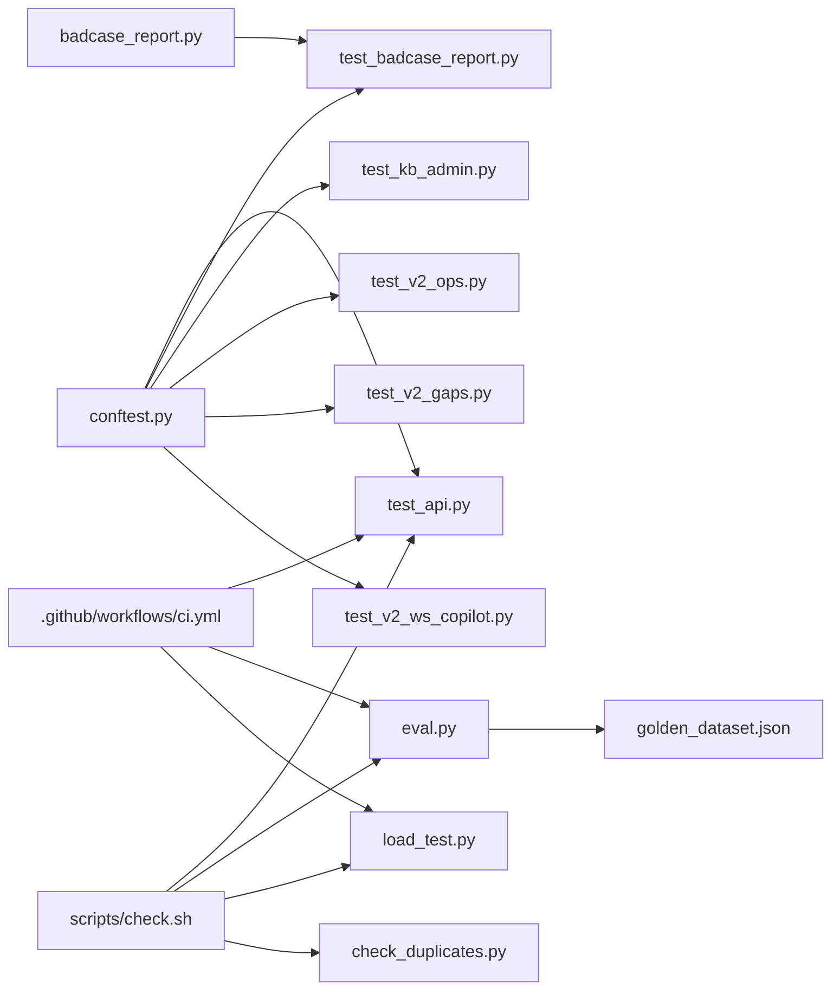

# 测试与质量保障

<cite>
**本文引用的文件**   
- [conftest.py](file://backend/tests/conftest.py)
- [eval.py](file://backend/tests/eval.py)
- [golden_dataset.json](file://backend/tests/golden_dataset.json)
- [load_test.py](file://backend/tests/load_test.py)
- [test_api.py](file://backend/tests/test_api.py)
- [test_badcase_report.py](file://backend/tests/test_badcase_report.py)
- [test_kb_admin.py](file://backend/tests/test_kb_admin.py)
- [test_v2_gaps.py](file://backend/tests/test_v2_gaps.py)
- [test_v2_ops.py](file://backend/tests/test_v2_ops.py)
- [test_v2_ws_copilot.py](file://backend/tests/test_v2_ws_copilot.py)
- [badcase_report.py](file://backend/tools/badcase_report.py)
- [check_duplicates.py](file://backend/tools/check_duplicates.py)
- [ci.yml](file://.github/workflows/ci.yml)
- [check.sh](file://scripts/check.sh)
- [dev.sh](file://dev.sh)
</cite>

## 目录
1. [引言](#引言)
2. [项目结构](#项目结构)
3. [核心组件](#核心组件)
4. [架构总览](#架构总览)
5. [详细组件分析](#详细组件分析)
6. [依赖关系分析](#依赖关系分析)
7. [性能考虑](#性能考虑)
8. [故障排查指南](#故障排查指南)
9. [结论](#结论)
10. [附录：质量门禁与开发规范](#附录质量门禁与开发规范)

## 引言
本文件面向“小答”客服对话系统的测试与质量保障工作，覆盖单元测试、集成测试、负载测试、黄金数据集评估框架、Bad Case 归因分析工具、重复检测工具、回归策略、代码质量检查与静态分析配置、性能基准和优化建议。文档既适合一线开发者编写和维护测试，也适合运营与质检人员使用自动化工具持续改进知识库质量。

## 项目结构
仓库的测试与质量相关代码集中在后端 `backend/tests` 和 `backend/tools`，并通过 GitHub Actions CI 和本地脚本串联执行。

**图示来源**
- [conftest.py:1-24](file://backend/tests/conftest.py#L1-L24)
- [eval.py:1-100](file://backend/tests/eval.py#L1-L100)
- [golden_dataset.json:1-105](file://backend/tests/golden_dataset.json#L1-L105)
- [load_test.py:1-114](file://backend/tests/load_test.py#L1-L114)
- [test_api.py:1-200](file://backend/tests/test_api.py#L1-L200)
- [test_badcase_report.py:1-35](file://backend/tests/test_badcase_report.py#L1-L35)
- [test_kb_admin.py:1-200](file://backend/tests/test_kb_admin.py#L1-L200)
- [test_v2_gaps.py:1-200](file://backend/tests/test_v2_gaps.py#L1-L200)
- [test_v2_ops.py:1-192](file://backend/tests/test_v2_ops.py#L1-L192)
- [test_v2_ws_copilot.py:1-126](file://backend/tests/test_v2_ws_copilot.py#L1-L126)
- [badcase_report.py:1-120](file://backend/tools/badcase_report.py#L1-L120)
- [check_duplicates.py:1-49](file://backend/tools/check_duplicates.py#L1-L49)
- [ci.yml:1-55](file://.github/workflows/ci.yml#L1-L55)
- [check.sh:1-29](file://scripts/check.sh#L1-L29)
- [dev.sh:1-75](file://dev.sh#L1-L75)

**章节来源**
- [conftest.py:1-24](file://backend/tests/conftest.py#L1-L24)
- [ci.yml:1-55](file://.github/workflows/ci.yml#L1-L55)
- [check.sh:1-29](file://scripts/check.sh#L1-L29)

## 核心组件
- 测试基础设施：通过 `conftest.py` 强制 Mock LLM、隔离临时数据库、隔离知识库副本，确保所有测试离线可跑且互不污染。
- 单元测试与集成测试：围绕聊天接口、知识库后台、运行控制、Bad Case、CSAT、WebSocket 排队与 Copilot、V2 新增能力（防死循环、会话超时复位、确认超时取消、幽默两段式接线、OTP）展开。
- 黄金数据集评估：以 `golden_dataset.json` 为权威输入，计算 Hit@3、MRR、否定句阈值、高风险红线、转人工低置信等指标。
- 负载测试：支持进程内 Mock SSE 压测和连真实后端压测，输出成功率、平均延迟、P95/P99、RPS。
- Bad Case 归因工具：将点踩记录自动分类为缺失型、检索失效型、生成质量型，并生成 FAQ 草案。
- 重复检测工具：对 FAQ 做混合检索，识别语义撞车重复对。
- 质量流水线：GitHub Actions 在 push/PR 时执行 pytest、黄金评测、轻量压测；本地可通过 `scripts/check.sh` 一键运行。

**章节来源**
- [conftest.py:1-24](file://backend/tests/conftest.py#L1-L24)
- [eval.py:1-100](file://backend/tests/eval.py#L1-L100)
- [golden_dataset.json:1-105](file://backend/tests/golden_dataset.json#L1-L105)
- [load_test.py:1-114](file://backend/tests/load_test.py#L1-L114)
- [badcase_report.py:1-120](file://backend/tools/badcase_report.py#L1-L120)
- [check_duplicates.py:1-49](file://backend/tools/check_duplicates.py#L1-L49)
- [ci.yml:1-55](file://.github/workflows/ci.yml#L1-L55)
- [check.sh:1-29](file://scripts/check.sh#L1-L29)

## 架构总览
测试系统以 FastAPI 应用为核心，pytest 驱动 HTTP/SSE/WebSocket 接口用例；评估与工具脚本直接调用配置、知识库、数据库与运行时控制模块；CI 把三类质量活动串联起来。

**图示来源**
- [test_api.py:1-200](file://backend/tests/test_api.py#L1-L200)
- [eval.py:1-100](file://backend/tests/eval.py#L1-L100)
- [badcase_report.py:1-120](file://backend/tools/badcase_report.py#L1-L120)
- [check_duplicates.py:1-49](file://backend/tools/check_duplicates.py#L1-L49)

## 详细组件分析

### 测试环境与基座
- 环境变量：强制设置 `LLM_MODE=mock`、清空 DeepSeek Key、提升限流阈值，避免外部依赖与限流干扰。
- 数据隔离：创建临时目录作为 `DB_PATH`，复制 `knowledge_base/faq.json` 到临时 `KB_PATH`，保证每个测试进程独立。
- 客户端复用：模块级 `TestClient` 单例，减少启动开销。

**章节来源**
- [conftest.py:1-24](file://backend/tests/conftest.py#L1-L24)

### 单元测试与集成测试设计
- 接口测试（`test_api.py`）：覆盖健康检查、会话初始化与历史恢复、SSE 流式回答、知识库命中、低置信转人工、高风险红灯、无效 Token 拦截、会话绑定、反馈、手动转人工、排队状态与完成、运营统计与 Bad Case 列表。
- V2 知识库后台（`test_kb_admin.py`）：覆盖新建/编辑/删除草稿的提交、审批、生效、热更新、版本历史、驳回与撤销、状态机守卫与越权保护。
- V2 运行控制（`test_v2_ops.py`）：覆盖 Kill Switch 维护模式、全局转人工、切回 auto、离线拒绝手工转人工、灰度百分比全开/关闭与部分分流、Bad Case 状态流转与守卫、CSAT 提分与统计、参数校验。
- V2 缺口补齐（`test_v2_gaps.py`）：覆盖连续未解决触发硬转人工、正常回答重置计数、会话超时复位轮次与 meta、确认态超时取消、幽默两段式润色与数字一致性回退、售后场景不开幽默、OTP 发送/验证/过期处理。
- WebSocket 与 Copilot（`test_v2_ws_copilot.py`）：覆盖坐席端首帧快照与实时广播、用户端 Token 鉴权拒绝与建连推送排队进度、Copilot 工单卡片/模板/内部查询、不存在工单返回 404。
- Bad Case 工具单测（`test_badcase_report.py`）：断言缺失型被识别并去重生成草案、弱召回与质量型不误判、明细含归因。

**图示来源**
- [test_api.py:1-200](file://backend/tests/test_api.py#L1-L200)
- [test_v2_gaps.py:1-200](file://backend/tests/test_v2_gaps.py#L1-L200)
- [test_v2_ops.py:1-192](file://backend/tests/test_v2_ops.py#L1-L192)
- [test_v2_ws_copilot.py:1-126](file://backend/tests/test_v2_ws_copilot.py#L1-L126)

**章节来源**
- [test_api.py:1-200](file://backend/tests/test_api.py#L1-L200)
- [test_kb_admin.py:1-200](file://backend/tests/test_kb_admin.py#L1-L200)
- [test_v2_ops.py:1-192](file://backend/tests/test_v2_ops.py#L1-L192)
- [test_v2_gaps.py:1-200](file://backend/tests/test_v2_gaps.py#L1-L200)
- [test_v2_ws_copilot.py:1-126](file://backend/tests/test_v2_ws_copilot.py#L1-L126)
- [test_badcase_report.py:1-35](file://backend/tests/test_badcase_report.py#L1-L35)

### 黄金数据集评估框架
- 数据来源：`golden_dataset.json` 包含 200+ 问法，按类别标注期望行为（知识库命中、否定句、高风险、转人工）。
- 指标定义：
  - Hit@3：Top3 是否命中目标 FAQ。
  - MRR：命中位置倒数第二名的倒数之和除以命中类总数。
  - 否定句通过率：Top1 相似度低于阈值且走 NLI 校验路径。
  - 高风险策略命中率：低置信或命中高风险 FAQ。
  - 转人工低置信判定率：Top1 分数低于高阈值即转人工。
- 自动化评分：`eval.py` 加载知识库后逐条评估，打印汇总指标与失败案例，Hit@3 ≥ 85% 视为达标。

**图示来源**
- [eval.py:1-100](file://backend/tests/eval.py#L1-L100)
- [golden_dataset.json:1-105](file://backend/tests/golden_dataset.json#L1-L105)

**章节来源**
- [eval.py:1-100](file://backend/tests/eval.py#L1-L100)
- [golden_dataset.json:1-105](file://backend/tests/golden_dataset.json#L1-L105)

### 负载测试方法
- 两种模式：
  - 进程内 Mock：默认推荐，零成本、可重复，自动注入 Mock LLM 与环境变量。
  - 真实后端：传入 `--base` 连接运行中的后端，注意消耗真实模型额度。
- 流量分布：60% 知识库消息、20% 转人工、20% 闲聊。
- 关键指标：成功率、平均延迟、P95/P99、RPS。
- 执行命令示例：
  - 进程内：`python backend/tests/load_test.py --concurrency 20 --total 120`
  - 真实后端：`python backend/tests/load_test.py --base http://127.0.0.1:8000 --concurrency 10 --total 50`

**图示来源**
- [load_test.py:1-114](file://backend/tests/load_test.py#L1-L114)

**章节来源**
- [load_test.py:1-114](file://backend/tests/load_test.py#L1-L114)

### Bad Case 归因分析工具
- 功能：对点踩记录重新检索，归因为“缺失型/检索失效型/生成质量型”，并为缺失型生成去重的 FAQ 草案。
- 用法：
  - 全量：`python backend/tools/badcase_report.py`
  - 最近 N 条：`python backend/tools/badcase_report.py --limit 50`
- 输出：控制台统计与明细、`knowledge_base/suggestions/YYYY-MM-DD.json` 草案。
- 单测要点：缺失型识别与草案生成、弱召回/质量型不误判、明细含归因、草案去重。

**图示来源**
- [badcase_report.py:1-120](file://backend/tools/badcase_report.py#L1-L120)
- [test_badcase_report.py:1-35](file://backend/tests/test_badcase_report.py#L1-L35)

**章节来源**
- [badcase_report.py:1-120](file://backend/tools/badcase_report.py#L1-L120)
- [test_badcase_report.py:1-35](file://backend/tests/test_badcase_report.py#L1-L35)

### 重复检测工具
- 功能：对每条 FAQ 的标准问法做混合检索，若 Top 候选是另一条 FAQ 且相似度达到阈值，提示语义撞车。
- 用法：`python backend/tools/check_duplicates.py [--threshold 0.95]`
- 退出码：0 表示无重复，1 表示发现重复对。

**章节来源**
- [check_duplicates.py:1-49](file://backend/tools/check_duplicates.py#L1-L49)

### 知识库质量与版本管理
- 知识库后台测试覆盖了从草稿创建、提交审核、审批生效、热更新到删除与版本快照的全流程，同时验证了状态机守卫（如重复提交、重复审批、越权操作）。
- 评估脚本与重复检测工具共同构成知识库质量门禁：Hit@3 达标、无严重重复、Bad Case 缺失型数量可控。

**章节来源**
- [test_kb_admin.py:1-200](file://backend/tests/test_kb_admin.py#L1-L200)
- [eval.py:1-100](file://backend/tests/eval.py#L1-L100)
- [check_duplicates.py:1-49](file://backend/tools/check_duplicates.py#L1-L49)

## 依赖关系分析
测试与工具之间的依赖关系如下：

**图示来源**
- [conftest.py:1-24](file://backend/tests/conftest.py#L1-L24)
- [eval.py:1-100](file://backend/tests/eval.py#L1-L100)
- [golden_dataset.json:1-105](file://backend/tests/golden_dataset.json#L1-L105)
- [test_badcase_report.py:1-35](file://backend/tests/test_badcase_report.py#L1-L35)
- [load_test.py:1-114](file://backend/tests/load_test.py#L1-L114)
- [badcase_report.py:1-120](file://backend/tools/badcase_report.py#L1-L120)
- [check_duplicates.py:1-49](file://backend/tools/check_duplicates.py#L1-L49)
- [ci.yml:1-55](file://.github/workflows/ci.yml#L1-L55)
- [check.sh:1-29](file://scripts/check.sh#L1-L29)

**章节来源**
- [ci.yml:1-55](file://.github/workflows/ci.yml#L1-L55)
- [check.sh:1-29](file://scripts/check.sh#L1-L29)

## 性能考虑
- 压测目标：SSE 对话接口的吞吐、成功率、P95/P99 延迟。
- 推荐基线：
  - 进程内 Mock 模式：`--concurrency 4 --total 5` 用于冒烟，CI 已内置。
  - 生产压测：按容量规划逐步提升并发与总量，观察 P95/P99 增长曲线与错误率。
- 优化建议：
  - 优先优化知识库检索与向量相似度计算路径，减少慢查询。
  - 对高频问题启用缓存策略（需结合现有 rate_limit/cache 模块评估影响）。
  - 在高并发下关注 SQLite 写锁与 SSE 事件序列化开销。
  - 根据压测结果调整 `SIM_THRESHOLD_HIGH/LOW` 与情绪/转人工阈值，平衡准确率与响应速度。

[本节为通用指导，不直接分析具体文件]

## 故障排查指南
- 测试失败常见原因：
  - 未设置 Mock 环境导致真实 LLM 调用失败：确认 `LLM_MODE=mock` 且 `DEEPSEEK_API_KEY` 为空。
  - 知识库路径污染：确认 `KB_PATH` 指向临时副本，避免写入真实 `faq.json`。
  - 限流触发：测试中已将 `RATE_LIMIT_PER_MIN` 调高，若仍报错请检查自定义限制。
  - WebSocket 鉴权失败：用户 WS 需要有效 `session_id` 与 `visitor_token`，否则返回 4401。
  - Bad Case 工具无输出：确认数据库中有点踩记录，或通过 `--limit` 缩小范围。
- 定位步骤：
  - 先运行 `scripts/check.sh` 获取端到端质量报告。
  - 单独运行 `python backend/tests/eval.py` 查看黄金集失败案例。
  - 运行 `python backend/tools/badcase_report.py --limit 50` 聚焦近期问题。
  - 运行 `python backend/tools/check_duplicates.py` 检查知识库重复。

**章节来源**
- [conftest.py:1-24](file://backend/tests/conftest.py#L1-L24)
- [test_v2_ws_copilot.py:1-126](file://backend/tests/test_v2_ws_copilot.py#L1-L126)
- [badcase_report.py:1-120](file://backend/tools/badcase_report.py#L1-L120)
- [check_duplicates.py:1-49](file://backend/tools/check_duplicates.py#L1-L49)
- [check.sh:1-29](file://scripts/check.sh#L1-L29)

## 结论
本项目构建了完整的测试与质量保障体系：离线可跑的 Mock 测试、覆盖核心业务链路的集成测试、基于黄金数据集的检索评估、SSE 并发负载测试、Bad Case 自动归因与 FAQ 草案生成、重复 FAQ 体检脚本，以及 GitHub Actions 与本地脚本串联的质量流水线。建议持续扩充黄金集覆盖面、完善 Bad Case 闭环跟踪，并结合压测结果迭代检索与话术策略。

[本节为总结性内容，不直接分析具体文件]

## 附录：质量门禁与开发规范

### 测试覆盖率要求
- 当前仓库未显式配置覆盖率门槛，建议在后续阶段引入覆盖率统计（例如 pytest-cov），并对关键模块设定最低覆盖率阈值（如核心 Agent 编排、知识库检索、运行时控制）。
- 现阶段建议至少保证以下模块具备充分用例覆盖：
  - 聊天接口与 SSE 事件解析
  - 知识库后台草稿/审批/热更新
  - 运行控制与灰度分流
  - Bad Case 与 CSAT
  - WebSocket 排队与 Copilot
  - 黄金数据集评估脚本

[本节为通用指导，不直接分析具体文件]

### 代码质量检查与静态分析
- 当前仓库未提供 lint/typecheck 配置文件，建议在 Python 侧引入 ruff/flake8/mypy，前端侧保持 TypeScript 编译检查。
- 建议在 CI 中加入静态分析与格式化检查，确保风格一致与类型安全。

[本节为通用指导，不直接分析具体文件]

### 回归测试策略
- 每次改动应保证：
  - 全部 pytest 用例通过。
  - 黄金数据集评估 Hit@3 ≥ 85%。
  - 基础负载冒测成功。
  - 无新增重复 FAQ（阈值可配置）。
- 针对知识库变更，应优先补充黄金集变体问法，确保检索鲁棒性。

**章节来源**
- [ci.yml:1-55](file://.github/workflows/ci.yml#L1-L55)
- [check.sh:1-29](file://scripts/check.sh#L1-L29)

### 质量门禁设置方法
- CI 门禁：
  - 在 `.github/workflows/ci.yml` 中已定义后端任务：安装依赖、运行 pytest、执行黄金评估、执行轻量压测。
  - 前端任务：安装依赖、TypeScript 类型检查与构建。
- 本地门禁：
  - 通过 `scripts/check.sh` 一键执行：后端测试、黄金评估、压测冒烟、前端构建、重复 FAQ 检测。
- 发布前门禁建议：
  - 扩大负载测试规模，加入更长尾延迟观测。
  - 增加 Bad Case 增量评估与重复 FAQ 扫描。
  - 接入覆盖率与静态分析门禁。

**章节来源**
- [ci.yml:1-55](file://.github/workflows/ci.yml#L1-L55)
- [check.sh:1-29](file://scripts/check.sh#L1-L29)

### 性能基准测试结果与优化建议
- 基准说明：仓库未保存固定基准数值；`load_test.py` 输出每次运行的成功率、平均延迟、P95/P99、RPS。
- 建议基线采集：
  - 在稳定版本上多次运行 `--concurrency 4 --total 5` 取中位数作为短期基线。
  - 在生产环境按容量计划执行渐进压测，记录峰值 RPS 与尾延迟。
- 优化方向：
  - 索引与检索层：优化向量检索与 TF-IDF 混合策略，降低 TopK 计算成本。
  - 会话与队列：优化写锁竞争，避免热点会话阻塞。
  - 话术与策略：合理调整相似度阈值与情绪/转人工策略，减少不必要的 LLM 调用。

[本节为通用指导，不直接分析具体文件]