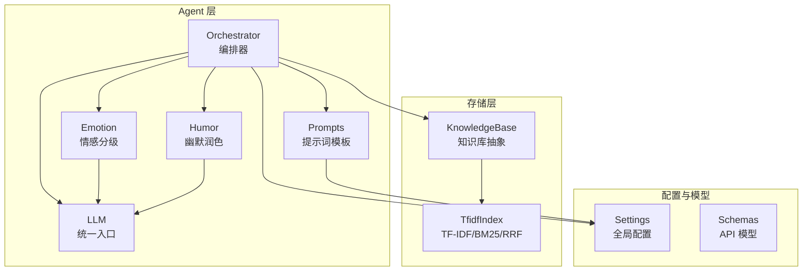
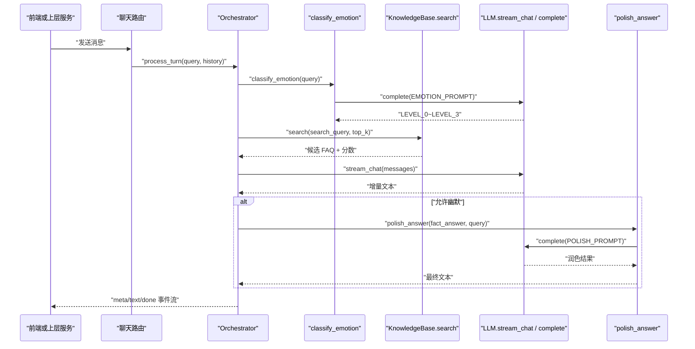
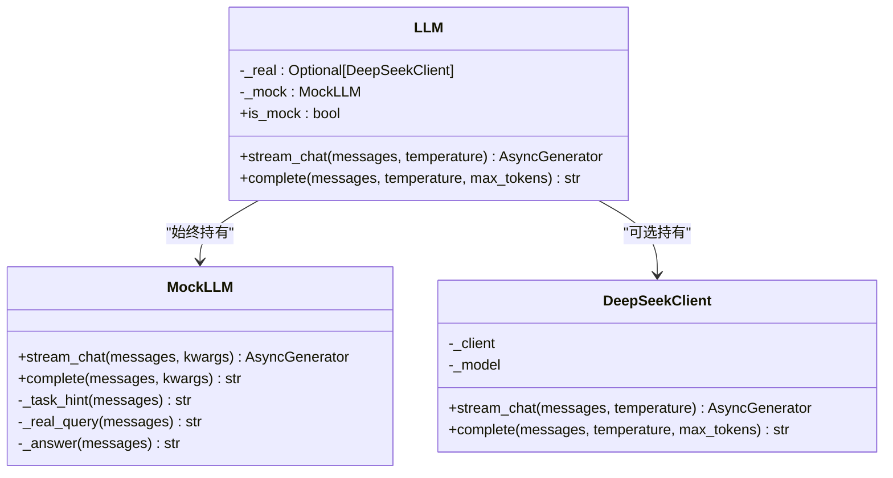
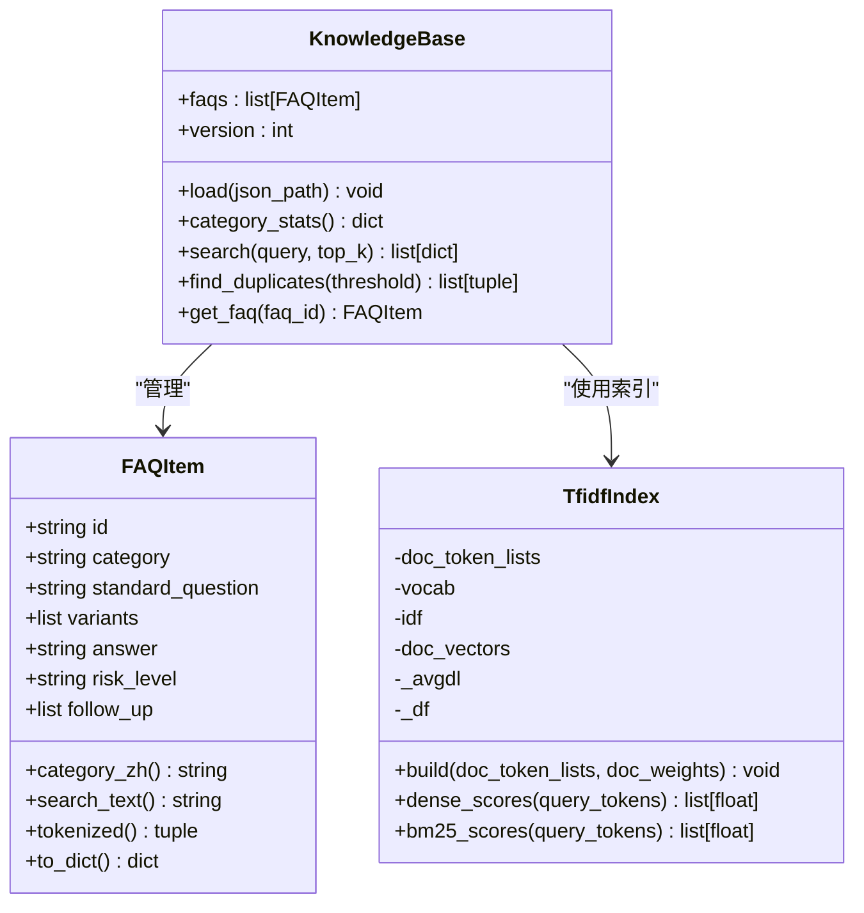
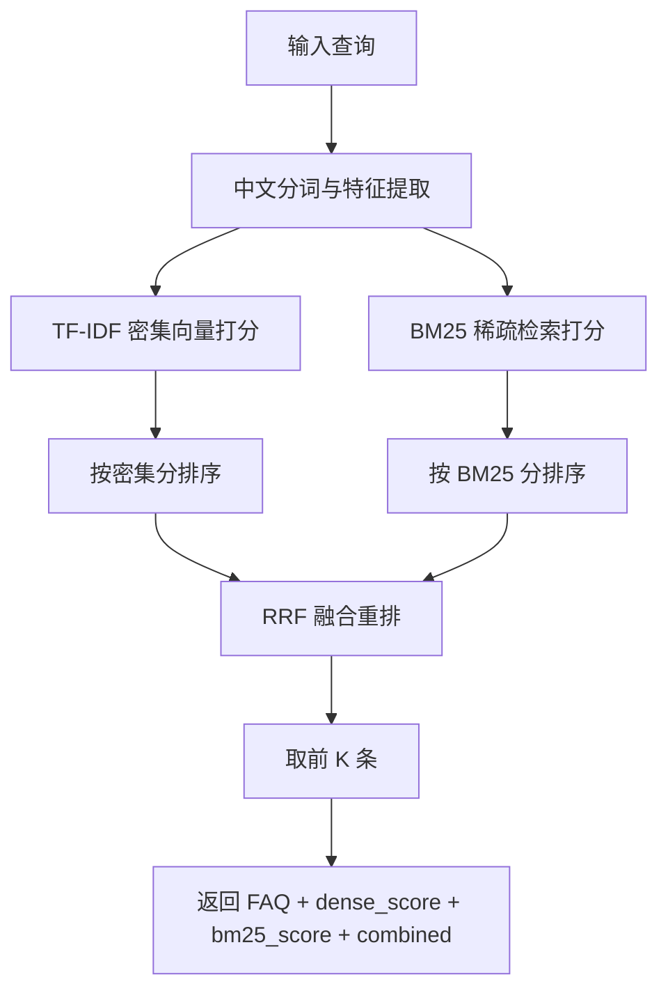
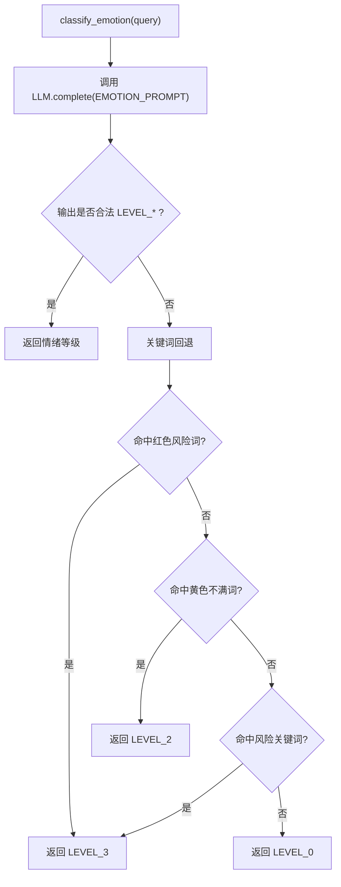
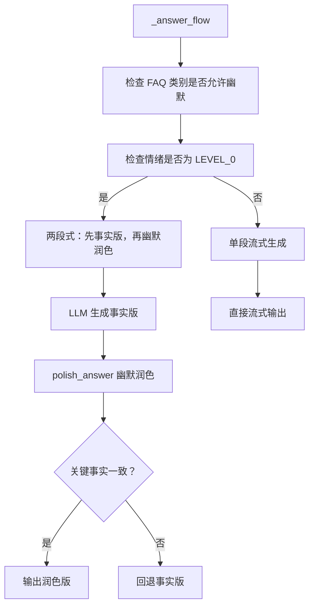
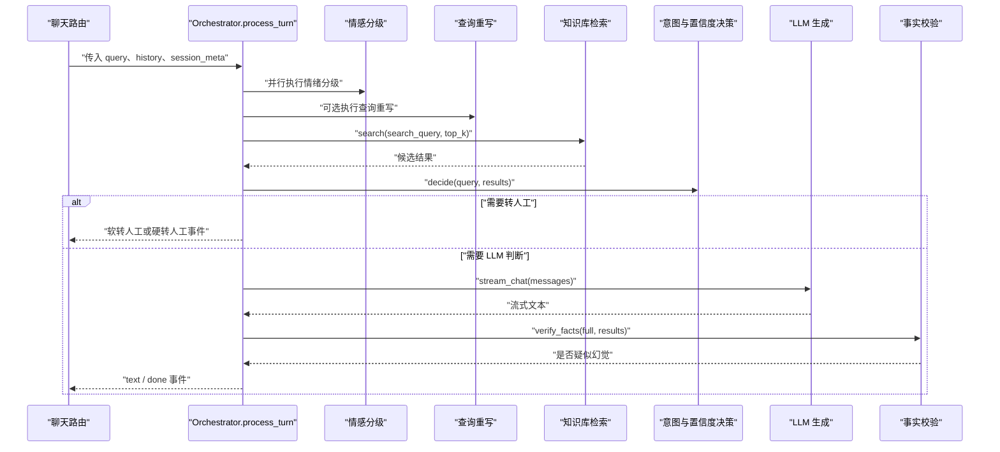
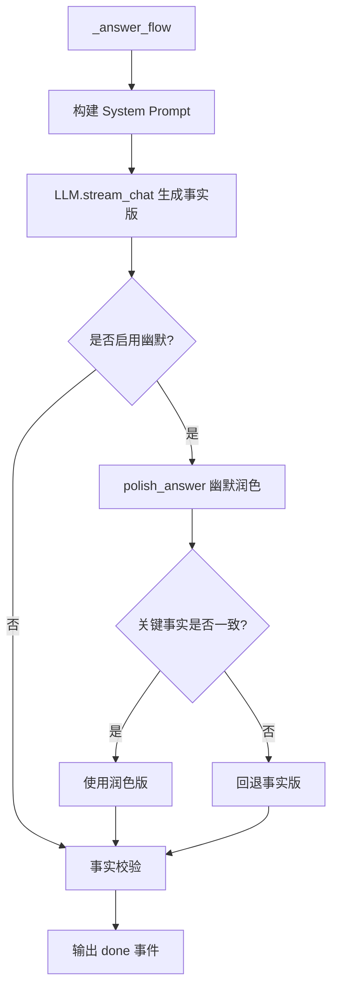
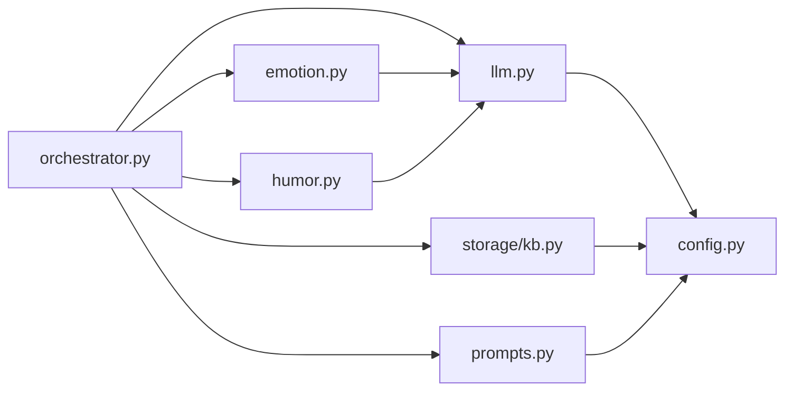

# 扩展点设计

<cite>
**本文引用的文件**   
- [llm.py](file://backend/app/agent/llm.py)
- [orchestrator.py](file://backend/app/agent/orchestrator.py)
- [emotion.py](file://backend/app/agent/emotion.py)
- [humor.py](file://backend/app/agent/humor.py)
- [prompts.py](file://backend/app/agent/prompts.py)
- [kb.py](file://backend/app/storage/kb.py)
- [config.py](file://backend/app/config.py)
- [schemas.py](file://backend/app/models/schemas.py)
</cite>

## 目录
1. [引言](#引言)
2. [项目结构](#项目结构)
3. [核心扩展点总览](#核心扩展点总览)
4. [架构总览](#架构总览)
5. [大语言模型适配器扩展点](#大语言模型适配器扩展点)
6. [知识库抽象层扩展点](#知识库抽象层扩展点)
7. [情感分析插件扩展点](#情感分析插件扩展点)
8. [提示词模板与幽默风格配置](#提示词模板与幽默风格配置)
9. [端到端调用流程](#端到端调用流程)
10. [依赖关系分析](#依赖关系分析)
11. [性能与可观测性](#性能与可观测性)
12. [扩展最佳实践](#扩展最佳实践)
13. [故障排查指南](#故障排查指南)
14. [结论](#结论)

## 引言
smart_bot 是一个面向电商客服场景的对话智能体系统。其核心目标是在高可靠性、低延迟的前提下，完成情绪识别、查询重写、知识库检索、语义判断、LLM 生成、幻觉防护、转人工等完整链路。当前代码已经围绕多个关键能力预留了扩展点：

- **LLM 适配器**：统一封装 DeepSeek 与 Mock 两种实现，并支持按配置自动切换。
- **KnowledgeBase 抽象层**：以 `KnowledgeBase` 为边界，当前使用本地 TF-IDF + BM25 + RRF，注释明确指向未来替换为向量数据库。
- **情感分析插件**：通过 `classify_emotion` 暴露统一接口，默认走 LLM，同时提供关键词兜底。
- **Prompt 模板系统**：集中管理人设、情绪分级、意图分类、NLI、幽默润色、记忆摘要、Copilot 话术等。
- **幽默风格控制**：在编排器中根据情绪等级和 FAQ 类别决定是否启用两段式幽默润色。

本文从扩展点视角，给出可插拔方案、数据流图、类图和序列图，并给出接入其他大模型、向量库和情绪算法的实践建议。

## 项目结构
smart_bot 后端主要位于 `backend/app`，本次文档聚焦以下模块：

| 路径 | 职责 | 扩展相关要点 |
|---|---|---|
| `backend/app/agent/llm.py` | LLM 客户端与统一入口 | 定义 `DeepSeekClient`、`MockLLM`、`LLM`；支持流式与非流式调用 |
| `backend/app/agent/orchestrator.py` | Agent 管线编排 | 串联情绪、检索、意图、生成、校验、转人工；控制幽默开关 |
| `backend/app/agent/emotion.py` | 情感分级 | 暴露 `classify_emotion`，默认基于 LLM，带关键词回退 |
| `backend/app/agent/humor.py` | 幽默分段生成 | 对事实回答做语气润色，并做关键信息一致性校验 |
| `backend/app/agent/prompts.py` | Prompt 工程 | 集中维护人设、情绪、改写、意图、NLI、幽默、记忆、Copilot、转人工等模板 |
| `backend/app/storage/kb.py` | 知识库加载与检索 | 定义 `FAQItem`、`TfidfIndex`、`KnowledgeBase`，混合检索与 RRF |
| `backend/app/config.py` | 全局配置 | LLM 模式、品牌名、检索阈值、会话安全、存储路径等 |
| `backend/app/models/schemas.py` | API 契约 | 前后端请求响应模型，不直接参与扩展点，但决定外部集成契约 |

**图表来源**
- [orchestrator.py:1-80](file://backend/app/agent/orchestrator.py#L1-L80)
- [emotion.py:1-47](file://backend/app/agent/emotion.py#L1-L47)
- [humor.py:1-55](file://backend/app/agent/humor.py#L1-L55)
- [prompts.py:1-120](file://backend/app/agent/prompts.py#L1-L120)
- [llm.py:1-177](file://backend/app/agent/llm.py#L1-L177)
- [kb.py:1-120](file://backend/app/storage/kb.py#L1-L120)
- [config.py:1-104](file://backend/app/config.py#L1-L104)

**章节来源**
- [orchestrator.py:1-80](file://backend/app/agent/orchestrator.py#L1-L80)
- [config.py:1-104](file://backend/app/config.py#L1-L104)

## 核心扩展点总览
smart_bot 的扩展点可以归纳为四类：

1. **LLM 适配器扩展点**
   - 现有实现：`DeepSeekClient`、`MockLLM`。
   - 统一接口：`stream_chat`、`complete`。
   - 切换策略：由 `LLM` 单例根据 `settings.use_real_llm` 选择真实或 Mock。

2. **KnowledgeBase 抽象层扩展点**
   - 现有实现：`KnowledgeBase.load`、`search`、`get_faq`、`find_duplicates`。
   - 当前索引：`TfidfIndex`，支持密集向量相似度与 BM25，并通过 RRF 融合。
   - 注释明确：生产期可替换为豆包 embedding 与 Qdrant 等向量数据库。

3. **情感分析插件扩展点**
   - 现有实现：`classify_emotion`，优先调用 LLM，异常时回退到关键词规则。
   - 扩展方式：可注入新的情绪分类器，保留返回 `LEVEL_0 ~ LEVEL_3` 的契约。

4. **Prompt 模板系统与幽默风格配置**
   - 模板集中在 `prompts.py`，包括人设、情绪、改写、意图、NLI、幽默、记忆、Copilot、转人工话术。
   - 幽默开关由编排器根据 FAQ 类别和情绪等级决定，配合 `polish_answer` 做两段式生成。

这些扩展点共同构成“可插拔”体系：业务侧可通过配置或最小改动替换具体实现，而不影响主流程。

**章节来源**
- [llm.py:120-177](file://backend/app/agent/llm.py#L120-L177)
- [kb.py:240-316](file://backend/app/storage/kb.py#L240-L316)
- [emotion.py:1-47](file://backend/app/agent/emotion.py#L1-L47)
- [prompts.py:1-200](file://backend/app/agent/prompts.py#L1-L200)
- [orchestrator.py:201-330](file://backend/app/agent/orchestrator.py#L201-L330)

## 架构总览
下图展示 smart_bot 在一次用户消息处理中的扩展点协作关系：

**图表来源**
- [orchestrator.py:60-180](file://backend/app/agent/orchestrator.py#L60-L180)
- [emotion.py:20-47](file://backend/app/agent/emotion.py#L20-L47)
- [kb.py:260-316](file://backend/app/storage/kb.py#L260-L316)
- [llm.py:120-177](file://backend/app/agent/llm.py#L120-L177)
- [humor.py:30-55](file://backend/app/agent/humor.py#L30-L55)

## 大语言模型适配器扩展点

### 现有实现
当前 LLM 层包含三个关键对象：

- `MockLLM`：离线 Mock，按任务类型返回规则化输出，用于开发与自动化测试。
- `DeepSeekClient`：基于 OpenAI 兼容接口的真实 DeepSeek 客户端，支持流式和非流式调用。
- `LLM`：统一入口，根据 `settings.use_real_llm` 自动选择真实或 Mock。

**图表来源**
- [llm.py:20-119](file://backend/app/agent/llm.py#L20-L119)
- [llm.py:120-177](file://backend/app/agent/llm.py#L120-L177)

### 统一接口契约
要接入新的 LLM 提供商（例如通义千问、文心一言、智谱、本地 Ollama 等），应遵循以下契约：

| 方法 | 输入 | 输出 | 说明 |
|---|---|---|---|
| `stream_chat` | `messages: list[dict]`、可选 `temperature` | `AsyncGenerator[str, None]` | 逐 token 产出文本，适合长回复 |
| `complete` | `messages: list[dict]`、可选 `temperature`、`max_tokens` | `str` | 一次性返回短文本，适合情绪、意图、布尔判断 |

推荐新增一个 `BaseLLMAdapter` 抽象基类，强制子类实现上述两个方法；然后让 `DeepSeekClient`、`MockLLM` 以及未来接入的新提供商都继承该基类。`LLM` 统一入口只依赖抽象接口，从而把具体提供商与编排逻辑解耦。

### 接入第三方提供商的步骤
1. 新建适配器文件，例如 `backend/app/agent/llm_adapter_qwen.py`。
2. 实现统一的 `stream_chat` 与 `complete`。
3. 从 `app.config.settings` 读取对应配置项，如 API Key、Base URL、Model Name。
4. 在 `LLM` 初始化逻辑中加入条件分支，根据环境变量或运行时配置选择新适配器。
5. 保持 Mock 降级路径：当第三方 API 不可用时，回退到 `MockLLM`。

### 配置扩展
建议在 `Settings` 中增加通用字段，例如：

| 配置项 | 含义 | 示例值 |
|---|---|---|
| `LLM_PROVIDER` | 提供商标识 | `deepseek`、`qwen`、`mock` |
| `LLM_BASE_URL` | 兼容 OpenAI 风格的 Base URL | `https://api.deepseek.com` |
| `LLM_MODEL` | 模型名称 | `deepseek-chat`、`qwen-max` |
| `LLM_TIMEOUT` | 超时秒数 | `30` |
| `LLM_MAX_RETRIES` | 重试次数 | `2` |

这些字段应与现有 `DEEPSEEK_API_KEY`、`DEEPSEEK_BASE_URL`、`DEEPSEEK_MODEL`、`LLM_MODE` 兼容，避免破坏现有 `.env` 行为。

**章节来源**
- [llm.py:1-177](file://backend/app/agent/llm.py#L1-L177)
- [config.py:15-60](file://backend/app/config.py#L15-L60)

## 知识库抽象层扩展点

### 现有实现
当前知识库实现包含以下关键部分：

- `FAQItem`：FAQ 数据结构，包含 id、category、standard_question、variants、answer、risk_level、follow_up。
- `TfidfIndex`：本地 TF-IDF 向量索引，同时提供 BM25 打分。
- `KnowledgeBase`：负责加载 JSON、构建索引、混合检索、重复检测、按 ID 查询。
- 工具函数：否定词、风险词、转人工关键词、确认词、拒绝词判断。

**图表来源**
- [kb.py:40-120](file://backend/app/storage/kb.py#L40-L120)
- [kb.py:120-240](file://backend/app/storage/kb.py#L120-L240)
- [kb.py:240-316](file://backend/app/storage/kb.py#L240-L316)

### 检索接口契约
当前 `KnowledgeBase.search` 返回结构如下：

| 字段 | 类型 | 含义 |
|---|---|---|
| `faq` | `FAQItem` | 匹配的 FAQ |
| `dense_score` | `float` | 密集向量相似度得分 |
| `bm25_score` | `float` | BM25 稀疏检索得分 |
| `combined` | `float` | RRF 融合后的排序依据 |

扩展时，只要保持 `search` 返回相同结构，就能无缝替换底层检索实现。

### 替换为向量数据库的方案
仓库注释明确指出：MVP 阶段使用本地 TF-IDF，生产期可替换为豆包 text-embedding 与 Qdrant。推荐扩展步骤：

1. 新增 `VectorKnowledgeBase` 子类或独立实现类。
2. 使用 Embedding 模型将 FAQ 和查询向量化。
3. 将向量存入 Qdrant、Milvus、Chroma、Weaviate 等向量数据库。
4. 实现 `search`：先向量召回，再结合 BM25 或关键词规则，最后用 RRF 重排。
5. 保持 `load` 从 JSON 或后台导入数据，并更新 `version` 以便缓存失效。
6. 保留 `get_faq`、`find_duplicates`、`category_stats` 等方法，保证上游编排器无需修改。

### 当前混合检索流程

**图表来源**
- [kb.py:120-240](file://backend/app/storage/kb.py#L120-L240)
- [kb.py:260-316](file://backend/app/storage/kb.py#L260-L316)

**章节来源**
- [kb.py:1-316](file://backend/app/storage/kb.py#L1-L316)

## 情感分析插件扩展点

### 现有实现
`classify_emotion` 的职责是返回 `LEVEL_0 ~ LEVEL_3` 中的一个标签：

- 正常咨询：`LEVEL_0`
- 轻微不满或催促：`LEVEL_1`
- 明显生气或投诉倾向：`LEVEL_2`
- 严重投诉、威胁曝光：`LEVEL_3`

默认实现：

1. 调用 LLM 的 `complete`，使用 `EMOTION_PROMPT`。
2. 解析返回值，若符合 `LEVEL_*` 格式则返回。
3. 若 LLM 输出异常或抛出异常，回退到关键词规则。
4. 关键词规则会检查内置红色、黄色风险词，以及 `has_risk_keyword`。

**图表来源**
- [emotion.py:1-47](file://backend/app/agent/emotion.py#L1-L47)

### 扩展新情绪算法
建议新增 `EmotionClassifier` 抽象接口：

| 方法 | 输入 | 输出 | 说明 |
|---|---|---|---|
| `classify` | `query: str` | `str` | 返回 `LEVEL_0 ~ LEVEL_3` |

现有 `classify_emotion` 可作为默认实现，同时支持注入自定义实现，例如：

- 基于规则的分类器。
- 基于本地小模型的分类器。
- 基于另一个 LLM 提供商的分类器。
- 多模型投票分类器。

### 与编排器的关系
编排器会根据情绪等级决定：

- 是否进入红灯熔断。
- 是否允许幽默。
- 是否触发高风险转人工。

因此，情绪插件必须保持稳定输出范围，否则会影响整个决策树。

**章节来源**
- [emotion.py:1-47](file://backend/app/agent/emotion.py#L1-L47)
- [orchestrator.py:100-180](file://backend/app/agent/orchestrator.py#L100-L180)

## 提示词模板与幽默风格配置

### Prompt 模板系统
`prompts.py` 集中维护所有 Prompt，包括：

| 模板 | 用途 |
|---|---|
| `build_system_prompt` | 动态生成 System Prompt，注入品牌、情绪、上下文、历史、问答 |
| `EMOTION_PROMPT` | 情绪分级 |
| `QUERY_REWRITE_PROMPT` | 查询重写 |
| `INTENT_PROMPT` | 意图分类 |
| `CAN_ANSWER_PROMPT` | 可回答性判断 |
| `NLI_PROMPT` | 蕴含、矛盾、中立判断 |
| `POLISH_PROMPT` | 幽默润色 |
| `MEMORY_FACTS_PROMPT` | 结构化事实提取 |
| `MEMORY_SUMMARY_PROMPT` | 对话摘要压缩 |
| `COPILOT_TEMPLATES_PROMPT` | 坐席快捷回复模板 |
| `SUMMARY_PROMPT` | 转人工摘要 |
| `HANDOVER_SOFT_MSG`、`HANDOVER_HARD_MSG`、`RED_LIGHT_MSG` 等 | 前端显示话术 |

这种集中管理方式便于审计、版本控制和 A/B 测试。

### 幽默风格配置
幽默开关在编排器中由以下因素决定：

- FAQ 类别属于允许幽默的集合，例如售前。
- 情绪等级为绿灯 `LEVEL_0`。
- 若允许幽默，先生成事实版，再通过 `polish_answer` 进行语气润色。
- 润色后如果关键数字、时间、金额被修改，或长度暴增，则回退到事实版。

**图表来源**
- [orchestrator.py:201-330](file://backend/app/agent/orchestrator.py#L201-L330)
- [humor.py:1-55](file://backend/app/agent/humor.py#L1-L55)
- [prompts.py:100-180](file://backend/app/agent/prompts.py#L100-L180)

### 可扩展配置项
建议在配置中增加以下幽默相关字段：

| 配置项 | 含义 | 默认行为 |
|---|---|---|
| `HUMOR_ENABLED` | 是否启用幽默润色 | 受类别和情绪控制 |
| `HUMOR_ALLOWED_CATEGORIES` | 允许幽默的 FAQ 类别 | 当前代码硬编码为售前 |
| `HUMOR_MAX_LENGTH_MULTIPLIER` | 润色后最大长度倍数 | 当前逻辑限制增长不超过事实版两倍加固定偏移 |
| `HUMOR_FALLBACK_ON_DIFF` | 关键事实不一致时是否回退 | 当前逻辑总是回退 |

**章节来源**
- [prompts.py:1-200](file://backend/app/agent/prompts.py#L1-L200)
- [humor.py:1-55](file://backend/app/agent/humor.py#L1-L55)
- [orchestrator.py:201-330](file://backend/app/agent/orchestrator.py#L201-L330)

## 端到端调用流程

### 用户消息处理主流程

**图表来源**
- [orchestrator.py:60-180](file://backend/app/agent/orchestrator.py#L60-L180)
- [orchestrator.py:201-404](file://backend/app/agent/orchestrator.py#L201-L404)

### 生成与幽默流程

**图表来源**
- [orchestrator.py:201-330](file://backend/app/agent/orchestrator.py#L201-L330)
- [humor.py:20-55](file://backend/app/agent/humor.py#L20-L55)

## 依赖关系分析

**图表来源**
- [orchestrator.py:1-80](file://backend/app/agent/orchestrator.py#L1-L80)
- [emotion.py:1-20](file://backend/app/agent/emotion.py#L1-L20)
- [humor.py:1-20](file://backend/app/agent/humor.py#L1-L20)
- [llm.py:1-30](file://backend/app/agent/llm.py#L1-L30)
- [kb.py:1-20](file://backend/app/storage/kb.py#L1-L20)
- [config.py:1-20](file://backend/app/config.py#L1-L20)

**章节来源**
- [orchestrator.py:1-80](file://backend/app/agent/orchestrator.py#L1-L80)
- [llm.py:1-30](file://backend/app/agent/llm.py#L1-L30)
- [kb.py:1-20](file://backend/app/storage/kb.py#L1-L20)
- [config.py:1-20](file://backend/app/config.py#L1-L20)

## 性能与可观测性

### 性能特征
- 情绪分级与查询重写可并行执行，降低首字延迟。
- 流式生成优先输出增量文本，提升用户体验。
- 幽默润色采用两段式，会增加一次额外 LLM 调用，因此仅在允许条件下启用。
- 知识库 MVP 使用本地 TF-IDF 与 BM25，无外部 Embedding 依赖，启动快、部署简单。
- 混合检索通过 RRF 融合，兼顾密集向量与稀疏检索精度。

### 可观测性建议
- 记录 LLM 提供商、模型、温度、是否 Mock。
- 记录情绪等级、意图、置信度、是否转人工、转人工原因。
- 记录检索召回数量、Top1 密度分数、BM25 分数、RRF 融合分数。
- 记录幽默是否启用、润色是否成功、是否因事实不一致回退。
- 记录 LLM 调用耗时、失败次数、回退路径。

这些指标可直接映射到 `orchestrator` 输出的 `meta`、`done` 事件中，便于前端埋点与后端日志聚合。

**章节来源**
- [orchestrator.py:60-180](file://backend/app/agent/orchestrator.py#L60-L180)
- [orchestrator.py:201-404](file://backend/app/agent/orchestrator.py#L201-L404)
- [kb.py:260-316](file://backend/app/storage/kb.py#L260-L316)

## 扩展最佳实践

### LLM 适配器最佳实践
1. 不要直接修改 `LLM` 内部分支逻辑；新增适配器应通过配置选择。
2. 严格实现 `stream_chat` 与 `complete`，保证异步迭代器和字符串返回。
3. 对网络异常、鉴权失败、模型不存在等错误做统一封装。
4. 保持 Mock 降级路径，确保离线链路可跑通。
5. 对敏感配置使用环境变量，避免写入源码。

### KnowledgeBase 扩展最佳实践
1. 保持 `search` 返回结构稳定，至少包含 `faq`、`dense_score`、`bm25_score`、`combined`。
2. 如果使用向量数据库，注意向量维度、归一化、距离度量与当前阈值对齐。
3. 保持 `load` 能重建索引并递增 `version`，使高频缓存能整体失效。
4. 保留 `get_faq`、`find_duplicates`，方便后台管理和质量巡检。
5. 对于大规模 FAQ，考虑分页加载、增量更新和冷热分层。

### 情感分析插件最佳实践
1. 返回标签必须限定在 `LEVEL_0 ~ LEVEL_3`。
2. 对 LLM 异常、超时、非预期输出做回退。
3. 规则型插件应可配置，避免硬编码黑盒。
4. 可组合多种信号：规则、模型、用户历史、风险词。
5. 记录情绪分布，便于监控投诉趋势。

### Prompt 模板最佳实践
1. 所有 Prompt 集中管理，禁止散落散落在业务逻辑中。
2. 对外部可变内容使用格式化占位符，而不是字符串拼接。
3. 对敏感 Prompt 做版本控制和审批。
4. 对幽默、人设、免责声明等策略性 Prompt 单独评审。
5. 在测试中使用 Mock LLM 验证 Prompt 输出稳定性。

### 幽默风格最佳实践
1. 仅对低风险、低情绪、允许类别的对话启用幽默。
2. 幽默不得改变数字、时间、金额、规则等关键事实。
3. 对润色结果做长度和事实一致性校验。
4. 幽默失败时立即回退事实版，不能污染最终答案。
5. 提供关闭开关，便于灰度上线。

**章节来源**
- [llm.py:120-177](file://backend/app/agent/llm.py#L120-L177)
- [kb.py:240-316](file://backend/app/storage/kb.py#L240-L316)
- [emotion.py:1-47](file://backend/app/agent/emotion.py#L1-L47)
- [prompts.py:1-200](file://backend/app/agent/prompts.py#L1-L200)
- [humor.py:1-55](file://backend/app/agent/humor.py#L1-L55)
- [orchestrator.py:201-330](file://backend/app/agent/orchestrator.py#L201-L330)

## 故障排查指南

### LLM 无法连接或返回异常
- 现象：`LLM.is_mock` 为真，或日志出现降级警告。
- 可能原因：未设置 API Key、`LLM_MODE=mock`、OpenAI SDK 未安装、网络不可达。
- 排查步骤：
  1. 检查 `DEEPSEEK_API_KEY`、`DEEPSEEK_BASE_URL`、`DEEPSEEK_MODEL`。
  2. 检查 `LLM_MODE`。
  3. 检查 `openai` 依赖是否安装。
  4. 观察是否回退到 `MockLLM`。

**章节来源**
- [llm.py:120-177](file://backend/app/agent/llm.py#L120-L177)
- [config.py:15-60](file://backend/app/config.py#L15-L60)

### 知识库检索结果为空
- 现象：`results` 为空，直接进入兜底或转人工。
- 可能原因：未加载 FAQ、分词为空、阈值过低、索引未重建。
- 排查步骤：
  1. 检查 `KB_PATH` 和 `kb.load` 是否执行。
  2. 检查 `RETRIEVE_TOP_K`。
  3. 检查 `SIM_THRESHOLD_LOW`、`SIM_THRESHOLD_HIGH`。
  4. 检查中文分词是否有效。

**章节来源**
- [kb.py:240-316](file://backend/app/storage/kb.py#L240-L316)
- [config.py:30-60](file://backend/app/config.py#L30-L60)

### 情绪等级始终为 LEVEL_0
- 现象：没有触发红灯熔断，也没有转人工。
- 可能原因：LLM 输出不符合 `LEVEL_*`，回退规则未命中风险词。
- 排查步骤：
  1. 查看情绪分级日志。
  2. 检查 `EMOTION_PROMPT` 是否被修改。
  3. 检查 `_RED_FALLBACK`、`_YELLOW_FALLBACK`、`has_risk_keyword`。

**章节来源**
- [emotion.py:1-47](file://backend/app/agent/emotion.py#L1-L47)
- [prompts.py:80-120](file://backend/app/agent/prompts.py#L80-L120)
- [kb.py:201-240](file://backend/app/storage/kb.py#L201-L240)

### 幽默润色后答案变差
- 现象：答案被改为调侃语气，或关键数字变化。
- 可能原因：幽默类别误判、Prompt 被过度放宽、长度校验未生效。
- 排查步骤：
  1. 检查 `humor_on` 条件。
  2. 检查 `POLISH_PROMPT`。
  3. 检查关键事实抽取与比对逻辑。
  4. 检查长度膨胀回退。

**章节来源**
- [orchestrator.py:201-330](file://backend/app/agent/orchestrator.py#L201-L330)
- [humor.py:1-55](file://backend/app/agent/humor.py#L1-L55)

## 结论
smart_bot 的扩展点设计已经具备清晰的边界：

- LLM 适配器通过统一接口解耦具体提供商。
- KnowledgeBase 抽象层隔离检索实现，当前 MVP 可用本地索引，未来可平滑升级到向量数据库。
- 情感分析插件以 `classify_emotion` 为入口，支持规则、模型或多策略组合。
- Prompt 模板集中管理，幽默风格由编排器根据业务策略控制。
- 编排器承担主线控制流，各扩展点通过稳定契约协作。

按照本文提供的接口契约、流程图和最佳实践，可以在不影响主流程的前提下接入新的 LLM、新的向量库、新的情绪算法，并逐步增强系统的可观测性、可配置性和可维护性。