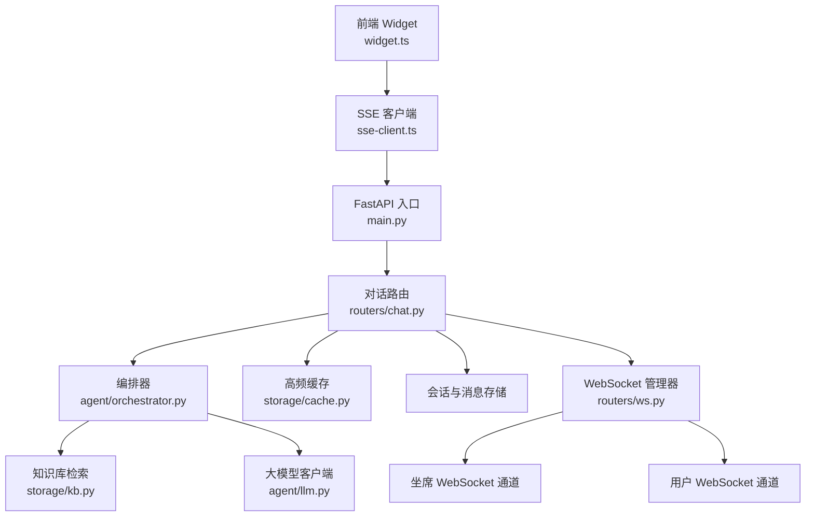
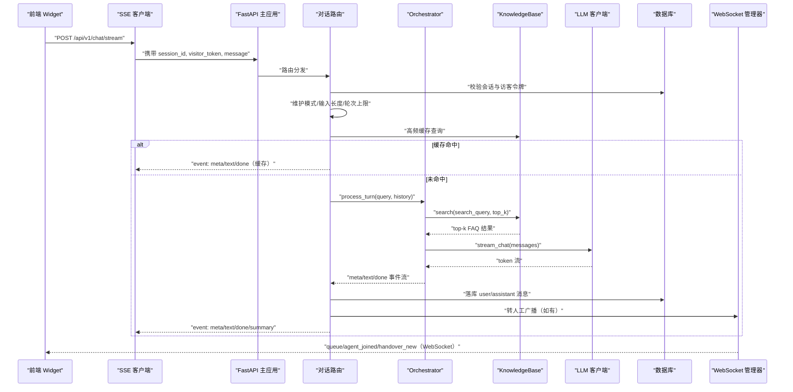
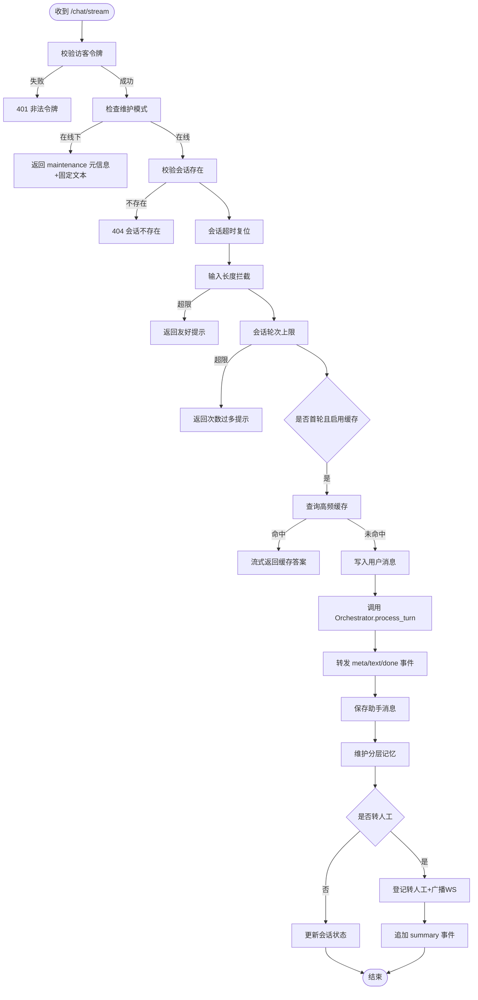
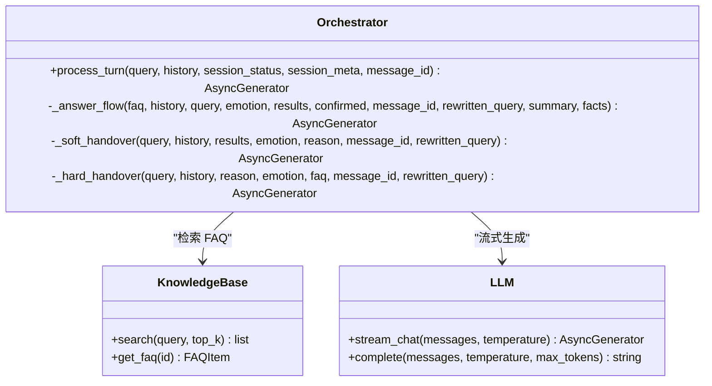
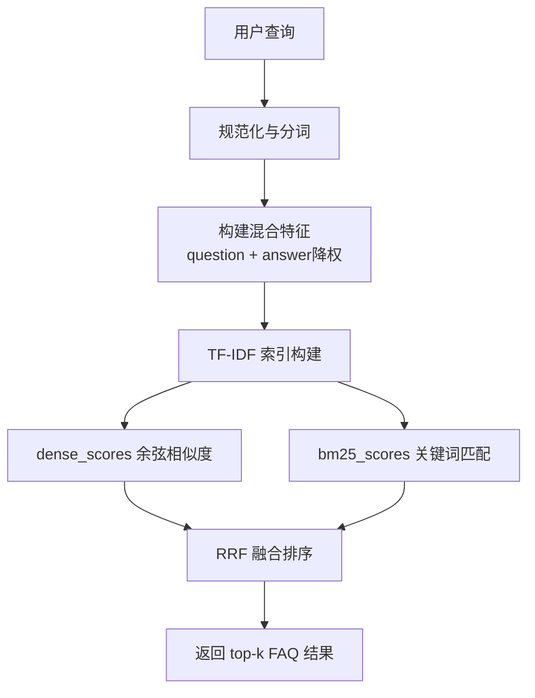
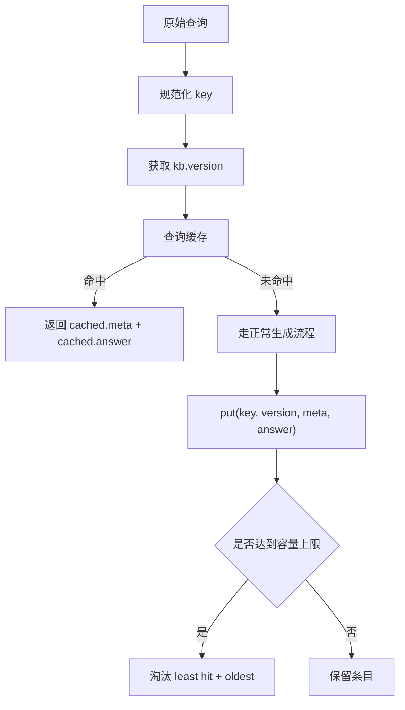
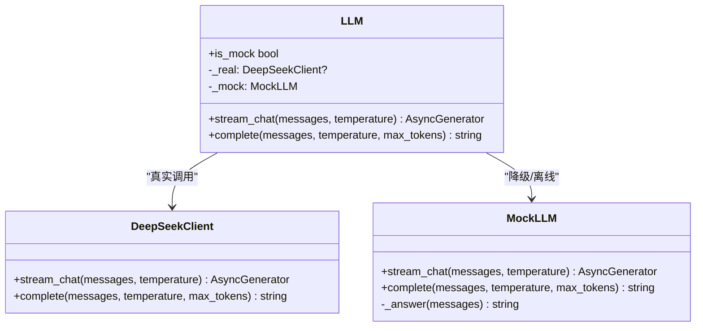
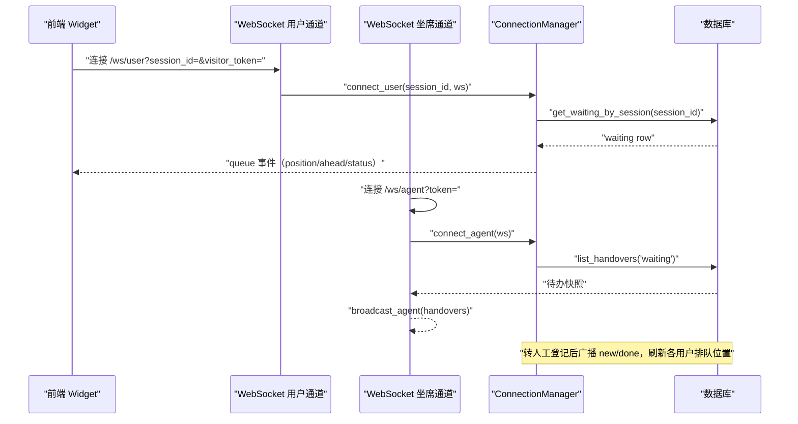
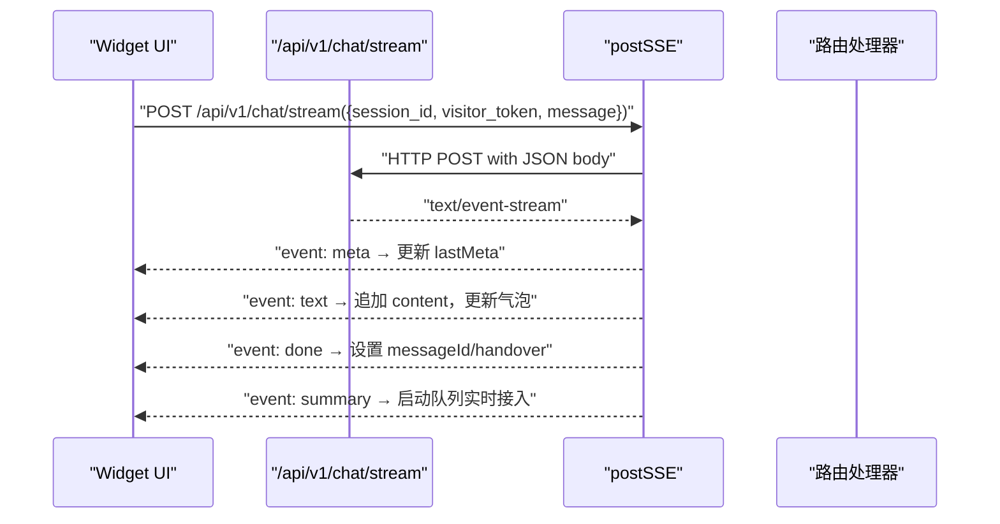
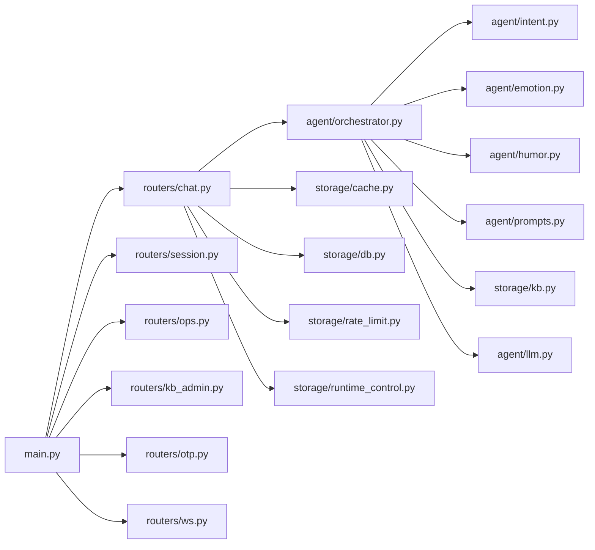

# 数据流设计

<cite>
**本文引用的文件 **
- [backend/app/main.py](file://backend/app/main.py)
- [backend/app/routers/chat.py](file://backend/app/routers/chat.py)
- [backend/app/routers/ws.py](file://backend/app/routers/ws.py)
- [backend/app/agent/orchestrator.py](file://backend/app/agent/orchestrator.py)
- [backend/app/storage/kb.py](file://backend/app/storage/kb.py)
- [backend/app/storage/cache.py](file://backend/app/storage/cache.py)
- [backend/app/agent/llm.py](file://backend/app/agent/llm.py)
- [frontend/src/widget.ts](file://frontend/src/widget.ts)
- [frontend/src/sse-client.ts](file://frontend/src/sse-client.ts)
- [knowledge_base/faq.json](file://knowledge_base/faq.json)
</cite>

## 目录
1. [引言](#引言)
2. [项目结构](#项目结构)
3. [核心组件](#核心组件)
4. [架构总览](#架构总览)
5. [详细组件分析](#详细组件分析)
6. [依赖关系分析](#依赖关系分析)
7. [性能与缓存策略](#性能与缓存策略)
8. [实时通信协议](#实时通信协议)
9. [故障排查](#故障排查)
10. [结论](#结论)

## 引言
本设计文档描述 smart_bot 的端到端数据流：用户在前端 Widget 输入消息后，请求经 FastAPI 路由进入 Orchestrator 编排管线，通过 KnowledgeBase 检索匹配 FAQ，再调用 LLM 生成回答；最终通过 SSE 流式返回给前端。同时说明 WebSocket 用于坐席通知和用户排队状态推送，并解释 Top20 高频问题秒回缓存机制。文档包含数据流向图、事件序列图以及不同场景（知识库命中、LLM 生成、转人工、维护模式）下的处理链路。

## 项目结构
后端采用 FastAPI 模块化组织：入口注册全局中间件和路由，对话逻辑集中在 chat 路由，Agent 编排由 orchestrator 承担，检索在 storage.kb，缓存为 storage.cache，LLM 抽象在 agent.llm，WebSocket 通道在 routers.ws。前端通过 Web Component 嵌入页面，使用 POST + SSE 发起聊天，并在需要时建立 WebSocket 接收排队事件。

**图示来源**
- [backend/app/main.py:1-63](file://backend/app/main.py#L1-L63)
- [backend/app/routers/chat.py:1-200](file://backend/app/routers/chat.py#L1-L200)
- [backend/app/agent/orchestrator.py:1-200](file://backend/app/agent/orchestrator.py#L1-L200)
- [backend/app/storage/kb.py:1-200](file://backend/app/storage/kb.py#L1-L200)
- [backend/app/storage/cache.py:1-82](file://backend/app/storage/cache.py#L1-L82)
- [backend/app/agent/llm.py:1-177](file://backend/app/agent/llm.py#L1-L177)
- [backend/app/routers/ws.py:1-149](file://backend/app/routers/ws.py#L1-L149)
- [frontend/src/widget.ts:1-200](file://frontend/src/widget.ts#L1-L200)
- [frontend/src/sse-client.ts:1-59](file://frontend/src/sse-client.ts#L1-L59)

**章节来源**
- [backend/app/main.py:1-63](file://backend/app/main.py#L1-L63)
- [frontend/src/widget.ts:1-200](file://frontend/src/widget.ts#L1-L200)

## 核心组件
- FastAPI 应用与中间件：CORS、IP 限流、健康检查、全局知识库加载。
- 对话路由 `/api/v1/chat/init` 与 `/api/v1/chat/stream`：会话初始化、访客令牌校验、维护模式熔断、输入长度与会话轮次限制、高频缓存命中、记忆维护、转人工登记与 WebSocket 广播。
- Orchestrator：情绪分级、查询重写、混合检索、置信度决策、否定句 NLI 校验、高风险 FAQ 拦截、LLM 流式生成、事实校验、软/硬转人工。
- KnowledgeBase：TF-IDF 向量索引、BM25 关键词检索、RRF 融合、中文分词与 bigram 特征、风险词与否定词检测。
- 高频缓存 AnswerCache：规范化 query key、Top20 容量淘汰、按 kb.version 失效。
- LLM 客户端：DeepSeek 真实流式与非流式调用、MockLLM 离线规则输出。
- WebSocket 通道：用户排队进度推送、坐席待办广播、连接管理与认证。
- 前端 Widget：Web Component 形态、SSE 事件解析、打字机渲染、FAQ 徽章、CSAT 打分、OTP 验证卡片、队列实时接入。

**章节来源**
- [backend/app/main.py:1-63](file://backend/app/main.py#L1-L63)
- [backend/app/routers/chat.py:1-200](file://backend/app/routers/chat.py#L1-L200)
- [backend/app/agent/orchestrator.py:1-200](file://backend/app/agent/orchestrator.py#L1-L200)
- [backend/app/storage/kb.py:1-200](file://backend/app/storage/kb.py#L1-L200)
- [backend/app/storage/cache.py:1-82](file://backend/app/storage/cache.py#L1-L82)
- [backend/app/agent/llm.py:1-177](file://backend/app/agent/llm.py#L1-L177)
- [backend/app/routers/ws.py:1-149](file://backend/app/routers/ws.py#L1-L149)
- [frontend/src/widget.ts:200-500](file://frontend/src/widget.ts#L200-L500)

## 架构总览
以下架构图展示从前端到后端的完整数据路径，包括 SSE 与 WebSocket 两条实时通道。

**图示来源**
- [backend/app/routers/chat.py:1-327](file://backend/app/routers/chat.py#L1-L327)
- [backend/app/agent/orchestrator.py:1-404](file://backend/app/agent/orchestrator.py#L1-L404)
- [backend/app/storage/kb.py:1-200](file://backend/app/storage/kb.py#L1-L200)
- [backend/app/agent/llm.py:1-177](file://backend/app/agent/llm.py#L1-L177)
- [backend/app/routers/ws.py:1-149](file://backend/app/routers/ws.py#L1-L149)
- [frontend/src/sse-client.ts:1-59](file://frontend/src/sse-client.ts#L1-L59)
- [frontend/src/widget.ts:200-500](file://frontend/src/widget.ts#L200-L500)

## 详细组件分析

### 对话路由与 SSE 流式响应
- 会话初始化：创建或恢复会话、下发 Visitor Token、返回历史消息与快捷按钮。
- 流式接口：
  - 访客令牌校验失败直接拒绝。
  - 维护模式直接返回 maintenance 元信息与固定提示。
  - 会话不存在则 404。
  - 会话超时自动复位；确认状态超时取消。
  - 全局转人工半切：绕过检索与 LLM，直接登记转人工并流式返回排队提示。
  - 输入长度拦截与会话轮次上限保护。
  - 首轮高频缓存命中秒回，不调用 LLM。
  - 正常流程：写入用户消息、更新轮次、组装历史上下文、调用 Orchestrator、流式转发事件、完成后落库助手消息、维护分层记忆、必要时登记转人工并广播 WebSocket。

**图示来源**
- [backend/app/routers/chat.py:1-327](file://backend/app/routers/chat.py#L1-L327)

**章节来源**
- [backend/app/routers/chat.py:1-327](file://backend/app/routers/chat.py#L1-L327)

### Orchestrator 编排管线
Orchestrator 串联以下阶段：
- 用户主动要求转人工：立即走硬转人工流程。
- 防死循环：连续多轮未解决触发硬转人工。
- 确认状态机：可中断的 CONFIRMING 状态，支持确认/否认分支。
- 并行任务：情绪分类与查询重写互不依赖，降低首字延迟。
- 红灯熔断：极端负面情绪或风险词直接硬转人工。
- 混合检索：改写后的查询进行 KB 检索，得到 top-k 结果。
- 决策分支：
  - 明确转人工：软转人工（澄清挽留）。
  - 不确定：NLI 语义方向校验或 can_answer 判断。
  - 高风险 FAQ：硬转人工。
  - 有匹配 FAQ：进入 _answer_flow 流式生成。
- 生成流程：
  - 构建 system 与 user prompt，注入上下文、历史、摘要与结构化事实。
  - 支持幽默两段式（先事实版、后润色），否则单段流式。
  - 输出校验：关键数字/金额/时间必须能在上下文中找到依据，否则回退并转人工。
  - 产出 done 事件，含 handover 标记与摘要。

**图示来源**
- [backend/app/agent/orchestrator.py:1-404](file://backend/app/agent/orchestrator.py#L1-L404)
- [backend/app/storage/kb.py:1-200](file://backend/app/storage/kb.py#L1-L200)
- [backend/app/agent/llm.py:1-177](file://backend/app/agent/llm.py#L1-L177)

**章节来源**
- [backend/app/agent/orchestrator.py:1-404](file://backend/app/agent/orchestrator.py#L1-L404)

### KnowledgeBase 检索与索引
- 分词：jieba 中文分词 + 停用词过滤 + 小写归一。
- 混合特征：标准问法与变体组合为 question tokens，answer tokens 降权，提升问法匹配精度。
- TF-IDF 向量索引：构建 doc_token_lists、vocab、idf、doc_vectors，支持 dense_scores 余弦相似度。
- BM25 评分：基于词频、文档频率与平均文档长度计算。
- RRF 融合：将 dense 与 bm25 分数融合，得到综合排序。
- 否定词与风险词检测：用于后续决策与熔断。

**图示来源**
- [backend/app/storage/kb.py:1-200](file://backend/app/storage/kb.py#L1-L200)

**章节来源**
- [backend/app/storage/kb.py:1-200](file://backend/app/storage/kb.py#L1-L200)

### 高频缓存策略（Top20 秒回）
- Key 规范化：对原始 query 做 jieba 分词、停用词过滤、纯标点 token 剔除，形成稳定键。
- 容量控制：默认最大 20 条，淘汰策略优先淘汰“命中次数最少且最久未命中”的条目。
- 失效机制：当知识库版本变化时整体清空，避免旧口径被命中。
- 使用条件：仅在会话首轮且启用缓存时生效；仅缓存自动回答结果（非转人工）。

**图示来源**
- [backend/app/storage/cache.py:1-82](file://backend/app/storage/cache.py#L1-L82)

**章节来源**
- [backend/app/storage/cache.py:1-82](file://backend/app/storage/cache.py#L1-L82)

### LLM 客户端与流式输出
- DeepSeek 客户端：OpenAI 兼容接口，配置 base_url、model、timeout、retries，支持 stream_chat 逐 token 输出。
- MockLLM：离线规则化输出，模拟情绪分级、查询改写、事实提取、摘要压缩、快捷回复模板、布尔判断等。
- LLM 统一入口：根据配置自动选择真实或 Mock，对外暴露 stream_chat 与 complete。

**图示来源**
- [backend/app/agent/llm.py:1-177](file://backend/app/agent/llm.py#L1-L177)

**章节来源**
- [backend/app/agent/llm.py:1-177](file://backend/app/agent/llm.py#L1-L177)

### WebSocket 实时通道
- 用户端 `/ws/user`：校验访客令牌后建连，首帧推送当前排队状态；只消费心跳/关闭信号，业务推送全部由服务端主动。
- 坐席端 `/ws/agent`：可选 token 校验，首帧下发待办快照；后续推送新增与完成事件。
- 事件类型：
  - 用户端：`queue`（排队位置、前面人数、状态）、`agent_joined`（人工已接入）。
  - 坐席端：`handovers`（初始快照）、`handover_new`（新工单）、`handover_done`（工单完成）。
- 连接管理：ConnectionManager 维护用户会话集合与坐席集合，线程安全地推送与断开。

**图示来源**
- [backend/app/routers/ws.py:1-149](file://backend/app/routers/ws.py#L1-L149)

**章节来源**
- [backend/app/routers/ws.py:1-149](file://backend/app/routers/ws.py#L1-L149)

### 前端 Widget 与 SSE 客户端
- Widget：
  - 两种形态：inline 内嵌面板、floating 悬浮按钮。
  - 初始化：调用 `/api/v1/chat/init`，持久化 session_id，拉取历史消息，渲染快捷按钮。
  - 发送消息：构造 POST 请求至 `/api/v1/chat/stream`，使用 sse-client 解析 text/event-stream。
  - 事件处理：meta 记录最后元信息，text 增量拼接实现打字机效果，done 标记 messageId 与 handover，summary 触发队列实时接入。
  - 转人工后：展示 FAQ 徽章、反馈按钮、CSAT 打分卡片、OTP 验证卡片（敏感引导）。
- SSE 客户端：
  - 使用 fetch ReadableStream 读取 chunk，按 `\n\n` 分割事件，解析 event/data 字段。
  - 错误处理：网络异常时抛出带状态码的错误信息。

**图示来源**
- [frontend/src/widget.ts:200-500](file://frontend/src/widget.ts#L200-L500)
- [frontend/src/sse-client.ts:1-59](file://frontend/src/sse-client.ts#L1-L59)
- [backend/app/routers/chat.py:1-327](file://backend/app/routers/chat.py#L1-L327)

**章节来源**
- [frontend/src/widget.ts:200-500](file://frontend/src/widget.ts#L200-L500)
- [frontend/src/sse-client.ts:1-59](file://frontend/src/sse-client.ts#L1-L59)

## 依赖关系分析
- FastAPI 入口依赖配置、全局知识库、IP 限流中间件，并注册所有路由模块。
- 对话路由依赖 Orchestrator、Memory、Prompts、Cache、DB、RuntimeControl、RateLimit。
- Orchestrator 依赖 Emotion、Humor、Intent、LLM、Prompts、KnowledgeBase。
- KnowledgeBase 依赖 jieba、math、collections、dataclasses。
- LLM 依赖 OpenAI 异步客户端（可选）与配置。
- WebSocket 管理器依赖 DB、RateLimit（访客令牌校验）。

**图示来源**
- [backend/app/main.py:1-63](file://backend/app/main.py#L1-L63)
- [backend/app/routers/chat.py:1-200](file://backend/app/routers/chat.py#L1-L200)
- [backend/app/agent/orchestrator.py:1-200](file://backend/app/agent/orchestrator.py#L1-L200)

**章节来源**
- [backend/app/main.py:1-63](file://backend/app/main.py#L1-L63)
- [backend/app/routers/chat.py:1-200](file://backend/app/routers/chat.py#L1-L200)

## 性能与缓存策略
- IP 限流：网关层 10 次/分钟/IP，超过返回 429。
- 输入长度拦截：防止超长乱码撑爆 Context。
- 会话轮次上限：成本熔断。
- 首轮高频缓存：Top20 命中率高的问题秒回，首字延迟目标 < 500ms。
- 并行任务：情绪分类与查询重写并发执行，减少首字延迟。
- 流式输出：LLM 逐 token 输出，前端即时渲染。
- 记忆维护：每轮结束后压缩早期历史，保持上下文窗口可控。
- 知识库重建：kb.version 变化时清空缓存，保证口径一致。

[本节为通用指导，不涉及具体文件分析]

## 实时通信协议
- SSE（Server-Sent Events）：
  - 请求：POST `/api/v1/chat/stream`，Content-Type application/json。
  - 响应：text/event-stream，事件类型包括 meta、text、done、summary。
  - 事件数据：
    - meta：会话元信息（状态、情绪、意图、置信度、FAQ 列表、快捷按钮、是否转人工）。
    - text：增量文本内容。
    - done：结束标记（message_id、handover、reason、summary）。
    - summary：转人工排队摘要（queue_id、status）。
- WebSocket：
  - 用户端 `/ws/user?session_id=&visitor_token=`：接收 queue 与 agent_joined 事件。
  - 坐席端 `/ws/agent?token=`：接收 handovers、handover_new、handover_done 事件。
  - 事件格式：JSON，type 字段标识事件类型，data 字段携带业务数据。

**章节来源**
- [backend/app/routers/chat.py:1-327](file://backend/app/routers/chat.py#L1-L327)
- [backend/app/routers/ws.py:1-149](file://backend/app/routers/ws.py#L1-L149)
- [frontend/src/sse-client.ts:1-59](file://frontend/src/sse-client.ts#L1-L59)
- [frontend/src/widget.ts:200-500](file://frontend/src/widget.ts#L200-L500)

## 故障排查
- 401 非法访客令牌：检查前端是否正确传递 visitor_token 与 session_id。
- 404 会话不存在：检查会话初始化是否成功，或会话是否过期复位。
- 429 请求频繁：IP 限流触发，等待冷却后重试。
- 网络错误：SSE 客户端捕获错误信息，前端显示友好提示。
- 转人工广播失败：WebSocket 广播异常会被记录日志，不影响主流程。
- 记忆维护异常：分层记忆压缩失败会记录警告，不影响对话继续。

**章节来源**
- [backend/app/routers/chat.py:1-327](file://backend/app/routers/chat.py#L1-L327)
- [backend/app/routers/ws.py:1-149](file://backend/app/routers/ws.py#L1-L149)
- [frontend/src/sse-client.ts:1-59](file://frontend/src/sse-client.ts#L1-L59)

## 结论
smart_bot 的数据流以 FastAPI 路由为入口，Orchestrator 为核心编排器，KnowledgeBase 提供混合检索能力，LLM 负责生成回答，SSE 实现实时流式响应，WebSocket 支撑坐席通知与用户排队状态。Top20 高频缓存显著提升常见问题的响应速度。系统具备完善的防御机制（令牌校验、限流、输入拦截、轮次上限、维护模式熔断），并通过分层记忆与事实校验提升稳定性与可解释性。