# 架构总览

<cite>
**本文引用的文件**   
- [backend/app/main.py](file://backend/app/main.py)
- [backend/app/config.py](file://backend/app/config.py)
- [backend/app/routers/chat.py](file://backend/app/routers/chat.py)
- [backend/app/routers/ws.py](file://backend/app/routers/ws.py)
- [backend/app/agent/orchestrator.py](file://backend/app/agent/orchestrator.py)
- [backend/app/agent/llm.py](file://backend/app/agent/llm.py)
- [backend/app/storage/db.py](file://backend/app/storage/db.py)
- [backend/app/storage/kb.py](file://backend/app/storage/kb.py)
- [frontend/src/main.ts](file://frontend/src/main.ts)
- [frontend/src/widget.ts](file://frontend/src/widget.ts)
- [frontend/package.json](file://frontend/package.json)
- [frontend/vite.config.ts](file://frontend/vite.config.ts)
- [docker-compose.yml](file://docker-compose.yml)
- [dev.sh](file://dev.sh)
</cite>

## 目录
1. [引言](#引言)
2. [项目结构](#项目结构)
3. [核心组件](#核心组件)
4. [架构总览](#架构总览)
5. [详细组件分析](#详细组件分析)
6. [依赖关系分析](#依赖关系分析)
7. [性能与可扩展性](#性能与可扩展性)
8. [部署拓扑](#部署拓扑)
9. [故障排查指南](#故障排查指南)
10. [结论](#结论)

## 引言
smart_bot 是一个前后端分离的 AI 客服系统：用户通过浏览器中的 Web Widget 发起对话，前端通过 HTTP 和 WebSocket 与 FastAPI 后端通信；后端负责会话管理、检索增强、大模型调用编排、SQLite 持久化，并在生产期可接入向量库与缓存中间件。整体遵循模块化、可扩展性、安全性与性能优化四大设计原则，同时为 MVP 到生产的演进预留了平滑升级路径。

## 项目结构
仓库采用按职责划分的分层结构：

- 后端 `backend/app`：FastAPI 应用入口、路由、Agent 编排、存储层、配置。
- 前端 `frontend/src`：TypeScript 源码，包含官网渲染、聊天 Widget、SSE 客户端、站点脚本等。
- 知识库 `knowledge_base`：FAQ JSON 与构建脚本。
- 运维脚本：一键启动、健康检查、Docker Compose。

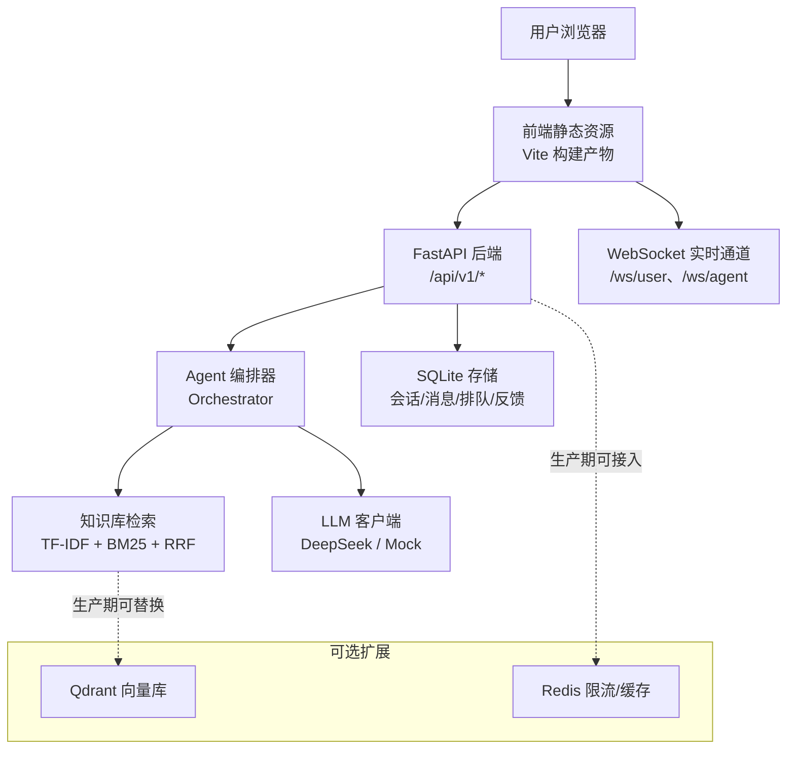

图表来源
- [backend/app/main.py:1-63](file://backend/app/main.py#L1-L63)
- [frontend/vite.config.ts:1-30](file://frontend/vite.config.ts#L1-L30)
- [docker-compose.yml:1-16](file://docker-compose.yml#L1-L16)

章节来源
- [backend/app/main.py:1-63](file://backend/app/main.py#L1-L63)
- [frontend/package.json:1-16](file://frontend/package.json#L1-L16)
- [frontend/vite.config.ts:1-30](file://frontend/vite.config.ts#L1-L30)
- [docker-compose.yml:1-16](file://docker-compose.yml#L1-L16)

## 核心组件
- FastAPI 服务：统一入口、CORS、IP 限流中间件、健康检查、路由注册。
- Agent 编排器：情绪分级、查询重写、检索决策、生成校验、转人工流程。
- 知识库模块：TF-IDF 混合特征索引、BM25 评分、RRF 融合，支持风险词与否定句检测。
- LLM 客户端：真实 DeepSeek 流式接口与离线 Mock 实现，统一切换。
- SQLite 存储：会话、消息、反馈、Bad Case、CSAT、人工排队、FAQ 草稿与版本历史。
- WebSocket 管理器：用户排队状态推送、坐席待办广播。
- 前端 Widget：Web Components 原生组件，支持悬浮面板与内嵌模式，SSE 流式渲染与 WebSocket 降级轮询。

章节来源
- [backend/app/main.py:1-63](file://backend/app/main.py#L1-L63)
- [backend/app/agent/orchestrator.py:1-200](file://backend/app/agent/orchestrator.py#L1-L200)
- [backend/app/storage/kb.py:1-200](file://backend/app/storage/kb.py#L1-L200)
- [backend/app/agent/llm.py:1-177](file://backend/app/agent/llm.py#L1-L177)
- [backend/app/storage/db.py:1-200](file://backend/app/storage/db.py#L1-L200)
- [backend/app/routers/ws.py:1-149](file://backend/app/routers/ws.py#L1-L149)
- [frontend/src/widget.ts:1-200](file://frontend/src/widget.ts#L1-L200)

## 架构总览
系统上下文展示了五类关键参与者：用户浏览器、Web Widget、FastAPI 服务、LLM API、SQLite。前端通过 `/api/v1/chat/init` 初始化会话并获取访客令牌，随后使用 SSE 流式接口 `/api/v1/chat/stream` 接收回答增量；需要人工时进入 WebSocket 排队通道 `/ws/user` 与 `/ws/agent`。

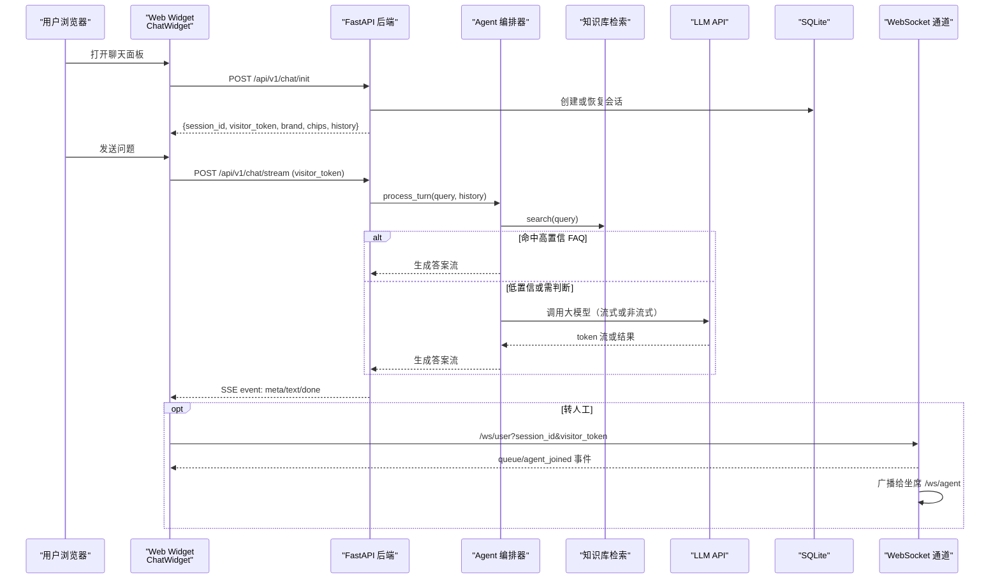

图表来源
- [backend/app/routers/chat.py:1-200](file://backend/app/routers/chat.py#L1-L200)
- [backend/app/agent/orchestrator.py:1-200](file://backend/app/agent/orchestrator.py#L1-L200)
- [backend/app/agent/llm.py:1-177](file://backend/app/agent/llm.py#L1-L177)
- [backend/app/storage/db.py:1-200](file://backend/app/storage/db.py#L1-L200)
- [backend/app/routers/ws.py:1-149](file://backend/app/routers/ws.py#L1-L149)
- [frontend/src/widget.ts:1-200](file://frontend/src/widget.ts#L1-L200)

## 详细组件分析

### FastAPI 后端服务
FastAPI 应用加载全局配置、一次性构建知识库、注册 CORS 与 IP 限流中间件，并暴露 `/health` 健康检查。所有业务路由通过子模块路由器集中挂载。

- 中间件：对 `/api/` 前缀请求执行 IP 级每分钟限制，超限返回 429。
- 生命周期：启动阶段读取 `.env`，构建知识库，输出 FAQ 数量与分类统计。
- 安全：CORS 允许全部来源用于开发；访问令牌在会话初始化后下发。

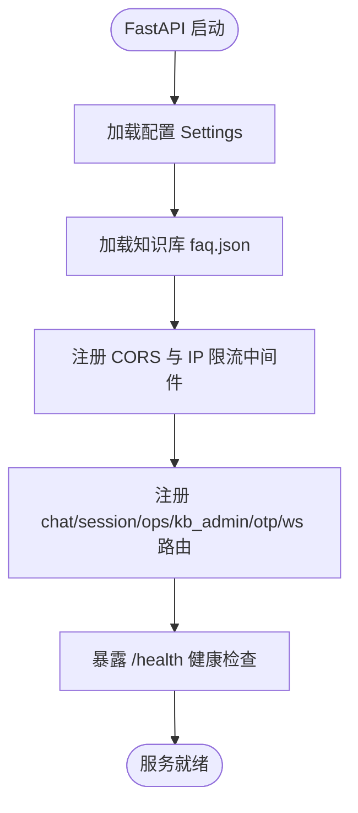

图表来源
- [backend/app/main.py:1-63](file://backend/app/main.py#L1-L63)
- [backend/app/config.py:1-104](file://backend/app/config.py#L1-L104)

章节来源
- [backend/app/main.py:1-63](file://backend/app/main.py#L1-L63)
- [backend/app/config.py:1-104](file://backend/app/config.py#L1-L104)

### 会话与对话路由
对话路由提供会话初始化、SSE 流式回答与转人工登记能力，承担访客令牌校验、维护模式开关、输入长度与轮次熔断、高频缓存命中秒回等逻辑。

- 会话初始化：创建或恢复会话，绑定用户 ID，返回历史消息与快捷标签。
- 对话流：校验访客令牌 → 维护模式判定 → 会话超时复位 → 确认态超时清理 → 全局转人工半切 → 输入拦截 → 轮次上限 → 高频缓存命中 → 检索与编排 → 生成与校验 → 落库与完成事件。
- 安全：无访客令牌直接拒绝；超长输入不调用 LLM；轮次硬上限控制成本。

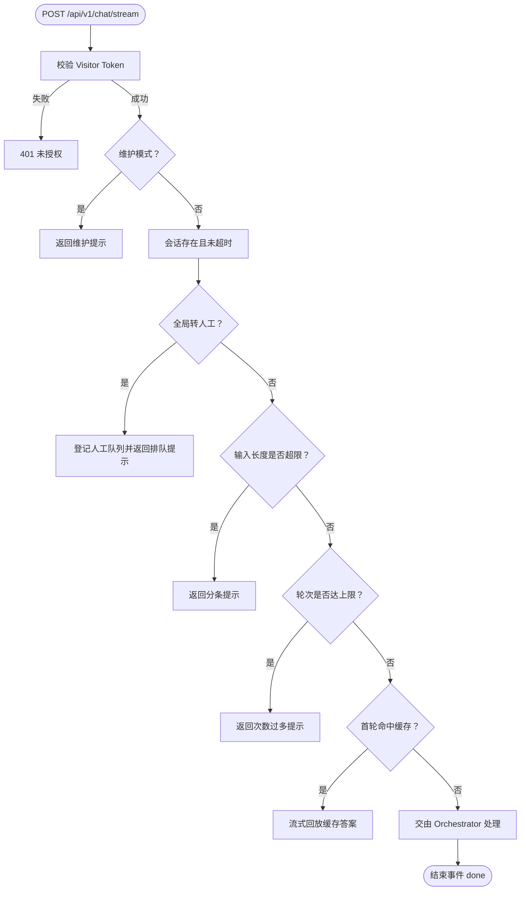

图表来源
- [backend/app/routers/chat.py:1-200](file://backend/app/routers/chat.py#L1-L200)

章节来源
- [backend/app/routers/chat.py:1-200](file://backend/app/routers/chat.py#L1-L200)

### Agent 编排器
编排器串联情绪分级、查询重写、检索召回、置信度决策、NLI 语义校验、高风险 FAQ 拦截、LLM 生成与事实校验，最终产出结构化 SSE 事件流。

- 主流程：主动转人工 → 防死循环计数 → 确认状态机 → 并行情绪与重写 → 红灯熔断 → 混合检索 → 决策分支 → 高风险拦截 → 生成与校验。
- 记忆：每轮提取结构化事实与摘要，写入会话元数据，降低长对话上下文膨胀。
- 输出：meta、text、done、summary 事件，支持快速按钮与转人工标记。

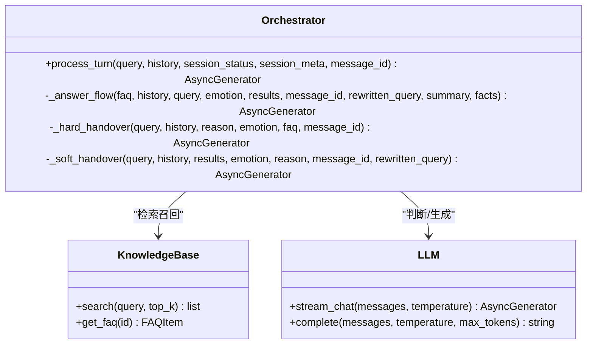

图表来源
- [backend/app/agent/orchestrator.py:1-200](file://backend/app/agent/orchestrator.py#L1-L200)
- [backend/app/storage/kb.py:1-200](file://backend/app/storage/kb.py#L1-L200)
- [backend/app/agent/llm.py:1-177](file://backend/app/agent/llm.py#L1-L177)

章节来源
- [backend/app/agent/orchestrator.py:1-200](file://backend/app/agent/orchestrator.py#L1-L200)

### 知识库检索
知识库模块基于本地 TF-IDF 向量与 BM25 关键词评分，结合中文 jieba 分词与大二gram 混合特征，最后用 RRF 融合打分。它还提供否定词与风险词检测、FAQ 数据结构、搜索文本拼接与权重策略。

- 分词：jieba 停用词过滤 + 小写归一 + bigram 连续字符特征。
- 索引：文档词频、IDF、L2 归一化向量；BM25 文档长度自适应。
- 检索：余弦相似度 + BM25 + RRF 融合；FAQ 项含类别、变体、答案、风险等级与后续追问。
- 扩展：接口以 `KnowledgeBase` 为边界，生产期可替换为豆包/BGE-M3 嵌入 + Qdrant。

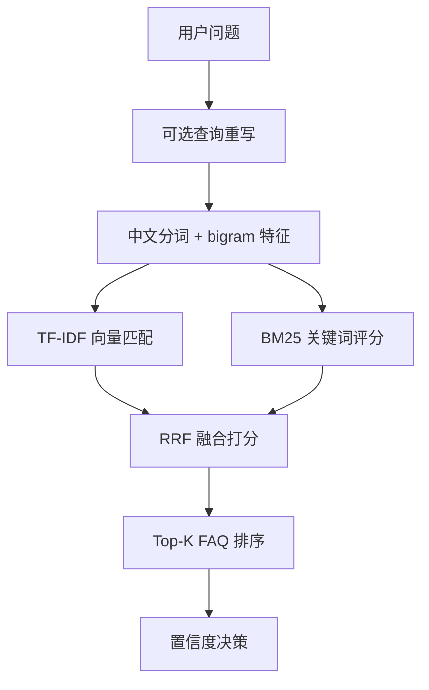

图表来源
- [backend/app/storage/kb.py:1-200](file://backend/app/storage/kb.py#L1-L200)

章节来源
- [backend/app/storage/kb.py:1-200](file://backend/app/storage/kb.py#L1-L200)

### LLM 客户端
LLM 模块统一封装真实 DeepSeek 与离线 Mock 两种实现，根据配置自动切换。Mock 覆盖情绪分级、查询重写、事实提取、摘要压缩、意图判断、幽默润色等任务，便于离线测试与自动化评测。

- 真实模式：OpenAI 兼容异步客户端，流式 token 与非流式短输出。
- Mock 模式：正则任务提示解析，稳定规则化输出。
- 降级：初始化失败时自动降级 Mock，保证链路可用。

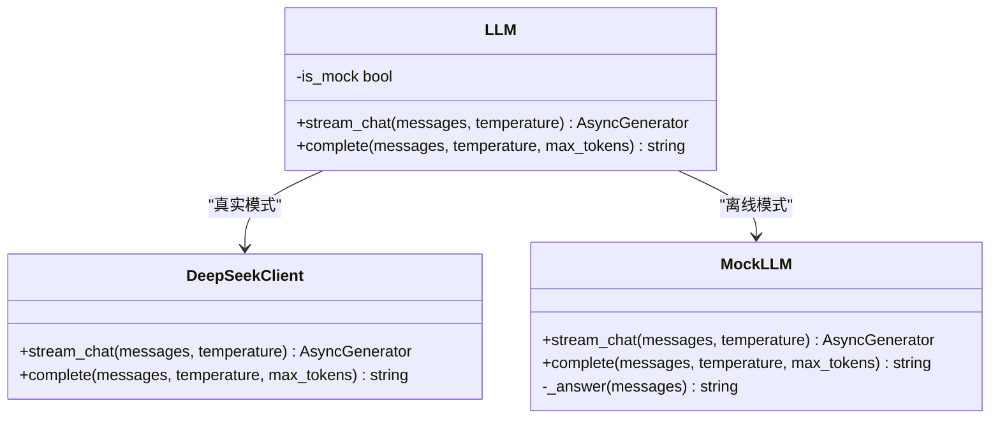

图表来源
- [backend/app/agent/llm.py:1-177](file://backend/app/agent/llm.py#L1-L177)

章节来源
- [backend/app/agent/llm.py:1-177](file://backend/app/agent/llm.py#L1-L177)

### WebSocket 实时通道
WebSocket 通道为用户提供排队位置与人工接入事件，为坐席提供新待办与完成事件的实时广播。连接建立即推送快照，连接断开自动清理。

- 用户端：`/ws/user?session_id&visitor_token`，访客令牌校验失败关闭连接。
- 坐席端：`/ws/agent?token`，可选 AGENT_WS_TOKEN 鉴权。
- 事件协议：queue、agent_joined、handovers、handover_new、handover_done。

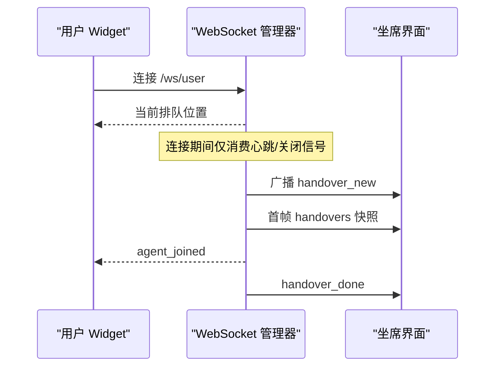

图表来源
- [backend/app/routers/ws.py:1-149](file://backend/app/routers/ws.py#L1-L149)

章节来源
- [backend/app/routers/ws.py:1-149](file://backend/app/routers/ws.py#L1-L149)

### 前端 Widget 与应用
前端由 Vite 构建多个 HTML 入口（官网、Agent、Dashboard、知识库后台），并通过 TypeScript 编写原生 Web Components。Widget 支持悬浮与内嵌两种形态，内置样式隔离于 Shadow DOM，向后兼容任意网站嵌入。

- 入口：`main.ts` 注册 Widget 并渲染站点。
- Widget：`widget.ts` 定义 `<xd-chat-widget>`，管理会话、SSE 流、排队与 CSAT、OTP 验证。
- 构建：`vite.config.ts` 将 `/api` 与 `/ws` 代理到后端，生产环境由网关或同源部署接管。

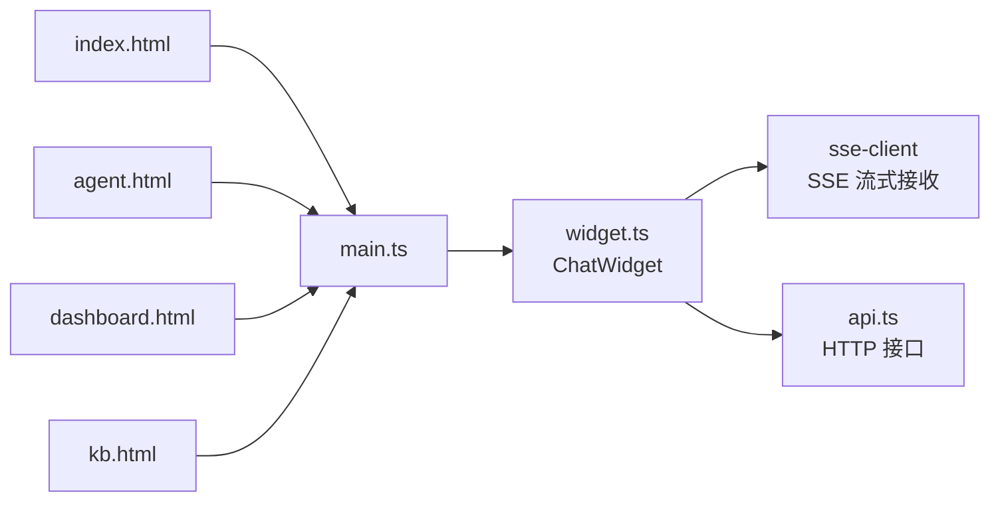

图表来源
- [frontend/src/main.ts:1-6](file://frontend/src/main.ts#L1-L6)
- [frontend/src/widget.ts:1-200](file://frontend/src/widget.ts#L1-L200)
- [frontend/vite.config.ts:1-30](file://frontend/vite.config.ts#L1-L30)

章节来源
- [frontend/src/main.ts:1-6](file://frontend/src/main.ts#L1-L6)
- [frontend/src/widget.ts:1-200](file://frontend/src/widget.ts#L1-L200)
- [frontend/vite.config.ts:1-30](file://frontend/vite.config.ts#L1-L30)

## 依赖关系分析
FastAPI 作为唯一对外服务端口，聚合路由、Agent 编排、存储与配置；前端通过静态资源与代理方式间接依赖后端。SQLite 是 MVP 默认存储，Qdrant 与 Redis 在生产期按需启用。

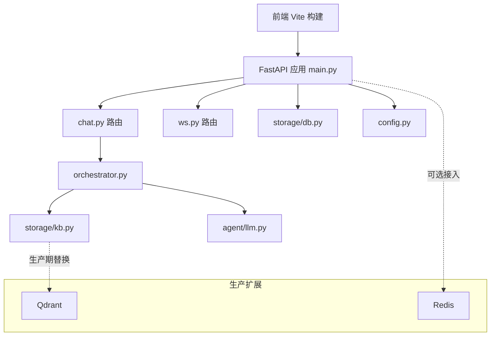

图表来源
- [backend/app/main.py:1-63](file://backend/app/main.py#L1-L63)
- [backend/app/routers/chat.py:1-200](file://backend/app/routers/chat.py#L1-L200)
- [backend/app/routers/ws.py:1-149](file://backend/app/routers/ws.py#L1-L149)
- [backend/app/agent/orchestrator.py:1-200](file://backend/app/agent/orchestrator.py#L1-L200)
- [backend/app/storage/kb.py:1-200](file://backend/app/storage/kb.py#L1-L200)
- [backend/app/agent/llm.py:1-177](file://backend/app/agent/llm.py#L1-L177)
- [backend/app/storage/db.py:1-200](file://backend/app/storage/db.py#L1-L200)
- [backend/app/config.py:1-104](file://backend/app/config.py#L1-L104)

章节来源
- [backend/app/main.py:1-63](file://backend/app/main.py#L1-L63)
- [docker-compose.yml:1-16](file://docker-compose.yml#L1-L16)

## 性能与可扩展性
- 异步高并发：FastAPI 基于 Starlette/uvicorn，支持异步路由与 SSE 流式响应，适合大量并发对话与实时事件。
- 零配置数据库：SQLite 无需额外服务，MVP 阶段单进程即可运行；WAL 模式提升并发读性能。
- 原生兼容性：Web Components 基于浏览器原生标准，Shadow DOM 样式隔离，避免与宿主页面冲突。
- 可扩展点：
  - 检索层：从本地 TF-IDF 迁移到豆包/BGE-M3 嵌入 + Qdrant。
  - 缓存与限流：从内存限流迁移到 Redis。
  - LLM：保持统一 LLM 抽象，便于接入其他厂商模型。
- 性能优化：
  - 首轮高频问答缓存命中秒回。
  - 情绪与查询重写并行执行以降低首字延迟。
  - 输入长度与轮次熔断防止异常流量。
  - 会话超时复位减少长期上下文膨胀。

[本节为通用指导，不直接分析具体文件]

## 部署拓扑
开发环境通过 `dev.sh` 同时启动后端 uvicorn 与前端 Vite 开发服务器，默认端口分别为 8000 与 5173，并等待后端健康检查就绪。生产环境可通过 Docker Compose 拉起 Qdrant 与 Redis，再由网关将 `/api` 与 `/ws` 转发至后端。

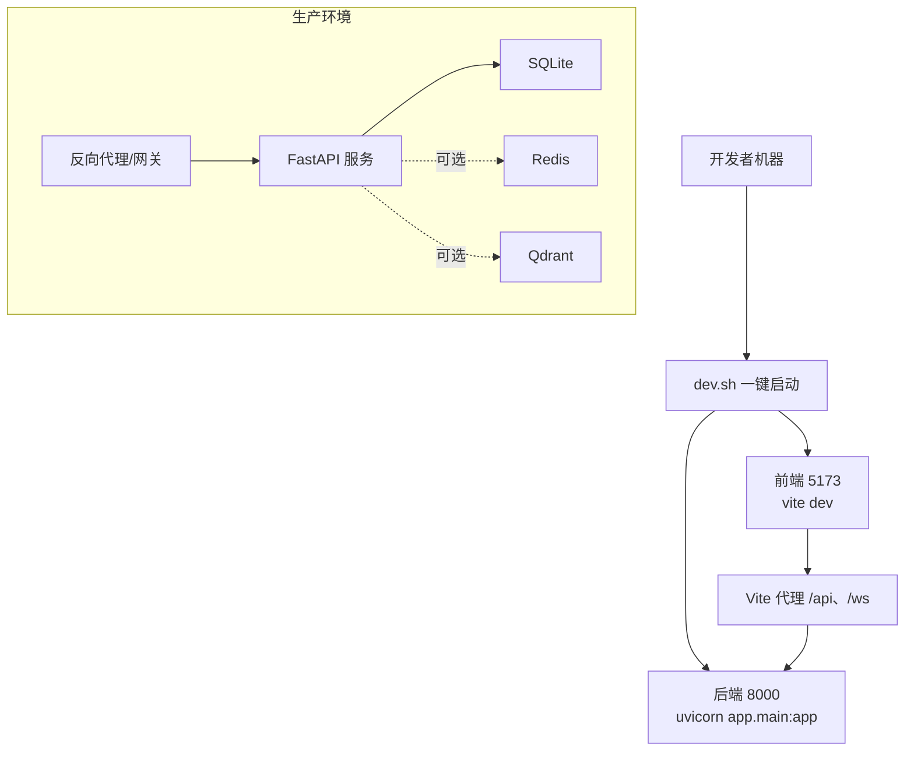

图表来源
- [dev.sh:1-75](file://dev.sh#L1-L75)
- [frontend/vite.config.ts:1-30](file://frontend/vite.config.ts#L1-L30)
- [docker-compose.yml:1-16](file://docker-compose.yml#L1-L16)

章节来源
- [dev.sh:1-75](file://dev.sh#L1-L75)
- [frontend/vite.config.ts:1-30](file://frontend/vite.config.ts#L1-L30)
- [docker-compose.yml:1-16](file://docker-compose.yml#L1-L16)

## 故障排查指南
- 后端不可用：检查 `/health` 返回的状态、品牌名、LLM 模式与 FAQ 数量；确认 `dev.sh` 是否成功启动 uvicorn。
- 访客令牌无效：确认会话已初始化并携带 `visitor_token`；检查 `/api/v1/chat/stream` 是否被中间件拦截。
- 无流式响应：确认 SSE 事件类型 `meta/text/done` 是否正常；检查网络代理与跨域设置。
- WebSocket 无法连接：确认 `/ws/user` 或 `/ws/agent` 的 token 参数正确；检查防火墙与代理是否透传 WebSocket。
- 知识库为空：确认 `faq.json` 路径与权限；查看启动日志中 FAQ 数量与分类统计。
- LLM 调用失败：检查 `DEEPSEEK_API_KEY` 与 `LLM_MODE`；确认 Mock 模式是否降级可用。

章节来源
- [backend/app/main.py:1-63](file://backend/app/main.py#L1-L63)
- [backend/app/routers/chat.py:1-200](file://backend/app/routers/chat.py#L1-L200)
- [backend/app/routers/ws.py:1-149](file://backend/app/routers/ws.py#L1-L149)
- [backend/app/agent/llm.py:1-177](file://backend/app/agent/llm.py#L1-L177)

## 结论
smart_bot 以 FastAPI 为核心服务，结合 TypeScript 前端与 SQLite 存储，形成清晰的前后端分离三层架构。Agent 编排器将检索、大模型与安全策略有机串联，提供可控、可观测、可扩展的对话流水线。通过 Web Components 的原生兼容性与 Vite 的灵活构建，系统在 MVP 与生产环境中均具备良好可部署性与可演进性。未来可平滑引入向量库与缓存中间件，进一步提升检索精度与吞吐能力。