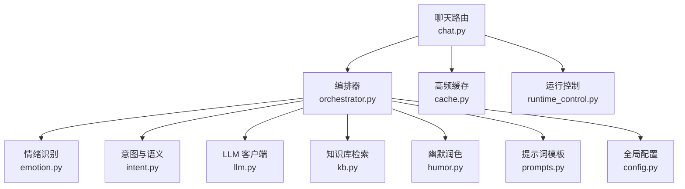
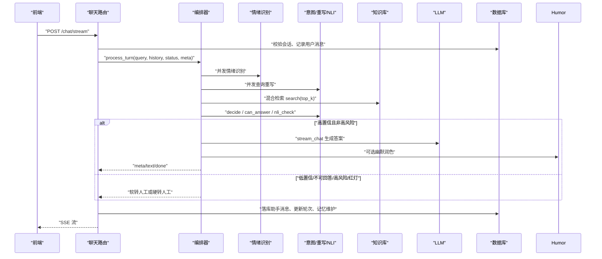
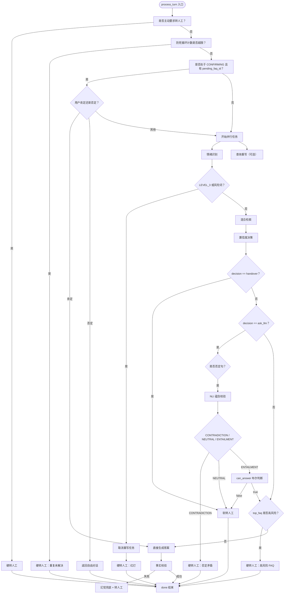
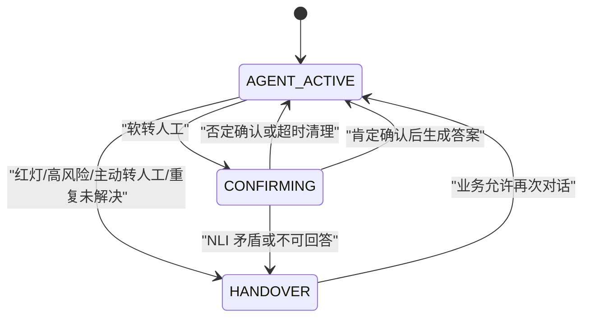
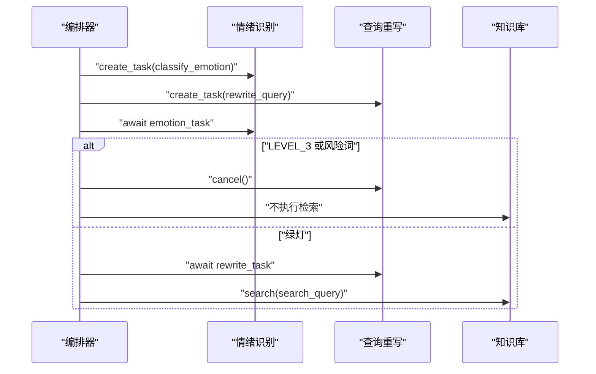
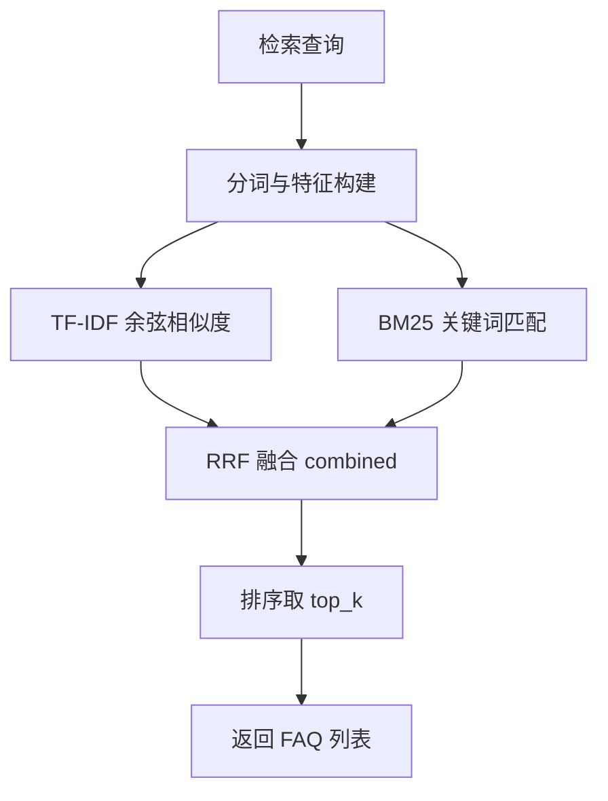
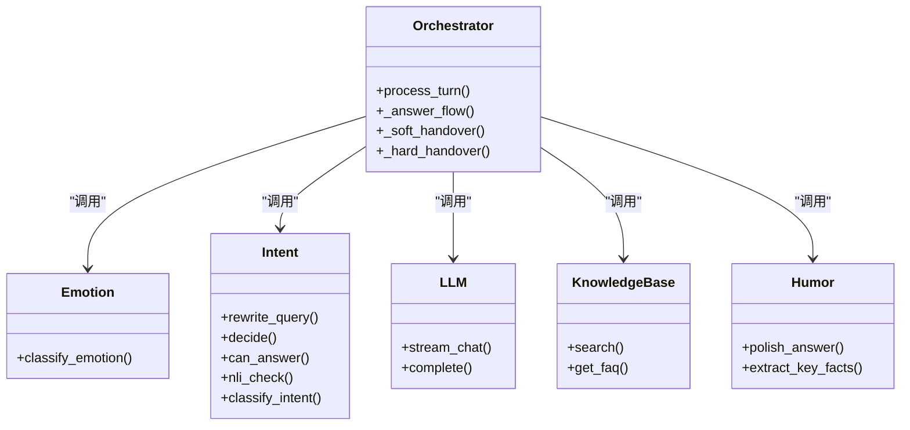

# Orchestrator 编排器

<cite>
**本文引用的文件**   
- [orchestrator.py](file://backend/app/agent/orchestrator.py)
- [emotion.py](file://backend/app/agent/emotion.py)
- [intent.py](file://backend/app/agent/intent.py)
- [llm.py](file://backend/app/agent/llm.py)
- [prompts.py](file://backend/app/agent/prompts.py)
- [humor.py](file://backend/app/agent/humor.py)
- [chat.py](file://backend/app/routers/chat.py)
- [schemas.py](file://backend/app/models/schemas.py)
- [cache.py](file://backend/app/storage/cache.py)
- [kb.py](file://backend/app/storage/kb.py)
- [runtime_control.py](file://backend/app/storage/runtime_control.py)
- [config.py](file://backend/app/config.py)
</cite>

## 目录
1. [引言](#引言)
2. [项目结构定位](#项目结构定位)
3. [核心组件总览](#核心组件总览)
4. [架构概览](#架构概览)
5. [详细组件分析](#详细组件分析)
6. [依赖关系分析](#依赖关系分析)
7. [性能与优化建议](#性能与优化建议)
8. [故障排查指南](#故障排查指南)
9. [结论](#结论)

## 引言
Orchestrator 编排器是客服对话系统的“管道主编排器”。它把用户输入按固定顺序串联成可中断、可熔断、可转人工的完整流程：情绪分级、查询重写、混合检索、置信度决策、LLM 生成、输出校验、确认状态机、转人工调度。其目标是降低首字延迟、提升检索精度、减少幻觉，并在高风险场景下主动把用户交给人工。

## 项目结构定位
Orchestrator 位于 `backend/app/agent/orchestrator.py`，由路由层 `backend/app/routers/chat.py` 在 `/api/v1/chat/stream` 中调用；它依赖情绪识别、意图识别、LLM 客户端、知识库和运行控制等模块。

**图示来源**
- [chat.py:10-25](file://backend/app/routers/chat.py#L10-L25)
- [orchestrator.py:1-40](file://backend/app/agent/orchestrator.py#L1-L40)
- [config.py:1-40](file://backend/app/config.py#L1-L40)

**章节来源**
- [orchestrator.py:1-40](file://backend/app/agent/orchestrator.py#L1-L40)
- [chat.py:10-25](file://backend/app/routers/chat.py#L10-L25)

## 核心组件总览
- **Orchestrator**：主入口 `process_turn`，定义事件流协议（meta/text/done），实现状态机、熔断、转人工、生成流程。
- **Emotion**：情绪分级 LEVEL_0～LEVEL_3，LLM 为主，关键词兜底。
- **Intent**：查询重写、相似度阈值决策、NLI 否定句校验、可回答性判断、意图分类。
- **LLM**：统一入口，支持真实 DeepSeek 与离线 Mock。
- **KB**：TF-IDF + BM25 + RRF 混合检索，提供 FAQItem、风险词、否定词、转人工语义检测。
- **Humor**：两段式幽默润色，关键数字一致性校验。
- **Router**：SSE 流式响应、会话轮次上限、输入长度拦截、Kill Switch、防死循环计数、记忆维护。
- **RuntimeControl**：auto / handover / off 模式与灰度分流。
- **Cache**：首轮高频问题秒回缓存。
- **Config**：阈值、开关、超时、限制等配置入口。

**章节来源**
- [orchestrator.py:1-40](file://backend/app/agent/orchestrator.py#L1-L40)
- [emotion.py:1-47](file://backend/app/agent/emotion.py#L1-L47)
- [intent.py:1-130](file://backend/app/agent/intent.py#L1-L130)
- [llm.py:1-177](file://backend/app/agent/llm.py#L1-L177)
- [kb.py:1-200](file://backend/app/storage/kb.py#L1-L200)
- [humor.py:1-55](file://backend/app/agent/humor.py#L1-L55)
- [chat.py:1-120](file://backend/app/routers/chat.py#L1-L120)
- [runtime_control.py:1-83](file://backend/app/storage/runtime_control.py#L1-L83)
- [cache.py:1-82](file://backend/app/storage/cache.py#L1-L82)
- [config.py:1-104](file://backend/app/config.py#L1-L104)

## 架构概览
编排器通过异步生成器向外推送三类 SSE 事件：
- meta：会话状态、情绪、意图、置信度、FAQ 列表、是否转人工、快捷回复、改写后的查询、幽默开关。
- text：流式增量文本或分片话术。
- done：结束标记，含是否转人工、原因、摘要、是否清除 pending 确认。

**图示来源**
- [chat.py:80-200](file://backend/app/routers/chat.py#L80-L200)
- [orchestrator.py:40-180](file://backend/app/agent/orchestrator.py#L40-L180)
- [emotion.py:20-47](file://backend/app/agent/emotion.py#L20-L47)
- [intent.py:20-130](file://backend/app/agent/intent.py#L20-L130)
- [humor.py:20-55](file://backend/app/agent/humor.py#L20-L55)

## 详细组件分析

### 编排主流程 process_turn
process_turn 是一个完整的对话决策流水线，主要阶段如下：
1. 构建转人工摘要、读取分层记忆。
2. 用户主动要求转人工：立即走硬转人工。
3. 防死循环：连续未解决轮数达到阈值后直接硬转人工。
4. 确认状态机：若 session_status 为 CONFIRMING 且存在 pending_faq_id，则根据肯定/否定输入决定继续确认或取消确认。
5. 并发执行情绪识别与查询重写。
6. 红灯熔断：LEVEL_3 或命中风险词时取消重写并硬转人工。
7. 混合检索：使用 rewrite_query 结果做检索召回，原始 query 仍用于安全判断。
8. 置信度决策：SIM_THRESHOLD_LOW/HIGH 两级阈值，否定句强制 NLI。
9. 高风险 FAQ 直接硬转人工。
10. 生成回答：_answer_flow 输出 meta/text/done，并进行事实校验与疑似幻觉处理。
11. 软转人工：无法确定意图或不可回答时，进入 CONFIRMING 状态。

**图示来源**
- [orchestrator.py:40-180](file://backend/app/agent/orchestrator.py#L40-L180)

**章节来源**
- [orchestrator.py:40-180](file://backend/app/agent/orchestrator.py#L40-L180)

### 状态机：AGENT_ACTIVE → CONFIRMING → HANDOVER
- AGENT_ACTIVE：默认自由对话状态。
- CONFIRMING：软转人工后进入确认状态，设置 pending_faq_id 和 pending_at。
- HANDOVER：硬转人工或系统登记人工后，会话状态置为 HANDOVER。

确认状态打断机制：
- 用户在 CONFIRMING 下发送肯定确认：从 KB 取出 faq，直接进入 _answer_flow。
- 用户在 CONFIRMING 下发送否定：回到自由对话，clear_pending=true。
- 路由层在每次请求前检查 CONFIRM_TIMEOUT_SECONDS，超过时间自动清理 pending_faq_id 和 pending_at，防止状态长期悬挂。
- 路由层在每轮 done 事件中维护 unresolved_streak：转人工则递增，正常闭环归零；达到 REPEAT_UNRESOLVED_LIMIT 后下次直接硬转人工。

**图示来源**
- [orchestrator.py:60-120](file://backend/app/agent/orchestrator.py#L60-L120)
- [chat.py:120-200](file://backend/app/routers/chat.py#L120-L200)

**章节来源**
- [orchestrator.py:60-120](file://backend/app/agent/orchestrator.py#L60-L120)
- [chat.py:120-200](file://backend/app/routers/chat.py#L120-L200)

### 异步任务并行执行：情绪识别与查询重写
- emotion_task 和 rewrite_task 同时创建，互不阻塞。
- 若红灯触发，rewrite_task 被 cancel，避免浪费 LLM 调用。
- 只有当 emotion 不是 LEVEL_3 且未命中风险词时，才使用 rewrite_query 的结果作为检索搜索词；所有安全判断仍以原始 query 为准。

**图示来源**
- [orchestrator.py:80-120](file://backend/app/agent/orchestrator.py#L80-L120)

**章节来源**
- [orchestrator.py:80-120](file://backend/app/agent/orchestrator.py#L80-L120)

### 混合检索与 RRF 融合重排
知识库实现包含：
- TF-IDF 向量索引：dense_scores 计算余弦相似度。
- BM25 评分：bm25_scores 计算关键词相关性。
- RRF 融合：配置项 RRF_K 控制融合重排参数。
- 返回结果格式：每个条目包含 faq、dense_score、bm25_score、combined。

编排器调用 kb.search(search_query, top_k=settings.RETRIEVE_TOP_K)，然后使用 results[0]["dense_score"] 作为置信度参考。

**图示来源**
- [kb.py:120-200](file://backend/app/storage/kb.py#L120-L200)
- [config.py:40-80](file://backend/app/config.py#L40-L80)

**章节来源**
- [kb.py:120-200](file://backend/app/storage/kb.py#L120-L200)
- [orchestrator.py:100-140](file://backend/app/agent/orchestrator.py#L100-L140)

### NLI 否定句语义校验
当检测到否定句且 top_faq 存在时，强制调用 nli_check：
- ENTAILMENT：语义方向一致，继续生成。
- CONTRADICTION：语义矛盾，硬转人工。
- NEUTRAL：语义无关，软转人工。

若 NLI 调用异常，默认按 ENTAILMENT 处理，避免误杀正常问答。

**章节来源**
- [intent.py:80-130](file://backend/app/agent/intent.py#L80-L130)
- [orchestrator.py:120-160](file://backend/app/agent/orchestrator.py#L120-L160)

### 置信度决策与 LLM 生成
决策矩阵：
- dense_score < SIM_THRESHOLD_LOW：handover。
- SIM_THRESHOLD_LOW ≤ dense_score ≤ SIM_THRESHOLD_HIGH：ask_llm。
- dense_score > SIM_THRESHOLD_HIGH：answer。

否定句路径会跳过快速决策，进入 NLI。

生成流程 _answer_flow：
- 构建 system prompt、history、facts、context。
- 根据 humor_on 决定是否两段式生成。
- 流式输出 token，最后进行 verify_facts 事实校验。
- 若疑似幻觉，输出 UNKNOWN_FALLBACK_MSG 并转人工。

**章节来源**
- [intent.py:40-80](file://backend/app/agent/intent.py#L40-L80)
- [orchestrator.py:201-320](file://backend/app/agent/orchestrator.py#L201-L320)

### 输出校验与幻觉防护
verify_facts 抽取回答中的数字、金额、时间等关键事实，并与上下文对比。若不满足子集关系，视为疑似幻觉，输出兜底话术并标记转人工。

幽默润色 polish_answer：
- 仅在售前类且情绪 LEVEL_0 时启用。
- 抽取关键事实指纹，校验润色前后一致性。
- 若润色版改变关键信息或长度暴增，回退事实版。

**章节来源**
- [orchestrator.py:20-40](file://backend/app/agent/orchestrator.py#L20-L40)
- [humor.py:1-55](file://backend/app/agent/humor.py#L1-L55)
- [orchestrator.py:201-320](file://backend/app/agent/orchestrator.py#L201-L320)

### 转人工调度与 Kill Switch
硬转人工：
- 用户主动要求转人工。
- 情绪 LEVEL_3 或风险词。
- 高风险 FAQ。
- 否定句 NLI 矛盾。
- 重复未解决轮数超限。

软转人工：
- 低置信或 cannot_answer。
- 否定句 NLI 中性。

路由层在 handover 完成后：
- 更新会话状态为 HANDOVER。
- 登记排队 queue_id。
- 广播 WebSocket 新待办和用户队列进度。
- 异步生成 Copilot 工单卡片。

Kill Switch：
- is_offline：维护模式，直接返回维护话术。
- is_handover_all：全局转人工，不落库不调 LLM，直接登记人工。

**章节来源**
- [orchestrator.py:320-404](file://backend/app/agent/orchestrator.py#L320-L404)
- [chat.py:200-327](file://backend/app/routers/chat.py#L200-L327)
- [runtime_control.py:1-83](file://backend/app/storage/runtime_control.py#L1-L83)

## 依赖关系分析

**图示来源**
- [orchestrator.py:1-40](file://backend/app/agent/orchestrator.py#L1-L40)
- [emotion.py:1-47](file://backend/app/agent/emotion.py#L1-L47)
- [intent.py:1-130](file://backend/app/agent/intent.py#L1-L130)
- [llm.py:1-177](file://backend/app/agent/llm.py#L1-L177)
- [kb.py:1-200](file://backend/app/storage/kb.py#L1-L200)
- [humor.py:1-55](file://backend/app/agent/humor.py#L1-L55)

**章节来源**
- [orchestrator.py:1-40](file://backend/app/agent/orchestrator.py#L1-L40)
- [llm.py:1-177](file://backend/app/agent/llm.py#L1-L177)

## 性能与优化建议
- 首字延迟优化：
  - 情绪识别与查询重写并发执行。
  - 首轮高频问题秒回缓存（CACHE_ENABLED）。
  - 非幽默场景直接流式输出，不额外做幽默润色。
- 成本与稳定性优化：
  - RED_FALLBACK 和 KEYWORD_FALLBACK 保证 LLM 不可用时仍可降级。
  - can_answer 和 nli_check 调用失败时采用保守默认值。
  - 查询重写失败或超长时回退原 query。
- 检索优化：
  - RRF_K 调整 RRF 融合强度。
  - RETRIEVE_TOP_K 控制候选数量。
  - SIM_THRESHOLD_LOW/HIGH 平衡召回与误判。
- 会话保护：
  - SESSION_MAX_TURNS 防止无限轮次。
  - MAX_INPUT_LEN 防止超大输入。
  - SESSION_TIMEOUT_MINUTES 自动复位长空闲会话。
  - CONFIRM_TIMEOUT_SECONDS 防止确认状态卡死。
  - REPEAT_UNRESOLVED_LIMIT 防止反复转人工死循环。

**章节来源**
- [config.py:40-104](file://backend/app/config.py#L40-L104)
- [cache.py:1-82](file://backend/app/storage/cache.py#L1-L82)
- [chat.py:120-200](file://backend/app/routers/chat.py#L120-L200)

## 故障排查指南
常见问题与处理路径：
- LLM 调用失败：
  - emotion/classify_intent/can_answer/nli_check 均捕获异常并记录日志，回退到规则或默认值。
  - MockLLM 可在无 API Key 时跑通全链路。
- 幻觉输出：
  - verify_facts 发现关键事实缺失时，输出 UNKNOWN_FALLBACK_MSG 并转人工。
- 红灯熔断：
  - LEVEL_3 或风险词直接硬转人工，避免继续生成。
- 确认状态卡住：
  - CONFIRM_TIMEOUT_SECONDS 自动清理 pending_faq_id。
  - 路由层在 done 事件中根据 clear_pending 标志清除 pending。
- 重复未解决：
  - unresolved_streak 递增至 REPEAT_UNRESOLVED_LIMIT 后下次直接硬转人工。
- 缓存过期：
  - AnswerCache 在 kb.version 变化时清空缓存，避免旧口径秒回。

**章节来源**
- [emotion.py:20-47](file://backend/app/agent/emotion.py#L20-L47)
- [intent.py:20-130](file://backend/app/agent/intent.py#L20-L130)
- [llm.py:1-177](file://backend/app/agent/llm.py#L1-L177)
- [orchestrator.py:201-404](file://backend/app/agent/orchestrator.py#L201-L404)
- [cache.py:1-82](file://backend/app/storage/cache.py#L1-L82)

## 结论
Orchestrator 编排器通过明确的状态机、并发任务、多层置信度决策、NLI 否定句校验、RHF 融合检索、事实校验和 Kill Switch，实现了从情绪感知到安全生成的完整闭环。它在生产环境中既追求首字延迟和用户体验，又强调风险控制与可观测性。调优重点在于阈值配置、并发策略、缓存命中率以及转人工策略的合理性。