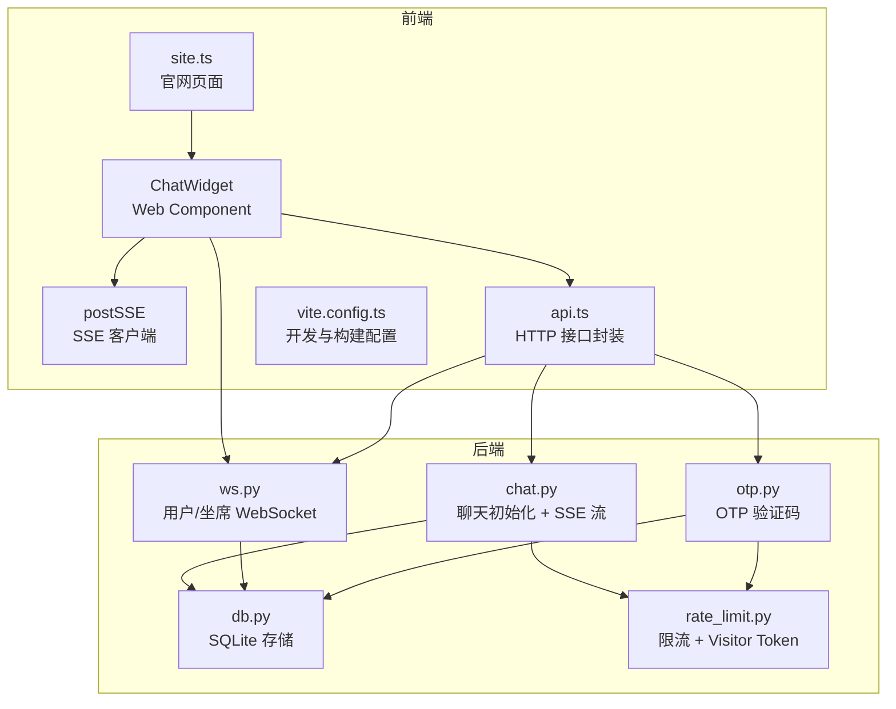
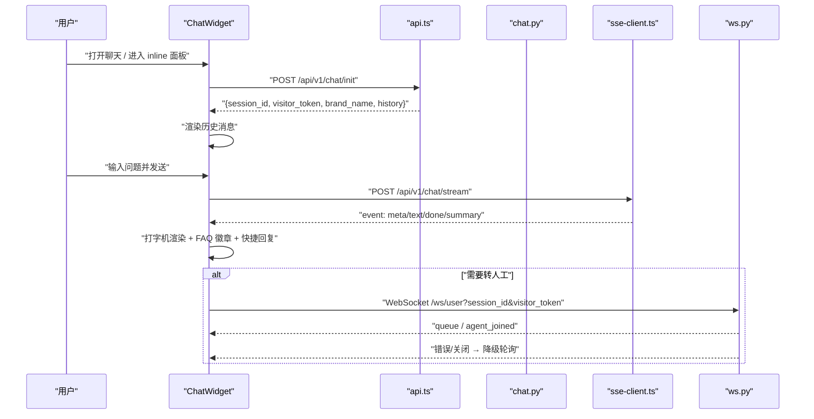
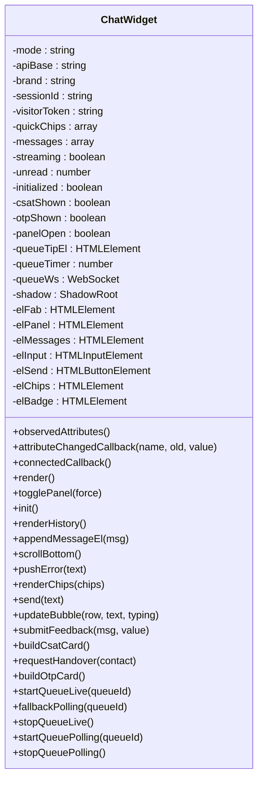
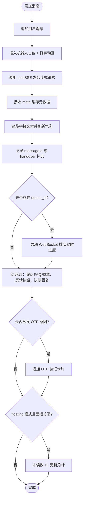
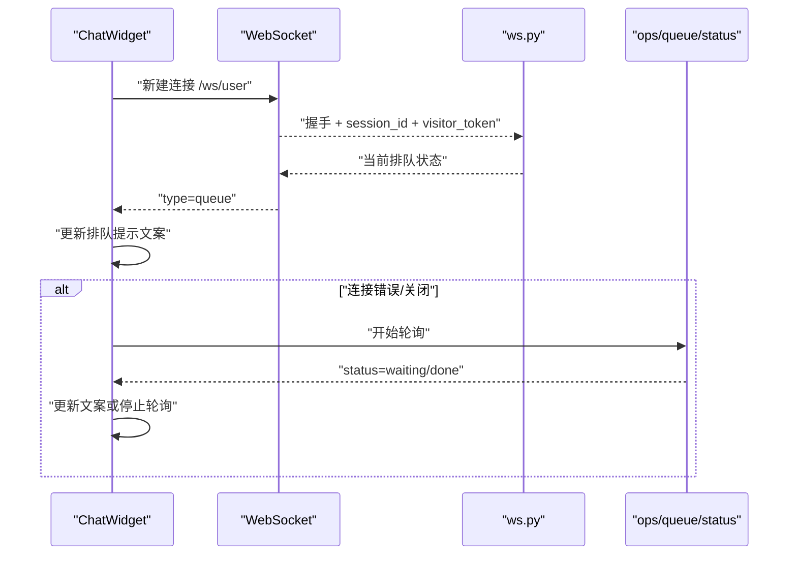
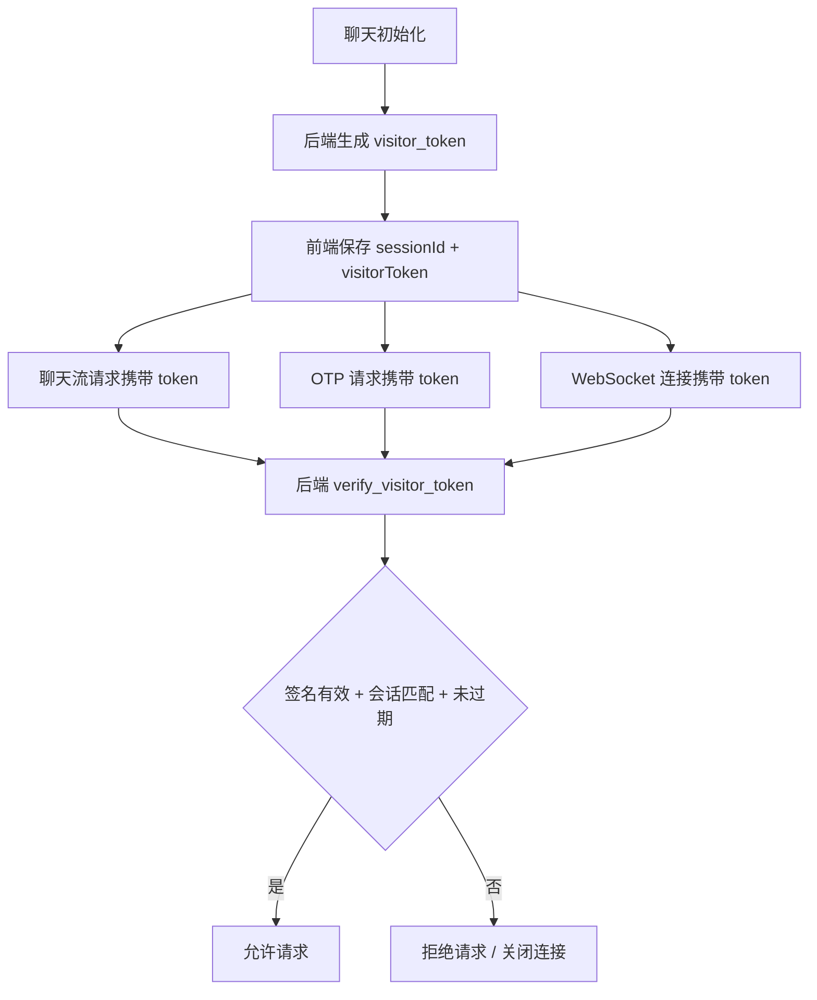
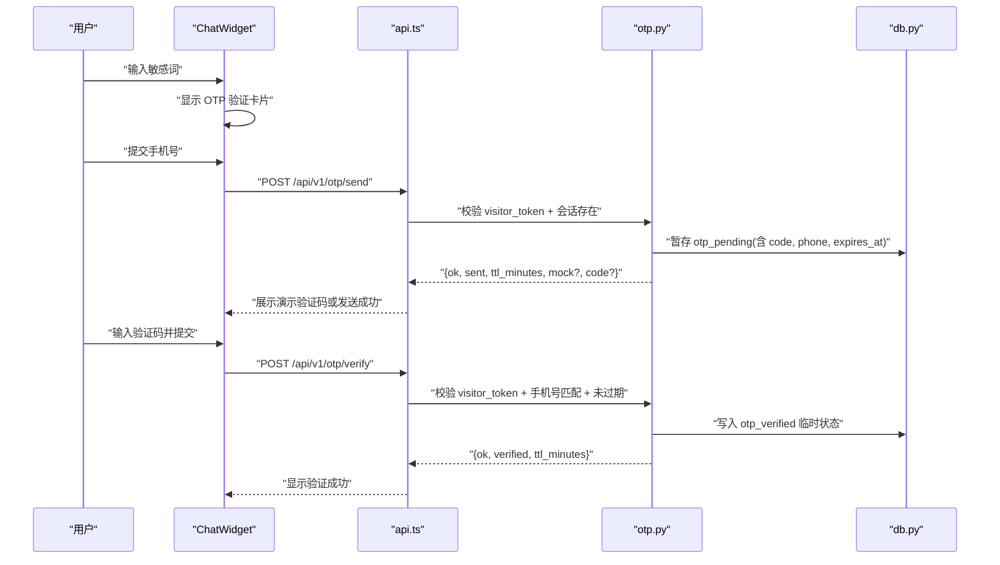
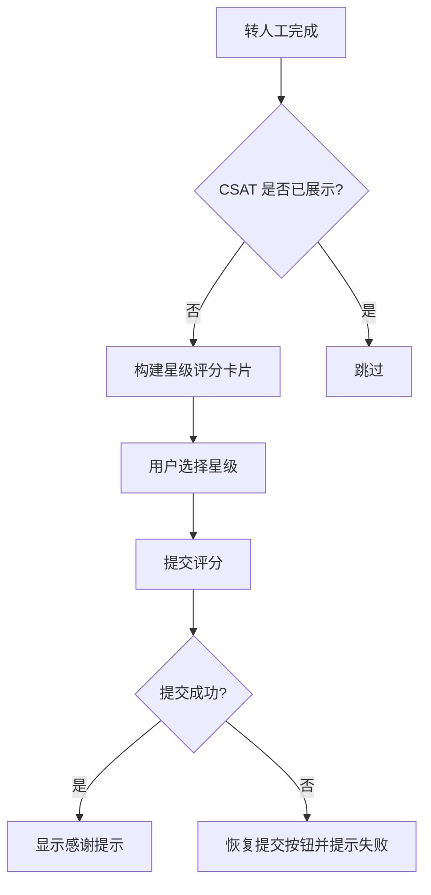
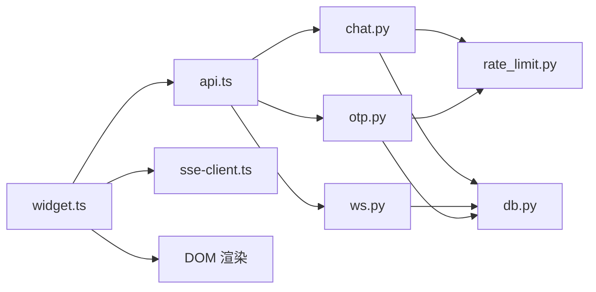

# Web 聊天组件

<cite>
**本文引用的文件**
- [frontend/src/widget.ts](file://frontend/src/widget.ts)
- [frontend/src/sse-client.ts](file://frontend/src/sse-client.ts)
- [frontend/src/api.ts](file://frontend/src/api.ts)
- [frontend/src/site.ts](file://frontend/src/site.ts)
- [frontend/src/styles.css](file://frontend/src/styles.css)
- [frontend/vite.config.ts](file://frontend/vite.config.ts)
- [backend/app/routers/chat.py](file://backend/app/routers/chat.py)
- [backend/app/routers/ws.py](file://backend/app/routers/ws.py)
- [backend/app/routers/otp.py](file://backend/app/routers/otp.py)
- [backend/app/storage/db.py](file://backend/app/storage/db.py)
- [backend/app/storage/rate_limit.py](file://backend/app/storage/rate_limit.py)
</cite>

## 目录
1. [引言](#引言)
2. [项目结构](#项目结构)
3. [核心组件](#核心组件)
4. [架构总览](#架构总览)
5. [详细组件分析](#详细组件分析)
6. [依赖关系分析](#依赖关系分析)
7. [性能考量](#性能考量)
8. [故障排查指南](#故障排查指南)
9. [结论](#结论)
10. [附录：API、事件与样式参考](#附录api事件与样式参考)

## 引言
本文件为“小答”Web 聊天组件的技术文档，聚焦前端 `xd-chat-widget` Web Component 的架构设计、两种形态实现差异、SSE 流式响应、WebSocket 实时排队、消息渲染与状态同步、Visitor Token 安全机制、OTP 验证码流程、CSAT 满意度评分和免责声明展示。同时提供 API 接口、事件行为、样式定制选项、跨浏览器兼容性方案、集成示例、性能优化技巧和故障排查指南。

该组件以原生 Web Components 构建，不依赖 React/Vue 等框架，可被任意站点通过一行 `<xd-chat-widget>` 标签嵌入；也可在官网 Hero 区以内嵌面板形式演示。

## 项目结构
本项目由前后端组成：
- 前端位于 `frontend/src`，其中 `widget.ts` 是聊天组件的实现，`sse-client.ts` 负责 SSE 解析，`api.ts` 封装后端 HTTP 接口，`site.ts` 是官网页面（包含内嵌聊天面板），`styles.css` 是官网全局样式，`vite.config.ts` 配置开发代理和构建入口。
- 后端位于 `backend/app`，核心对话路由在 `routers/chat.py`，WebSocket 排队通道在 `routers/ws.py`，OTP 验证码在 `routers/otp.py`，数据存储和会话元信息在 `storage/db.py`，访客令牌和安全限流在 `storage/rate_limit.py`。



**图表来源**
- [frontend/src/widget.ts:1-719](file://frontend/src/widget.ts#L1-L719)
- [frontend/src/sse-client.ts:1-59](file://frontend/src/sse-client.ts#L1-L59)
- [frontend/src/api.ts:1-200](file://frontend/src/api.ts#L1-L200)
- [frontend/src/site.ts:1-227](file://frontend/src/site.ts#L1-L227)
- [frontend/vite.config.ts:1-30](file://frontend/vite.config.ts#L1-L30)
- [backend/app/routers/chat.py:1-200](file://backend/app/routers/chat.py#L1-L200)
- [backend/app/routers/ws.py:1-149](file://backend/app/routers/ws.py#L1-L149)
- [backend/app/routers/otp.py:1-83](file://backend/app/routers/otp.py#L1-L83)
- [backend/app/storage/db.py:1-200](file://backend/app/storage/db.py#L1-L200)
- [backend/app/storage/rate_limit.py:1-74](file://backend/app/storage/rate_limit.py#L1-L74)

**章节来源**
- [frontend/src/widget.ts:1-719](file://frontend/src/widget.ts#L1-L719)
- [frontend/src/site.ts:1-227](file://frontend/src/site.ts#L1-L227)
- [frontend/vite.config.ts:1-30](file://frontend/vite.config.ts#L1-L30)

## 核心组件
`ChatWidget` 继承自 `HTMLElement`，注册为自定义元素 `xd-chat-widget`。它承担以下职责：
- 管理组件属性 `mode`、`api-base`、`brand`。
- 使用 Shadow DOM 隔离样式和内容。
- 维护会话状态：`sessionId`、`visitorToken`、消息列表、流式状态、未读计数、CSAT 和 OTP 状态。
- 渲染悬浮按钮、弹出面板、消息气泡、快捷提示词、输入栏、免责声明、OTP 验证卡片、CSAT 打分卡片。
- 发起聊天初始化、发送消息、处理 SSE 流式响应、管理 WebSocket 排队连接并降级轮询。
- 提交反馈、手动转人工、提交 CSAT 评分。

### 生命周期与属性监听
- `static get observedAttributes()` 声明监听 `mode`、`api-base`、`brand`。
- `attributeChangedCallback` 根据属性更新内部状态：切换 `floating` 或 `inline` 模式、清理 `apiBase` 末尾斜杠、设置品牌名。
- `connectedCallback` 完成首次渲染、绑定事件（打开/关闭面板、发送消息、回车发送）、按模式决定是否立即初始化。

### Shadow DOM 样式隔离
组件通过 `attachShadow({ mode: "open" })` 创建 Shadow Root，并将全部 UI 结构和内联 CSS 注入其中。这意味着：
- 组件内部类名不会污染宿主页面。
- 宿主页面的 CSS 默认不会穿透到组件内部。
- 组件样式可通过宿主选择器 `::part(...)` 或覆盖 `:host` 变量进行有限定制。

### 两种形态：inline 与 floating
- `mode="inline"`：面板直接作为普通元素显示，用于官网 Hero 演示区。此时面板初始即展开，且会补一条静态演示对话。
- `mode="floating"`（默认）：右下角悬浮按钮 + 点击弹出的面板。面板隐藏时，收到新消息会累计未读数并在按钮角标上显示。

切换逻辑：
- 属性变更时更新内部 `mode`。
- `togglePanel` 控制面板显隐，并在打开时触发初始化或历史渲染、自动聚焦输入框。
- inline 模式下，`panelOpen` 固定为真，跳过未读角标逻辑。

**章节来源**
- [frontend/src/widget.ts:1-200](file://frontend/src/widget.ts#L1-L200)
- [frontend/src/widget.ts:201-450](file://frontend/src/widget.ts#L201-L450)
- [frontend/src/widget.ts:451-719](file://frontend/src/widget.ts#L451-L719)

## 架构总览
聊天组件采用“前端轻量 UI + 后端流式服务”的架构：
- 初始化阶段：前端调用 `/api/v1/chat/init` 获取 `session_id`、`visitor_token`、品牌名、快捷提示词和历史消息。
- 对话阶段：前端通过 `postSSE` 向 `/api/v1/chat/stream` 发起 POST，后端以 `text/event-stream` 返回 `meta`、`text`、`done`、`summary` 等事件。
- 转人工阶段：后端可能返回 `queue_id`，前端优先建立 WebSocket 连接 `/ws/user` 接收排队进度；若失败则回退到每 5~8 秒轮询 `/api/v1/ops/queue/status`。
- 安全机制：所有敏感请求均携带 `visitor_token`，后端校验 HMAC 签名、会话匹配和过期时间。
- 验证码与安全操作：敏感意图触发 OTP 流程，前端展示手机号输入和验证码卡片，后端暂存验证码并校验通过后标记会话临时安全状态。
- 满意度评分：转人工后弹出一星至五星打分卡片，提交到 `/api/v1/csat`。



**图表来源**
- [frontend/src/widget.ts:201-450](file://frontend/src/widget.ts#L201-L450)
- [frontend/src/sse-client.ts:1-59](file://frontend/src/sse-client.ts#L1-L59)
- [backend/app/routers/chat.py:1-200](file://backend/app/routers/chat.py#L1-L200)
- [backend/app/routers/ws.py:1-149](file://backend/app/routers/ws.py#L1-L149)

## 详细组件分析

### ChatWidget 类结构与职责
`ChatWidget` 是组件唯一公开类，对外暴露 `requestHandover` 方法，其余交互通过属性、DOM 事件和内部状态驱动。



**图表来源**
- [frontend/src/widget.ts:1-719](file://frontend/src/widget.ts#L1-L719)

**章节来源**
- [frontend/src/widget.ts:1-719](file://frontend/src/widget.ts#L1-L719)

### 消息渲染与流式处理
消息渲染流程如下：
1. 用户发送后，前端立即追加用户消息气泡。
2. 插入机器人占位消息，显示“正在输入”动画。
3. 通过 `postSSE` 订阅事件：
   - `meta`：缓存最近一次元数据，用于最终渲染 FAQ 徽章、快捷回复。
   - `text`：逐块拼接机器人回答，带光标闪烁。
   - `done`：记录 `messageId`、是否转人工。
   - `summary`：若存在 `queue_id`，启动 WebSocket 排队实时进度。
4. 流结束后替换占位气泡，附加知识库命中徽章、转人工提示、反馈按钮、快捷回复。
5. 若检测到敏感意图，追加 OTP 验证卡片。
6. floating 模式下，面板关闭时累计未读数并更新角标。



**图表来源**
- [frontend/src/widget.ts:201-450](file://frontend/src/widget.ts#L201-L450)
- [frontend/src/widget.ts:451-719](file://frontend/src/widget.ts#L451-L719)
- [frontend/src/sse-client.ts:1-59](file://frontend/src/sse-client.ts#L1-L59)

**章节来源**
- [frontend/src/widget.ts:201-450](file://frontend/src/widget.ts#L201-L450)
- [frontend/src/widget.ts:451-719](file://frontend/src/widget.ts#L451-L719)
- [frontend/src/sse-client.ts:1-59](file://frontend/src/sse-client.ts#L1-L59)

### SSE 流式响应处理
`postSSE` 使用 `fetch` 发起 POST，要求 `Accept: text/event-stream`，并通过 `ReadableStream` 逐块读取响应体。它解析标准 SSE 格式中的 `event:` 与 `data:` 行，支持 JSON data 或纯文本 fallback。

关键点：
- 非 2xx 响应会抛出错误，便于组件捕获并友好提示。
- 缓冲拼接字符串，按 `\n\n` 分割事件。
- 对非法 JSON 数据降级为 `{ content: data }`，保证文本流稳定。

**章节来源**
- [frontend/src/sse-client.ts:1-59](file://frontend/src/sse-client.ts#L1-L59)

### WebSocket 实时连接管理与降级
当后端返回 `queue_id`，组件优先尝试 WebSocket 连接 `/ws/user?session_id&visitor_token`：
- 成功建连后立即推送当前排队状态。
- 接收 `queue` 事件更新排队人数、状态。
- 接收 `agent_joined` 表示人工客服已接入。
- 发生错误或关闭时，自动降级为每 5~8 秒轮询 `/api/v1/ops/queue/status`。



**图表来源**
- [frontend/src/widget.ts:451-719](file://frontend/src/widget.ts#L451-L719)
- [backend/app/routers/ws.py:1-149](file://backend/app/routers/ws.py#L1-L149)

**章节来源**
- [frontend/src/widget.ts:451-719](file://frontend/src/widget.ts#L451-L719)
- [backend/app/routers/ws.py:1-149](file://backend/app/routers/ws.py#L1-L149)

### Visitor Token 安全机制
Visitor Token 由后端生成，前端在聊天初始化时获得，并在后续请求中附带：
- 生成方式：将 `{session_id, exp}` 序列化为 base64 payload，再用 HMAC-SHA256 计算签名。
- 校验方式：后端先比对签名，再解码 payload 检查会话 ID 是否匹配、是否过期。
- 作用范围：聊天流、OTP 发送与校验、WebSocket 用户端连接。



**图表来源**
- [backend/app/storage/rate_limit.py:1-74](file://backend/app/storage/rate_limit.py#L1-L74)
- [backend/app/routers/chat.py:1-200](file://backend/app/routers/chat.py#L1-L200)
- [backend/app/routers/otp.py:1-83](file://backend/app/routers/otp.py#L1-L83)
- [backend/app/routers/ws.py:1-149](file://backend/app/routers/ws.py#L1-L149)

**章节来源**
- [backend/app/storage/rate_limit.py:1-74](file://backend/app/storage/rate_limit.py#L1-L74)
- [backend/app/routers/chat.py:1-200](file://backend/app/routers/chat.py#L1-L200)
- [backend/app/routers/otp.py:1-83](file://backend/app/routers/otp.py#L1-L83)
- [backend/app/routers/ws.py:1-149](file://backend/app/routers/ws.py#L1-L149)

### OTP 验证码流程
OTP 流程针对忘记密码、修改手机号等敏感场景：
- 前端检测用户输入是否匹配敏感词正则，若匹配则仅弹出一次验证卡片。
- 用户输入手机号后调用 `/api/v1/otp/send`，后端将验证码暂存于会话元数据，并设置过期时间。
- 演示模式下，后端直接返回验证码；生产环境应接入短信通道而不返回 code。
- 用户输入验证码后调用 `/api/v1/otp/verify`，通过后写入会话 `otp_verified` 临时状态，用于后续敏感操作门禁。



**图表来源**
- [frontend/src/widget.ts:451-719](file://frontend/src/widget.ts#L451-L719)
- [backend/app/routers/otp.py:1-83](file://backend/app/routers/otp.py#L1-L83)
- [backend/app/storage/db.py:1-200](file://backend/app/storage/db.py#L1-L200)

**章节来源**
- [frontend/src/widget.ts:451-719](file://frontend/src/widget.ts#L451-L719)
- [backend/app/routers/otp.py:1-83](file://backend/app/routers/otp.py#L1-L83)
- [backend/app/storage/db.py:1-200](file://backend/app/storage/db.py#L1-L200)

### CSAT 满意度评分
CSAT 在转人工后弹出，每个会话仅展示一次：
- 用户可选择 1~5 星评分，并可填写补充意见。
- 提交后调用 `/api/v1/csat`，成功后替换卡片为成功提示。
- 提交失败时恢复提交按钮并弹窗提示。



**图表来源**
- [frontend/src/widget.ts:201-450](file://frontend/src/widget.ts#L201-L450)
- [frontend/src/widget.ts:451-719](file://frontend/src/widget.ts#L451-L719)
- [backend/app/storage/db.py:1-200](file://backend/app/storage/db.py#L1-L200)

**章节来源**
- [frontend/src/widget.ts:201-450](file://frontend/src/widget.ts#L201-L450)
- [frontend/src/widget.ts:451-719](file://frontend/src/widget.ts#L451-L719)
- [backend/app/storage/db.py:1-200](file://backend/app/storage/db.py#L1-L200)

### 免责声明展示
免责声明在输入栏上方显示，明确告知 AI 客服信息仅供参考，交易与价格以结算页或人工确认为准。这是合规性设计的一部分，避免用户误以为 AI 回答具备法律效力。

**章节来源**
- [frontend/src/widget.ts:201-450](file://frontend/src/widget.ts#L201-L450)

### 样式定制与跨浏览器兼容性
- 组件使用 Shadow DOM，所有样式定义在组件内部，避免与宿主页面冲突。
- 组件根选择器 `:host` 重置基础样式，并使用系统字体栈适配中文环境。
- 组件内 CSS 使用现代布局（Flexbox）、CSS 动画、CSS 变量，兼容主流现代浏览器。
- 如需主题定制，可在宿主页面通过 `:host` 选择器覆盖颜色、圆角、字号等基础样式。
- 官网全局样式位于 `styles.css`，与组件样式分离，不影响组件内部。

**章节来源**
- [frontend/src/widget.ts:1-200](file://frontend/src/widget.ts#L1-L200)
- [frontend/src/styles.css:1-172](file://frontend/src/styles.css#L1-L172)

### 集成示例
官网页面通过 `site.ts` 在 Hero 区域插入内嵌聊天面板：
```html
<xd-chat-widget mode="inline"></xd-chat-widget>
```
对于任意站点，可直接引入组件脚本并放置悬浮按钮：
```html
<script type="module" src="/path/to/widget-bundle.js"></script>
<xd-chat-widget></xd-chat-widget>
```
开发环境通过 `vite.config.ts` 的 proxy 将 `/api` 和 `/ws` 转发到本地后端。

**章节来源**
- [frontend/src/site.ts:1-227](file://frontend/src/site.ts#L1-L227)
- [frontend/vite.config.ts:1-30](file://frontend/vite.config.ts#L1-L30)

## 依赖关系分析
组件依赖链如下：
- `ChatWidget` 依赖 `api.ts` 的 HTTP 封装函数，包括聊天初始化、反馈、转人工、队列状态、CSAT 等。
- `ChatWidget` 依赖 `sse-client.ts` 的 `postSSE` 处理流式响应。
- `ChatWidget` 直接操作 DOM 创建消息气泡、OTP 卡片、CSAT 卡片。
- 后端 `chat.py` 依赖 `rate_limit.py` 的 Visitor Token 校验与 IP 限流，依赖 `db.py` 的会话与消息存储。
- 后端 `ws.py` 依赖 `db.py` 查询排队状态，并对用户和坐席连接进行管理。
- 后端 `otp.py` 依赖 `db.py` 的会话元数据和 `rate_limit.py` 的 Visitor Token 校验。



**图表来源**
- [frontend/src/widget.ts:1-719](file://frontend/src/widget.ts#L1-L719)
- [frontend/src/api.ts:1-200](file://frontend/src/api.ts#L1-L200)
- [frontend/src/sse-client.ts:1-59](file://frontend/src/sse-client.ts#L1-L59)
- [backend/app/routers/chat.py:1-200](file://backend/app/routers/chat.py#L1-L200)
- [backend/app/routers/ws.py:1-149](file://backend/app/routers/ws.py#L1-L149)
- [backend/app/routers/otp.py:1-83](file://backend/app/routers/otp.py#L1-L83)
- [backend/app/storage/db.py:1-200](file://backend/app/storage/db.py#L1-L200)
- [backend/app/storage/rate_limit.py:1-74](file://backend/app/storage/rate_limit.py#L1-L74)

**章节来源**
- [frontend/src/widget.ts:1-719](file://frontend/src/widget.ts#L1-L719)
- [frontend/src/api.ts:1-200](file://frontend/src/api.ts#L1-L200)
- [backend/app/routers/chat.py:1-200](file://backend/app/routers/chat.py#L1-L200)
- [backend/app/routers/ws.py:1-149](file://backend/app/routers/ws.py#L1-L149)
- [backend/app/routers/otp.py:1-83](file://backend/app/routers/otp.py#L1-L83)
- [backend/app/storage/db.py:1-200](file://backend/app/storage/db.py#L1-L200)
- [backend/app/storage/rate_limit.py:1-74](file://backend/app/storage/rate_limit.py#L1-L74)

## 性能考量
- 流式渲染：SSE 分片文本减少首字延迟，提升用户感知速度。
- 记忆压缩：后端维护分层记忆，滑动窗口外历史压缩为摘要，降低 Prompt 长度和 LLM 成本。
- 首轮缓存：同一会话首轮命中缓存时直接返回答案，首字响应目标小于 500ms。
- WebSocket 优先：排队进度优先使用 WebSocket，失败才轮询，减少无效请求。
- Shadow DOM 隔离：避免宿主样式重排影响组件内部布局。
- 构建优化：Vite 构建产物输出到 `dist`，开发环境使用代理避免跨域问题。

[本节为通用性能建议，不直接分析具体代码行]

## 故障排查指南
常见问题及定位思路：
- 无法连接后端：检查 `apiBase` 是否正确，开发环境确认 Vite proxy 是否生效，生产环境确认网关同源部署。
- 流式响应失败：查看 `postSSE` 抛出的错误信息，确认后端 `/api/v1/chat/stream` 是否正常返回 `text/event-stream`。
- WebSocket 排队不可用：检查浏览器控制台 WebSocket 错误，确认 `/ws/user` 路径和访客令牌参数；组件会自动降级轮询。
- Visitor Token 无效：确认聊天初始化是否成功，后端是否启用 `VISITOR_TOKEN_SECRET`，会话是否过期。
- OTP 验证失败：检查手机号格式、验证码是否过期、演示模式是否开启。
- CSAT 提交失败：检查网络状态、后端 `/api/v1/csat` 是否可用，确认后重试。

**章节来源**
- [frontend/src/widget.ts:201-450](file://frontend/src/widget.ts#L201-L450)
- [frontend/src/widget.ts:451-719](file://frontend/src/widget.ts#L451-L719)
- [frontend/src/sse-client.ts:1-59](file://frontend/src/sse-client.ts#L1-L59)
- [backend/app/routers/chat.py:1-200](file://backend/app/routers/chat.py#L1-L200)
- [backend/app/routers/ws.py:1-149](file://backend/app/routers/ws.py#L1-L149)
- [backend/app/routers/otp.py:1-83](file://backend/app/routers/otp.py#L1-L83)

## 结论
`xd-chat-widget` 是一个完整的前端聊天组件，具备内嵌与悬浮两种形态、Shadow DOM 样式隔离、属性监听与生命周期管理、SSE 流式响应、WebSocket 实时排队、Visitor Token 安全机制、OTP 验证码流程和 CSAT 满意度评分。它与后端聊天路由、WebSocket 通道、OTP 接口、存储层紧密协作，形成从用户输入到人工接管的闭环。组件具备良好的可嵌入性、可定制性和容错能力，适合快速集成到任意官网或应用中。

[本节为总结性内容，不直接分析具体代码行]

## 附录：API、事件与样式参考

### 前端组件 API
- 自定义元素：`<xd-chat-widget>`
- 属性：
  - `mode`：`floating`（默认）或 `inline`。
  - `api-base`：后端地址，缺省走同源 `/api` 代理。
  - `brand`：品牌名，缺省取后端初始化返回。
- 公共方法：
  - `requestHandover(contact?)`：主动发起转人工。
- 内部状态：
  - `sessionId`、`visitorToken`、`messages`、`streaming`、`unread`、`csatShown`、`otpShown`、`panelOpen`。

**章节来源**
- [frontend/src/widget.ts:1-719](file://frontend/src/widget.ts#L1-L719)

### 后端接口契约
- 聊天初始化：`POST /api/v1/chat/init`
- 聊天流：`POST /api/v1/chat/stream`
- 反馈：`POST /api/v1/feedback`
- 转人工：`POST /api/v1/handover`
- 队列状态：`GET /api/v1/ops/queue/status`
- CSAT：`POST /api/v1/csat`
- OTP 发送：`POST /api/v1/otp/send`
- OTP 校验：`POST /api/v1/otp/verify`

**章节来源**
- [frontend/src/api.ts:1-200](file://frontend/src/api.ts#L1-L200)
- [backend/app/routers/chat.py:1-200](file://backend/app/routers/chat.py#L1-L200)
- [backend/app/routers/otp.py:1-83](file://backend/app/routers/otp.py#L1-L83)

### SSE 事件类型
- `meta`：元数据，包含状态、FAQ 信息、快捷回复。
- `text`：流式文本片段。
- `done`：流结束，包含消息 ID、是否转人工。
- `summary`：转人工摘要，包含 `queue_id`。

**章节来源**
- [frontend/src/sse-client.ts:1-59](file://frontend/src/sse-client.ts#L1-L59)
- [backend/app/routers/chat.py:1-200](file://backend/app/routers/chat.py#L1-L200)

### WebSocket 事件类型
- 用户端：
  - `queue`：排队进度。
  - `agent_joined`：人工客服已接入。
- 坐席端：
  - `handovers`：待办快照。
  - `handover_new`：新转人工。
  - `handover_done`：工单完成。

**章节来源**
- [backend/app/routers/ws.py:1-149](file://backend/app/routers/ws.py#L1-L149)

### 样式定制建议
- 覆盖 `:host` 的基础样式，如字体、主色、圆角。
- 调整 `.xd-panel`、`.xd-fab`、`.xd-header`、`.xd-messages`、`.xd-input-bar` 等类名以适配品牌风格。
- 注意 Shadow DOM 隔离特性，宿主 CSS 不会直接作用于组件内部节点。

**章节来源**
- [frontend/src/widget.ts:1-200](file://frontend/src/widget.ts#L1-L200)
- [frontend/src/styles.css:1-172](file://frontend/src/styles.css#L1-L172)