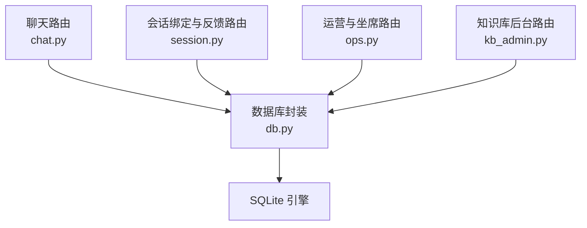
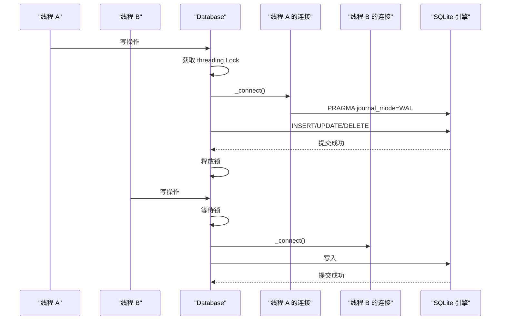
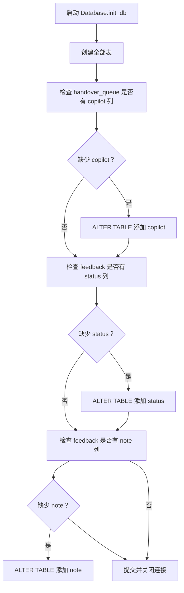
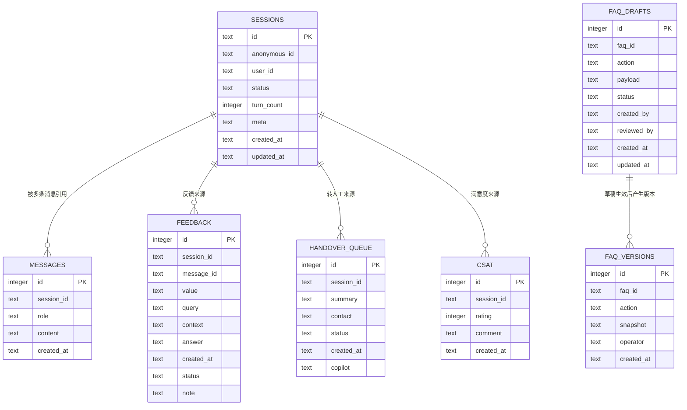
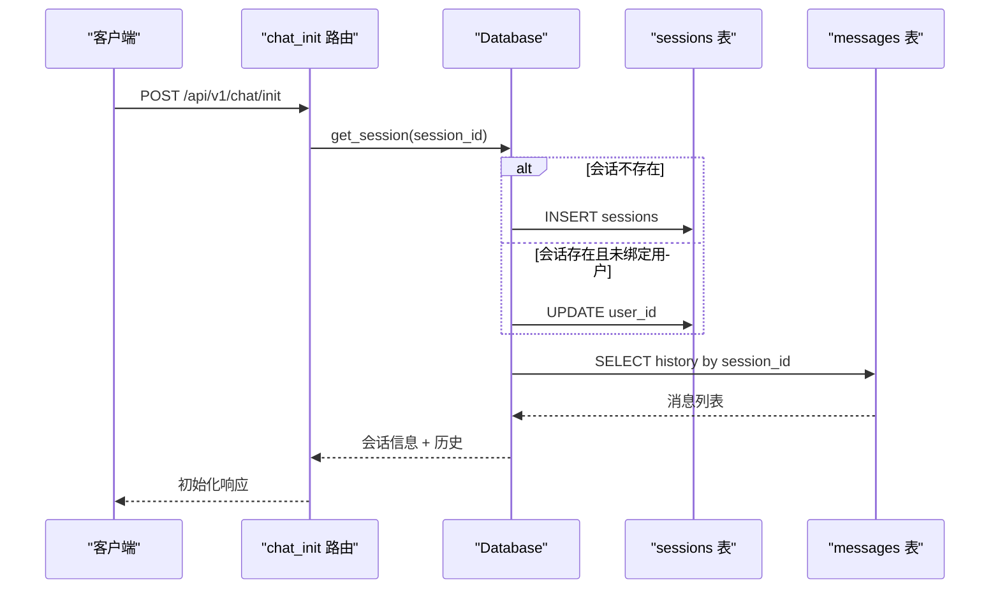
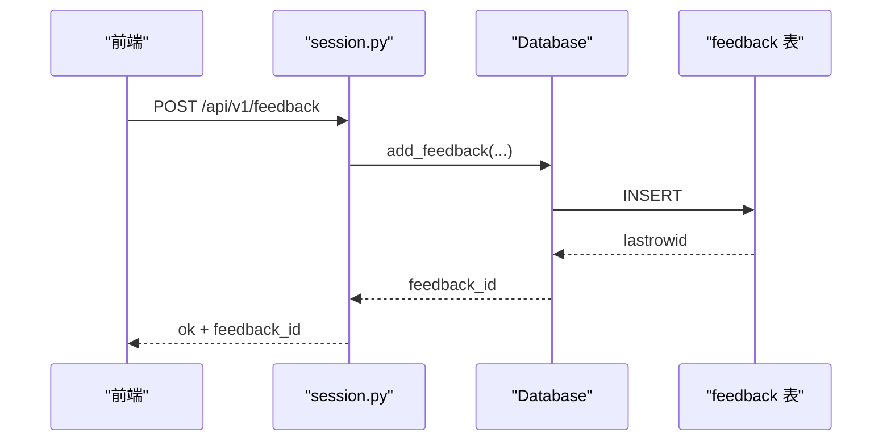
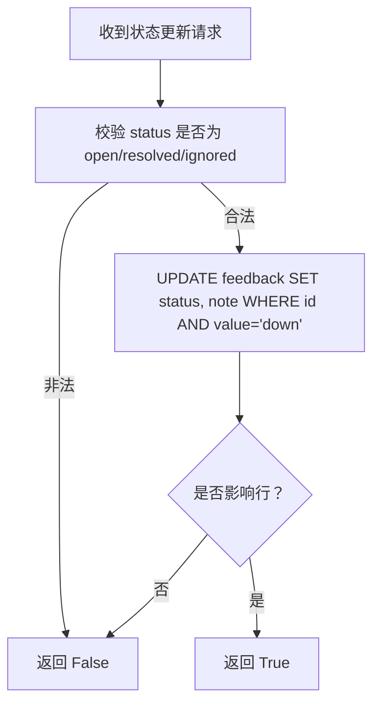
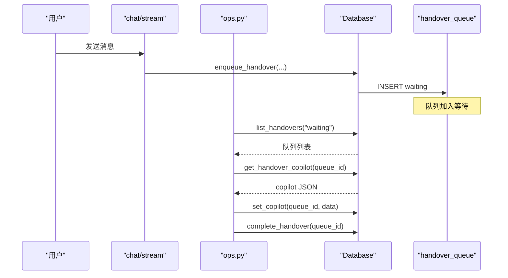
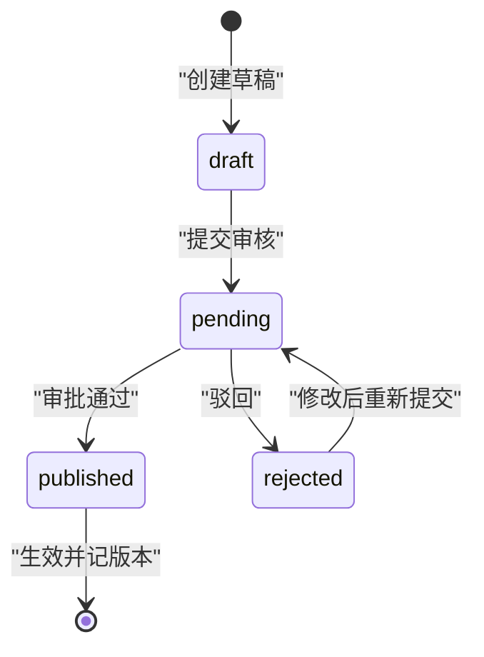
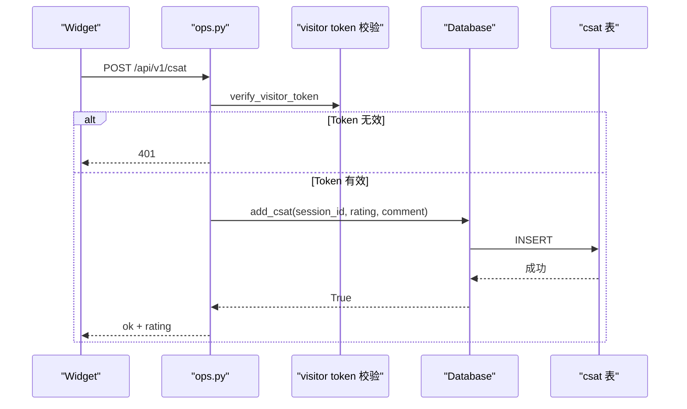

# SQLite 数据库架构

<cite>
**本文引用的文件**   
- [db.py](file://backend/app/storage/db.py)
- [schemas.py](file://backend/app/models/schemas.py)
- [session.py](file://backend/app/routers/session.py)
- [chat.py](file://backend/app/routers/chat.py)
- [kb_admin.py](file://backend/app/routers/kb_admin.py)
- [ops.py](file://backend/app/routers/ops.py)
</cite>

## 目录
1. [引言](#引言)
2. [项目结构与定位](#项目结构与定位)
3. [核心表结构总览](#核心表结构总览)
4. [表级详细设计](#表级详细设计)
5. [索引与查询性能](#索引与查询性能)
6. [并发模型与线程安全](#并发模型与线程安全)
7. [迁移策略与字段演进](#迁移策略与字段演进)
8. [JSON 存储策略](#json-存储策略)
9. [ER 关系图](#er-关系图)
10. [典型查询示例](#典型查询示例)
11. [错误处理与边界条件](#错误处理与边界条件)
12. [配置与部署要点](#配置与部署要点)
13. [结论](#结论)

## 引言
本文件聚焦后端 SQLite 持久层，系统化梳理会话、消息、反馈、人工转接队列、FAQ 草稿与版本历史、CSAT 满意度等数据模型。文档从表结构、索引、并发、迁移、JSON 存储到 ER 图和查询示例逐层展开，既适合数据库建模者，也适合前端与运营侧理解数据流转。

## 项目结构与定位
SQLite 数据库由 `backend/app/storage/db.py` 中的 `Database` 类统一管理，包括建表、连接、事务、迁移和所有业务表的读写方法；FastAPI 路由层通过全局单例 `db` 访问数据库。

**图表来源**
- [chat.py:1-200](file://backend/app/routers/chat.py#L1-L200)
- [session.py:1-35](file://backend/app/routers/session.py#L1-L35)
- [ops.py:1-163](file://backend/app/routers/ops.py#L1-L163)
- [kb_admin.py:1-200](file://backend/app/routers/kb_admin.py#L1-L200)
- [db.py:1-200](file://backend/app/storage/db.py#L1-L200)

**章节来源**
- [db.py:1-40](file://backend/app/storage/db.py#L1-L40)
- [chat.py:1-40](file://backend/app/routers/chat.py#L1-L40)
- [session.py:1-35](file://backend/app/routers/session.py#L1-L35)
- [ops.py:1-40](file://backend/app/routers/ops.py#L1-L40)
- [kb_admin.py:1-40](file://backend/app/routers/kb_admin.py#L1-L40)

## 核心表结构总览
系统共维护七张核心表：

| 表名 | 主要职责 | 主键 | 关键字段 | 默认值或约束说明 |
|---|---|---:|---|---|
| `sessions` | 会话主表，记录状态、轮次、元数据、用户绑定和时间戳 | `id TEXT` | `anonymous_id`、`user_id`、`status`、`turn_count`、`meta`、`created_at`、`updated_at` | `status` 默认 `AGENT_ACTIVE`；`turn_count` 默认 `0`；`meta` 默认空对象字符串；时间字段为文本时间 |
| `messages` | 按会话组织的消息历史，角色含用户与助手 | `id INTEGER AUTOINCREMENT` | `session_id`、`role`、`content`、`created_at` | 无外键；`role` 与 `content` 为文本 |
| `feedback` | 点赞点踩埋点与 Bad Case 管理 | `id INTEGER AUTOINCREMENT` | `session_id`、`message_id`、`value`、`query`、`context`、`answer`、`created_at`、`status`、`note` | `status` 默认 `open`；`note` 默认空串；仅 `value='down'` 才参与 Bad Case 状态更新 |
| `handover_queue` | 人工转接排队与工单卡片 | `id INTEGER AUTOINCREMENT` | `session_id`、`summary`、`contact`、`status`、`created_at`、`copilot` | `status` 默认 `waiting`；`copilot` 是 V2.0 新增列，默认空对象字符串 |
| `faq_drafts` | FAQ 变更草稿与审批流 | `id INTEGER AUTOINCREMENT` | `faq_id`、`action`、`payload`、`status`、`created_by`、`reviewed_by`、`created_at`、`updated_at` | `status` 默认 `draft`；`created_by` 默认 `ops` |
| `faq_versions` | FAQ 生效后的版本快照 | `id INTEGER AUTOINCREMENT` | `faq_id`、`action`、`snapshot`、`operator`、`created_at` | `operator` 默认 `ops`；`snapshot` 存发布后或删除前 JSON |
| `csat` | CSAT 满意度评分 | `id INTEGER AUTOINCREMENT` | `session_id`、`rating`、`comment`、`created_at` | `rating` 取值范围 `1-5`；`comment` 默认空串 |

**章节来源**
- [db.py:28-130](file://backend/app/storage/db.py#L28-L130)

## 表级详细设计

### sessions 表：会话主表
`sessions` 是会话生命周期中心。每条会话拥有唯一 `id`，支持匿名与会话绑定登录用户；`status` 控制自动化、转人工等流程；`turn_count` 用于会话轮次上限熔断；`meta` 以 JSON 字符串保存结构化事实、摘要、待确认信息等扩展上下文。

| 字段 | 类型 | 是否可空 | 默认值 | 语义 |
|---|---|---:|---|---|
| `id` | TEXT | 否 | 无 | 会话 ID，格式以 `sess_` 开头 |
| `anonymous_id` | TEXT | 是 | 无 | 未登录访客标识 |
| `user_id` | TEXT | 是 | 无 | 登录后绑定的真实用户标识 |
| `status` | TEXT | 否 | `AGENT_ACTIVE` | 会话状态，如活跃、转人工等 |
| `turn_count` | INTEGER | 否 | `0` | 已发送轮数，超过上限直接拒绝继续对话 |
| `meta` | TEXT | 否 | `'{}'` | JSON 字符串，保存结构化扩展信息 |
| `created_at` | TEXT | 是 | 无 | 创建时间 |
| `updated_at` | TEXT | 是 | 无 | 最后更新时间 |

典型用途包括：初始化会话时写入初始状态、登录时绑定 `user_id`、会话超时时重置状态与轮次、记忆压缩时覆盖 `facts` 与 `summary`。

**章节来源**
- [db.py:28-60](file://backend/app/storage/db.py#L28-L60)
- [db.py:132-180](file://backend/app/storage/db.py#L132-L180)
- [chat.py:42-80](file://backend/app/routers/chat.py#L42-L80)
- [chat.py:120-180](file://backend/app/routers/chat.py#L120-L180)

### messages 表：消息历史
`messages` 以自增整数为主键，按 `session_id` 组织多轮对话。每条消息包含角色、内容和创建时间，不直接存储会话状态；会话状态保存在 `sessions` 中，二者通过 `session_id` 逻辑关联。

| 字段 | 类型 | 是否可空 | 默认值 | 语义 |
|---|---|---:|---|---|
| `id` | INTEGER | 否 | 自增 | 消息内部序号 |
| `session_id` | TEXT | 是 | 无 | 所属会话 |
| `role` | TEXT | 是 | 无 | 角色，例如用户或助手 |
| `content` | TEXT | 是 | 无 | 消息正文 |
| `created_at` | TEXT | 是 | 无 | 消息时间 |

读取历史时通常按 `id DESC` 取最近若干条并反转顺序返回给上层。

**章节来源**
- [db.py:60-75](file://backend/app/storage/db.py#L60-L75)
- [db.py:182-205](file://backend/app/storage/db.py#L182-L205)

### feedback 表：反馈与 Bad Case 管理
`feedback` 同时承担埋点和 Bad Case 管理职责。`value` 通常为 `up` 或 `down`；只有 `value='down'` 的记录才能进入 Bad Case 工作流。V2.0 引入 `status` 与 `note`：`open` 表示待处理，`resolved` 表示已修复，`ignored` 表示忽略。

| 字段 | 类型 | 是否可空 | 默认值 | 语义 |
|---|---|---:|---|---|
| `id` | INTEGER | 否 | 自增 | 反馈记录编号 |
| `session_id` | TEXT | 是 | 无 | 来源会话 |
| `message_id` | TEXT | 是 | 无 | 可选目标消息编号 |
| `value` | TEXT | 是 | 无 | 点赞或点踩 |
| `query` | TEXT | 是 | 无 | 原始问题 |
| `context` | TEXT | 是 | 无 | 上下文片段 |
| `answer` | TEXT | 是 | 无 | 回答片段 |
| `created_at` | TEXT | 是 | 无 | 反馈时间 |
| `status` | TEXT | 是 | `open` | Bad Case 处理状态 |
| `note` | TEXT | 是 | `''` | 处理备注 |

**章节来源**
- [db.py:60-130](file://backend/app/storage/db.py#L60-L130)
- [db.py:205-270](file://backend/app/storage/db.py#L205-L270)
- [session.py:15-35](file://backend/app/routers/session.py#L15-L35)
- [ops.py:35-60](file://backend/app/routers/ops.py#L35-L60)

### handover_queue 表：人工转接队列
该表用于“留言式”人工转接：用户触发转人工后生成一条排队记录，客服工作台拉取等待项并标记完成。V2.0 新增 `copilot` 列，用于存储 AI 辅助生成的工单卡片与快捷回复模板。

| 字段 | 类型 | 是否可空 | 默认值 | 语义 |
|---|---|---:|---|---|
| `id` | INTEGER | 否 | 自增 | 队列编号 |
| `session_id` | TEXT | 是 | 无 | 来源会话 |
| `summary` | TEXT | 是 | 无 | 转人工摘要 |
| `contact` | TEXT | 是 | 无 | 联系方式，可选 |
| `status` | TEXT | 是 | `waiting` | 队列状态 |
| `created_at` | TEXT | 是 | 无 | 入队时间 |
| `copilot` | TEXT | 是 | `'{}'` | V2.0 新增，AI 工单与模板 JSON |

**章节来源**
- [db.py:80-110](file://backend/app/storage/db.py#L80-L110)
- [db.py:310-420](file://backend/app/storage/db.py#L310-L420)
- [ops.py:60-163](file://backend/app/routers/ops.py#L60-L163)

### faq_drafts 表：FAQ 变更草稿与审批流
`faq_drafts` 是所有知识库变更的入口。新建、编辑、删除操作都会先落盘为草稿，状态从 `draft` 提交为 `pending`，再由管理员审批为 `published` 或 `rejected`。`payload` 保存完整 FAQ 内容；删除场景下也可保留删除前快照。

| 字段 | 类型 | 是否可空 | 默认值 | 语义 |
|---|---|---:|---|---|
| `id` | INTEGER | 否 | 自增 | 草稿编号 |
| `faq_id` | TEXT | 是 | 无 | 目标 FAQ 编号 |
| `action` | TEXT | 是 | 无 | `create`、`update`、`delete` |
| `payload` | TEXT | 是 | 无 | FAQ 完整 JSON |
| `status` | TEXT | 是 | `draft` | 草稿状态 |
| `created_by` | TEXT | 是 | `ops` | 创建人 |
| `reviewed_by` | TEXT | 是 | 无 | 审批人 |
| `created_at` | TEXT | 是 | 无 | 创建时间 |
| `updated_at` | TEXT | 是 | 无 | 更新时间 |

状态流转受代码校验保护，允许 `draft→pending`、`pending→published`、`pending→rejected`、`rejected→pending`。

**章节来源**
- [db.py:80-110](file://backend/app/storage/db.py#L80-L110)
- [db.py:420-530](file://backend/app/storage/db.py#L420-L530)
- [kb_admin.py:1-120](file://backend/app/routers/kb_admin.py#L1-L120)

### faq_versions 表：知识库版本历史快照
每次草稿审批生效，都会向 `faq_versions` 写入一条版本记录。新建和编辑时 snapshot 为新内容；删除时 snapshot 为删除前的旧内容，便于回滚审计。

| 字段 | 类型 | 是否可空 | 默认值 | 语义 |
|---|---|---:|---|---|
| `id` | INTEGER | 否 | 自增 | 版本编号 |
| `faq_id` | TEXT | 是 | 无 | 目标 FAQ 编号 |
| `action` | TEXT | 是 | 无 | 对应动作 |
| `snapshot` | TEXT | 是 | 无 | 发布快照 JSON |
| `operator` | TEXT | 是 | `ops` | 操作人 |
| `created_at` | TEXT | 是 | 无 | 生效时间 |

**章节来源**
- [db.py:110-130](file://backend/app/storage/db.py#L110-L130)
- [db.py:530-566](file://backend/app/storage/db.py#L530-L566)
- [kb_admin.py:80-120](file://backend/app/routers/kb_admin.py#L80-L120)

### csat 表：CSAT 满意度评分
CSAT 用于在 widget 弹出后收集 1-5 星评价。接口层会校验 visitor token 与评分范围，再调用数据库写入。

| 字段 | 类型 | 是否可空 | 默认值 | 语义 |
|---|---|---:|---|---|
| `id` | INTEGER | 否 | 自增 | 评分编号 |
| `session_id` | TEXT | 是 | 无 | 来源会话 |
| `rating` | INTEGER | 是 | 无 | 1-5 |
| `comment` | TEXT | 是 | `''` | 用户评语 |
| `created_at` | TEXT | 是 | 无 | 评分时间 |

**章节来源**
- [db.py:110-130](file://backend/app/storage/db.py#L110-L130)
- [db.py:270-310](file://backend/app/storage/db.py#L270-L310)
- [ops.py:60-80](file://backend/app/routers/ops.py#L60-L80)

## 索引与查询性能
当前显式索引只有一处：

| 索引名 | 定义位置 | 作用 |
|---|---|---|
| `idx_messages_session` | `messages(session_id, id)` | 加速按会话查询消息并按插入顺序排序 |

该复合索引对 `get_history(session_id, limit)` 这类“按会话倒序取最近消息”的查询非常关键。虽然 SQLite 也会自动维护主键索引，但明确指定 `(session_id, id)` 能减少额外排序成本。

其他常用查询路径：

| 查询场景 | 涉及表 | 过滤条件 | 性能建议 |
|---|---|---|---|
| 获取会话 | `sessions` | `id=?` | 主键查找，无需额外索引 |
| 获取消息历史 | `messages` | `session_id=? ORDER BY id DESC LIMIT n` | 依赖 `idx_messages_session` |
| 点踩列表 | `feedback` | `value='down' ORDER BY id DESC` | 可按需增加 `(value, id)` 索引 |
| 人工队列 | `handover_queue` | `status=? ORDER BY id ASC` | 可按需增加 `(status, id)` 索引 |
| 草稿列表 | `faq_drafts` | `status=? ORDER BY id DESC` | 可按需增加 `(status, id)` 索引 |
| 版本历史 | `faq_versions` | `faq_id=? ORDER BY id DESC` | 可按需增加 `(faq_id, id)` 索引 |
| CSAT 统计 | `csat` | `COUNT(*)`、`AVG(rating)`、分组 | 小库可直接全表扫描 |

**章节来源**
- [db.py:60-75](file://backend/app/storage/db.py#L60-L75)
- [db.py:182-205](file://backend/app/storage/db.py#L182-L205)
- [db.py:230-270](file://backend/app/storage/db.py#L230-L270)
- [db.py:310-360](file://backend/app/storage/db.py#L310-L360)
- [db.py:450-530](file://backend/app/storage/db.py#L450-L530)
- [db.py:530-566](file://backend/app/storage/db.py#L530-L566)

## 并发模型与线程安全
`Database` 类采用“进程内单例 + 每线程独立连接 + `threading.Lock`”的模式：

1. `__init__` 初始化 `_lock = threading.Lock()`，并在启动时调用 `init_db()` 建表。
2. `_connect()` 使用 `sqlite3.connect(..., check_same_thread=False)` 建立连接，并设置 `PRAGMA journal_mode=WAL`。
3. 所有写操作都包裹在 `with self._lock:` 中，确保同一时刻只有一个线程执行数据库修改。
4. 每个请求/线程拿到的是新连接，避免跨线程共享连接导致的 SQLite 线程安全问题。
5. 读操作同样持有锁，属于串行化读写，牺牲一定并发换取实现简单可靠。

**图表来源**
- [db.py:12-40](file://backend/app/storage/db.py#L12-L40)
- [db.py:40-130](file://backend/app/storage/db.py#L40-L130)

**章节来源**
- [db.py:12-40](file://backend/app/storage/db.py#L12-L40)
- [db.py:132-205](file://backend/app/storage/db.py#L132-L205)

## 迁移策略与字段演进
数据库初始化使用 `executescript` 一次性创建所有表。随后通过 `PRAGMA table_info` 检查已有列，缺失列则执行 `ALTER TABLE ... ADD COLUMN`，实现向后兼容的自动迁移：

| 迁移项 | 检测逻辑 | 迁移动作 | 默认值 |
|---|---|---|---|
| `handover_queue.copilot` | 检查 `handover_queue` 是否存在 `copilot` 列 | 新增列 | `'{}'` |
| `feedback.status` | 检查 `feedback` 是否存在 `status` 列 | 新增列 | `'open'` |
| `feedback.note` | 检查 `feedback` 是否存在 `note` 列 | 新增列 | `''` |

这意味着老库升级不会因缺少字段而失败，新库也不会重复添加列。

**图表来源**
- [db.py:40-130](file://backend/app/storage/db.py#L40-L130)

**章节来源**
- [db.py:40-130](file://backend/app/storage/db.py#L40-L130)

## JSON 存储策略
本项目没有使用 SQLite JSON1 扩展的高级 JSON 函数，而是把复杂对象序列化为 TEXT 字段，并在 Python 层做序列化与反序列化：

| 字段 | 存储形式 | 写入逻辑 | 读取逻辑 |
|---|---|---|---|
| `sessions.meta` | JSON 字符串 | dict → `json.dumps(ensure_ascii=False)` | `json.loads`，失败回退为空对象 |
| `feedback.query/context/answer` | 普通 TEXT | 直接写入字符串 | 直接返回字符串 |
| `handover_queue.copilot` | JSON 字符串 | dict → `json.dumps(ensure_ascii=False)` | `json.loads`，失败回退为空对象 |
| `faq_drafts.payload` | JSON 字符串 | dict → `json.dumps(ensure_ascii=False)`，删除可为 None | `json.loads`，失败回退为 None |
| `faq_versions.snapshot` | JSON 字符串 | dict → `json.dumps(ensure_ascii=False)`，可为 None | `json.loads`，失败回退为 None |

这种策略优点是简单、兼容性高；缺点是难以用 SQL 直接查询 JSON 内部字段。若未来需要高频按 FAQ 内容筛选，可考虑迁移到 JSON1 或拆分为结构化子表。

**章节来源**
- [db.py:132-180](file://backend/app/storage/db.py#L132-L180)
- [db.py:420-530](file://backend/app/storage/db.py#L420-L530)
- [db.py:530-566](file://backend/app/storage/db.py#L530-L566)

## ER 关系图
下图展示表之间的逻辑关系。除 `messages` 通过 `session_id` 指向 `sessions` 外，其余表多为独立业务实体，部分通过 `session_id` 或 `faq_id` 形成弱关联。

**图表来源**
- [db.py:28-130](file://backend/app/storage/db.py#L28-L130)

## 典型查询示例

### 1. 初始化或恢复会话
- 输入：`session_id`（可选）、`user_id`（可选）
- 行为：
  - 若不存在则创建 `sessions`，状态 `AGENT_ACTIVE`、轮次 `0`、`meta` 为空对象。
  - 若存在且已登录但未绑定 `user_id`，则更新绑定。
  - 返回最近 20 条 `messages` 历史。

**图表来源**
- [chat.py:42-80](file://backend/app/routers/chat.py#L42-L80)
- [db.py:132-205](file://backend/app/storage/db.py#L132-L205)

**章节来源**
- [chat.py:42-80](file://backend/app/routers/chat.py#L42-L80)
- [db.py:132-205](file://backend/app/storage/db.py#L132-L205)

### 2. 点赞或点踩埋点
- 输入：`session_id`、`message_id`（可选）、`value`、`query`、`context`、`answer`
- 行为：写入 `feedback`，返回 `feedback_id`。
- 后续：Bad Case 运营可通过 `/ops/badcases/{feedback_id}/status` 设置 `status` 与 `note`。

**图表来源**
- [session.py:15-35](file://backend/app/routers/session.py#L15-L35)
- [db.py:205-230](file://backend/app/storage/db.py#L205-L230)

**章节来源**
- [session.py:15-35](file://backend/app/routers/session.py#L15-L35)
- [db.py:205-230](file://backend/app/storage/db.py#L205-L230)

### 3. Bad Case 状态更新
- 输入：`feedback_id`、`status`（`open`/`resolved`/`ignored`）、`note`
- 行为：仅对 `value='down'` 的记录更新，非法状态返回失败。

**图表来源**
- [db.py:240-270](file://backend/app/storage/db.py#L240-L270)
- [ops.py:35-60](file://backend/app/routers/ops.py#L35-L60)

**章节来源**
- [db.py:240-270](file://backend/app/storage/db.py#L240-L270)
- [ops.py:35-60](file://backend/app/routers/ops.py#L35-L60)

### 4. 人工转接与 Copilot
- 用户触发转人工：写入 `handover_queue`，状态 `waiting`。
- 坐席工作台拉取队列、查看 Copilot、生成模板、标记完成。
- Copilot 数据存储在 `copilot` JSON 字段中。

**图表来源**
- [chat.py:120-200](file://backend/app/routers/chat.py#L120-L200)
- [ops.py:80-163](file://backend/app/routers/ops.py#L80-L163)
- [db.py:310-420](file://backend/app/storage/db.py#L310-L420)

**章节来源**
- [chat.py:120-200](file://backend/app/routers/chat.py#L120-L200)
- [ops.py:80-163](file://backend/app/routers/ops.py#L80-L163)
- [db.py:310-420](file://backend/app/storage/db.py#L310-L420)

### 5. FAQ 草稿审批与版本快照
- 新建/编辑/删除 FAQ 先写入 `faq_drafts`，状态 `draft`。
- 提交审核后变为 `pending`，审批通过后写入 `faq_versions` 并更新草稿状态为 `published`。
- 删除操作的 snapshot 为删除前内容，支持回滚。

**图表来源**
- [kb_admin.py:1-120](file://backend/app/routers/kb_admin.py#L1-L120)
- [db.py:420-530](file://backend/app/storage/db.py#L420-L530)
- [db.py:530-566](file://backend/app/storage/db.py#L530-L566)

**章节来源**
- [kb_admin.py:1-120](file://backend/app/routers/kb_admin.py#L1-L120)
- [db.py:420-566](file://backend/app/storage/db.py#L420-L566)

### 6. CSAT 满意度提交
- 输入：`session_id`、`visitor_token`、`rating`（1-5）、`comment`
- 行为：校验 token 与评分范围，写入 `csat`。

**图表来源**
- [ops.py:60-80](file://backend/app/routers/ops.py#L60-L80)
- [db.py:270-310](file://backend/app/storage/db.py#L270-L310)

**章节来源**
- [ops.py:60-80](file://backend/app/routers/ops.py#L60-L80)
- [db.py:270-310](file://backend/app/storage/db.py#L270-L310)

## 错误处理与边界条件
- 会话不存在：聊天流式接口返回 404。
- Visitor Token 无效：聊天与 CSAT 接口返回 401。
- 输入过长：直接走 SSE 提示，不调 LLM。
- 会话轮次超限：返回限制提示，引导转人工。
- Bad Case 状态非法：返回 False，路由层返回 404 或错误信息。
- CSAT 评分不在 1-5：写入失败，返回 400。
- FAQ 草稿状态跳转非法：写入失败，防止并发越权。
- FAQ 不存在的新建/编辑/删除：返回 404。
- FAQ 重复新建：返回 409。
- JSON 解析异常：`meta`、`copilot`、`payload`、`snapshot` 等字段在读取时捕获异常并回退为空对象或空值。

**章节来源**
- [chat.py:80-200](file://backend/app/routers/chat.py#L80-L200)
- [ops.py:35-80](file://backend/app/routers/ops.py#L35-L80)
- [kb_admin.py:100-200](file://backend/app/routers/kb_admin.py#L100-L200)
- [db.py:132-180](file://backend/app/storage/db.py#L132-L180)
- [db.py:240-270](file://backend/app/storage/db.py#L240-L270)
- [db.py:450-530](file://backend/app/storage/db.py#L450-L530)

## 配置与部署要点
- 数据库路径由 `settings.DB_PATH` 决定，`Database.__init__` 会确保目录存在。
- WAL 模式通过 `PRAGMA journal_mode=WAL` 开启，提升并发读取能力。
- 所有写操作由 `threading.Lock` 串行化，适合单进程 FastAPI 部署；若使用多 Worker 进程部署，需要注意进程间共享同一个 SQLite 文件时的并发限制。
- 时间字段统一使用格式化字符串 `"YYYY-MM-DD HH:MM:SS"`，不是 SQLite 原生 DATETIME。
- 主键策略：
  - `sessions.id` 由 `new_session_id()` 生成，格式为 `sess_` 加十六进制 UUID。
  - 其他表使用 SQLite 自增主键。
- 默认值策略：
  - 表定义中声明默认值用于新库。
  - 迁移脚本为旧库补齐缺失列及默认值。
  - Python 层在写入时再次提供默认值，提高健壮性。

**章节来源**
- [db.py:12-40](file://backend/app/storage/db.py#L12-L40)
- [db.py:40-130](file://backend/app/storage/db.py#L40-L130)

## 结论
该 SQLite 数据库架构以最小复杂度支撑了完整的客服对话系统：会话与消息作为基础，反馈与 CSAT 提供质量信号，人工队列承载离线转人工，FAQ 草稿与版本历史保障知识库变更可审计、可回滚。其优点是实现简洁、迁移友好；风险在于所有写操作串行化、JSON 字段不可直接 SQL 查询，以及多进程部署时需评估 SQLite 并发限制。未来可在热点查询上补充复合索引，或在 JSON 查询需求增强时逐步引入 JSON1 或结构化子表。