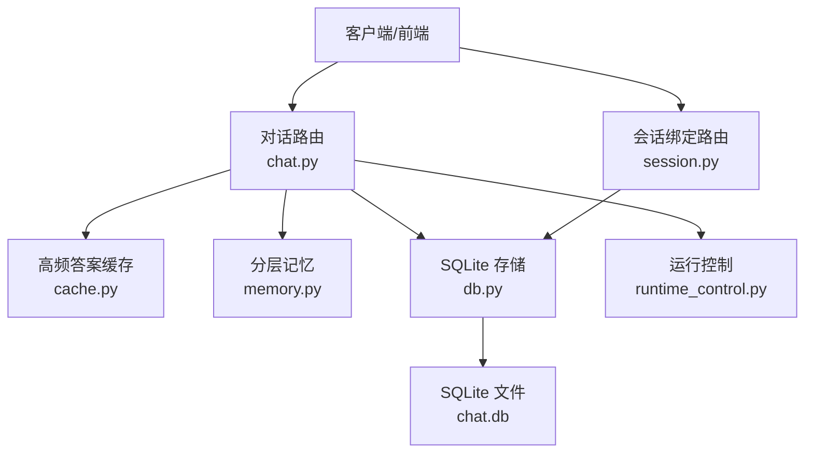
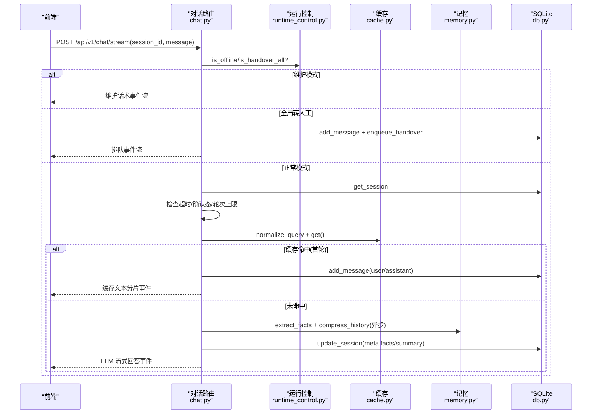
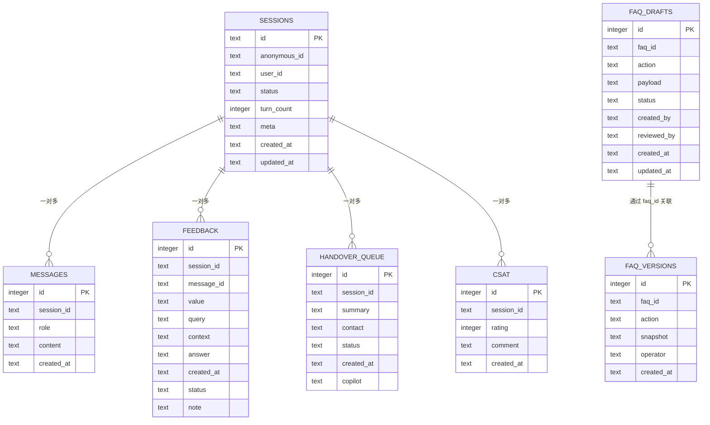
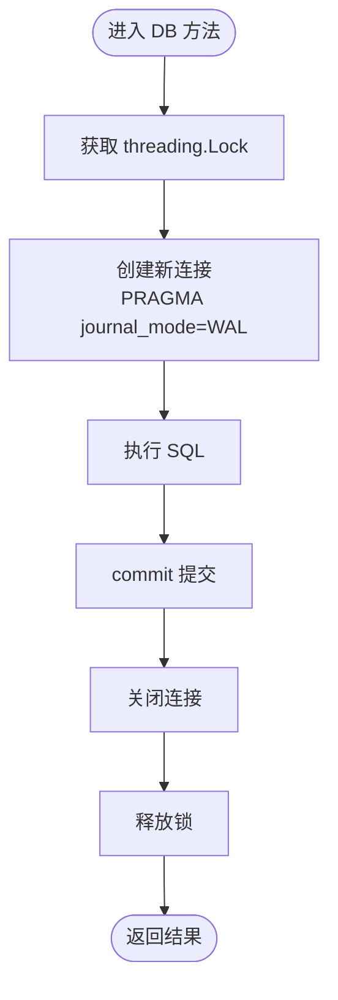
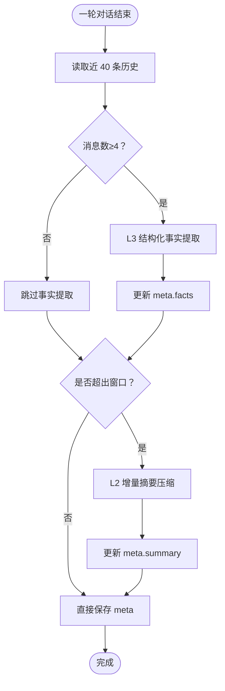
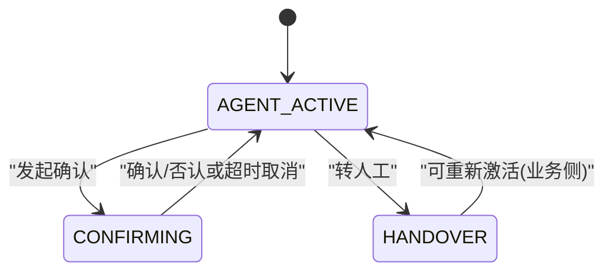
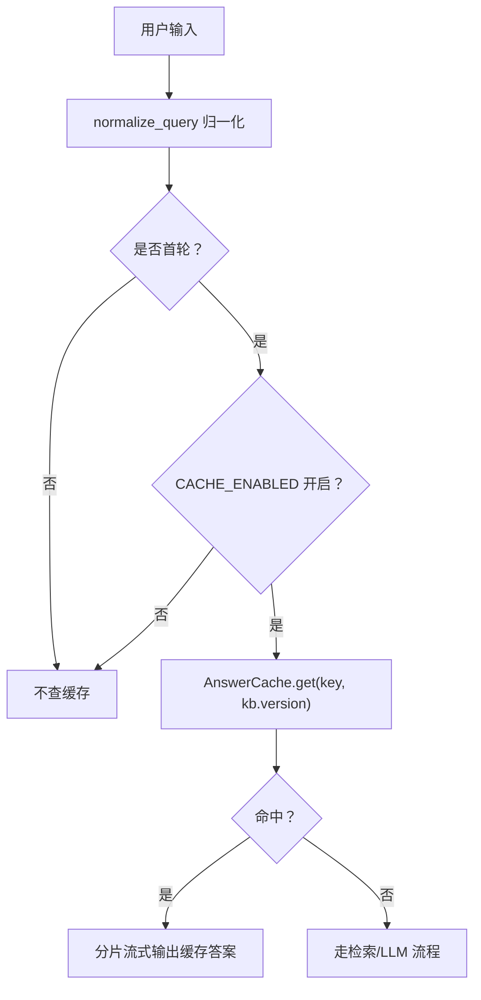
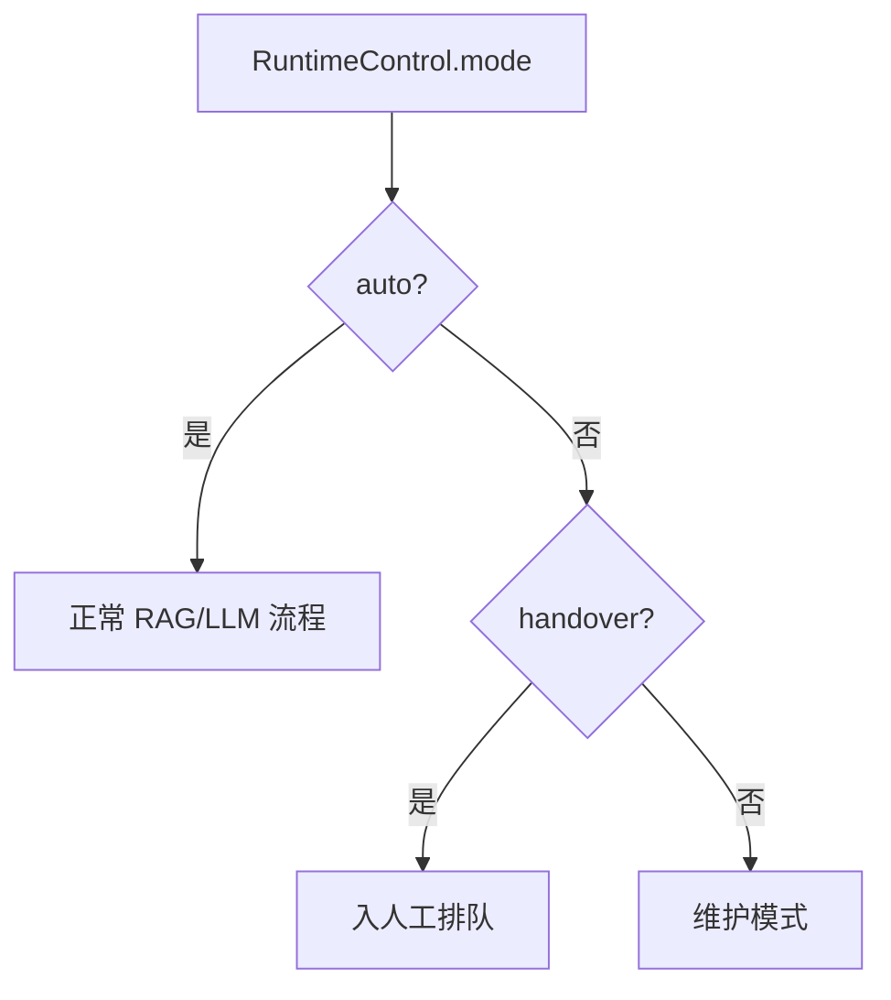
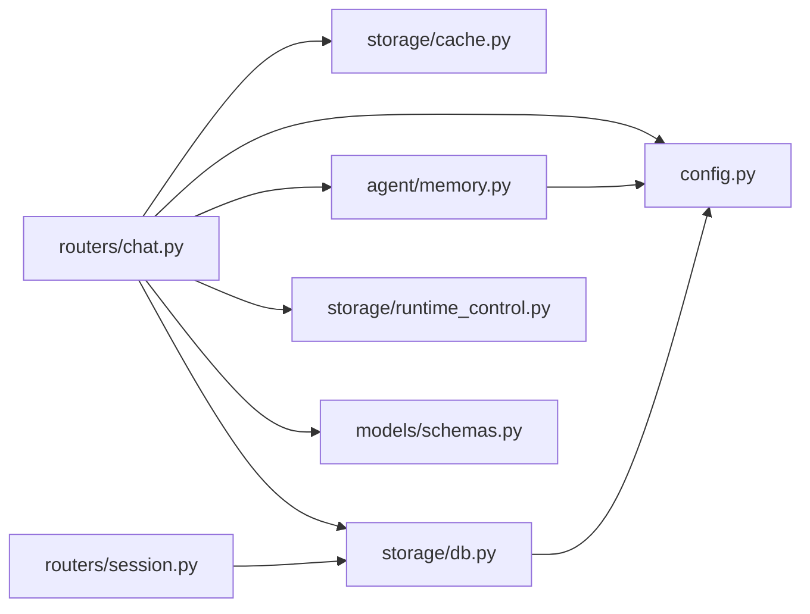

# 会话存储层

<cite>
**本文引用的文件**   
- [backend/app/storage/db.py](file://backend/app/storage/db.py)
- [backend/app/storage/cache.py](file://backend/app/storage/cache.py)
- [backend/app/storage/runtime_control.py](file://backend/app/storage/runtime_control.py)
- [backend/app/agent/memory.py](file://backend/app/agent/memory.py)
- [backend/app/routers/chat.py](file://backend/app/routers/chat.py)
- [backend/app/routers/session.py](file://backend/app/routers/session.py)
- [backend/app/models/schemas.py](file://backend/app/models/schemas.py)
- [backend/app/config.py](file://backend/app/config.py)
</cite>

## 目录
1. [引言](#引言)
2. [项目结构](#项目结构)
3. [核心组件](#核心组件)
4. [架构总览](#架构总览)
5. [详细组件分析](#详细组件分析)
6. [依赖关系分析](#依赖关系分析)
7. [性能与优化](#性能与优化)
8. [故障排查](#故障排查)
9. [结论](#结论)
10. [附录：配置与迁移清单](#附录配置与迁移清单)

## 引言
本文件聚焦“会话存储层”，围绕 SQLite 数据库、内存缓存、运行时控制开关以及分层记忆系统，系统性说明以下能力：
- SQLite 表结构与关系：sessions、messages、feedback、handover_queue、faq_drafts、faq_versions、csat。
- WAL 模式优化、线程安全机制、滑动窗口历史管理。
- 会话状态机、30 轮对话上限、超时复位逻辑。
- L3 结构化事实提取与 L2 增量摘要的记忆系统。
- Top20 高频问题秒回缓存策略。
- 运行时控制开关（Kill Switch / 灰度）。
- 数据迁移脚本行为、性能监控指标、备份恢复方案与扩容建议。

## 项目结构
会话存储相关代码集中在 backend/app 下：
- storage/db.py：SQLite 存储抽象、建表、索引、查询、写入、统计、知识库草稿/版本/CSAT 等。
- storage/cache.py：Top20 高频问答内存缓存。
- storage/runtime_control.py：服务 Kill Switch 与灰度分流。
- agent/memory.py：L2/L3 分层记忆维护。
- routers/chat.py：对话入口，串联缓存、会话校验、轮次上限、超时复位、记忆更新。
- routers/session.py：会话绑定与反馈提交。
- models/schemas.py：请求/响应模型契约。
- config.py：会话轮次上限、滑动窗口、缓存大小、超时时间等配置。

**图表来源**
- [backend/app/routers/chat.py:1-200](file://backend/app/routers/chat.py#L1-L200)
- [backend/app/routers/session.py:1-35](file://backend/app/routers/session.py#L1-L35)
- [backend/app/storage/cache.py:1-82](file://backend/app/storage/cache.py#L1-L82)
- [backend/app/agent/memory.py:1-87](file://backend/app/agent/memory.py#L1-L87)
- [backend/app/storage/db.py:1-200](file://backend/app/storage/db.py#L1-L200)
- [backend/app/storage/runtime_control.py:1-83](file://backend/app/storage/runtime_control.py#L1-L83)

**章节来源**
- [backend/app/storage/db.py:1-200](file://backend/app/storage/db.py#L1-L200)
- [backend/app/routers/chat.py:1-200](file://backend/app/routers/chat.py#L1-L200)
- [backend/app/storage/cache.py:1-82](file://backend/app/storage/cache.py#L1-L82)
- [backend/app/agent/memory.py:1-87](file://backend/app/agent/memory.py#L1-L87)
- [backend/app/storage/runtime_control.py:1-83](file://backend/app/storage/runtime_control.py#L1-L83)
- [backend/app/routers/session.py:1-35](file://backend/app/routers/session.py#L1-L35)
- [backend/app/models/schemas.py:1-138](file://backend/app/models/schemas.py#L1-L138)
- [backend/app/config.py:1-104](file://backend/app/config.py#L1-L104)

## 核心组件
- SQLite 数据库封装 Database：单实例 db，线程锁保护，WAL 模式，统一建表与迁移。
- 高频答案缓存 AnswerCache：按规范化 query key 命中秒回，容量淘汰策略。
- 运行控制 RuntimeControl：auto/handover/off 三态，灰度百分比稳定哈希。
- 分层记忆 memory：L3 结构化事实覆盖式提取；L2 早期对话增量摘要。
- 对话路由 chat：Visitor Token 校验、轮次上限、超时复位、首轮缓存、记忆更新。
- 会话绑定 session：匿名 ID 与用户 ID 绑定，点赞点踩埋点入库。

**章节来源**
- [backend/app/storage/db.py:1-200](file://backend/app/storage/db.py#L1-L200)
- [backend/app/storage/cache.py:1-82](file://backend/app/storage/cache.py#L1-L82)
- [backend/app/storage/runtime_control.py:1-83](file://backend/app/storage/runtime_control.py#L1-L83)
- [backend/app/agent/memory.py:1-87](file://backend/app/agent/memory.py#L1-L87)
- [backend/app/routers/chat.py:1-200](file://backend/app/routers/chat.py#L1-L200)
- [backend/app/routers/session.py:1-35](file://backend/app/routers/session.py#L1-L35)

## 架构总览
会话存储层在对话主流程中的位置如下：

**图表来源**
- [backend/app/routers/chat.py:1-200](file://backend/app/routers/chat.py#L1-L200)
- [backend/app/storage/runtime_control.py:1-83](file://backend/app/storage/runtime_control.py#L1-L83)
- [backend/app/storage/cache.py:1-82](file://backend/app/storage/cache.py#L1-L82)
- [backend/app/agent/memory.py:1-87](file://backend/app/agent/memory.py#L1-L87)
- [backend/app/storage/db.py:1-200](file://backend/app/storage/db.py#L1-L200)

## 详细组件分析

### SQLite 表结构与关系
Database 初始化时创建并迁移以下表：

- sessions：会话元信息，含状态、轮次、JSON meta、时间戳。
- messages：消息历史，按 id 自增，按 session_id+id 索引。
- feedback：点赞/点踩及 Bad Case 字段，含 status/note。
- handover_queue：人工排队队列，支持 copilot 扩展字段。
- faq_drafts：FAQ 变更草稿，支持 draft→pending→published/rejected 流转。
- faq_versions：FAQ 版本快照，用于一键回滚。
- csat：满意度评分 1-5。

**图表来源**
- [backend/app/storage/db.py:20-110](file://backend/app/storage/db.py#L20-L110)
- [backend/app/storage/db.py:110-200](file://backend/app/storage/db.py#L110-L200)
- [backend/app/storage/db.py:201-566](file://backend/app/storage/db.py#L201-L566)

关键设计要点：
- 所有写操作均使用 threading.Lock 串行化，避免多线程竞争。
- WAL 模式开启，提升并发读与写吞吐。
- messages 建立 (session_id, id) 索引以加速最近 N 条历史查询。
- JSON 字段 meta/payload/snapshot/copilot 使用 ensure_ascii=False 序列化。
- 旧库自动迁移：handover_queue.copilot、feedback.status/note 列缺失则 ALTER TABLE 补齐。

**章节来源**
- [backend/app/storage/db.py:20-110](file://backend/app/storage/db.py#L20-L110)
- [backend/app/storage/db.py:110-200](file://backend/app/storage/db.py#L110-L200)
- [backend/app/storage/db.py:201-566](file://backend/app/storage/db.py#L201-L566)

### 线程安全与 WAL 优化
- 连接级隔离：_connect 为每个调用创建独立 sqlite3.Connection，并设置 check_same_thread=False。
- 进程内互斥：Database 持有 _lock = threading.Lock()，所有读写方法在进入 SQL 前加锁。
- WAL 模式：conn.execute("PRAGMA journal_mode=WAL")，降低写放大与锁竞争，提高读并发。
- 事务边界：每次 INSERT/UPDATE 后显式 commit，确保数据持久化。

**图表来源**
- [backend/app/storage/db.py:12-35](file://backend/app/storage/db.py#L12-L35)
- [backend/app/storage/db.py:110-180](file://backend/app/storage/db.py#L110-L180)

**章节来源**
- [backend/app/storage/db.py:12-35](file://backend/app/storage/db.py#L12-L35)
- [backend/app/storage/db.py:110-180](file://backend/app/storage/db.py#L110-L180)

### 滑动窗口历史管理与记忆系统
- 滑动窗口：HISTORY_WINDOW_TURNS 决定短期窗口轮数，window_size() 返回对应消息条数阈值。
- L2 中期记忆：当 total_messages > window_size()，对窗口外 early 消息进行压缩，生成摘要，增量合并到 meta.summary。
- L3 结构化事实：从第 2 轮起覆盖式提取 user_intent/order_info/product/request 等 Key-Value，存入 meta.facts。
- 记忆更新时机：每轮对话结束后由 chat._update_memory 调用 memory.extract_facts/compress_history，再更新 session.meta。

**图表来源**
- [backend/app/agent/memory.py:1-87](file://backend/app/agent/memory.py#L1-L87)
- [backend/app/routers/chat.py:1-200](file://backend/app/routers/chat.py#L1-L200)
- [backend/app/config.py:1-104](file://backend/app/config.py#L1-L104)

**章节来源**
- [backend/app/agent/memory.py:1-87](file://backend/app/agent/memory.py#L1-L87)
- [backend/app/routers/chat.py:1-200](file://backend/app/routers/chat.py#L1-L200)
- [backend/app/config.py:1-104](file://backend/app/config.py#L1-L104)

### 会话状态机、30 轮上限与超时复位
- 状态值：AGENT_ACTIVE、CONFIRMING、HANDOVER 等，存储在 sessions.status。
- 30 轮硬上限：SESSION_MAX_TURNS=30，超过即拒绝继续对话，引导登录或转人工。
- 超时复位：30 分钟无操作视为新会话，重置 status/turn_count/meta，历史保留供查阅。
- 确认态超时：CONFIRM_TIMEOUT_SECONDS=30，未在时限内确认则清除 pending 状态。

**图表来源**
- [backend/app/storage/db.py:110-180](file://backend/app/storage/db.py#L110-L180)
- [backend/app/routers/chat.py:1-200](file://backend/app/routers/chat.py#L1-L200)
- [backend/app/config.py:1-104](file://backend/app/config.py#L1-L104)

**章节来源**
- [backend/app/storage/db.py:110-180](file://backend/app/storage/db.py#L110-L180)
- [backend/app/routers/chat.py:1-200](file://backend/app/routers/chat.py#L1-L200)
- [backend/app/config.py:1-104](file://backend/app/config.py#L1-L104)

### 高频答案缓存策略（Top20）
- 归一化键：normalize_query 对 query 做分词与停用词过滤，仅保留中英文数字 token。
- 容量上限：默认 20 项，LRU 变种淘汰策略优先淘汰 count 最小且 last_ts 最旧的条目。
- 失效策略：kb.version 变化时清空缓存，防止口径过期。
- 命中条件：仅首轮且开启 CACHE_ENABLED，仅自动回答结果（非转人工）。

**图表来源**
- [backend/app/storage/cache.py:1-82](file://backend/app/storage/cache.py#L1-L82)
- [backend/app/routers/chat.py:1-200](file://backend/app/routers/chat.py#L1-L200)
- [backend/app/config.py:1-104](file://backend/app/config.py#L1-L104)

**章节来源**
- [backend/app/storage/cache.py:1-82](file://backend/app/storage/cache.py#L1-L82)
- [backend/app/routers/chat.py:1-200](file://backend/app/routers/chat.py#L1-L200)
- [backend/app/config.py:1-104](file://backend/app/config.py#L1-L104)

### 运行时控制开关（Kill Switch 与灰度）
- 服务模式：
  - auto：RAG + 自动回答 + 转人工决策全开。
  - handover：全局转人工登记，不调用检索/LLM。
  - off：维护模式，回复维护话术，不入队不调用。
- 灰度分流：gray_percent 0-100，基于 session_id 的 sha256 稳定哈希分配桶位。
- 状态可见：ChatInitResponse.gray 标记该会话是否命中灰度组。

**图表来源**
- [backend/app/storage/runtime_control.py:1-83](file://backend/app/storage/runtime_control.py#L1-L83)
- [backend/app/routers/chat.py:1-200](file://backend/app/routers/chat.py#L1-L200)

**章节来源**
- [backend/app/storage/runtime_control.py:1-83](file://backend/app/storage/runtime_control.py#L1-L83)
- [backend/app/routers/chat.py:1-200](file://backend/app/routers/chat.py#L1-L200)
- [backend/app/models/schemas.py:1-138](file://backend/app/models/schemas.py#L1-L138)

### 会话绑定与反馈埋点
- 绑定接口：/api/v1/session/bind，将 anonymous_session_id 与 user_id 绑定，历史聊天零丢失。
- 反馈接口：/api/v1/feedback，记录点赞/点踩，点踩用于 Bad Case 归因。

**章节来源**
- [backend/app/routers/session.py:1-35](file://backend/app/routers/session.py#L1-L35)
- [backend/app/models/schemas.py:1-138](file://backend/app/models/schemas.py#L1-L138)
- [backend/app/storage/db.py:201-260](file://backend/app/storage/db.py#L201-L260)

### 数据迁移脚本
Database.init_db 包含内联迁移：
- 若 handover_queue 缺少 copilot 列，则 ADD COLUMN DEFAULT '{}'。
- 若 feedback 缺少 status/note 列，则分别 ADD COLUMN DEFAULT 'open'/'\'\'\'。
- 无需外部脚本即可兼容旧库结构。

**章节来源**
- [backend/app/storage/db.py:80-110](file://backend/app/storage/db.py#L80-L110)

## 依赖关系分析
- routers.chat 依赖：
  - storage.cache：高频答案缓存。
  - storage.db：会话/消息/反馈/排队/CSAT 等读写。
  - agent.memory：L2/L3 记忆维护。
  - storage.runtime_control：Kill Switch/灰度判断。
  - models.schemas：请求/响应模型。
  - config：会话上限、滑动窗口、缓存开关等。
- routers.session 依赖：storage.db。
- agent.memory 依赖：agent.llm、agent.prompts（外部模块），与 config.window_size。
- storage.db 依赖：config.settings。

**图表来源**
- [backend/app/routers/chat.py:1-200](file://backend/app/routers/chat.py#L1-L200)
- [backend/app/routers/session.py:1-35](file://backend/app/routers/session.py#L1-L35)
- [backend/app/agent/memory.py:1-87](file://backend/app/agent/memory.py#L1-L87)
- [backend/app/storage/cache.py:1-82](file://backend/app/storage/cache.py#L1-L82)
- [backend/app/storage/db.py:1-200](file://backend/app/storage/db.py#L1-L200)
- [backend/app/storage/runtime_control.py:1-83](file://backend/app/storage/runtime_control.py#L1-L83)
- [backend/app/models/schemas.py:1-138](file://backend/app/models/schemas.py#L1-L138)
- [backend/app/config.py:1-104](file://backend/app/config.py#L1-L104)

**章节来源**
- [backend/app/routers/chat.py:1-200](file://backend/app/routers/chat.py#L1-L200)
- [backend/app/routers/session.py:1-35](file://backend/app/routers/session.py#L1-L35)
- [backend/app/agent/memory.py:1-87](file://backend/app/agent/memory.py#L1-L87)
- [backend/app/storage/cache.py:1-82](file://backend/app/storage/cache.py#L1-L82)
- [backend/app/storage/db.py:1-200](file://backend/app/storage/db.py#L1-L200)
- [backend/app/storage/runtime_control.py:1-83](file://backend/app/storage/runtime_control.py#L1-L83)
- [backend/app/models/schemas.py:1-138](file://backend/app/models/schemas.py#L1-L138)
- [backend/app/config.py:1-104](file://backend/app/config.py#L1-L104)

## 性能与优化

### 性能监控指标
可从存储层导出以下指标：
- 反馈统计：total/up/down/up_rate。
- CSAT 统计：总数、平均分、各星分布。
- 会话统计：总数、AGENT_ACTIVE/HANDOVER 计数、自动解决率。
- 缓存统计：size/max/hits_total。

这些指标可通过 Database.feedback_stats、csat_stats、session_stats 与 cache.stats 汇总至运营看板。

**章节来源**
- [backend/app/storage/db.py:260-360](file://backend/app/storage/db.py#L260-L360)
- [backend/app/storage/cache.py:1-82](file://backend/app/storage/cache.py#L1-L82)

### 备份恢复方案
- 基础方案：由于使用 SQLite 单文件（默认 data/chat.db），可直接复制文件作为冷备。建议在低峰期停止写入或使用只读副本。
- WAL 恢复：WAL 模式下需同时备份主数据库文件与同名的 .wal/.shm 文件，以确保一致性。
- 应用内快照：FAQ 版本表提供知识口径的历史快照，便于快速回滚知识口径。
- 推荐策略：定时 cron 任务拉取数据库快照至对象存储，并保留一定数量的历史版本。

[本节为通用实践建议，不直接分析具体源码文件]

### 扩容建议
- 单机 SQLite：适合中小流量场景；高并发下可考虑提升 I/O 与 CPU 资源。
- 水平扩展：当前 runtime_control 状态为进程内存，生产多实例可扩展为 Redis 共享。
- 读写分离：WAL 已提升读并发，但写串行化仍受限于单进程；如写入成为瓶颈，可评估数据库引擎替换或引入消息队列削峰。
- 缓存扩容：AnswerCache 为进程内内存，多实例场景下命中率可能偏低，建议接入分布式缓存（如 Redis）。

[本节为通用实践建议，不直接分析具体源码文件]

## 故障排查
- 会话找不到：检查 /api/v1/chat/init 是否先调用，确认 session_id 有效。
- Visitor Token 无效：核对前端生成与后端 verify_visitor_token 一致，检查 VISITOR_TOKEN_SECRET/TTL。
- 频繁触发轮次上限：确认 SESSION_MAX_TURNS 与业务预期一致，必要时调整。
- 缓存未命中：确认 CACHE_ENABLED=true，且为首轮；检查 normalize_query 归一化逻辑是否导致 key 不一致。
- 记忆未更新：检查 HISTORY_WINDOW_TURNS 与 total_messages 的关系，确认 _update_memory 成功执行。
- 超时复位异常：检查 updated_at 格式与 SESSION_TIMEOUT_MINUTES 配置。
- 运行模式切换：通过 RuntimeControl.set_mode 切换 auto/handover/off，观察日志警告。
- 灰度分流：检查 gray_percent 与 session_id 哈希桶计算，确认 ChatInitResponse.gray。

**章节来源**
- [backend/app/routers/chat.py:1-200](file://backend/app/routers/chat.py#L1-L200)
- [backend/app/storage/cache.py:1-82](file://backend/app/storage/cache.py#L1-L82)
- [backend/app/agent/memory.py:1-87](file://backend/app/agent/memory.py#L1-L87)
- [backend/app/storage/runtime_control.py:1-83](file://backend/app/storage/runtime_control.py#L1-L83)
- [backend/app/config.py:1-104](file://backend/app/config.py#L1-L104)

## 结论
本会话存储层以 SQLite 为核心，结合内存缓存与进程内运行控制，实现了：
- 稳定的表结构与迁移机制，支撑会话、消息、反馈、排队、FAQ 草稿/版本、CSAT 等业务。
- WAL 与线程锁保障基本并发与一致性。
- 首轮高频问题秒回缓存，显著降低首字延迟。
- 分层记忆系统在长对话中维持上下文质量。
- 会话状态机与轮次上限、超时复位保证用户体验与成本可控。
- Kill Switch 与灰度分流提供运维弹性。

在生产环境中，建议关注指标监控、定期备份、并根据流量特征评估缓存与数据库的分布式改造。

## 附录：配置与迁移清单

### 关键配置项
- SESSION_MAX_TURNS：会话最大轮次，默认 30。
- MAX_INPUT_LEN：单条消息长度限制，默认 2000。
- HISTORY_WINDOW_TURNS：滑动窗口轮数，默认 5。
- SESSION_TIMEOUT_MINUTES：会话空闲超时分钟数，默认 30。
- CONFIRM_TIMEOUT_SECONDS：确认态超时秒数，默认 30。
- REPEAT_UNRESOLVED_LIMIT：连续未解决次数阈值，默认 2。
- CACHE_ENABLED：是否启用高频答案缓存。
- CACHE_MAX_ENTRIES：缓存容量上限，默认 20。
- DB_PATH：SQLite 文件路径，默认 data/chat.db。

**章节来源**
- [backend/app/config.py:1-104](file://backend/app/config.py#L1-L104)

### 数据迁移要点
- init_db 自动检测并添加手缺少的列：
  - handover_queue.copilot TEXT DEFAULT '{}'
  - feedback.status TEXT DEFAULT 'open'
  - feedback.note TEXT DEFAULT ''

**章节来源**
- [backend/app/storage/db.py:80-110](file://backend/app/storage/db.py#L80-L110)