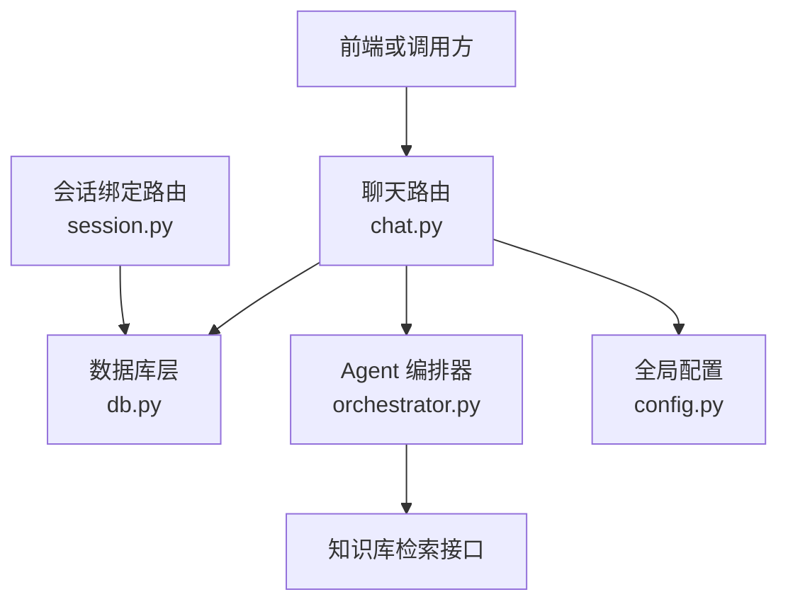
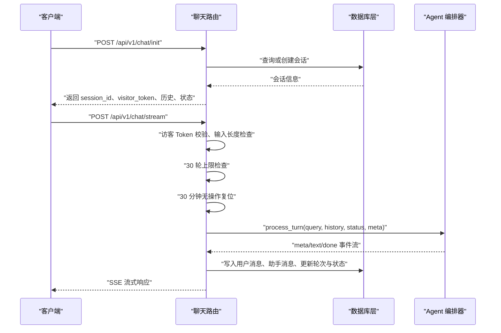
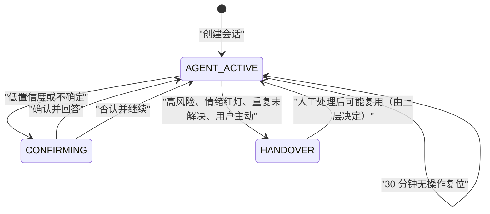
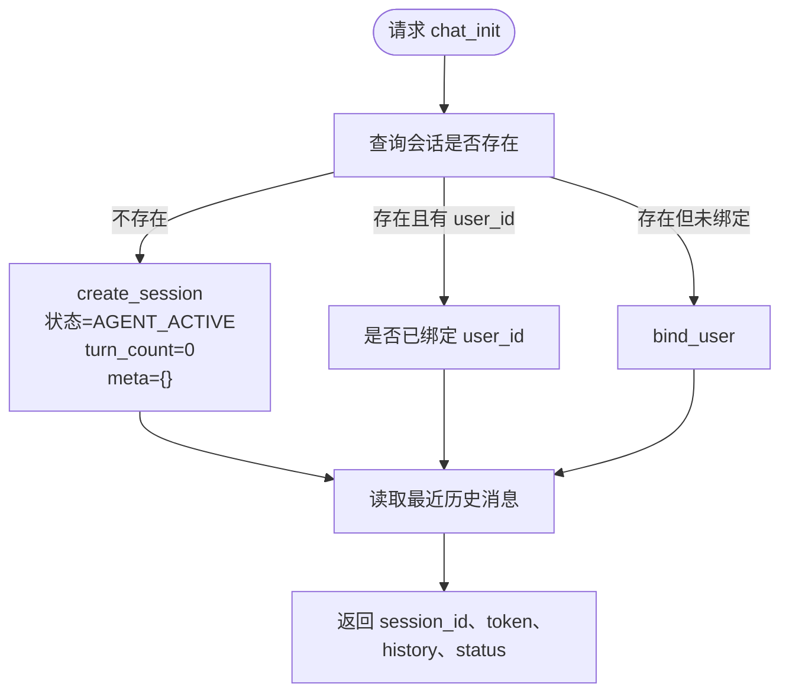
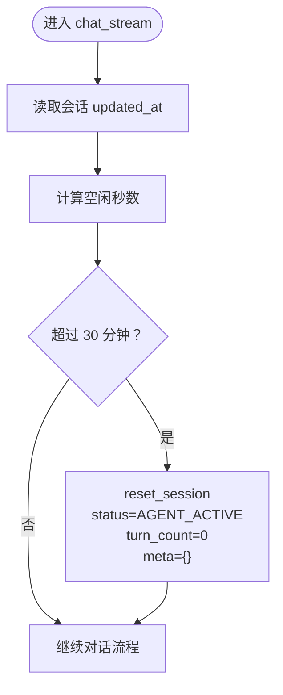
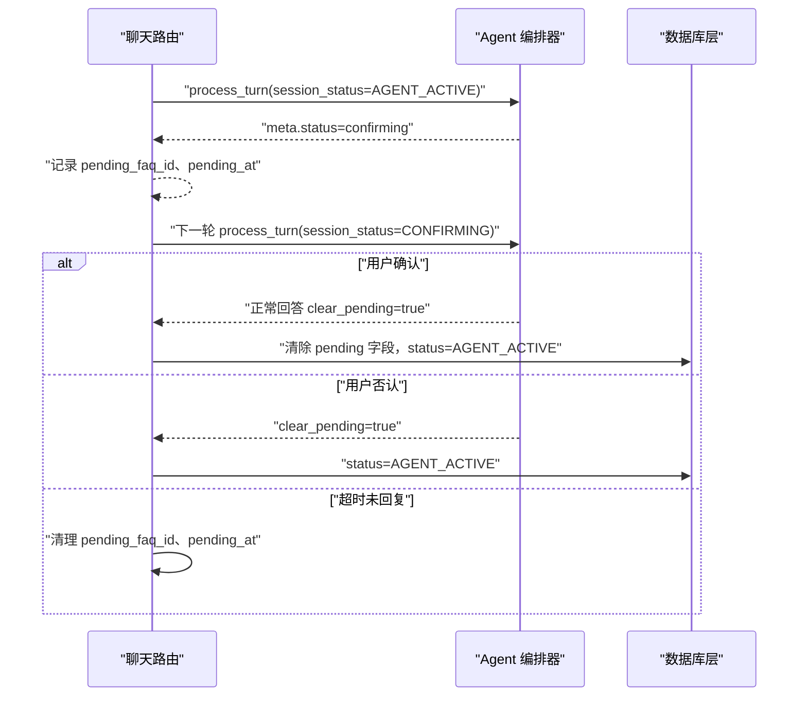
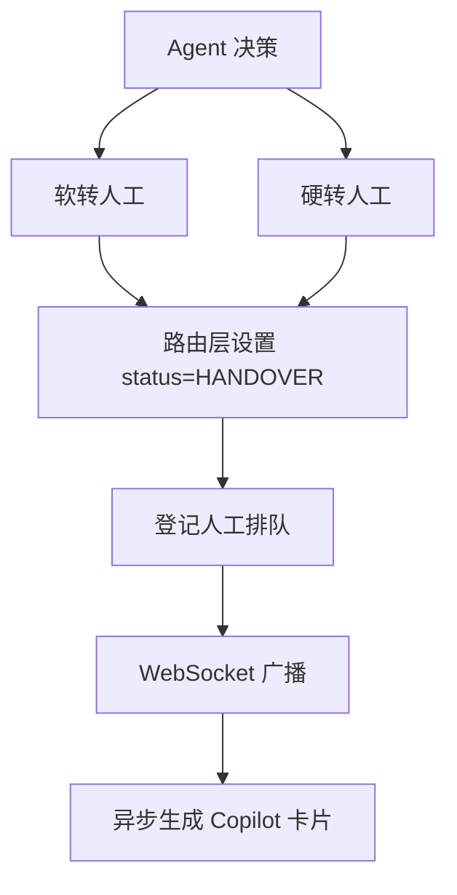
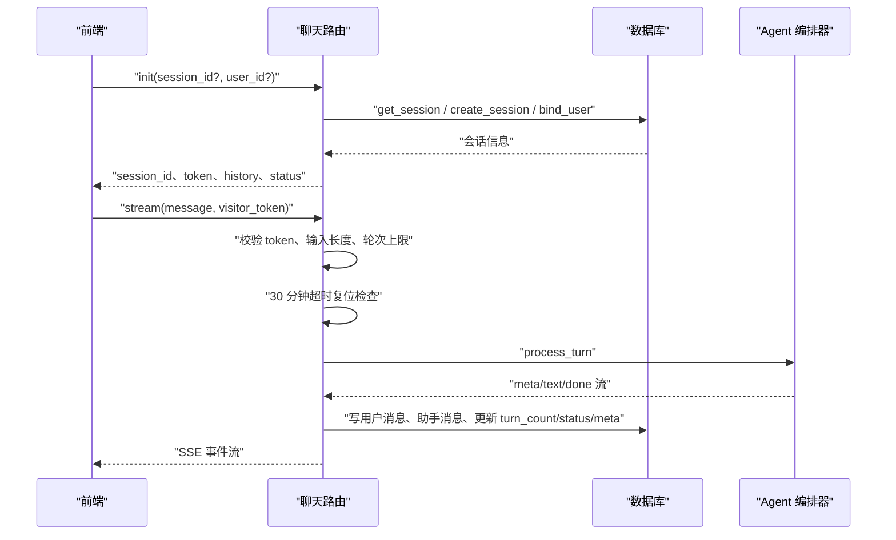
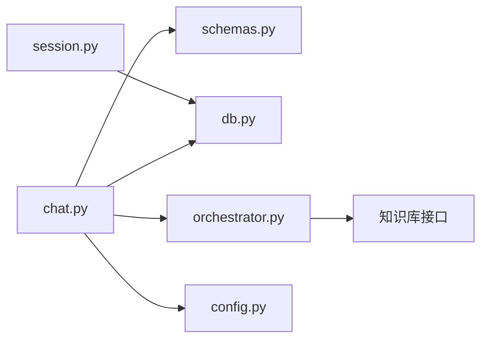

# 会话状态机与生命周期

<cite>
**本文引用的文件**   
- [backend/app/routers/chat.py](file://backend/app/routers/chat.py)
- [backend/app/routers/session.py](file://backend/app/routers/session.py)
- [backend/app/models/schemas.py](file://backend/app/models/schemas.py)
- [backend/app/storage/db.py](file://backend/app/storage/db.py)
- [backend/app/agent/orchestrator.py](file://backend/app/agent/orchestrator.py)
- [backend/app/config.py](file://backend/app/config.py)
</cite>

## 目录
1. [引言](#引言)
2. [项目结构与定位](#项目结构与定位)
3. [核心组件](#核心组件)
4. [架构总览](#架构总览)
5. [详细组件分析](#详细组件分析)
6. [依赖关系分析](#依赖关系分析)
7. [性能与容量特性](#性能与容量特性)
8. [故障排查指南](#故障排查指南)
9. [结论](#结论)
10. [附录：元数据字段与配置项](#附录元数据字段与配置项)

## 引言
本文聚焦后端会话子系统的状态机与生命周期，覆盖以下目标：
- 明确会话状态定义及转换规则，尤其是 `AGENT_ACTIVE → CONFIRMING → HANDOVER → CLOSED` 等关键路径。
- 完整说明会话创建、更新、用户绑定、重置的业务流程。
- 解释 30 轮对话上限控制机制。
- 阐述超时复位逻辑（plan 3.1-4）：30 分钟无操作视为新会话，历史消息保留但不进入 Prompt。
- 给出会话元数据 JSON 结构设计与 `anonymous_id` 与 `user_id` 的关联关系。
- 提供状态转换图、生命周期时序图和异常处理方案。

## 项目结构与定位
会话相关代码主要分布在四个层次：
- 路由层：负责 HTTP API、SSE 流式响应、WebSocket 实时事件。
- 模型层：统一前后端契约，包括请求体、响应体和枚举值。
- 存储层：SQLite 表结构、会话与消息读写、排队与统计。
- Agent 编排层：情绪分级、检索决策、生成回答、转人工策略。

**图表来源**
- [backend/app/routers/chat.py:1-327](file://backend/app/routers/chat.py#L1-L327)
- [backend/app/routers/session.py:1-35](file://backend/app/routers/session.py#L1-L35)
- [backend/app/storage/db.py:1-566](file://backend/app/storage/db.py#L1-L566)
- [backend/app/agent/orchestrator.py:1-404](file://backend/app/agent/orchestrator.py#L1-L404)
- [backend/app/config.py:1-104](file://backend/app/config.py#L1-L104)

**章节来源**
- [backend/app/routers/chat.py:1-327](file://backend/app/routers/chat.py#L1-L327)
- [backend/app/routers/session.py:1-35](file://backend/app/routers/session.py#L1-L35)
- [backend/app/storage/db.py:1-566](file://backend/app/storage/db.py#L1-L566)
- [backend/app/agent/orchestrator.py:1-404](file://backend/app/agent/orchestrator.py#L1-L404)
- [backend/app/config.py:1-104](file://backend/app/config.py#L1-L104)

## 核心组件
本节从业务角度梳理与会话状态机直接相关的核心对象与方法。

| 组件 | 职责 | 关键方法 / 行为 |
|---|---|---|
| 聊天路由 | 初始化会话、流式对话、手动转人工 | `chat_init`、`chat_stream`、`handover` |
| 会话绑定路由 | 匿名会话与已登录用户绑定 | `session_bind` |
| 数据库层 | 会话持久化、消息持久化、队列、统计 | `create_session`、`get_session`、`update_session`、`bind_user`、`reset_session` |
| Agent 编排器 | 意图判断、确认态、生成回答、转人工 | `process_turn`、`_answer_flow`、`_soft_handover`、`_hard_handover` |
| 配置模块 | 会话轮次上限、超时阈值、缓存开关等 | `SESSION_MAX_TURNS`、`SESSION_TIMEOUT_MINUTES`、`CONFIRM_TIMEOUT_SECONDS` |

**章节来源**
- [backend/app/routers/chat.py:1-327](file://backend/app/routers/chat.py#L1-L327)
- [backend/app/routers/session.py:1-35](file://backend/app/routers/session.py#L1-L35)
- [backend/app/storage/db.py:1-566](file://backend/app/storage/db.py#L1-L566)
- [backend/app/agent/orchestrator.py:1-404](file://backend/app/agent/orchestrator.py#L1-L404)
- [backend/app/config.py:1-104](file://backend/app/config.py#L1-L104)

## 架构总览
会话系统采用“路由层驱动 + Agent 编排 + 存储落盘”的分层架构：
- 路由层接收 HTTP/SSE/WS 请求，完成鉴权、限流、校验和边界保护。
- Agent 编排器决定当前轮是继续问答、进入确认态还是转人工。
- 存储层维护会话状态、轮次计数、元数据、消息历史和人工排队。

**图表来源**
- [backend/app/routers/chat.py:1-327](file://backend/app/routers/chat.py#L1-L327)
- [backend/app/storage/db.py:1-566](file://backend/app/storage/db.py#L1-L566)
- [backend/app/agent/orchestrator.py:1-404](file://backend/app/agent/orchestrator.py#L1-L404)

## 详细组件分析

### 会话状态机定义与转换规则
当前会话状态由数据库 `sessions.status` 字段承载，结合 Agent 编排器的输出事件，可归纳如下状态：

| 状态 | 含义 | 常见进入条件 | 后续可能 |
|---|---|---|---|
| `AGENT_ACTIVE` | 智能客服活跃，正常问答 | 新建会话、超时复位后恢复 | `CONFIRMING`、`HANDOVER` |
| `CONFIRMING` | 低置信度或不确定场景下的确认态 | 软转人工分支输出 `status=confirming` | `AGENT_ACTIVE`、`HANDOVER` |
| `HANDOVER` | 已转人工排队 | 硬转人工、软转人工最终标记、运行控制全局转人工 | 人工接入后可继续交互或结束 |
| `CLOSED` | 会话结束语义（概念状态） | 当前实现未显式写入该状态；通常以超时会话复位或前端终止体现 | 不复用为活跃会话 |

#### 关键转换规则
1. **初始状态**  
   - 新建会话默认状态为 `AGENT_ACTIVE`。
2. **进入确认态**  
   - 当检索结果置信度较低、无法确定是否可直接回答时，Agent 编排器输出 `meta.status=confirming`。
   - 此时前端应展示澄清选项或快捷回复，等待用户确认。
3. **确认态解除**
   - 若用户确认且匹配 FAQ，则走正常回答流程，最终将状态恢复为 `AGENT_ACTIVE`。
   - 若用户否认，Agent 编排器会清除 pending 字段并回到自由对话。
4. **转人工**
   - 高风险、情绪红灯、重复未解决、用户主动要求、LLM 不可回答等情况进入 `HANDOVER`。
   - 路由层在收到编排器 `done.handover=True` 后，写入 `status=HANDOVER`，并登记人工排队。
5. **会话复位**
   - 30 分钟无操作后，状态重置为 `AGENT_ACTIVE`，轮次归零，元数据清空，但历史消息仍保留。

**图表来源**
- [backend/app/storage/db.py:60-120](file://backend/app/storage/db.py#L60-L120)
- [backend/app/agent/orchestrator.py:120-220](file://backend/app/agent/orchestrator.py#L120-L220)
- [backend/app/agent/orchestrator.py:280-404](file://backend/app/agent/orchestrator.py#L280-L404)
- [backend/app/routers/chat.py:180-327](file://backend/app/routers/chat.py#L180-L327)

**章节来源**
- [backend/app/storage/db.py:60-120](file://backend/app/storage/db.py#L60-L120)
- [backend/app/agent/orchestrator.py:100-404](file://backend/app/agent/orchestrator.py#L100-L404)
- [backend/app/routers/chat.py:180-327](file://backend/app/routers/chat.py#L180-L327)

### 会话创建流程 create_session
创建会话的核心逻辑位于路由层与存储层协作：
- 前端调用 `/api/v1/chat/init`，可选携带已有 `session_id` 或已登录 `user_id`。
- 若会话不存在，路由层调用 `db.create_session` 创建会话，默认状态 `AGENT_ACTIVE`、轮次 0、元数据为空对象。
- 若会话存在但未绑定 `user_id`，且请求携带 `user_id`，则调用 `db.bind_user` 进行绑定。
- 最后返回 `session_id`、`visitor_token`、品牌名、快捷按钮、最近历史、当前状态及灰度标记。

**图表来源**
- [backend/app/routers/chat.py:60-120](file://backend/app/routers/chat.py#L60-L120)
- [backend/app/storage/db.py:120-170](file://backend/app/storage/db.py#L120-L170)

**章节来源**
- [backend/app/routers/chat.py:60-120](file://backend/app/routers/chat.py#L60-L120)
- [backend/app/storage/db.py:120-170](file://backend/app/storage/db.py#L120-L170)

### 会话更新流程 update_session
`update_session` 是会话状态与元数据的统一写入入口：
- 允许更新的字段受白名单限制：`status`、`turn_count`、`meta`、`user_id`、`anonymous_id`。
- 若更新 `meta` 且为字典，则序列化为 JSON 字符串。
- 每次更新自动刷新 `updated_at`，用于超时判定。
- 路由层在每轮对话结束时根据 Agent 输出更新状态、轮次和元数据。

典型更新场景包括：
- 轮次递增：`turn_count += 1`。
- 状态切换：`AGENT_ACTIVE → CONFIRMING → HANDOVER`。
- 元数据写入：确认态 pending 信息、未解决连续次数、结构化事实、摘要等。

**章节来源**
- [backend/app/storage/db.py:140-170](file://backend/app/storage/db.py#L140-L170)
- [backend/app/routers/chat.py:220-327](file://backend/app/routers/chat.py#L220-L327)

### 用户绑定流程 bind_user
用户绑定发生在两个入口：
1. **登录瞬间绑定**：通过 `/api/v1/session/bind`。
   - 若匿名会话不存在，直接用匿名 ID 创建会话并绑定 `user_id`。
   - 若会话已存在，则执行绑定。
   - 保证“历史聊天零丢失”。
2. **初始化时补绑**：在 `chat_init` 中，若已有会话但未绑定 `user_id`，且请求携带 `user_id`，则调用 `bind_user`。

`anonymous_id` 与 `user_id` 的关系：
- `anonymous_id` 表示未登录时的匿名会话标识。
- `user_id` 表示已登录用户标识。
- 绑定后，同一 `session_id` 同时具备匿名上下文与用户身份，便于历史延续。

**章节来源**
- [backend/app/routers/session.py:1-35](file://backend/app/routers/session.py#L1-L35)
- [backend/app/routers/chat.py:60-120](file://backend/app/routers/chat.py#L60-L120)
- [backend/app/storage/db.py:140-170](file://backend/app/storage/db.py#L140-L170)

### 会话重置流程 reset_session
会话重置是 plan 3.1-4 的关键机制：
- 触发条件：单次请求到达时，计算 `updated_at` 到当前时间的空闲时长，超过 `SESSION_TIMEOUT_MINUTES`。
- 重置动作：
  - 状态重置为 `AGENT_ACTIVE`。
  - 轮次重置为 0。
  - 元数据重置为空对象。
  - `updated_at` 刷新。
- 历史消息不删除，仅不再作为 Prompt 上下文参与本轮生成。

**图表来源**
- [backend/app/routers/chat.py:140-200](file://backend/app/routers/chat.py#L140-L200)
- [backend/app/storage/db.py:150-170](file://backend/app/storage/db.py#L150-L170)
- [backend/app/config.py:70-104](file://backend/app/config.py#L70-L104)

**章节来源**
- [backend/app/routers/chat.py:140-200](file://backend/app/routers/chat.py#L140-L200)
- [backend/app/storage/db.py:150-170](file://backend/app/storage/db.py#L150-L170)
- [backend/app/config.py:70-104](file://backend/app/config.py#L70-L104)

### 30 轮对话上限控制机制
会话轮次上限由配置项 `SESSION_MAX_TURNS` 控制，默认值为 30：
- 路由层在 Agent 调用前检查 `turn_count >= SESSION_MAX_TURNS`。
- 若达到上限，直接返回提示消息，不调用 LLM，不落历史答案。
- 该机制属于成本熔断，防止单会话无限消耗。

注意：
- 该上限不是会话绝对生命周期，而是“当前活跃轮次计数”。
- 会话可通过 30 分钟超时复位重新获得新的轮次额度。

**章节来源**
- [backend/app/routers/chat.py:180-220](file://backend/app/routers/chat.py#L180-L220)
- [backend/app/config.py:70-104](file://backend/app/config.py#L70-L104)

### 确认态与 CONFIRMING 生命周期
确认态是 Agent 编排器的重要中间状态：
- 当检索结果置信度不足时，编排器输出 `status=confirming`，并提供快捷回复或澄清选项。
- 若用户确认且能命中 FAQ，则走 `_answer_flow` 正常回答。
- 若用户否认，编排器返回 `clear_pending=True`，路由层清除 `pending_faq_id` 并将状态恢复为 `AGENT_ACTIVE`。
- 若用户在 30 秒内未回复，路由层会清理 `pending_faq_id` 和 `pending_at`，使会话回到自由对话。

**图表来源**
- [backend/app/agent/orchestrator.py:120-220](file://backend/app/agent/orchestrator.py#L120-L220)
- [backend/app/routers/chat.py:140-220](file://backend/app/routers/chat.py#L140-L220)

**章节来源**
- [backend/app/agent/orchestrator.py:120-220](file://backend/app/agent/orchestrator.py#L120-L220)
- [backend/app/routers/chat.py:140-220](file://backend/app/routers/chat.py#L140-L220)

### 转人工与 HANDOVER 流程
转人工分为两种路径：
1. **软转人工**：低置信度时先挽留，展示可选话题或直接转人工。
2. **硬转人工**：高风险、情绪红灯、用户主动要求、重复未解决等直接转人工。

路由层在收到 `done.handover=True` 后：
- 将会话状态设为 `HANDOVER`。
- 登记人工排队。
- 广播 WebSocket 事件。
- 异步生成坐席 Copilot 工单卡片。

**图表来源**
- [backend/app/agent/orchestrator.py:280-404](file://backend/app/agent/orchestrator.py#L280-L404)
- [backend/app/routers/chat.py:220-327](file://backend/app/routers/chat.py#L220-L327)
- [backend/app/storage/db.py:380-460](file://backend/app/storage/db.py#L380-L460)

**章节来源**
- [backend/app/agent/orchestrator.py:280-404](file://backend/app/agent/orchestrator.py#L280-L404)
- [backend/app/routers/chat.py:220-327](file://backend/app/routers/chat.py#L220-L327)
- [backend/app/storage/db.py:380-460](file://backend/app/storage/db.py#L380-L460)

### 生命周期时序图
以下时序图串联一次典型对话的生命周期：

**图表来源**
- [backend/app/routers/chat.py:60-327](file://backend/app/routers/chat.py#L60-L327)
- [backend/app/storage/db.py:120-200](file://backend/app/storage/db.py#L120-L200)
- [backend/app/agent/orchestrator.py:100-220](file://backend/app/agent/orchestrator.py#L100-L220)

**章节来源**
- [backend/app/routers/chat.py:60-327](file://backend/app/routers/chat.py#L60-L327)
- [backend/app/storage/db.py:120-200](file://backend/app/storage/db.py#L120-L200)
- [backend/app/agent/orchestrator.py:100-220](file://backend/app/agent/orchestrator.py#L100-L220)

## 依赖关系分析
会话子系统内部依赖如下：

**图表来源**
- [backend/app/routers/chat.py:1-327](file://backend/app/routers/chat.py#L1-L327)
- [backend/app/routers/session.py:1-35](file://backend/app/routers/session.py#L1-L35)
- [backend/app/models/schemas.py:1-138](file://backend/app/models/schemas.py#L1-L138)
- [backend/app/storage/db.py:1-566](file://backend/app/storage/db.py#L1-L566)
- [backend/app/agent/orchestrator.py:1-404](file://backend/app/agent/orchestrator.py#L1-L404)
- [backend/app/config.py:1-104](file://backend/app/config.py#L1-L104)

**章节来源**
- [backend/app/routers/chat.py:1-327](file://backend/app/routers/chat.py#L1-L327)
- [backend/app/routers/session.py:1-35](file://backend/app/routers/session.py#L1-L35)
- [backend/app/models/schemas.py:1-138](file://backend/app/models/schemas.py#L1-L138)
- [backend/app/storage/db.py:1-566](file://backend/app/storage/db.py#L1-L566)
- [backend/app/agent/orchestrator.py:1-404](file://backend/app/agent/orchestrator.py#L1-L404)
- [backend/app/config.py:1-104](file://backend/app/config.py#L1-L104)

## 性能与容量特性
- **轮次上限**：默认 30 轮，达到上限直接拒绝继续生成，避免无限消耗。
- **输入长度限制**：默认 2000 字符，防止恶意超长输入撑爆上下文。
- **首轮缓存**：在开启缓存且首轮命中时，直接返回预置答案，降低 LLM 调用延迟。
- **超时复位**：30 分钟无操作复位会话，释放轮次与元数据，但不删除历史。
- **确认态超时**：30 秒未回复自动清理确认态，避免会话卡在中间状态。
- **并发安全**：数据库层使用线程锁与 WAL 模式，保证 SQLite 并发访问稳定。

[本节为通用性能说明，不直接分析具体代码片段]

## 故障排查指南

### 常见问题与定位
| 现象 | 可能原因 | 排查建议 |
|---|---|---|
| 会话始终处于 `CONFIRMING` | 用户未确认也未否认，或确认逻辑未触发 | 检查前端是否发送确认/否认消息；检查 `pending_faq_id` 是否被清理 |
| 会话很快进入 `HANDOVER` | 高风险 FAQ、情绪红灯、重复未解决、用户主动要求 | 查看编排器输出的 `handover_reason`；检查风险词与情绪分类 |
| 会话无法继续，提示轮次上限 | 已达 30 轮 | 检查 `SESSION_MAX_TURNS`；考虑引导用户登录或使用新会话 |
| 会话长时间无响应 | 30 分钟超时复位 | 检查 `SESSION_TIMEOUT_MINUTES`；确认 `updated_at` 是否正常更新 |
| 绑定失败 | 匿名会话不存在或参数错误 | 检查 `anonymous_session_id` 与 `user_id` 格式；确认绑定接口返回值 |

### 异常处理要点
- **Visitor Token 无效**：直接返回 401。
- **会话不存在**：返回 404。
- **维护模式**：全局离线时返回维护消息，不走 LLM。
- **记忆维护异常**：分层记忆写入失败仅记录警告，不影响主对话流程。
- **WebSocket 广播失败**：记录警告，不阻塞 SSE 响应。

**章节来源**
- [backend/app/routers/chat.py:120-327](file://backend/app/routers/chat.py#L120-L327)
- [backend/app/routers/ws.py:1-149](file://backend/app/routers/ws.py#L1-L149)
- [backend/app/storage/db.py:200-566](file://backend/app/storage/db.py#L200-L566)

## 结论
本会话子系统围绕 `AGENT_ACTIVE`、`CONFIRMING`、`HANDOVER` 三个核心状态构建，配合 30 轮上限、30 分钟超时复位、确认态超时清理、用户绑定与历史保留机制，形成完整的会话生命周期闭环。Agent 编排器负责复杂决策，路由层负责边界保护与状态落盘，数据库层提供稳定的持久化能力。未来若需要引入明确的 `CLOSED` 终态，可在会话结束后增加显式状态写入，并结合前端关闭事件与运营统计口径完善。

[本节为总结性内容，不直接分析具体代码片段]

## 附录：元数据字段与配置项

### 会话元数据 meta JSON 设计
`meta` 字段以 JSON 字符串存储在数据库，常见字段包括：

| 字段 | 类型 | 含义 | 示例 |
|---|---|---|---|
| `summary` | 字符串 | 中期摘要，压缩早期对话 | `"用户咨询物流与退款"` |
| `facts` | 对象 | 结构化事实，如订单号、型号、诉求 | `{"order_no": "123", "product": "手机壳"}` |
| `pending_faq_id` | 字符串 | 待确认 FAQ 的 ID | `"faq_abc"` |
| `pending_at` | 时间字符串 | 进入确认态的时间 | `"2026-11-05 10:00:00"` |
| `unresolved_streak` | 整数 | 连续未解决轮次计数 | `2` |
| 其他扩展字段 | 任意 | 可由上层业务扩展 | `{"otp_sent": true}` |

### anonymous_id 与 user_id 关联
- `anonymous_id` 对应匿名会话 ID，通常等于 `session_id`。
- `user_id` 在登录后绑定，实现匿名历史与用户身份的合并。
- 绑定成功后，同一 `session_id` 既可用于匿名追踪，也可关联用户档案。

### 关键配置项
| 配置项 | 默认值 | 作用 |
|---|---:|---|
| `SESSION_MAX_TURNS` | 30 | 单会话最大轮次 |
| `SESSION_TIMEOUT_MINUTES` | 30 | 无操作超时复位分钟数 |
| `CONFIRM_TIMEOUT_SECONDS` | 30 | 确认态超时取消秒数 |
| `REPEAT_UNRESOLVED_LIMIT` | 2 | 连续未解决触发硬转人工阈值 |
| `MAX_INPUT_LEN` | 2000 | 单条消息最大长度 |
| `HISTORY_WINDOW_TURNS` | 5 | 记忆窗口轮次 |
| `CACHE_ENABLED` | true | 是否启用首轮高频缓存 |

**章节来源**
- [backend/app/storage/db.py:60-170](file://backend/app/storage/db.py#L60-L170)
- [backend/app/config.py:60-104](file://backend/app/config.py#L60-L104)