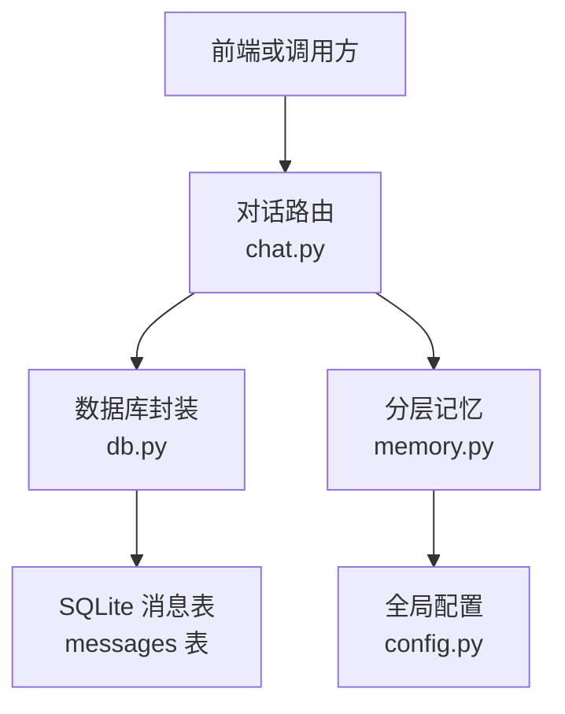
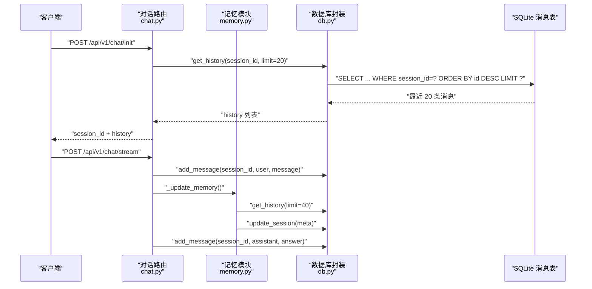
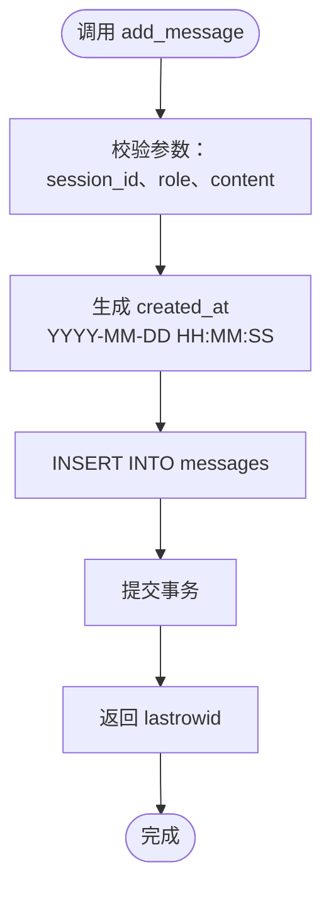
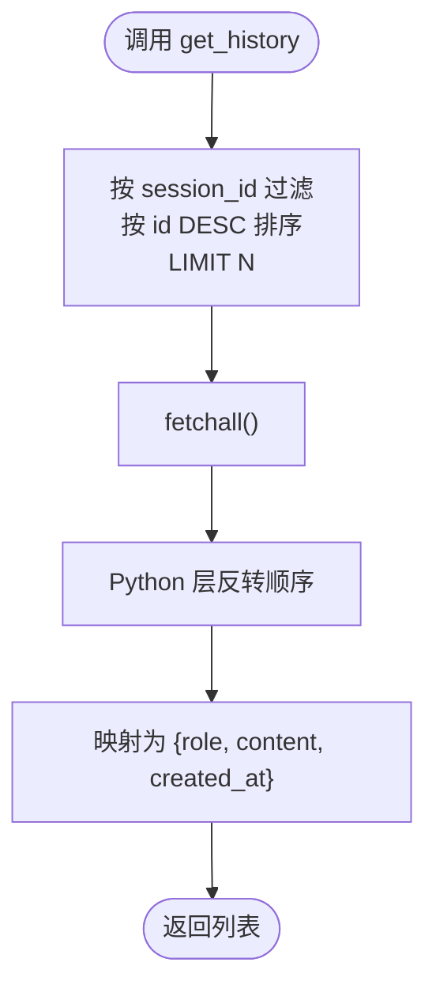
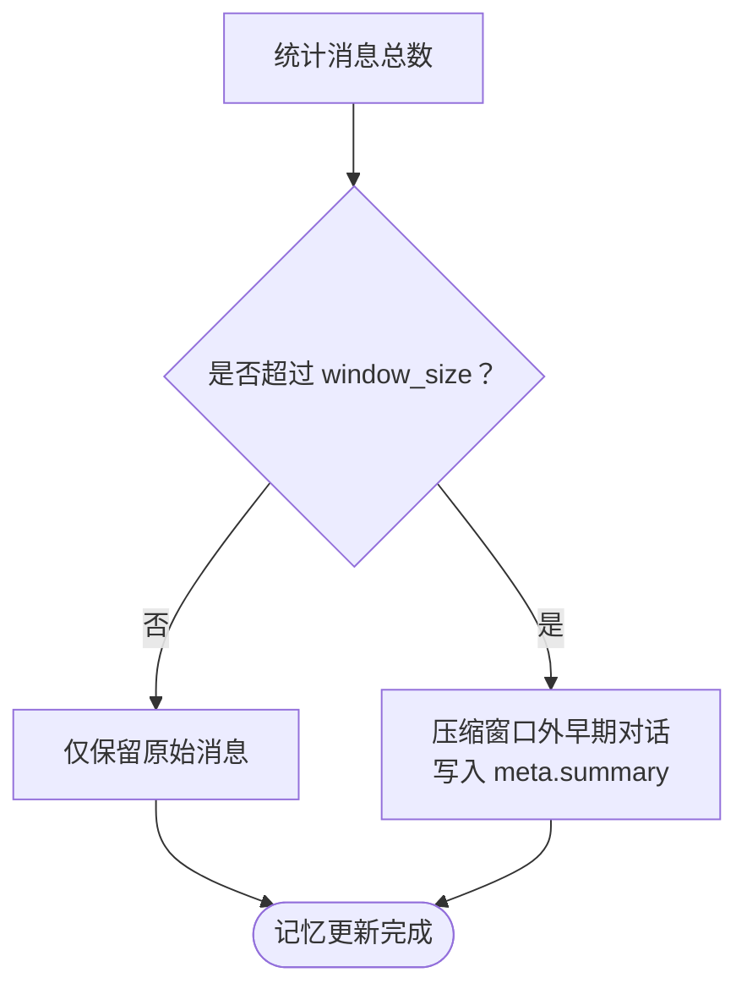
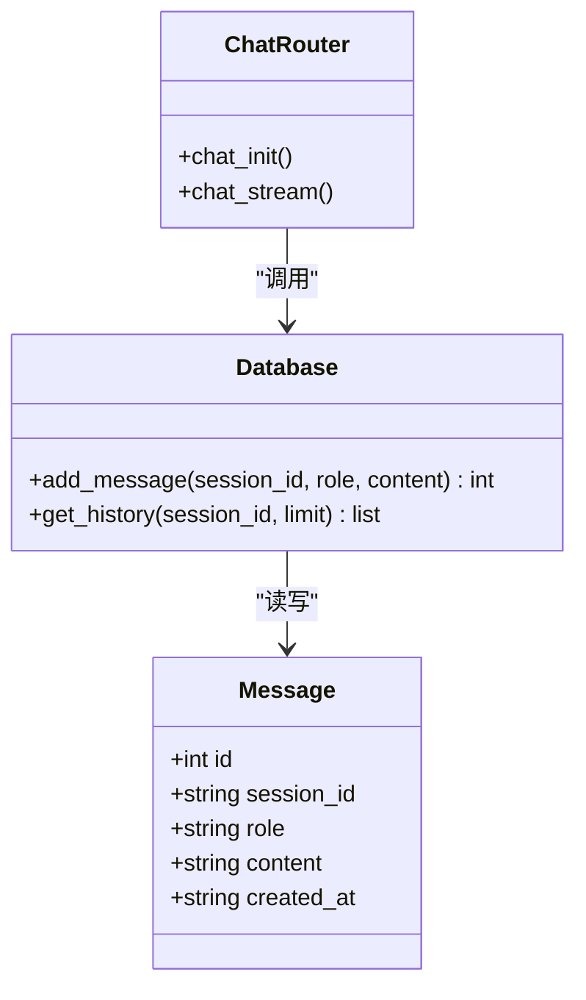
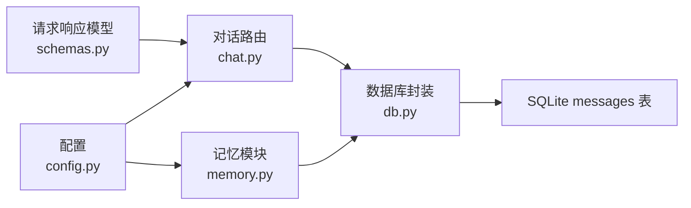

# 消息历史管理

<cite>
**本文引用的文件**   
- [backend/app/storage/db.py](file://backend/app/storage/db.py)
- [backend/app/routers/chat.py](file://backend/app/routers/chat.py)
- [backend/app/agent/memory.py](file://backend/app/agent/memory.py)
- [backend/app/models/schemas.py](file://backend/app/models/schemas.py)
- [backend/app/config.py](file://backend/app/config.py)
</cite>

## 目录
1. [引言](#引言)
2. [项目结构中的消息历史位置](#项目结构中的消息历史位置)
3. [核心组件](#核心组件)
4. [架构总览](#架构总览)
5. [详细组件分析](#详细组件分析)
6. [依赖关系分析](#依赖关系分析)
7. [性能分析与优化](#性能分析与优化)
8. [安全与内容治理](#安全与内容治理)
9. [故障排查指南](#故障排查指南)
10. [结论](#结论)
11. [附录：字段、配置与扩展建议](#附录字段配置与扩展建议)

## 引言
本文件面向“消息历史管理”，围绕以下目标展开：  
- 解释消息的增删改查能力，重点覆盖 `add_message`（插入并返回 ID）和 `get_history`（滑动窗口查询，默认 limit=20）。  
- 明确消息角色区分：user、assistant、system。  
- 说明滑动窗口机制的设计原理与实现方式。  
- 分析按 session_id 索引排序的性能策略。  
- 梳理消息内容的安全过滤、长度限制、特殊字符处理现状与改进空间。  
- 给出时间戳格式、批量操作优化、历史数据清理策略及扩容建议。  

## 项目结构中的消息历史位置
消息历史相关代码分布在四层：  
- 存储层：SQLite 建表、索引、`add_message`、`get_history`。  
- 路由层：对话初始化、SSE 流式回复中写入 user/assistant 消息，并拉取历史。  
- 记忆层：滑动窗口阈值、摘要压缩、事实提取等 L1/L2/L3 记忆维护。  
- 模型与配置层：请求响应契约、会话与窗口大小等可配置项。

**图示来源**  
- [backend/app/routers/chat.py:60-100](file://backend/app/routers/chat.py#L60-L100)  
- [backend/app/storage/db.py:183-205](file://backend/app/storage/db.py#L183-L205)  
- [backend/app/agent/memory.py:72-87](file://backend/app/agent/memory.py#L72-L87)  
- [backend/app/config.py:70-86](file://backend/app/config.py#L70-L86)

**章节来源**  
- [backend/app/storage/db.py:183-205](file://backend/app/storage/db.py#L183-L205)  
- [backend/app/routers/chat.py:60-100](file://backend/app/routers/chat.py#L60-L100)  
- [backend/app/agent/memory.py:72-87](file://backend/app/agent/memory.py#L72-L87)  
- [backend/app/models/schemas.py:12-31](file://backend/app/models/schemas.py#L12-L31)  
- [backend/app/config.py:70-86](file://backend/app/config.py#L70-L86)

## 核心组件
- `Database.add_message(session_id, role, content)`  
  - 功能：向 `messages` 表插入一条消息，记录 `session_id`、`role`、`content`、`created_at`。  
  - 返回值：自增主键 `id`。  
  - 线程安全：使用类级锁保护连接与提交。  
  - 时间戳：使用 `YYYY-MM-DD HH:MM:SS` 格式。

- `Database.get_history(session_id, limit=20)`  
  - 功能：按 `session_id` 查询最近 N 条消息，按 `id DESC` 排序后反转，返回从最早到最新的顺序列表。  
  - 返回字段：每条消息包含 `role`、`content`、`created_at`。  
  - 默认窗口：limit=20；在对话初始化时作为视觉历史返回给前端。

- 路由层对消息的写入时机：  
  - 用户消息：每次对话进入正常流程时写入 `role=user`。  
  - 助手消息：缓存命中或流式生成完成后写入 `role=assistant`。  
  - system 角色：当前代码未自动写入 system 消息，但 schema 允许该值。

- 记忆层滑动窗口：  
  - `window_size()` 返回 `HISTORY_WINDOW_TURNS * 2`，用于判断是否需要 L2 摘要。  
  - `needs_summary(total_messages)` 根据消息总数决定是否压缩早期对话。

**章节来源**  
- [backend/app/storage/db.py:183-205](file://backend/app/storage/db.py#L183-L205)  
- [backend/app/routers/chat.py:187-213](file://backend/app/routers/chat.py#L187-L213)  
- [backend/app/agent/memory.py:72-87](file://backend/app/agent/memory.py#L72-L87)  
- [backend/app/models/schemas.py:12-31](file://backend/app/models/schemas.py#L12-L31)  
- [backend/app/config.py:70-86](file://backend/app/config.py#L70-L86)

## 架构总览
消息历史管理的端到端流程如下：

**图示来源**  
- [backend/app/routers/chat.py:60-100](file://backend/app/routers/chat.py#L60-L100)  
- [backend/app/routers/chat.py:187-213](file://backend/app/routers/chat.py#L187-L213)  
- [backend/app/storage/db.py:183-205](file://backend/app/storage/db.py#L183-L205)  
- [backend/app/agent/memory.py:20-71](file://backend/app/agent/memory.py#L20-L71)

## 详细组件分析

### 消息写入：add_message
`add_message` 是消息历史的核心写入入口。它负责：  
- 将用户输入或系统生成的回答持久化到 `messages` 表。  
- 生成带秒级精度的 `created_at` 时间戳。  
- 返回新消息的自增 ID，便于后续反馈、Bad Case、CSAT 等关联。

**图示来源**  
- [backend/app/storage/db.py:183-195](file://backend/app/storage/db.py#L183-L195)

关键行为与边界：  
- 当前实现没有显式校验 `role` 是否为 `user`、`assistant`、`system`，因此任何字符串都可写入。  
- 没有对 `content` 做长度上限或特殊字符过滤。  
- 每行一次 INSERT，未提供批量插入接口。  
- 时间戳为本地字符串格式，不是 UTC ISO 8601。

**章节来源**  
- [backend/app/storage/db.py:183-195](file://backend/app/storage/db.py#L183-L195)

### 消息查询：get_history 与滑动窗口
`get_history` 通过 `WHERE session_id=? ORDER BY id DESC LIMIT ?` 获取最近 N 条消息，并在 Python 层反转结果，使调用方得到从早到晚的顺序。

**图示来源**  
- [backend/app/storage/db.py:196-205](file://backend/app/storage/db.py#L196-L205)

滑动窗口机制：  
- `HISTORY_WINDOW_TURNS` 默认 5，表示短期记忆保留最近 5 轮对话。  
- `window_size()` 返回 `HISTORY_WINDOW_TURNS * 2`，因为一轮对话通常包含 user 与 assistant 两条消息。  
- `needs_summary(total_messages)` 在消息数超过窗口时触发 L2 摘要压缩。  
- `_update_memory` 中会读取更多历史（limit=40），以便提取事实和压缩更早片段。

**图示来源**  
- [backend/app/agent/memory.py:72-87](file://backend/app/agent/memory.py#L72-L87)  
- [backend/app/routers/chat.py:30-58](file://backend/app/routers/chat.py#L30-L58)

**章节来源**  
- [backend/app/storage/db.py:196-205](file://backend/app/storage/db.py#L196-L205)  
- [backend/app/agent/memory.py:72-87](file://backend/app/agent/memory.py#L72-L87)  
- [backend/app/routers/chat.py:30-58](file://backend/app/routers/chat.py#L30-L58)  
- [backend/app/config.py:70-86](file://backend/app/config.py#L70-L86)

### 消息角色：user、assistant、system
- user：由路由层在正常对话流程中写入。  
- assistant：由缓存命中或流式回复完成后写入。  
- system：当前代码未自动写入 system 消息，但消息表允许任意 role 字符串。

**图示来源**  
- [backend/app/storage/db.py:183-205](file://backend/app/storage/db.py#L183-L205)  
- [backend/app/routers/chat.py:187-213](file://backend/app/routers/chat.py#L187-L213)

**章节来源**  
- [backend/app/storage/db.py:183-205](file://backend/app/storage/db.py#L183-L205)  
- [backend/app/routers/chat.py:187-213](file://backend/app/routers/chat.py#L187-L213)

### 删除、修改与批量操作现状
- 删除：当前 `Database` 未暴露 `delete_message`、`remove_message`、`truncate_messages` 等方法。  
- 修改：当前 `Database` 未暴露 `update_message` 方法。  
- 批量：当前只支持单条 INSERT，没有批量插入接口。  
- 历史清理：没有定时任务或 API 直接清理 `messages` 表；清理应通过外部运维脚本或数据库维护流程完成。

这意味着“消息历史管理”在当前仓库中主要实现的是“写+读+基于记忆层的软裁剪”，而不是完整的数据生命周期管理。

**章节来源**  
- [backend/app/storage/db.py:183-205](file://backend/app/storage/db.py#L183-L205)

## 依赖关系分析
消息历史相关依赖链如下：

**图示来源**  
- [backend/app/models/schemas.py:12-31](file://backend/app/models/schemas.py#L12-L31)  
- [backend/app/config.py:70-86](file://backend/app/config.py#L70-L86)  
- [backend/app/routers/chat.py:60-100](file://backend/app/routers/chat.py#L60-L100)  
- [backend/app/storage/db.py:183-205](file://backend/app/storage/db.py#L183-L205)

**章节来源**  
- [backend/app/models/schemas.py:12-31](file://backend/app/models/schemas.py#L12-L31)  
- [backend/app/config.py:70-86](file://backend/app/config.py#L70-L86)  
- [backend/app/routers/chat.py:60-100](file://backend/app/routers/chat.py#L60-L100)  
- [backend/app/storage/db.py:183-205](file://backend/app/storage/db.py#L183-L205)

## 性能分析与优化

### 查询性能
- `get_history` 使用 `WHERE session_id=? ORDER BY id DESC LIMIT ?`，并通过 `CREATE INDEX IF NOT EXISTS idx_messages_session ON messages(session_id, id)` 建立复合索引。  
- 索引列顺序合理：先按 `session_id` 精确过滤，再按 `id` 排序，能避免全表扫描。  
- `LIMIT` 控制返回行数，减少网络与序列化开销。  
- Python 层反转结果的时间复杂度为 O(N)，N 通常为 20~40，开销很小。

### 写入性能
- 每条消息一次 INSERT，无事务批处理。  
- 高并发下存在 SQLite 写入竞争；当前用线程锁串行化访问，保证一致性但可能成为瓶颈。  
- 若未来需要提升吞吐，可在业务层做消息队列合并或应用层批处理。

### 滑动窗口与内存压力
- `HISTORY_WINDOW_TURNS` 控制短期记忆长度，影响 LLM 上下文成本。  
- `_update_memory` 会读取最多 40 条历史，用于事实提取与摘要压缩。  
- 当消息数量远超窗口时，L2 摘要可降低长期上下文膨胀。

### 扩容建议
- 单机 SQLite：适合中小规模客服场景；可通过 WAL 模式提升并发读。  
- 分库分表：按 `session_id` 哈希分片，或使用多张 `messages_部分号` 表。  
- 冷热分离：热数据保留最近 N 天，冷数据归档到对象存储或历史库。  
- 只读副本：报表、回溯、审计走副本，减轻主库压力。  
- 连接池：生产环境建议使用连接池替代每请求新建连接。

**章节来源**  
- [backend/app/storage/db.py:1-60](file://backend/app/storage/db.py#L1-L60)  
- [backend/app/storage/db.py:183-205](file://backend/app/storage/db.py#L183-L205)  
- [backend/app/agent/memory.py:72-87](file://backend/app/agent/memory.py#L72-L87)  
- [backend/app/routers/chat.py:30-58](file://backend/app/routers/chat.py#L30-L58)

## 安全与内容治理

### 长度限制
- 输入长度限制在路由层进行：`ChatStreamRequest.message` 最大 2000，且路由层再次检查 `MAX_INPUT_LEN`。  
- 这可以防止超长输入撑爆上下文，但未对已落库消息的 `content` 字段做统一长度限制。

### 角色校验
- 当前 `add_message` 不校验 `role` 是否为 `user`、`assistant`、`system`。  
- 建议在写入前增加白名单校验，避免恶意或错误角色污染历史。

### 特殊字符与注入防护
- 数据库层使用参数化查询，降低 SQL 注入风险。  
- JSON 输出使用 `ensure_ascii=False`，有利于中文显示，但需注意前端渲染安全。  
- 未看到 XSS 过滤、HTML 清洗、敏感词过滤、URL 白名单等逻辑。

### 建议的安全增强
- 新增 `validate_role(role)`，仅允许 `user`、`assistant`、`system`。  
- 新增 `sanitize_content(content)`，去除危险 HTML、脚本标签。  
- 新增 `validate_message_length(content, max_len)`，与 `MAX_INPUT_LEN` 保持一致。  
- 对 `content` 增加数据库层长度约束或应用层强校验。  
- 如需审计，可增加 `updated_at`、`is_deleted`、`deleted_at` 字段。

**章节来源**  
- [backend/app/models/schemas.py:18-26](file://backend/app/models/schemas.py#L18-L26)  
- [backend/app/routers/chat.py:130-150](file://backend/app/routers/chat.py#L130-L150)  
- [backend/app/storage/db.py:183-205](file://backend/app/storage/db.py#L183-L205)

## 故障排查指南

### 常见问题
- 历史为空：  
  - 检查 `session_id` 是否正确。  
  - 检查是否在 `/api/v1/chat/init` 之前已写入消息。  
  - 确认 `get_history(limit=20)` 是否被其他逻辑覆盖。

- 历史顺序异常：  
  - `get_history` 按 `id DESC` 查询后再反转，如果手动插入 `id` 不连续，可能影响顺序。  
  - 建议始终通过 `add_message` 写入，不要直接操作自增 ID。

- 历史过多导致 LLM 成本上升：  
  - 调整 `HISTORY_WINDOW_TURNS`。  
  - 检查 `_update_memory` 是否正常压缩 L2 摘要。  
  - 检查是否有额外逻辑把大量历史注入 Prompt。

- 写入失败：  
  - 检查 SQLite 文件路径、权限。  
  - 检查线程锁是否阻塞严重。  
  - 检查磁盘空间与 WAL 文件。

### 定位步骤
1. 确认 `sessions` 是否存在。  
2. 确认 `messages` 表是否有对应 `session_id` 的记录。  
3. 确认 `idx_messages_session` 索引是否存在。  
4. 检查路由层是否在正确时机调用 `add_message`。  
5. 检查 `_update_memory` 是否因异常跳过记忆更新。

**章节来源**  
- [backend/app/storage/db.py:183-205](file://backend/app/storage/db.py#L183-L205)  
- [backend/app/routers/chat.py:60-100](file://backend/app/routers/chat.py#L60-L100)  
- [backend/app/routers/chat.py:30-58](file://backend/app/routers/chat.py#L30-L58)

## 结论
当前消息历史管理以 SQLite 为基础，实现了消息写入、按会话查询、滑动窗口记忆维护和基础安全拦截。其优势在于结构简单、易部署；不足在于缺少删除、修改、批量写入、严格角色校验和内容净化。对于生产环境，建议补充数据生命周期管理能力，并结合业务量级考虑分库分表、冷热分离与只读副本等扩容方案。

## 附录：字段、配置与扩展建议

### 消息表字段
- `id`：自增主键。  
- `session_id`：会话标识。  
- `role`：消息角色，建议限制为 `user`、`assistant`、`system`。  
- `content`：消息正文。  
- `created_at`：创建时间，格式为 `YYYY-MM-DD HH:MM:SS`。

### 时间戳格式
- 写入时使用本地时间字符串。  
- 建议生产环境改为 UTC ISO 8601，例如 `2026-11-05T12:00:00Z`，便于跨时区展示与分析。

### 滑动窗口配置
- `HISTORY_WINDOW_TURNS`：默认 5，代表短期记忆轮数。  
- `window_size()`：返回 `HISTORY_WINDOW_TURNS * 2`。  
- `needs_summary(total_messages)`：超过窗口时触发摘要压缩。

### 建议新增的能力
- 删除消息：`delete_message(message_id)` 或按 `session_id` 删除。  
- 修改消息：`update_message(message_id, content)`。  
- 批量写入：`add_messages_batch(messages)`。  
- 历史清理：`clean_old_messages(session_id, keep_last_n)` 或按时间清理。  
- 角色校验：`validate_role(role)`。  
- 内容净化：`sanitize_content(content)`。  
- 审计字段：`updated_at`、`is_deleted`、`deleted_at`。

**章节来源**  
- [backend/app/storage/db.py:1-60](file://backend/app/storage/db.py#L1-L60)  
- [backend/app/storage/db.py:183-205](file://backend/app/storage/db.py#L183-L205)  
- [backend/app/agent/memory.py:72-87](file://backend/app/agent/memory.py#L72-L87)  
- [backend/app/config.py:70-86](file://backend/app/config.py#L70-L86)