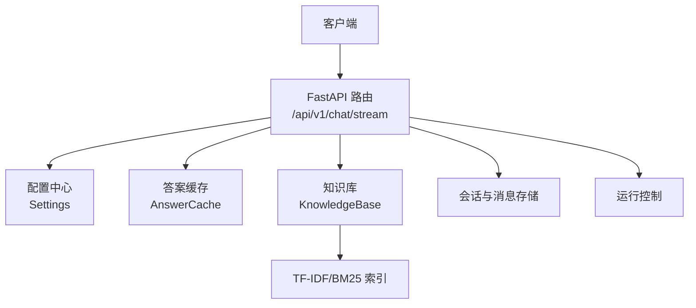
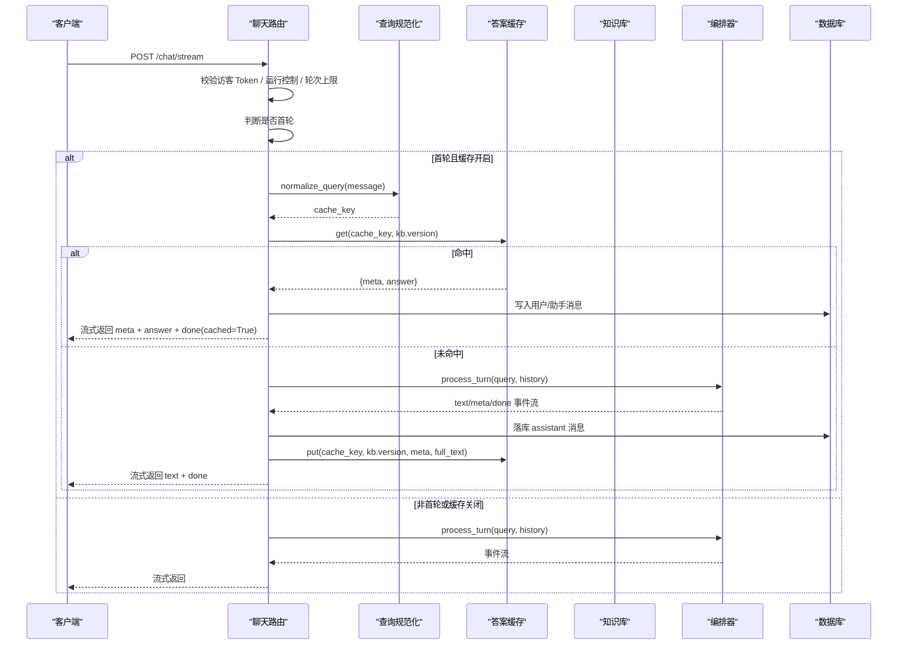
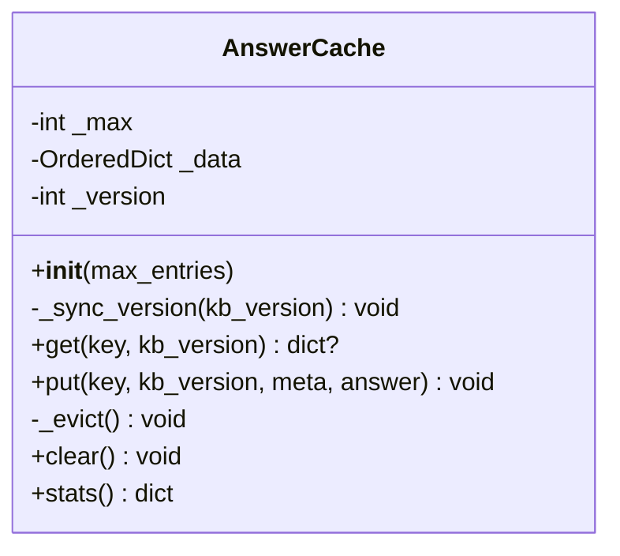
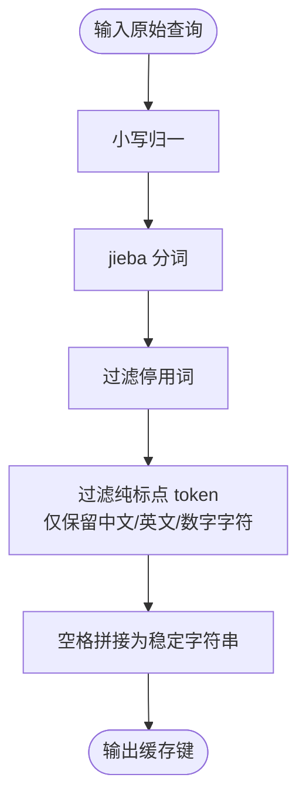
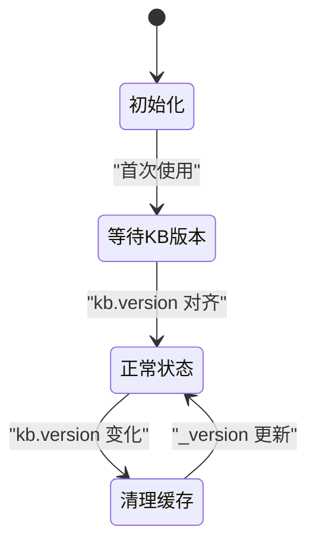
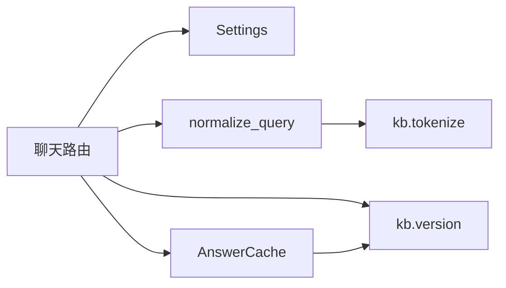

# 答案缓存系统

<cite>
**本文引用的文件**   
- [backend/app/storage/cache.py](file://backend/app/storage/cache.py)
- [backend/app/routers/chat.py](file://backend/app/routers/chat.py)
- [backend/app/storage/kb.py](file://backend/app/storage/kb.py)
- [backend/app/config.py](file://backend/app/config.py)
- [backend/app/main.py](file://backend/app/main.py)
</cite>

## 目录
1. [引言](#引言)
2. [项目结构与缓存定位](#项目结构与缓存定位)
3. [核心组件](#核心组件)
4. [架构总览](#架构总览)
5. [详细组件分析](#详细组件分析)
6. [依赖关系分析](#依赖关系分析)
7. [性能与容量特性](#性能与容量特性)
8. [监控指标与排查指南](#监控指标与排查指南)
9. [结论](#结论)

## 引言
本文件系统性地说明“Top20 高频问题秒回”答案缓存机制。该机制用于在对话接口中，对首轮用户输入进行规范化后查询内存缓存；命中时直接返回已缓存答案，跳过检索与 LLM 调用，实现首字延迟极低的高频问题秒回。缓存采用基于“命中次数 + 最后命中时间”的淘汰策略，并通过知识库版本号同步机制保证知识库重建后旧口径不被错误复用。

## 项目结构与缓存定位
缓存系统由以下模块协作构成：
- 配置层：提供 `CACHE_ENABLED`、`CACHE_MAX_ENTRIES` 等开关和容量参数。
- 知识库层：维护 FAQ 数据、检索索引及全局版本号 `kb.version`。
- 路由层：在 `/api/v1/chat/stream` 中决定是否使用缓存、如何读/写缓存。
- 缓存层：实现 `AnswerCache` 类、查询规范化函数 `normalize_query`，以及进程内单例 `answer_cache`。
- 应用入口：启动时加载知识库并注册路由，使缓存与知识库版本在运行期联动。

**图表来源**
- [backend/app/routers/chat.py:160-271](file://backend/app/routers/chat.py#L160-L271)
- [backend/app/storage/cache.py:31-82](file://backend/app/storage/cache.py#L31-L82)
- [backend/app/storage/kb.py:254-316](file://backend/app/storage/kb.py#L254-L316)
- [backend/app/config.py:56-60](file://backend/app/config.py#L56-L60)
- [backend/app/main.py:24-63](file://backend/app/main.py#L24-L63)

**章节来源**
- [backend/app/config.py:56-60](file://backend/app/config.py#L56-L60)
- [backend/app/main.py:24-63](file://backend/app/main.py#L24-L63)

## 核心组件
- `AnswerCache`：进程内高频答案缓存容器，维护最多 `max_entries` 条条目，按“命中次数最少且最久未命中优先淘汰”。
- `normalize_query`：将原始查询规范化为稳定字符串，作为缓存键。
- `KnowledgeBase.version`：知识库版本号，每次 `load()` 递增；缓存通过 `_sync_version` 与之对齐并在变化时清空。
- 路由中的缓存读写逻辑：仅在首轮、自动回答、开启缓存且答案非空时写入；命中则直接流式返回。

**章节来源**
- [backend/app/storage/cache.py:31-82](file://backend/app/storage/cache.py#L31-L82)
- [backend/app/routers/chat.py:160-271](file://backend/app/routers/chat.py#L160-L271)
- [backend/app/storage/kb.py:254-316](file://backend/app/storage/kb.py#L254-L316)

## 架构总览
下图展示一次典型请求中缓存参与的完整流程：是否启用缓存、是否首轮、是否命中、命中后如何流式输出、未命中如何生成答案并回填缓存。

**图表来源**
- [backend/app/routers/chat.py:160-271](file://backend/app/routers/chat.py#L160-L271)
- [backend/app/storage/cache.py:31-82](file://backend/app/storage/cache.py#L31-L82)
- [backend/app/storage/kb.py:254-316](file://backend/app/storage/kb.py#L254-L316)

## 详细组件分析

### AnswerCache 类设计
`AnswerCache` 是进程内有序字典容器，每个缓存项包含：
- `meta`：从检索/问答链路产生的元数据（如分类、风险等级等）。
- `answer`：自动回答文本。
- `count`：命中计数。
- `last_ts`：最后一次命中的时间戳。

关键行为：
- `_sync_version(kb_version)`：当传入的知识库版本号变化时，清空全部缓存并更新内部版本号。
- `get(key, kb_version)`：先同步版本，再查找 key；命中则自增 `count` 并刷新 `last_ts`。
- `put(key, kb_version, meta, answer)`：先同步版本，忽略空答案；若 key 已存在则不重复写入；容量满时执行淘汰；写入新项。
- `_evict()`：选择 `count` 最小且 `last_ts` 最小的条目删除，体现“低频且冷”优先淘汰。
- `stats()`：返回当前大小、上限、累计命中数。

**图表来源**
- [backend/app/storage/cache.py:31-82](file://backend/app/storage/cache.py#L31-L82)

**章节来源**
- [backend/app/storage/cache.py:31-82](file://backend/app/storage/cache.py#L31-L82)

### 查询规范化流程 normalize_query
规范化目标是把口语化、标点差异、大小写等变体归一，使得不同表述能映射到同一缓存键。其处理步骤如下：

实现要点：
- 调用知识库层的 `tokenize`，完成 jieba 分词、停用词过滤与小写归一。
- 进一步用正则过滤掉不包含中文、英文、数字的 token，避免标点单独成为键的一部分。
- 最终用空格连接所有有效 token，形成稳定的缓存键。

注意：该函数在 `normalize_query` 中直接 import `app.storage.kb.tokenize`，属于运行时导入，避免循环依赖。

**图表来源**
- [backend/app/storage/cache.py:22-30](file://backend/app/storage/cache.py#L22-L30)
- [backend/app/storage/kb.py:24-43](file://backend/app/storage/kb.py#L24-L43)

**章节来源**
- [backend/app/storage/cache.py:22-30](file://backend/app/storage/cache.py#L22-L30)
- [backend/app/storage/kb.py:24-43](file://backend/app/storage/kb.py#L24-L43)

### 缓存键生成算法
缓存键即 `normalize_query(req.message)` 的结果，具有以下性质：
- 语义等价：同义口语变体经分词与停用词过滤后趋于一致。
- 鲁棒性：去除纯标点 token，避免“吗？”与“吗”产生不同键。
- 确定性：相同输入产生相同输出，便于命中。

由于键来自自然语言分词结果，极端长尾查询也可能进入缓存，但受 `max_entries=20` 限制，只有高频命中才能长期留存。

**章节来源**
- [backend/app/routers/chat.py:183-187](file://backend/app/routers/chat.py#L183-L187)
- [backend/app/storage/cache.py:22-30](file://backend/app/storage/cache.py#L22-L30)

### 版本号同步与缓存失效机制
`KnowledgeBase.load()` 每次重建知识库后会递增 `self.version`。`AnswerCache` 在每个 `get` 和 `put` 前调用 `_sync_version(kb_version)`：
- 若当前 `kb.version` 与缓存内部版本不一致，则清空 `_data` 并更新 `_version`。
- 这确保知识库重建后，旧 FAQ 口径不会继续被“秒回”。

**图表来源**
- [backend/app/storage/cache.py:39-44](file://backend/app/storage/cache.py#L39-L44)
- [backend/app/storage/kb.py:272-281](file://backend/app/storage/kb.py#L272-L281)

**章节来源**
- [backend/app/storage/cache.py:39-44](file://backend/app/storage/cache.py#L39-L44)
- [backend/app/storage/kb.py:272-281](file://backend/app/storage/kb.py#L272-L281)

### 缓存命中率统计与内存占用
- 命中率统计：每条命中会自增 `count`，`stats().hits_total` 汇总所有条目 `(count-1)` 的总和，表示除首次写入外的累计命中次数。
- 内存占用：每个条目保存 `meta`、`answer`、`count`、`last_ts`，整体容量受 `max_entries` 限制。默认值为 20，可通过 `CACHE_MAX_ENTRIES` 调整。
- 并发安全：当前实现基于 Python 内置 `OrderedDict`，没有显式锁；在 GIL 环境下适合轻量级进程内缓存，但不建议在多线程共享场景下自行扩展复杂操作。

**章节来源**
- [backend/app/storage/cache.py:46-82](file://backend/app/storage/cache.py#L46-L82)
- [backend/app/config.py:59-60](file://backend/app/config.py#L59-L60)

### 缓存写入条件与边界
缓存写入发生在对话主流程结束后，满足以下条件才写入：
- 计算过 `cache_key`：即首轮且缓存开启。
- 不是转人工：`handover=False`。
- 生成了完整回答：`full_text` 非空。
- 携带了元数据：`last_meta` 非空。

这些条件防止无意义内容、转人工场景、空答案污染缓存。

**章节来源**
- [backend/app/routers/chat.py:183-187](file://backend/app/routers/chat.py#L183-L187)
- [backend/app/routers/chat.py:260-271](file://backend/app/routers/chat.py#L260-L271)

## 依赖关系分析
缓存系统的依赖关系如下：
- 路由层依赖配置 `settings.CACHE_ENABLED`、`settings.CACHE_MAX_ENTRIES`。
- 路由层依赖 `normalize_query` 生成缓存键。
- 路由层通过 `kb.version` 与缓存版本同步。
- 缓存层依赖知识库的 `tokenize` 做查询规范化。
- 应用入口在启动时加载知识库，使 `kb.version` 初始化为 1。

**图表来源**
- [backend/app/routers/chat.py:160-271](file://backend/app/routers/chat.py#L160-L271)
- [backend/app/storage/cache.py:22-82](file://backend/app/storage/cache.py#L22-L82)
- [backend/app/storage/kb.py:24-43](file://backend/app/storage/kb.py#L24-L43)
- [backend/app/config.py:56-60](file://backend/app/config.py#L56-L60)

**章节来源**
- [backend/app/routers/chat.py:160-271](file://backend/app/routers/chat.py#L160-L271)
- [backend/app/storage/cache.py:22-82](file://backend/app/storage/cache.py#L22-L82)
- [backend/app/storage/kb.py:24-43](file://backend/app/storage/kb.py#L24-L43)
- [backend/app/config.py:56-60](file://backend/app/config.py#L56-L60)

## 性能与容量特性

### Top20 高频问题秒回效果
- 命中路径完全绕过检索与 LLM，只经过内存查找、消息落库与 SSE 流式输出。
- 首字延迟目标为极短（代码注释提及 < 500ms），取决于缓存命中与网络流式传输。
- 未命中路径走正常检索与 LLM 流程，并在完成后回填缓存。

### 淘汰策略与复杂度
- 淘汰候选选择：遍历所有条目，比较 `(count, last_ts)` 二元组，取最小值。时间复杂度为 O(n)，n 为当前缓存大小，默认最大 20，因此开销很小。
- 空间复杂度：O(n)，每个条目固定字段。

### 容量控制
- 默认容量 20，由 `CACHE_MAX_ENTRIES` 控制。
- 容量满时淘汰“最低命中次数、最久未命中”的条目，有助于保留高频热点答案。

### 并发与安全
- 当前实现未加锁，依赖 Python GIL；适用于单进程、轻量级缓存场景。
- 如需强并发保护，可在外部增加读写锁或迁移到带并发控制的缓存结构。

**章节来源**
- [backend/app/storage/cache.py:46-75](file://backend/app/storage/cache.py#L46-L75)
- [backend/app/routers/chat.py:183-271](file://backend/app/routers/chat.py#L183-L271)

## 监控指标与排查指南

### 可观测指标
- `answer_cache.stats()` 返回：
  - `size`：当前缓存条目数。
  - `max`：容量上限。
  - `hits_total`：累计命中次数。
- 建议将这些指标暴露到运维监控或日志中，以便观察：
  - 缓存命中率趋势。
  - 缓存容量是否频繁达到上限。
  - 知识库重建后缓存是否被正确清空。

### 常见排查点
- 缓存未命中：
  - 检查是否非首轮请求。
  - 检查 `CACHE_ENABLED` 是否为真。
  - 检查 `normalize_query` 是否因输入差异导致键不同。
- 缓存命中但答案过期：
  - 检查知识库是否重建且 `kb.version` 是否递增。
  - 确认 `AnswerCache._sync_version` 是否在读写路径中被调用。
- 转人工未被缓存：
  - 确认 `handover=False` 条件。
- 缓存容量不足：
  - 观察 `hits_total` 与 `size/max`，必要时调大 `CACHE_MAX_ENTRIES`。

**章节来源**
- [backend/app/storage/cache.py:71-82](file://backend/app/storage/cache.py#L71-L82)
- [backend/app/routers/chat.py:183-271](file://backend/app/routers/chat.py#L183-L271)
- [backend/app/config.py:56-60](file://backend/app/config.py#L56-L60)

## 结论
该答案缓存系统以简洁高效的进程内数据结构实现 Top20 高频问题秒回：通过 `normalize_query` 统一查询表达，通过 `AnswerCache` 管理命中统计与淘汰，通过 `kb.version` 保证知识库变更后的缓存一致性。在默认配置下，它既控制了内存占用，又显著降低了高频问题的响应延迟。未来可根据业务规模引入更精细的 TTL、LRU/LFU 升级、分布式共享缓存以及更丰富的监控指标。