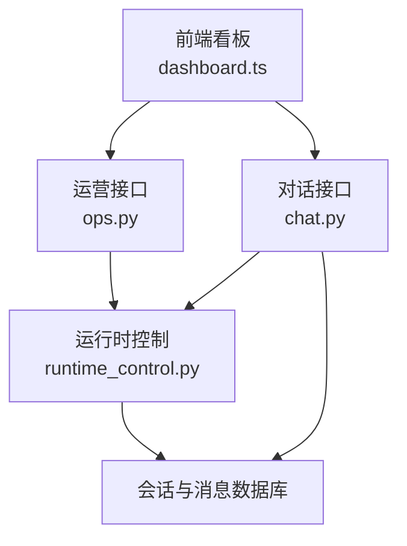
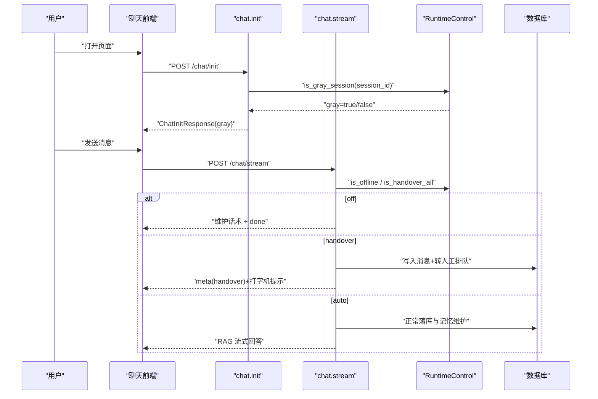
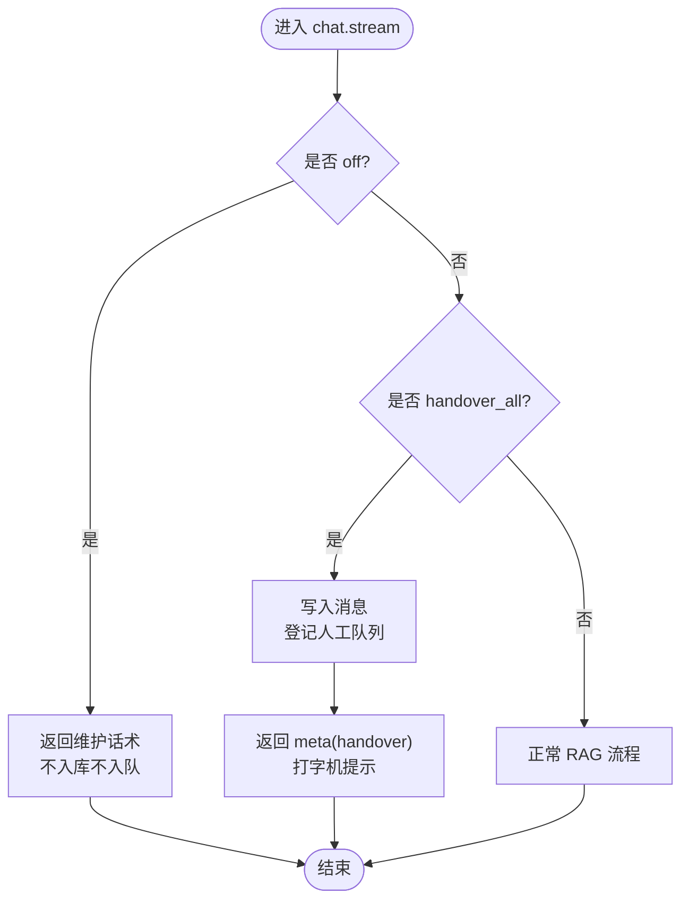
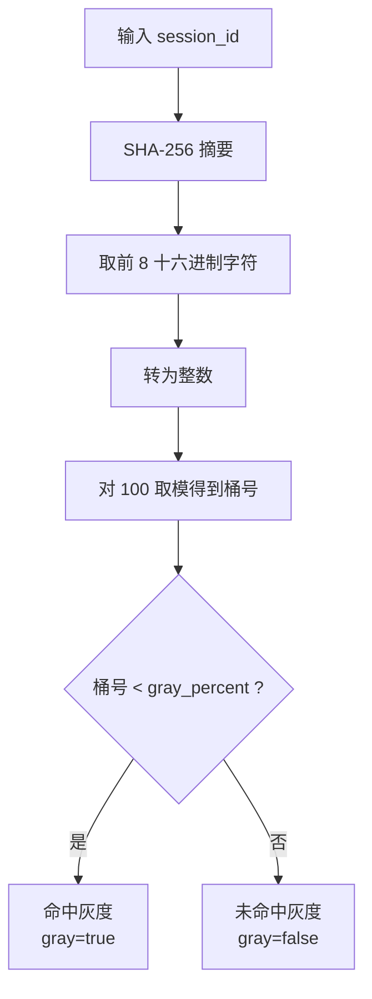
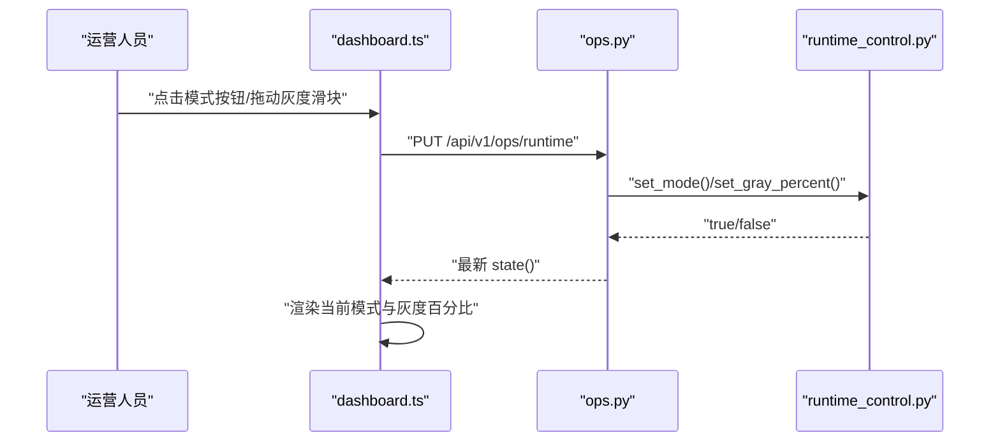
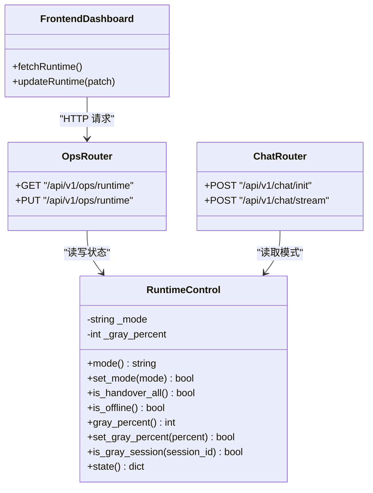
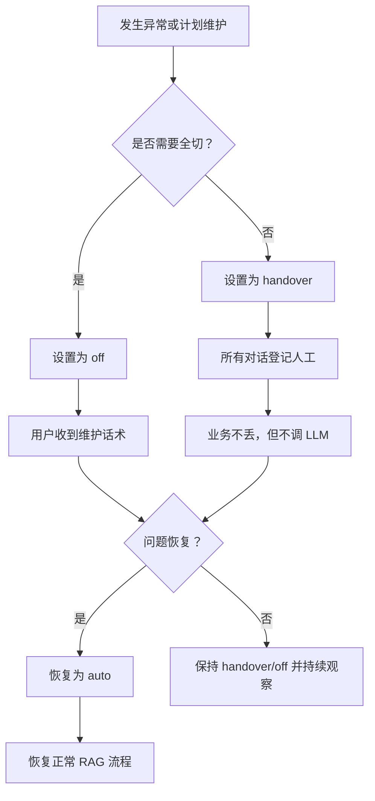

# 运行时控制开关

<cite>
**本文引用的文件**   
- [backend/app/storage/runtime_control.py](file://backend/app/storage/runtime_control.py)
- [backend/app/routers/ops.py](file://backend/app/routers/ops.py)
- [backend/app/routers/chat.py](file://backend/app/routers/chat.py)
- [backend/app/models/schemas.py](file://backend/app/models/schemas.py)
- [backend/app/config.py](file://backend/app/config.py)
- [frontend/src/api.ts](file://frontend/src/api.ts)
- [frontend/src/dashboard.ts](file://frontend/src/dashboard.ts)
</cite>

## 目录
1. [引言](#引言)
2. [项目结构](#项目结构)
3. [核心组件](#核心组件)
4. [架构总览](#架构总览)
5. [详细组件分析](#详细组件分析)
6. [依赖关系分析](#依赖关系分析)
7. [性能与扩展性](#性能与扩展性)
8. [故障恢复与安全考虑](#故障恢复与安全考虑)
9. [运维操作指南](#运维操作指南)
10. [结论](#结论)

## 引言
本文件面向运行期控制能力，聚焦 Kill Switch 三种服务模式、灰度发布机制、实时监控、日志记录、状态快照，以及多实例扩展方案、安全约束和故障恢复策略。目标是帮助运营、开发和运维人员在上线、灰度、降级和维护场景中快速定位行为差异并做出正确决策。

## 项目结构
运行时控制能力由“存储层 + 路由层 + 前端看板”三部分构成：
- 存储层 `RuntimeControl` 提供模式切换、灰度分流和状态快照。
- 路由层暴露运营接口，并在对话流程中消费运行状态。
- 前端看板提供可视化的模式切换与灰度调节控件。



**图表来源**
- [backend/app/routers/ops.py:1-60](file://backend/app/routers/ops.py#L1-L60)
- [backend/app/routers/chat.py:1-80](file://backend/app/routers/chat.py#L1-L80)
- [backend/app/storage/runtime_control.py:1-83](file://backend/app/storage/runtime_control.py#L1-L83)

**章节来源**
- [backend/app/storage/runtime_control.py:1-83](file://backend/app/storage/runtime_control.py#L1-L83)
- [backend/app/routers/ops.py:1-60](file://backend/app/routers/ops.py#L1-L60)
- [backend/app/routers/chat.py:1-80](file://backend/app/routers/chat.py#L1-L80)

## 核心组件
- `RuntimeControl`：进程内单例，维护当前模式、灰度百分比、会话灰度判定和状态快照。
- 运营接口 `/api/v1/ops/runtime`：查询与更新运行状态。
- 对话入口 `/api/v1/chat/init`：初始化会话时注入 `gray` 字段。
- 对话流 `/api/v1/chat/stream`：根据模式短路 RAG 或转人工。
- 前端运营看板：渲染模式、灰度滑块，并提供一键切换与实时刷新。

**章节来源**
- [backend/app/storage/runtime_control.py:1-83](file://backend/app/storage/runtime_control.py#L1-L83)
- [backend/app/routers/ops.py:1-60](file://backend/app/routers/ops.py#L1-L60)
- [backend/app/routers/chat.py:81-120](file://backend/app/routers/chat.py#L81-L120)
- [frontend/src/dashboard.ts:120-200](file://frontend/src/dashboard.ts#L120-L200)

## 架构总览
Kill Switch 的三条主线如下：
- auto（正常）：RAG、自动回答、自动转人工决策均开启。
- handover（全局转人工）：所有对话直接登记人工，不走检索与 LLM。
- off（维护下线）：统一返回维护话术，不落库、不调 LLM、不入队。

灰度开关通过 `session_id` 的稳定哈希决定会话是否命中灰度组；SSE meta 中标注 `gray=true`，便于观测和未来按灰度放量接入新逻辑。



**图表来源**
- [backend/app/routers/chat.py:81-120](file://backend/app/routers/chat.py#L81-L120)
- [backend/app/routers/chat.py:121-327](file://backend/app/routers/chat.py#L121-L327)
- [backend/app/storage/runtime_control.py:1-83](file://backend/app/storage/runtime_control.py#L1-L83)

## 详细组件分析

### Kill Switch 三种服务模式
| 模式 | 含义 | 对对话流程的影响 | 适用场景 |
|---|---|---|---|
| auto | 正常服务 | 走 RAG、LLM、缓存、自动转人工决策 | 生产稳定期 |
| handover | 全局转人工 | 不检索不调 LLM，直接登记人工队列 | 上游系统异常、需要保业务不丢 |
| off | 维护下线 | 统一维护话术，不落库、不入队、不调 LLM | 计划停机、紧急熔断 |

- 模式值仅允许 `auto`、`handover`、`off`，非法值会被拒绝。
- 模式变更会记录警告日志，便于审计。
- `state()` 返回当前模式、灰度比例和 `kill_switch` 布尔位，供看板展示。



**图表来源**
- [backend/app/routers/chat.py:121-200](file://backend/app/routers/chat.py#L121-L200)
- [backend/app/storage/runtime_control.py:20-55](file://backend/app/storage/runtime_control.py#L20-L55)

**章节来源**
- [backend/app/storage/runtime_control.py:1-83](file://backend/app/storage/runtime_control.py#L1-L83)
- [backend/app/routers/chat.py:121-200](file://backend/app/routers/chat.py#L121-L200)

### 灰度发布机制
- 灰度比例 `gray_percent` 取值范围 `0–100`，非法值被拒绝。
- 灰度判定使用 `session_id` 的 SHA-256 前 8 字节作为桶号，模 100 后与比例比较，保证同一会话全程一致、无抖动。
- `init` 响应携带 `gray=true/false`，SSE meta 可标注灰度状态；未来可按该标记分流到新实现。



**图表来源**
- [backend/app/storage/runtime_control.py:46-54](file://backend/app/storage/runtime_control.py#L46-L54)

**章节来源**
- [backend/app/storage/runtime_control.py:40-54](file://backend/app/storage/runtime_control.py#L40-L54)
- [backend/app/routers/chat.py:81-120](file://backend/app/routers/chat.py#L81-L120)
- [backend/app/models/schemas.py:118-138](file://backend/app/models/schemas.py#L118-L138)

### 灰度流量分布图
灰度分流近似均匀分布在 `[0,100)` 区间：

```mermaid
graph LR
  subgraph "桶空间 [0,100)"
    Zeros["0%~gray%"] --> Gray["命中灰度"]
    Rest["gray%~100%"] --> NoGray["未命中灰度"]
  end
  Gray -->|"约 gray_percent%" "灰度会话"
  NoGray -->|"约 (100-gray)%%" "非灰度会话"
```

该分布基于对 100 取模后的均匀假设，适合渐进放量。

**图表来源**
- [backend/app/storage/runtime_control.py:46-54](file://backend/app/storage/runtime_control.py#L46-L54)

### 运行状态监控与日志
- 状态快照：`GET /api/v1/ops/runtime` 返回 `mode`、`gray_percent`、`kill_switch`。
- 状态更新：`PUT /api/v1/ops/runtime` 支持同时修改模式和灰度比例，参数校验失败返回 400。
- 日志：模式切换记录 `logger.warning`，包含旧模式与新模式，便于审计和告警。
- 前端看板每 15 秒轮询一次统计、运行控制和满意度数据。



**图表来源**
- [backend/app/routers/ops.py:20-40](file://backend/app/routers/ops.py#L20-L40)
- [backend/app/storage/runtime_control.py:20-55](file://backend/app/storage/runtime_control.py#L20-L55)
- [frontend/src/dashboard.ts:120-200](file://frontend/src/dashboard.ts#L120-L200)

**章节来源**
- [backend/app/routers/ops.py:1-60](file://backend/app/routers/ops.py#L1-L60)
- [backend/app/storage/runtime_control.py:20-83](file://backend/app/storage/runtime_control.py#L20-L83)
- [frontend/src/dashboard.ts:120-255](file://frontend/src/dashboard.ts#L120-L255)

### 前端可视化与控制面板
- 模式按钮：`auto`、`handover`、`off`，选中态高亮。
- 灰度滑块：输入变化后节流 400ms 调用后端更新。
- 状态信息条：显示当前模式说明、描述及灰度提示。
- 错误反馈：切换失败时在状态条中以警告样式呈现错误信息。

**章节来源**
- [frontend/src/dashboard.ts:120-200](file://frontend/src/dashboard.ts#L120-L200)
- [frontend/src/api.ts:150-200](file://frontend/src/api.ts#L150-L200)

## 依赖关系分析
运行时控制的核心依赖链如下：



**图表来源**
- [backend/app/storage/runtime_control.py:1-83](file://backend/app/storage/runtime_control.py#L1-L83)
- [backend/app/routers/ops.py:1-60](file://backend/app/routers/ops.py#L1-L60)
- [backend/app/routers/chat.py:81-200](file://backend/app/routers/chat.py#L81-L200)
- [frontend/src/api.ts:150-200](file://frontend/src/api.ts#L150-L200)
- [frontend/src/dashboard.ts:120-200](file://frontend/src/dashboard.ts#L120-L200)

**章节来源**
- [backend/app/storage/runtime_control.py:1-83](file://backend/app/storage/runtime_control.py#L1-L83)
- [backend/app/routers/ops.py:1-60](file://backend/app/routers/ops.py#L1-L60)
- [backend/app/routers/chat.py:81-200](file://backend/app/routers/chat.py#L81-L200)
- [frontend/src/api.ts:150-200](file://frontend/src/api.ts#L150-L200)
- [frontend/src/dashboard.ts:120-200](file://frontend/src/dashboard.ts#L120-L200)

## 性能与扩展性

### 性能特性
- 内存化状态：`RuntimeControl` 的状态保存在进程内存，读写开销极低。
- 会话灰度判定为 O(1) 计算：单次 SHA-256 与取模运算。
- SSE 流式输出在 off/handover/auto 三个分支均有优化，避免不必要的 LLM 调用。

### 多实例扩展方案（Redis 共享）
当前实现为单实例内存状态，注释已明确“生产多实例时可扩展为 Redis 共享”。建议扩展要点：
- 将 `_mode`、`_gray_percent` 迁移到 Redis Hash，键名如 `rc:mode`、`rc:gray_percent`。
- `set_mode`/`set_gray_percent` 写 Redis 并设置短 TTL，配合写锁防止并发覆盖。
- `state()` 与 `is_gray_session` 从 Redis 读取，必要时增加本地缓存以减少读放大。
- 模式切换事件通过 Redis Pub/Sub 通知各实例刷新本地缓存，保证一致性。
- 灰度算法保持不变，确保不同实例对同一 `session_id` 判定一致。

### 可扩展点与优化机会
- 增加灰度规则维度：例如按用户 ID、IP 段或渠道分流。
- 灰度比例调整增加审批与审计字段，避免误操作。
- 将 `kill_switch` 与外部监控系统对接，触发告警。
- 对 SSE 连接数进行限流与配额管理，防止极端流量冲击。

**章节来源**
- [backend/app/storage/runtime_control.py:1-83](file://backend/app/storage/runtime_control.py#L1-L83)
- [backend/app/routers/chat.py:121-327](file://backend/app/routers/chat.py#L121-L327)

## 故障恢复与安全考虑

### 模式切换安全性
- 模式值白名单校验：仅允许 `auto`、`handover`、`off`，非法值返回 400。
- 灰度比例校验：必须为 `0–100` 的整数，越界返回 400。
- 模式变更日志：每次切换记录旧值与新值，便于追溯。
- 手动转人工接口在 `off` 模式下返回 503，防止维护期间继续入队。

### 会话一致性与防抖
- 灰度判定基于 `session_id` 的稳定哈希，同一会话不会在不同请求间抖动。
- `init` 阶段即确定 `gray`，后续 SSE 流可在元数据中标注，便于前端统一展示。

### 故障恢复策略
- off 模式：立即停止正常回答，用户收到维护话术，零副作用。
- handover 模式：已有会话继续登记人工，保障业务连续性，但不消耗 LLM 资源。
- 模式回滚：通过同一个运营接口再次 PUT，将模式改回 `auto`，无需重启服务。
- 前端容错：看板拉取失败或切换失败会在状态条中显示错误，不影响其他功能。



**图表来源**
- [backend/app/routers/chat.py:121-200](file://backend/app/routers/chat.py#L121-L200)
- [backend/app/routers/chat.py:240-327](file://backend/app/routers/chat.py#L240-L327)
- [backend/app/storage/runtime_control.py:20-55](file://backend/app/storage/runtime_control.py#L20-L55)

**章节来源**
- [backend/app/routers/ops.py:20-40](file://backend/app/routers/ops.py#L20-L40)
- [backend/app/routers/chat.py:121-200](file://backend/app/routers/chat.py#L121-L200)
- [backend/app/storage/runtime_control.py:20-55](file://backend/app/storage/runtime_control.py#L20-L55)

## 运维操作指南

### 查看当前运行状态
- 访问运营接口 `GET /api/v1/ops/runtime`，返回：
  - `mode`：当前模式。
  - `gray_percent`：灰度比例。
  - `kill_switch`：是否处于非 auto 模式。
- 在前端看板“运行控制”区域可直接看到模式说明、描述与灰度提示。

### 切换到不同模式
- 在运营看板点击模式按钮，或通过 `PUT /api/v1/ops/runtime` 传入 `mode`。
- 推荐顺序：
  - 先切 `handover`：保业务，停止 LLM 调用。
  - 再切 `off`：彻底下线，用于紧急熔断或计划停机。
  - 恢复时先切 `auto`，再逐步放开灰度。

### 调整灰度比例
- 在运营看板拖动灰度滑块，或在接口中传入 `gray_percent`。
- 建议步骤：
  - 从 `0%` 开始，确认无异常后逐步提升到 `10%`、`30%`、`50%`、`100%`。
  - 观察 `ChatInitResponse.gray` 与 SSE meta 中的灰度标注。
  - 若出现异常，立即降低比例或关闭灰度。

### 监控与审计
- 关注后端日志中的模式切换警告，确认切换主体和时间。
- 看板每 15 秒刷新一次运行状态，结合统计指标观察自动化率与转人工率变化。
- 在灰度放量过程中，重点观察异常会话占比、转人工率和满意度评分。

### 常见问题排查
- 切换失败：检查模式或灰度比例是否合法；确认接口返回 400 的错误详情。
- 用户仍走正常流程：确认 `session_id` 是否命中灰度桶；核对 `gray_percent` 与实际分布。
- off 模式下仍可转人工：手动转人工接口在 off 模式下会返回 503，属于预期行为。
- 前端状态不刷新：检查看板轮询是否正常；确认网络与后端接口可达。

**章节来源**
- [backend/app/routers/ops.py:20-40](file://backend/app/routers/ops.py#L20-L40)
- [backend/app/routers/chat.py:81-120](file://backend/app/routers/chat.py#L81-L120)
- [frontend/src/dashboard.ts:120-200](file://frontend/src/dashboard.ts#L120-L200)
- [frontend/src/dashboard.ts:200-255](file://frontend/src/dashboard.ts#L200-L255)

## 结论
运行时控制开关以 `RuntimeControl` 为核心，提供清晰的三种服务模式与稳定的灰度分流机制。通过运营接口和前端看板，可实现安全的模式切换与灰度放量，并具备完善的日志、状态快照和监控能力。在多实例部署下，可通过 Redis 共享状态进一步增强一致性。建议在灰度放量过程中采用小步快跑策略，结合自动化率、转人工率和满意度指标持续评估，确保上线过程可控、可回滚、可观测。