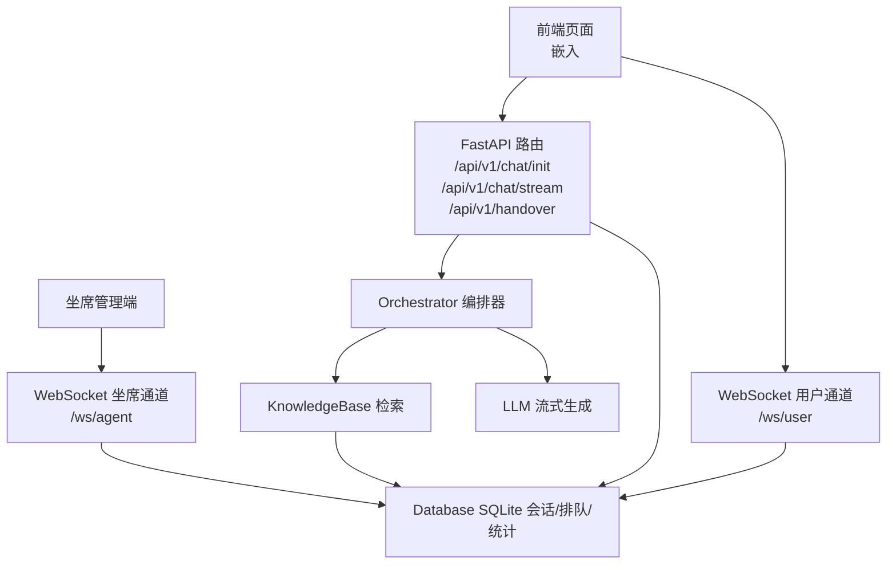
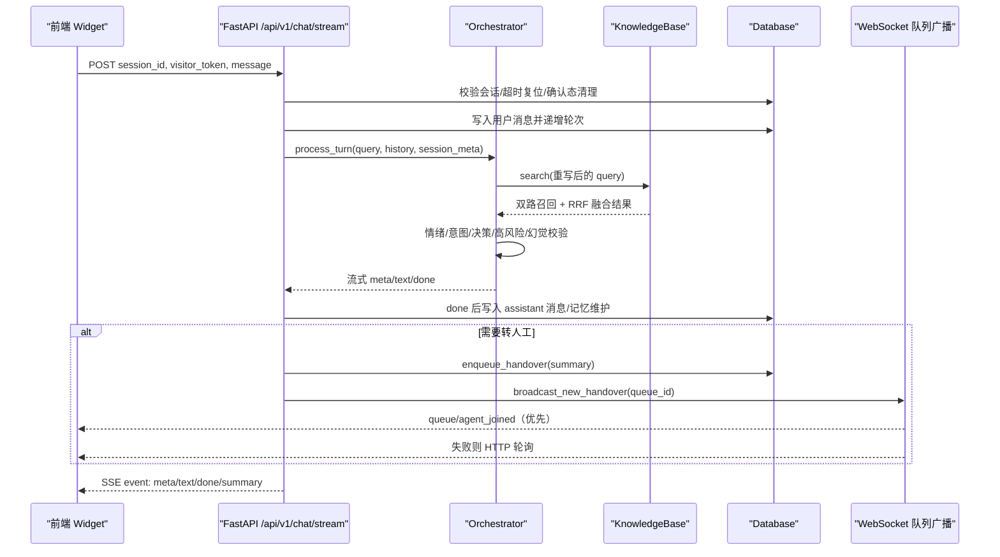
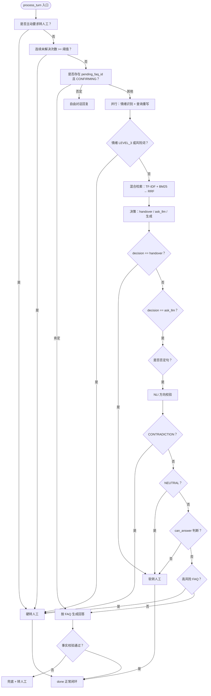
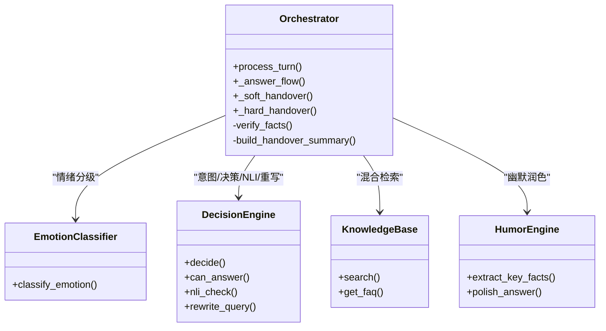
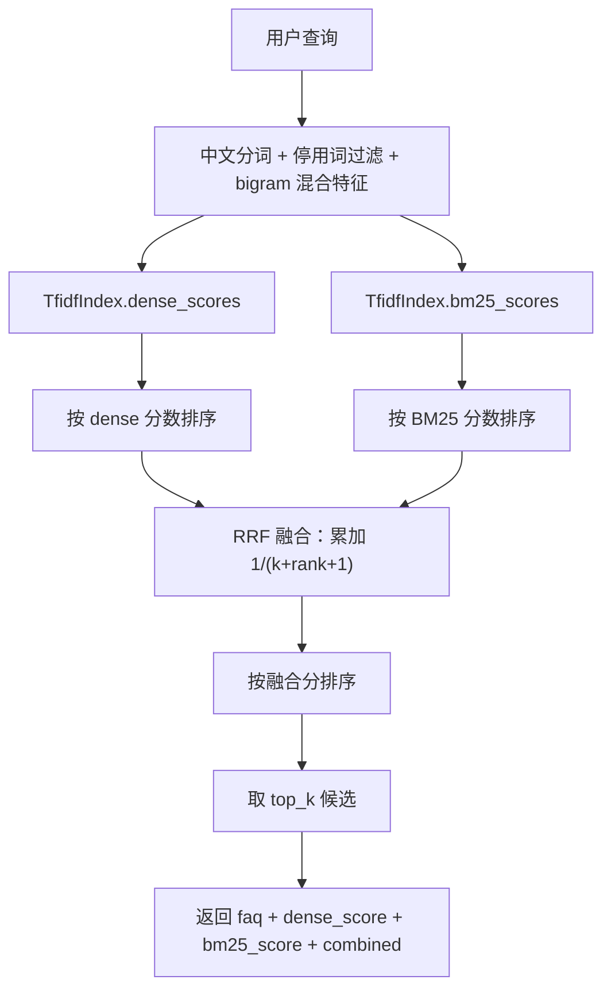
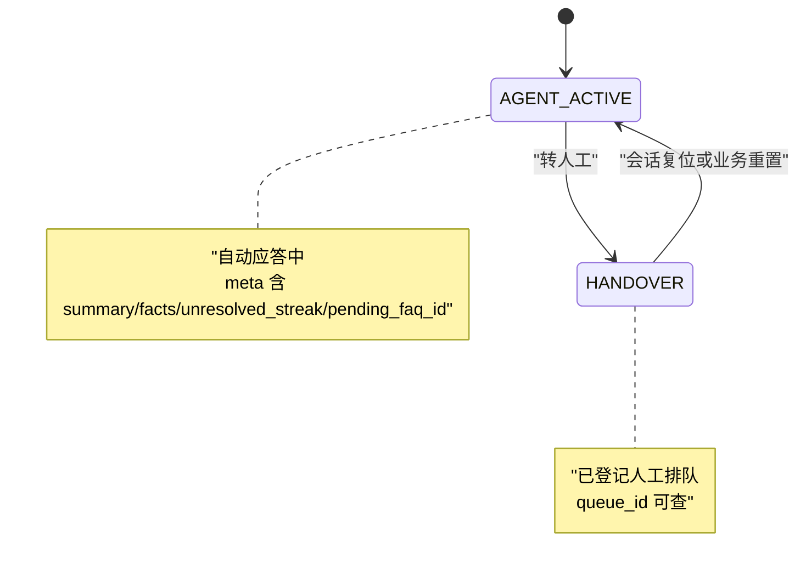
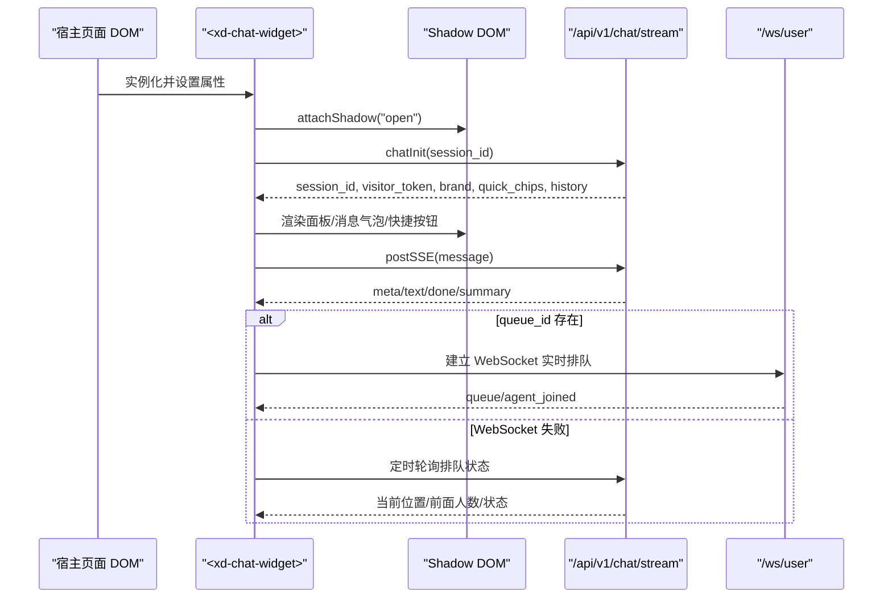
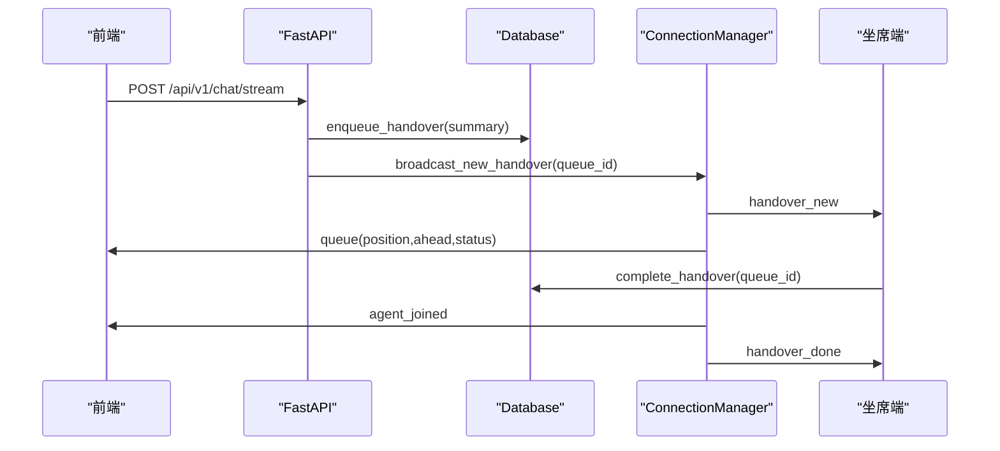
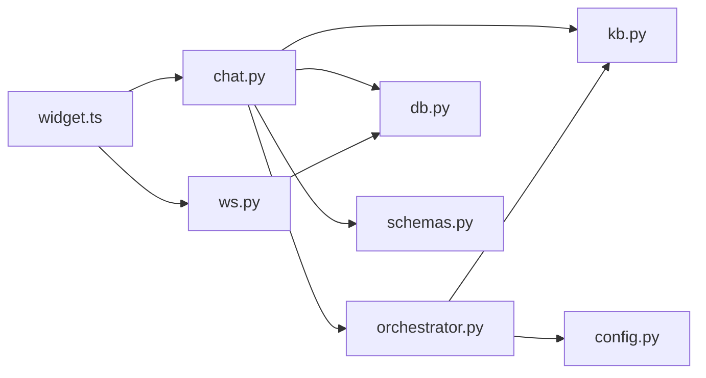

# 核心组件

<cite>
**本文引用的文件**   
- [orchestrator.py](file://backend/app/agent/orchestrator.py)
- [kb.py](file://backend/app/storage/kb.py)
- [db.py](file://backend/app/storage/db.py)
- [chat.py](file://backend/app/routers/chat.py)
- [ws.py](file://backend/app/routers/ws.py)
- [schemas.py](file://backend/app/models/schemas.py)
- [config.py](file://backend/app/config.py)
- [widget.ts](file://frontend/src/widget.ts)
</cite>

## 目录
1. [引言](#引言)
2. [项目结构](#项目结构)
3. [核心组件](#核心组件)
4. [架构总览](#架构总览)
5. [详细组件分析](#详细组件分析)
6. [依赖关系分析](#依赖关系分析)
7. [性能与可扩展性](#性能与可扩展性)
8. [故障排查指南](#故障排查指南)
9. [结论](#结论)

## 引言
smart_bot 是一个以“情绪识别 + 检索增强生成 + 决策引擎 + 转人工调度”为核心的智能客服系统。后端基于 FastAPI，前端通过 Web Component 嵌入任意网页；知识库采用本地 TF-IDF 向量索引与 BM25 双路召回、RRF 融合重排；会话和排队状态持久化到 SQLite；实时排队使用 WebSocket，失败时回退 HTTP 轮询。

## 项目结构
本项目的关键代码集中在以下层次：
- 路由层：`backend/app/routers/chat.py` 暴露对话初始化、SSE 流式对话、手动转人工接口；`backend/app/routers/ws.py` 提供用户端与坐席端 WebSocket。
- 编排层：`backend/app/agent/orchestrator.py` 实现 Orchestrator 管道模式，串联情绪识别、查询重写、混合检索、决策、LLM 生成、输出校验与转人工。
- 知识层：`backend/app/storage/kb.py` 维护 FAQ 模型、TF-IDF 向量索引、BM25 评分、RRF 融合、否定词/风险词/转人工关键词规则。
- 数据层：`backend/app/storage/db.py` 封装 SQLite 会话、消息、反馈、CSAT、FAQ 草稿审批、版本历史与人工排队。
- 前端层：`frontend/src/widget.ts` 定义 `<xd-chat-widget>` Web Component，使用 Shadow DOM 隔离样式与 DOM。
- 契约与配置：`backend/app/models/schemas.py` 定义 Pydantic 请求响应模型；`backend/app/config.py` 加载 `.env` 全局参数。

**图表来源**
- [chat.py:1-120](file://backend/app/routers/chat.py#L1-L120)
- [ws.py:1-149](file://backend/app/routers/ws.py#L1-L149)
- [orchestrator.py:1-120](file://backend/app/agent/orchestrator.py#L1-L120)
- [kb.py:230-316](file://backend/app/storage/kb.py#L230-L316)
- [db.py:1-120](file://backend/app/storage/db.py#L1-L120)

**章节来源**
- [chat.py:1-120](file://backend/app/routers/chat.py#L1-L120)
- [ws.py:1-149](file://backend/app/routers/ws.py#L1-L149)
- [orchestrator.py:1-120](file://backend/app/agent/orchestrator.py#L1-L120)
- [kb.py:230-316](file://backend/app/storage/kb.py#L230-L316)
- [db.py:1-120](file://backend/app/storage/db.py#L1-L120)
- [widget.ts:1-120](file://frontend/src/widget.ts#L1-L120)

## 核心组件
本节聚焦四个核心子系统：
- Orchestrator 编排器：定义从用户输入到最终回答或转人工的完整事件流。
- KnowledgeBase 检索：TF-IDF 向量 + BM25 双路召回 + RRF 融合重排。
- Database 数据层：SQLite 会话状态机、消息、反馈、CSAT、FAQ 草稿审批与版本历史、人工排队。
- Widget 前端：Web Component 与 Shadow DOM 隔离，SSE 流式渲染、实时排队降级轮询。

**章节来源**
- [orchestrator.py:1-200](file://backend/app/agent/orchestrator.py#L1-L200)
- [kb.py:1-120](file://backend/app/storage/kb.py#L1-L120)
- [db.py:1-200](file://backend/app/storage/db.py#L1-L200)
- [widget.ts:1-200](file://frontend/src/widget.ts#L1-L200)

## 架构总览
smart_bot 的请求入口是 `/api/v1/chat/stream`。该接口完成访客 Token 校验、Kill Switch 检查、会话超时复位、确认态超时取消、输入长度与会话轮次限制、首轮缓存命中后秒回，否则调用 Orchestrator 处理一轮对话，并通过 SSE 返回 meta、text、done、summary 四类事件。

**图表来源**
- [chat.py:60-327](file://backend/app/routers/chat.py#L60-L327)
- [orchestrator.py:1-404](file://backend/app/agent/orchestrator.py#L1-L404)
- [kb.py:230-316](file://backend/app/storage/kb.py#L230-L316)
- [ws.py:1-149](file://backend/app/routers/ws.py#L1-L149)
- [db.py:300-470](file://backend/app/storage/db.py#L300-L470)

## 详细组件分析

### Orchestrator 编排器：管道模式与子组件协作
Orchestrator 将单轮对话拆成可中断、可并行、可熔断的管道步骤：
1. 主动转人工：命中 `wants_human` 立即走硬转人工。
2. 防死循环：连续未解决达到阈值直接硬转人工。
3. 确认状态机：处于 `CONFIRMING` 时根据肯定/否定语义快速收敛。
4. 情绪识别与查询重写并行执行，降低首字延迟。
5. 红灯熔断：极端负面情绪或风险词直接硬转人工。
6. 混合检索：调用 KnowledgeBase.search。
7. 决策引擎：`decide` 决定 handover、ask_llm 或直接生成。
8. 否定句 NLI 校验：矛盾或中性时降级转人工。
9. 高风险 FAQ：高风险分类不直接回答，转人工。
10. 生成流程：流式 LLM 输出 + 事实校验，失败则兜底并转人工。
11. 软转人工：低置信度或不支持回答时澄清挽留。
12. 硬转人工：高风险、极端情绪、重复未解决等场景统一输出标准化摘要。

**图表来源**
- [orchestrator.py:1-200](file://backend/app/agent/orchestrator.py#L1-L200)
- [orchestrator.py:200-404](file://backend/app/agent/orchestrator.py#L200-L404)

#### 情绪识别、幽默策略与两段式生成
- 情绪分级用于决定是否允许幽默点缀：仅售前类别且绿灯情绪允许幽默。
- 两段式生成：先产出事实版，再尝试幽默润色；若事实一致性校验失败则回退事实版。
- 输出校验提取回答中的数字/金额/时间，要求在检索上下文中有依据，否则视为疑似幻觉并触发转人工。

**图表来源**
- [orchestrator.py:1-404](file://backend/app/agent/orchestrator.py#L1-L404)

**章节来源**
- [orchestrator.py:1-200](file://backend/app/agent/orchestrator.py#L1-L200)
- [orchestrator.py:200-404](file://backend/app/agent/orchestrator.py#L200-L404)

### KnowledgeBase：TF-IDF + BM25 双路检索与 RRF 融合
KnowledgeBase 负责加载 FAQ JSON、构建本地索引、执行混合检索。

- FAQItem：包含 id、category、standard_question、variants、answer、risk_level、follow_up，并提供 category_zh、search_text、tokenized 属性。
- TfidfIndex：
  - 构建阶段统计文档频率 df、词表 vocab、IDF，并对每篇文档计算加权 TF-IDF 向量并进行 L2 归一化。
  - dense_scores：将查询也转为相同特征空间，计算余弦相似度，得到 Dense 分数。
  - bm25_scores：实现经典 BM25 公式，考虑 k1、b、文档长度与平均文档长度。
- KnowledgeBase.search：
  - 对同一查询分别计算 dense_scores 与 bm25_scores。
  - 对两路结果分别排序，得到 rank 序列。
  - 使用 RRF 融合：对每个文档 i，累计 1/(k + rank + 1)，默认 k=60。
  - 按融合分降序取 top_k，同时保留 dense_score、bm25_score、combined 供上层决策使用。

**图表来源**
- [kb.py:1-120](file://backend/app/storage/kb.py#L1-L120)
- [kb.py:230-316](file://backend/app/storage/kb.py#L230-L316)

**章节来源**
- [kb.py:1-120](file://backend/app/storage/kb.py#L1-L120)
- [kb.py:230-316](file://backend/app/storage/kb.py#L230-L316)

### Database 层：SQLite 会话管理与状态机
Database 提供线程安全的 SQLite 访问，封装会话、消息、反馈、CSAT、FAQ 草稿审批、版本历史与人工排队。

- 会话状态机：
  - `AGENT_ACTIVE`：正常自动应答。
  - `HANDOVER`：已登记转人工。
  - 会话初始化默认创建为 `AGENT_ACTIVE`。
  - 超时复位：超过配置的会话空闲时间，重置 status、turn_count、meta，但保留历史消息。
- 消息存储：messages 表按 session_id 与 id 有序，支持最近 N 轮读取。
- 人工排队：
  - enqueue_handover 插入 waiting 队列。
  - queue_status 计算 position、ahead、status。
  - complete_handover 由坐席标记完成。
  - get_waiting_by_session 用于 WebSocket 建连时推送当前排队进度。
- FAQ 草稿审批流：
  - draft → pending → published/rejected。
  - set_faq_draft_status 强制合法状态跳转。
- 版本历史：每次审批生效记录快照，支持回滚查看。

**图表来源**
- [db.py:1-200](file://backend/app/storage/db.py#L1-L200)
- [db.py:300-470](file://backend/app/storage/db.py#L300-L470)

**章节来源**
- [db.py:1-200](file://backend/app/storage/db.py#L1-L200)
- [db.py:300-470](file://backend/app/storage/db.py#L300-L470)

### 前端 Widget：Web Component 与 Shadow DOM 隔离
`ChatWidget` 继承自 HTMLElement，对外暴露 `<xd-chat-widget>`：
- 属性：mode（floating/inline）、api-base、brand。
- 生命周期：connectedCallback 注册点击/发送事件；init 调用 `/api/v1/chat/init` 获取 session_id、visitor_token、品牌名、快捷气泡与历史。
- Shadow DOM：所有样式与内部 DOM 通过 attachShadow 隔离，避免被宿主站点 CSS 污染。
- SSE 消费：postSSE 监听 meta/text/done/summary 事件；meta 更新 lastMeta，text 增量拼接，done 写入 messageId/handover，summary 触发 WebSocket 实时排队或 HTTP 轮询降级。
- 转人工 UI：显示排队提示、CSAT 打分卡片、免责声明、OTP 验证卡片。
- 实时排队：优先建立 WebSocket `/ws/user?session_id=&visitor_token=`；连接失败则回退到定时轮询接口。

**图表来源**
- [widget.ts:1-577](file://frontend/src/widget.ts#L1-L577)
- [ws.py:1-149](file://backend/app/routers/ws.py#L1-L149)

**章节来源**
- [widget.ts:1-577](file://frontend/src/widget.ts#L1-L577)
- [widget.ts:577-719](file://frontend/src/widget.ts#L577-L719)

### 转人工调度：SSE、WebSocket 与排队状态
转人工路径分为两类：
- 自动转人工：Orchestrator 判定为高敏感、高风险、重复未解决、情感红灯、否定矛盾等，返回 done.handover=true，路由层登记排队并广播新待办。
- 手动转人工：前端调用 `/api/v1/handover`，路由层直接入队并广播。

实时通道：
- 用户端 `/ws/user`：校验 visitor_token，建连即推送当前排队进度，后续服务端主动推送队列变化。
- 坐席端 `/ws/agent`：可选 token 鉴权，首帧下发待办快照，后续接收新增与完成事件。

**图表来源**
- [chat.py:250-327](file://backend/app/routers/chat.py#L250-L327)
- [ws.py:1-149](file://backend/app/routers/ws.py#L1-L149)
- [db.py:300-470](file://backend/app/storage/db.py#L300-L470)

**章节来源**
- [chat.py:250-327](file://backend/app/routers/chat.py#L250-L327)
- [ws.py:1-149](file://backend/app/routers/ws.py#L1-L149)
- [db.py:300-470](file://backend/app/storage/db.py#L300-L470)

## 依赖关系分析
- 路由层依赖：
  - chat.py 依赖 Orchestrator、Database、KnowledgeBase、RuntimeControl、Cache、RateLimit、Pydantic Schemas。
  - ws.py 依赖 ConnectionManager、Database、RateLimit。
- 编排层依赖：
  - orchestrator.py 依赖 emotion、humor、intent、llm、prompts、config、storage.kb。
- 知识层依赖：
  - kb.py 依赖 jieba 分词、math 数学函数、collections。
- 数据层依赖：
  - db.py 依赖 sqlite3、threading、time、uuid、config。
- 前端依赖：
  - widget.ts 依赖 api.ts、sse-client.ts，并与后端 SSE/WebSocket 协议对齐。

**图表来源**
- [chat.py:1-120](file://backend/app/routers/chat.py#L1-L120)
- [ws.py:1-149](file://backend/app/routers/ws.py#L1-L149)
- [orchestrator.py:1-120](file://backend/app/agent/orchestrator.py#L1-L120)
- [kb.py:1-120](file://backend/app/storage/kb.py#L1-L120)
- [db.py:1-120](file://backend/app/storage/db.py#L1-L120)
- [schemas.py:1-138](file://backend/app/models/schemas.py#L1-L138)
- [config.py:1-104](file://backend/app/config.py#L1-L104)
- [widget.ts:1-120](file://frontend/src/widget.ts#L1-L120)

**章节来源**
- [chat.py:1-120](file://backend/app/routers/chat.py#L1-L120)
- [ws.py:1-149](file://backend/app/routers/ws.py#L1-L149)
- [orchestrator.py:1-120](file://backend/app/agent/orchestrator.py#L1-L120)
- [kb.py:1-120](file://backend/app/storage/kb.py#L1-L120)
- [db.py:1-120](file://backend/app/storage/db.py#L1-L120)
- [schemas.py:1-138](file://backend/app/models/schemas.py#L1-L138)
- [config.py:1-104](file://backend/app/config.py#L1-L104)
- [widget.ts:1-120](file://frontend/src/widget.ts#L1-L120)

## 性能与可扩展性
- 首字延迟优化：
  - 情绪识别与查询重写并行执行，红灯熔断时可取消重写任务。
  - 首轮高频问题通过 answer_cache 秒回，不调 LLM。
  - 固定话术 `_chunk_text` 切块模拟流式打字机效果。
- 检索性能：
  - 本地 TF-IDF 向量与 BM25 无需外部 Embedding 服务，适合 MVP 与内网部署。
  - RRF 融合在 O(n log n) 排序基础上做线性扫描，top_k 较小，开销可控。
- 可扩展点：
  - KnowledgeBase 接口以类为边界，可替换为豆包 text-embedding + Qdrant 等向量数据库。
  - LLM_MODE 支持 auto/real/mock，便于联调与压测。
  - 会话超时、确认超时、REPEAT_UNRESOLVED_LIMIT、RRF_K、SIM_THRESHOLD_* 等均可通过环境变量调整。

[本节为通用性能讨论，不直接分析具体代码行]

## 故障排查指南
- 无法连接客服服务：
  - 检查前端 init 是否成功拿到 session_id 与 visitor_token。
  - 确认后端 FastAPI 已启动且 CORS/代理配置正确。
- 401 invalid visitor token：
  - 核对 visitor_token 与 session_id 是否匹配，检查 VISITOR_TOKEN_SECRET 配置。
- 会话被频繁重置：
  - 检查 SESSION_TIMEOUT_MINUTES 是否过小；确认会话更新时间是否被后端正常写入。
- 检索结果为空或质量差：
  - 检查 KB_PATH 是否正确加载 FAQ JSON。
  - 调整 SIM_THRESHOLD_LOW/SIM_THRESHOLD_HIGH、RETRIEVE_TOP_K、RRF_K。
  - 启用 QUERY_REWRITE_ENABLED 提升口语化查询召回。
- 转人工无实时排队：
  - 检查 WebSocket 连接是否成功；若失败应回退 HTTP 轮询。
  - 确认 AGENT_WS_TOKEN 是否与后端配置一致。
- CSAT 提交失败：
  - 检查 rating 是否为 1-5，comment 长度是否合理。
  - 确认 CsatSubmitRequest 字段与后端一致。

**章节来源**
- [chat.py:60-327](file://backend/app/routers/chat.py#L60-L327)
- [ws.py:1-149](file://backend/app/routers/ws.py#L1-L149)
- [kb.py:230-316](file://backend/app/storage/kb.py#L230-L316)
- [config.py:1-104](file://backend/app/config.py#L1-L104)
- [widget.ts:200-577](file://frontend/src/widget.ts#L200-L577)

## 结论
smart_bot 的核心价值在于把客服交互从“简单问答”升级为“有情绪感知、有检索增强、有决策约束、有人工兜底”的可控流水线。Orchestrator 通过管道模式将情绪、意图、检索、生成、校验与转人工串联起来；KnowledgeBase 用轻量本地索引实现双路召回与 RRF 融合；Database 提供稳健的 SQLite 会话状态机与排队能力；前端 Widget 用 Web Component 与 Shadow DOM 实现干净隔离与流式体验。生产环境中可通过配置项与运行控制开关灵活调节行为，并在必要时平滑切换到更强大的 Embedding 与向量检索方案。