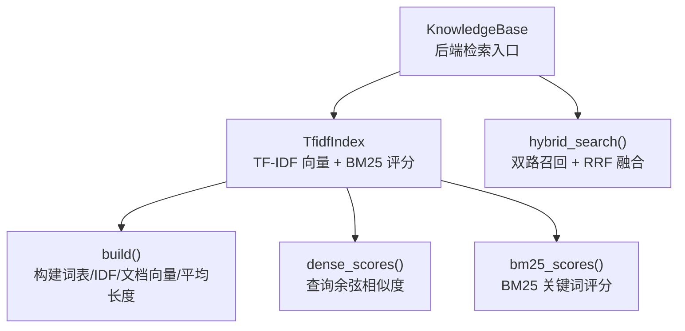
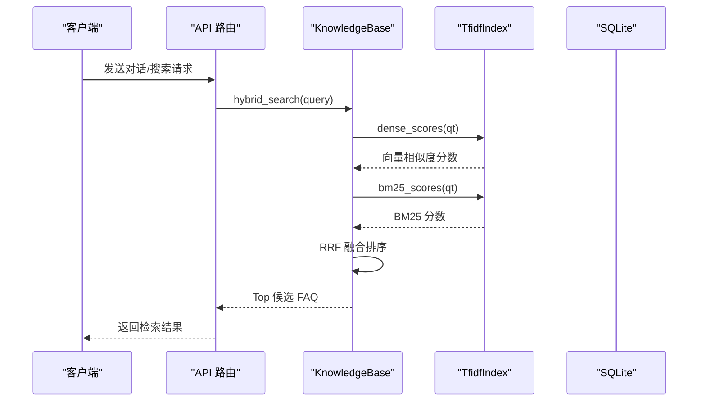
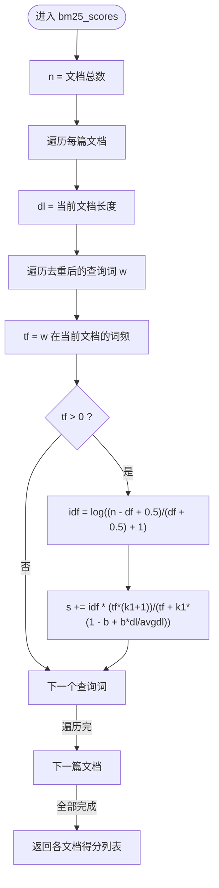
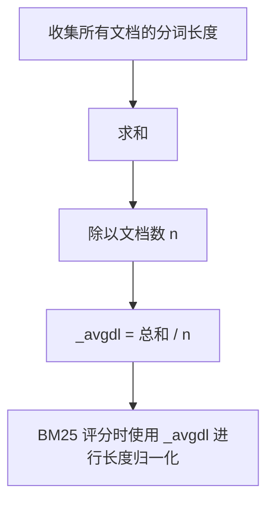
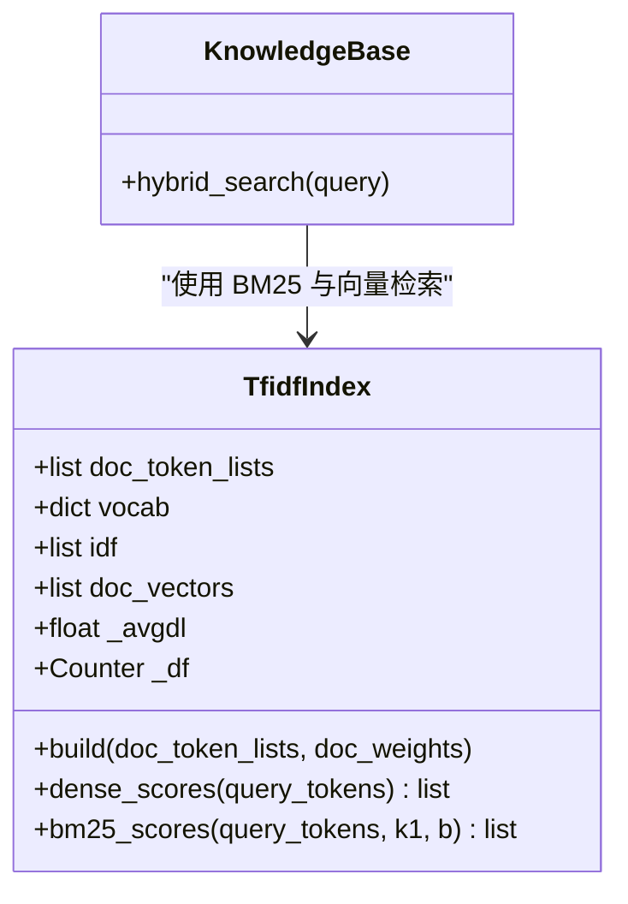

# BM25 关键词检索

<cite>
**本文引用的文件**   
- [backend/app/storage/kb.py](file://backend/app/storage/kb.py)
- [源码解读.md](file://源码解读.md)
- [README.md](file://README.md)
</cite>

## 目录
1. [引言](#引言)
2. [项目结构与定位](#项目结构与定位)
3. [核心组件](#核心组件)
4. [架构总览](#架构总览)
5. [BM25 详细实现分析](#bm25-详细实现分析)
6. [依赖与调用关系分析](#依赖与调用关系分析)
7. [性能特征与优化建议](#性能特征与优化建议)
8. [与传统 TF-IDF 的对比](#与传统-tfidf-的对比)
9. [中文语境适用性](#中文语境适用性)
10. [常见问题与排障](#常见问题与排障)
11. [结论](#结论)

## 引言
本文聚焦知识库检索中的 BM25 关键词检索实现，围绕 `bm25_scores` 方法展开：解释 k1、b 参数的作用机制；说明平均文档长度 `_avgdl` 的计算方式及其影响；解析评分公式的业务含义；给出参数调优思路，并比较 BM25 与传统 TF-IDF 的差异，同时评估在中文分词场景下的适用性与注意事项。

## 项目结构与定位
本项目的知识库检索由后端存储层提供，核心代码位于 `backend/app/storage/kb.py`。该模块实现了：
- 中文分词与停用词过滤
- 混合特征（jieba 词 + 中文 bigram）用于 TF-IDF 向量检索
- TF-IDF 向量索引与余弦相似度计算
- BM25 关键词索引与评分
- 混合检索（Dense 向量 + Sparse BM25）与 RRF 融合重排

**图表来源**
- [backend/app/storage/kb.py:1-200](file://backend/app/storage/kb.py#L1-L200)

**章节来源**
- [backend/app/storage/kb.py:1-200](file://backend/app/storage/kb.py#L1-L200)

## 核心组件
- `tokenize(text)`：基于 jieba 的分词器，进行小写归一和停用词过滤，输出词列表。
- `tokenize_full(text, bigram_weight=0.7)`：生成混合特征（词 + 中文 bigram），提升口语化变体的匹配鲁棒性。
- `FAQItem.search_text`：拼接标准问法、变体问法与答案作为检索文本，兼顾“短片段精准”和“父文档完整”。
- `TfidfIndex.build()`：统计词频、构建词表、计算 IDF、构造文档向量，并计算平均文档长度 `_avgdl`。
- `TfidfIndex.dense_scores()`：对查询向量与文档向量做余弦相似度计算。
- `TfidfIndex.bm25_scores()`：按 BM25 公式为每篇文档打分。
- `KnowledgeBase.hybrid_search()`：双路召回（向量 + BM25），RRF 融合排序。

**章节来源**
- [backend/app/storage/kb.py:1-200](file://backend/app/storage/kb.py#L1-L200)

## 架构总览
下图展示从查询到最终结果的关键流程，BM25 作为关键词检索路径参与双路召回。

**图表来源**
- [backend/app/storage/kb.py:239-316](file://backend/app/storage/kb.py#L239-L316)

**章节来源**
- [backend/app/storage/kb.py:239-316](file://backend/app/storage/kb.py#L239-L316)

## BM25 详细实现分析

### bm25_scores 的整体流程
该方法对每篇文档计算一个 BM25 总分，遍历去重后的查询词，累加每个词的贡献。关键步骤包括：
1. 获取文档长度 `dl = len(tokens)`。
2. 对查询词去重后逐个处理，避免重复计数。
3. 计算词在当前文档中的词频 `tf = tokens.count(w)`。
4. 若 `tf == 0`，直接跳过该词。
5. 计算 IDF：`log((n - df + 0.5)/(df + 0.5) + 1)`，其中 `n` 为文档总数，`df` 为该词出现在多少篇文档中。
6. 应用 BM25 部分分数：`idf * (tf*(k1+1)) / (tf + k1*(1 - b + b*dl/avgdl))`。
7. 累计得到文档总分。

**图表来源**
- [backend/app/storage/kb.py:164-176](file://backend/app/storage/kb.py#L164-L176)

**章节来源**
- [backend/app/storage/kb.py:164-176](file://backend/app/storage/kb.py#L164-L176)

### k1（词频饱和参数）的作用机制
- k1 控制词频饱和的速度。
- 当 k1 较大时，同一个词在文档中出现多次的贡献增长更快；当 k1 较小时，重复出现的收益更平缓。
- 在分母中，k1 会“稀释”高频词的边际增益，使评分趋于饱和，避免长文档中简单重复带来的过度放大。
- 默认值 1.5 是经典经验值，适合多数英文语料；中文因分词粒度不同，可结合业务测试微调。

**章节来源**
- [backend/app/storage/kb.py:164-176](file://backend/app/storage/kb.py#L164-L176)

### b（长度归一化参数）的作用机制
- b 控制文档长度的归一化程度。
- 当 b = 0 时，不执行长度归一化；当 b = 1 时，完全按平均文档长度归一化。
- 公式中 `b * dl / avgdl` 项衡量当前文档长度相对于平均长度的偏差，从而调整词频项的权重。
- 默认值 0.75 是经典配置，能在长短文档之间取得较好平衡。

**章节来源**
- [backend/app/storage/kb.py:164-176](file://backend/app/storage/kb.py#L164-L176)

### 平均文档长度 _avgdl 的计算与影响
- 计算方式：所有文档的分词长度之和除以文档数量。
- 目的：提供一个基准长度，用于判断某篇文档是偏长还是偏短，进而调节词频贡献。
- 影响：
  - 如果 `_avgdl` 偏大，较短文档会被相对低估，有利于抑制短文档上偶然命中导致的虚高。
  - 如果 `_avgdl` 偏小，较长文档可能获得更高分数，需警惕长文档重复命中带来的优势。
- 安全边界：在 BM25 分母中使用 `max(self._avgdl, 1e-9)` 避免除零。

**图表来源**
- [backend/app/storage/kb.py:134-137](file://backend/app/storage/kb.py#L134-L137)

**章节来源**
- [backend/app/storage/kb.py:134-137](file://backend/app/storage/kb.py#L134-L137)

### 评分公式的业务含义
公式结构：  
`idf * (tf*(k1+1)) / (tf + k1*(1 - b + b*dl/avgdl))`

逐项解释：
- `tf`：词在当前文档的出现次数，体现局部相关性。
- `k1`：控制 tf 的增长速率，防止重复命中无限放大。
- `b`：长度归一化强度，将当前文档长度 `dl` 与平均长度 `_avgdl` 对齐。
- `idf`：全局逆文档频率，降低常见词权重，提高稀有词区分度。
- 整体效果：既考虑词频与词重要性，又通过长度归一化缓解长短文档偏差。

调参建议：
- 短查询（如“退款”）：适当增大 k1，强化命中词的影响；保持 b≈0.75 以维持长度稳定性。
- 长文档集合：适当增大 b，增强长度归一化，避免长文档天然占优。
- 低频关键术语较多：适度提升 k1，让重要词命中更显著。
- 噪声词较多或口语化严重：可通过分词与停用词策略配合，降低无关词干扰。

**章节来源**
- [backend/app/storage/kb.py:164-176](file://backend/app/storage/kb.py#L164-L176)

## 依赖与调用关系分析
- `TfidfIndex.bm25_scores` 依赖：
  - `self.doc_token_lists`：每篇文档的分词列表。
  - `self._df`：词到文档频率的映射。
  - `self._avgdl`：平均文档长度。
- 调用方：
  - `KnowledgeBase.hybrid_search` 在双路召回中调用 `bm25_scores`，并将 BM25 分数与向量分数一起进行 RRF 融合。

**图表来源**
- [backend/app/storage/kb.py:1-200](file://backend/app/storage/kb.py#L1-L200)
- [backend/app/storage/kb.py:263-316](file://backend/app/storage/kb.py#L263-L316)

**章节来源**
- [backend/app/storage/kb.py:1-200](file://backend/app/storage/kb.py#L1-L200)
- [backend/app/storage/kb.py:263-316](file://backend/app/storage/kb.py#L263-L316)

## 性能特征与优化建议
- 时间复杂度：
  - `bm25_scores` 对每篇文档遍历其分词，并对每个查询词在该文档中计数，整体近似 O(D × Q)，其中 D 为文档数，Q 为查询词数。
  - 对于大规模语料（万级及以上），全量遍历成本较高。
- 空间复杂度：
  - 需要保存 `doc_token_lists`、`_df`、`_avgdl` 等索引结构。
- 优化建议：
  - 预计算每篇文档的词频 Counter，避免重复 `tokens.count(w)`。
  - 对稀疏倒排索引进行优化，仅扫描包含查询词的文档。
  - 对超大规模语料迁移至 Qdrant 等向量数据库，并结合倒排索引库（如 Elasticsearch）承载 BM25。

**章节来源**
- [backend/app/storage/kb.py:164-176](file://backend/app/storage/kb.py#L164-L176)
- [源码解读.md:994-1000](file://源码解读.md#L994-L1000)

## 与传统 TF-IDF 的对比
- TF-IDF：
  - 通常使用线性或加权 TF（如 `1 + log(tf)`）乘以 IDF。
  - 未显式建模文档长度差异，容易受长文档重复命中影响。
- BM25：
  - 引入 k1 控制词频饱和，避免重复命中无限放大。
  - 引入 b 进行长度归一化，减小长短文档偏差。
  - 更适合检索任务中对相关性的稳健估计。

本项目中，TF-IDF 向量用于语义召回路径，BM25 用于关键词召回路径，二者通过 RRF 融合互补。

**章节来源**
- [backend/app/storage/kb.py:80-163](file://backend/app/storage/kb.py#L80-L163)
- [backend/app/storage/kb.py:164-176](file://backend/app/storage/kb.py#L164-L176)

## 中文语境适用性
- 分词依赖 jieba：
  - 分词质量直接影响 BM25 效果；错误切分会导致 tf 分布异常。
  - 停用词过滤能减少无意义词对 BM25 的干扰。
- bigram 辅助：
  - 项目同时采用中文 bigram 提升口语化和拆字变体的鲁棒性，但 BM25 主要基于词频，bigram 更多服务于 TF-IDF 向量路径。
- 参数选择：
  - 中文词汇密度与句法不同于英文，k1、b 仍需根据业务语料验证。
  - 建议在真实数据集上进行离线评估（如召回率、准确率）后再上线。

**章节来源**
- [backend/app/storage/kb.py:1-70](file://backend/app/storage/kb.py#L1-L70)
- [源码解读.md:232-239](file://源码解读.md#L232-L239)

## 常见问题与排障
- 问题：BM25 分数偏低或排序不合理
  - 检查分词是否正确，停用词是否误删了业务关键词。
  - 检查 `_avgdl` 是否异常（例如文档过长或过短导致偏差）。
  - 调整 k1、b，观察短查询与长文档的效果变化。
- 问题：大量重复命中导致长文档优先
  - 增大 b，强化长度归一化。
  - 增加停用词与负向词过滤，减少噪声词贡献。
- 问题：查询很短时命中率低
  - 适当增大 k1，强化命中词的影响。
  - 检查 IDF 计算是否过于平滑，导致稀有词区分度不足。

**章节来源**
- [backend/app/storage/kb.py:134-176](file://backend/app/storage/kb.py#L134-L176)

## 结论
BM25 在本项目中作为关键词检索路径，与 TF-IDF 向量检索形成双路召回。通过 k1 与 b 的参数设计，BM25 在词频饱和与长度归一化方面提供了更稳健的相关性估计。在实际使用中，应结合中文分词质量、业务语料分布与查询特性，持续校准参数，并通过离线评估确保检索效果的稳定与可解释。