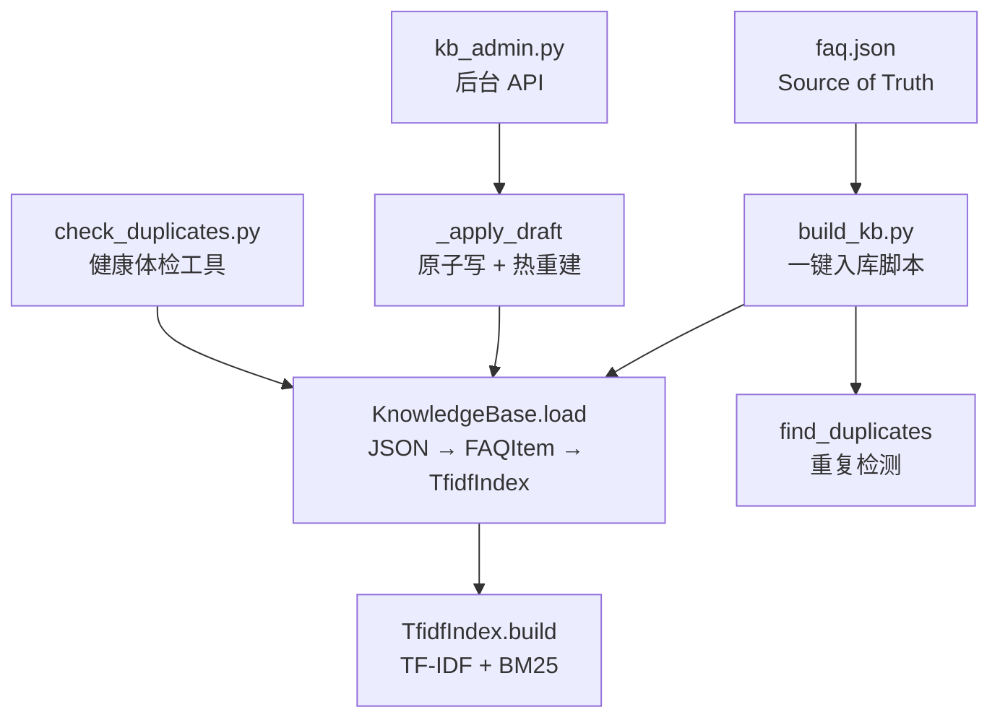
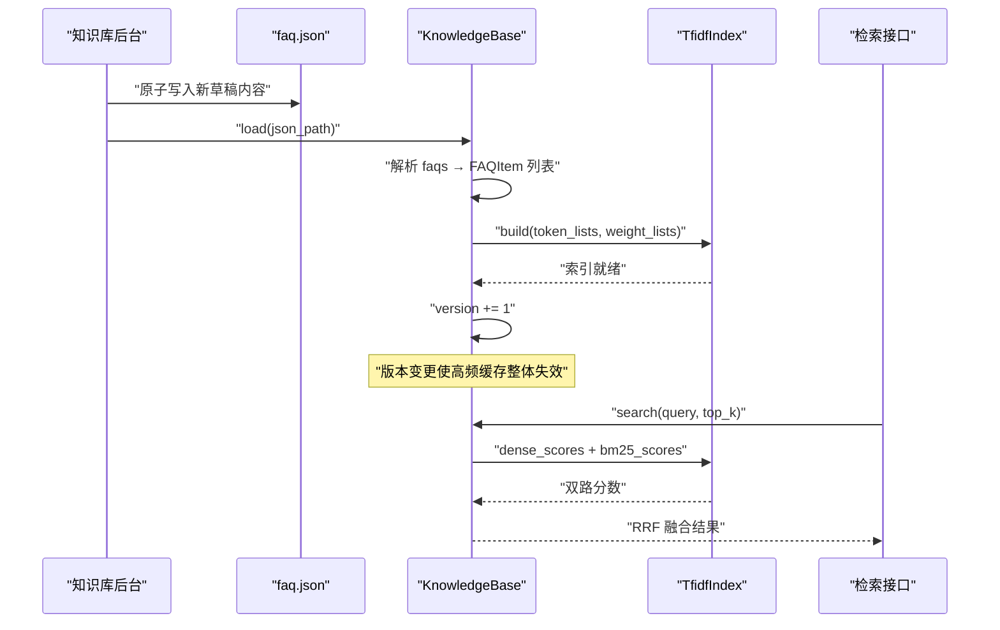
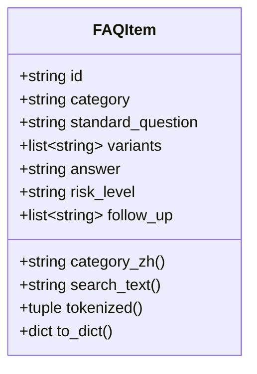
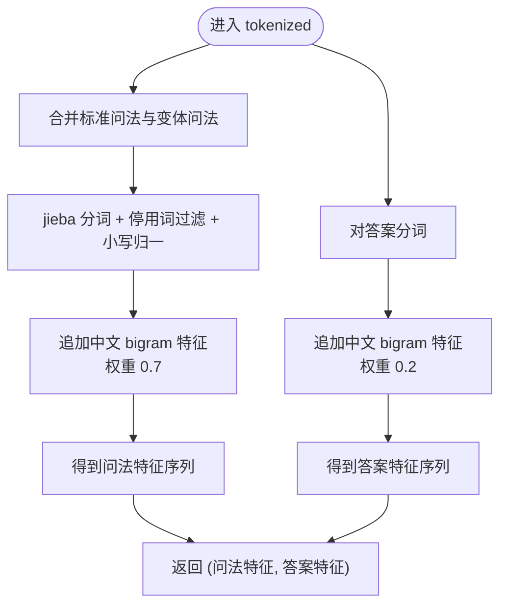
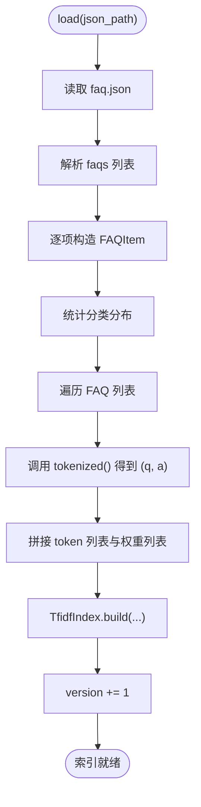
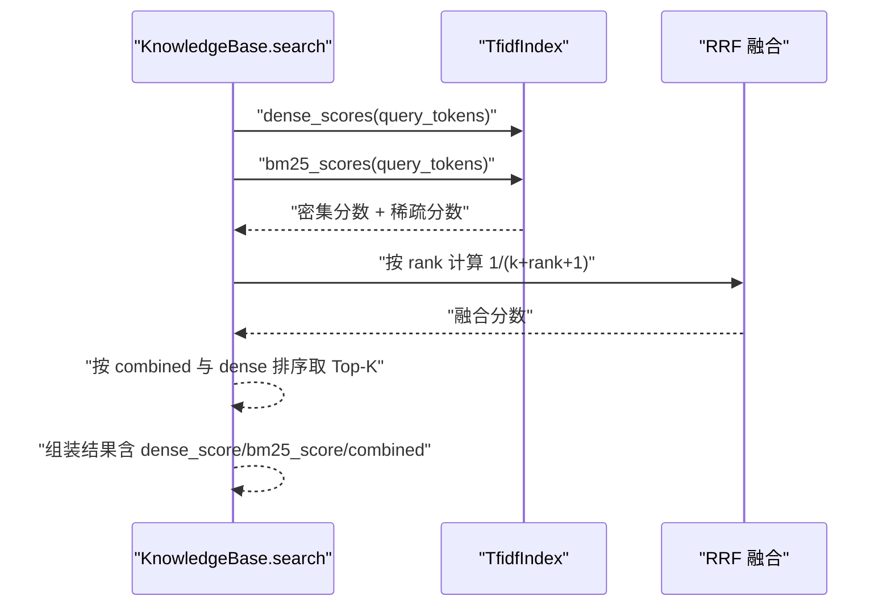
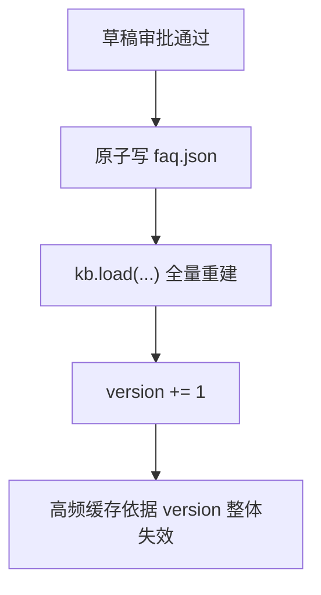
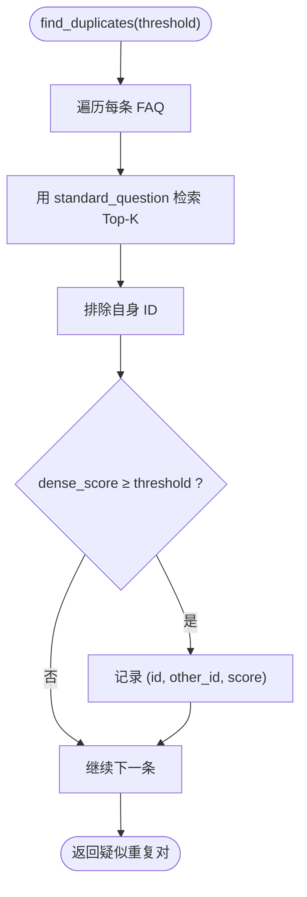
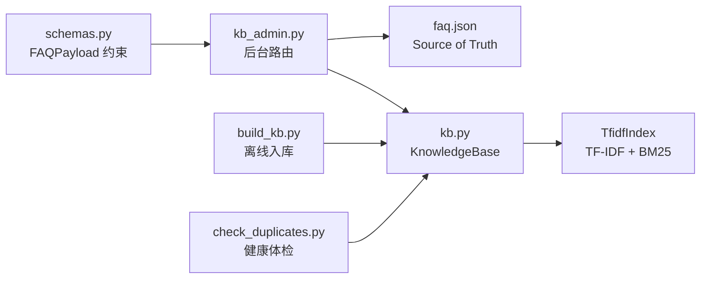

# FAQ 数据模型与索引构建

<cite>
**本文引用的文件**   
- [kb.py](file://backend/app/storage/kb.py)
- [faq.json](file://knowledge_base/faq.json)
- [build_kb.py](file://knowledge_base/build_kb.py)
- [check_duplicates.py](file://backend/tools/check_duplicates.py)
- [kb_admin.py](file://backend/app/routers/kb_admin.py)
- [schemas.py](file://backend/app/models/schemas.py)
</cite>

## 目录
1. [引言](#引言)
2. [项目结构](#项目结构)
3. [核心组件](#核心组件)
4. [架构总览](#架构总览)
5. [详细组件分析](#详细组件分析)
6. [依赖关系分析](#依赖关系分析)
7. [性能考量](#性能考量)
8. [故障排查指南](#故障排查指南)
9. [结论](#结论)
10. [附录：FAQ 数据规范、最佳实践与迁移指南](#附录faq-数据规范最佳实践与迁移指南)

## 引言
本文聚焦知识库的 FAQ 数据模型与索引构建机制，围绕以下目标展开：
- 解释 `FAQItem` dataclass 的字段设计及其业务语义；
- 说明 `search_text` 文本组合策略与 `tokenized` 方法中问法、答案的特征分离机制；
- 解析 `KnowledgeBase.load` 从 JSON 到 TfidfIndex 的完整转换流程；
- 说明分类映射 `category_zh`、版本缓存失效 `version`、重复检测 `find_duplicates` 的工作原理；
- 提供 FAQ 数据规范、最佳实践和迁移指南。

该实现采用本地 TF-IDF 向量检索与 BM25 关键词检索双路召回，并通过 RRF（倒数排名融合）进行重排，MVP 阶段无需外部 Embedding 服务，生产期可平滑替换为向量数据库方案。

## 项目结构
与 FAQ 数据模型和索引构建直接相关的代码集中在后端存储层、知识库脚本以及后台路由中：
- `backend/app/storage/kb.py`：定义 FAQ 数据模型、分词器、TF-IDF/BM25 索引、知识库加载与检索、重复检测等核心逻辑；
- `knowledge_base/faq.json`：知识库 Source of Truth，包含元数据与 FAQ 列表；
- `knowledge_base/build_kb.py`：一键入库脚本，读取 JSON、调用 `KnowledgeBase.load`、执行重复检查并序列化索引；
- `backend/tools/check_duplicates.py`：独立的健康体检工具，用于周期性扫描重复 FAQ；
- `backend/app/routers/kb_admin.py`：V2.0 知识库后台，负责草稿审批流、原子写 faq.json、热重建索引及版本历史；
- `backend/app/models/schemas.py`：Pydantic 请求模型，约束 FAQ 载荷字段类型与长度。

图表来源
- [kb.py:1-120](file://backend/app/storage/kb.py#L1-L120)
- [kb.py:201-316](file://backend/app/storage/kb.py#L201-L316)
- [faq.json:1-20](file://knowledge_base/faq.json#L1-L20)
- [build_kb.py:1-55](file://knowledge_base/build_kb.py#L1-L55)
- [kb_admin.py:1-80](file://backend/app/routers/kb_admin.py#L1-L80)
- [kb_admin.py:201-299](file://backend/app/routers/kb_admin.py#L201-L299)
- [check_duplicates.py:1-49](file://backend/tools/check_duplicates.py#L1-L49)

章节来源
- [kb.py:1-120](file://backend/app/storage/kb.py#L1-L120)
- [kb.py:201-316](file://backend/app/storage/kb.py#L201-L316)
- [faq.json:1-20](file://knowledge_base/faq.json#L1-L20)
- [build_kb.py:1-55](file://knowledge_base/build_kb.py#L1-L55)
- [kb_admin.py:1-80](file://backend/app/routers/kb_admin.py#L1-L80)
- [kb_admin.py:201-299](file://backend/app/routers/kb_admin.py#L201-L299)
- [check_duplicates.py:1-49](file://backend/tools/check_duplicates.py#L1-L49)

## 核心组件
本节对核心类与关键方法进行概念性说明，不直接粘贴代码内容，而是以引用路径说明具体实现位置。

- `FAQItem`：FAQ 条目 dataclass，承载 id、category、standard_question、variants、answer、risk_level、follow_up 等业务字段，并提供 category_zh、search_text、tokenized、to_dict 等方法。
- `TfidfIndex`：简化版 TF-IDF 向量索引，同时支持 BM25 分数计算，维护词表、IDF、文档向量、文档频率与平均文档长度。
- `KnowledgeBase`：知识库主体，负责加载 JSON、构造 FAQItem 列表、构建混合特征索引、执行混合检索、查找重复项，并维护 version 版本号。
- 分词与特征提取：`tokenize` 使用 jieba 中文分词、停用词过滤与小写归一；`tokenize_full` 在词级特征基础上叠加中文 bigram 特征，提升口语化变体匹配鲁棒性。
- 后台路由 `_apply_draft`：通过原子写更新 faq.json，然后调用 kb.load 热重建索引并递增 version，从而触发高频缓存整体失效。
- 健康体检 `check_duplicates`：周期性运行，基于 KnowledgeBase.find_duplicates 报告疑似重复 FAQ 对。

章节来源
- [kb.py:1-120](file://backend/app/storage/kb.py#L1-L120)
- [kb.py:201-316](file://backend/app/storage/kb.py#L201-L316)
- [kb_admin.py:1-80](file://backend/app/routers/kb_admin.py#L1-L80)
- [kb_admin.py:201-299](file://backend/app/routers/kb_admin.py#L201-L299)
- [check_duplicates.py:1-49](file://backend/tools/check_duplicates.py#L1-L49)

## 架构总览
下图展示从 faq.json 到在线检索的端到端流程，包括后台审批、热更新与索引重建。

图表来源
- [kb.py:201-316](file://backend/app/storage/kb.py#L201-L316)
- [kb_admin.py:1-80](file://backend/app/routers/kb_admin.py#L1-L80)
- [kb_admin.py:201-299](file://backend/app/routers/kb_admin.py#L201-L299)

## 详细组件分析

### FAQItem 数据模型与字段语义
`FAQItem` 是 FAQ 的最小语义单元，其字段设计兼顾检索、运营与风控：
- `id`：唯一标识，通常形如 `faq_001`，便于后台生成、查询与版本回滚定位；
- `category`：英文分类键，用于统计与筛选，常见值包括售后、售前、交易、账号；
- `standard_question`：标准问法，作为检索主键之一，也作为重复检测的 query；
- `variants`：同义变体问法集合，覆盖口语化、错别字、句式变化等用户表达差异；
- `answer`：标准答案，参与检索但权重低于问法，避免答案噪声稀释问题匹配；
- `risk_level`：风险等级 low/mid/high，用于后续策略分支（例如高风险转人工）；
- `follow_up`：推荐追问列表，增强多轮对话引导能力；
- `category_zh`：将英文分类映射为中文显示名，未映射时回退原值；
- `search_text`：检索辅助文本，由标准问法、变体问法与答案拼接而成，用于需要全文匹配的轻量场景；
- `tokenized`：返回“问法特征”和“答案特征”两个序列，分别以不同 bigram 权重建模，体现“问法优先”的设计原则；
- `to_dict`：序列化输出，供 API 响应或持久化使用。

图表来源
- [kb.py:1-120](file://backend/app/storage/kb.py#L1-L120)

章节来源
- [kb.py:1-120](file://backend/app/storage/kb.py#L1-L120)

### search_text 文本组合策略
`search_text` 将标准问法、所有变体问法和答案拼接为一个空格分隔的字符串。其策略要点如下：
- 标准问法与变体问法构成用户侧查询空间，提高召回覆盖率；
- 答案被纳入检索文本，有助于命中“答案内隐含关键词”的场景；
- 拼接顺序保持“问题在前、答案在后”，配合后续 tokenized 中的权重区分，避免答案过度影响排序；
- 该属性常用于简单文本包含式过滤或调试输出，并非主索引特征。

章节来源
- [kb.py:1-120](file://backend/app/storage/kb.py#L1-L120)

### tokenized 方法的特征分离机制
`tokenized` 返回一个二元组：`(问法特征, 答案特征)`。实现细节包括：
- 问法特征：由标准问法与变体问法合并后分词，bigram 权重设为较高值，强调问题语义；
- 答案特征：仅对 answer 分词，bigram 权重较低，降低答案对主匹配的干扰；
- 最终索引构建时，问法 token 与答案 token 被拼接成一个 token 列表，同时保留对应权重列表，以便 TF-IDF 加权；
- 这种“特征分离 + 权重降权”的策略，在保证答案可被召回的同时，突出问题匹配质量。

图表来源
- [kb.py:1-120](file://backend/app/storage/kb.py#L1-L120)

章节来源
- [kb.py:1-120](file://backend/app/storage/kb.py#L1-L120)

### KnowledgeBase.load 的 JSON 解析与索引构建流程
`KnowledgeBase.load` 完成从 faq.json 到内存索引的全量重建，步骤如下：
1. 打开 JSON 文件并以 UTF-8 解码；
2. 读取 `faqs` 数组，逐项构造 `FAQItem`；
3. 统计分类分布 `_categories`；
4. 遍历每条 FAQ，调用 `tokenized()` 得到问法与答案特征；
5. 将问法与答案 token 拼接成 `doc_token_lists`，并将对应权重拼接成 `weight_lists`；
6. 创建 `TfidfIndex` 并调用 `build`，完成词表、IDF、向量与 BM25 统计信息构建；
7. 递增 `version`，使上层高频缓存据此整体失效。

图表来源
- [kb.py:201-260](file://backend/app/storage/kb.py#L201-L260)

章节来源
- [kb.py:201-260](file://backend/app/storage/kb.py#L201-L260)

### TfidfIndex 与检索融合
`TfidfIndex` 同时提供两种打分方式：
- `dense_scores`：基于 TF-IDF 向量的余弦相似度；
- `bm25_scores`：传统 BM25 关键词打分。

`KnowledgeBase.search` 将两路召回结果按 RRF 融合重排，返回 Top-K 候选，并附带 dense_score、bm25_score 与 combined 分数，便于置信度阈值判断与可观测性分析。

图表来源
- [kb.py:260-316](file://backend/app/storage/kb.py#L260-L316)

章节来源
- [kb.py:260-316](file://backend/app/storage/kb.py#L260-L316)

### category_zh 分类映射
`CATEGORY_ZH` 将英文分类键映射为中文显示名：
- aftersales → 售后
- presales → 售前
- transaction → 交易
- account → 账号

若传入分类不在映射表中，`category_zh` 会回退到原始英文分类值，保证兼容性与可读性。

章节来源
- [kb.py:1-120](file://backend/app/storage/kb.py#L1-L120)

### version 缓存失效机制
`KnowledgeBase.version` 在每次 `load` 成功后自增。后台路由 `_apply_draft` 在完成 faq.json 原子写入后调用 `kb.load`，从而触发 version 递增。上游高频缓存若依赖 version 作为失效键，则可在知识库热更新后自动整体失效，避免旧索引与新版数据不一致。

图表来源
- [kb_admin.py:1-80](file://backend/app/routers/kb_admin.py#L1-L80)
- [kb_admin.py:201-299](file://backend/app/routers/kb_admin.py#L201-L299)
- [kb.py:201-260](file://backend/app/storage/kb.py#L201-L260)

章节来源
- [kb_admin.py:1-80](file://backend/app/routers/kb_admin.py#L1-L80)
- [kb_admin.py:201-299](file://backend/app/routers/kb_admin.py#L201-L299)
- [kb.py:201-260](file://backend/app/storage/kb.py#L201-L260)

### find_duplicates 重复检测原理
`find_duplicates` 用于发现语义撞车的 FAQ 对：
- 对每条 FAQ，以其 `standard_question` 作为查询调用 `search`；
- 排除自身（`faq.id != h.faq.id`），从 Top-K 候选中筛选出 `dense_score` 超过阈值的条目；
- 返回 `(faq_id, other_faq_id, score)` 三元组列表；
- 默认阈值 0.95，既敏感于高度相似问法，又避免误报低相关条目；
- 后台构建脚本与健康体检工具均使用该能力，用于入库前自检与周期性巡检。

图表来源
- [kb.py:260-316](file://backend/app/storage/kb.py#L260-L316)
- [build_kb.py:20-55](file://knowledge_base/build_kb.py#L20-L55)
- [check_duplicates.py:1-49](file://backend/tools/check_duplicates.py#L1-L49)

章节来源
- [kb.py:260-316](file://backend/app/storage/kb.py#L260-L316)
- [build_kb.py:20-55](file://knowledge_base/build_kb.py#L20-L55)
- [check_duplicates.py:1-49](file://backend/tools/check_duplicates.py#L1-L49)

## 依赖关系分析
FAQ 数据模型与索引构建的依赖关系如下：
- `faq.json` 是 Source of Truth，被 `build_kb.py` 与 `kb_admin.py` 共同消费；
- `build_kb.py` 通过导入 `KnowledgeBase` 完成离线入库；
- `kb_admin.py` 通过全局单例 `kb` 进行在线热更新；
- `check_duplicates.py` 复用 `KnowledgeBase` 实现健康巡检；
- `schemas.py` 约束前台提交载荷，确保 JSON 字段合法后再落盘。

图表来源
- [schemas.py:1-138](file://backend/app/models/schemas.py#L1-L138)
- [kb_admin.py:1-80](file://backend/app/routers/kb_admin.py#L1-L80)
- [kb_admin.py:201-299](file://backend/app/routers/kb_admin.py#L201-L299)
- [build_kb.py:1-55](file://knowledge_base/build_kb.py#L1-L55)
- [check_duplicates.py:1-49](file://backend/tools/check_duplicates.py#L1-L49)
- [kb.py:201-316](file://backend/app/storage/kb.py#L201-L316)

章节来源
- [schemas.py:1-138](file://backend/app/models/schemas.py#L1-L138)
- [kb_admin.py:1-80](file://backend/app/routers/kb_admin.py#L1-L80)
- [kb_admin.py:201-299](file://backend/app/routers/kb_admin.py#L201-L299)
- [build_kb.py:1-55](file://knowledge_base/build_kb.py#L1-L55)
- [check_duplicates.py:1-49](file://backend/tools/check_duplicates.py#L1-L49)
- [kb.py:201-316](file://backend/app/storage/kb.py#L201-L316)

## 性能考量
- 分词成本：中文分词与 bigram 生成随 FAQ 规模线性增长，MVP 规模下秒级可完成；
- 索引构建：TF-IDF 与 BM25 统计信息在一次 build 中完成，适合离线全量重建；
- 检索性能：密集向量余弦相似度与 BM25 均为 O(N) 扫描，结合 RRF 融合，Top-K 较小，整体延迟可控；
- 权重策略：答案特征降权避免答案噪声稀释问题匹配，提升排序稳定性；
- 热更新成本：后台审批通过后全量重建索引，FAQ 数量较少时开销可忽略，且可通过 version 控制缓存失效范围。

[本节为通用性能讨论，不涉及具体代码片段]

## 故障排查指南
常见问题与定位建议：
- 索引为空或检索结果为空：
  - 确认 `faq.json` 是否包含 `faqs` 数组且非空；
  - 检查 `KnowledgeBase.load` 是否成功执行并递增 version；
  - 确认分词后 query 是否为空（停用词过多可能导致空查询）。
- 重复 FAQ 导致检索撞车：
  - 运行 `build_kb.py` 或 `check_duplicates.py`，查看相似度超阈值的 FAQ 对；
  - 合并语义相近条目，或改写变体问法以降低重叠。
- 后台审批后缓存未失效：
  - 确认 `_apply_draft` 调用了 `kb.load` 并递增 `version`；
  - 检查上层缓存是否以 version 作为失效键。
- JSON 解析失败：
  - 校验 `faq.json` 格式是否符合 `FAQPayload` 约束；
  - 关注必填字段 length 限制与枚举值范围。

章节来源
- [kb.py:201-316](file://backend/app/storage/kb.py#L201-L316)
- [build_kb.py:20-55](file://knowledge_base/build_kb.py#L20-L55)
- [check_duplicates.py:1-49](file://backend/tools/check_duplicates.py#L1-L49)
- [kb_admin.py:1-80](file://backend/app/routers/kb_admin.py#L1-L80)
- [kb_admin.py:201-299](file://backend/app/routers/kb_admin.py#L201-L299)
- [schemas.py:1-138](file://backend/app/models/schemas.py#L1-L138)

## 结论
本实现以 `FAQItem` 为核心数据模型，通过 `tokenized` 将问法与答案特征分离，并在 `TfidfIndex` 中以权重区分重要性；`KnowledgeBase.load` 将 JSON 转为 FAQ 对象并构建 TF-IDF/BM25 索引；后台审批流通过原子写与热重建保证数据一致性与缓存一致性；`find_duplicates` 为知识库防腐烂提供自动化保障。该方案在 MVP 阶段具备可解释、可维护、可扩展的特点，并为未来引入外部 Embedding 与向量数据库预留了接口边界。

[本节为总结性内容，不涉及具体代码片段]

## 附录：FAQ 数据规范、最佳实践与迁移指南

### FAQ 数据规范
- 必填字段：
  - `id`：唯一标识，建议使用递增编号，如 `faq_001`；
  - `category`：必须为 `aftersales`、`presales`、`transaction`、`account` 之一；
  - `standard_question`：标准问法，长度建议 2-200；
  - `variants`：变体问法列表，建议不超过 50；
  - `answer`：标准答案，长度建议 1-5000；
  - `risk_level`：枚举 `low`、`mid`、`high`；
  - `follow_up`：推荐追问列表，建议不超过 20。
- 可选字段：
  - `follow_up` 可为空列表；
  - `variants` 可为空列表，但建议补充常用变体以提升召回。
- 分类映射：
  - 使用 `category_zh` 获取中文分类名；未知分类将回退为原始英文值。

章节来源
- [schemas.py:1-138](file://backend/app/models/schemas.py#L1-L138)
- [kb.py:1-120](file://backend/app/storage/kb.py#L1-L120)

### 最佳实践
- 问法设计：
  - 标准问法应简洁明确，覆盖核心意图；
  - 变体问法应覆盖口语化、错别字、倒装句等常见用户表达；
  - 避免与已有 FAQ 高度重复，防止检索撞车。
- 答案设计：
  - 答案应尽量准确、完整，避免模糊表述；
  - 注意答案中可能出现的敏感词与风险词，合理设置 `risk_level`；
  - 答案不宜过长，避免稀释问题匹配。
- 风险分级：
  - `low`：常规咨询；
  - `mid`：涉及订单、退款、物流等需关注的问题；
  - `high`：投诉、封号、盗号等高风险场景，建议转人工。
- 追问设计：
  - `follow_up` 应指向下一常见意图，形成自然多轮对话。
- 索引与缓存：
  - 修改 faq.json 后务必运行构建脚本或触发后台热更新；
  - 使用 version 控制缓存失效，避免新旧数据混用。

章节来源
- [kb.py:1-120](file://backend/app/storage/kb.py#L1-L120)
- [kb.py:201-316](file://backend/app/storage/kb.py#L201-L316)
- [kb_admin.py:201-299](file://backend/app/routers/kb_admin.py#L201-L299)

### 迁移指南
- 新增 FAQ：
  - 通过后台新建草稿，提交审核后自动生成 faq.json 变更并热重建索引；
  - 或通过编辑现有 FAQ 的草稿，走相同审批流。
- 批量迁移：
  - 准备符合规范的 faq.json，运行 `python knowledge_base/build_kb.py`；
  - 检查重复 FAQ 报告，合并或改写冲突条目；
  - 确认抽样检索结果符合预期。
- 回滚与版本管理：
  - 后台提供版本历史与一键回滚功能；
  - 回滚操作同样走审批流，确保审计与一致性。
- 健康巡检：
  - 定期运行 `python backend/tools/check_duplicates.py`，及时清理重复 FAQ；
  - 调整相似度阈值以平衡召回与误报。

章节来源
- [build_kb.py:1-55](file://knowledge_base/build_kb.py#L1-L55)
- [check_duplicates.py:1-49](file://backend/tools/check_duplicates.py#L1-L49)
- [kb_admin.py:201-299](file://backend/app/routers/kb_admin.py#L201-L299)