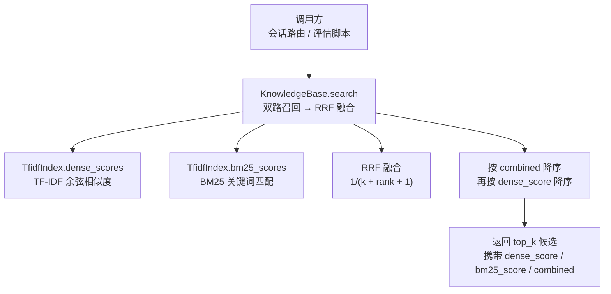
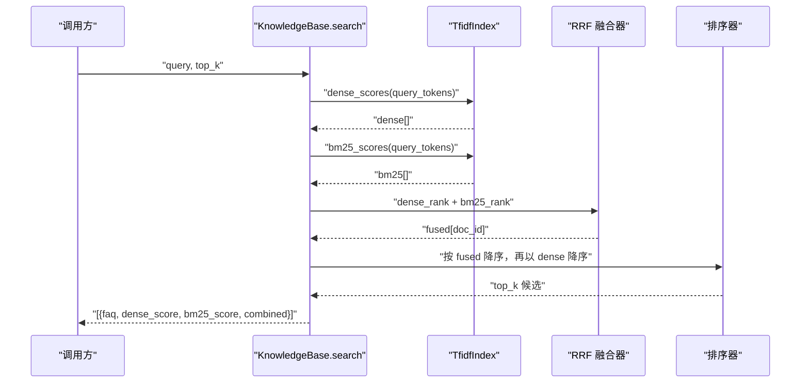
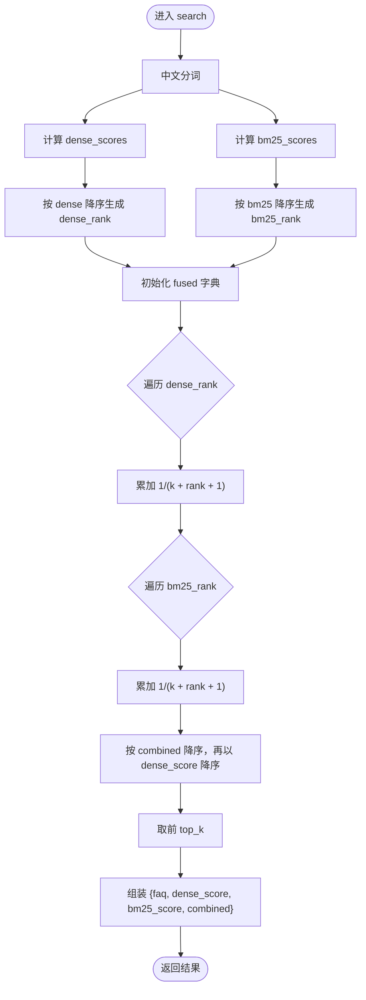
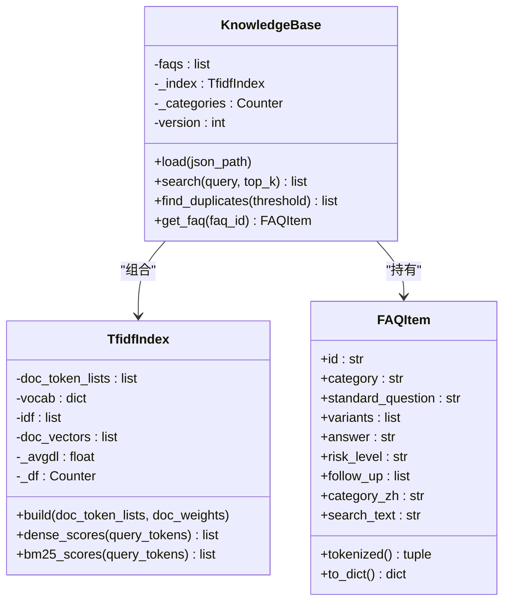
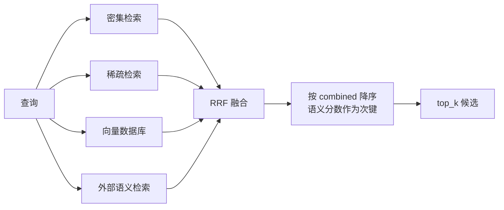

# RRF 融合重排

<cite>
**本文引用的文件**
- [kb.py](file://backend/app/storage/kb.py)
- [源码解读.md](file://源码解读.md)
</cite>

## 目录
1. [引言](#引言)
2. [项目结构中的检索位置](#项目结构中的检索位置)
3. [核心组件](#核心组件)
4. [架构总览](#架构总览)
5. [RRF 融合重排详细分析](#rrf-融合重排详细分析)
6. [依赖关系分析](#依赖关系分析)
7. [性能与复杂度](#性能与复杂度)
8. [参数调优：k=60 的设计与扩展](#参数调优k60-的设计与扩展)
9. [故障排查指南](#故障排查指南)
10. [结论](#结论)

## 引言
本文围绕知识库模块中的 `KnowledgeBase.search` 方法，系统化解释 RRF（Reciprocal Rank Fusion，倒数排名融合）在系统中的实现方式。重点包括：

- 密集检索与稀疏检索的双路召回策略；
- RRF 融合公式 `1/(k + rank + 1)` 的设计原理；
- 全局参数 `k=60` 的选择依据及其对排序稳定性的影响；
- 以 `dense_score` 作为第二排序键，实现语义相似度优先的最终排序策略；
- 不同 `k` 值对融合效果的影响分析；
- 面向多路召回（如向量数据库、Qdrant）的 RRF 适配方案。

该文档不直接粘贴源代码，而是通过路径引用和结构化图示帮助读者理解实现细节。

**章节来源**
- [kb.py:262-306](file://backend/app/storage/kb.py#L262-L306)
- [源码解读.md:231-251](file://源码解读.md#L231-L251)

## 项目结构中的检索位置
RRF 融合逻辑位于后端知识库存储层，具体入口为 `backend/app/storage/kb.py` 中的 `KnowledgeBase.search`。它对外暴露统一的检索接口，内部组合 TF-IDF 密集检索与 BM25 稀疏检索，并通过 RRF 得到最终候选列表。

**图表来源**
- [kb.py:262-306](file://backend/app/storage/kb.py#L262-L306)

**章节来源**
- [kb.py:262-306](file://backend/app/storage/kb.py#L262-L306)

## 核心组件
- `FAQItem`：知识条目数据模型，提供检索文本构造与分词特征。
- `TfidfIndex`：索引类，同时实现密集检索（TF-IDF 余弦）与稀疏检索（BM25）。
- `KnowledgeBase`：知识库主体，负责加载 FAQ、构建索引、执行检索与重复检测。

关键职责划分：
- `TfidfIndex.dense_scores`：将查询与文档都映射到 TF-IDF 向量空间，计算 L2 归一化后的余弦相似度，输出 0~1 分数，用于置信度判断。
- `TfidfIndex.bm25_scores`：基于词频、逆文档频率、文档长度归一化的 BM25 评分，体现关键词命中强度。
- `KnowledgeBase.search`：串联两路召回结果，使用 RRF 融合，并以 `combined` 为主键、`dense_score` 为次键进行最终排序。

**章节来源**
- [kb.py:43-98](file://backend/app/storage/kb.py#L43-L98)
- [kb.py:101-199](file://backend/app/storage/kb.py#L101-L199)
- [kb.py:262-306](file://backend/app/storage/kb.py#L262-L306)

## 架构总览
下图展示从查询到最终结果的完整流程：

**图表来源**
- [kb.py:262-306](file://backend/app/storage/kb.py#L262-L306)

**章节来源**
- [kb.py:262-306](file://backend/app/storage/kb.py#L262-L306)

## RRF 融合重排详细分析

### 双路召回策略
`KnowledgeBase.search` 首先对查询进行中文分词，然后分别计算：

1. **密集检索**：`TfidfIndex.dense_scores`
   - 基于 `(1+ln tf)·idf` 加权并 L2 归一化；
   - 查询与文档向量求余弦相似度；
   - 分数范围近似 0~1，适合做置信度阈值判断。

2. **稀疏检索**：`TfidfIndex.bm25_scores`
   - 标准 BM25 实现，`k1=1.5, b=0.75`；
   - 更强调关键词命中与文档长度归一化。

两条召回路径独立排序后进入 RRF 融合阶段，避免直接比较不同量纲的分数。

**章节来源**
- [kb.py:139-183](file://backend/app/storage/kb.py#L139-L183)
- [kb.py:262-282](file://backend/app/storage/kb.py#L262-L282)

### RRF 融合公式与设计原理
RRF 的核心思想是：**不直接使用原始分数，而是使用名次贡献**。对每条召回路径，文档按其在该路径中的排名 `rank` 获得融合分增量：

`贡献 = 1 / (k + rank + 1)`

其中：
- `rank` 从 0 开始；
- `k` 是平滑常数，当前固定为 60；
- 两个召回路径各自累加，得到每个文档的 `fused` 总分。

这种设计带来以下特性：

- **跨路可比性**：密集检索与稀疏检索的分数尺度不同，但名次贡献只依赖相对顺序，天然可加。
- **抑制极端值**：低排名文档的贡献衰减较快，避免某一路中异常高分拉偏整体排序。
- **鲁棒性**：即使某一召回路径噪声较大，另一条路径仍可通过自身高排名文档贡献提升其 `fused` 分数。

**章节来源**
- [kb.py:274-290](file://backend/app/storage/kb.py#L274-L290)
- [源码解读.md:234-251](file://源码解读.md#L234-L251)

### 最终排序策略：语义相似度优先
RRF 得到的 `combined` 是主排序键，而 `dense_score` 作为第二排序键参与同分或接近分数的排序决策。实现上等价于按以下规则排序：

1. 主键：`combined` 降序；
2. 次键：`dense_score` 降序。

这样设计的业务含义是：

- RRF 保证“多路共识”优先：如果某个 FAQ 在密集和稀疏两条路径中都靠前，它的 `combined` 会更高；
- 当 `combined` 相近时，语义相似度更高的文档排在前面，使最终结果更贴近语义意图；
- `dense_score` 还承担下游置信度判断职责，例如在重复 FAQ 检测中作为阈值依据。

**章节来源**
- [kb.py:286-306](file://backend/app/storage/kb.py#L286-L306)
- [源码解读.md:238-251](file://源码解读.md#L238-L251)

### RRF 融合流程图

**图表来源**
- [kb.py:262-306](file://backend/app/storage/kb.py#L262-L306)

## 依赖关系分析
`KnowledgeBase.search` 依赖 `TfidfIndex` 的两个打分方法，二者共享同一份分词、IDF、词表与文档向量结构。

**图表来源**
- [kb.py:43-98](file://backend/app/storage/kb.py#L43-L98)
- [kb.py:101-199](file://backend/app/storage/kb.py#L101-L199)
- [kb.py:262-316](file://backend/app/storage/kb.py#L262-L316)

**章节来源**
- [kb.py:43-98](file://backend/app/storage/kb.py#L43-L98)
- [kb.py:101-199](file://backend/app/storage/kb.py#L101-L199)
- [kb.py:262-316](file://backend/app/storage/kb.py#L262-L316)

## 性能与复杂度
假设文档数量为 `n`，查询分词结果为 `q`，词表大小为 `v`，平均非零维度为 `d`：

- `dense_scores`：
  - 构建查询向量：O(q + d)；
  - 与每篇文档向量点积：O(n × d)；
  - 总体 O(n × d)。

- `bm25_scores`：
  - 对每个唯一查询词统计 TF、DF、IDF；
  - 总体约 O(q + n × |unique_query|)，实际受稀疏分布影响较小。

- RRF 融合：
  - 两次排序：O(n log n)；
  - 两次线性累加：O(n)；
  - 最终排序：O(n log n)。

- 最终取 top_k：O(k) 或使用堆优化到 O(n log k)。

因此，搜索阶段的瓶颈通常集中在：
1. 大规模文档下的余弦点积；
2. 全量排序产生的 O(n log n)。

在当前 MVP 实现中，这些代价由本地内存索引承担，适合中小规模知识库；生产环境若扩展到向量数据库，应将密集检索下沉至专用向量引擎，RRF 仅融合各路返回的排名。

**章节来源**
- [kb.py:139-183](file://backend/app/storage/kb.py#L139-L183)
- [kb.py:262-306](file://backend/app/storage/kb.py#L262-L306)

## 参数调优：k=60 的设计与扩展

### k=60 的作用
RRF 公式 `1/(k + rank + 1)` 中，`k` 控制贡献曲线的陡峭程度：

- `k` 越小，排名越靠前的文档贡献越大，低排名文档也被放大；
- `k` 越大，所有排名贡献被压缩，融合结果更接近“是否出现在召回列表中”，而非严格区分细粒度排名。

代码中固定 `k=60`，意味着：

- 前几名文档仍有明显贡献；
- 第 60 名之后的文档贡献显著衰减；
- 融合结果对尾部噪声较稳健，不会因长尾排名产生过度扰动。

### 不同 k 值对融合效果的影响
- **k 过小（如 k≈1~5）**：
  - 高度依赖头部排名；
  - 对单路召回的噪声敏感；
  - 容易让某一条路径的偶然高排名主导结果。

- **k 适中（如 k≈30~100）**：
  - 平衡头部与中部排名；
  - 能较好体现“多路共识”；
  - 对中等质量召回路径更友好。

- **k 过大（如 k≥200）**：
  - 融合趋近于“是否被召回”的二元信号；
  - 对排名差异不敏感；
  - 可能削弱 RRF 的精细排序能力。

### 与语义相似度优先策略的配合
由于最终排序以 `combined` 为主键、`dense_score` 为次键，k 的调节会影响“谁进 top_k”，而 `dense_score` 能在相近 `combined` 的情况下微调顺序。因此：

- 若希望更重视“多路一致性”，可适当增大 k；
- 若希望更重视“语义相似度”，可保持现有 k，并信任 `dense_score` 的次键作用；
- 若发现稀疏路径噪声较大，可降低 k 权重或引入路径置信度门控。

### 扩展多路召回时的 RRF 适配方案
当系统接入更多召回源，例如向量数据库、Qdrant、图检索或外部语义检索服务时，RRF 仍可复用，只需满足以下条件：

1. 每条召回路径返回统一格式的候选列表；
2. 每条路径内部按自身分数排序；
3. RRF 对所有路径的排名统一累加 `1/(k + rank + 1)`；
4. 最终排序仍以 `combined` 为主键，并可保留 `dense_score` 或其他语义分数作为次键。

推荐扩展结构：

在实现上，可将 `KnowledgeBase.search` 拆分为：

- `recall_dense()`
- `recall_sparse()`
- `recall_vector_db()`
- `recall_external_semantic()`
- `rrf_fuse(ranks_map, k)`
- `final_sort(results, primary_key="combined", secondary_key="dense_score")`

这样既保留 RRF 的统一融合语义，又允许不同召回源独立演进。

**章节来源**
- [kb.py:274-290](file://backend/app/storage/kb.py#L274-L290)
- [源码解读.md:234-251](file://源码解读.md#L234-L251)

## 故障排查指南

常见问题与定位建议：

1. **返回空结果**
   - 检查是否已调用 `kb.load(...)` 构建索引；
   - 检查查询分词是否为空，尤其是停用词过滤后无有效词；
   - 确认 `self.faqs` 与 `self._index` 不为空。

2. **Top1 语义相似度偏低**
   - 观察返回结果中的 `dense_score`；
   - 若 `dense_score` 普遍偏低，可能是 FAQ 文本过短、变体不足或答案稀释了问法特征；
   - 可调整 `FAQItem.tokenized` 中问法与答案的权重配比。

3. **融合结果不稳定**
   - 检查 k 值是否合理；
   - 若某一路召回噪声大，可单独评估该路召回的排序质量；
   - 考虑为不同召回路径引入置信度门控或权重调节。

4. **重复 FAQ 检测误报**
   - 检查 `find_duplicates` 使用的相似度阈值；
   - 注意该函数依赖 `dense_score`，应结合业务场景调参。

**章节来源**
- [kb.py:262-316](file://backend/app/storage/kb.py#L262-L316)

## 结论
RRF 融合重排在当前知识库检索链路中承担“多路共识”的关键角色。通过将密集检索与稀疏检索的排名转换为统一的名次贡献，系统在无需对齐不同打分器量纲的前提下实现了稳健融合。固定 `k=60` 提供了对尾部噪声的抑制，而以 `dense_score` 作为第二排序键则确保语义相似度在最终排序中具有优先话语权。

未来接入向量数据库等更多召回源时，RRF 仍可作为通用融合层，配合清晰的路召回接口与稳定的最终排序策略，使系统具备可扩展、可观测、可回归的检索能力。