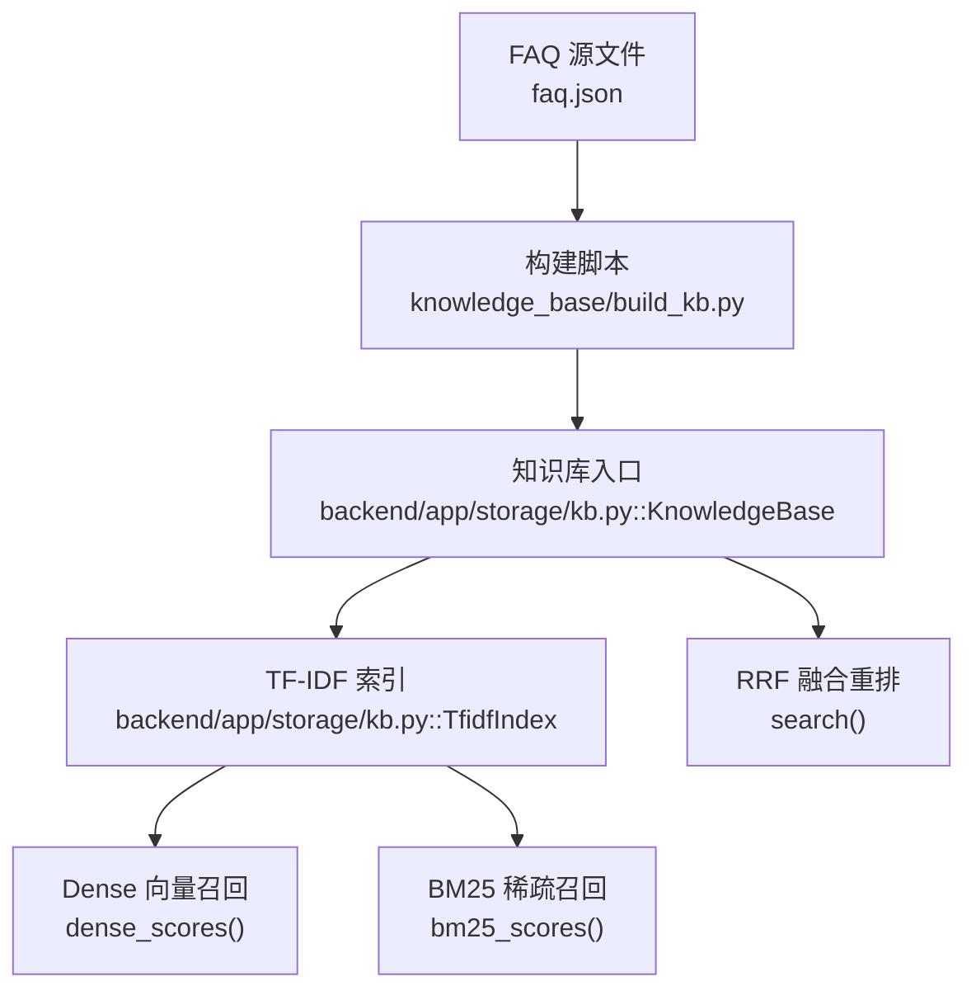
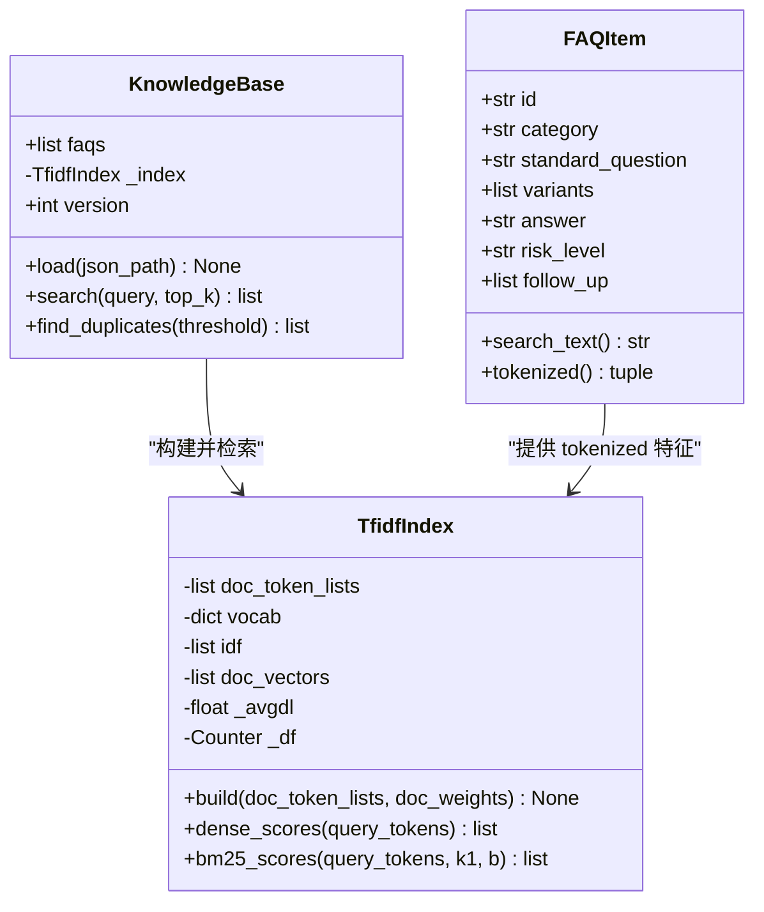
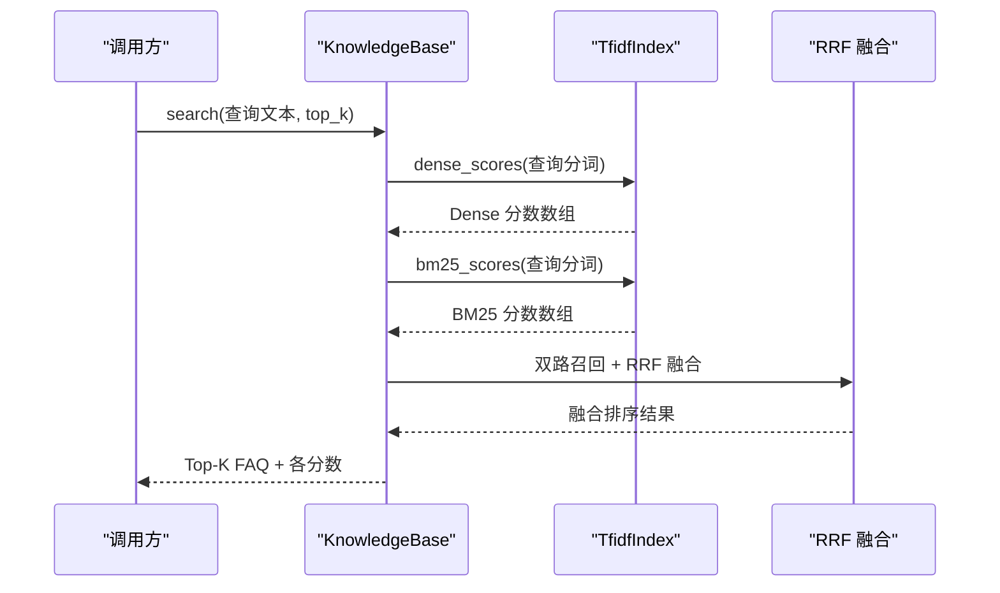
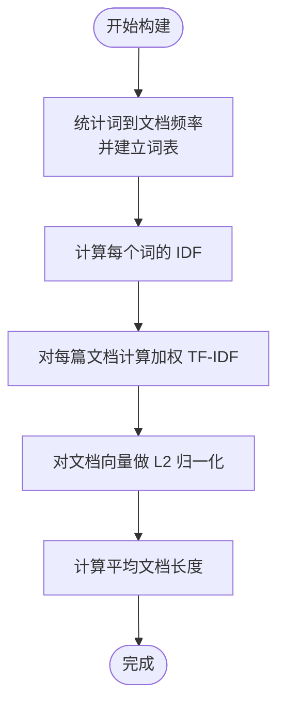
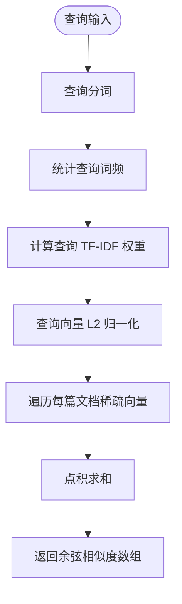
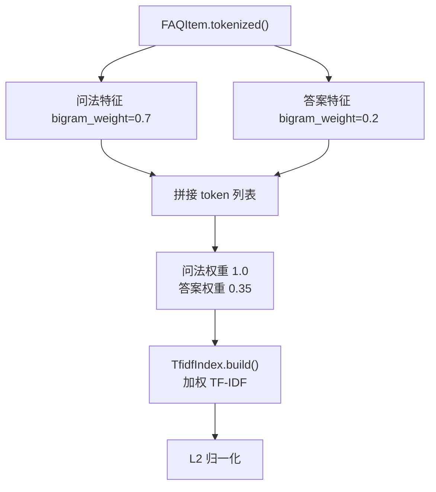

# TF-IDF 向量索引

<cite>
**本文引用的文件**   
- [backend/app/storage/kb.py](file://backend/app/storage/kb.py)
- [knowledge_base/build_kb.py](file://knowledge_base/build_kb.py)
- [源码解读.md](file://源码解读.md)
</cite>

## 目录
1. [引言](#引言)
2. [项目结构定位](#项目结构定位)
3. [核心组件总览](#核心组件总览)
4. [架构与数据流](#架构与数据流)
5. [TfidfIndex 实现原理](#tfidfindex-实现原理)
6. [词表构建、IDF 计算与加权 TF-IDF](#词表构建idf-计算与加权-tfidf)
7. [dense_scores 查询与余弦相似度](#dense_scores-查询与余弦相似度)
8. [doc_weights 差异化匹配机制](#doc_weights-差异化匹配机制)
9. [稀疏向量存储与内存占用分析](#稀疏向量存储与内存占用分析)
10. [性能调优参数](#性能调优参数)
11. [故障排查](#故障排查)
12. [结论](#结论)

## 引言
本文件面向“TF-IDF 向量索引”这一核心检索能力，围绕 `TfidfIndex` 类展开，解释其在客服知识库系统中的职责：把 FAQ 的标准问法、变体问法和答案切分为特征，计算 IDF，构造加权 TF-IDF 向量并进行 L2 归一化；在查询时通过 `dense_scores` 计算查询向量与文档向量的余弦相似度。同时说明 BM25 稀疏召回如何与 Dense 向量召回融合为最终排序结果，并给出稀疏存储优化、内存分析和可调节的运维参数建议。

该系统采用本地 TF-IDF + BM25 的 MVP 方案，不依赖外部 Embedding 服务，便于离线运行和快速上线；后续可通过 `KnowledgeBase` 接口平滑替换为向量数据库方案。

**章节来源**
- [backend/app/storage/kb.py:1-30](file://backend/app/storage/kb.py#L1-L30)
- [源码解读.md:1-60](file://源码解读.md#L1-L60)

## 项目结构定位
TF-IDF 向量索引位于后端存储层 `backend/app/storage/kb.py`，由知识库加载脚本 `knowledge_base/build_kb.py` 调用并序列化到磁盘。整体调用关系如下：

**图表来源**
- [knowledge_base/build_kb.py:1-55](file://knowledge_base/build_kb.py#L1-L55)
- [backend/app/storage/kb.py:201-316](file://backend/app/storage/kb.py#L201-L316)

**章节来源**
- [knowledge_base/build_kb.py:1-55](file://knowledge_base/build_kb.py#L1-L55)
- [backend/app/storage/kb.py:201-316](file://backend/app/storage/kb.py#L201-L316)

## 核心组件总览
- `tokenize`：中文分词（jieba）+ 停用词过滤 + 小写归一。
- `tokenize_full`：混合特征，包含 jieba 词和中文 bigram，bigram 以 `bg_` 前缀区分。
- `FAQItem`：FAQ 数据结构，提供 `search_text` 和 `tokenized()`，对问法和答案分别做不同 bigram 权重。
- `TfidfIndex`：TF-IDF 向量索引，负责词表、IDF、加权 TF-IDF 向量、L2 归一化、Dense 查询、BM25 召回。
- `KnowledgeBase`：知识库主体，负责加载 FAQ、构建索引、混合检索、重复检测。

**图表来源**
- [backend/app/storage/kb.py:45-120](file://backend/app/storage/kb.py#L45-L120)
- [backend/app/storage/kb.py:120-200](file://backend/app/storage/kb.py#L120-L200)
- [backend/app/storage/kb.py:201-316](file://backend/app/storage/kb.py#L201-L316)

**章节来源**
- [backend/app/storage/kb.py:1-200](file://backend/app/storage/kb.py#L1-L200)
- [backend/app/storage/kb.py:201-316](file://backend/app/storage/kb.py#L201-L316)

## 架构与数据流
一次搜索请求的典型流程：

- `KnowledgeBase.search` 先调用 `TfidfIndex.dense_scores` 得到 Dense 余弦相似度，再调用 `bm25_scores` 得到 BM25 稀疏分数。
- 然后按两路排名做 RRF（Reciprocal Rank Fusion），合并后取 Top-K。
- 返回结果中包含 `dense_score`，用于上层置信度判断或业务阈值。

**图表来源**
- [backend/app/storage/kb.py:201-316](file://backend/app/storage/kb.py#L201-L316)

**章节来源**
- [backend/app/storage/kb.py:201-316](file://backend/app/storage/kb.py#L201-L316)

## TfidfIndex 实现原理
`TfidfIndex` 是本地向量索引的核心，主要状态包括：

| 属性 | 含义 | 类型 | 作用 |
|---|---|---|---|
| `doc_token_lists` | 每篇文档的分词序列 | `list[list[str]]` | 记录原始分词，供 BM25 使用 |
| `vocab` | 词到列索引的映射 | `dict[str, int]` | 将词映射为向量维度编号 |
| `idf` | 每个词的 IDF 值 | `list[float]` | 按词表顺序排列 |
| `doc_vectors` | 每篇文档的稀疏向量 | `list[dict[int, float]]` | `{列索引: L2 归一化后的 TF-IDF 权重}` |
| `_avgdl` | 平均文档长度 | `float` | BM25 使用 |
| `_df` | 词到文档频率统计 | `Counter` | BM25 使用 |

构建过程分为四步：

1. 统计文档频率 `_df` 并建立词表 `vocab`。
2. 计算 IDF 向量。
3. 对每篇文档计算加权 TF-IDF，并做 L2 归一化，保存为稀疏向量。
4. 计算平均文档长度 `_avgdl`。

查询过程：

1. 对查询词统计词频，计算查询向量的 TF-IDF 并 L2 归一化。
2. 遍历文档稀疏向量，仅对共享列做点积，得到余弦相似度。

**章节来源**
- [backend/app/storage/kb.py:120-200](file://backend/app/storage/kb.py#L120-L200)

## 词表构建、IDF 计算与加权 TF-IDF
### 词表构建
词表构建基于去重后的词集合，保证每个词有唯一列索引。该实现简单直接，但存在以下特点：

- 时间复杂度：对每个文档的去重词集合进行遍历，总体为 `O(Σn_d)`，其中 `n_d` 是文档中不同词的数量。
- 空间复杂度：词表大小等于语料中的不同词数，包括 jieba 词和 bigram 特征。

### IDF 公式与推导
代码中 IDF 的计算方式为：

\[
\text{IDF}_w = \log\left(\frac{N + 1}{\text{df}_w + 1}\right) + 1
\]

其中：

- \(N\) 是文档总数。
- \(\text{df}_w\) 是包含词 \(w\) 的文档数量。
- 加 1 是对分子分母做平滑，避免极端分布。
- 再加 1 是为了保证 IDF 始终为正，防止某些词被完全抑制。

这个公式与经典 IDF 的关系可以理解为：

\[
\text{IDF}_w^{\text{code}} = 1 + \log\left(\frac{N + 1}{\text{df}_w + 1}\right)
\]

其效果是：

- 高频出现在多篇文档中的词，IDF 接近 1。
- 稀有词 IDF 更大，对区分性更强的词给予更高权重。
- 由于加 1，所有 IDF 均为正数，TF-IDF 向量不会因 IDF 为负而反转语义方向。

### 加权 TF-IDF
对于每篇文档的词 \(w\)，其 TF-IDF 权重为：

\[
\text{TF-IDF}_{d,w} = (1 + \log(\text{tf}_{d,w})) \times \text{IDF}_w
\]

其中 \(\text{tf}_{d,w}\) 是文档 \(d\) 中词 \(w\) 的计数。这里使用了增强型局部 TF 形式 \(1 + \log(\text{tf})\)，而不是简单的词频计数，目的是降低高频词对权重的线性放大效应。

随后对文档向量做 L2 归一化：

\[
\hat{v}_d = \frac{v_d}{\|v_d\|_2}
\]

这使得后续余弦相似度等价于两个归一化向量的点积。

**图表来源**
- [backend/app/storage/kb.py:120-200](file://backend/app/storage/kb.py#L120-L200)

**章节来源**
- [backend/app/storage/kb.py:120-200](file://backend/app/storage/kb.py#L120-L200)

## dense_scores 查询与余弦相似度
`dense_scores` 的目标是计算查询向量与所有文档向量的余弦相似度，返回长度为文档数量的浮点数组。

### 查询向量构建
1. 对查询文本分词。
2. 统计查询词频。
3. 对每个词计算 \( (1 + \log(\text{tf})) \times \text{IDF} \)。
4. 对查询向量做 L2 归一化。

### 余弦相似度计算
由于文档向量已经 L2 归一化，查询向量也 L2 归一化，因此：

\[
\text{cosine}(q, d) = q \cdot d = \sum_{i \in \text{共享列}} q_i \times d_i
\]

实现上只遍历查询向量非零列，并在文档稀疏向量中查找对应列，从而利用稀疏性减少计算量。

**图表来源**
- [backend/app/storage/kb.py:120-200](file://backend/app/storage/kb.py#L120-L200)

**章节来源**
- [backend/app/storage/kb.py:120-200](file://backend/app/storage/kb.py#L120-L200)

## doc_weights 差异化匹配机制
`doc_weights` 的作用是对同一文档内不同部分的 token 赋予不同权重，从而实现“问法更敏感、答案更保守”的匹配策略。

具体机制如下：

1. `FAQItem.tokenized()` 对问法和答案分别生成混合特征：
   - 问法：jieba 词 + bigram，bigram 权重为 0.7。
   - 答案：jieba 词 + bigram，bigram 权重为 0.2。
2. `KnowledgeBase.load()` 将问法特征和答案特征拼接成一篇文档的 token 列表，同时生成对应的权重列表：
   - 问法 token 权重为 1.0。
   - 答案 token 权重为 0.35。
3. `TfidfIndex.build()` 在计算 TF 时对每个 token 乘以其权重，使得答案部分对 TF-IDF 的贡献被显著降低。
4. 最终 L2 归一化是在加权 TF-IDF 之后进行的，因此权重差异会影响向量方向，从而影响余弦相似度。

这种设计的动机是：

- 用户查询通常更接近问法风格。
- 如果答案参与过多，可能引入无关语义，稀释问法匹配。
- 通过权重控制，系统在保留答案信息的同时，优先匹配问法语义。

**图表来源**
- [backend/app/storage/kb.py:45-120](file://backend/app/storage/kb.py#L45-L120)
- [backend/app/storage/kb.py:201-240](file://backend/app/storage/kb.py#L201-L240)

**章节来源**
- [backend/app/storage/kb.py:45-120](file://backend/app/storage/kb.py#L45-L120)
- [backend/app/storage/kb.py:201-240](file://backend/app/storage/kb.py#L201-L240)

## 稀疏向量存储与内存占用分析
### 稀疏存储设计
`doc_vectors` 使用 `list[dict[int, float]]` 存储，每个文档是一个 `{列索引: 权重}` 的字典。这意味着：

- 未出现的词不对应任何条目。
- 查询时只遍历查询向量非零列，并在文档向量中查找对应键。
- BM25 则直接使用 `doc_token_lists` 原始分词列表。

### 内存占用估算
假设：

- \(D\) 为文档数量。
- \(V\) 为词表大小。
- \(A\) 为平均每篇文档的非零列数。

则：

- 词表内存：\(O(V)\)。
- IDF 向量内存：\(O(V)\)。
- 文档稀疏向量内存：\(O(D \times A)\)。
- 原始分词列表内存：\(O(\Sigma n_d)\)，其中 \(n_d\) 是文档 token 数。

当词汇量大、bigram 多时，\(V\) 会显著增长；当文档较长或分词较细时，\(A\) 也会增长。

### 优化建议
当前实现已具备稀疏性优势，但在大数据场景下可考虑：

- 限制词表规模：增加最小词频阈值，过滤低频噪声词。
- 控制 bigram 比例：调整 `tokenize_full` 中 bigram 生成范围或权重。
- 使用更紧凑的稀疏格式：例如 CSR/CSC 或向量库提供的稀疏向量类型。
- 分片存储：按分类或版本拆分索引。

**章节来源**
- [backend/app/storage/kb.py:120-200](file://backend/app/storage/kb.py#L120-L200)

## 性能调优参数
以下是与 TF-IDF 向量索引相关的关键参数及其影响：

| 参数 | 位置 | 默认值或行为 | 作用 | 调优建议 |
|---|---|---|---|---|
| `bigram_weight`（问法） | `FAQItem.tokenized()` | 0.7 | 控制中文 bigram 在问法中的贡献 | 若口语化变体较多可提高；若噪声多可降低 |
| `bigram_weight`（答案） | `FAQItem.tokenized()` | 0.2 | 控制中文 bigram 在答案中的贡献 | 通常保持较低，避免答案噪声干扰 |
| 问法权重 | `KnowledgeBase.load()` | 1.0 | 问法 token 的匹配权重 | 提高可增强问法敏感度 |
| 答案权重 | `KnowledgeBase.load()` | 0.35 | 答案 token 的匹配权重 | 降低可减轻答案稀释 |
| IDF 平滑项 | `TfidfIndex.build()` | 分子分母 +1，整体 +1 | 控制 IDF 分布 | 一般保持默认，避免过拟合稀有词 |
| BM25 参数 `k1` | `bm25_scores()` | 1.5 | 控制词频饱和程度 | 增大可提升高频词贡献 |
| BM25 参数 `b` | `bm25_scores()` | 0.75 | 控制文档长度归一化强度 | 增大可更重视短文档 |
| RRF 常数 `k` | `KnowledgeBase.search()` | 60 | 控制排名衰减速度 | 减小会让高排名更突出 |
| Top-K | `KnowledgeBase.search()` | 3 | 返回候选数量 | 根据业务下游决策阈值调整 |
| 重复检测阈值 | `find_duplicates()` | 0.95 | 判断 FAQ 是否重复 | 过高漏判，过低误报 |

注意：当前实现中没有显式的“词汇过滤阈值”或“向量维度上限”配置项。若需严格控制维度，可在构建阶段加入词频过滤、停用词扩展或 bigram 裁剪逻辑。

**章节来源**
- [backend/app/storage/kb.py:45-120](file://backend/app/storage/kb.py#L45-L120)
- [backend/app/storage/kb.py:120-200](file://backend/app/storage/kb.py#L120-L200)
- [backend/app/storage/kb.py:201-316](file://backend/app/storage/kb.py#L201-L316)

## 故障排查
常见问题及处理思路：

| 现象 | 可能原因 | 排查方法 | 建议处理 |
|---|---|---|---|
| 检索结果为空 | 查询分词为空 | 检查 `tokenize` 是否过滤掉全部词 | 检查停用词、分词器、输入文本 |
| Dense 分数全为 0 | 查询词不在词表中 | 检查 `vocab` 是否包含查询词 | 检查分词与词表构建是否一致 |
| 答案命中过高 | 答案权重过大 | 检查 `doc_weights` 中答案权重 | 降低答案权重或增加问法权重 |
| 相似问法无法区分 | IDF 过小或词表噪声大 | 检查 IDF 分布和词表大小 | 增加停用词、过滤低频词 |
| 重复 FAQ 检测误报 | 阈值过低 | 检查 `find_duplicates` 阈值 | 调整阈值或人工复核 |
| 构建速度慢 | 词表过大或 bigram 过多 | 统计词表规模和 bigram 数量 | 控制 bigram 比例、增加词频过滤 |
| 内存占用过高 | 稀疏向量太多或词表太大 | 监控 `doc_vectors` 和 `vocab` 大小 | 分片索引、压缩存储 |

**章节来源**
- [backend/app/storage/kb.py:120-200](file://backend/app/storage/kb.py#L120-L200)
- [backend/app/storage/kb.py:201-316](file://backend/app/storage/kb.py#L201-L316)

## 结论
`TfidfIndex` 在本系统中承担本地向量检索的核心职责：通过 jieba 分词和中文 bigram 构建混合特征，使用带平滑的 IDF 公式计算词重要性，再以加权 TF-IDF 和 L2 归一化形成可比较的向量表示。`doc_weights` 实现了问法 1.0、答案 0.35 的差异化匹配，使系统更贴近用户真实问法风格。

当前实现简洁、可解释性强，适合中小规模知识库；随着语料增长，建议引入词频过滤、bigram 控制、稀疏格式优化和索引分片等策略，以平衡准确率、召回率和资源占用。

**章节来源**
- [backend/app/storage/kb.py:1-200](file://backend/app/storage/kb.py#L1-L200)
- [knowledge_base/build_kb.py:1-55](file://knowledge_base/build_kb.py#L1-L55)
- [源码解读.md:1-60](file://源码解读.md#L1-L60)