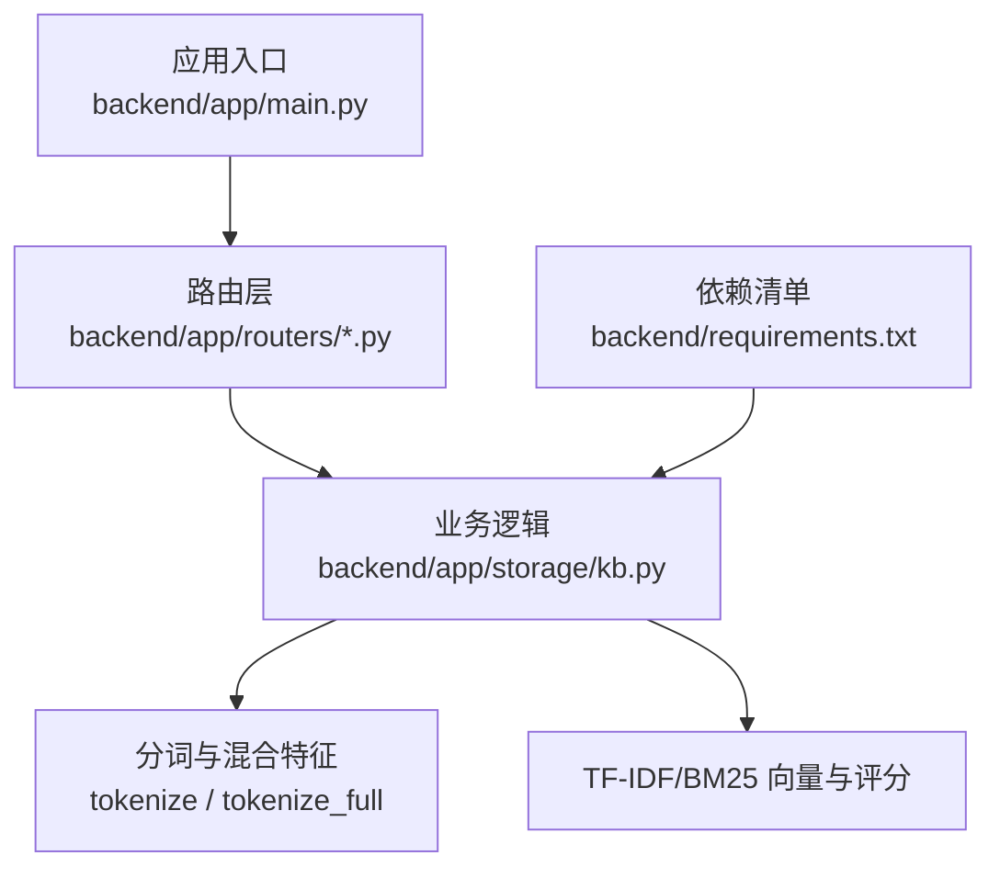
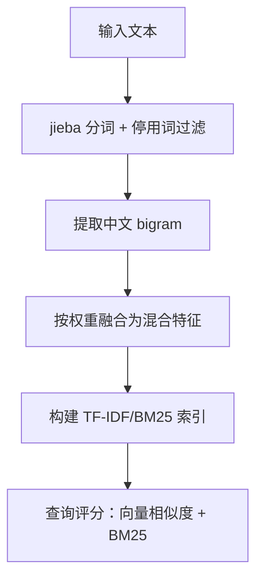
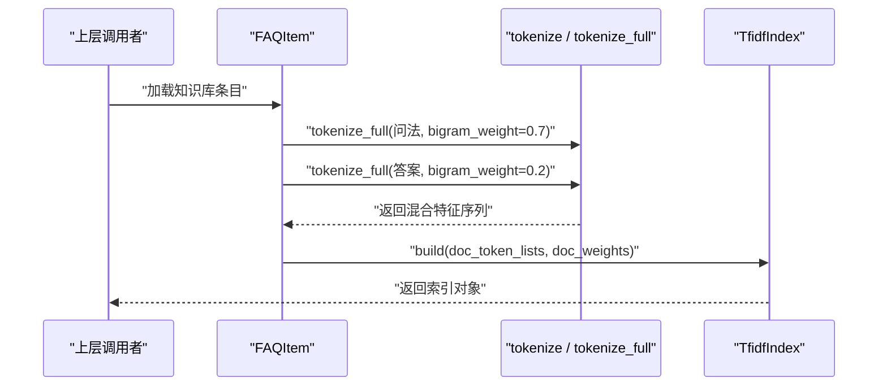
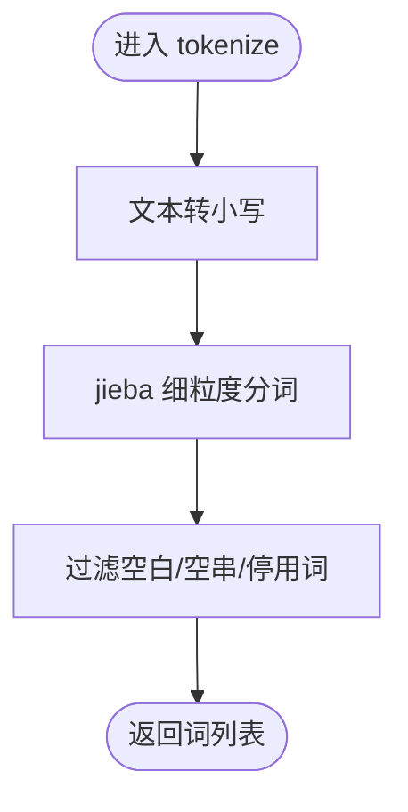
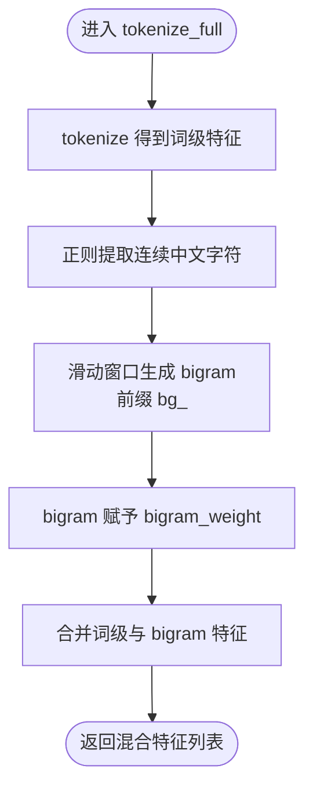
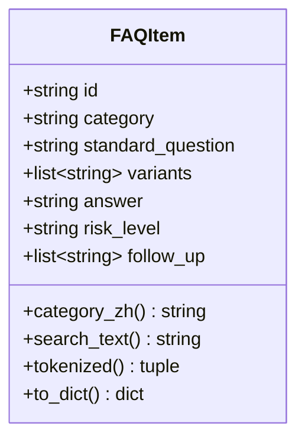
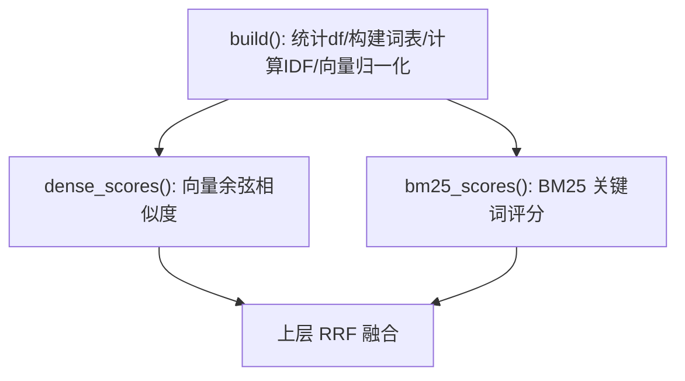
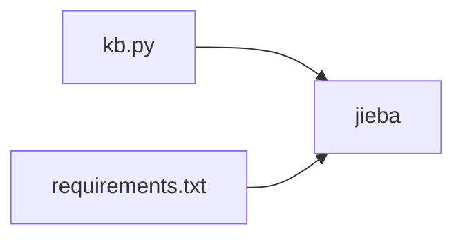

# 中文分词与特征工程

<cite>
**本文引用的文件**   
- [backend/app/storage/kb.py](file://backend/app/storage/kb.py)
- [backend/requirements.txt](file://backend/requirements.txt)
</cite>

## 目录
1. [引言](#引言)
2. [项目结构中的相关位置](#项目结构中的相关位置)
3. [核心组件总览](#核心组件总览)
4. [架构概览](#架构概览)
5. [详细组件分析](#详细组件分析)
6. [依赖关系分析](#依赖关系分析)
7. [性能考量](#性能考量)
8. [故障排查指南](#故障排查指南)
9. [结论](#结论)
10. [附录：配置与示例](#附录配置与示例)

## 引言
本文聚焦知识库检索系统中的中文分词与特征工程实现，重点解释基于 jieba 的分词函数、停用词表设计原则、混合特征构造方式，以及 bigram 权重在“问法匹配”和“答案降权”场景中的不同策略。同时给出可操作的分词效果示例、性能分析与自定义规则扩展方法，帮助读者在不深入源码的情况下掌握系统的关键机制。

## 项目结构中的相关位置
中文分词与特征工程代码集中在后端存储模块的知识库索引文件中；外部依赖通过 Python 依赖清单声明。

**图表来源**
- [backend/app/storage/kb.py:1-120](file://backend/app/storage/kb.py#L1-L120)
- [backend/requirements.txt:1-11](file://backend/requirements.txt#L1-L11)

**章节来源**
- [backend/app/storage/kb.py:1-120](file://backend/app/storage/kb.py#L1-L120)
- [backend/requirements.txt:1-11](file://backend/requirements.txt#L1-L11)

## 核心组件总览
本模块围绕以下能力构建知识库检索：
- 中文分词：基于 jieba 的细粒度分词，并做停用词过滤与小写归一。
- 混合特征：将 jieba 词级特征与中文连续字符二元组（bigram）特征融合，提升口语化变体的匹配鲁棒性。
- 问法与答案加权：对问法使用较高 bigram 权重，对答案进行降权，避免稀释问法匹配。
- 向量与关键词检索：提供简化版 TF-IDF 向量与 BM25 关键词评分，并用 RRF 融合（由上层调用方完成）。

**图表来源**
- [backend/app/storage/kb.py:12-66](file://backend/app/storage/kb.py#L12-L66)
- [backend/app/storage/kb.py:120-210](file://backend/app/storage/kb.py#L120-L210)

**章节来源**
- [backend/app/storage/kb.py:12-66](file://backend/app/storage/kb.py#L12-L66)
- [backend/app/storage/kb.py:120-210](file://backend/app/storage/kb.py#L120-L210)

## 架构概览
从数据流角度，知识库条目先被解析为 FAQItem，再将其标准问法、变体问法和答案分别进行混合特征抽取，最终构建倒排索引与向量表示，用于后续检索与排序。

**图表来源**
- [backend/app/storage/kb.py:68-119](file://backend/app/storage/kb.py#L68-L119)
- [backend/app/storage/kb.py:120-210](file://backend/app/storage/kb.py#L120-L210)

**章节来源**
- [backend/app/storage/kb.py:68-119](file://backend/app/storage/kb.py#L68-L119)
- [backend/app/storage/kb.py:120-210](file://backend/app/storage/kb.py#L120-L210)

## 详细组件分析

### 分词函数 tokenize
- 功能要点
  - 使用 jieba.lcut 进行细粒度中文分词。
  - 统一转为小写以消除大小写差异。
  - 去除空白、空串与停用词。
- 设计原则
  - 停用词表 _STOPWORDS 覆盖常见语气词、代词、助动词、疑问词、礼貌用语等，旨在保留语义核心词，过滤无区分度的高频虚词。
  - 该函数是基础分词单元，不引入 bigram。

**图表来源**
- [backend/app/storage/kb.py:12-26](file://backend/app/storage/kb.py#L12-L26)

**章节来源**
- [backend/app/storage/kb.py:12-26](file://backend/app/storage/kb.py#L12-L26)

### 停用词表 _STOPWORDS 的设计原则与过滤策略
- 类别覆盖
  - 语气与应答词：如“吗、呢、啊、吧、哦、呀、嗯、好、行、对、哈”等。
  - 人称与指示词：如“我、你、他、她、它、我们、你们、他们、这个、那个”。
  - 疑问与泛问词：如“什么、怎么、多久、多少”。
  - 助动词与情态词：如“会、要、想、有、没、不”。
  - 礼貌与请求词：如“请、帮、问、一下、请问”。
  - 冗余叠词：如“吗吗、呀呀、的的、了了”，用于抑制重复词噪声。
- 过滤策略
  - 严格集合匹配，不在表内的词一律保留，保证召回面。
  - 结合空白与空串过滤，避免分词噪声。
- 可扩展性
  - 可按业务领域增补行业术语、品牌名或负向词。
  - 建议采用“白名单+黑名单”双轨制：黑名单即 _STOPWORDS，白名单为领域专有名词，便于灰度上线与回滚。

**章节来源**
- [backend/app/storage/kb.py:12-26](file://backend/app/storage/kb.py#L12-L26)

### 混合特征函数 tokenize_full
- 输入输出
  - 输入：原始文本、bigram_weight（默认 0.7）。
  - 输出：[(词/特征, 权重), ...] 的混合特征序列。
- 特征构成
  - 词级特征：来自 tokenize(text)，权重固定为 1.0。
  - 字符级 bigram：仅对连续中文字符生成二元组，并在前缀加“bg_”以区分词级特征。
- 融合机制
  - 先拼接所有词级特征，再遍历所有中文 bigram 追加到特征序列。
  - bigram 特征携带 bigram_weight，允许根据场景调参。

**图表来源**
- [backend/app/storage/kb.py:28-49](file://backend/app/storage/kb.py#L28-L49)

**章节来源**
- [backend/app/storage/kb.py:28-49](file://backend/app/storage/kb.py#L28-L49)

### bigram_weight=0.7 与答案降权 bigram_weight=0.2 的设计
- 问法 bigram_weight=0.7
  - 目标：增强口语化变体与拆字变体的匹配鲁棒性。例如“拆了包装还能退吗”与“拆封了还能退吗”共享“还能/能退/退吗”等 bigram，有助于跨变体召回。
  - 作用：提高局部片段匹配的贡献，弥补 jieba 切分可能带来的碎片化。
- 答案 bigram_weight=0.2
  - 目标：降低答案内容对整体特征的稀释效应，使问法匹配更突出。
  - 原因：答案通常较长且包含大量通用表述，若赋予过高权重，容易掩盖问法关键信号；适度降权有助于保持“问法优先”的检索导向。
- 实践建议
  - 在离线评估集上对比 0.5/0.7/0.9 等多档权重，选择 F1 或 NDCG 最优值。
  - 对特定类目可设置差异化权重，例如高口语化类目使用更高权重。

**章节来源**
- [backend/app/storage/kb.py:30-49](file://backend/app/storage/kb.py#L30-L49)
- [backend/app/storage/kb.py:68-119](file://backend/app/storage/kb.py#L68-L119)

### FAQItem 与 tokenized 方法
- 字段职责
  - standard_question：标准问法，作为主要检索信号。
  - variants：用户变体问法，扩充召回面。
  - answer：答案正文，参与检索但需降权。
  - category/follow_up/risk_level：辅助信息与风险标注。
- tokenized 方法
  - 对“标准问法 + 变体问法”拼接后使用 bigram_weight=0.7 抽取问法特征。
  - 对 answer 使用 bigram_weight=0.2 抽取答案特征。
  - 返回 (问法特征, 答案特征) 两个特征序列，供上层构建索引时分配权重。

**图表来源**
- [backend/app/storage/kb.py:68-119](file://backend/app/storage/kb.py#L68-L119)

**章节来源**
- [backend/app/storage/kb.py:68-119](file://backend/app/storage/kb.py#L68-L119)

### TF-IDF 与 BM25 评分
- 简化 TF-IDF
  - 统计文档频率 df，计算 IDF。
  - 对每篇文档计算加权 TF-IDF，并进行 L2 归一化。
  - 查询向量同样加权与归一化，然后与文档向量求余弦相似度。
- BM25
  - 使用 k1=1.5、b=0.75 的经典参数。
  - 考虑词频 tf、文档长度 dl、平均文档长度 avgdl 与 IDF。
- 向量与 BM25 结果可由上层用 RRF 融合（Retrieval-Rank Fusion），以获得更稳健的排序。

**图表来源**
- [backend/app/storage/kb.py:120-210](file://backend/app/storage/kb.py#L120-L210)

**章节来源**
- [backend/app/storage/kb.py:120-210](file://backend/app/storage/kb.py#L120-L210)

## 依赖关系分析
- jieba
  - 用于中文分词，版本约束 >= 0.42。
  - 分词质量直接影响词级特征与 bigram 的边界。
- 其他依赖
  - fastapi、uvicorn、pydantic 等用于服务与数据结构定义，与本专题无直接耦合。

**图表来源**
- [backend/app/storage/kb.py:12-19](file://backend/app/storage/kb.py#L12-L19)
- [backend/requirements.txt:1-11](file://backend/requirements.txt#L1-L11)

**章节来源**
- [backend/app/storage/kb.py:12-19](file://backend/app/storage/kb.py#L12-L19)
- [backend/requirements.txt:1-11](file://backend/requirements.txt#L1-L11)

## 性能考量
- 时间复杂度
  - tokenize：O(n) 分词 + O(k) 停用词过滤，n 为分词结果数量，k 为停用词表规模。
  - tokenize_full：在 tokenize 基础上增加 O(m) 的 bigram 生成，m 为连续中文字符数减一。
- 空间复杂度
  - 混合特征列表长度为 |词级| + |bigram|，最坏情况下接近 O(n + m)。
- 索引构建
  - build：遍历文档与词项，统计 df、计算 IDF 与向量，时间复杂度近似 O(D × V)，D 为文档数，V 为平均词项数。
  - dense_scores/bm25_scores：单次查询开销与词汇量及文档规模线性相关。
- 优化建议
  - 对热点查询可做缓存（如按 query_tokens 缓存评分）。
  - 批量构建索引时复用 Counter 与 vocab，减少重复分配。
  - 针对长答案，可在 tokenized 阶段进一步限制 bigram 上限，控制特征膨胀。

[本节为一般性指导，不涉及具体源码行引用]

## 故障排查指南
- 分词过碎或过粗
  - 现象：关键信息缺失或噪声过多。
  - 处理：调整 jieba 词典与用户自定义词；检查 _STOPWORDS 是否误删领域重要词。
- 口语化变体匹配不稳定
  - 现象：相似问法召回率波动。
  - 处理：增大 bigram_weight（如 0.7→0.8），或在评估集上网格搜索。
- 答案干扰问法匹配
  - 现象：答案过长导致相关性下降。
  - 处理：进一步降低答案 bigram_weight（如 0.2→0.15），或拆分答案段落并分配更低权重。
- 检索速度偏慢
  - 现象：大规模语料下查询延迟升高。
  - 处理：启用查询缓存；缩小检索候选集；按需关闭 BM25 或降低其权重。

[本节为一般性指导，不涉及具体源码行引用]

## 结论
本实现以 jieba 分词为基础，通过精心设计的停用词表与混合特征（词级 + bigram），有效提升了中文口语化变体的匹配鲁棒性。问法 bigram_weight=0.7 强化局部片段匹配，答案 bigram_weight=0.2 则抑制答案对匹配信号的稀释。配合 TF-IDF 与 BM25 两种评分，并以 RRF 融合，可在 MVP 阶段获得稳定可靠的检索效果。后续可按业务类目与评测指标进一步调参与扩展。

[本节为总结性内容，不涉及具体源码行引用]

## 附录：配置与示例

### 分词效果示例（概念说明）
- 示例一
  - 输入：“拆了包装还能退吗”
  - 词级特征：拆、包装、还、能、退
  - bigram 特征：拆了、了包、包装、装还、还能、能退、退吗
- 示例二
  - 输入：“拆封了还能退吗”
  - bigram 特征：拆封、封了、了还、还能、能退、退吗
  - 与示例一共享“还能/能退/退吗”，体现跨变体匹配优势

[本节为概念性示例，不涉及具体源码行引用]

### 自定义分词规则的配置方法
- 扩展停用词表
  - 在 _STOPWORDS 中添加需要过滤的词语，注意避免误伤领域专有名词。
- 添加用户词典
  - 通过 jieba 提供的接口加载自定义词典，确保专业术语不被错误切分。
- 调整 bigram 权重
  - 对问法使用较高权重（如 0.7），对答案使用较低权重（如 0.2）。
  - 针对不同类目可设置差异化权重，并通过离线评估集验证。
- 预处理清洗
  - 在传入 tokenize/tokenize_full 之前，对文本进行去噪、规范化（如全角转半角、去除多余标点），以提升分词稳定性。

[本节为一般性指导，不涉及具体源码行引用]