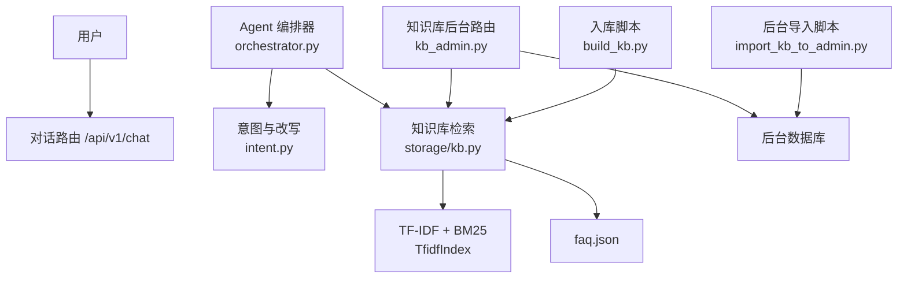
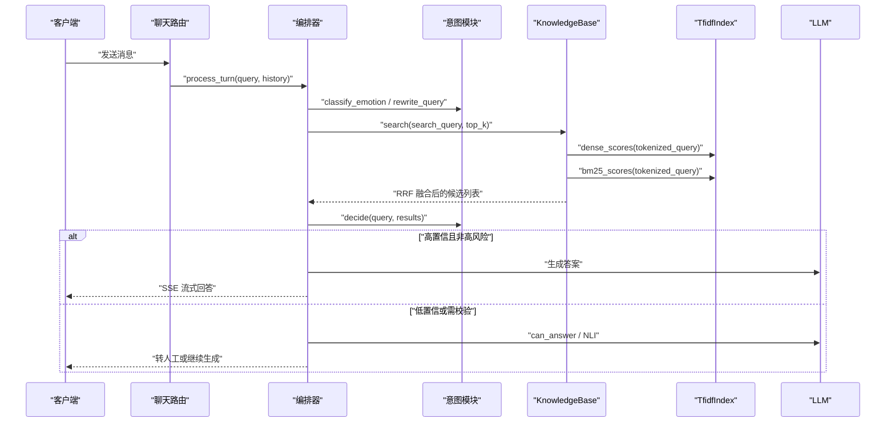
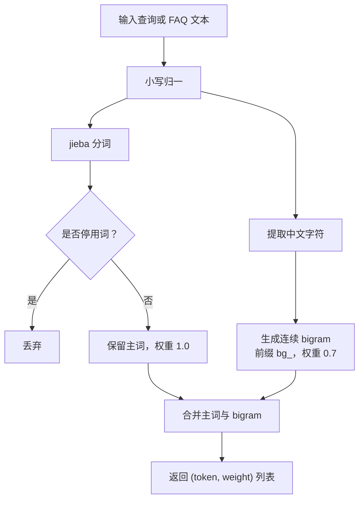
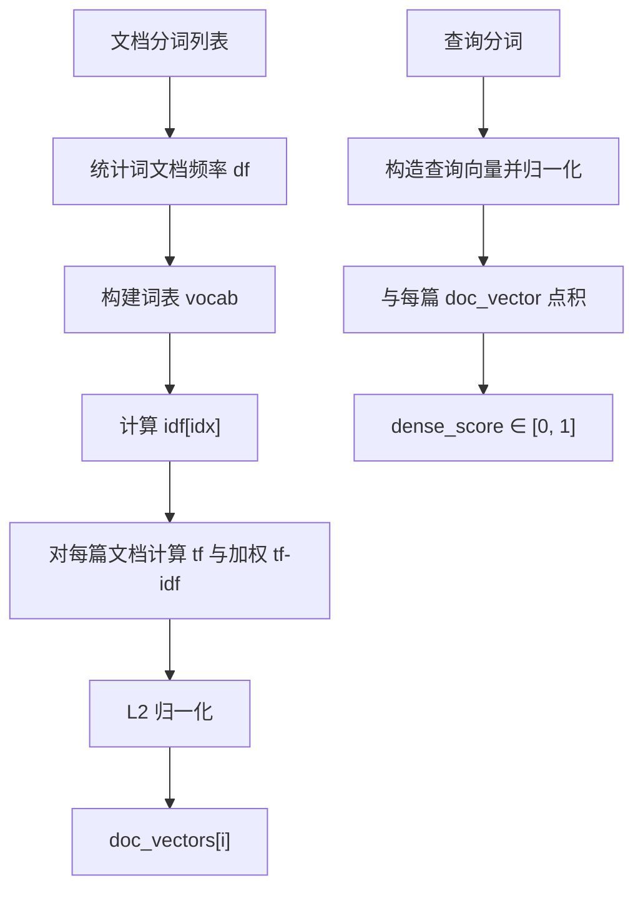
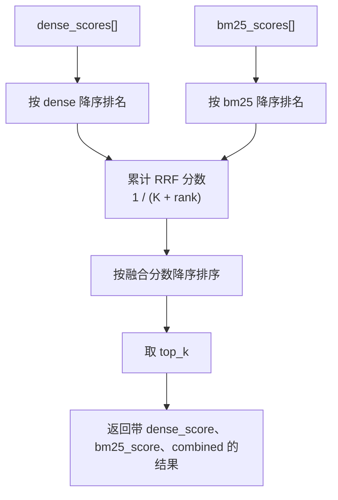
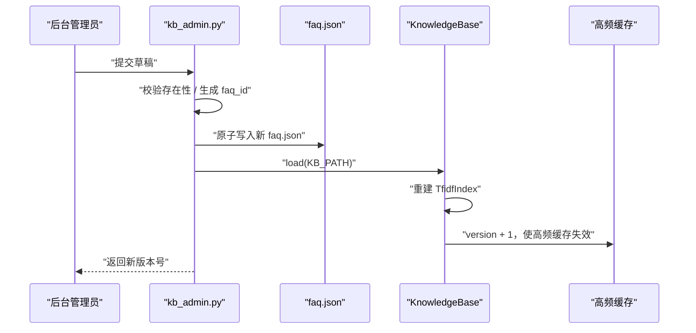
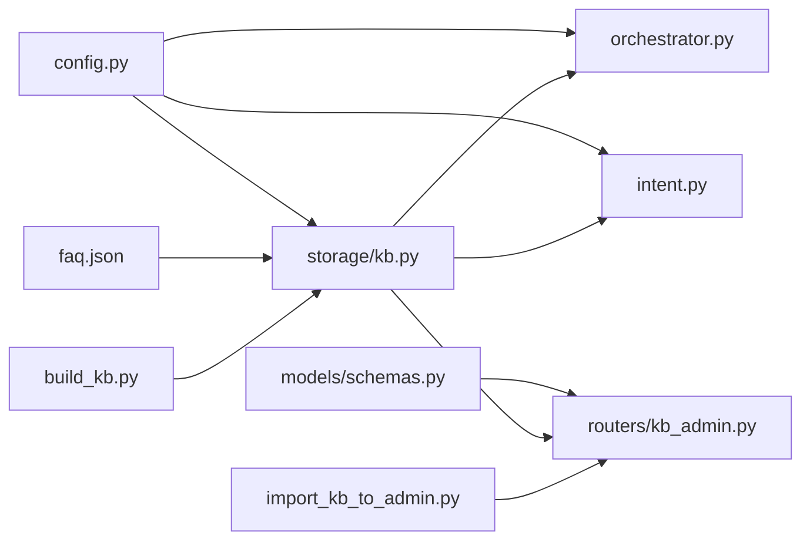
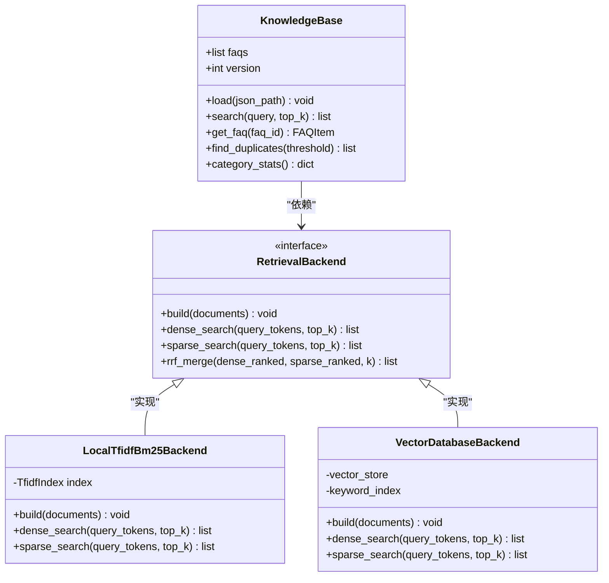

# 知识库检索引擎

<cite>
**本文引用的文件**
- [knowledge_base/build_kb.py](file://knowledge_base/build_kb.py)
- [backend/app/storage/kb.py](file://backend/app/storage/kb.py)
- [backend/app/agent/orchestrator.py](file://backend/app/agent/orchestrator.py)
- [backend/app/agent/intent.py](file://backend/app/agent/intent.py)
- [backend/app/config.py](file://backend/app/config.py)
- [backend/app/models/schemas.py](file://backend/app/models/schemas.py)
- [backend/app/routers/kb_admin.py](file://backend/app/routers/kb_admin.py)
- [knowledge_base/import_kb_to_admin.py](file://knowledge_base/import_kb_to_admin.py)
- [knowledge_base/faq.json](file://knowledge_base/faq.json)
</cite>

## 目录

1. [引言](#引言)
2. [项目结构](#项目结构)
3. [核心组件](#核心组件)
4. [架构总览](#架构总览)
5. [详细组件分析](#详细组件分析)
6. [依赖关系分析](#依赖关系分析)
7. [性能与调优](#性能与调优)
8. [故障排查](#故障排查)
9. [结论](#结论)
10. [附录：扩展为向量数据库的接口设计与迁移指南](#附录扩展为向量数据库的接口设计与迁移指南)

## 引言

本仓库的知识库检索引擎是一个面向客服场景的本地双路检索系统。它不依赖外部向量模型，而是通过中文分词、TF-IDF 向量化和 BM25 关键词检索构建两条召回路径，再用 RRF（倒数排名融合）算法对候选结果进行重排；同时提供否定词检测、风险关键词匹配、转人工意图判断等安全辅助能力。

在业务层，检索结果进入 Agent 编排管线，结合情绪分级、查询重写、LLM 可回答性判断与 NLI 蕴含校验，最终决定是否直接生成答案、调用 LLM 或转交人工。数据源是 `knowledge_base/faq.json`，后台审批流、版本回滚和热更新由 FastAPI 路由驱动，运行时配置统一来自 `.env` 与 `backend/app/config.py`。

## 项目结构

与检索引擎直接相关的代码集中在以下位置：

| 路径 | 职责 |
|---|---|
| `knowledge_base/faq.json` | 知识库 Source of Truth，包含 FAQ 元数据、标准问法、变体、答案、风险等级与跟进问题 |
| `knowledge_base/build_kb.py` | 离线一键入库脚本：加载 JSON、查重、序列化保存索引 |
| `knowledge_base/import_kb_to_admin.py` | 将已有 `faq.json` 补录到后台草稿/版本表，补齐 V2.0 管理链路 |
| `backend/app/storage/kb.py` | 核心实现：分词、FAQItem、TfidfIndex、KnowledgeBase、否定/风险/转人工辅助函数 |
| `backend/app/agent/orchestrator.py` | Agent 编排器：情绪、改写、混合检索、决策、生成、转人工 |
| `backend/app/agent/intent.py` | 意图识别、查询重写、可回答性判断、NLI 语义方向校验 |
| `backend/app/config.py` | 检索阈值、Top-K、RRF 常数、缓存开关等全局参数 |
| `backend/app/models/schemas.py` | Pydantic 请求响应契约，定义 FAQPayload 等业务字段 |
| `backend/app/routers/kb_admin.py` | FAQ 创建/编辑/删除、草稿审批、原子写盘与热重建索引 |

**图表来源**
- [backend/app/agent/orchestrator.py:1-120](file://backend/app/agent/orchestrator.py#L1-L120)
- [backend/app/agent/intent.py:1-130](file://backend/app/agent/intent.py#L1-L130)
- [backend/app/storage/kb.py:1-120](file://backend/app/storage/kb.py#L1-L120)
- [backend/app/routers/kb_admin.py:1-120](file://backend/app/routers/kb_admin.py#L1-L120)
- [knowledge_base/build_kb.py:1-55](file://knowledge_base/build_kb.py#L1-L55)
- [knowledge_base/import_kb_to_admin.py:1-66](file://knowledge_base/import_kb_to_admin.py#L1-L66)

**章节来源**
- [knowledge_base/build_kb.py:1-55](file://knowledge_base/build_kb.py#L1-L55)
- [backend/app/storage/kb.py:1-316](file://backend/app/storage/kb.py#L1-L316)
- [backend/app/agent/orchestrator.py:1-200](file://backend/app/agent/orchestrator.py#L1-L200)
- [backend/app/agent/intent.py:1-130](file://backend/app/agent/intent.py#L1-L130)
- [backend/app/config.py:1-104](file://backend/app/config.py#L1-L104)
- [backend/app/models/schemas.py:1-138](file://backend/app/models/schemas.py#L1-L138)
- [backend/app/routers/kb_admin.py:1-200](file://backend/app/routers/kb_admin.py#L1-L200)
- [knowledge_base/import_kb_to_admin.py:1-66](file://knowledge_base/import_kb_to_admin.py#L1-L66)
- [knowledge_base/faq.json:1-80](file://knowledge_base/faq.json#L1-L80)

## 核心组件

### TF-IDF 与 BM25 双路索引

`TfidfIndex` 是检索引擎的核心数据结构，维护四个关键成员：

| 成员 | 含义 | 复杂度影响 |
|---|---|---|
| `doc_token_lists` | 每篇文档的分词序列 | 构建时 O(N × M)，M 为平均词数 |
| `vocab` | 词到列索引映射 | 查找 O(1) |
| `idf` | 每个词的逆文档频率 | IDF 计算 O(V)，V 为词表大小 |
| `doc_vectors` | 每篇文档的稀疏向量 `{词索引: 归一化权重}` | 构建时 O(N × M)，余弦相似度 O(|交集|) |
| `_df` | 词频文档计数，BM25 使用 | 统计 O(N × M) |
| `_avgdl` | 平均文档长度，BM25 使用 | O(N) |

`build` 方法依次完成文档频率统计、词表建立、IDF 计算、加权 TF-IDF 向量构建与 L2 归一化，并记录平均文档长度。该实现是简化版“本地稠密向量”，实际存储仍是稀疏字典，但查询过程按稠密向量语义计算余弦相似度。

`dense_scores` 对查询词也做相同的加权、IDF 与 L2 归一化，然后逐文档点积求余弦相似度，返回长度为 N 的分数列表。

`bm25_scores` 使用经典 BM25 公式：对查询中每个唯一词计算 TF、IDF、文档长度归一化项，再累加。默认 `k1=1.5`、`b=0.75`。

**章节来源**
- [backend/app/storage/kb.py:92-172](file://backend/app/storage/kb.py#L92-L172)

### FAQItem 数据模型

`FAQItem` 是知识库的基本条目，字段如下：

| 字段 | 类型 | 说明 |
|---|---|---|
| `id` | 字符串 | FAQ 唯一标识，例如 `faq_001` |
| `category` | 枚举 | `aftersales`、`presales`、`transaction`、`account` |
| `standard_question` | 字符串 | 标准问法 |
| `variants` | 字符串列表 | 用户口语化变体问法 |
| `answer` | 字符串 | 标准答案 |
| `risk_level` | 枚举 | `low`、`mid`、`high` |
| `follow_up` | 字符串列表 | 推荐追问 |

它还提供三个重要属性与方法：

| 名称 | 行为 |
|---|---|
| `category_zh` | 把英文分类映射为中文，如 `aftersales → 售后` |
| `search_text` | 拼接标准问法、变体与答案，作为完整检索文本 |
| `tokenized` | 返回 `(问法特征, 答案特征)`，答案特征降权避免稀释问法匹配 |
| `to_dict` | 导出为后台路由使用的字典 |

**章节来源**
- [backend/app/storage/kb.py:57-90](file://backend/app/storage/kb.py#L57-L90)
- [backend/app/models/schemas.py:42-61](file://backend/app/models/schemas.py#L42-L61)

### KnowledgeBase 主体类

`KnowledgeBase` 封装 FAQ 列表、类别统计、版本号和 TfidfIndex。其关键流程是：

1. `load(json_path)`：从 JSON 解析 FAQItem，统计类别，构造 token 列表与对应权重，构建索引，版本号自增。
2. `search(query, top_k)`：双路召回后 RRF 融合。
3. `find_duplicates(threshold)`：用自身标准问法搜索自身，提示高相似重复条目。
4. `get_faq(faq_id)`：按 ID 获取单条 FAQ。
5. `category_stats()`：返回分类分布。

全局单例 `kb = KnowledgeBase()` 在应用启动时被初始化，后台热更新也会调用 `kb.load(...)` 重建索引并使高频缓存失效。

**章节来源**
- [backend/app/storage/kb.py:228-316](file://backend/app/storage/kb.py#L228-L316)
- [backend/app/routers/kb_admin.py:107-129](file://backend/app/routers/kb_admin.py#L107-L129)

## 架构总览

检索引擎在 Agent 管线中的整体流程如下：

**图表来源**
- [backend/app/agent/orchestrator.py:57-186](file://backend/app/agent/orchestrator.py#L57-L186)
- [backend/app/agent/intent.py:64-130](file://backend/app/agent/intent.py#L64-L130)
- [backend/app/storage/kb.py:247-295](file://backend/app/storage/kb.py#L247-L295)

## 详细组件分析

### 中文分词与混合特征

分词入口是 `tokenize(text)`：

1. 使用 jieba 切词。
2. 小写归一。
3. 去除空白。
4. 过滤内置停用词集合，包括语气词、代词、常见虚词和部分口语填充词。
5. 返回干净词列表。

更关键的特征是 `tokenize_full(text, bigram_weight=0.7)`：

1. 先对原始文本调用 `tokenize`，得到主词特征，权重为 `1.0`。
2. 提取所有中文字符，忽略标点、数字、英文。
3. 滑动窗口生成连续字符 bigram，前缀加上 `bg_`，权重为 `bigram_weight`。
4. 返回 `(token, weight)` 元组列表。

这种设计的目的是：当 jieba 对口语化表达切得不够理想时，bigram 仍能捕获局部连续语义片段，例如“拆了包装还能退吗”与“拆封了还能退吗”共享“还能/能退/退吗”等 bigram，提升鲁棒性。

**图表来源**
- [backend/app/storage/kb.py:24-55](file://backend/app/storage/kb.py#L24-L55)

**章节来源**
- [backend/app/storage/kb.py:24-55](file://backend/app/storage/kb.py#L24-L55)

### 停用词策略

停用词集合 `_STOPWORDS` 覆盖三类内容：

| 类别 | 示例 | 目的 |
|---|---|---|
| 语气助词 | “吗”“呢”“啊”“吧”“哦”“呀” | 降低无信息量语气词干扰 |
| 代词与指示词 | “我”“你”“他”“这个”“那个” | 减少主观指代对检索的影响 |
| 常见虚词与口语填充 | “的”“了”“要”“想”“有”“没”“请问”“一下” | 抑制高频通用词 |

当前实现是静态集合，未使用外部停用词表。若未来需要扩展，可在 `tokenize` 中读取配置文件或数据库停用词集合，并与 `_STOPWORDS` 取并集。

**章节来源**
- [backend/app/storage/kb.py:18-33](file://backend/app/storage/kb.py#L18-L33)

### 搜索文本生成策略

FAQ 的检索文本由三部分构成：

1. 标准问法：权重最高，代表权威问法。
2. 变体问法：覆盖用户不同表达方式。
3. 答案：用于召回语义相关答案，但权重被降低。

`FAQItem.search_text` 将三者用空格拼接；`FAQItem.tokenized` 则分别对“标准问法+变体”和“答案”调用 `tokenize_full`，其中：

- 问法部分 `bigram_weight=0.7`
- 答案部分 `bigram_weight=0.2`

在 `KnowledgeBase.load` 中，每条 FAQ 的问法特征和答案特征被拼接成一个 token 列表，同时维护对应权重列表：问法权重为 `1.0`，答案权重为 `0.2` 生成的 bigram 权重。这样既保证问法主导匹配，又让答案参与语义召回。

**章节来源**
- [backend/app/storage/kb.py:64-90](file://backend/app/storage/kb.py#L64-L90)
- [backend/app/storage/kb.py:235-246](file://backend/app/storage/kb.py#L235-L246)

### TF-IDF 向量化与 BM25 评分

#### TF-IDF 向量

对于一篇文档，`build` 会：

1. 统计每个词的出现次数。
2. 对每个词计算 `tf = 1 + log(count)`。
3. 乘以预计算的 `idf = log((N+1)/(df+1)) + 1`。
4. 对文档向量做 L2 归一化，使向量模长为 1。
5. 查询向量采用相同规则构造，再与每篇文档向量做点积，得到余弦相似度。

时间复杂度：

- 构建：O(N × M)，N 为文档数，M 为平均词数。
- 查询：O(Q × V_intersect + N × V_avg_sparse)，Q 为查询词数，V 为稀疏向量维度。

#### BM25

BM25 对每篇文档独立打分，不使用归一化向量，因此与 TF-IDF 向量不在同一数值空间。它的优势是天然考虑文档长度归一化和词频饱和，适合短文本问答场景。

**图表来源**
- [backend/app/storage/kb.py:92-172](file://backend/app/storage/kb.py#L92-L172)

**章节来源**
- [backend/app/storage/kb.py:92-172](file://backend/app/storage/kb.py#L92-L172)

### RRF 融合重排算法

RRF 是一种不依赖两路分数数值一致性的融合方法。它只关心两个检索器各自给出的排名顺序，而不要求 dense 分数与 bm25 分数可以直接相加。

RRF 公式为：

\[
\text{score}(d) = \sum_{r \in \{dense, bm25\}} \frac{1}{K + rank_r(d)}
\]

其中：

- \( d \) 是候选 FAQ。
- \( rank_r(d) \) 是文档 \( d \) 在第 \( r \) 路检索结果中的排名，从 0 开始。
- \( K \) 是平滑常数，代码中固定为 `60`，对应配置 `RRF_K`。

实现逻辑如下：

1. 分别对 dense 分数和 bm25 分数排序，得到两个排名序列。
2. 对每个候选索引初始化融合分数为 0。
3. 遍历 dense 排名，对第 `rank` 位的文档增加 `1/(K + rank)`。
4. 同样处理 bm25 排名。
5. 按融合分数降序取 Top-K；若融合分数相同，则优先保留 dense 分数更高的结果。

RRF 的优势是：

- 不需要对齐 dense 与 bm25 的量纲。
- 对异常高分值不敏感。
- 易于扩展到三路或多路检索。
- 在 MVP 阶段可以稳定融合两条不同数学模型的输出。

**图表来源**
- [backend/app/storage/kb.py:247-295](file://backend/app/storage/kb.py#L247-L295)
- [backend/app/config.py:48-54](file://backend/app/config.py#L48-L54)

**章节来源**
- [backend/app/storage/kb.py:247-295](file://backend/app/storage/kb.py#L247-L295)
- [backend/app/config.py:48-54](file://backend/app/config.py#L48-L54)

### 否定词检测、风险关键词与转人工

知识库层提供一组规则型辅助函数：

| 函数 | 输入 | 输出 | 用途 |
|---|---|---|---|
| `has_negation(text)` | 原始查询 | 布尔值 | 命中否定模式时强制走 NLI 语义方向校验 |
| `has_risk_keyword(text)` | 原始查询 | 布尔值 | 命中投诉、举报、报警、法律等词时触发红灯熔断 |
| `wants_human(text)` | 原始查询 | 布尔值 | 用户主动要求转人工 |
| `is_confirmation(text)` | 用户确认语 | 布尔值 | 确认状态机接受肯定回复 |
| `is_denial(text)` | 用户否认语 | 布尔值 | 确认状态机接受否定回复 |

否定模式使用正则表达式，例如“不支持”“不能”“没办法”“难道”“真的假的”等；风险关键词覆盖客诉、监管、法律、账号安全、价格争议等高风险领域。

这些函数被编排器和意图模块共同使用，确保安全判断始终基于原始查询，而不是被 LLM 改写过后的查询。

**章节来源**
- [backend/app/storage/kb.py:201-226](file://backend/app/storage/kb.py#L201-L226)
- [backend/app/agent/orchestrator.py:96-186](file://backend/app/agent/orchestrator.py#L96-L186)
- [backend/app/agent/intent.py:10-36](file://backend/app/agent/intent.py#L10-L36)

### 分类映射

分类字段使用英文键值，便于后端枚举与 API 契约稳定；展示层通过 `CATEGORY_ZH` 映射为中文：

| 英文 | 中文 |
|---|---|
| `aftersales` | 售后 |
| `presales` | 售前 |
| `transaction` | 交易 |
| `account` | 账号 |

Pydantic 模型 `FAQPayload.category` 也限制为这四个枚举值，保证写入数据的合法性。

**章节来源**
- [backend/app/storage/kb.py:47-56](file://backend/app/storage/kb.py#L47-L56)
- [backend/app/models/schemas.py:42-47](file://backend/app/models/schemas.py#L42-L47)

### 索引构建与热更新流程

知识库有两个构建入口：

1. **离线构建**：`build_kb.py` 加载 `faq.json`，执行重复检查，序列化整个 `KnowledgeBase` 对象到 `backend/data/kb_index.pkl`。
2. **在线热更新**：后台审批通过后，`kb_admin.py` 原子写入 `faq.json`，然后调用 `kb.load(settings.KB_PATH)` 重建内存索引，并将版本号加 1。

热更新的并发控制由异步锁 `_apply_lock` 保护；文件写入采用临时文件加 `os.replace`，避免半写状态。

**图表来源**
- [backend/app/routers/kb_admin.py:64-129](file://backend/app/routers/kb_admin.py#L64-L129)
- [backend/app/storage/kb.py:228-246](file://backend/app/storage/kb.py#L228-L246)

**章节来源**
- [knowledge_base/build_kb.py:1-55](file://knowledge_base/build_kb.py#L1-L55)
- [backend/app/routers/kb_admin.py:64-129](file://backend/app/routers/kb_admin.py#L64-L129)
- [backend/app/storage/kb.py:228-246](file://backend/app/storage/kb.py#L228-L246)

### Agent 编排中的检索使用

`Orchestrator.process_turn` 是检索进入业务决策的主入口：

1. 如果用户主动要求转人工，立即硬转人工。
2. 防死循环：连续未解决轮数达到阈值后直接硬转人工。
3. 确认状态机：在 CONFIRMING 状态下根据肯定/否定回复决定继续回答或取消。
4. 并行执行情绪分类与查询重写。
5. 红灯熔断：情绪极差或命中风险关键词，取消重写任务并转人工。
6. 使用改写后的查询执行混合检索。
7. 根据相似度阈值和否定词做两级决策。
8. 高风险 FAQ 不直接回答，转人工。
9. 正常路径下生成答案并进行事实校验。

**章节来源**
- [backend/app/agent/orchestrator.py:57-186](file://backend/app/agent/orchestrator.py#L57-L186)

### 意图模块与置信度决策

`intent.py` 中的 `decide` 函数根据最高 dense 分数与配置阈值做快速决策：

| 条件 | 决策 | 原因 |
|---|---|---|
| 无候选 | 转人工 | 没有候选 |
| 检测到否定词 | 走 LLM 可回答性/NLI | 词面重合但语义可能相反 |
| 分数低于低阈值 | 转人工 | 低置信 |
| 分数在低到高之间 | 走 LLM can_answer | 中置信 |
| 分数高于高阈值 | 直接生成 | 高置信 |

此外还实现了：

- `rewrite_query`：口语化查询改写为标准问法，失败时回退原查询。
- `can_answer`：LLM 布尔判断知识库能否回答。
- `nli_check`：LLM 做蕴含判断，返回 ENTAILMENT、CONTRADICTION 或 NEUTRAL。
- `classify_intent`：可选的意图分类，兜底逻辑参考风险词和转人工意图。

**章节来源**
- [backend/app/agent/intent.py:1-130](file://backend/app/agent/intent.py#L1-L130)

## 依赖关系分析

**图表来源**
- [backend/app/config.py:1-104](file://backend/app/config.py#L1-L104)
- [backend/app/storage/kb.py:1-316](file://backend/app/storage/kb.py#L1-L316)
- [backend/app/agent/orchestrator.py:1-200](file://backend/app/agent/orchestrator.py#L1-L200)
- [backend/app/agent/intent.py:1-130](file://backend/app/agent/intent.py#L1-L130)
- [backend/app/models/schemas.py:1-138](file://backend/app/models/schemas.py#L1-L138)
- [backend/app/routers/kb_admin.py:1-200](file://backend/app/routers/kb_admin.py#L1-L200)
- [knowledge_base/build_kb.py:1-55](file://knowledge_base/build_kb.py#L1-L55)
- [knowledge_base/import_kb_to_admin.py:1-66](file://knowledge_base/import_kb_to_admin.py#L1-L66)
- [knowledge_base/faq.json:1-80](file://knowledge_base/faq.json#L1-L80)

耦合关系说明：

- `KnowledgeBase` 是检索子系统边界，对外暴露 `search`、`get_faq`、`find_duplicates`、`category_stats`、`version`。
- `orchestrator` 和 `intent` 都依赖 `KnowledgeBase`，但不直接操作 `TfidfIndex`。
- `kb_admin` 通过全局单例 `kb` 触发热重建，形成后台变更到检索索引的单向依赖。
- `config.py` 是横向配置源，被检索、Agent、会话、存储等多个模块读取。

潜在改进点：

- 当前 `KnowledgeBase.get_faq` 是线性扫描，FAQ 数量较大时可引入 `faq_by_id` 字典。
- `TfidfIndex.dense_scores` 每次查询都会重新构造查询向量，可考虑在查询词不变时缓存查询向量。
- 停用词、negation patterns、risk keywords 目前硬编码，建议抽取为配置或外部资源。

**章节来源**
- [backend/app/storage/kb.py:228-316](file://backend/app/storage/kb.py#L228-L316)
- [backend/app/agent/orchestrator.py:1-120](file://backend/app/agent/orchestrator.py#L1-L120)
- [backend/app/agent/intent.py:1-63](file://backend/app/agent/intent.py#L1-L63)
- [backend/app/routers/kb_admin.py:1-129](file://backend/app/routers/kb_admin.py#L1-L129)

## 性能与调优

### 关键配置参数

| 参数 | 默认值 | 作用 | 调优建议 |
|---|---:|---|---|
| `SIM_THRESHOLD_LOW` | `0.22` | 低置信阈值，低于此值直接转人工 | 切换真实 Embedding 后可提高到约 `0.75` |
| `SIM_THRESHOLD_HIGH` | `0.40` | 高置信阈值，高于此值直接生成 | 切换真实 Embedding 后可提高到约 `0.85` |
| `RETRIEVE_TOP_K` | `3` | 检索候选数量 | 太小容易漏召回，太大增加 LLM 成本 |
| `RRF_K` | `60` | RRF 平滑常数 | 增大可降低排名靠前位置的绝对差异影响 |
| `QUERY_REWRITE_ENABLED` | `true` | 是否启用查询改写 | 关闭后可完全离线运行 |
| `CACHE_ENABLED` | `true` | 是否启用高频问题秒回缓存 | 配合 `CACHE_MAX_ENTRIES` 控制内存 |
| `CACHE_MAX_ENTRIES` | `20` | 高频缓存最大条目 | 根据热点 FAQ 数量调整 |

这些参数均从环境变量读取，缺省值写在 `Settings` 类中。

**章节来源**
- [backend/app/config.py:40-71](file://backend/app/config.py#L40-L71)

### 时间复杂度分析

设 FAQ 数量为 \( N \)，平均 token 数为 \( M \)，词表大小为 \( V \)。

| 操作 | 时间复杂度 | 空间复杂度 |
|---|---|---|
| 索引构建 | O(N × M) | O(N × M + V) |
| dense 查询 | O(Q × V_intersect + N × V_avg_sparse) | O(V) |
| BM25 查询 | O(N × Q) | O(1) 额外 |
| RRF 融合 | O(N log N) | O(N) |
| 单次 search | O(N log N + N × M) | O(N) |

MVP 阶段 FAQ 规模较小，全量重建通常在毫秒级；随着知识库增长，应考虑：

1. 引入倒排索引加速 BM25。
2. 使用近似最近邻库加速 dense 查询。
3. 将 `TfidfIndex` 抽象为可替换后端。
4. 对 `KnowledgeBase.get_faq` 建立 ID 索引。
5. 对热门 FAQ 做答案缓存。

### 检索质量调优建议

1. **停用词优化**：补充业务停用词，例如品牌名、产品名、占位符。
2. **bigram 权重**：问法 bigram 权重保持较高，答案 bigram 权重较低，避免长答案稀释问法信号。
3. **阈值校准**：先用历史 query 打点，观察 dense 分数分布，再设置 LOW/HIGH 阈值。
4. **Top-K 选择**：如果 LLM 成本高，可将 `RETRIEVE_TOP_K` 设为 2~3；如果需要更多上下文，可提升到 5~10。
5. **RRF 常数**：若某一路检索器噪声大，可适当增大 `RRF_K` 以弱化排名差异。
6. **重复检测**：入库时开启 `find_duplicates`，防止相似 FAQ 导致检索撞车。

[本节为通用性能指导，不直接分析具体代码行]

## 故障排查

### 常见问题与定位方式

| 现象 | 可能原因 | 排查步骤 |
|---|---|---|
| 检索结果为空 | 查询被停用词全部过滤，或知识库未加载 | 检查 `tokenize` 输出是否为空；确认 `kb.faqs` 和 `kb._index` 已初始化 |
| 召回不准 | 停用词过多、bigram 权重不合理、阈值过低 | 调整 `SIM_THRESHOLD_LOW`/`SIM_THRESHOLD_HIGH`，检查 `tokenize_full` 特征 |
| 重复 FAQ 导致混淆 | 多条 FAQ 高度相似 | 运行 `build_kb.py`，查看 `find_duplicates` 输出 |
| 后台修改未生效 | 未审批或未热重建 | 检查草稿状态，确认 `_apply_draft` 已调用 `kb.load` |
| 频繁转人工 | 低置信阈值过高或知识库覆盖不足 | 降低 `SIM_THRESHOLD_LOW`，补充 FAQ 变体 |
| 风险词误判 | 风险关键词列表过宽 | 审查 `_RISK_KEYWORDS`，区分真实风险与正常咨询 |
| 否定句误答 | NLI 校验失败或 LLM 不可用 | 检查 `nli_check` 日志，确认 fallback 行为 |

### 错误处理策略

- `can_answer` 和 `nli_check` 在 LLM 调用失败时采取保守 fallback：前者默认认为可回答，后者默认返回 ENTAILMENT。
- `classify_intent` 在 LLM 失败时回退到风险词和转人工规则。
- `rewrite_query` 在异常时回退原始查询，保证离线链路可用。
- 后台文件写入使用原子写，避免半写状态。
- 审批写操作通过异步锁串行化，避免并发竞态。

**章节来源**
- [backend/app/agent/intent.py:84-130](file://backend/app/agent/intent.py#L84-L130)
- [backend/app/routers/kb_admin.py:38-62](file://backend/app/routers/kb_admin.py#L38-L62)
- [backend/app/storage/kb.py:296-316](file://backend/app/storage/kb.py#L296-L316)

## 结论

该知识库检索引擎在 MVP 阶段采用轻量、可解释、无外部依赖的双路检索方案：

- **Dense 路**：基于 jieba 分词、TF-IDF 向量与 L2 归一化的余弦相似度。
- **Sparse 路**：基于 BM25 的关键词检索。
- **融合重排**：使用 RRF 对两路排名进行融合，避免分数量纲不一致问题。
- **中文特征增强**：jieba 主词 + 连续字符 bigram，提高口语化与拆字变体的召回鲁棒性。
- **安全辅助**：否定词、风险词、转人工、确认/否认状态机与 LLM NLI 校验共同保障回答安全性。
- **工程闭环**：`faq.json` 作为 Source of Truth，配合后台审批流、原子写盘、版本回滚与热重建，形成完整知识生命周期。

下一步演进方向是抽象检索后端，将本地 TF-IDF/BM25 替换为真实 Embedding 与向量数据库，同时保留现有接口和行为语义。

[本节为总结性内容，不直接分析具体代码行]

## 附录：扩展为向量数据库的接口设计与迁移指南

### 设计目标

当前 `KnowledgeBase` 已经是一个良好的抽象边界。扩展目标是：

1. 保留 `search(query, top_k)`、`get_faq(id)`、`load(path)`、`find_duplicates(threshold)` 等对外方法。
2. 将 `TfidfIndex` 的实现细节下沉到可替换后端。
3. 支持本地 FAISS/Qdrant/Milvus 等向量库，以及 BM25 关键词检索后端。
4. 保持 RRF 融合逻辑不变。
5. 使 `orchestrator` 和 `intent` 无需感知底层检索实现。

### 推荐接口设计

**图表来源**
- [backend/app/storage/kb.py:228-316](file://backend/app/storage/kb.py#L228-L316)
- [backend/app/storage/kb.py:92-172](file://backend/app/storage/kb.py#L92-L172)

### 迁移步骤

1. **定义抽象后端**：新建 `RetrievalBackend` 接口，声明 `build`、`dense_search`、`sparse_search`、`rrf_merge`。
2. **保留本地实现**：将现有 `TfidfIndex` 封装为 `LocalTfidfBm25Backend`，供灰度期继续使用。
3. **新增向量后端**：实现 `VectorDatabaseBackend`，对接豆包 text-embedding、BGE-M3、Qdrant、Milvus 等。
4. **改造 KnowledgeBase**：构造函数接收 `RetrievalBackend` 实例，`search` 调用后端 dense 与 sparse 检索，再执行 RRF。
5. **更新加载逻辑**：`load` 将 FAQ 转换为后端文档格式，而非直接构造 token 列表。
6. **保持配置兼容**：`SIM_THRESHOLD_LOW`、`SIM_THRESHOLD_HIGH`、`RETRIEVE_TOP_K`、`RRF_K` 仍由 `config.py` 提供。
7. **逐步切换**：通过环境变量选择后端实现，先在测试集评估召回率与延迟，再切生产流量。

### 数据模型适配

FAQ 文档在后端应至少包含：

| 字段 | 向量后端用途 |
|---|---|
| `id` | 主键 |
| `category` | 过滤、聚合 |
| `standard_question` | 主要向量字段 |
| `variants` | 拼接或单独字段，提升召回 |
| `answer` | 可选向量字段，用于语义召回 |
| `risk_level` | 过滤高风险 FAQ |
| `follow_up` | 展示或下游生成使用 |

### 向后兼容建议

- 默认后端仍为 `LocalTfidfBm25Backend`，避免破坏现有部署。
- 新增配置项如 `RETRIEVAL_BACKEND`，值为 `local`、`qdrant`、`milvus` 等。
- 向量维度、相似度函数、BM25 参数、连接地址等放入独立配置段。
- 迁移过程中保留 `find_duplicates` 的本地 dense 查重能力，或改用向量库近似重复检测。

### 性能迁移注意事项

| 维度 | 本地 TF-IDF/BM25 | 向量数据库 |
|---|---|---|
| 首次建索引 | 全量 Python 计算，适合离线 | 批量写入，注意批次大小 |
| 查询延迟 | 随 FAQ 数线性增长 | 近似最近邻，通常亚毫秒级 |
| 内存占用 | 与 FAQ 数量和词表成正比 | 与向量维度和索引结构有关 |
| 可解释性 | 高，可追溯词频与 IDF | 较低，依赖向量距离 |
| 扩展性 | 单机有限 | 可水平扩展 |

[本节为概念性接口设计与迁移指导，不直接分析具体代码行]