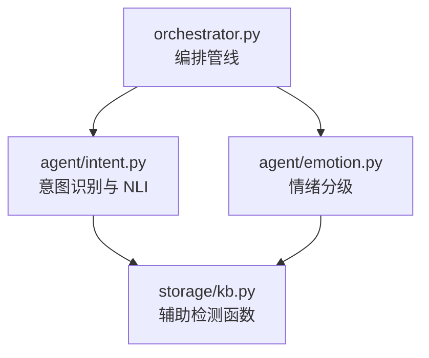
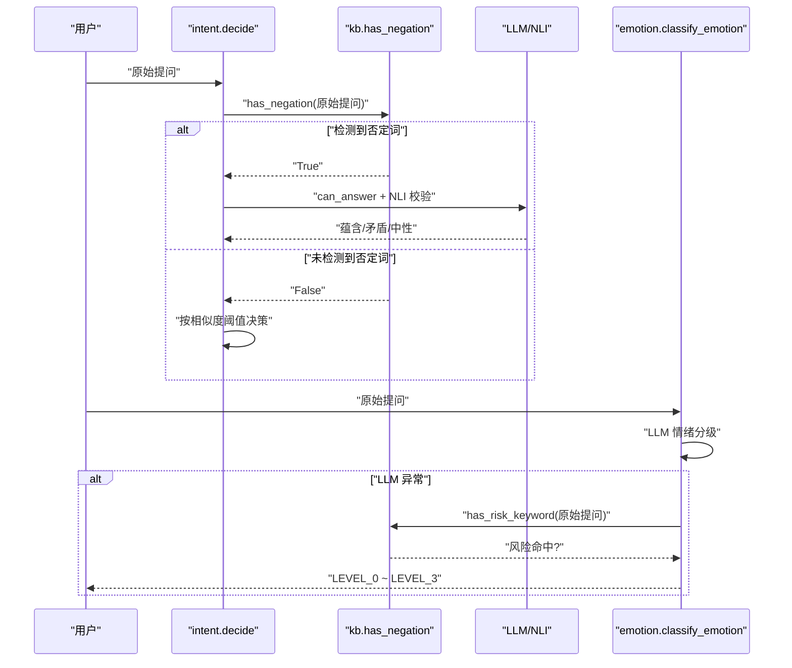
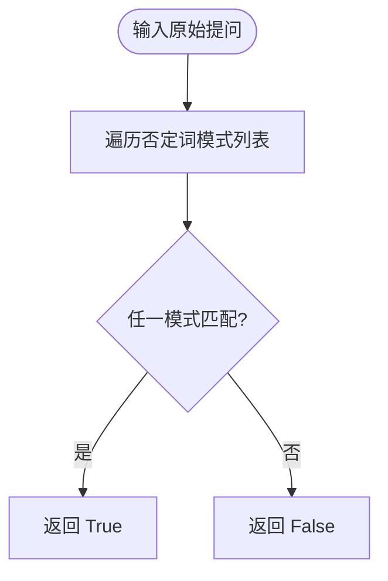
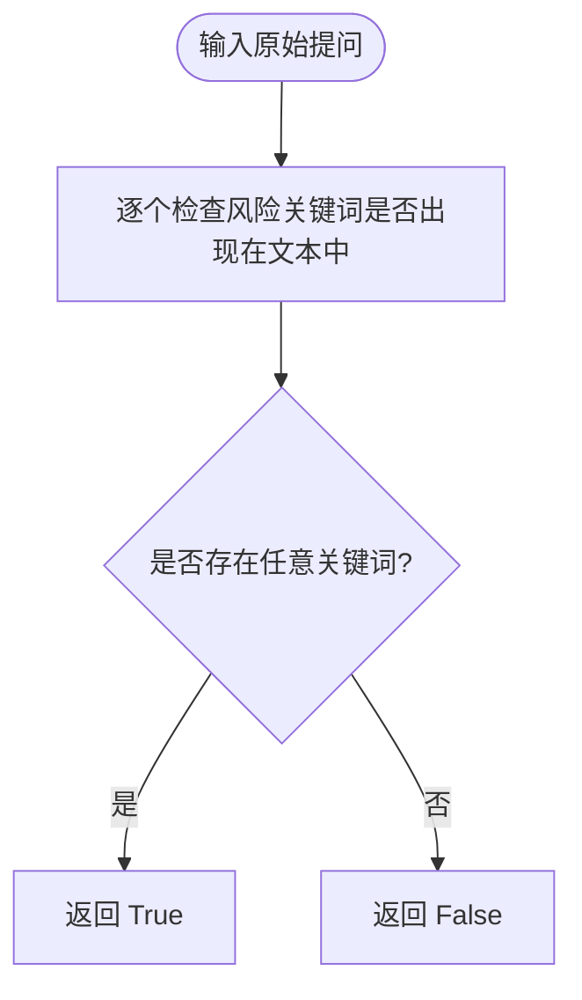
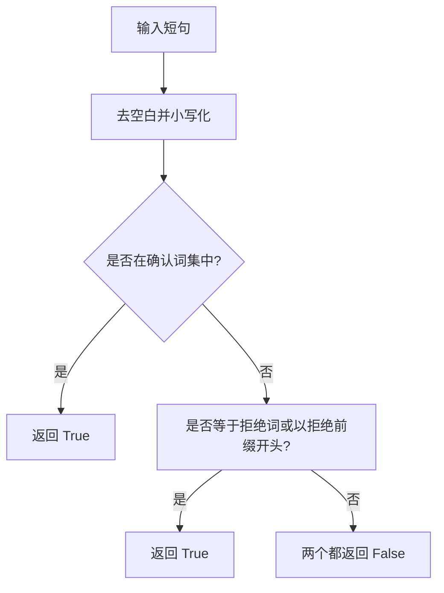

# 辅助检测功能

<cite>
**本文引用的文件**   
- [backend/app/storage/kb.py](file://backend/app/storage/kb.py)
- [backend/app/agent/intent.py](file://backend/app/agent/intent.py)
- [backend/app/agent/emotion.py](file://backend/app/agent/emotion.py)
- [源码解读.md](file://源码解读.md)
</cite>

## 目录
1. [引言](#引言)
2. [项目结构定位](#项目结构定位)
3. [核心组件总览](#核心组件总览)
4. [架构与调用关系](#架构与调用关系)
5. [否定词检测 has_negation](#否定词检测-has_negation)
6. [风险关键词 has_risk_keyword](#风险关键词-has_risk_keyword)
7. [转人工意图 wants_human](#转人工意图-wants_human)
8. [确认与拒绝 is_confirmation / is_denial](#确认与拒绝-isconfirmation--is_denial)
9. [正则表达式优化建议](#正则表达式优化建议)
10. [关键词库维护规范](#关键词库维护规范)
11. [误判率分析方法](#误判率分析方法)
12. [性能特征](#性能特征)
13. [故障排查指南](#故障排查指南)
14. [结论](#结论)

## 引言
本文件聚焦「辅助检测功能」，即知识库模块中一组纯规则、无外部依赖的语义判断函数。它们负责在检索之后、大模型决策之前，对原始用户提问做快速安全拦截和分流，包括：
- 否定词检测 `has_negation`
- 风险关键词检测 `has_risk_keyword`
- 转人工意图检测 `wants_human`
- 确认与拒绝判断 `is_confirmation` / `is_denial`

这些函数被意图识别、情绪分级、NLI 校验等上层逻辑复用，是客服系统从“命中相似度”走向“语义正确性”的关键前置护栏。

## 项目结构定位
辅助检测功能实现于知识库存储层，由意图层和情绪层共同消费。其职责边界如下：
- 位于 `backend/app/storage/kb.py`：定义否定词模式、风险词表、转人工词表、确认/拒绝词表及对应检测函数。
- 被 `backend/app/agent/intent.py` 导入并用于查询重写后的决策、NLI 强制路径、以及 LLM 意图分类兜底。
- 被 `backend/app/agent/emotion.py` 作为情绪分级不可用时的红色兜底策略之一。

**图示来源**
- [backend/app/storage/kb.py:201-250](file://backend/app/storage/kb.py#L201-L250)
- [backend/app/agent/intent.py:1-130](file://backend/app/agent/intent.py#L1-L130)
- [backend/app/agent/emotion.py:1-47](file://backend/app/agent/emotion.py#L1-L47)

**章节来源**
- [backend/app/storage/kb.py:201-250](file://backend/app/storage/kb.py#L201-L250)
- [backend/app/agent/intent.py:1-130](file://backend/app/agent/intent.py#L1-L130)
- [backend/app/agent/emotion.py:1-47](file://backend/app/agent/emotion.py#L1-L47)
- [源码解读.md:1-200](file://源码解读.md#L1-L200)

## 核心组件总览
| 函数 | 输入 | 输出 | 主要用途 |
|---|---|---|---|
| `has_negation(text)` | 原始用户提问 | 布尔值 | 检测否定、反问、质疑句式；命中后强制走 NLI 或 LLM 二次判断 |
| `has_risk_keyword(text)` | 原始用户提问 | 布尔值 | 识别投诉举报、法律维权、账号安全等高风险场景 |
| `wants_human(text)` | 原始用户提问 | 布尔值 | 识别主动要求转人工的意图 |
| `is_confirmation(text)` | 简短确认语 | 布尔值 | 精确匹配用户是否确认某条 FAQ |
| `is_denial(text)` | 简短拒绝语 | 布尔值 | 精确匹配用户是否拒绝某条 FAQ |

这些函数都是 O(n) 线性扫描：对每个模式或关键词检查一次文本，时间复杂度取决于模式数量或词表大小，空间复杂度为常数级。

**章节来源**
- [backend/app/storage/kb.py:201-250](file://backend/app/storage/kb.py#L201-L250)
- [backend/app/agent/intent.py:75-130](file://backend/app/agent/intent.py#L75-L130)
- [backend/app/agent/emotion.py:1-47](file://backend/app/agent/emotion.py#L1-L47)

## 架构与调用关系
辅助检测函数并非独立运行，而是嵌入到两条关键链路中：

1. **意图识别链路**
   - 检索得到候选 FAQ 后，先调用 `decide` 做置信度分级。
   - 如果检测到否定词，直接返回“问 LLM + NLI 校验”，避免字面相似但语义相反的误答。
   - 若 LLM 意图分类失败，则回退到 `has_risk_keyword` 和 `wants_human` 做兜底分类。

2. **情绪分级链路**
   - 优先使用 LLM 做情绪等级判断。
   - LLM 异常或输出异常时，回退到 `_keyword_fallback`，其中会再次调用 `has_risk_keyword` 把风险问题升级为严重情绪等级。

**图示来源**
- [backend/app/agent/intent.py:28-74](file://backend/app/agent/intent.py#L28-L74)
- [backend/app/storage/kb.py:201-250](file://backend/app/storage/kb.py#L201-L250)
- [backend/app/agent/emotion.py:1-47](file://backend/app/agent/emotion.py#L1-L47)

**章节来源**
- [backend/app/agent/intent.py:28-130](file://backend/app/agent/intent.py#L28-L130)
- [backend/app/agent/emotion.py:1-47](file://backend/app/agent/emotion.py#L1-L47)

## 否定词检测 has_negation
### 设计目标
`has_negation` 的目标不是做完整自然语言理解，而是在低成本下捕捉三类典型情况：
- 明确否定：如“不支持”“不能”。
- 否定式能力表达：如“没（有|法|办）”。
- 反问、质疑、验证类语气：如“难道”“对吧”“不是吗”“真的假的”“确定.*吗”“是假”“别想”“别指望”。

这类语句即使与 FAQ 字面重合，也可能语义相反，因此系统在 `decide` 中一旦命中就强制进入 LLM 的 can_answer 和 NLI 流程，而不是直接自动回答。

### 模式分类
否定词模式分为以下子集：

| 类别 | 覆盖语义 | 示例行为 |
|---|---|---|
| 明确否定能力 | “不支持”“不能” | 防止把“能退货”误答给“不能退货” |
| 否定式能力缺失 | “没（有|法|办）” | 覆盖“没办法”“没法弄”等口语变体 |
| 反问与质疑 | “难道”“对吧”“不是吗”“真的假的”“确定.*吗”“是假” | 防止把疑问句当肯定句处理 |
| 禁止与劝阻 | “别想”“别指望” | 识别用户表达不可能或拒绝预期 |

### 判定流程

该流程是简单线性扫描，没有捕获组回溯代价，整体开销很低。

### 使用位置
- `intent.decide`：否定句直接返回“问 LLM”，原因标记为“negation_nli”。
- 这使“字面相似但语义相反”的问题绕过直接回答路径。

**章节来源**
- [backend/app/storage/kb.py:201-250](file://backend/app/storage/kb.py#L201-L250)
- [backend/app/agent/intent.py:43-74](file://backend/app/agent/intent.py#L43-L74)

## 风险关键词 has_risk_keyword
### 设计目标
`has_risk_keyword` 是一个基于子串匹配的黑名单检测器，用于识别可能引发合规、客诉、监管或账号安全风险的用户输入。它不区分具体子类，只输出一个统一的高风险信号；更细粒度的分类可在运营侧通过 FAQ 标签或后续分析完成。

### 关键词体系
当前词表涵盖以下高风险场景：

| 风险类别 | 典型关键词 | 业务含义 |
|---|---|---|
| 投诉举报 | “投诉”“举报”“曝光”“12315”“315”“消协” | 消费者维权入口 |
| 行政监管 | “市场监管局”“工商局” | 政府监管部门关键词 |
| 法律诉讼 | “起诉”“律师”“法院” | 已进入或威胁进入司法程序 |
| 公共安全 | “报警”“警察” | 涉及治安或刑事风险 |
| 欺诈相关 | “诈骗”“骗子” | 用户怀疑被骗 |
| 赔偿争议 | “赔偿”“赔钱”“精神损失”“假一赔” | 高成本赔付场景 |
| 价格纠纷 | “退款金额”“改价”“补差价” | 交易价格敏感问题 |
| 账号安全 | “注销”“盗号”“账号被盗”“异地登录”“陌生订单”“封号” | 账户与资金安全风险 |

### 判定流程

### 在系统中的扩散影响
- 意图分类兜底：LLM 意图分类失败时，若命中风险词，则归类为“HIGH_RISK”。
- 情绪分级兜底：情绪 LLM 不可用时，`has_risk_keyword` 会把对应问题升级为严重情绪等级。
- 这意味着同一个风险词既影响“能不能答”，也影响“情绪有多严重”。

**章节来源**
- [backend/app/storage/kb.py:201-250](file://backend/app/storage/kb.py#L201-L250)
- [backend/app/agent/intent.py:107-130](file://backend/app/agent/intent.py#L107-L130)
- [backend/app/agent/emotion.py:1-47](file://backend/app/agent/emotion.py#L1-L47)

## 转人工意图 wants_human
### 设计目标
`wants_human` 用于识别用户主动要求转接人类客服的意图。它不关心问题内容，只关心用户是否在明确要求人工服务。

### 关键词覆盖
词表包含以下表达：
- “转人工”“找客服”“找真人”“人工客服”“人工”“真人”“活人”“客服电话”“转接”

这些词覆盖了口语化、省略式和同义替换，例如“我要找真人”“打客服电话”“转接人工”等。

### 使用位置
- 意图分类兜底：当 LLM 无法给出 IN_KNOWLEDGE / OUT_OF_SCOPE / HIGH_RISK 时，若命中转人工词，则返回 HANDOVER。
- 它不会单独决定会话立即转接，而是作为意图标签的一部分，供上层编排决定是否触发排队。

**章节来源**
- [backend/app/storage/kb.py:201-250](file://backend/app/storage/kb.py#L201-L250)
- [backend/app/agent/intent.py:107-130](file://backend/app/agent/intent.py#L107-L130)

## 确认与拒绝 is_confirmation / is_denial
### 设计目标
这两个函数用于短轮次确认状态机：当系统根据 FAQ 命中结果向用户复述答案并请求确认时，需要判断用户的下一句话是“确认继续”还是“拒绝取消”。

### 确认判断 is_confirmation
- 将输入去空白、小写化后做精确集合匹配。
- 支持中文肯定词：“是”“对”“嗯”“好”“行”“是的”“对的”“没错”。
- 支持英文常见确认：“ok”。
- 支持口语化表达：“可以”“要的”“要”。

### 拒绝判断 is_denial
- 同样去空白、小写化。
- 先做完全相等匹配。
- 再允许以某些否定前缀开头，例如“不是”“不对”“没有”“不是的”。
- 同时覆盖英文否定：“no”。
- 还覆盖放弃型表达：“算了”“不用”“不了”。

### 判断流程

### 注意事项
- `is_confirmation` 是严格集合匹配，不会做前缀匹配。
- `is_denial` 同时支持精确匹配和前缀匹配，更容易覆盖“不是啊”“不对吧”等口语扩展。
- 这种不对称设计反映现实：拒绝表达往往比确认表达更多样，因此需要更宽松的匹配。

**章节来源**
- [backend/app/storage/kb.py:201-250](file://backend/app/storage/kb.py#L201-L250)

## 正则表达式优化建议
当前否定词检测使用多个独立的 `re.search` 调用，优点是清晰易维护，缺点是每次检测最多执行多次正则编译与扫描。以下是渐进式优化建议。

### 1. 合并为单一正则
将 `_NEGATION_PATTERNS` 合并为一个 `|` 连接的正则，减少 Python 层循环和多次 `re.search` 调用。例如把“不支持”“不能”“没(有|法|办)”等组合为可选分支。

优点：
- 单次正则扫描完成全部模式匹配。
- 降低 Python 层循环开销。

风险：
- 正则过长会增加编译和维护成本。
- 需要确保分支顺序合理，避免长分支提前匹配导致短分支失效。

### 2. 预编译正则对象
无论是否合并，都应把 `_NEGATION_PATTERNS` 中的正则预编译为 `re.Pattern` 对象，避免每次调用重复编译。

### 3. 增加边界与长度限制
对于“确定.*吗”这类宽松模式，建议加入长度上限或中间字符数限制，防止“确定……吗”中间插入极长内容造成回溯放大。

### 4. 分离确定性否定与语气词
建议把“不支持”“不能”“没(有|法|办)”等强否定模式和“难道”“对吧”“不是吗”等弱语气模式分开：
- 强否定：可直接驱动 NLI 或转人工。
- 弱语气：可作为提示特征，但不一定强制阻断直接回答。

这样可以降低误判率，尤其是对反问句和陈述句的区分。

### 5. 添加单元测试覆盖
为每类模式至少准备一条正例和一条反例，例如：
- 正例：“不支持退货”“没办法退款”“难道这是真的？”
- 反例：“支持退货”“能退款”“这不是真的吗？”

**章节来源**
- [backend/app/storage/kb.py:201-250](file://backend/app/storage/kb.py#L201-L250)
- [backend/app/agent/intent.py:43-74](file://backend/app/agent/intent.py#L43-L74)

## 关键词库维护规范
### 新增词原则
- 所有新词必须来自真实 Bad Case 或线上日志，不能仅凭直觉添加。
- 新增风险词应标注业务类别，例如“投诉举报”“账号安全”“法律维权”。
- 新增转人工词应覆盖同义词和口语变体，但不能过度泛化。

### 删除词原则
- 删除词必须有长期零误报证据。
- 若只是短期误报，应先加白名单或上下文约束，而不是直接删除。

### 词表分层
建议将现有扁平词表拆成三层：
1. 红线词：如“12315”“报警”“诈骗”，一旦命中直接升级风险等级。
2. 高敏词：如“赔偿”“封号”“异地登录”，需人工复核或谨慎回答。
3. 低敏词：如“改价”“补差价”，仅作为风险提示。

### 版本管理
- 词表应纳入版本控制，每次修改附带变更说明和影响范围。
- 上线前应运行离线评测脚本，统计历史样本上的召回率和误报率变化。
- 对高风险词变更，应设置灰度开关，观察一段时间后再全量。

### 与情绪分级的协调
情绪分级模块已有自己的红黄词表，新增风险词时应评估是否与情绪兜底逻辑冲突。例如“曝光”同时出现在情绪红词和风险词中，会导致风险命中与情绪降级一致，这在当前设计中是可接受的，但应记录这一约定。

**章节来源**
- [backend/app/storage/kb.py:201-250](file://backend/app/storage/kb.py#L201-L250)
- [backend/app/agent/emotion.py:1-47](file://backend/app/agent/emotion.py#L1-L47)

## 误判率分析方法
### 1. 构建测试集
建议维护三类样本：
- 否定句样本：明确否定、模糊否定、反问、质疑。
- 风险句样本：各风险类别的真实用户表达。
- 确认拒绝样本：用户在确认流程中的简短回复。

### 2. 指标定义
| 指标 | 含义 | 关注点 |
|---|---|---|
| 召回率 | 实际风险/否定/转人工中被命中的比例 | 漏判风险，尤其是法律和安全类 |
| 精确率 | 命中中真正属于该类别的比例 | 误判导致不必要的 LLM 调用或转人工 |
| 误报率 | 非风险/非否定/非转人工被错误命中的比例 | 影响用户体验和成本 |
| F1 分数 | 召回率和精确率的调和平均 | 综合平衡 |

### 3. 分层评测
- 对 `has_negation`：重点看反问句是否被过度判定为否定。
- 对 `has_risk_keyword`：重点看不同风险类别的召回差异。
- 对 `wants_human`：重点看“客服电话”“转接”等词是否被正常业务问答误伤。
- 对 `is_confirmation / is_denial`：重点看口语扩展是否被覆盖。

### 4. 回归测试
任何词表或正则变更后，必须运行历史 Bad Case 集，确保：
- 已知风险问题不再漏判。
- 已知正常问题不再误判。
- 转人工和确认拒绝逻辑不因词表膨胀而过度敏感。

### 5. 线上监控
建议在日志中记录：
- 每条请求是否命中否定词、风险词、转人工词。
- 命中后进入的决策路径：直接回答、LLM 判断、NLI、转人工。
- 最终用户反馈：点赞、点踩、转人工成功率。

**章节来源**
- [backend/app/storage/kb.py:201-250](file://backend/app/storage/kb.py#L201-L250)
- [backend/app/agent/intent.py:28-130](file://backend/app/agent/intent.py#L28-L130)
- [backend/app/agent/emotion.py:1-47](file://backend/app/agent/emotion.py#L1-L47)

## 性能特征
| 函数 | 时间复杂度 | 空间复杂度 | 特点 |
|---|---|---|---|
| `has_negation` | O(m × n)，m 为模式数，n 为文本长度 | O(1) | 多正则扫描，可优化为单正则 |
| `has_risk_keyword` | O(k × n)，k 为风险词数，n 为文本长度 | O(1) | 简单子串匹配，适合高频调用 |
| `wants_human` | O(h × n)，h 为转人工词数 | O(1) | 词表较小，开销低 |
| `is_confirmation` | O(1) | O(1) | 精确集合匹配 |
| `is_denial` | O(d × n)，d 为拒绝词基数 | O(1) | 精确匹配加前缀匹配 |

由于这些函数都在 LLM 调用前执行，它们的性能直接影响整体延迟和成本。建议优先保证正确性，其次才考虑合并正则或改用 Aho-Corasick 等多模式匹配结构。

**章节来源**
- [backend/app/storage/kb.py:201-250](file://backend/app/storage/kb.py#L201-L250)

## 故障排查指南
### 症状：大量正常问题被转人工
可能原因：
- 转人工词过于宽泛，例如“客服电话”在普通咨询中也出现。
- 风险词误伤正常业务描述，例如“投诉”被用于描述平台机制而非用户诉求。

排查步骤：
1. 收集最近转人工样本。
2. 打印 `wants_human` 和 `has_risk_keyword` 命中详情。
3. 将误命中词加入白名单或增加上下文约束。
4. 重新运行历史样本集。

### 症状：否定句仍被直接回答
可能原因：
- 否定模式未覆盖新表达。
- 用户使用了非常规否定形式，如倒装、方言、谐音。

排查步骤：
1. 提取未被命中的否定句。
2. 抽象出新模式并加入 `_NEGATION_PATTERNS`。
3. 优先加入强否定模式，弱语气模式谨慎评估。
4. 验证 NLI 是否能正确识别矛盾。

### 症状：风险问题被漏判
可能原因：
- 风险词尚未收录。
- 用户使用了缩写、谐音或变体表达。

排查步骤：
1. 从投诉、报警、法律、账号安全四类分别抽样。
2. 补充高风险词。
3. 对“12315”“报警”“诈骗”等红线词优先保障召回。
4. 同步更新情绪兜底逻辑，避免 LLM 不可用时漏掉红灯。

### 症状：确认流程卡住
可能原因：
- 用户用了不在词表中的确认或拒绝表达。
- `is_denial` 的前缀匹配未能覆盖新表达。

排查步骤：
1. 收集确认阶段的真实短句。
2. 优先补充常用口语变体。
3. 保持 `is_confirmation` 精确匹配，避免误把半句话当成确认。

**章节来源**
- [backend/app/storage/kb.py:201-250](file://backend/app/storage/kb.py#L201-L250)
- [backend/app/agent/intent.py:75-130](file://backend/app/agent/intent.py#L75-L130)
- [backend/app/agent/emotion.py:1-47](file://backend/app/agent/emotion.py#L1-L47)

## 结论
辅助检测功能是客服系统中“低成本、高价值”的规则层。它的核心价值不是替代大模型，而是：
- 在否定句中阻止字面相似但语义相反的误答。
- 在风险场景中提前标记合规与安全红线。
- 在用户明确要求时识别转人工意图。
- 在确认流程中稳定识别简短确认与拒绝。

未来改进方向应围绕三点展开：
1. 将多模式正则合并并预编译，提升性能。
2. 将风险词表分层并建立版本管理与灰度发布流程。
3. 建立持续回归评测体系，量化召回率、精确率和误报率变化。

这样可以在不引入复杂模型的前提下，显著提升客服系统的准确性、安全性和稳定性。