# 系统架构

<cite>
**本文引用的文件**   
- [backend/app/main.py](file://backend/app/main.py)
- [backend/app/config.py](file://backend/app/config.py)
- [backend/app/routers/chat.py](file://backend/app/routers/chat.py)
- [backend/app/routers/ws.py](file://backend/app/routers/ws.py)
- [backend/app/routers/session.py](file://backend/app/routers/session.py)
- [backend/app/routers/kb_admin.py](file://backend/app/routers/kb_admin.py)
- [backend/app/storage/db.py](file://backend/app/storage/db.py)
- [backend/app/storage/kb.py](file://backend/app/storage/kb.py)
- [backend/app/agent/orchestrator.py](file://backend/app/agent/orchestrator.py)
- [backend/app/agent/llm.py](file://backend/app/agent/llm.py)
- [frontend/src/main.ts](file://frontend/src/main.ts)
- [frontend/src/widget.ts](file://frontend/src/widget.ts)
- [frontend/src/agent.ts](file://frontend/src/agent.ts)
- [frontend/src/api.ts](file://frontend/src/api.ts)
- [frontend/src/sse-client.ts](file://frontend/src/sse-client.ts)
- [knowledge_base/build_kb.py](file://knowledge_base/build_kb.py)
- [docker-compose.yml](file://docker-compose.yml)
- [backend/requirements.txt](file://backend/requirements.txt)
- [frontend/package.json](file://frontend/package.json)
- [dev.sh](file://dev.sh)
</cite>

## 目录
1. [引言](#引言)
2. [项目结构](#项目结构)
3. [核心组件](#核心组件)
4. [架构总览](#架构总览)
5. [详细组件分析](#详细组件分析)
6. [依赖关系分析](#依赖关系分析)
7. [性能与扩展性](#性能与扩展性)
8. [部署拓扑与基础设施](#部署拓扑与基础设施)
9. [故障排查指南](#故障排查指南)
10. [结论](#结论)

## 引言
smart_bot 是一个面向电商客服场景的“小答 AI 客服”系统。后端采用 FastAPI + Python，提供 REST API、SSE 流式对话和 WebSocket 实时排队；前端使用 TypeScript + Vite，并暴露可嵌入任意网站的 Web Components 聊天 Widget；数据持久化基于 SQLite；知识检索在 MVP 阶段使用本地 TF-IDF 与 BM25，预留 Qdrant 向量库替换路径。系统同时支持真实 LLM（DeepSeek OpenAI 兼容接口）与离线 Mock 模式，具备会话管理、知识库后台审批热更新、运行控制开关、转人工队列、CSAT 满意度等能力。

## 项目结构
仓库按前后端分层组织：
- `backend/app`：FastAPI 应用、路由、Agent 编排、存储抽象、配置。
- `frontend/src`：TypeScript 前端，包括官网渲染、Web Component 聊天 Widget、坐席工作台、SSE 客户端、API 封装。
- `knowledge_base`：FAQ 源数据与索引构建脚本。
- `scripts`、`docker-compose.yml`、`dev.sh`：运维、容器与开发脚本。

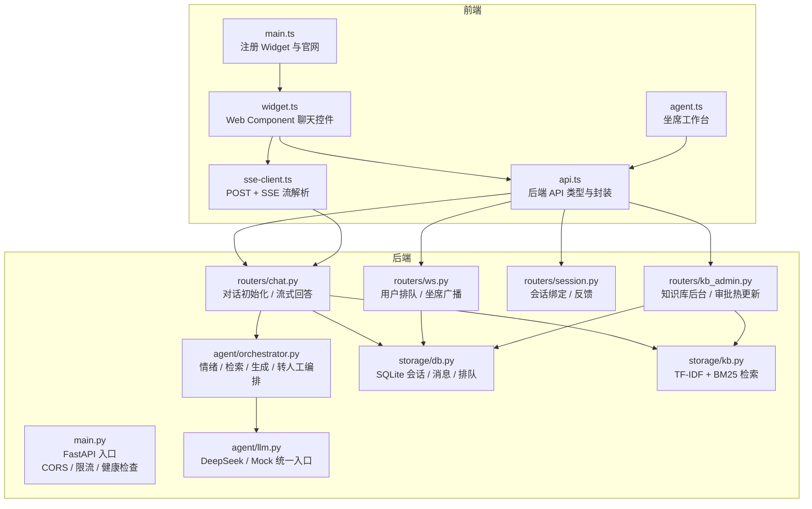

**图表来源**
- [backend/app/main.py:1-63](file://backend/app/main.py#L1-L63)
- [frontend/src/main.ts:1-6](file://frontend/src/main.ts#L1-L6)
- [frontend/src/widget.ts:1-200](file://frontend/src/widget.ts#L1-L200)
- [frontend/src/agent.ts:1-200](file://frontend/src/agent.ts#L1-L200)
- [frontend/src/api.ts:1-200](file://frontend/src/api.ts#L1-L200)
- [frontend/src/sse-client.ts:1-59](file://frontend/src/sse-client.ts#L1-L59)

**章节来源**
- [backend/app/main.py:1-63](file://backend/app/main.py#L1-L63)
- [frontend/src/main.ts:1-6](file://frontend/src/main.ts#L1-L6)
- [frontend/package.json:1-16](file://frontend/package.json#L1-L16)
- [docker-compose.yml:1-16](file://docker-compose.yml#L1-L16)

## 核心组件
- FastAPI 后端服务：负责 HTTP 路由、CORS、IP 限流、健康检查、会话校验、SSE 流式响应、WebSocket 实时通道。
- Agent 编排器：串联情绪分级、查询重写、混合检索、置信度决策、LLM 生成、输出校验与转人工策略。
- 知识库检索系统：MVP 使用 jieba 分词、TF-IDF 向量与 BM25 关键词融合，支持 RRF 重排与风险词检测。
- 存储层：SQLite 单文件数据库，线程锁保护，维护会话、消息、反馈、转人工队列、FAQ 草稿与版本历史。
- LLM 适配层：统一 DeepSeek 与 MockLLM，根据配置自动切换真实或离线模式。
- 前端应用：官网页面、可嵌入的 Web Component 聊天控件、坐席工作台、SSE 客户端、API 类型契约。

**章节来源**
- [backend/app/routers/chat.py:1-200](file://backend/app/routers/chat.py#L1-L200)
- [backend/app/agent/orchestrator.py:1-200](file://backend/app/agent/orchestrator.py#L1-L200)
- [backend/app/storage/kb.py:1-200](file://backend/app/storage/kb.py#L1-L200)
- [backend/app/storage/db.py:1-200](file://backend/app/storage/db.py#L1-L200)
- [backend/app/agent/llm.py:1-177](file://backend/app/agent/llm.py#L1-L177)
- [frontend/src/widget.ts:1-200](file://frontend/src/widget.ts#L1-L200)
- [frontend/src/api.ts:1-200](file://frontend/src/api.ts#L1-L200)

## 架构总览
系统采用前后端分离、HTTP/SSE/WebSocket 多协议通信的分层架构。请求从浏览器进入前端组件后，通过 API 调用后端路由；对话主链路走 POST + SSE，实时排队与坐席协作走 WebSocket；所有业务状态落盘 SQLite，知识检索走内存索引。

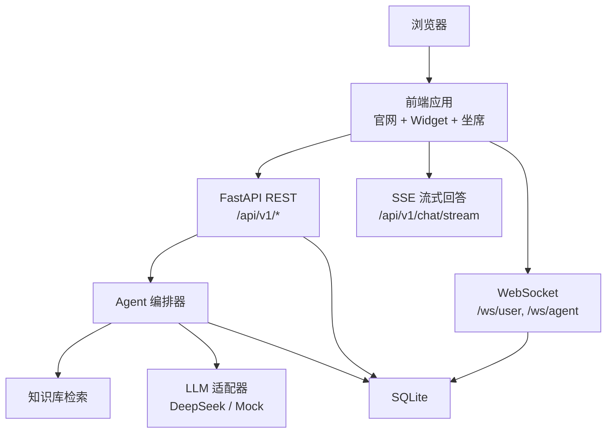

**图表来源**
- [backend/app/main.py:1-63](file://backend/app/main.py#L1-L63)
- [backend/app/routers/chat.py:1-200](file://backend/app/routers/chat.py#L1-L200)
- [backend/app/routers/ws.py:1-149](file://backend/app/routers/ws.py#L1-L149)
- [backend/app/agent/orchestrator.py:1-200](file://backend/app/agent/orchestrator.py#L1-L200)
- [backend/app/storage/db.py:1-200](file://backend/app/storage/db.py#L1-L200)
- [backend/app/storage/kb.py:1-200](file://backend/app/storage/kb.py#L1-L200)
- [backend/app/agent/llm.py:1-177](file://backend/app/agent/llm.py#L1-L177)

## 详细组件分析

### FastAPI 后端服务
FastAPI 应用负责全局中间件、CORS、IP 限流、知识库加载与健康检查，并按模块注册路由。

- 中间件与限流：对 `/api/` 前缀进行 IP 限流，超限返回 429。
- 知识库加载：启动时加载 FAQ 索引，记录分类统计。
- 健康检查：返回品牌名、LLM 模式、FAQ 数量。
- 路由聚合：chat、session、ops、kb_admin、otp、ws 六个子模块。

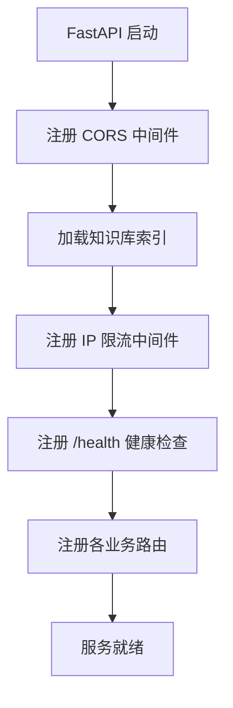

**图表来源**
- [backend/app/main.py:1-63](file://backend/app/main.py#L1-L63)

**章节来源**
- [backend/app/main.py:1-63](file://backend/app/main.py#L1-L63)
- [backend/app/config.py:1-104](file://backend/app/config.py#L1-L104)

### 对话主链路（REST + SSE）
对话初始化创建或恢复会话、下发访客 Token、返回历史消息；核心流式回答流程包含访客 Token 校验、Kill Switch、会话超时复位、确认状态超时取消、输入长度限制、轮次熔断、高频缓存命中、检索与生成、转人工摘要与通知。

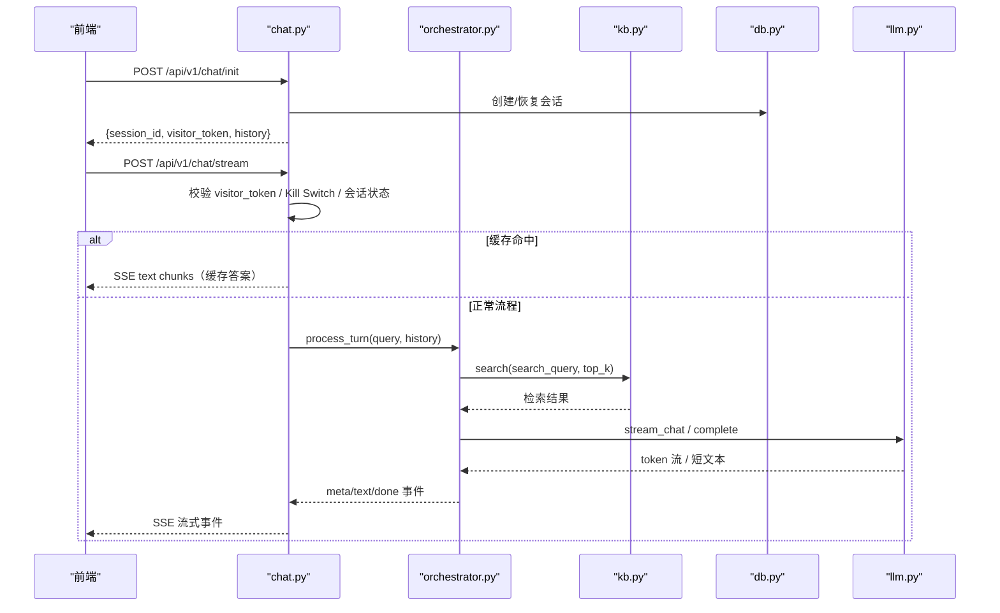

**图表来源**
- [backend/app/routers/chat.py:1-200](file://backend/app/routers/chat.py#L1-L200)
- [backend/app/agent/orchestrator.py:1-200](file://backend/app/agent/orchestrator.py#L1-L200)
- [backend/app/storage/kb.py:1-200](file://backend/app/storage/kb.py#L1-L200)
- [backend/app/storage/db.py:1-200](file://backend/app/storage/db.py#L1-L200)
- [backend/app/agent/llm.py:1-177](file://backend/app/agent/llm.py#L1-L177)

**章节来源**
- [backend/app/routers/chat.py:1-200](file://backend/app/routers/chat.py#L1-L200)
- [frontend/src/sse-client.ts:1-59](file://frontend/src/sse-client.ts#L1-L59)

### WebSocket 实时通道
WebSocket 用于转人工排队进度推送与坐席待办广播。用户端连接后被动接收队列位置变化；坐席端首帧收到待办快照，后续接收新增与完成事件，并在完成后触发其他用户队列重算。

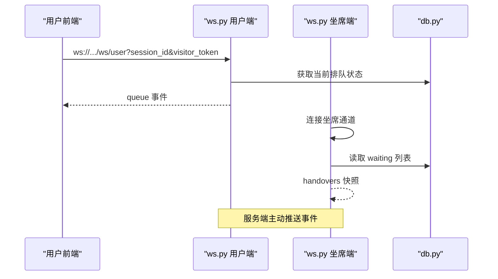

**图表来源**
- [backend/app/routers/ws.py:1-149](file://backend/app/routers/ws.py#L1-L149)
- [backend/app/storage/db.py:1-200](file://backend/app/storage/db.py#L1-L200)

**章节来源**
- [backend/app/routers/ws.py:1-149](file://backend/app/routers/ws.py#L1-L149)
- [frontend/src/agent.ts:1-200](file://frontend/src/agent.ts#L1-L200)

### 知识库后台与热更新
知识库后台实现 FAQ 增删改查、草稿审批流、版本历史与原子写 faq.json。审批通过后重建索引并递增 version，使高频缓存失效。

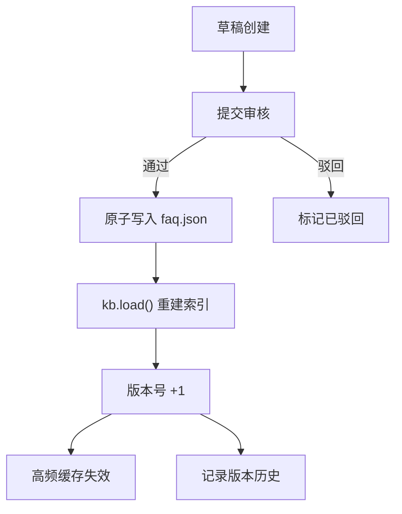

**图表来源**
- [backend/app/routers/kb_admin.py:1-200](file://backend/app/routers/kb_admin.py#L1-L200)
- [backend/app/storage/kb.py:1-200](file://backend/app/storage/kb.py#L1-L200)

**章节来源**
- [backend/app/routers/kb_admin.py:1-200](file://backend/app/routers/kb_admin.py#L1-L200)

### Agent 编排器
编排器是智能体管线核心，串联情绪分级、防死循环、确认状态机、查询重写、混合检索、NLI 语义校验、高风险 FAQ 拦截、LLM 生成与输出事实校验，最终决定直接回答、软转人工或硬转人工。

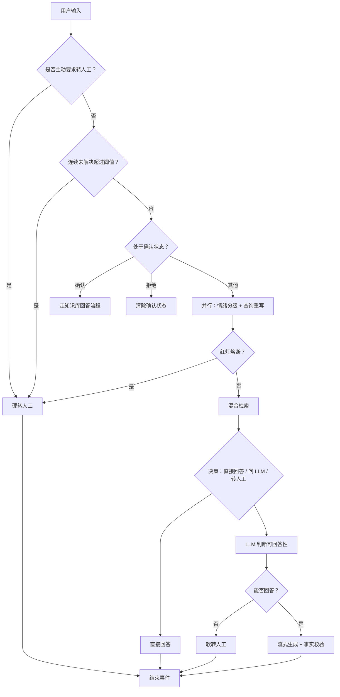

**图表来源**
- [backend/app/agent/orchestrator.py:1-200](file://backend/app/agent/orchestrator.py#L1-L200)

**章节来源**
- [backend/app/agent/orchestrator.py:1-200](file://backend/app/agent/orchestrator.py#L1-L200)

### 前端组件体系
前端由官网入口、聊天 Widget 与坐席工作台组成，Widget 作为 Web Component 暴露 `<xd-chat-widget>`，支持内嵌与悬浮两种形态；SSE 客户端解析后端 text/event-stream；API 层定义与后端 Pydantic 模型对齐的数据结构。

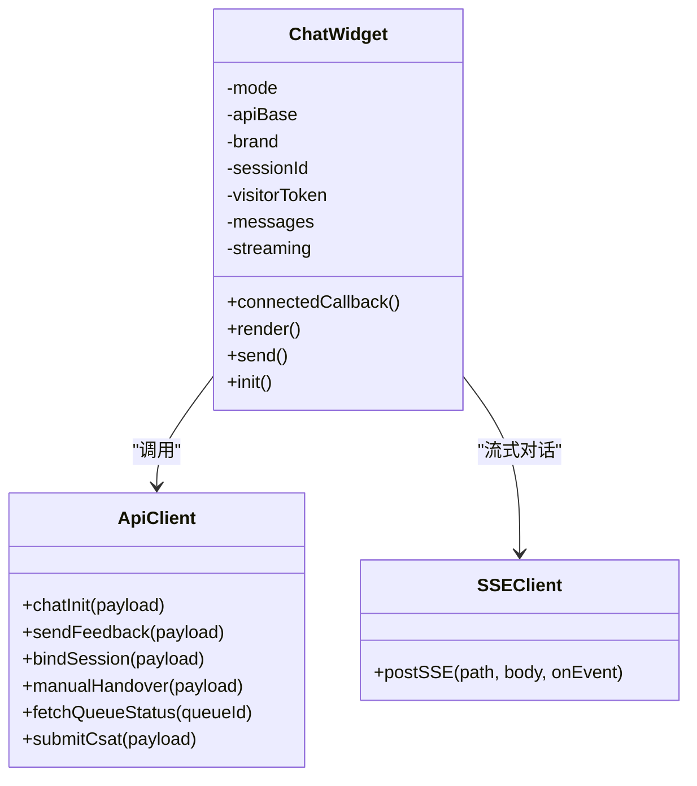

**图表来源**
- [frontend/src/widget.ts:1-200](file://frontend/src/widget.ts#L1-L200)
- [frontend/src/api.ts:1-200](file://frontend/src/api.ts#L1-L200)
- [frontend/src/sse-client.ts:1-59](file://frontend/src/sse-client.ts#L1-L59)

**章节来源**
- [frontend/src/main.ts:1-6](file://frontend/src/main.ts#L1-L6)
- [frontend/src/widget.ts:1-200](file://frontend/src/widget.ts#L1-L200)
- [frontend/src/api.ts:1-200](file://frontend/src/api.ts#L1-L200)
- [frontend/src/sse-client.ts:1-59](file://frontend/src/sse-client.ts#L1-L59)

### 存储与数据模型
SQLite 存储涵盖会话、消息、反馈、转人工队列、FAQ 草稿与版本、CSAT 满意度。数据库使用 WAL 模式与线程锁保证并发安全，并提供迁移逻辑以兼容旧库结构。

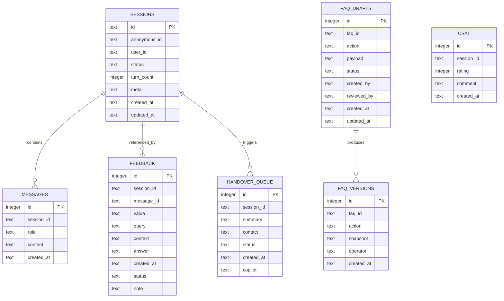

**图表来源**
- [backend/app/storage/db.py:1-200](file://backend/app/storage/db.py#L1-L200)

**章节来源**
- [backend/app/storage/db.py:1-200](file://backend/app/storage/db.py#L1-L200)

### LLM 适配层
LLM 适配器统一 DeepSeek 与 MockLLM。真实模式使用 AsyncOpenAI 流式与非流式调用；Mock 模式按任务类型返回规则化输出，便于离线开发与测试。配置项 `LLM_MODE` 与 `DEEPSEEK_API_KEY` 共同决定运行模式。

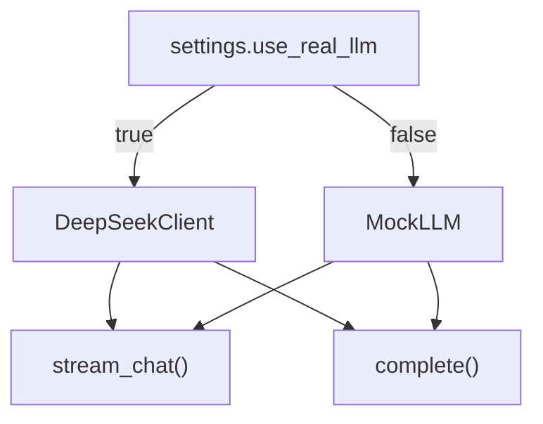

**图表来源**
- [backend/app/agent/llm.py:1-177](file://backend/app/agent/llm.py#L1-L177)
- [backend/app/config.py:1-104](file://backend/app/config.py#L1-L104)

**章节来源**
- [backend/app/agent/llm.py:1-177](file://backend/app/agent/llm.py#L1-L177)
- [backend/app/config.py:1-104](file://backend/app/config.py#L1-L104)

## 依赖关系分析
后端主要依赖 FastAPI、uvicorn、pydantic、openai、jieba、httpx、pytest；前端依赖 TypeScript 与 Vite。运行时可选依赖 Qdrant 与 Redis，MVP 阶段无外部容器依赖。

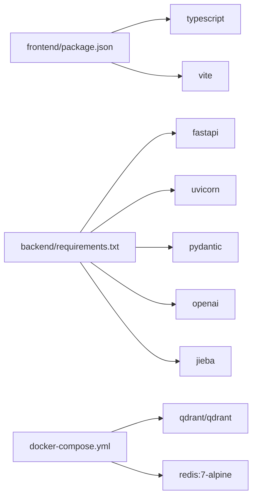

**图表来源**
- [frontend/package.json:1-16](file://frontend/package.json#L1-L16)
- [backend/requirements.txt:1-11](file://backend/requirements.txt#L1-L11)
- [docker-compose.yml:1-16](file://docker-compose.yml#L1-L16)

**章节来源**
- [frontend/package.json:1-16](file://frontend/package.json#L1-L16)
- [backend/requirements.txt:1-11](file://backend/requirements.txt#L1-L11)
- [docker-compose.yml:1-16](file://docker-compose.yml#L1-L16)

## 性能与扩展性

### 技术选型考虑
- FastAPI 异步优势：路由、SSE 流、WebSocket 与 LLM 调用均为异步 I/O，适合高并发与长连接场景。
- SQLite 轻量特性：MVP 单文件数据库，WAL 模式提升并发读写性能，适合中小规模客服场景；生产期可按需迁移至 PostgreSQL 或 MySQL。
- Web Components 兼容性：原生浏览器组件无需框架依赖，可嵌入任意网站，降低集成成本。
- 本地检索替代 Embedding：MVP 使用 TF-IDF + BM25，避免外部向量库依赖，简化部署；生产期可无缝切换到豆包/BGE-M3 + Qdrant。

### 关键性能优化点
- 高频问题缓存：首轮命中秒回，目标首字延迟小于 500ms。
- 检索融合：dense 向量相似度与 BM25 关键词分数结合，RRF 重排提升召回精度。
- 会话记忆压缩：中期摘要与结构化事实减少 Prompt 上下文开销。
- 输入与轮次熔断：超长输入与轮次上限防止成本失控。
- 知识库热更新：原子写 faq.json 并重建索引，避免服务重启。

[本节为通用指导，不直接分析具体代码文件]

## 部署拓扑与基础设施

### 开发环境
- 端口：后端 8000，前端 5173。
- 启动脚本：`dev.sh` 一键拉起后端 uvicorn 与前端 vite dev server，并轮询健康检查。

### 生产环境
- 容器依赖：Qdrant 向量库、Redis 限流与缓存（MVP 阶段可注释）。
- 环境变量：`.env` 配置 DeepSeek API Key、LLM 模式、品牌名、阈值、会话参数、OTP 参数、访问密钥等。
- 进程管理：建议在生产中使用 systemd、Supervisor 或容器编排工具管理后端进程。

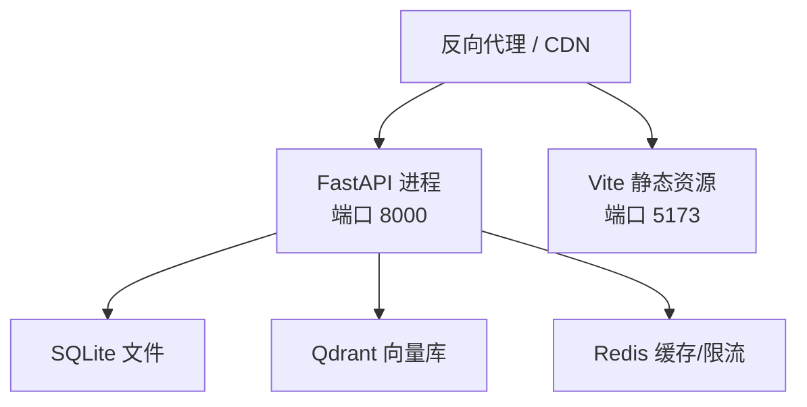

**图表来源**
- [docker-compose.yml:1-16](file://docker-compose.yml#L1-L16)
- [dev.sh:1-75](file://dev.sh#L1-L75)
- [backend/app/config.py:1-104](file://backend/app/config.py#L1-L104)

**章节来源**
- [dev.sh:1-75](file://dev.sh#L1-L75)
- [docker-compose.yml:1-16](file://docker-compose.yml#L1-L16)

## 故障排查指南

### 常见问题定位
- 429 限流：IP 请求过于频繁，检查中间层限流配置与上游网关。
- 401 访客 Token 无效：检查 visitor_token 与 session_id 是否匹配。
- 404 会话不存在：会话可能已被超时复位或清理，前端应重新初始化。
- 知识库未生效：检查 faq.json 原子写是否成功、kb.load 是否执行、版本号是否递增。
- WebSocket 断连：前端会自动降级为 HTTP 轮询，检查代理是否允许 WS 升级。

### 日志与监控
- 后端日志：使用 logging 输出 INFO 级别，关注知识库加载、LLM 模式、错误警告。
- 健康检查：访问 `/health` 查看品牌、LLM 模式、FAQ 数量。
- 运行控制：通过 ops 路由查看与调整 mode、gray_percent、kill_switch。

**章节来源**
- [backend/app/main.py:1-63](file://backend/app/main.py#L1-L63)
- [backend/app/routers/chat.py:1-200](file://backend/app/routers/chat.py#L1-L200)
- [backend/app/routers/ws.py:1-149](file://backend/app/routers/ws.py#L1-L149)
- [backend/app/routers/kb_admin.py:1-200](file://backend/app/routers/kb_admin.py#L1-L200)

## 结论
smart_bot 以 FastAPI 为核心，结合 TypeScript 前端与 SQLite 存储，构建了可扩展、可嵌入的客服机器人系统。Agent 编排器将情绪识别、检索、LLM 生成与风险控制整合成稳定管线；知识库后台提供审批与热更新能力；WebSocket 提供实时排队体验。系统在 MVP 阶段保持轻量部署，同时预留 Qdrant、Redis、真实 LLM 等扩展点，便于向生产级规模演进。