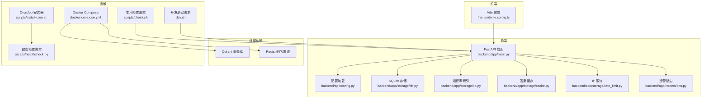
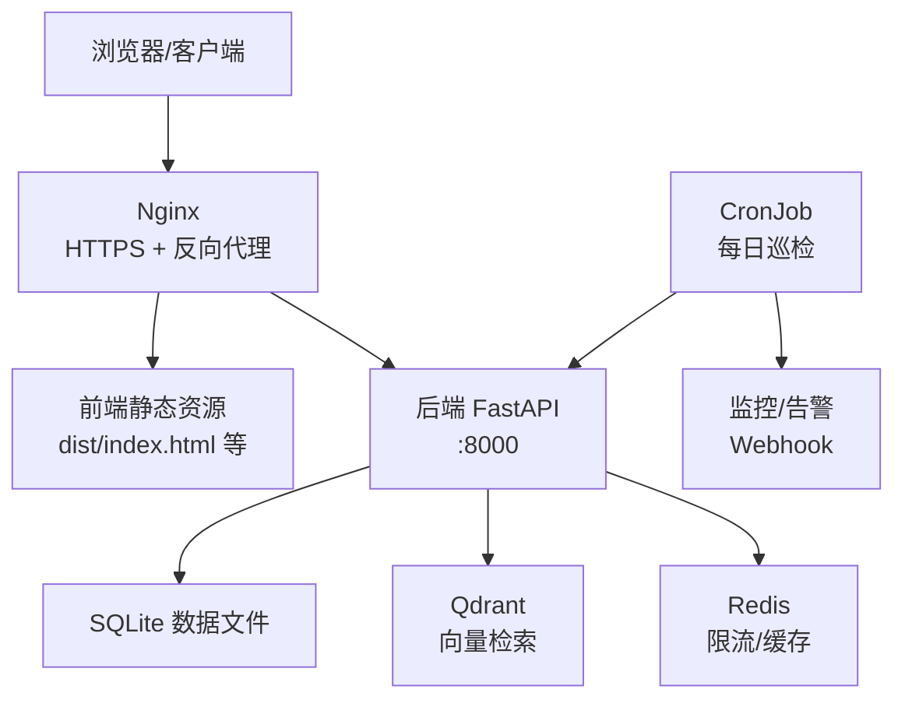
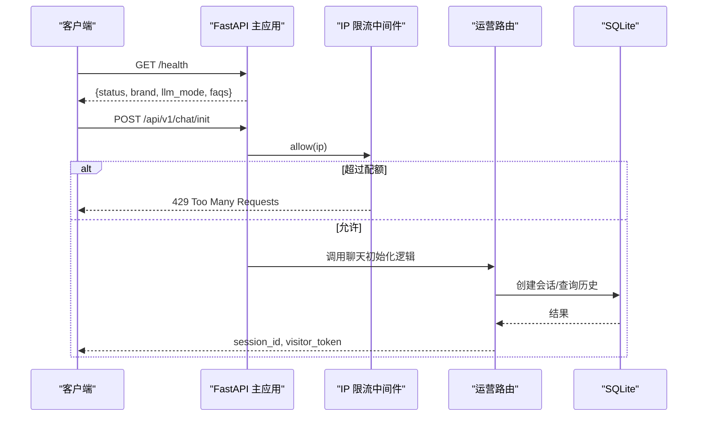
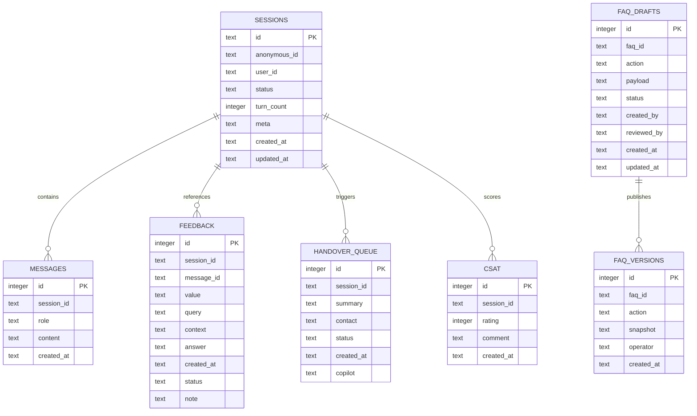
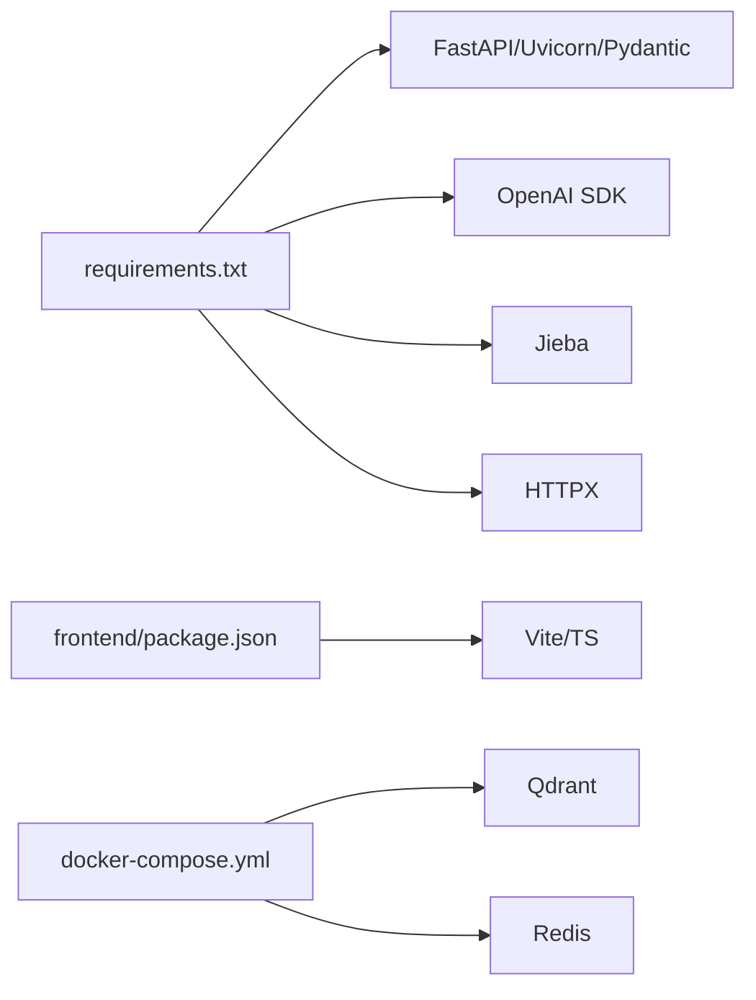
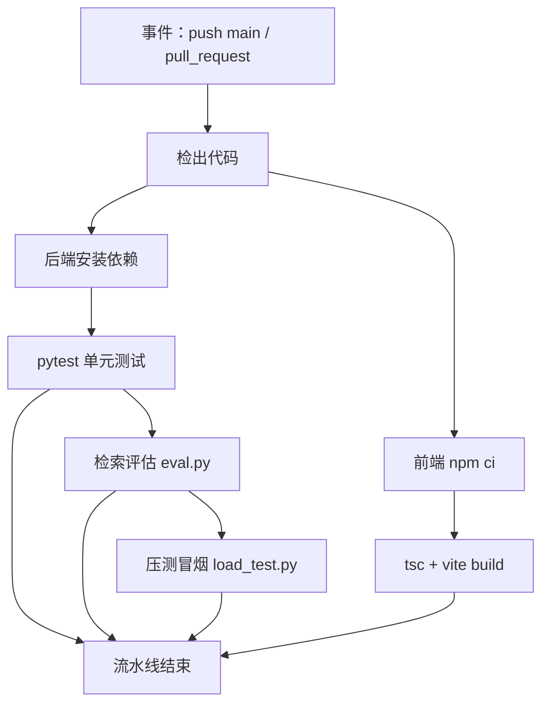
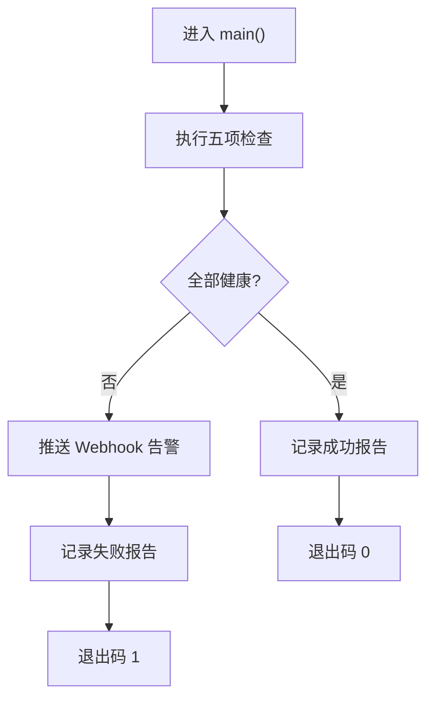

# 部署与运维

<cite>
**本文引用的文件**   
- [docker-compose.yml](file://docker-compose.yml)
- [scripts/healthcheck.py](file://scripts/healthcheck.py)
- [scripts/install-cron.sh](file://scripts/install-cron.sh)
- [.github/workflows/ci.yml](file://.github/workflows/ci.yml)
- [backend/app/main.py](file://backend/app/main.py)
- [backend/app/config.py](file://backend/app/config.py)
- [backend/app/storage/db.py](file://backend/app/storage/db.py)
- [backend/app/storage/kb.py](file://backend/app/storage/kb.py)
- [backend/app/storage/cache.py](file://backend/app/storage/cache.py)
- [backend/app/storage/rate_limit.py](file://backend/app/storage/rate_limit.py)
- [backend/app/routers/ops.py](file://backend/app/routers/ops.py)
- [backend/tests/load_test.py](file://backend/tests/load_test.py)
- [scripts/check.sh](file://scripts/check.sh)
- [dev.sh](file://dev.sh)
- [frontend/package.json](file://frontend/package.json)
- [frontend/vite.config.ts](file://frontend/vite.config.ts)
</cite>

## 目录
1. [引言](#引言)
2. [项目结构](#项目结构)
3. [核心组件](#核心组件)
4. [架构总览](#架构总览)
5. [详细组件分析](#详细组件分析)
6. [依赖关系分析](#依赖关系分析)
7. [性能与容量规划](#性能与容量规划)
8. [CI/CD 流水线](#cicd-流水线)
9. [自动化巡检与健康检查](#自动化巡检与健康检查)
10. [日志、监控与告警](#日志监控与告警)
11. [生产部署步骤](#生产部署步骤)
12. [故障排查指南](#故障排查指南)
13. [灾难恢复与业务连续性](#灾难恢复与业务连续性)
14. [结论](#结论)

## 引言
本指南面向生产环境的部署与运维，覆盖容器化编排、反向代理、SSL、自动化巡检、监控告警、日志收集、性能压测、容量规划、负载均衡、数据库备份、CI/CD 流水线、故障排查以及灾难恢复等主题。文档所有技术细节均基于仓库现有实现进行说明，并给出可操作的步骤与最佳实践建议。

## 项目结构
本项目包含后端 FastAPI 应用、前端静态站点、知识库脚本、运维脚本和 CI 配置：
- 后端：FastAPI + SQLite（MVP），可选 Qdrant 向量库；提供聊天、运营统计、运行控制、WebSocket 等能力。
- 前端：Vite 构建多入口 HTML，开发期通过 Vite 代理 /api 与 /ws。
- 运维脚本：健康检查、CronJob 安装、本地一键质量检查。
- CI：GitHub Actions 执行后端测试、检索评估、压测冒烟，以及前端类型检查与构建。

**图表来源**
- [backend/app/main.py:1-63](file://backend/app/main.py#L1-L63)
- [backend/app/config.py:1-104](file://backend/app/config.py#L1-L104)
- [backend/app/storage/db.py:1-200](file://backend/app/storage/db.py#L1-L200)
- [backend/app/storage/kb.py:1-200](file://backend/app/storage/kb.py#L1-L200)
- [backend/app/storage/cache.py:1-82](file://backend/app/storage/cache.py#L1-L82)
- [backend/app/storage/rate_limit.py:1-74](file://backend/app/storage/rate_limit.py#L1-L74)
- [backend/app/routers/ops.py:1-163](file://backend/app/routers/ops.py#L1-L163)
- [frontend/vite.config.ts:1-30](file://frontend/vite.config.ts#L1-L30)
- [scripts/healthcheck.py:1-175](file://scripts/healthcheck.py#L1-L175)
- [scripts/install-cron.sh:1-52](file://scripts/install-cron.sh#L1-L52)
- [scripts/check.sh:1-29](file://scripts/check.sh#L1-L29)
- [dev.sh:1-75](file://dev.sh#L1-L75)
- [docker-compose.yml:1-16](file://docker-compose.yml#L1-L16)

**章节来源**
- [docker-compose.yml:1-16](file://docker-compose.yml#L1-L16)
- [frontend/vite.config.ts:1-30](file://frontend/vite.config.ts#L1-L30)
- [backend/app/main.py:1-63](file://backend/app/main.py#L1-L63)

## 核心组件
- FastAPI 应用入口：注册 CORS、全局 IP 限流中间件、知识库初始化、健康端点、子路由挂载。
- 配置中心：从 .env 读取 LLM、品牌、检索阈值、会话策略、存储路径、Token 安全等配置。
- 存储层：SQLite 管理会话、消息、反馈、转人工队列、CSAT 满意度、FAQ 草稿与版本历史；使用 WAL 模式提升并发写入性能。
- 知识库：TF-IDF + BM25 + RRF 融合检索；支持 jieba 分词与大模型 Embedding 替换扩展点。
- 缓存：高频问题秒回缓存（内存有序字典），按版本号失效。
- 限流与安全：IP 令牌桶限流、Visitor Token HMAC 校验。
- 运营路由：运行控制、Bad Case、CSAT、统计、排队与 Copilot。

**章节来源**
- [backend/app/main.py:1-63](file://backend/app/main.py#L1-L63)
- [backend/app/config.py:1-104](file://backend/app/config.py#L1-L104)
- [backend/app/storage/db.py:1-200](file://backend/app/storage/db.py#L1-L200)
- [backend/app/storage/kb.py:1-200](file://backend/app/storage/kb.py#L1-L200)
- [backend/app/storage/cache.py:1-82](file://backend/app/storage/cache.py#L1-L82)
- [backend/app/storage/rate_limit.py:1-74](file://backend/app/storage/rate_limit.py#L1-L74)
- [backend/app/routers/ops.py:1-163](file://backend/app/routers/ops.py#L1-L163)

## 架构总览
生产环境推荐如下部署形态：
- Nginx 作为统一入口，提供 HTTPS、TLS 终止、静态资源服务、反向代理到后端与 WebSocket。
- 后端以进程或容器方式运行，监听内网端口（如 8000）。
- 生产期启用 Qdrant（向量库）与 Redis（限流/缓存）以提升检索精度与吞吐。
- 前端静态产物由 Nginx 直接托管。
- 自动化巡检通过系统 Cron 定时执行 healthcheck 脚本，异常推送企微/钉钉机器人。

[此图为概念性架构图，未直接映射具体源码文件]

## 详细组件分析

### FastAPI 应用入口与中间件
- 生命周期：启动时加载知识库并记录 FAQ 数量与分类统计。
- 中间件：CORS 全放行；IP 限流中间件对 /api 前缀请求做每分钟配额限制，超限返回 429。
- 健康端点：返回状态、品牌名、LLM 模式、FAQ 数量，供健康检查与网关探针使用。
- 路由挂载：chat、session、ops、otp、ws 等模块按需导入。

**图表来源**
- [backend/app/main.py:1-63](file://backend/app/main.py#L1-L63)
- [backend/app/storage/rate_limit.py:1-74](file://backend/app/storage/rate_limit.py#L1-L74)
- [backend/app/routers/ops.py:1-163](file://backend/app/routers/ops.py#L1-L163)
- [backend/app/storage/db.py:1-200](file://backend/app/storage/db.py#L1-L200)

**章节来源**
- [backend/app/main.py:1-63](file://backend/app/main.py#L1-L63)
- [backend/app/storage/rate_limit.py:1-74](file://backend/app/storage/rate_limit.py#L1-L74)

### 配置与环境变量
- LLM：DEEPSEEK_API_KEY、BASE_URL、MODEL、MODE（auto/real/mock）。
- 检索：SIM_THRESHOLD_LOW/HIGH、RETRIEVE_TOP_K、RRF_K、QUERY_REWRITE_ENABLED、CACHE_ENABLED/CACHE_MAX_ENTRIES。
- 会话与安全：SESSION_MAX_TURNS、MAX_INPUT_LEN、RATE_LIMIT_PER_MIN、SESSION_TIMEOUT_MINUTES、CONFIRM_TIMEOUT_SECONDS、REPEAT_UNRESOLVED_LIMIT、OTP_TTL_MINUTES、OTP_MOCK_MODE。
- 存储：DB_PATH、KB_PATH。
- 安全：VISITOR_TOKEN_SECRET/TTL、AGENT_WS_TOKEN。
- 运行时：BRAND_NAME、QUICK_CHIPS、HANDOVER_QUICK_REPLIES。

**章节来源**
- [backend/app/config.py:1-104](file://backend/app/config.py#L1-L104)

### 数据存储与会话模型
- SQLite 单文件数据库，WAL 模式，线程锁保护关键写操作。
- 表结构包括 sessions、messages、feedback、handover_queue、faq_drafts、faq_versions、csat。
- 自动迁移：为旧库添加 copilot、status、note 列。
- 会话超时复位：30 分钟无操作重置 turn_count/meta/status，保留历史消息用于查阅。

**图表来源**
- [backend/app/storage/db.py:1-200](file://backend/app/storage/db.py#L1-L200)

**章节来源**
- [backend/app/storage/db.py:1-200](file://backend/app/storage/db.py#L1-L200)

### 知识库与检索
- MVP 使用本地 TF-IDF + BM25 + RRF 融合检索，jieba 分词与中文 bigram 特征增强。
- FAQItem 含标准问法、变体、答案、风险等级、后续追问等元信息。
- 可扩展为豆包/BGE-M3 + Qdrant 的向量检索实现。

**章节来源**
- [backend/app/storage/kb.py:1-200](file://backend/app/storage/kb.py#L1-L200)

### 缓存与限流
- 答案缓存：仅缓存自动回答的首轮命中，按 kb.version 失效，LRU+LFU 淘汰策略。
- IP 限流：滑动窗口令牌桶，默认 10 次/分钟/IP，生产建议切换到 Redis 分布式限流。
- Visitor Token：HMAC 签名，绑定 session_id 与过期时间，防止裸 curl 滥用。

**章节来源**
- [backend/app/storage/cache.py:1-82](file://backend/app/storage/cache.py#L1-L82)
- [backend/app/storage/rate_limit.py:1-74](file://backend/app/storage/rate_limit.py#L1-L74)

### 运营与运行控制
- 运行控制：mode（auto/handover/off）、gray_percent（灰度比例）、kill_switch。
- Bad Case：标记 open/resolved/ignored 并附备注。
- CSAT：提交 1-5 星评分与评论，统计平均分与分布。
- 统计口径：自动化率 + 转人工率 = 100%。

**章节来源**
- [backend/app/routers/ops.py:1-163](file://backend/app/routers/ops.py#L1-L163)

## 依赖关系分析
- 后端依赖：FastAPI、Uvicorn、Pydantic、OpenAI SDK、Jieba、HTTPX、Pytest。
- 前端依赖：TypeScript、Vite，构建输出 index/agent/dashboard/kb 四个入口。
- 外部依赖：Qdrant（向量库）、Redis（限流/缓存），通过 docker-compose 拉起。

**图表来源**
- [backend/requirements.txt:1-11](file://backend/requirements.txt#L1-L11)
- [frontend/package.json:1-16](file://frontend/package.json#L1-L16)
- [docker-compose.yml:1-16](file://docker-compose.yml#L1-L16)

**章节来源**
- [backend/requirements.txt:1-11](file://backend/requirements.txt#L1-L11)
- [frontend/package.json:1-16](file://frontend/package.json#L1-L16)
- [docker-compose.yml:1-16](file://docker-compose.yml#L1-L16)

## 性能与容量规划
- 后端吞吐：默认 IP 限流 10 次/分钟/IP，可通过 RATE_LIMIT_PER_MIN 调整；生产建议使用 Redis 限流以支撑更高并发。
- 检索性能：MVP 本地 TF-IDF/BM25 在小规模 FAQ 下毫秒级；大规模知识应切换至 Qdrant 向量库并调优 TOP_K、RRF_K、相似度阈值。
- 缓存命中率：AnswerCache 容量默认 20，可按热点问答量提升 CACHE_MAX_ENTRIES。
- 数据库：SQLite 使用 WAL 模式，适合读多写少场景；高并发写需迁移至 PostgreSQL/MySQL。
- 前端：Vite 构建多入口静态资源，Nginx 缓存与 gzip 压缩可降低首屏延迟。
- 压测工具：tests/load_test.py 支持进程内 Mock 与真实后端压测，输出成功率、平均延迟、P95/P99、RPS。

**章节来源**
- [backend/app/storage/rate_limit.py:1-74](file://backend/app/storage/rate_limit.py#L1-L74)
- [backend/app/storage/cache.py:1-82](file://backend/app/storage/cache.py#L1-L82)
- [backend/tests/load_test.py:1-114](file://backend/tests/load_test.py#L1-L114)

## CI/CD 流水线
- 触发条件：push main 分支与所有 pull_request。
- 后端作业：Python 3.11，安装依赖，执行 pytest 测试、eval 检索评估、load_test 压测冒烟。
- 前端作业：Node 20，npm ci，执行 tsc 类型检查与 vite build 构建。

**图表来源**
- [.github/workflows/ci.yml:1-55](file://.github/workflows/ci.yml#L1-L55)

**章节来源**
- [.github/workflows/ci.yml:1-55](file://.github/workflows/ci.yml#L1-L55)

## 自动化巡检与健康检查
健康检查脚本 healthcheck.py 提供五项检查：
- 服务存活：GET /health，要求 status=ok 且 FAQs≥1。
- 核心指标：GET /api/v1/ops/stats，检查自动化率、CSAT 平均分。
- 检索质量：执行 backend/tests/eval.py，Hit@3 ≥ 阈值。
- 待办积压：GET /api/v1/ops/handovers?status=waiting，待处理数 ≤ 阈值。
- Bad Case 积压：GET /api/v1/ops/badcases?limit=100，open 状态数 ≤ 阈值。

告警机制：
- 任一检查失败 → 退出码 1，输出异常摘要。
- 配置 WECHAT_WEBHOOK/DINGTALK_WEBHOOK 后自动推送群机器人。
- 报告落盘 backend/logs/healthcheck-YYYY-MM-DD.json。

CronJob 安装：
- scripts/install-cron.sh 支持设置执行时间（默认 08:00）、卸载（--remove）。
- 环境变量透传：WECHAT_WEBHOOK、DINGTALK_WEBHOOK、XD_BASE_URL、各阈值。
- 日志输出至 backend/logs/healthcheck-cron.log。

**图表来源**
- [scripts/healthcheck.py:1-175](file://scripts/healthcheck.py#L1-L175)
- [scripts/install-cron.sh:1-52](file://scripts/install-cron.sh#L1-L52)

**章节来源**
- [scripts/healthcheck.py:1-175](file://scripts/healthcheck.py#L1-L175)
- [scripts/install-cron.sh:1-52](file://scripts/install-cron.sh#L1-L52)

## 日志、监控与告警
- 应用日志：FastAPI 启动时配置 logging，输出 INFO 级别结构化日志。
- 健康检查日志：每次巡检生成 JSON 报告，cron 模式追加 cron 日志。
- 监控指标：通过 /api/v1/ops/stats 获取自动化率、CSAT、反馈统计；/api/v1/ops/runtime 获取运行模式与灰度比例。
- 告警通道：企微/钉钉机器人 Webhook，支持自定义阈值。
- 建议集成 Prometheus/Grafana：暴露 /metrics（需在路由中新增），结合 Grafana 看板展示趋势与阈值告警。

**章节来源**
- [backend/app/main.py:1-63](file://backend/app/main.py#L1-L63)
- [scripts/healthcheck.py:1-175](file://scripts/healthcheck.py#L1-L175)
- [backend/app/routers/ops.py:1-163](file://backend/app/routers/ops.py#L1-L163)

## 生产部署步骤

### 前置准备
- 服务器：Linux（Ubuntu/CentOS），开放 80/443（Nginx）、8000（后端，内网）。
- 软件：Python 3.11+、Node 20、pip、uvicorn、sqlite3、systemd（可选）。
- 证书：Let’s Encrypt 或其他 CA 颁发的域名证书与私钥。

### 后端部署
1. 克隆仓库，创建虚拟环境并安装依赖：
   - cd backend && python -m venv .venv && source .venv/bin/activate
   - pip install -r requirements.txt
2. 准备 .env（参考配置项），设置 DEEPSEEK_API_KEY、DB_PATH、KB_PATH、RATE_LIMIT_PER_MIN 等。
3. 启动后端：
   - dev.sh start（开发期）
   - 生产建议使用 systemd 或 supervisor 守护进程，绑定 127.0.0.1:8000。
4. 验证健康端点：curl http://127.0.0.1:8000/health。

**章节来源**
- [dev.sh:1-75](file://dev.sh#L1-L75)
- [backend/app/config.py:1-104](file://backend/app/config.py#L1-L104)

### 前端部署
1. 安装依赖并构建：
   - cd frontend && npm ci && npm run build
2. 产物位于 frontend/dist，包含 index.html、agent.html、dashboard.html、kb.html。
3. 将 dist 目录放入 Nginx 静态目录，如 /var/www/xiaoda。

**章节来源**
- [frontend/package.json:1-16](file://frontend/package.json#L1-L16)
- [frontend/vite.config.ts:1-30](file://frontend/vite.config.ts#L1-L30)

### Nginx 反向代理与 SSL
- 配置要点：
  - 监听 443，启用 TLS，指向证书与私钥。
  - location / 指向静态 dist 目录。
  - location /api 反向代理到后端 127.0.0.1:8000。
  - location /ws 启用 WebSocket 代理（Upgrade/Connection 头转发）。
  - 开启 gzip、缓存静态资源、限制请求体大小。
- 证书管理：推荐使用 certbot 自动续期。

[本节为通用 Nginx 配置指导，不直接引用具体源码文件]

### 容器化与编排（Docker Compose）
- docker-compose.yml 已定义 qdrant 与 redis 服务及持久卷，MVP 阶段可暂不使用，生产取消注释即可一键拉起。
- 建议扩展：
  - 增加后端服务镜像构建与运行。
  - 增加 Nginx 服务镜像。
  - 挂载后端日志与数据目录。
  - 设置环境变量与网络隔离。

**章节来源**
- [docker-compose.yml:1-16](file://docker-compose.yml#L1-L16)

## 故障排查指南

### 常见问题诊断
- 后端不可达：
  - 检查 /health 响应是否包含 status=ok 与 faqs≥1。
  - 查看 backend.log 是否有启动错误或知识库加载失败。
- 429 限流：
  - 临时提升 RATE_LIMIT_PER_MIN，或在前置网关层做更精细限流。
- 检索质量下降：
  - 执行 tests/eval.py 检查 Hit@3 是否低于阈值；调优 SIM_THRESHOLD_LOW/HIGH、RETRIEVE_TOP_K。
- 转人工积压：
  - 通过 /api/v1/ops/handovers?status=waiting 查看待办数，结合 ops_stats 自动化率判断。

**章节来源**
- [backend/app/main.py:1-63](file://backend/app/main.py#L1-L63)
- [backend/tests/load_test.py:1-114](file://backend/tests/load_test.py#L1-L114)
- [backend/app/routers/ops.py:1-163](file://backend/app/routers/ops.py#L1-L163)

### 性能瓶颈分析
- SSE 对话接口延迟偏高：
  - 使用 tests/load_test.py 压测，观察 P95/P99 与 RPS。
  - 检查 LLM 调用耗时；在 Mock 模式下隔离外部因素。
- 知识库检索慢：
  - 扩大 CACHE_MAX_ENTRIES，启用缓存；考虑迁移至 Qdrant。
- 数据库写入竞争：
  - SQLite WAL 已优化，但高并发写仍可能成为瓶颈；考虑迁移到关系型数据库。

**章节来源**
- [backend/tests/load_test.py:1-114](file://backend/tests/load_test.py#L1-L114)
- [backend/app/storage/cache.py:1-82](file://backend/app/storage/cache.py#L1-L82)
- [backend/app/storage/db.py:1-200](file://backend/app/storage/db.py#L1-L200)

### 内存泄漏检测
- Python 侧：
  - 使用 tracemalloc 或 memory_profiler 定期采样后端进程内存。
  - 关注 AnswerCache 与 IPRateLimiter 的内存增长，必要时重启服务或扩容。
- Node 侧：
  - 前端构建产物为静态资源，内存占用低；若引入运行时服务，可使用 node --inspect 配合 Chrome DevTools 分析。

[本节为通用排查方法，不直接引用具体源码文件]

## 灾难恢复与业务连续性

### 备份策略
- SQLite 数据：
  - 停止写服务或使用 sqlite3 快照命令（如 .backup）进行一致性备份。
  - 建议每日增量备份 + 每周全量备份，异地存储。
- 知识库与配置：
  - 备份 knowledge_base/faq.json 与 backend/.env。
- 容器数据卷：
  - docker-compose 中的 qdrant_data 卷需纳入备份计划。

**章节来源**
- [backend/app/storage/db.py:1-200](file://backend/app/storage/db.py#L1-L200)
- [docker-compose.yml:1-16](file://docker-compose.yml#L1-L16)

### 回滚与版本管理
- 知识库后台支持 FAQ 草稿审批流与版本历史（faq_drafts、faq_versions），可实现热更新与一键回滚。
- 建议发布流程：
  - 预发环境验证 → 灰度放量（ops.runtime gray_percent）→ 全量发布。
  - 发现问题立即切回上一版本并关闭灰度。

**章节来源**
- [backend/app/storage/db.py:1-200](file://backend/app/storage/db.py#L1-L200)
- [backend/app/routers/ops.py:1-163](file://backend/app/routers/ops.py#L1-L163)

### 业务连续性保障
- 运行控制：
  - mode=off 维护下线，mode=handover 全局转人工，确保用户体验。
- 高可用：
  - 多实例后端 + 负载均衡（Nginx upstream），健康检查剔除不健康节点。
  - 外部依赖（Qdrant、Redis）集群化部署，避免单点故障。
- 容灾演练：
  - 定期演练数据库恢复、证书续期、依赖服务故障切换。

**章节来源**
- [backend/app/routers/ops.py:1-163](file://backend/app/routers/ops.py#L1-L163)

## 结论
本指南基于仓库现有实现，提供了从部署、监控、巡检到故障排查与灾难恢复的全链路运维方案。生产环境建议优先完善 Nginx 反向代理与 SSL、启用 Qdrant/Redis、建立完善的日志与监控体系，并通过 CI/CD 与自动化巡检保障服务质量。随着业务增长，逐步迁移数据库、扩展缓存与限流能力，以实现稳定、高性能、可观测的客服 Agent 平台。